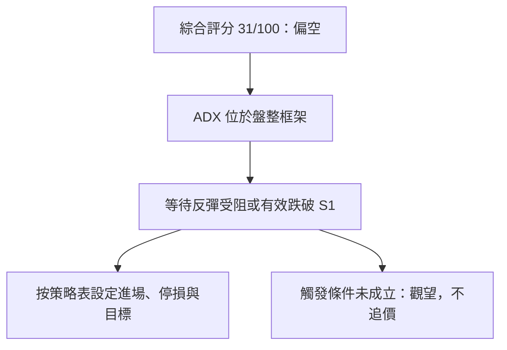

# GOOG 技術分析報告

> **報告日期**：2026-11-28 ｜ **語言**：繁體中文 ｜ **數據來源**：Yahoo Finance ｜ **當前價格**：$272.44 USD（收盤日：2026-11-27）

---

## 目錄

| 章節 | 內容 |
|------|------|
| [1. 技術面概覽](#1-技術面概覽) | 核心指標速覽、評分卡 |
| [2. 趨勢分析](#2-趨勢分析) | 長中短期走勢、ADX |
| [3. 圖表形態分析](#3-圖表形態分析) | 形態、K線、缺口 |
| [4. 支撐與阻力](#4-支撐與阻力) | 關鍵價位、斐波那契 |
| [5. 技術指標深度解讀](#5-技術指標深度解讀) | MA、RSI、MACD、布林、成交量、進階指標 |
| [6. 動能與波動率](#6-動能與波動率) | ATR、Beta、相對強度 |
| [7. 多時框架總結](#7-多時框架總結) | 時框架評分矩陣 |
| [8. 交易策略建議](#8-交易策略建議) | 歷史基準、策略、風險報酬比 |
| [9. 風險提示與監控](#9-風險提示與監控) | 監控指標、風險場景 |

---

## 1. 技術面概覽

GOOG 技術面偏空，主要依據是股價位於主要均線下方且均線呈空頭排列，以及週線方向與多時框一致性均偏空。日線動能雖有短線改善訊號，但空頭 DI 仍占優，成交量指標亦未確認價格止跌。最大的反向風險是價格已接近布林下軌與波段支撐，且日線 RSI 資料標示底背離；若支撐有效，空頭延伸可能受阻。

### 📊 核心指標速覽表

| 指標類別 | 指標名稱 | 當前數值 | 訊號 | 解讀 |
|----------|----------|----------|------|------|
| **價格** | 當前價格 | $272.44 USD | 🔴 | 收盤價接近波段支撐區；趨勢反轉仍待確認。 |
| **均線** | MA20 / MA50 / MA200 | 見第 5 章 | 🔴 | 股價位於三條均線下方，排列偏空。 |
| **動能** | RSI(14)（日線） | 見第 5 章 | 🟡 | 處於中性區；資料標示底背離，但尚未扭轉週線弱勢。 |
| **動能** | MACD 柱（日線） | 見第 5 章 | 🟢 | 柱值轉正，顯示日線下跌動能有所緩和。 |
| **趨勢** | ADX(14) | 見第 2 章 | 🟡 | 趨勢強度門檻未達，按規則以盤整框架處理。 |
| **波動** | ATR(14) | 見第 6 章 | 🟡 | 單日波動金額偏大，停損與部位須配合波動調整。 |
| **多時框** | 一致性 | 見第 7 章 | 🔴 | 三時框中兩個偏空，整體偏空。 |

### 🏆 技術評分卡

綜合評分依六項子評分算術平均後四捨五入；評分只反映技術結構，不代表基本面評價。

| 維度 | 評分（0–100） | 訊號 | 主要依據（引用數值所在章節） |
|------|---------------|------|------------------------------|
| 趨勢強度 | 30 | 🔴 | ADX 未達趨勢行情門檻，且空頭 DI 較強；見第 2 章。 |
| 動能指標 | 42 | 🟡 | 日線 MACD 柱轉正、RSI 有底背離標示，但週線動能偏弱；見第 5、7 章。 |
| 支撐穩定度 | 45 | 🟡 | 價格接近支撐，但價格仍在主要均線下方；見第 4 章。 |
| 成交量配合 | 25 | 🔴 | OBV 與 A/D 未呈現足以確認反轉的量價訊號；見第 5 章。 |
| 形態完整度 | 30 | 🔴 | 未確認具高信心度的反轉形態，跳空缺口仍未回補；見第 3 章。 |
| 均線排列 | 15 | 🔴 | 均線呈空頭排列，價格低於主要趨勢均線；見第 5 章。 |
| **綜合評分** | **31** | **偏空** | 六項平均為 31.17，四捨五入為 31；依規則 18 計算。 |

---

## 2. 趨勢分析

**結論：** 長期走勢自 2025 年春季低點後大幅上行，惟近月明顯回落；週線跌勢與均線結構仍偏空。日線 ADX 位於盤整門檻之下，因此依規則 14，短線操作以日線布林通道區間為主，而非逕自假設單邊趨勢。

### 📈 長期趨勢（近 12 個月）

下表以月末收盤整理階段；漲跌幅以該階段起訖收盤計算。價格與月收盤資料來源：價格資料庫。

| 階段 | 期間 | 起始收盤 | 結束收盤 | 漲跌幅 | 特徵 |
|------|------|---------:|---------:|-------:|------|
| 回升與加速上行 | 2025-12 至 2026-01 | $313.19 | $337.87 | +7.9% | 月末收盤續升，延續前期上行。 |
| 回檔整理 | 2026-01 至 2026-03 | $337.87 | $286.50 | -15.2% | 月收盤連續回落，長期上行趨勢出現修正。 |
| 強勢反彈 | 2026-03 至 2026-04 | $286.50 | $381.46 | +33.1% | 急升收復前期跌幅，之後未能維持高位。 |
| 高檔震盪轉弱 | 2026-04 至 2026-09 | $381.46 | $340.74 | -10.7% | 區間震盪偏弱，月 RSI 仍高但逐步降溫。 |
| 加速下跌 | 2026-09 至 2026-11 | $340.74 | $272.44 | -20.0% | 月收盤快速下滑，與目前偏空均線結構一致。 |

### 📊 中期趨勢（週線）

週線方向照抄多時框指標區塊：趨勢均線下方、週 RSI 低於 50、週 MACD 柱為負，方向為偏空。近週收盤資料亦顯示，反彈未能扭轉週線動能：2026-11-13 收盤曾升至 $292.52，之後回落，最新週收盤為 $272.44；週 RSI 與週 MACD 柱詳見第 7 章。

週成交量在 2026-10-30 所在週放大至 208,382,100 股，與大幅下跌及缺口出現的時段重合；其後週成交量雖仍高於前期部分週次，但價格未建立穩定上行結構。量價更接近下跌壓力後的反彈整理，而非已確認的週線反轉。

### ⚡ 趨勢強度（ADX）

| 指標 | 數值 | 解讀 |
|------|------:|------|
| ADX(14) | 24.61 | 低於 25，屬弱趨勢／盤整區。 |
| +DI | 19.91 | 多方方向指標低於空方方向指標。 |
| −DI | 30.07 | 空方方向指標占優，方向壓力仍在空方。 |
| 行情分類 | 盤整框架 | ADX 未達趨勢行情門檻，依規則 14 以日線布林通道上下軌作主要交易區間；但週線與均線方向仍作為風險背景。 |

**收斂解讀：** ADX 顯示目前不是已確認的強趨勢行情，因此日線區間訊號主導進場時機；週線、MA50 與 MA200 仍偏空，故反彈交易須視為逆勢候選，空頭策略則須等待價格確認，不能把短線 MACD 柱轉正直接解讀成中期反轉。

---

## 3. 圖表形態分析

**結論：** 目前沒有足夠幾何證據確認雙底、頭肩或旗形等高信心度形態。較明確的圖表事件是未回補的向下跳空；日線 RSI 底背離屬潛在反彈訊號，但與週線偏空及量能疲弱互相矛盾。

### 🔍 形態識別

| 形態 | 信心度 | 判斷依據（引用數據） | 完成度 | 目標價（附計算式） |
|------|--------|----------------------|--------|--------------------|
| 向下跳空缺口 | 高 | 市場脈絡列有明確日期、方向與缺口區間，且標示未回補。 | 缺口尚未回補，反映上方有待消化的供給區。 | 不以缺口本身推算目標價；缺口區間見下方缺口表。 |
| 雙底或其他底部反轉形態 | 低 | 近 10 根日 K 與近 8 根週 K 不足以確認兩個有效底部及頸線。 | 訊號不足，僅做指標型解讀。 | N/A（數據未提供）；不推算形態目標。 |
| 下降旗形、頭肩等複雜形態 | 低 | 現有 K 棒資料不足以證明所需的趨勢段與幾何結構。 | 訊號不足，僅做指標型解讀。 | N/A（數據未提供）；不推算形態目標。 |
| RSI 底背離 | 中 | 程式以近 20 根 K 棒首尾比較標示底背離；但未提供各轉折點數值，且非幾何形態。 | 屬動能警訊，須等待價格與量能確認。 | 不以背離自行推算目標價。 |

### 🕯️ 重要 K 線形態與缺口

下列 K 線判斷僅依 Yahoo Finance 所列近 10 根日 K 與近 8 根週 K 的開、高、低、收。列出的價格是該 K 棒的 OHLC，不代表額外推算的支撐或阻力。

| 日期（日 K／週 K） | 開 | 高 | 低 | 收 | K 線形態 | 解讀 | 訊號 |
|------|----:|----:|----:|----:|---------|------|------|
| 2026-11-20（日 K） | $272.45 | $280.52 | $262.27 | $264.00 | 收跌、上影較長 | 盤中反彈未能維持，收盤靠近當日低位；偏空，但單根 K 棒不足以判定趨勢延續。 | 🔴 |
| 2026-11-25（日 K） | $263.32 | $271.60 | $260.69 | $270.98 | 收漲、實體偏長 | 收盤接近當日高位，呈現低位買盤反應；尚不足以單獨確認反轉。 | 🟡 |
| 2026-11-27（日 K） | $277.02 | $277.30 | $268.20 | $272.44 | 收跌、開收區間較窄 | 開盤後走低，收盤低於開盤；下影線顯示盤中曾有承接，但量能不足以確認。 | 🟡 |
| 2026-10-30（週 K） | $318.05 | $323.13 | $275.35 | $278.22 | 大幅收跌週 K | 當週收盤落在週內區間下方，且週成交量明顯增加；與跳空下跌及中期轉弱相符。 | 🔴 |
| 2026-11-27（週 K） | $282.49 | $282.62 | $260.69 | $272.44 | 收跌、低位收盤 | 價格仍承受週線下壓；單週收盤沒有顯示明確反轉完成。 | 🔴 |

**跳空缺口：**

| 日期 | 方向 | 缺口區間 | 是否回補 | 技術含義 |
|------|------|----------|----------|----------|
| 2026-10-29 | 向下跳空 | $286.43–$319.68 | 未回補 | 上方存在由缺口形成的供給區；若價格反彈進入該區，須觀察能否有效消化賣壓。 |

缺口區間是市場脈絡計算值；其外的日期不另行宣稱存在缺口。缺口上下緣可作為參考區域，但不是本報告另行推算的價格目標。

---

## 4. 支撐與阻力

**結論：** 價格目前緊貼 S1 一帶，短線先看該支撐是否有效；若失守，下一層波段支撐位於更低區間。上方阻力依序來自近一年波段高點聚類，另有斐波那契與缺口區域構成反彈阻力背景。支撐或阻力「守住可能性」與「突破難度」為定性判斷，並非歷史機率。

### 🚧 阻力位分析表

下列阻力為關鍵價位區塊所列近一年波段高點聚類，來源為程式由日線計算。

| 阻力級別 | 價位 | 形成原因 | 突破難度（高／中／低） | 重要性 |
|----------|------:|----------|------------------------|--------|
| R1 | $301.62 | 近一年波段高點聚類；亦與近期反彈高位接近。 | 中 | 第一個需觀察的波段阻力。 |
| R2 | $310.68 | 近一年波段高點聚類。 | 高 | 位於前方均線壓力帶附近，突破需有價格與成交量確認。 |
| R3 | $318.83 | 近一年波段高點聚類。 | 高 | 進一步上行須先消化多層阻力，並確認週線轉強。 |

### 🛡️ 支撐位分析表

下列支撐依關鍵價位區塊的回溯標題，為近兩年波段低點聚類；數據註記指出，支撐回溯在不足兩個近一年價位時放寬至近兩年。

| 支撐級別 | 價位 | 形成原因 | 守住可能性（高／中／低） | 重要性 |
|----------|------:|----------|--------------------------|--------|
| S1 | $271.65 | 近兩年波段低點聚類，現價位於其上方不遠。 | 中 | 近期首要支撐；若失守，須觀察是否出現快速下探。 |
| S2 | $237.94 | 近兩年波段低點聚類。 | 中 | S1 失守後的下一個波段支撐參考。 |
| S3 | $197.46 | 近兩年波段低點聚類。 | 低 | 屬更深度回撤情境的波段參考，並非基準預測。 |

波段支撐與阻力各自已有至少兩個價位，因此本章不以經典樞軸點補列支撐或阻力。

### 📐 斐波那契回調位分析

斐波那契回調區間由 52 週低點至高點計算；以下數值直接引用關鍵價位區塊，來源為程式由日線計算。

| 回調位 | 價位 | 參考解讀 |
|--------|------:|----------|
| 23.6% | $370.15 | 較高位置的淺回檔參考，遠高於現價。 |
| 38.2% | $349.23 | 中淺回檔參考，與當前價格有明顯距離。 |
| 50.0% | $332.33 | 區間中位回調參考。 |
| 61.8% | $315.42 | 常用深回調參考，並接近上方均線與供給區。 |
| 78.6% | $291.35 | 深回調參考；亦可作短線反彈時的壓力觀察位。 |

現價位於 78.6% 回調位與 100.0%（52 週低點）之間。此位置代表過去一段漲幅已大幅回吐，既可能有技術性承接，也表示價格處於低位弱勢區；不能僅因回撤深就推定見底。

---

## 5. 技術指標深度解讀

**結論：** 均線與週線方向偏空，日線 MACD 柱轉正及底背離標示則提供有限的反彈訊號。布林位置接近下緣，支持短線處於弱勢區而非已確認反轉。成交量、OBV 與 A/D 未提供一致的反轉確認，因此指標整體仍以偏空為主、短線反彈風險升高。

### 📈 均線、RSI、MACD、布林通道

下列日線指標與價位由程式由日線計算。

| 指標 | 數值 | 訊號 | 解讀 |
|------|------|------|------|
| MA20 / MA50 / MA200 與排列 | MA20 $280.48；MA50 $313.86；MA200 $333.69；MA20 < MA50 < MA200 | 🔴 | 股價低於三條均線，且均線空頭排列；反彈遇均線壓力的風險較高。 |
| RSI(14)（日線）與背離 | RSI 37.35；資料標示「底背離」，比較方法為近 20 根 K 棒首尾價格與 RSI 方向 | 🟡 | RSI 未進入超賣區。底背離是潛在多方警訊，但缺少明確轉折點與價格確認，不等於趨勢已反轉。 |
| MACD 線 / Signal / 柱 | MACD -11.568；Signal -12.308；Hist +0.740 | 🟡 | MACD 與 Signal 仍在零軸下方，但柱值為正，表示下跌動能有緩和跡象，尚非中期趨勢轉多確認。 |
| 布林上軌 / 中軌 / 下軌 / %B | 上軌 $295.96；中軌 $280.48；下軌 $265.00；%B 0.24 | 🟡 | 收盤位於中軌下方、接近下軌；符合弱勢區間特徵，但尚未顯示已突破下軌並確認反轉。 |
| Stoch %K / %D | %K 28.70；%D 30.07 | 🟡 | 兩者處於偏低區域，但數據分類為中性；尚未確認有效向上交叉。 |

**指標整合：** 均線排列、股價與布林中軌位置、週線 MACD 柱共同指向偏空；日線 MACD 柱轉正與 RSI 底背離則指出下跌動能可能暫時放緩。RSI 尚未進入超賣區，且量能訊號不支持強勢反轉，故目前訊號是「中期偏空、短線反彈可能增加」，而不是多空完全一致的趨勢反轉。

### 💹 成交量（量價配合度）

| 指標 | 數值或結論 | 解讀 |
|------|------------|------|
| 最新成交量 | 14,018,400 股 | 低於日均量，單日價格變動的量能確認度有限。 |
| 20 日均量 | 26,111,910 股 | 最新成交量低於近期均量。 |
| 50 日均量 | 22,461,174 股 | 最新成交量亦低於較長區間均量。 |
| 量比 | 0.54 倍 | 成交量未擴張，不足以確認反彈買盤主導。 |
| OBV 趨勢 | OBV < MA；量能疲弱 | OBV 未確認價格止跌；若價格反彈但 OBV 未同步改善，反彈可信度有限。 |
| A/D 線（近 20 根） | 不高於 20 日均值；A/D 下降、價格下跌，兩者同向 | 資金累積／派發線與價格下跌同向，確認近期價格疲弱，而非底部累積。 |

**量價結論：** OBV 與 A/D 並未出現足以確認底部的量價背離。最新成交量低於均量，表示短線賣壓未必持續放大，但也沒有足夠證據證明買方已接手。

### 🧭 進階指標

一目均衡表、成交量分布、錨定 VWAP 與 A/D 均為日線計算；價位來源為程式由日線計算。

| 指標 | 數值 | 收盤相對位置 | 解讀 |
|------|------|--------------|------|
| 一目均衡表（轉換線／基準線／雲層） | 轉換線 $276.45；基準線 $294.20；最新 K 棒雲層先行帶 A $341.94、先行帶 B $342.81；前方 26 根雲層先行帶 A $285.32、B $310.34 | 收盤位於最新雲層下方；轉換線低於基準線 | 一目結構偏空；前方雲層先行帶 A 低於 B，亦偏空。與均線、週線方向一致，與日線 MACD 柱改善相矛盾。 |
| 成交量分布（POC／價值區） | POC $341.28；價值區 $296.51–$362.18，含 71% 成交量 | 收盤位於價值區下方 | 價格處於過去一年主要成交量區之下；若反彈回到價值區，可能遇到上方套牢供給。此訊號與均線及中期弱勢一致。 |
| 錨定 VWAP（自 52 週高點／低點） | 自 52 週高點起 $334.48；自 52 週低點起 $269.39 | 收盤低於自高點錨定 VWAP、位於自低點錨定 VWAP 上方 | 由高點起計的市場成本壓力仍在上方；由近期低點起計則略有短線承接。前者偏空、後者略為緩和，整體不構成反轉確認。 |
| A/D 線 | 近 20 根不高於 20 日均值；A/D 下降且價格下跌 | — | A/D 與下跌同向，支持弱勢判斷；不支持 RSI 背離已轉化為價格底部。 |

**進階指標整合：** 一目雲層、價值區與自高點錨定 VWAP 均顯示上方存在結構性壓力，與均線偏空、週線弱勢相符。自低點錨定 VWAP 提供短線承接線索，但與 OBV、A/D 的疲弱訊號不一致；故視為反彈觀察訊號，而不是主要方向翻多依據。

---

## 6. 動能與波動率

**結論：** 波動幅度對交易執行有實質影響，固定小幅停損可能容易遭日常波動觸及。相對強度方面，GOOG 在觀察區間均落後 VTI 與 QQQ，股價弱勢不只是廣泛市場同步下跌；這與主策略偏空方向相符，但不可據此推定後續必然續跌。

### 📊 ATR 波動率分析

| 指標 | 數值 | 解讀 |
|------|------:|------|
| ATR(14) | $11.31 | Wilder 方法計算的日線真實波幅均值，反映近期單日價格波動金額。 |
| ATR 佔價格比例 | 4.15% | 單日波幅相對價格不低，停損距離與持倉股數需一併管理。 |
| 1.5 倍 ATR 距離 | $16.965 | 由 ATR 乘以 1.5 計算，作為波動尺度參考；不直接取代策略指定的結構性停損價。 |
| 2 倍 ATR 距離 | $22.62 | 由 ATR 乘以 2 計算，提供較寬的波動尺度參考；實際策略停損仍須以策略表所列價位為準。 |

ATR 距離是風險尺度計算，不是額外的支撐、阻力或目標價。若策略停損距離窄於一般日常波動，須降低倉位，避免以過大股數承受正常市場震盪。

### 📐 Beta 與相對強度

**Beta：** GOOG 的 Beta 為 1.226，代表相對大盤的歷史波動敏感度高於市場平均；Beta 是歷史統計特徵，不是短期價格方向預測。

**相對強度 vs VTI（美國整體市場）**，價格報酬不含股息，至 2026-11-25：

| 期間 | 本股 | 基準 VTI | 超額報酬 |
|------|------:|---------:|---------:|
| 1 個月 | -14.5% | -6.5% | -7.9% |
| 3 個月 | -19.8% | -7.2% | -12.6% |
| 6 個月 | -29.8% | -5.0% | -24.9% |

**比值趨勢：** 相對走弱，比值低於其 50 日均值。

**相對強度 vs QQQ（Nasdaq-100）**，價格報酬不含股息，至 2026-11-25：

| 期間 | 本股 | 基準 QQQ | 超額報酬 |
|------|------:|---------:|---------:|
| 1 個月 | -14.5% | -12.1% | -2.4% |
| 3 個月 | -19.8% | -12.1% | -7.7% |
| 6 個月 | -29.8% | -13.8% | -16.0% |

**比值趨勢：** 相對走弱，比值低於其 50 日均值。

**對主策略的影響：** 對 VTI 與 QQQ 均呈各期落後，且比值趨勢相對走弱，支持以空方作風險管理主軸；但在 ADX 顯示盤整、價格接近支撐的背景下，主策略仍必須等待指定觸發條件，不宜在支撐附近追空。

---

## 7. 多時框架總結

**結論：** 日線與週線方向偏空、月線中性；多時框一致性照多時框指標為 2/3 偏空。由於 ADX 顯示盤整，日線布林區間負責時機判斷；但週線與中長期均線弱勢，使整體方向結論收斂為偏空。

### 📋 時框架評分表

方向、均線、RSI 與 MACD 柱依多時框指標區塊照錄。該區塊未提供各時框的獨立 K 線形態，因此形態欄不自行判定幾何形態。

| 時框架 | 趨勢方向 | RSI(14) | MACD 柱 | 收盤 vs 趨勢均線 | 形態 | 建議 |
|--------|----------|--------:|--------:|------------------|------|------|
| 日線 | 偏空 | 37.35 | +0.740 | 收盤低於 MA50 313.86 | 短線下跌後的動能緩和；未確認反轉形態 | 以布林區間為主，等待支撐或阻力觸發。 |
| 週線 | 偏空 | 35.68 | -9.035 | 收盤低於 MA20 324.59 | 週線弱勢；未確認底部形態 | 偏空背景下避免在支撐附近追空。 |
| 月線 | 中性 | 57.13 | N/A（數據未提供） | 收盤低於 MA10 329.09 | 月線動能未確認方向反轉 | 中長期仍需觀察均線收復情形。 |

**多時框一致性：2/3 偏空。**

### ⚖️ 多時框收斂結論

ADX 低於趨勢行情門檻，依規則 14 判為盤整框架，因此日線布林上下軌優先用於進場時機；週線與 MA50、MA200 方向仍偏空，作為主要風險背景。日線 MACD 柱轉正與 RSI 底背離只代表短線反彈風險，不足以推翻週線方向。

**唯一方向性結論：偏空。** 此結論與第 1 章綜合評分及第 8 章主策略一致；空頭策略須等反彈受阻或支撐有效跌破後執行，不在支撐附近盲目追空。

---

## 8. 交易策略建議

**當前主策略方向 = 偏空（依評分 31/100）。** ADX 仍處於盤整框架，因此策略採區間阻力反彈失敗或支撐跌破後進場；不以追空代替觸發確認。

### 📊 歷史基準機率

今日狀態：RSI(14) 30–50 且收盤在 MA200 下方。樣本期間為 2016-11-25 至 2026-11-27，共 2,515 個交易日；價格報酬不含股息。數據來源：價格資料庫。

| 持有期 | 相同狀態樣本（段數） | 上漲比例 | 中位數報酬 | 25%–75% 分位 | 全部交易日上漲比例／中位數 |
|--------|----------------------|----------|------------|--------------|--------------------------|
| 5 日 | 354 日（63 段） | 51% | +0.2% | -3.4% 至 +3.3% | 57%／+0.6% |
| 20 日 | 346 日（62 段） | 55% | +1.7% | -4.7% 至 +7.3% | 62%／+2.4% |
| 60 日 | 334 日（56 段） | 61% | +5.2% | -7.2% 至 +14.9% | 66%／+6.3% |

今日狀態樣本在各持有期的上漲比例均低於全部交易日的基準比例，但中位數仍為正。交易日樣本會連續出現且持有期互相重疊，獨立事件數應以段數觀察；因此此歷史頻率僅供參照，不是預測，也不能解讀成策略成功機率。對短線空頭方向而言，歷史基準並未形成強空方確認，屬相抵因素，支持採等待觸發而非直接追空。

### 🎯 價格情境階梯（Price Scenarios）

情境可能性為定性判斷，不代表統計機率。價位引用第 4 章已列關鍵價位。

| 觸發條件 | 下一目標 | 後續延伸 | 可能性（高／中／低） | 依據 |
|----------|----------|----------|----------------------|------|
| 有效反彈並突破 R1 | R2 | R3 | 低 | 週線、均線與相對強度仍偏弱；須有成交量與週線動能改善才能提高反彈可信度。 |
| 價格維持於 S1 與 R1 之間 | — | — | 中 | ADX 屬盤整框架，且價格接近布林下緣；觀察區間內是否出現收斂及量能改善。 |
| 有效跌破 S1 | S2 | S3 | 中 | 多時框偏空、A/D 與 OBV 未確認反轉；但歷史基準上漲比例不低於一半，故不列高可能性。 |

### 🟢 主策略詳情（方向依上方路由）

策略價位取自已列波段價位、布林通道或斐波那契回調位；風險報酬比依指定公式計算。進場條件為必要條件，未出現確認訊號時不執行。

| 策略要素 | 策略 A：反彈至布林上軌附近受阻後做空 | 策略 B：跌破 S1 後確認做空 |
|----------|------------------------------------------|------------------------------|
| 進場條件 | 價格反彈至布林上軌，出現受阻訊號，且日線未能收復 R1。 | 日線有效收於 S1 下方，之後反抽無法收復該位；避免單日盤中跌破即追空。 |
| 進場價格 | $295.96 | $271.65 |
| 目標價 T1 | $237.94（S2） | $237.94（S2） |
| 目標價 T2 | $197.46（S3） | $197.46（S3） |
| 止損價格 | $315.42 | $291.35 |
| 風險報酬比 | 1 : 2.98（以 T1 計） | 1 : 1.71（以 T1 計） |
| 把握度 | 中：週線偏空及相對走弱支持方向，但進場須先等待反彈受阻；盤整框架降低追趨勢的可靠性。 | 中：多時框偏空支持跌破方向，但歷史基準不支持直接視為高把握度，且須等待收盤確認。 |
| 建議倉位 | 佔可投資資金 0.5%–1.0% 的風險預算；依停損距離反推股數。 | 佔可投資資金 0.5%–1.0% 的風險預算；依停損距離反推股數。 |

**風險報酬比核算：**

- 策略 A：做空風險報酬比 =（進場價 − T1）÷（止損價 − 進場價）=（$295.96 − $237.94）÷（$315.42 − $295.96）= **1 : 2.98**（四捨五入至小數點後兩位）。
- 策略 B：做空風險報酬比 =（進場價 − T1）÷（止損價 − 進場價）=（$271.65 − $237.94）÷（$291.35 − $271.65）= **1 : 1.71**（四捨五入至小數點後兩位）。

兩個策略的 T1 均不同於當前收盤價，且以 T1 計的風險報酬比均達最低門檻。策略 A 的進場價來自日線布林上軌，策略 B 以波段支撐跌破作為條件；若價格未觸及條件或觸發前已發生結構變化，均應取消而非追價。

### 🔴 反向風險觸發點（對沖提示）

| 風險訊號 | 對主策略的影響 | 風控提示 |
|----------|----------------|----------|
| 價格收復 R1，且後續能站上 R2 | 空頭反彈失敗假設減弱。 | 暫停新增空單，檢視是否觸及策略停損。 |
| 日線 MACD 柱續增、RSI 背離獲得價格確認，且成交量同步改善 | 短線反彈可能從修正轉為更廣泛的反轉。 | 不以單一指標加碼空單，重新評估週線趨勢。 |
| S1 未有效跌破、價格於布林區間內回穩 | 策略 B 的跌破條件未成立。 | 不提前建立跌破型空單；改為等待區間訊號。 |

### 🧭 策略決策流程

---

## 9. 風險提示與監控

**結論：** 監控重點為支撐是否失守、反彈能否收復阻力、量能是否確認價格，以及下次財報事件風險。若策略持有期涵蓋財報日，財報可能造成跳空，停損單不保證按指定價格成交。

### ✅ 關鍵監控指標

| 監控項目 | 觀察值或事件 | 觸發後的動作 |
|----------|--------------|--------------|
| 首要支撐 | S1，見第 4 章 | 守住則避免追空；若有效跌破並反抽失敗，才評估策略 B。 |
| 下一層支撐 | S2，見第 4 章 | 若價格到達，評估部分獲利與是否仍具備續跌條件。 |
| 主要反彈阻力 | R1、R2，見第 4 章 | 反彈至阻力附近觀察收盤與量能；有效收復後檢視空頭假設。 |
| 日線布林位置 | 上下軌與中軌，見第 5 章 | ADX 為盤整框架，利用上下軌觀察區間；未確認突破前避免追價。 |
| 量能確認 | OBV、A/D 與成交量相對均量，見第 5 章 | 若量能轉強且 OBV、A/D 同步改善，降低空單曝險。 |
| 相對強度 | VTI、QQQ 相對強度與比值趨勢，見第 6 章 | 若比值趨勢轉強，重新評估以相對弱勢為依據的空頭策略。 |
| 下次財報日 | 2027-02-03；距最新收盤日 68 個日曆天（Yahoo Finance，日期可能調整） | 若持倉期間覆蓋財報，降低倉位或事前平倉；財報可能造成跳空，止損不保證成交。 |

### ⚠️ 風險場景

| 情境 | 觸發條件 | 價位參考 | 可能性（高／中／低） | 應對 |
|------|----------|----------|----------------------|------|
| 樂觀 | 支撐守穩，RSI 背離獲得價格確認，日線量能改善並收復上方阻力。 | S1、R1，見第 4 章 | 低 | 暫停追空，按停損紀律處理；待週線確認前不假設長期反轉。 |
| 基本 | 價格在支撐與阻力間震盪，指標維持方向分歧。 | 布林通道上下軌，見第 5 章 | 中 | 按區間框架等待策略條件，不在區間中段加碼。 |
| 悲觀 | 有效跌破 S1，且週線維持偏空，反抽無法收復。 | S2、S3，見第 4 章 | 中 | 僅依策略條件分段管理空單，接近目標後檢視停利，不假設支撐必然失守。 |

### 🛡️ 風險管理提醒

- 依個人可承受風險反推持倉股數；策略表所列倉位是風險預算參考，不是保證倉位。
- 未達成進場條件時不預先進場；尤其價格接近支撐時，避免只因中期偏空而追空。
- 停損以策略表價位執行，留意跳空、流動性與交易滑價；停損觸發不保證按指定價格成交。
- 財報前評估持倉曝險；若持有跨越財報，應把跳空風險納入最大可能損失。
- 若 OBV、A/D 與價格同時轉強，或週線方向改變，重新檢視空頭策略，不以既有判斷取代新訊號。

---

## 📋 報告總結

| 項目 | 結論 |
|------|------|
| 報告日期 | 2026-11-28 |
| 當前價格 | 見標題列及第 1 章速覽表（收盤日：2026-11-27） |
| 綜合評分 / 方向 | 31/100，偏空 |
| 長期 / 中期 / 短期趨勢 | 🔴 長期近期急跌；🔴 週線偏空；🟡 日線偏空但有動能緩和訊號 |
| 關鍵支撐 / 關鍵阻力 | S1 與 R1，精確價位見第 4 章 |
| 🥇 最佳機會 | 策略 A：等待反彈至布林上軌並受阻後做空；須符合策略表觸發條件。 |
| 最大風險 | 支撐附近出現量價確認的反轉，或財報跳空令停損無法按指定價格成交。 |

> ⚠️ **免責聲明**：本報告為 AI 自動生成之技術分析，所有數據及估算均基於提供的歷史價格資訊。本報告**僅供研究與學術參考**，**不構成任何投資建議**。投資有風險，入市需謹慎。

---

## 資料與來源

| 項目 | 內容 |
|------|------|
| 價格 | 272.44 USD，2026-11-27 收盤（Yahoo Finance 日線） |
| K 棒 | 500 根日線，2024-11-29 至 2026-11-27（Yahoo Finance）；較長期間的價位與基準機率取自價格資料庫 |
| 關鍵價位回溯期間 | 阻力 近一年、支撐 近兩年 |
| 下次財報日 | 2027-02-03（Yahoo Finance，日期可能調整） |
| 有回應的資料來源 | Yahoo Finance、Finviz、StockAnalysis、Roic.ai |
| 由程式計算 | 所有指標、R1–S3 與斐波那契價位、多時框方向、相對強度、缺口、歷史基準機率、綜合評分 |
| 撰寫模型 | openai / gpt-6-luna |

> 本區塊由產生報告的程式依實際取得的資料填寫，非模型撰寫。「由程式計算」的數字不是模型的估計；其餘判斷（評分、情境、策略）是模型的分析。
