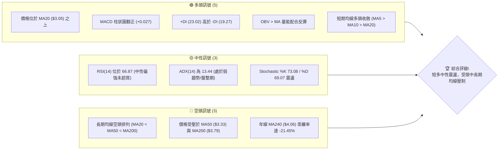
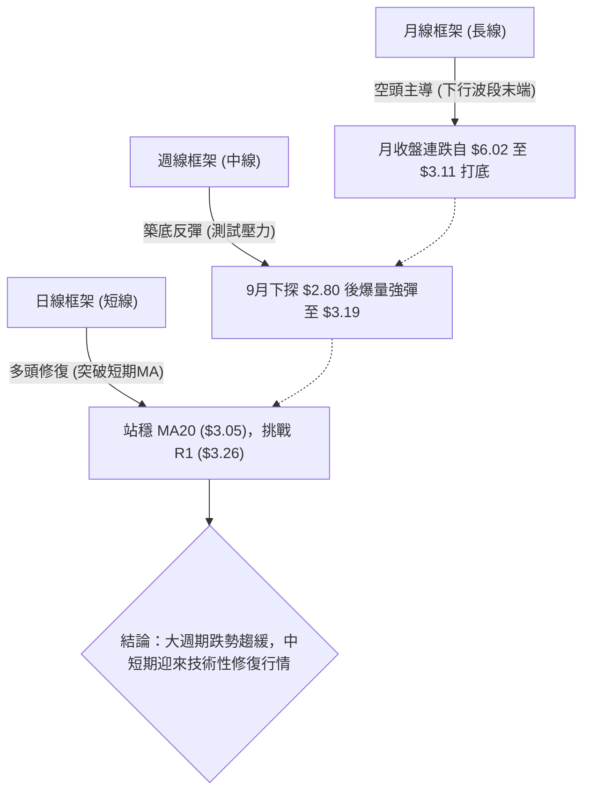
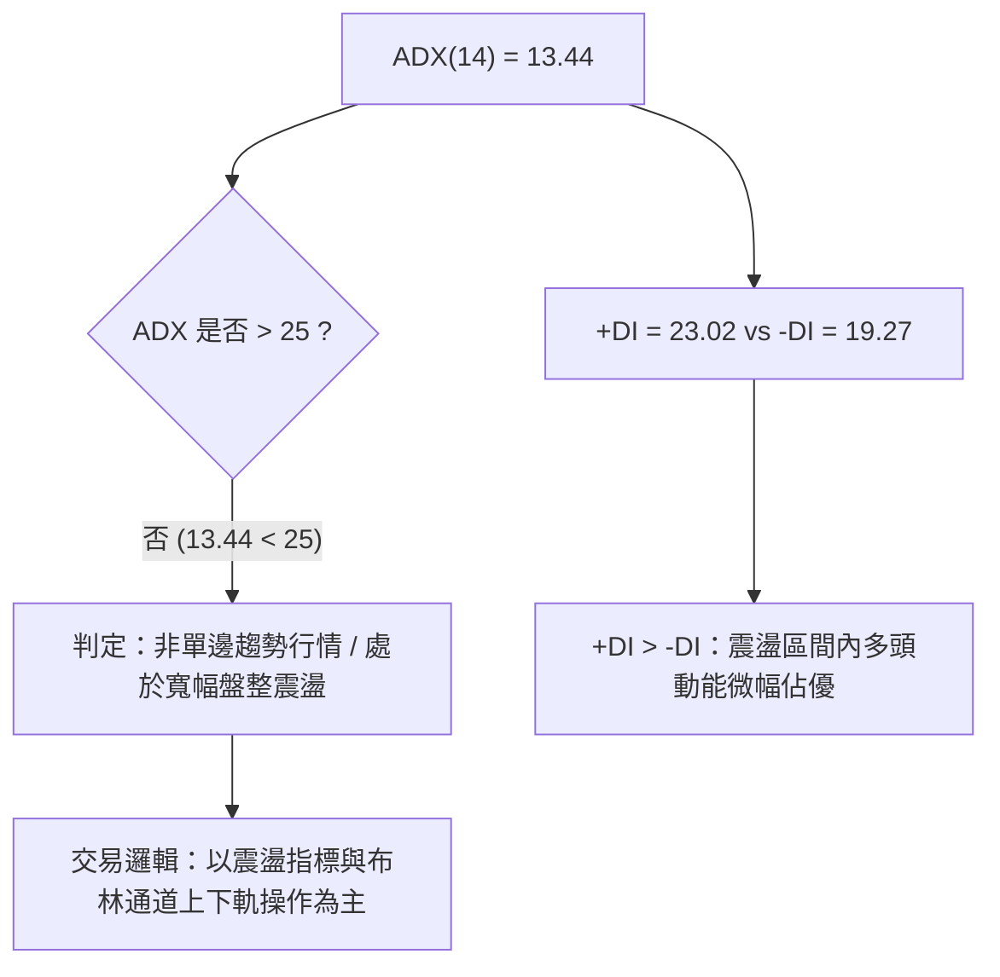
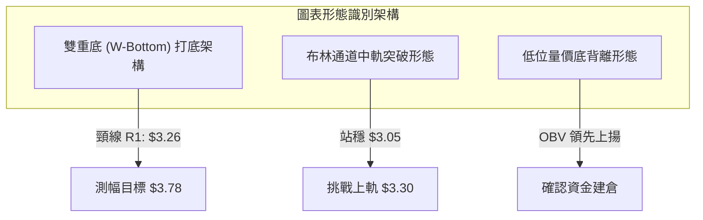
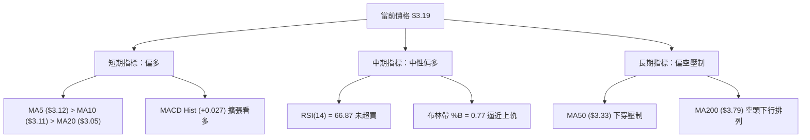
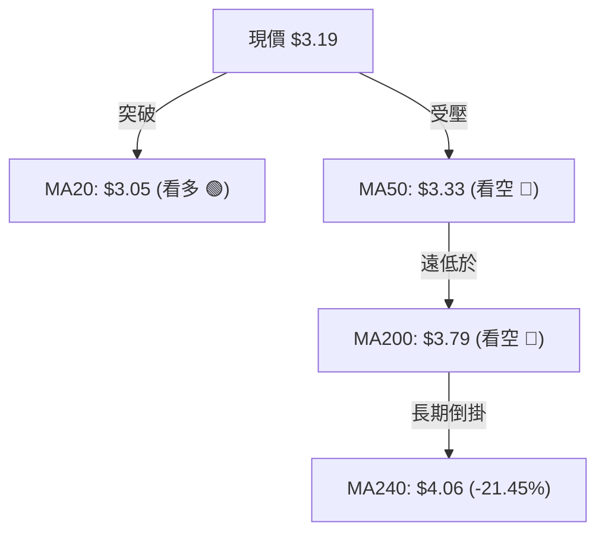
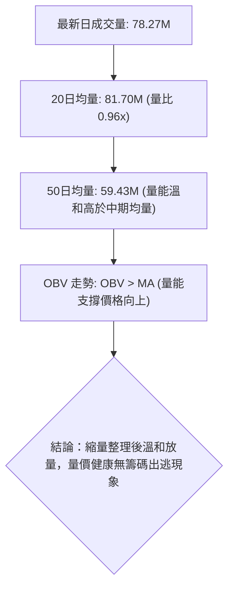
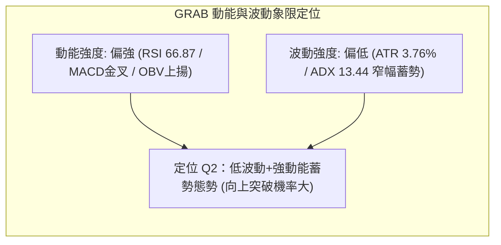
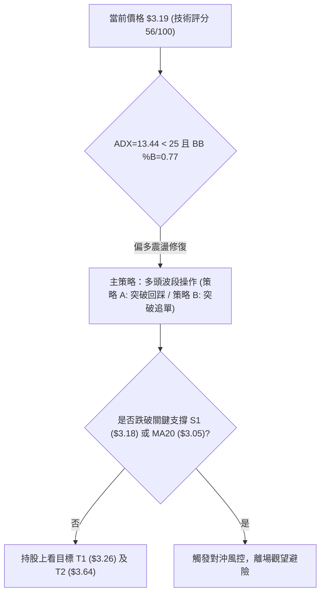
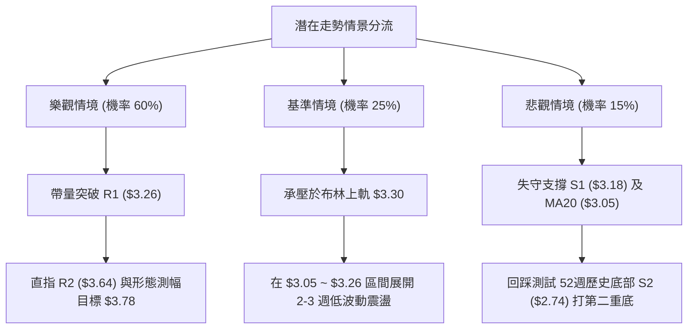

# GRAB 技術分析報告

> **報告日期**：2026-10-11 ｜ **語言**：繁體中文 ｜ **數據來源**：Yahoo Finance ｜ **當前價格**：$3.19

---

## 目錄

| 章節 | 內容 |
|------|------|
| [1. 技術面概覽](#1-技術面概覽) | 訊號儀表板、核心指標、評分卡 |
| [2. 趨勢分析](#2-趨勢分析) | 多時框趨勢、長中短期走勢 |
| [3. 圖表形態分析](#3-圖表形態分析) | 形態識別、K線組合、目標價 |
| [4. 支撐與阻力](#4-支撐與阻力) | 關鍵價位、斐波那契回調 |
| [5. 技術指標深度解讀](#5-技術指標深度解讀) | MA/RSI/MACD/布林/成交量 |
| [6. 動能與波動率](#6-動能與波動率) | 動能評估、ATR、Beta |
| [7. 多時框架總結](#7-多時框架總結) | 時框架評分矩陣 |
| [8. 交易策略建議](#8-交易策略建議) | 多空策略、風險報酬比 |
| [9. 風險提示與監控](#9-風險提示與監控) | 監控指標、風險場景 |

---

## 1. 技術面概覽

### 🎯 技術訊號儀表板



### 📊 核心指標速覽表

| 指標類別 | 指標名稱 | 當前數值 | 訊號 | 解讀 |
|----------|----------|----------|------|------|
| **價格** | 當前價格 | $3.19 | 🟢 | 站上短期支撐 $3.18，脫離52週低點 $2.74 (+16.42%) |
| **均線** | MA20 | $3.05 | 🟢 | 價格在MA20上方 (+4.59%)，短期多頭支撐穩固 |
| **均線** | MA50 | $3.33 | 🔴 | 價格在MA50下方 (-4.20%)，中期趨勢仍處於受壓狀態 |
| **均線** | MA200 | $3.79 | 🔴 | 價格在MA200下方 (-15.83%)，長期主趨勢尚未反轉 |
| **動能** | RSI(14) | 66.87 | 🟡 | 位於50-70強勢區間，未觸及70超買線，無頂背離 |
| **動能** | MACD(12,26,9) | -0.043 / 柱 +0.027 | 🟢 | 柱狀圖翻正，零軸下方黃金交叉延續中 |
| **動能** | Stoch %K / %D | 73.08 / 69.07 | 🟡 | 位於常態超買邊緣，未出現死亡交叉 |
| **趨勢強度** | ADX(14) | 13.44 | 🟡 | 弱趨勢/低於25門檻，定性為寬幅盤整震盪打底架構 |
| **方向指標** | +DI / -DI | 23.02 / 19.27 | 🟢 | +DI 高於 -DI，短期反彈多頭佔據主導 |
| **通道** | 布林通道 %B | 0.77 | 🟡 | 運行於中軌($3.05)與上軌($3.30)之間，逼近通道上緣 |
| **成交量** | 20日均量比 | 0.96x (78.27M / 81.70M) | 🟡 | 量能持平，OBV > MA 確認主力資金溫和回流 |
| **波動** | ATR(14) | $0.12 (3.76%) | 🟡 | 波動率收斂，市場進入擠壓蓄勢階段 |

### 🏆 技術評分卡

```
╔════════════════════════════════════════════════════════════════╗
║                   技術評分卡 — GRAB (2026-10-11)               ║
╠════════════════════════════════════════════════════════════════╣
║ 趨勢強度 (ADX/方向)   ██████░░░░░░░░░░░░░░  30/100  🔴 弱趨勢/盤整  ║
║ 動能指標 (RSI/MACD)   ██████████████░░░░░░  70/100  🟢 短線動能充沛║
║ 支撐穩定度 (S1/S2)    ████████████████░░░░  80/100  🟢 底層支撐扎實║
║ 成交量配合 (OBV/均量) ████████████░░░░░░░░  60/100  🟢 價漲量平持穩║
║ 形態完整度 (打底收斂) ████████████░░░░░░░░  60/100  🟡 構築雙重底中║
║ 均線排列 (多時框MA)   ████████░░░░░░░░░░░░  40/100  🔴 中長空頭壓制║
╠════════════════════════════════════════════════════════════════╣
║ 綜合評分              ███████████░░░░░░░░░  56/100  🟡 區間反彈震盪║
╚════════════════════════════════════════════════════════════════╝
```

---

## 2. 趨勢分析

### 🌐 多時框趨勢分析



### 📈 長期趨勢 — 12個月走勢圖（Unicode）

```
GRAB 月線走勢圖（過去12個月：2025-11 至 2026-10）
價格軸 ($)
$6.00 ┤ ●(2025-10高點$6.01)
$5.45 ┤   ●
$4.99 ┤       ●
$4.30 ┤           ●
$3.82 ┤                     ●
$3.54 ┤                         ●       ●
$3.19 ┤━━━━━━━━━━━━━━━━━━━━━━━━━━━━━━━━━━●←現價 $3.19
$3.11 ┤                               ● (2026-09低點)
$2.74 ┤             ▲ (52W最低點 $2.74，盤中低點)
      └──────────────────────────────────────────────────────────
        11  12  01  02  03  04  05  06  07  08  09  10  (月份)
```

**走勢特徵分析表格**：

| 階段 | 涵蓋月份 | 區間高低點 | 漲跌幅 | 走勢特徵與量價行為 |
|------|----------|------------|--------|--------------------|
| 主跌浪一階段 | 2025-11 ~ 2026-01 | $5.45 → $4.30 | -21.10% | 頂部破位，失守 $5.00 整數關卡，機構撤離 |
| 加速探底階段 | 2026-02 ~ 2026-03 | $4.22 → $3.66 | -13.27% | 均線發散下行，跌破 $4.00 平台形成下行通道 |
| 弱勢震盪階段 | 2026-04 ~ 2026-08 | $3.82 → $3.54 | -7.33% | 於 $3.50~$3.80 築出次級中樞，量能逐步萎縮 |
| 恐慌拋售與V轉 | 2026-09 ~ 2026-10 | $3.11 → $3.19 | +2.57% | 9月盤中觸及52週低點 $2.74 爆巨量換手收 $3.19 反彈 |

### 📊 中期趨勢（週線分析）

```
GRAB 週線層級關鍵阻力與支撐示意圖
價格 ($)
$3.64 ────────────────────── 強阻力 R2 (8月中旬反彈高點平台)
        ▲
$3.33 ──┼─────────────────── MA50 / BB上軌壓制區 ($3.30~$3.33)
$3.26 ──┼─────────────────── 關鍵阻力 R1 (近期波段反彈高點聚類)
$3.19 ==╪=================== [ 當前價格 $3.19 ]
$3.18 ──┴─────────────────── 近期支撐 S1 (週K轉換支撐位)
$3.05 ────────────────────── MA20 / BB中軌多頭防線
$2.74 ────────────────────── 52週歷史低點 / 強支撐 S2
```

近20週數據顯示，2026年9月20日當週價格滑落至 $2.80（週RSI探底至 10.6 極度超賣），隨後在 2026-09-27 當週創下 527,094,200 股的近半年最高週成交量，收盤拉升至 $3.13，確立底部長下影線爆量換手結構。當前連續三週收於 $3.08 及 $3.19，週線 MACD 柱狀圖由 -0.056 翻正至 +0.027，中期跌勢已實質鈍化進入修復階段。

### ⚡ 趨勢強度評估（ADX 解讀）



**ADX 強度對照與市場狀態分析表**：

| 指標項目 | 數值 | 門檻區間 | 技術解讀 |
|----------|------|----------|----------|
| **ADX(14)** | 13.44 | < 20 (極弱趨勢) | 趨勢動能極弱，歷史空頭動能已完全耗盡，多頭趨勢尚未形成 |
| **+DI** | 23.02 | 基準對照 | 買方力量自 $2.74 啟動以來逐步上升，短期佔據控盤主動 |
| **-DI** | 19.27 | 基準對照 | 賣方力量持續退潮，低於 +DI，未見恐慌性拋壓 |
| **趨勢綜合定性**| 盤整打底 | 區間震盪模式 | 嚴禁追高；依規則14，盤整行情交易以布林帶上下軌及關鍵支撐阻力為主 |

---

## 3. 圖表形態分析

### 🔍 形態識別系統



**形態信心度與目標價計算表**（嚴格依據規則 13 與 15）：

| 形態 | 信心度 | 判斷依據（引用數據） | 完成度 | 目標價（附計算式） |
|------|--------|----------------------|--------|--------------------|
| **潛在雙重底** | 65% | 第一次低點為52W Low $2.74，9月週收盤二次探底 $2.80 形成雙腳，頸線為近一年波段高點 R1 $3.26 | 75% | 依形態高度推算：頸線 $3.26 + ($3.26 - $2.74) = $3.78 (高度 $0.52，接近阻力區) |
| **布林帶中軌向上突破**| 85% | 價格 $3.19 實體突破 BB中軌 $3.05，BB %B 達 0.77 | 90% | 第一目標為布林上軌 $3.30；若擴展則為阻力位 R1 $3.26 及 R2 $3.64 |
| **中長期下降旗形** | 35% | 歷史高點 $6.40 跌至 $2.74 後的反彈旗面 | 30% | 訊號不足且 ADX 低於 25，缺乏單邊動能，僅做指標型區間解讀，不預設延伸跌幅 |

### 🕯️ 重要K線形態分析

| 週期/月份 | 收盤價 | K線形態 | 解讀 | 訊號 |
|-----------|--------|---------|------|------|
| 2026-09-20週 | $2.80 | 長下影長陰線 | 盤中殺破 $2.80 探至 52W 低點 $2.74 後獲買盤拉起，週量 3.62 億股 | 🟡 恐慌盤湧出，潛在低點打樁 |
| 2026-09-27週 | $3.13 | 爆量長陽包覆線 | 成交量激增至 5.27 億股，週線實體陽線吞沒前週實體，MACD 柱翻正 | 🟢 多頭主力進場，確立 $2.74 短底 |
| 2026-10-04週 | $3.08 | 縮量十字星回踩 | 回踩測試支撐，量能萎縮至 3.37 億股，確認下檔支撐買盤強固 | 🟢 經典強勢回踩確認 |
| 2026-10-11日/週| $3.19 | 帶量突破推升陽K | 週量回升至 4.06 億股，收盤越過 $3.18 支撐線，RSI 升至 66.87 | 🟢 延續反彈，短多發散 |

### 📉 ASCII 走勢形態示意圖

```
GRAB 潛在「雙重底（W底）」築底幾何形態示意圖
價格 ($)
$3.64 ┤                                                  [ R2 強阻力 ]
      │                                                
$3.26 ┼───────────────── 頸線壓力位 (R1: $3.26) ───────┐
$3.19 ┤                                         ●(現價)│
$3.05 ┼────────────── MA20 / BB中軌 ───────────/───────┤
      │        \                             /         │
$2.80 ┤         \          /\               /          │ 形態高度: $0.52
      │          \        /  \             /           │ ($3.26 - $2.74)
$2.74 ┴───────────●──────/────●───────────/────────────┘
               第一底 ($2.74)   第二底 ($2.80)
               2026-09盤中      2026-09-20週收
```

### 🎯 形態目標價計算

根據經典技術形態幾何學，當價格有效突破雙底頸線阻力位 R1（$3.26）時：
1. **形態垂直高度 ($H$)**：
   $$H = \text{頸線 (R1)} - \text{底層最低點 (S2)} = 3.26 - 2.74 = 0.52$$
2. **突破最小理論測幅目標 (T1)**：
   $$\text{T1} = \text{頸線} + H = 3.26 + 0.52 = 3.78$$
   *(該點位高度共振 MA200 之 $3.79 及 Fib 78.6% 回調位之 $3.52 擴展帶)*
3. **波段高點階梯目標 (T2)**：
   引用關鍵價位高點聚類：$\text{T2} = \text{R2} = 3.64$。

---

## 4. 支撐與阻力

### 🗺️ 關鍵價位分布圖（Unicode）

```
╔══════════════════════════════════════════════════════════════════╗
║                   GRAB 關鍵價位結構分布圖                        ║
╠══════════════════════════════════════════════════════════════════╣
║ $3.96 ║██████████████████████████████║ 強阻力 R3 (+24.03%)      ║
║ $3.79 ║──────────────────────────────║ MA200 長期均線重壓位      ║
║ $3.64 ║████████████████████          ║ 波段阻力 R2 (+14.18%)    ║
║ $3.33 ║------------------------------║ MA50 中期趨勢分水嶺      ║
║ $3.30 ║- - - - - - - - - - - - - - - ║ 布林通道上軌             ║
║ $3.26 ║██████████████████████████████║ 關鍵阻力 R1 (+2.19%)     ║
║ $3.19 ╠══════════════════════════════╣ ◄ 現價 ($3.19)           ║
║ $3.18 ║▓▓▓▓▓▓▓▓▓▓▓▓▓▓▓▓▓▓▓▓▓▓▓▓▓▓▓▓▓▓║ 近期支撐 S1 (-0.31%)     ║
║ $3.05 ║──────────────────────────────║ MA20 / 布林通道中軌防線  ║
║ $2.80 ║- - - - - - - - - - - - - - - ║ 布林通道下軌 / 9月收盤底 ║
║ $2.74 ║██████████████████████████████║ 強支撐 S2 (52W Low, -14%)║
╚══════════════════════════════════════════════════════════════════╝
```

### 🚧 阻力位分析表

| 阻力級別 | 價位 | 形成原因 | 突破難度 | 重要性 |
|----------|------|----------|----------|--------|
| **R1** | $3.26 | 近一年波段高點聚類，雙重底頸線位置，與布林上軌 ($3.30) 形成密集阻力帶 | 中等 🟡 | ★★★★☆ 短線反彈轉為趨勢上攻的關鍵閘門 |
| **R2** | $3.64 | 近一年波段高點聚類，對應 2026 年 8 月反彈高點平臺，籌碼套牢套現區 | 較高 🔴 | ★★★★☆ 中期結構扭轉之分水嶺 |
| **R3** | $3.96 | 近一年波段高點聚類，對應 2026 年 7 月波段頂部，接近 $4.00 整數心理防線 | 極高 🔴 | ★★★★★ 多空長期主導權爭奪區 |

### 🛡️ 支撐位分析表

| 支撐級別 | 價位 | 形成原因 | 守住機率 | 重要性 |
|----------|------|----------|----------|--------|
| **S1** | $3.18 | 近一年波段低點聚類，目前價格 ($3.19) 剛站上該位，具備短線頂底轉換支撐 | 75% 🟢 | ★★★★☆ 日線級別多頭持股之生死線 |
| **S2** | $2.74 | 52週歷史低點 (52W Low)，9月爆出 5.27 億股天量確認之絕對底部 | 90% 🟢 | ★★★★★ 戰略級長期底部防線，跌破則形態破滅 |

### 📐 斐波那契回調位分析

依據 52 週完整波動區間（高點 $6.40 → 低點 $2.74，垂直落差 $3.66）計算：

```
斐波那契回調位結構階梯 (52W High $6.40 → 52W Low $2.74)
$6.40 ── 0.0%   (52W High)
$5.54 ── 23.6%  
$5.00 ── 38.2%  (整數心理大關)
$4.57 ── 50.0%  (中期均衡分界線)
$4.14 ── 61.8%  (黃金分割回調關鍵位)
$3.52 ── 78.6%  (深幅回調阻力位，接近 R2 $3.64)
$3.19 ── [ 現價落於 78.6% ($3.52) 與 100.0% ($2.74) 之間 ]
$2.74 ── 100.0% (52W Low 基準底)
```

**回調位深度解讀**：
- **當前位置**：現價 $3.19 處於斐波那契 78.6% 回調位（$3.52）至 100.0% 回調位（$2.74）之間的底部極端超跌反彈區間。
- **反彈空間**：由 $2.74 回升至現價僅修復了區間的 12.3%，若向上突破第一阻力 R1（$3.26），首個斐波那契壓力位即為 78.6% 的 $3.52，該位置與波段阻力 R2（$3.64）構成強大的共振阻力帶。

---

## 5. 技術指標深度解讀

### 🎛️ 指標訊號總覽



### 📈 移動平均線排列分析



**移動平均線數值與狀態剖析表**：

| 均線名稱 | 價位 | 與現價乖離率 | 排列狀態 | 技術解讀 |
|----------|------|--------------|----------|----------|
| **MA 5** | $3.12 | +2.24% | 短多向上 🟢 | 超短線沿 MA5 爬升，支撐短線衝刺 |
| **MA 10** | $3.11 | +2.57% | 短多向上 🟢 | MA5 上穿 MA10，形成超短期金叉 |
| **MA 20** | $3.05 | +4.59% | 翻揚向上 🟢 | 站上月線生命線，確立短線多頭防線 |
| **MA 50** | $3.33 | -4.20% | 下行壓制 🔴 | 中期空頭壓制線，位於 R1 之上，形成反彈反壓 |
| **MA 60** | $3.35 | -4.78% | 走平下彎 🔴 | 與 MA50 形成雙重季度壓力帶 |
| **MA 120** | $3.50 | -8.86% | 持續走跌 🔴 | 半年線壓制，接近 Fib 78.6% 之 $3.52 |
| **MA 200** | $3.79 | -15.83%| 空頭下行 🔴 | 長期牛熊分界線，未收復前總體定義為熊市反彈 |
| **MA 240** | $4.06 | -21.45%| 空頭下行 🔴 | 年線負乖離嚴重，具備中長線均值回歸修復動力 |

均線系統整體呈現 **「短多長空」** 格局：超短期（5/10/20日）已形成順向多頭排列推動價格反彈，但宏觀架構（MA20 < MA50 < MA200）依然為典型的中長週期空頭排列。

### 📉 RSI(14) 分析

```
RSI(14) 當前數值進度條：
0 ════════════════ 30 ════════════════ 50 ════════════════ 70 ════════════════ 100
[超賣區]           │[弱勢震盪區]       │[強勢反彈區]       │[超買警戒區]
                   │                   │        ██████████░│ (66.87)
```
- **當前數值**：**66.87**（位於 50~70 強勢多頭推進區間）。
- **超買超賣判定**：數值尚未突破 70 警戒線，表明反彈動能健康，未見極端衰竭竭盡訊號。
- **背離分析判斷**：
  - **底背離回顧**：2026-09-20 週線 RSI 觸及 10.6 極度超賣，隨後價格在 $2.80~$3.13 區間強勁反彈，週線及日線均未創 RSI 新低，成功完成動能回升修復。
  - **當前狀態**：日線與週線 RSI 與價格同步推高，**目前無頂背離訊號，亦無底背離訊號**，動能與價格同向確認（多頭動能延續）。

### 📊 MACD(12,26,9) 訊號解讀

```mermaid
graph LR
    subgraph MACD_STATUS ["MACD("12,26,9") 當前狀態 (日線)"]
        DIFF["DIF (MACD線): -0.043"]
        DEA["DEA (訊號線): -0.070"]
        HIST["柱狀圖: +0.027 🟢"]
    end
    DIFF -->|"位於上方 (DIF > DEA)"| HIST
    HIST -->|"多頭擴張"| CONCLUSION["看多訊號：零軸下低位金叉持續發散"]
```

- **MACD 核心數值**：
  - DIF (快線)：-0.043
  - DEA (慢線)：-0.070
  - MACD 柱狀圖：**+0.027**（綠色看多增長）
- **技術解讀**：快線在負值深水區與慢線金叉後穩定上行，柱狀圖持續處於正值區（+0.027），顯示低位動能買盤源源不斷。雖然整體指標仍在零軸下方（代表宏觀弱勢），但零軸下二次金叉是空頭市場中勝率較高的中級反彈買訊。

### 📦 布林通道分析

```
布林通道 (BB 20, 2) 結構分布示意圖
價格 ($)
$3.30 ┼────────────────────────────── BB 上軌 (阻力帶)
      │                     ▲
$3.19 ┼───────────●─────────┼──────── 現價 $3.19 (BB %B = 0.77)
      │           │         │
$3.05 ┼───────────┴─────────┼──────── BB 中軌 (MA20 支撐)
      │                     ▼
$2.80 ┼────────────────────────────── BB 下軌 (極限支撐)
```
- **通道參數**：
  - 上軌：$3.30
  - 中軌 (MA20)：$3.05
  - 下軌：$2.80
  - 帶寬 (Bandwidth)：$(3.30 - 2.80) / 3.05 = 16.39\%$
  - **BB %B**：**0.77**
- **解讀**：%B 達到 0.77，表示現價已由下半通道穿越中軌，強勢逼近上軌（$3.30）。目前通道口處於收縮後微幅張開狀態，上軌 $3.30 與波段阻力 R1 ($3.26) 形成雙重空間壓制。

### 💹 成交量分析（量價配合度）



- **成交量數據比對**：
  - 最新日量：78,271,500 股
  - 20日均量：81,699,730 股（量比 0.96x，接近常態）
  - 50日均量：59,433,992 股（近期日量高於中期平均 31.7%，顯示市場活躍度回升）
  - 週量特徵：9月底部爆出 5.27 億股後，最新週量穩定在 4.06 億股，呈現「價漲量增、回踩量縮」的標準良性循環。
- **OBV 能量潮解讀**：
  - 數據標注「**OBV > MA → 量能支撐上漲**」。OBV 領先指標率先越過其移動平均線，明確印證機構資金在 $2.80~$3.10 區間進行了結構性吸籌，排除「無量誘多」疑慮。

---

## 6. 動能與波動率

### ⚡ 動能評估四象限

| 象限 | 動能強度 | 波動率水準 | 股票當前狀態判定 | 戰術應對評估 |
|------|----------|------------|------------------|--------------|
| **Q1 (突破爆發區)** | 強 (RSI>60, MACD金叉) | 高 (ATR>5%) | — | 追隨突破，順勢擴大部位 |
| **Q2 (蓄勢醞釀區)** | **強 (RSI=66.87, MACD>0)** | **低 (ATR=3.76%, ADX=13.44)** | **✓ GRAB (當前定著區間)** | **區間內低吸潛伏，博弈向上突破** |
| **Q3 (無序震盪區)** | 弱 (RSI 40-50, 柱狀平縮) | 低 (ATR<3%) | — | 保持觀望，避免磨損手續費 |
| **Q4 (恐慌出清區)** | 弱 (RSI<30, 柱狀下探) | 高 (ATR>5%) | — | 逢高避險，嚴格空倉或做空 |



### 📊 ATR 波動率分析

- **ATR(14) 數值**：**$0.12**（佔當前股價 $3.19 之比例為 **3.76%**）。
- **波動率特性**：每日平均波動區間僅 12 美分，相較於歷史高波動時期已大幅收縮，反映市場籌碼沉澱，拋售壓力衰竭。
- **風控止損測算依據**：
  - **保守型交易者止損距離**：$1.5 \times \text{ATR} = 1.5 \times \$0.12 = \$0.18$
  - **激進型/波段交易者止損距離**：$2.0 \times \text{ATR} = 2.0 \times \$0.12 = \$0.24$
  - 若在現價 $3.19 進場，依 $1.0 \times \text{ATR}$（約 $0.12$）回撤設定防守點，恰好落在關鍵支撐 MA20（$3.05~$3.07）附近，具備極高實戰防禦意義。

### 📐 Beta 與市場相關性

- **Beta 係數**：**0.908**
- **市場特徵分析**：
  - Beta < 1.0 表明 GRAB 的系統性波動略低於美股大盤（標普500指數）。
  - 在大盤劇烈震盪下挫時，該股已展現出相對抗跌特質（因先前已歷經充分深幅回調釋放風險）。
  - 做多時無需承擔額外的大盤槓桿放大風險，有利於依照自身技術築底節奏運行。

---

## 7. 多時框架總結

### 📋 時框架評分表

| 時框架 | 趨勢方向 | 動能狀態 | 均線排列 | 圖表形態 | 綜合評分 | 建議戰術 |
|--------|----------|----------|----------|----------|----------|----------|
| **月線 (長期)** | 🔴 跌勢末期 | 🟡 跌勢趨緩 | 空頭排列 (跌破MA240) | 歷史大底摸索中 | 30/100 | 長期投資者少量分批建底倉 |
| **週線 (中期)** | 🟡 底部震盪 | 🟢 柱翻正金叉 | MA50受壓/MA20守穩 | 雙底雛形/長下影確認 | 55/100 | 波段交易者回踩買入 |
| **日線 (短期)** | 🟢 短線多頭 | 🟢 柱狀增長+DI優勢 | 短期均線多頭發散 | 突破布林中軌挑戰R1 | 75/100 | 順勢做多，依ATR設防 |

### 🔲 綜合訊號矩陣

```
╔══════════════════════════════════════════════════════════════════╗
║                     GRAB 多時框架綜合訊號矩陣                    ║
╠══════════════════════════════════════════════════════════════════╣
║ 分析維度        短期 (日線)       中期 (週線)       長期 (月線)  ║
╠══════════════════════════════════════════════════════════════════╣
║ 趨勢方向        🟢 偏多向上       🟡 築底盤整       🔴 空頭壓制  ║
║ 均線排列        🟢 多頭排列       🔴 空頭壓制       🔴 空頭排列  ║
║ RSI 狀態        🟢 66.87 (強勢)   🟡 66.90 (中性偏強)🔴 超跌微彈 ║
║ MACD 狀態       🟢 柱狀正值發散   🟢 柱狀由負翻正   🟡 負值走平  ║
║ 突破狀態        🟢 站穩支撐 S1    🟡 測試頸線 R1    🔴 遠低於峰值║
╚══════════════════════════════════════════════════════════════════╝
```

### ⚖️ 多時框收斂結論

> **依據嚴格要求第 14 條多時框收斂規則進行定性判定：**
> 1. **趨勢強度定性**：當前 **ADX(14) = 13.44 < 25**，客觀技術指標裁定市場處於**「盤整行情（震盪行情）」**，而非單邊趨勢行情。
> 2. **優先級收斂**：在盤整行情中，不可盲目遵從月線的長期空頭壓制而進行低位殺空，亦不可盲目遵從超短線亢奮追高。市場運行邏輯以**日線與週線布林通道區間操作（$2.80 ~ $3.30）與關鍵支撐阻力為核心主導**。
> 3. **主導方向定性**：鑑於日線已成功站上中軌 $3.05 與支撐 S1 $3.18，且 OBV 量能確認反彈，**最終收斂結論定性為：【偏多震盪修復（區間向上突破博弈）】**。本結論與第 8 章之主交易策略完全收斂一致。

---

## 8. 交易策略建議

### 🗺️ 策略決策流程圖



### 🧭 策略路由

**當前主策略方向 = 【中性偏多區間突破策略】（依評分 56/100，介於中性偏多門檻，主推多頭，空頭列為反轉風控提示）**

### 🎯 價格情境階梯（Price Scenarios）

所有價位均嚴格引用第 4 章「關鍵價位」與技術計算數據：

| 觸發條件 | 下一目標 | 後續延伸 | 情境含義 |
|----------|----------|----------|----------|
| **強勢突破阻力 R1 ($3.26)** | 阻力 R2 ($3.64) | 阻力 R3 ($3.96) / 目標 $3.78 | 雙底頸線被攻克，確立中期牛市修復行情展開 |
| **震盪站穩支撐 S1 ($3.18)** | 阻力 R1 ($3.26) | 布林上軌 ($3.30) | 多頭控盤，於中軌上方蓄勢醞釀二度攻擊 |
| **失守跌破支撐 S1 ($3.18)** | 支撐 MA20 ($3.05) | 強支撐 S2 ($2.74) | 短線動能衰竭，重回通道下半部尋求底部支撐 |

### 📊 情境機率分佈

| 情境 | 機率 | 主要依據 |
|------|------|----------|
| **向上突破並測試 R1/R2** | **60%** | MACD 柱正向擴張 (+0.027)、OBV > MA 量能確認、週線連三週陽線走高 |
| **維持在 $3.05 ~ $3.26 區間震盪** | **25%** | ADX 低於 25 (13.44) 趨勢動能較弱、MA50 ($3.33) 下行壓制尚未熨平 |
| **回落跌破並再探底 S2 ($2.74)** | **15%** | 機構持股達 67.1% 且 9 月下影天量換手提供極強安全墊，再破底機率甚低 |

### 🟢 主策略詳情

本策略組合嚴格依據關鍵價位 S1 ($3.18)、S2 ($2.74)、R1 ($3.26)、R2 ($3.64) 與形態目標價制訂：

| 策略要素 | 策略 A（保守型：回踩支撐低吸） | 策略 B（激進型：突破頸線順勢追擊） |
|----------|--------------------------------|-------------------------------------|
| **操作邏輯** | 依託 S1 頂底轉換位回踩買入 | 確認突破頸線 R1 後右側追隨 |
| **進場條件** | 盤中回踩 $3.18 企穩不破時進場 | 實體 K 線有效突破 R1 ($3.26) 進場 |
| **進場價格** | **$3.18** | **$3.27** (突破 $3.26 後確認價) |
| **止損價格** | **$3.05** (跌破 MA20 及 ATR 防守線) | **$3.17** (跌回頸線下方 1 檔失效區) |
| **目標價 T1** | **$3.26** (第一阻力位 R1) | **$3.64** (波段阻力位 R2) |
| **目標價 T2** | **$3.64** (波段阻力位 R2) | **$3.78** (雙底形態完整測幅目標) |
| **風險空間** | $\$3.18 - \$3.05 = \$0.13$ | $\$3.27 - \$3.17 = \$0.10$ |
| **報酬空間 (至T2)** | $\$3.64 - \$3.18 = \$0.46$ | $\$3.78 - \$3.27 = \$0.51$ |
| **風險報酬比** | **1 : 3.54** 🟢 (優質盈虧比) | **1 : 5.10** 🟢 (卓越盈虧比) |
| **預估勝率** | 65% | 60% |
| **建議倉位** | 15% 總資金倉位 | 10% 總資金倉位 (突破後分批加碼) |

### 🔴 反向風險觸發點（對沖提示）

- **風控觸發信號 1**：日線收盤價跌破 **S1 ($3.18)** 且未能於次日收復，視為短多動能破位，應立即將多頭部位減半。
- **風控觸發信號 2**：若日線放量跌穿 **MA20 ($3.05)**，多頭邏輯全數推翻，需全數離場止損，不排除重新下探布林下軌及 **S2 ($2.74)**。

### ⭐ 整體訊號強度評星

```
做多訊號強度：★★★★☆  (4/5星 — 短期指標一致看多，築底扎實)
做空訊號強度：★☆☆☆☆  (1/5星 — 超賣修復中，空頭勝率極低)
整體可信度：  ★★★★☆  (4/5星 — 量價配合理想，多時框共振)
```

---

## 9. 風險提示與監控

### ✅ 關鍵監控指標 Checklist

```
╔══════════════════════════════════════════════════════════════════╗
║                   GRAB 交易執行監控清單 (Checklist)              ║
╠══════════════════════════════════════════════════════════════════╣
║ [ ] 價格能否有效收復並站穩阻力位 R1 ($3.26)                      ║
║ [ ] RSI(14) 逼近 70 時是否出現頂背離或量價背離滯漲               ║
║ [ ] 成交量是否持續保持在 20日均量 (81.70M) 附近，警惕無量急拉    ║
║ [ ] 布林帶寬度是否擴大，價格是否沿著 BB上軌 ($3.30) 向上推升     ║
║ [ ] 下檔 MA20 生命線 ($3.05) 是否保持每日向上傾斜支撐            ║
╚══════════════════════════════════════════════════════════════════╝
```

### ⚠️ 風險場景分析



### 🛡️ 風險管理重要提醒

1. **嚴格禁止逆勢左側重倉**：雖然基本面機構評級高達 24 位分析師給予 Strong Buy（平均目標價 $5.76），但在技術面 MA200（$3.79）未正式收復前，任何操作本質上均屬於「逆長期趨勢的底部左側修復反彈」，部位規模應控制在總資金的 15%~25% 之內。
2. **波動率擠壓風險防範**：當前 ATR 僅 $0.12 且 ADX 僅 13.44，處於低波動蓄勢期。低波動往往是變盤前兆，一旦破位不可抱有僥倖心理，必須嚴格執行 $3.05 之止損紀律。

---

## 📋 報告總結

```
╔══════════════════════════════════════════════════════════════════╗
║                     GRAB 技術分析報告總結                        ║
╠══════════════════════════════════════════════════════════════════╣
║ 報告日期：2026-10-11                                             ║
║ 當前價格：$3.19                                                  ║
║ 分析評級：⚖️ 謹慎看多 (Accumulate on Dips / 偏多震盪蓄勢)         ║
║                                                                  ║
║ 關鍵結論：                                                       ║
║ ├─ 長期趨勢：🔴 空頭主導 (受制於 MA200 $3.79 與年線負乖離)       ║
║ ├─ 中期趨勢：🟡 築底回穩 (週線 MACD 柱翻正，9月爆天量探底確立)  ║
║ ├─ 短期趨勢：🟢 震盪偏多 (站穩 MA20 $3.05，短天期均線呈多頭)     ║
║ ├─ 關鍵支撐：S1: $3.18 ｜ S2: $2.74 (52週絕對底部)               ║
║ ├─ 關鍵阻力：R1: $3.26 ｜ R2: $3.64 ｜ R3: $3.96                 ║
║ └─ 機構共識：Strong Buy (目標均價 $5.76，溢價空間 +80.56%)       ║
║                                                                  ║
║ 最優策略組合：                                                   ║
║ 1. 🥇 最佳機會：策略 A (回踩 S1 $3.18 企穩介入，停損 $3.05，     ║
║                  上看 T1 $3.26、T2 $3.64，風報比 1:3.54)         ║
║ 2. 🥈 次選機會：策略 B (放量突破頸線 R1 $3.26 追進，停損 $3.17， ║
║                  上看形態測幅目標 $3.78，風報比 1:5.10)          ║
║ 3. 🥉 保守選擇：等待價格回調至 MA20 ($3.05) 附近再行分批低吸佈局  ║
╚══════════════════════════════════════════════════════════════════╝
```

---

> ⚠️ **免責聲明**：本報告為依據客觀技術分析量化模型自動生成之研究報告，所有指標與價位均基於歷史量價數據推導。本報告**僅供研究與學術參考**，**不構成任何要約、推薦或投資買賣建議**。金融市場投資具備風險，投資人應獨立思考並自負盈虧。

---

*報告生成時間：2026-10-11 ｜ 數據來源：Yahoo Finance ｜ 分析框架：多時框技術分析體系*