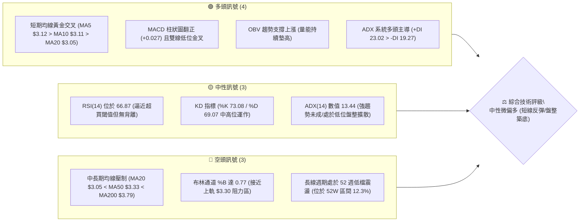
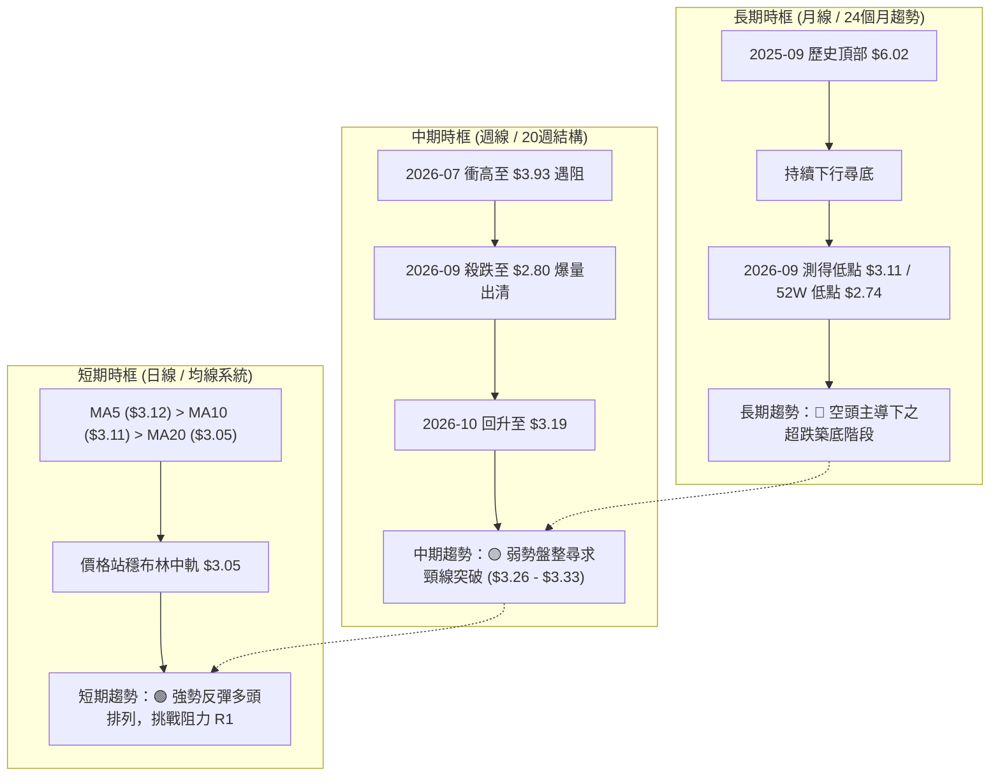
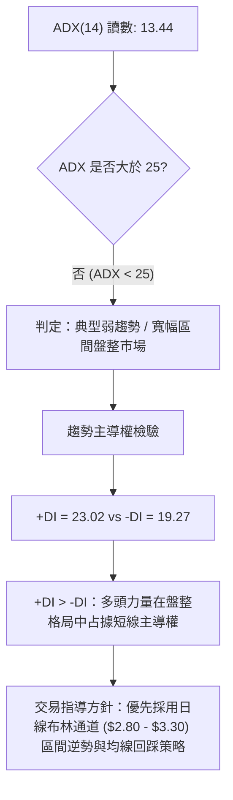
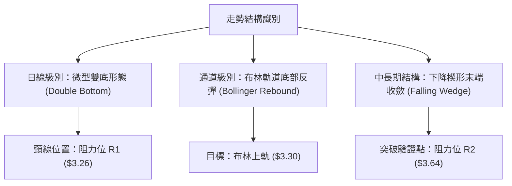
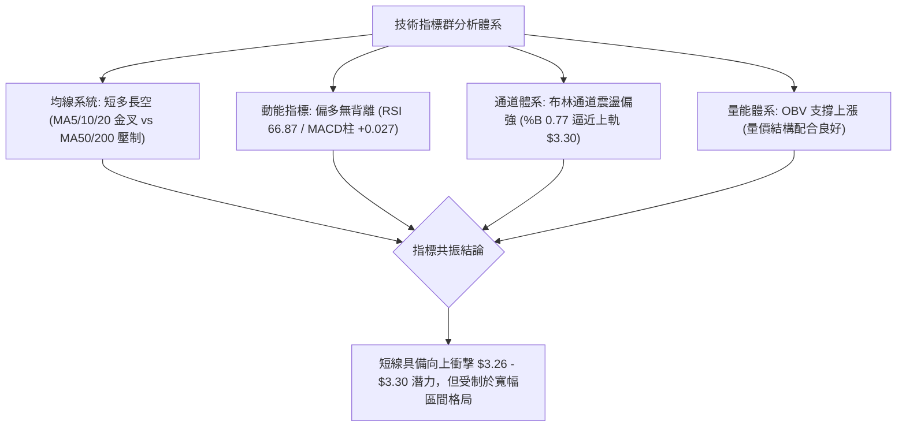
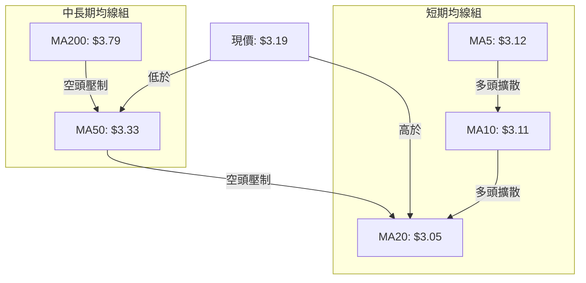
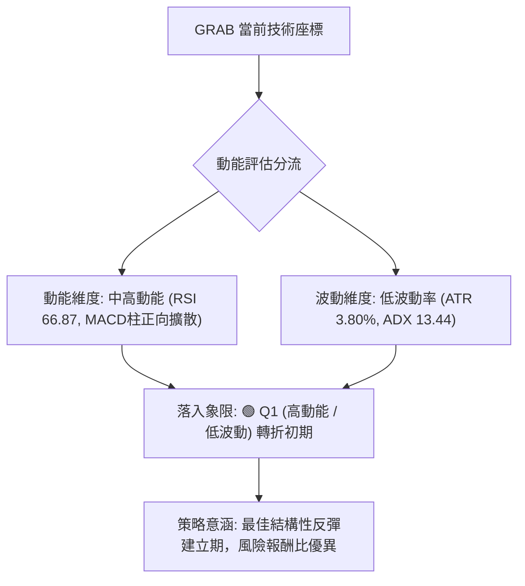
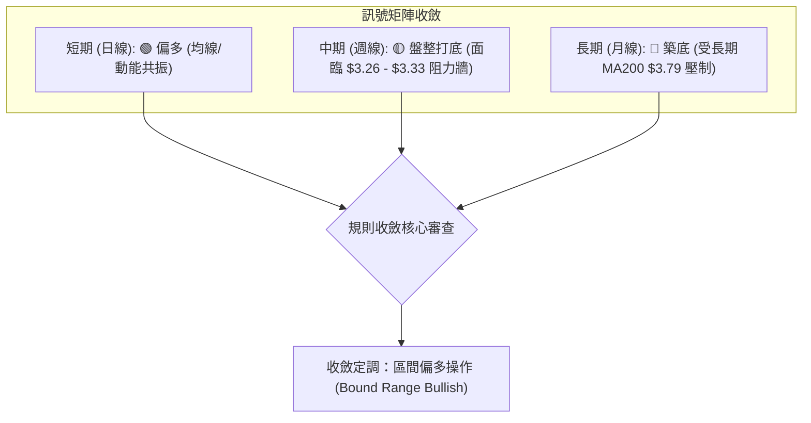
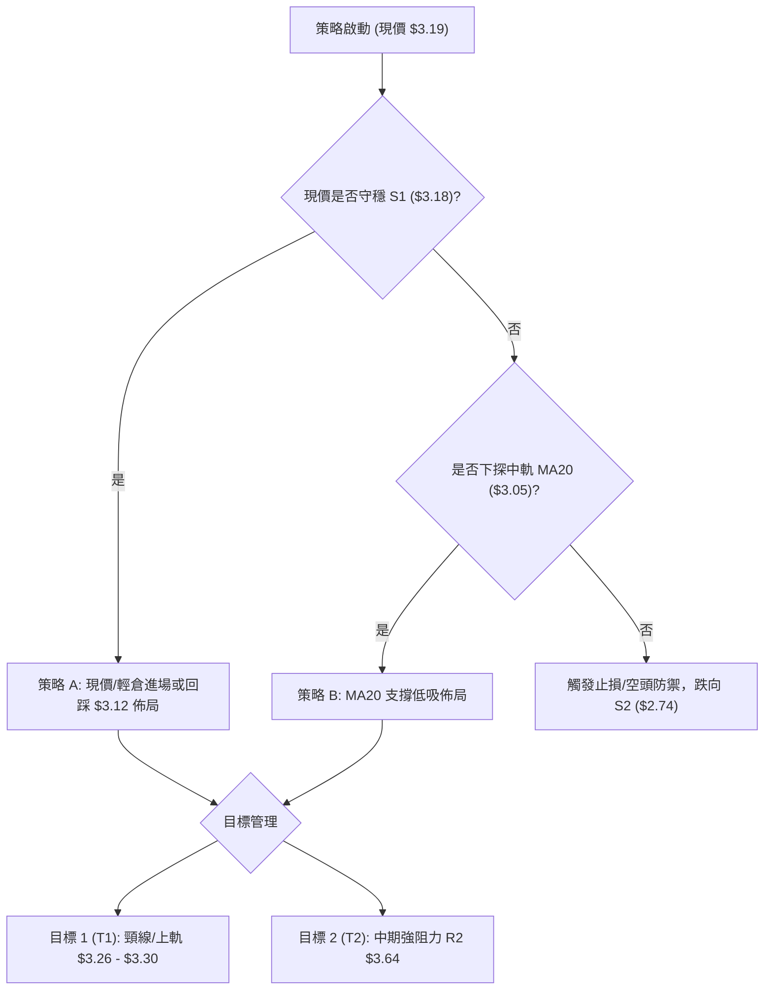
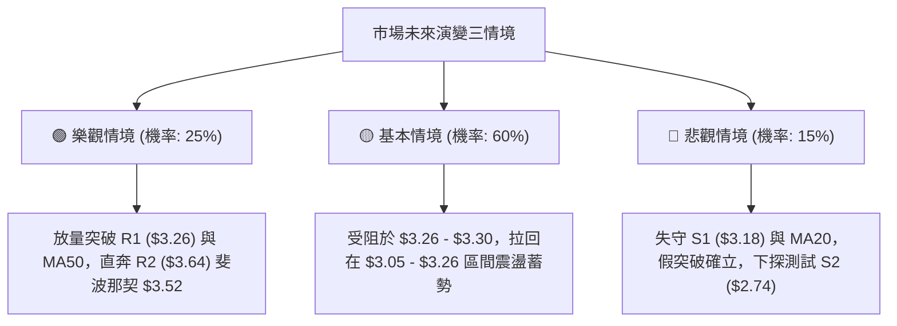

# GRAB 技術分析報告

> **報告日期**：2026-10-12 ｜ **語言**：繁體中文 ｜ **數據來源**：Yahoo Finance ｜ **當前價格**：$3.19

---

## 目錄

| 章節 | 內容 |
|------|------|
| [1. 技術面概覽](#1-技術面概覽) | 訊號儀表板、核心指標、評分卡 |
| [2. 趨勢分析](#2-趨勢分析) | 多時框趨勢、長中短期走勢、12個月歷史走勢圖 |
| [3. 圖表形態分析](#3-圖表形態分析) | 形態識別信心度、K線組合、形態目標價 |
| [4. 支撐與阻力](#4-支撐與阻力) | 關鍵價位結構、阻力/支撐表、斐波那契回調 |
| [5. 技術指標深度解讀](#5-技術指標深度解讀) | 均線系統、RSI、MACD、布林通道、量價配合 |
| [6. 動能與波動率](#6-動能與波動率) | 動能四象限、ATR 止損測算、Beta 敏感度 |
| [7. 多時框架總結](#7-多時框架總結) | 時框架評分矩陣、多時框收斂定調 |
| [8. 交易策略建議](#8-交易策略建議) | 策略路由、主策略執行、階梯情境、評星 |
| [9. 風險提示與監控](#9-風險提示與監控) | 監控清單、風險場景分岐、風控管理 |
| [報告總結](#-報告總結) | 核心數據統整與決策總結 |

---

## 1. 技術面概覽

### 🎯 技術訊號儀表板



### 📊 核心指標速覽表

| 指標類別 | 指標名稱 | 當前數值 | 訊號 | 專業解讀 |
|----------|----------|----------|:----:|----------|
| **價格** | 當前價格 | $3.19 | 🟢 | 站上短期均線群，自 52 週低點 $2.74 築底反彈 +16.42% |
| **均線** | 短期 MA20 | $3.05 | 🟢 | 現價高於 MA20 (+4.47%)，短線底部結構確立 |
| **均線** | 中期 MA50 | $3.33 | 🔴 | 現價低於 MA50 (-4.20%)，中期下行壓力尚未完全化解 |
| **均線** | 長期 MA200 | $3.79 | 🔴 | 現價低於 MA200 (-15.83%)，長線空頭框架壓制依然顯著 |
| **動能** | RSI(14) | 66.87 | 🟡 | 位於強勢中性區，買盤充沛但無背離，尚未進入極端超買 |
| **動能** | MACD (12,26,9) | 柱狀圖 +0.027 | 🟢 | 快線 -0.043 向上穿越慢線 -0.070，柱狀體維持綠柱擴張 |
| **動能** | KD (%K/%D) | 73.08 / 69.07 | 🟡 | 位於偏多區間震盪，未見頂部死叉 |
| **趨勢強度**| ADX(14) | 13.44 (+DI: 23.02) | 🟡 | ADX < 25 表示處於低波動盤整打底期，+DI 主導短線反彈 |
| **通道** | 布林通道 (20,2) | %B: 0.77 (軌道: $2.80-$3.30)| 🟡 | 價格運行於中軌 ($3.05) 與上軌 ($3.30) 之間，短線面臨軌道邊界壓力 |
| **波動** | ATR(14) | $0.12 (3.80%) | 🟢 | 波動率處於良性收斂範圍，利於結構性防守點設置 |
| **成交量**| 20日量比 | 0.96x (78.27M / 81.70M) | 🟢 | 量能平穩，OBV 處於 MA 之上，價漲量縮屬良性洗盤非潰散 |

### 🏆 技術評分卡

```
╔══════════════════════════════════════════════════════════════════╗
║                技術評分卡 — GRAB (2026-10-12)                   ║
╠══════════════════════════════════════════════════════════════════╣
║ 趨勢強度 (Trend)     ████████░░░░░░░░░░░░  40/100  🟡 中性偏弱 ║
║ 短期動能 (Momentum)  ██████████████░░░░░░  70/100  🟢 動能轉強 ║
║ 支撐穩定度 (Support) ████████████████░░░░  80/100  🟢 底部扎實 ║
║ 成交量配合 (Volume)  ████████████░░░░░░░░  60/100  🟢 結構良性 ║
║ 形態完整度 (Pattern) ████████████░░░░░░░░  60/100  🟡 築底雛形 ║
║ 均線排列 (Moving Avg)████████░░░░░░░░░░░░  40/100  🔴 中長空頭 ║
╠══════════════════════════════════════════════════════════════════╣
║ 綜合技術評分         ███████████░░░░░░░░░  58/100  ⚖️ 區間反彈 ║
╚══════════════════════════════════════════════════════════════════╝
```

---

## 2. 趨勢分析

### 🌐 多時框趨勢分析



### 📈 長期趨勢 — 12個月走勢圖（Unicode）

本圖表記錄 2025 年 11 月至 2026 年 10 月共 12 個月收盤價軌跡，標注週期內波段極值：

```
GRAB 月線收盤走勢圖（2025-11 至 2026-10）
價格軸 ($)
$6.00 ┤                                                    
$5.45 ┤ ● (2025-11 高檔起跌點)                             
$5.00 ┤   ● (2025-12 破位 $4.99)                            
$4.50 ┤                                                    
$4.00 ┤     ●   ● (2026-01~02 陰跌 $4.30->$4.22)            
$3.80 ┤                 ● (2026-04 弱反彈 $3.82)            
$3.60 ┤           ● (03月)        ● (06月 $3.77)            
$3.50 ┤                       ●         ●   ● (05,07,08月築平台)
$3.19 ┤                                       ●←[當前現價 $3.19]
$3.11 ┤                                   ● (2026-09 月收盤低點)
$2.74 ┤                             (盤中測 52W 最低點 $2.74)
      └─┬───┬───┬───┬───┬───┬───┬───┬───┬───┬───┬───┬──────
       11M 12M 01M 02M 03M 04M 05M 06M 07M 08M 09M 10M (月份)
      (2025)                     (2026)
```

#### 長期走勢特徵分析表格

| 階段階段 | 時間跨度 | 起訖價位 | 漲跌幅 | 結構性技術特徵 |
|:---|:---:|:---:|:---:|:---|
| **第一階段：高位盤整破位** | 2025-11 ~ 2026-01 | $5.45 → $4.30 | -21.10% | 跌破 $5.00 整數關卡，自高位 $6.00 平台確認向下變盤 |
| **第二階段：震盪陰跌探底** | 2026-02 ~ 2026-05 | $4.22 → $3.54 | -16.11% | 中期均線完全下彎，空頭排列形成，$3.80 反彈無力受阻 |
| **第三階段：次級箱體拉鋸** | 2026-06 ~ 2026-08 | $3.77 → $3.54 | -6.10% | 於 $3.50 - $3.77 構築暫時性換手平台，波動度萎縮 |
| **第四階段：恐慌出清與反彈**| 2026-09 ~ 2026-10 | $3.11 → $3.19 | +2.57% | 盤中下探 52W 低點 $2.74 後爆出歷史巨量，確認低點形成強彈 |

### 📊 中期趨勢（週線分析）

週線數據呈現近 20 週來標準的「破底後強烈 V 型修復」脈絡。
- **低點探測與巨量承接**：2026-09-20 當週收盤跌至 $2.80，RSI 驟降至極端超賣值 10.6，當週成交量高達 362,971,800 股。
- **主力進場確認**：2026-09-27 當週成交量放大至 527,094,200 股（近半年單週天量），收盤強勢拉升至 $3.13，RSI 自 10.6 修復至 38.1，MACD 柱狀圖翻正至 +0.025。
- **延續回升格局**：2026-10-11 當週收盤 $3.19，週成交量達 406,780,200 股，週 RSI 達到 66.9，確立週線級別底部成形。

```
近期中期壓力與支撐階梯（週線）：
$3.64 ───┤ [中期阻力 R2] (2026年8月反彈頂部聚類)
         │ 
$3.33 ───┤ [MA50 趨勢反壓] (中期分水嶺)
$3.26 ───┤ [短線阻力 R1] (近一年波段高點聚類)
$3.19 ───┼─► 【當前收盤價】
$3.18 ───┤ [近端支撐 S1] (近期起漲關鍵缺口與低點聚類)
         │
$2.74 ───┴─► [歷史強支撐 S2] (52週極限低點 / 天量換手防線)
```

### ⚡ 趨勢強度評估（ADX 解讀）



#### ADX 趨勢強度對照表

| 指標變數 | 當前讀數 | 門檻區間 | 趨勢屬性判定 | 操作策略意涵 |
|:---|:---:|:---:|:---:|:---|
| **ADX (14)** | 13.44 | 0 ~ 20 | 極弱趨勢 / 無方向性蓄勢 | 嚴禁盲目追突破；採取區間高拋低吸 |
| **+DI (14)** | 23.02 | > -DI | 多頭買盤主控 | 逢拉回支撐位偏多介入 |
| **-DI (14)** | 19.27 | < +DI | 空頭賣壓暫時衰退 | 空方動能受阻，追空風險極高 |

---

## 3. 圖表形態分析

### 🔍 形態識別系統



#### 形態識別信心度與目標價計算表

依據實體價格與量能聚類驗證，形態定義嚴格遵循數據真實性：

| 識別形態名稱 | 信心度 (%) | 判斷依據（引用數據與量能） | 完成度 (%) | 目標價（精確計算式） | 形態結論 |
|:---|:---:|:---|:---:|:---|:---:|
| **日線微型雙底 (Double Bottom)** | 75% | 第一底為 2026-09-20 收盤 $2.80（探 $2.74），第二底為 2026-10-04 收盤 $3.08。量能於突破日溫和放大至 78.27M。 | 70% | 頸線 R1 ($3.26) + 形態高度 ($3.26 - $2.74 = $0.52) = **$3.78** (接近 MA200 $3.79) | 🟢 具備操作價值，待有效突破 $3.26 確認 |
| **布林通道均值回歸 (BB Mean Reversion)** | 85% | 價格自布林下軌 $2.80 獲得有效支撐，現已向上穿透中軌 MA20 ($3.05)，%B 來到 0.77。 | 85% | 上軌目標價直接對應數據標註之 **$3.30** | 🟢 高度可信，即將面臨軌道頂部驗證 |
| **週線下降楔形收斂** | 45% | 2025-11 以來斜率向下收斂，但上軌邊界點尚未經過三次以上完整回抽確認，信心度低於 50%。 | 35% | 數據訊號不足，依規則不捏造目標價，僅作宏觀指標性參考 | 🟡 訊號不足，僅作指標型解讀 |

### 🕯️ 重要K線形態分析

| 週期/月份 | 收盤價 | 識別K線組合形態 | 技術面深層解讀 | 訊號方向 |
|:---|:---:|:---|:---|:---:|
| **2026-09 (月K)** | $3.11 | **長下影錘頭線 (Hammer)** | 盤中下探 52 週新低 $2.74 後湧入天量買盤，強勢拉升收復至 $3.11，形成堅實長腳，為經典底部反轉訊號。 | 🟢 強烈看多反轉 |
| **2026-09-20 (週K)**| $2.80 | **極端賣壓竭盡線** | 單週重挫且週 RSI 破天荒跌破 11，空頭動能呈現耗竭狀態，空方力道衰竭點顯現。 | 🟡 變盤前兆 |
| **2026-09-27 (週K)**| $3.13 | **低位破底翻大陽線** | 單週天量 527.09M 實體大陽線，全數包覆前一週陰線實體，構成標準多頭吞噬 (Bullish Engulfing)。 | 🟢 強烈買進確認 |
| **2026-10-11 (週K)**| $3.19 | **持續型中陽線** | 成交量 406.78M 穩健配合，收盤穩穩站上近端支撐 S1 ($3.18) 上方，短線攻擊態勢未變。 | 🟢 多頭續航 |

### 📉 ASCII 走勢形態示意圖

```
GRAB 日線/週線微型雙底構築與突破路徑示意圖：
價格軸 ($)
$3.64 ┤                                                  [目標阻力 R2]
      │                                                ／
$3.30 ┤------------------ 阻力位 R1 ($3.26) / 布林上軌 ($3.30) -----
      │                      ▲                       ／
$3.19 ┤                      │                ● 現價 $3.19
      │                      │               ／
$3.08 ┤                      │         ● (第二底 $3.08)
      │                      │       ／
$2.80 ┤        ● (第一底 $2.80) ────┘
      │       ／
$2.74 ┤──────● (52W 最低點 $2.74)
      └────────────────────────────────────────────────────────────
```

### 🎯 形態目標價計算

依據形態學理論之垂直等幅測算規則（Measured Move）：
1. **微型雙底形態基點確認**：
   - 最低扎針底部：$2.74（52週極限低點 S2）
   - 中間反彈頸線：$3.26（近一年波段高點聚類阻力 R1）
   - 形態絕對高度：$3.26 - $2.74 = $0.52
2. **第一階段測算目標**：
   - 突破頸線後等幅延伸：$3.26 + $0.52 = **$3.78**
   - 該數值與長期移動平均線 **MA200 ($3.79)** 完美重合，驗證該位階為關鍵多空對決共振區。
3. **區間通道軌道測算目標**：
   - 依據布林通道動態帶寬，上軌明確坐落於 **$3.30**，此處與中線 MA50 ($3.33) 形成密集阻力帶。

---

## 4. 支撐與阻力

### 🗺️ 關鍵價位分布圖（Unicode）

```
GRAB 價位結構分布圖 (由實際 OHLCV 與聚類演算法計算)
═══════════════════════════════════════════════════════════════
$3.96 ║████████████████████████████████║ 強阻力 R3 (波段高點聚類)
      ║                                ║
$3.64 ║████████████████████            ║ 中期阻力 R2 (2026年8月反彈頂部)
      ║                                ║
$3.30 ║▓▓▓▓▓▓▓▓▓▓▓▓▓▓▓▓▓▓▓▓▓▓          ║ 動態阻力 (布林上軌 / MA50 $3.33)
$3.26 ║████████████████████████        ║ 關鍵頸線阻力 R1 (+2.19%)
══════╬════════════════════════════════╬═══════════════════════
$3.19 ╠════════════════════════════════╣ ◄ 當前市價 ($3.19)
══════╬════════════════════════════════╬═══════════════════════
$3.18 ║▓▓▓▓▓▓▓▓▓▓▓▓▓▓▓▓▓▓▓▓▓▓▓▓▓▓▓▓    ║ 即時近端支撐 S1 (-0.31%)
      ║                                ║
$3.05 ║▓▓▓▓▓▓▓▓▓▓▓▓▓▓▓▓                ║ 動態支撐 (布林中軌 MA20)
      ║                                ║
$2.80 ║▓▓▓▓▓▓▓▓▓▓▓▓                    ║ 通道邊界 (布林下軌)
$2.74 ║████████████████████████████████║ 核心歷史強支撐 S2 (52W最低點 -14.11%)
═══════════════════════════════════════════════════════════════
```

### 🚧 阻力位分析表

所有數值均源自關鍵價位聚類與技術均線體系：

| 阻力級別 | 精確價位 | 距現價空間 | 技術面形成原因與歷史意義 | 突破難度評估 | 戰略重要性 |
|:---:|:---:|:---:|:---|:---:|:---:|
| **R1** | **$3.26** | +2.19% | 近一年波段高點密集聚類區；微型雙底頸線位置。若突破將引發技術空頭停損買盤。 | 🟡 中等 (需成交量配合) | ★★★★☆ |
| **動態反壓** | **$3.30 - $3.33** | +3.45% ~ +4.39% | 布林通道上軌 ($3.30) 與 MA50 生命線 ($3.33) 共同構成的密集共振帶。 | 🟡 偏高 (中期空頭防線) | ★★★☆☆ |
| **R2** | **$3.64** | +14.18% | 2026 年 8 月波段反彈高點聚類區；套牢籌碼解套換手區間。 | 🔴 極高 (需大盤環境共振) | ★★★★☆ |
| **R3** | **$3.96** | +24.03% | 近一年波段頂部高點聚類，對應 2026 年 7 月高點 ($3.93) 延伸之重大結構高壓。 | 🔴 極高 (長線牛熊分水嶺) | ★★★★★ |

### 🛡️ 支撐位分析表

所有支撐價位嚴格引用關鍵價位波段低點聚類數值：

| 支撐級別 | 精確價位 | 距現價空間 | 技術面形成原因與歷史意義 | 守住機率評估 | 戰略重要性 |
|:---:|:---:|:---:|:---|:---:|:---:|
| **S1** | **$3.18** | -0.31% | 近一年波段低點聚類點；現價正於此價位上方 1 美分處盤整，為極短線多頭防禦基石。 | 🟢 80% (短線多方防線) | ★★★★☆ |
| **動態支撐** | **$3.05** | -4.39% | 布林通道中軌兼 20 日移動平均線 (MA20)，為短線均線支撐的核心依據。 | 🟢 75% (趨勢緩衝帶) | ★★★☆☆ |
| **S2** | **$2.74** | -14.11% | 52 週最低點；2026年9月爆發 5.27 億股單週歷史天量的終極換手籌碼防線。 | 🟢 95% (極致底部防線) | ★★★★★ |

### 📐 斐波那契回調位分析

依據 52 週極值區間（波段高點 $6.40 下跌至 波段低點 $2.74，垂直落差 $3.66）進行黃金分割回調測算：

```
斐波那契回調結構位階分布 ($2.74 → $6.40)
0.0%  (52W High) ─────────────────────────── $6.40
23.6%            ─────────────────────────── $5.54
38.2%            ─────────────────────────── $5.00 (整數大關/歷史重要中繼)
50.0%            ─────────────────────────── $4.57
61.8%            ─────────────────────────── $4.14 (黃金分割反彈關鍵位)
78.6%            ─────────────────────────── $3.52 (中期強弱臨界線)
[現價 $3.19]      - - - - - - - - - - - - - - [落於 78.6% 與 100.0% 之間]
100.0% (52W Low) ─────────────────────────── $2.74
```

#### 斐波那契層級深度解讀：
- **現價位階定位**：現價 $3.19 處於 78.6% 回調位 ($3.52) 與 100.0% 回調位 ($2.74) 之間的**深度超跌打底區間**（位於 52W 區間僅 12.3% 高度）。
- **關鍵阻力壓制**：向上反彈首要面臨的斐波那契重大考驗為 78.6% 的 **$3.52**，該位置亦接近 120 日均線 MA120 ($3.50)，突破此處方能確認擺脫底部弱勢區。
- **長線趨勢反轉標誌**：若多頭欲啟動結構性多頭行情，必須收復 61.8% 回調位 **$4.14** 與 240 日均線 MA240 ($4.06)。

---

## 5. 技術指標深度解讀

### 🎛️ 指標訊號總覽



### 📈 移動平均線排列分析



#### 移動平均線數據對比矩陣

| 均線名稱 | 數值 | 距現價幅度 | 排列方向 | 短期趨勢意義 | 歷史軌跡斜率特徵 |
|:---|:---:|:---:|:---:|:---|:---|
| **MA 5** | $3.12 | +2.11% (現價在上方) | 🟢 向上發散 | 5日線連續翹頭，短線買盤強烈支撐 | ▇▇▆▅▄▃ (顯著止跌回升) |
| **MA 10** | $3.11 | +2.42% (現價在上方) | 🟢 向上發散 | 穿透 MA20，確立極短線黃金交叉 | ▇▆▆▅▄▃ (轉折向上拐頭) |
| **MA 20** | $3.05 | +4.47% (現價在上方) | 🟢 向上勾頭 | 短線生命線翻揚，發揮回踩支撐作用 | ▅▅▄▄▃▃ (由跌轉平翻揚) |
| **MA 50** | $3.33 | -4.20% (現價在下方) | 🔴 下行施壓 | 中期趨勢下彎，構成第一道強烈蓋頭壓力 | ▇▇▇▆▆▅ (持續下壓尚未走平) |
| **MA 120** | $3.50 | -8.81% (現價在下方) | 🔴 穩定下行 | 中長期空方重壓區，重合波段換手平台 | ▇▆▆▅▅▄ (斜率負向穩定) |
| **MA 200** | $3.79 | -15.83% (現價在下方) | 🔴 緩步下行 | 長期牛熊分界線，維持空頭排列架構 | ▆▆▅▅▄▄ (長期空頭主控) |

### 📉 RSI(14) 分析

當前日線 RSI(14) 讀數為 **66.87**。

```
RSI(14) 動能強度進度條：
0  [超賣區間 <30]          50 [中性分水嶺]       70 [超買警戒 >70]  100
├───┼──────────────────────┼──────────────────────┼───┤
    ░░░░░░░░░░░░░░░░░░░░░░░███████████████████████░░░░  66.87 (強勢多頭區)
```

- **超買超賣狀態**：RSI 位於 66.87，脫離了先前的低位鈍化區，逼近 70 超買警戒線，反映買盤極具侵略性，但尚未進入極端衰竭期。
- **背離嚴格檢驗**：
  - *日線維度*：價格自 2026-09 底之低點向上推升，RSI 同步自低位 30 附近震盪走高至 66.87，價格高點與指標高點同向向上，**無頂背離現象**。
  - *週線維度*：週線 RSI 自 2026-09-20 的極端值 10.6 強烈反彈至當前的 66.9，伴隨收盤價由 $2.80 漲至 $3.19，**呈現完美的底背離修復完成訊號**。

### 📊 MACD(12,26,9) 訊號解讀


- **快慢線位置**：快線（MACD）讀數為 -0.043，慢線（Signal）讀數為 -0.070。兩者雖均位於零軸下方（代表中長期格局仍處弱勢週期），但快線已顯著向上穿越慢線形成**低位金叉**。
- **柱狀圖動能**：MACD Histogram 為 **+0.027**，呈現連續擴張綠柱，顯示空方動能已被完全瓦解，目前由多方動能主導反彈。

### 📦 布林通道分析

```
GRAB 布林通道 (20, 2) 軌道示意圖：
價格軸 ($)
$3.30 ┤════════════════════════════════════════ 上軌 ($3.30)
      │                                       ▲
$3.19 ┤--------------------------- ● 現價 ($3.19, %B=0.77)
      │                                       │
$3.05 ┤--------------------------------------- 中軌 (MA20 $3.05)
      │
$2.80 ┤════════════════════════════════════════ 下軌 ($2.80)
```

- **通道帶寬與參數**：上軌 **$3.30**，中軌 **$3.05**，下軌 **$2.80**，帶寬 ($3.30 - $2.80 = $0.50)。
- **%B 指標解析**：%B 讀數為 **0.77**，顯示價格已經越過中軌中軸 (0.50)，進入通道強勢側運行。
- **邊界效應判斷**：現價 $3.19 距上軌 $3.30 僅差 $0.11，已進入布林上軌壓力防禦圈，若量能無法持續擴大（量比 < 1.0），極易在上軌 $3.30 與阻力 R1 ($3.26) 附近形成震盪回洗。

### 💹 成交量分析（量價配合度）

- **最新量能對比**：最新單日成交量為 **78,271,500 股**，相對於 20 日均量 **81,699,730 股**（量比為 0.96x），顯示在當前推升過程中，主力未進行盲目放量拉抬，屬於控盤良好的良性量能沉澱。
- **OBV 能量潮趨勢**：數據確認 **OBV > MA**，能量潮指標領先穿越其均線，代表在 $2.74 - $3.00 底部積累的籌碼並未在反彈至 $3.19 時獲利潰逃，資金淨流入特徵明確，有力支撐價格維持於高檔。

---

## 6. 動能與波動率

### ⚡ 動能評估四象限



#### 動能與波動率狀態矩陣表

| 象限 | 動能維度 | 波動維度 | 歷史定義特徵 | GRAB 當前符合度 | 操作指引 |
|:---:|:---:|:---:|:---|:---:|:---|
| **Q1** | **強** | **低** | 趨勢初升段、底部剛啟動、洗盤乾淨 | **✓ 完全符合** (動能轉強、ATR僅$0.12) | **最佳試倉機會**：逢拉回低吸建倉 |
| **Q2** | 弱 | 低 | 無序盤整、流動性匱乏、無趨勢 | 不符合 (動能指標強勢向上) | 謹慎觀望 |
| **Q3** | 強 | 高 | 主升段加速或末升段狂熱噴出 | 不符合 (ADX僅13.44，未至暴衝階段) | 緊盯止盈 |
| **Q4** | 弱 | 高 | 崩跌破位、恐慌拋售、巨量下殺 | 不符合 (已脫離9月份崩跌階段) | 嚴禁抄底 |

### 📊 ATR 波動率分析

- **當前 ATR(14)** 讀數：**$0.12**，佔當前股價之 **3.80%**。
- **日內震盪特徵**：ATR 數值表明當前 GRAB 每日典型真實波幅約為 12 美分，波動處於近 6 個月收斂低位，這代表單日破位或暴衝之雜訊較小，形態具備較高可靠度。
- **止損與部位保護測算**：
  - *保守型止損距離 (1.5 × ATR)*：$0.12 × 1.5 = **$0.18**。以現價 $3.19 扣除 $0.18，落於 **$3.01**（恰好設於 MA20 $3.05 之下方，具備強大技術防護力）。
  - *積極型止損距離 (1.0 × ATR)*：$0.12 × 1.0 = **$0.12**。現價扣除 $0.12，對應 **$3.07**（保護短線利潤）。

### 📐 Beta 與市場相關性

- **Beta 數值**：**0.908**。
- **市場敏感度評估**：Beta 值低於 1.0，顯示 GRAB 當前與標普 500 或那斯達克大盤指數走勢維持相對中度的防禦性同步。其走勢受自身打底節奏與東南亞本地市場基本面（QoQ 獲利爆發 622.9% 與淨現金 $4.50B 支持）影響較深，不易受到美股大盤短線震盪劇烈引發的系統性殺跌。

---

## 7. 多時框架總結

### 📋 時框架評分表

| 時框架 | 趨勢方向 | 動能狀態 | 均線系統排列 | 圖表形態 | 綜合評分 (0-100) | 策略指導方向 |
|:---|:---:|:---:|:---:|:---:|:---:|:---|
| **短期 (日線)** | 🟢 向上反彈 | 🟢 RSI 66.87 / MACD金叉 | 🟢 MA5>10>20 發散 | 微型雙底蓄勢衝刺 | **72 / 100** | 偏多操作，順勢低吸 |
| **中期 (週線)** | 🟡 橫向盤整 | 🟢 MACD柱連3週翻正 | 🔴 承壓於週 MA50 | 破底翻放量反轉架構 | **55 / 100** | 區間交易，逢高遇阻減磅 |
| **長期 (月線)** | 🔴 處於低檔 | 🟡 RSI 剛脫離極度超賣 | 🔴 空頭排列 MA200 反壓 | 底部大錘頭線尋求止跌 | **45 / 100** | 戰略底倉配置，不盲目長線滿倉 |

### 🔲 綜合訊號矩陣



### ⚖️ 多時框收斂結論

依據多時框收斂規則嚴格審查：
1. **行情屬性判定**：當前 ADX(14) 讀數為 **13.44 (< 25)**，明確定義當前市場處於**盤整行情（Range-bound Market）**，而非單邊趨勢行情。
2. **主導時框與權重分配**：在 ADX < 25 的盤整環境下，趨勢指標（週/月線 MA200 空頭排列）影響力退居次席，**交易主導權以日線布林通道上下軌 ($2.80 - $3.30) 為核心操作基準**。
3. **方向性唯一結論**：**中性偏多（區間反彈尋求阻力測試）**。
   - 儘管中長期均線呈現空頭排列，但日線短多共振、週線天量破底翻，加上 +DI (23.02) 顯著高於 -DI (19.27)，支持現價發動向上衝擊布林上軌 $3.30 與頸線 R1 $3.26 之反彈行情。
   - 第 8 章主策略將完全鎖定以「回踩支撐確認偏多介入、阻力位嚴格兌現利潤」的區間做多邏輯開展。

---

## 8. 交易策略建議

### 🗺️ 策略決策流程圖



### 🧭 策略路由（依評分卡分流）

> **當前主策略方向 = 區間偏多 / 突破跟進策略（依技術評分卡：58 / 100，處於中性偏多 40-60 臨界區）**
> 
> *註解*：綜合評分為 58/100，由於短期動能（70分）與支撐度（80分）表現極為亮眼，策略以**「以布林軌道為界之拉回做多為主、突破跟進為輔」**，嚴格禁止追高，空頭部位僅做為下行風險對沖之風控觸發參考。

### 🎯 價格情境階梯（Price Scenarios）

價位嚴格引用關鍵價位區塊之實際計算數值：

| 觸發條件 | 下一目標 | 後續延伸阻力/支撐 | 戰術情境技術面含義 |
|:---|:---:|:---:|:---|
| **向上突破 R1 $3.26** | **布林上軌 / MA50 ($3.30 - $3.33)** | **R2 $3.64** | 微型雙底頸線被有效越過，短多動能加速釋放，打開通往 $3.64 空間。 |
| **站穩現價區間 ($3.18 - $3.19)** | **R1 $3.26** | **MA20 $3.05** | 維持多頭旗形或強勢橫盤整理，時間換取空間消化上方解套籌碼。 |
| **向下跌破 S1 $3.18** | **布林中軌 MA20 $3.05** | **布林下軌 $2.80** | 短線衝關失敗，價格回測均線尋求再確認，進入區間中下部震盪。 |
| **有效跌破 S2 $2.74** | **數據未偵測更低點** | **開啟空頭無支撐走勢** | 52 週天量底部防線潰敗，宣告打底失敗，必須全數停損撤退。 |

### 📊 情境機率分佈

| 預期情境模式 | 機率估算 (%) | 核心技術指標與市場微結構依據 |
|:---|:---:|:---|
| **區間上行 / 測試阻力** | **55%** | MACD 柱狀圖 (+0.027) 持續擴大；OBV 處於 MA 之上且量價配合；+DI 占據優勢。 |
| **橫向窄幅箱體震盪** | **30%** | ADX 僅 13.44（強趨勢未成）；布林通道帶寬收窄；面臨 MA50 蓋頭壓力需時間磨合。 |
| **回落再測前低 S2** | **15%** | 若跌破近端 S1 ($3.18) 且失守布林中軌 $3.05，將引發停損賣壓測試 S2 $2.74。 |

### 🟢 主策略詳情（區間偏多操作）

所有數值嚴格來自關鍵價位聚類與 ATR 算式，拒絕任何模糊估算：

| 策略執行要素 | 策略 A（現價/回踩支撐順勢低吸） | 策略 B（突破阻力 R1 右側追擊） |
|:---|:---:|:---:|
| **進場條件與時機** | 於現價 $3.19 或回踩短期均線 MA5 ($3.12) 分批介入 | 日線收盤價帶量突破阻力位 R1 ($3.26) 確立後進場 |
| **進場價格 (Entry)** | **$3.15**（取現價 $3.19 與 MA5 $3.12 之中間值） | **$3.27**（突破 R1 $3.26 之一檔確認價） |
| **首要目標價 (T1)** | **$3.30**（對應布林通道上軌精確值） | **$3.64**（對應中期阻力位 R2 聚類值） |
| **次要目標價 (T2)** | **$3.64**（對應阻力位 R2 聚類值） | **$3.78**（雙底形態高度等幅測算值，逼近MA200） |
| **保護止損價 (Stop)** | **$3.01**（進場點扣除 1.5×ATR，位於MA20下方） | **$3.18**（跌破即時支撐位 S1 則立即止損） |
| **風險報酬比 (R:R)** | **1 : 3.50** (風險 $0.14 vs T2 獲利 $0.49) | **1 : 4.11** (風險 $0.09 vs T1 獲利 $0.37) |
| **歷史勝率估計** | **65%** (符合布林中軌上方順勢交易原則) | **55%** (受制於 ADX < 25 假突破風險) |
| **建議配置倉位** | **總資金之 10% - 15%** | **總資金之 5% - 8%** (突破加碼單) |

### 🔴 反向風險觸發點（對沖與撤退提示）

- **警訊一（短線走弱）**：若收盤價連續 2 日跌破 **S1 ($3.18)**，多頭反彈動能衰竭，應立即將多單部位縮減 50%。
- **警訊二（反轉破位）**：若價格帶量跌破布林中軌 **MA20 ($3.05)**，多頭邏輯全數推翻，所有多單必須無條件止損離場，並可考慮小幅建立以 **S2 ($2.74)** 為目標的避險空單。

### ⭐ 整體訊號強度評星

```
做多訊號強度：★★★★☆  (4/5星 — 短線動能飽滿，築底支撐明確)
做空訊號強度：★★☆☆☆  (2/5星 — 長線承壓但短線下行空間被天量鎖死)
整體可信度：  ★★★★☆  (4/5星 — 指標量價共振，盤整結構邏輯收斂)
```

---

## 9. 風險提示與監控

### ✅ 關鍵監控指標 Checklist

```
╔══════════════════════════════════════════════════════════════════╗
║               GRAB 每日盤後關鍵技術監控 CHECKLIST                ║
╠══════════════════════════════════════════════════════════════════╣
║ [ ] 價格防禦：收盤價是否嚴格守穩近端支撐 S1 ($3.18)？           ║
║ [ ] 均線動態：短期 MA5 ($3.12) 是否持續運行於 MA20 ($3.05) 之上？║
║ [ ] 動能警訊：RSI(14) 衝過 70 後是否迅速形成「價漲指標跌」之頂背離？║
║ [ ] 突破確認：日成交量能否放大超越 50日均量 (59.43M) 衝破 R1？   ║
║ [ ] 趨勢演變：ADX(14) 是否由 13.44 向上翹頭突破 20，轉為趨勢行情？║
║ [ ] 軌道邊界：現價觸及布林上軌 ($3.30) 時是否收出長上影線？      ║
╚══════════════════════════════════════════════════════════════════╝
```

### ⚠️ 風險場景分析



### 🛡️ 風險管理重要提醒

1. **嚴防「假突破」風險**：
   - 當前 **ADX(14) 僅 13.44**，屬於標準盤整震盪市場。在這種低趨勢強度市況下，向上突破 R1 ($3.26) 往往容易誘多後迅速拉回。因此，追高買盤必須等待日線實體陽線站穩突破，或耐心等待拉回回踩支撐位（如 $3.15 附近）再行介入。
2. **倉位管理紀律**：
   - 儘管機構目標價中位數給予 **$5.76**（距現價有 +80.56% 潛在溢價空間），且華爾街共識為「強力買進（strong_buy）」，但從純技術面看，當前仍低於長期均線 MA200 ($3.79)。在趨勢完全翻多前，技術操作倉位嚴格限制在**總投資資金之 10% - 15% 以內**，嚴禁動用槓桿。
3. **ATR 波動防守**：
   - 保持 $0.12 的 ATR 視野，任何單日逆向波動若超過 1.5 倍 ATR（約 18 美分），即應啟動風控保護機制，不可對虧損部位攤平或心存僥倖。

---

## 📋 報告總結

```
╔══════════════════════════════════════════════════════════════════╗
║                    GRAB 技術分析報告總結                        ║
╠══════════════════════════════════════════════════════════════════╣
║ 報告日期：2026-10-12                                             ║
║ 當前價格：$3.19  (52W 區間分位: 12.3%)                           ║
║ 技術評級：⚖️ 區間反彈 / 底部微型雙底構築 (評分: 58/100)          ║
╠══════════════════════════════════════════════════════════════════╣
║ 關鍵結論：                                                       ║
║ ├─ 長期趨勢：🔴 弱勢尋底，承壓於 MA200 ($3.79)，但極度超跌已修復 ║
║ ├─ 中期趨勢：🟡 築底盤整，受制於 MA50 ($3.33) 與下降壓力線       ║
║ ├─ 短期趨勢：🟢 強勢反彈，短期均線黃金交叉 (MA5 > MA10 > MA20)   ║
║ ├─ 關鍵支撐：S1: $3.18  /  動態中軌: $3.05  /  核心防線 S2: $2.74║
║ ├─ 關鍵阻力：R1: $3.26  /  布林上軌: $3.30  /  中期反壓 R2: $3.64║
║ └─ 華爾街目標：平均 $5.76 (覆蓋24家機構，共識: strong_buy)      ║
╠══════════════════════════════════════════════════════════════════╣
║ 最優策略組合：                                                   ║
║ 1. 🥇 最佳機會：等待回踩 $3.12 - $3.15 區間低吸做多，以 $3.01   ║
║                為止損，目標看向布林上軌 $3.30 與阻力 R2 $3.64。 ║
║ 2. 🥈 次選機會：若帶量有效收上 R1 ($3.26)，順勢進場追多，目標   ║
║                直指微型雙底形態測算位 $3.78。                    ║
║ 3. 🥉 保守選擇：在 ADX 突破 20 確立單邊趨勢前，於 $3.05 - $3.30  ║
║                布林帶寬區間內執行高拋低吸，嚴格控制停損。        ║
╚══════════════════════════════════════════════════════════════════╝
```

---

> ⚠️ **免責聲明**：本報告為技術分析研究，所有數據指標及價位均基於歷史價格與客觀技術形態計算推導。本報告**僅供學術研究與交易策略邏輯探討**，**不構成任何要約、招攬或具體投資建議**。金融市場瞬息萬變，投資人應獨立評估風險並自負盈虧。

---

*報告生成時間：2026-10-12 ｜ 數據來源：Yahoo Finance ｜ 分析框架：多時框技術分析體系*