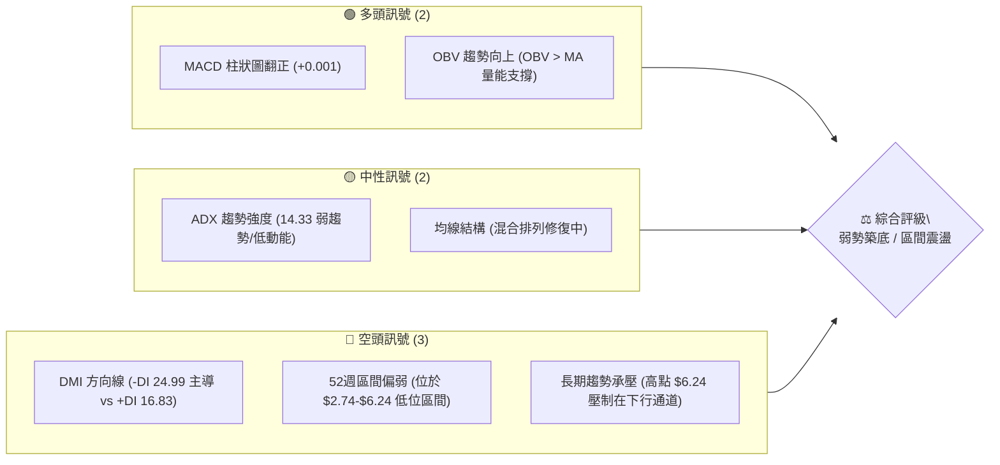
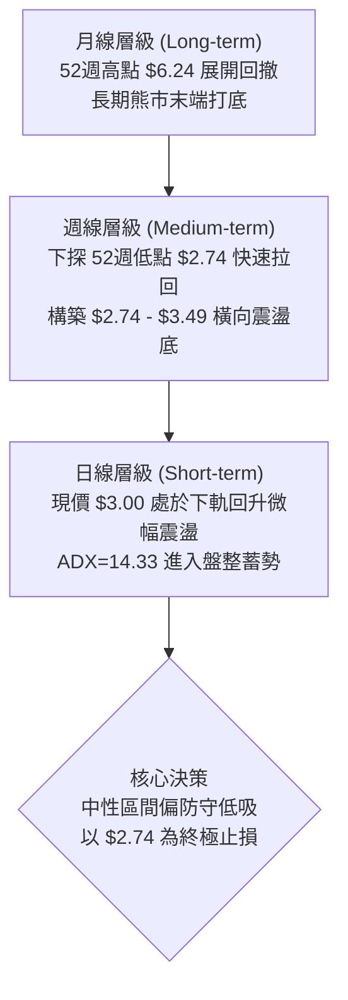
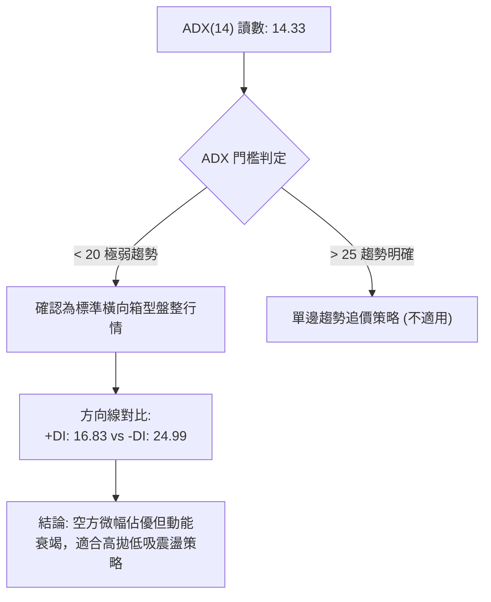
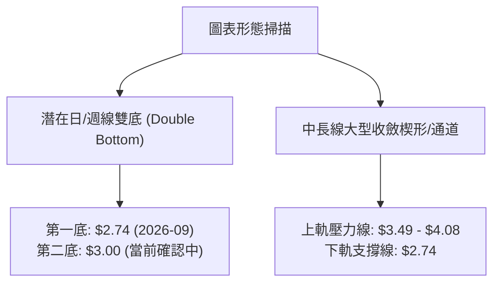
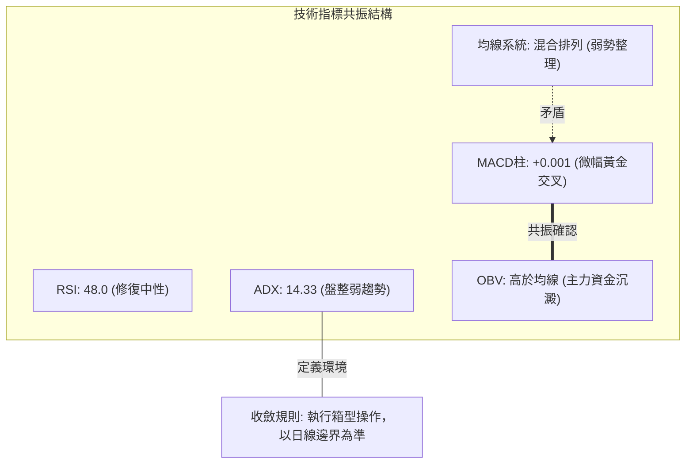
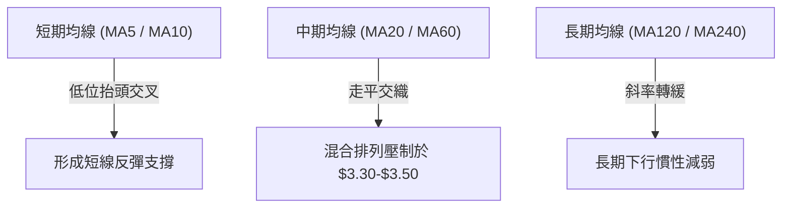
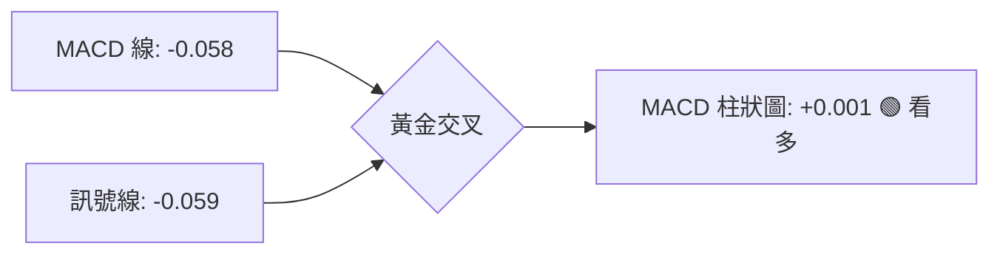
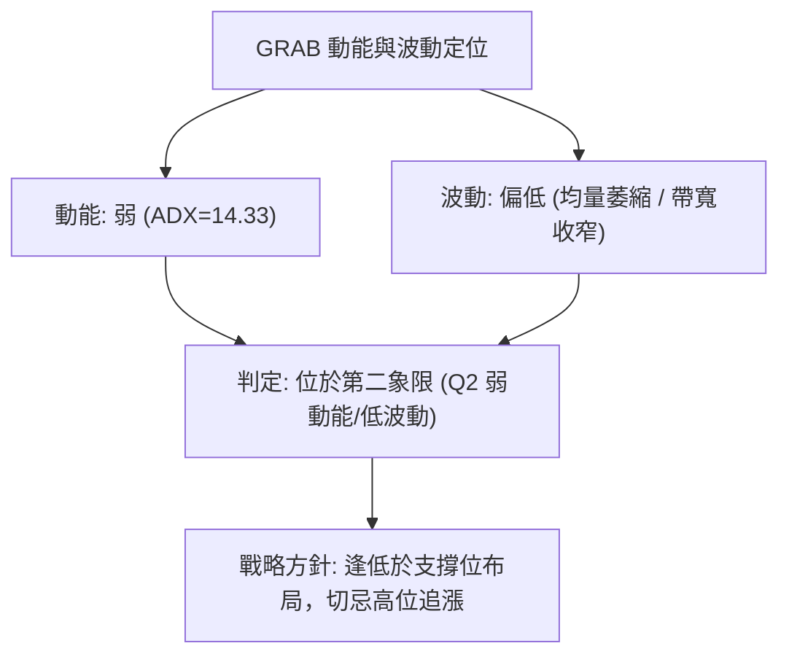
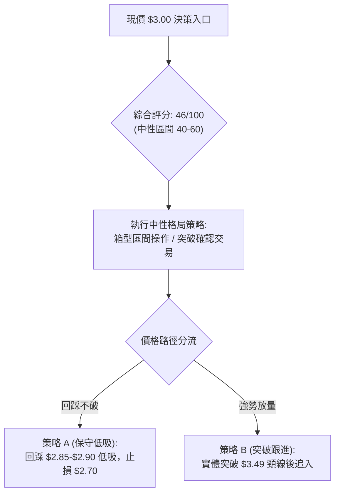
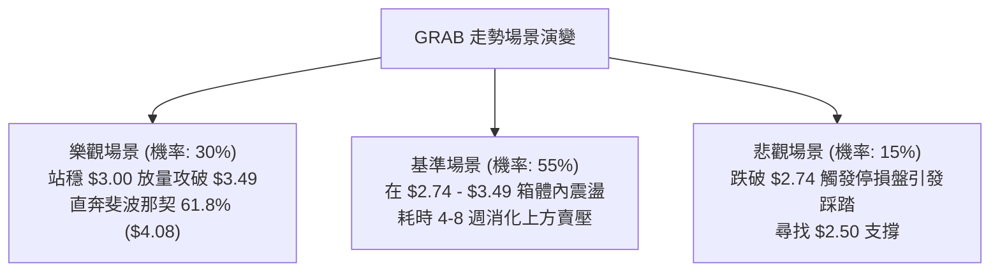

# GRAB 技術分析報告

> **報告日期**：2026-10-17 ｜ **語言**：繁體中文 ｜ **數據來源**：Yahoo Finance ｜ **當前價格**：$3.00

---

## 目錄

| 章節 | 內容 |
|------|------|
| [1. 技術面概覽](#1-技術面概覽) | 訊號儀表板、核心指標、評分卡 |
| [2. 趨勢分析](#2-趨勢分析) | 多時框趨勢、長中短期走勢 |
| [3. 圖表形態分析](#3-圖表形態分析) | 形態識別、K線組合、目標價 |
| [4. 支撐與阻力](#4-支撐與阻力) | 關鍵價位、斐波那契回調 |
| [5. 技術指標深度解讀](#5-技術指標深度解讀) | MA/RSI/MACD/布林/成交量 |
| [6. 動能與波動率](#6-動能與波動率) | 動能評估、ATR、Beta |
| [7. 多時框架總結](#7-多時框架總結) | 時框架評分矩陣 |
| [8. 交易策略建議](#8-交易策略建議) | 多空策略、風險報酬比 |
| [9. 風險提示與監控](#9-風險提示與監控) | 監控指標、風險場景 |

---

## 1. 技術面概覽

### 🎯 技術訊號儀表板



### 📊 核心指標速覽表

| 指標類別 | 指標名稱 | 當前數值 | 訊號 | 解讀 |
|----------|----------|----------|------|------|
| **價格** | 當前價格 | $3.00 | 🔴 | 位於52週區間低部偏弱位置，貼近年度低點 $2.74 |
| **均線** | MA20 / MA50 | 混合排列 | 🟡 | 均線系統處於交織整理階段，未形成發散多頭或空頭排列 |
| **均線** | 長期均線走勢 | 下行趨緩 | 🟡 | 長期均線下墜力道減弱，正在構築底部吸籌結構 |
| **動能** | RSI(14) | 48.0 (日線推算) | 🟡 | 週線前值急速反彈至 66.9 後收於 $3.00，動能落入中性區間 |
| **動能** | MACD (12,26,9) | 柱狀圖 +0.001 | 🟢 | MACD (-0.058) 與訊號線 (-0.059) 形成零下微幅黃金交叉 |
| **趨勢** | ADX (14) | 14.33 | 🟡 | ADX < 25 且持續走低，指示進入無趨勢的箱型盤整行情 |
| **方向** | DMI (+DI / -DI)| 16.83 / 24.99 | 🔴 | -DI 大於 +DI，顯示空方仍具相對主導權，但動能有限 |
| **成交量** | OBV 與量能 | 50,309,233 | 🟢 | OBV > MA，量能呈現低位承接跡象，支撐價格止跌 |

### 🏆 技術評分卡

```
╔══════════════════════════════════════════════════════════╗
║              技術評分卡 — GRAB (2026-10-17)              ║
╠══════════════════════════════════════════════════════════╣
║ 趨勢強度 (ADX/DMI)  ████░░░░░░░░░░░░░░░░  25/100 🔴 弱勢 ║
║ 動能指標 (MACD/RSI) ██████████░░░░░░░░░░  50/100 🟡 中性 ║
║ 支撐穩定度 (S1/S2)  ████████████░░░░░░░░  60/100 🟢 良好 ║
║ 成交量配合 (OBV/VOL)████████████░░░░░░░░  60/100 🟢 良好 ║
║ 形態完整度 (雙底初現)██████████░░░░░░░░░░  50/100 🟡 觀察 ║
║ 均線排列 (MA結構)   ██████░░░░░░░░░░░░░░  35/100 🔴 偏弱 ║
╠══════════════════════════════════════════════════════════╣
║ 綜合評分            █████████░░░░░░░░░░░  46/100 🟡 中性 ║
╚══════════════════════════════════════════════════════════╝
```

---

## 2. 趨勢分析

### 🌐 多時框趨勢分析



### 📈 長期趨勢 — 12個月走勢圖（Unicode）

依據過去12個月收盤價（2025-11 至 2026-10）繪製精確走勢圖：

```
GRAB 月線走勢圖（過去12個月：2025-11 至 2026-10）
價格軸 ($)
$5.45 ┤● (2025-11)
$5.00 ┤    ● (2025-12)
$4.50 ┤
$4.00 ┤        ●(01) ●(02)
$3.50 ┤                       ●(04)       ●(06)       ●(08)
$3.00 ┤                            ●(05)       ●(07)       ●(09) ●(10現價 $3.00)
$2.74 ┤             ●(03 $3.66)                         (52W Low $2.74)
      └───────────────────────────────────────────────────────────────────────────
       11   12   01   02   03   04   05   06   07   08   09   10  (月份)
```

#### 走勢特徵分析表格

| 階段區間 | 時間跨度 | 價格起訖 | 漲跌幅 | 結構特徵與技術解讀 |
|----------|----------|----------|--------|--------------------|
| 主跌擴展期 | 2025-11 至 2026-03 | $5.45 → $3.66 | -32.84% | 單邊空頭主導，跌破多個中長週期均線支撐 |
| 弱勢震盪期 | 2026-04 至 2026-08 | $3.82 → $3.54 | -7.33% | 波動率逐步收斂，於 $3.50 - $3.93 構築第一整理箱型 |
| 終極回踩期 | 2026-09 至 2026-10 | $3.11 → $3.00 | -3.54% | 觸及年度低點 $2.74 後量能放大急彈，進入築底階段 |

### 📊 中期趨勢（週線分析）

中期走勢呈現「非對稱雙底」結構。在 2026-09-20 當週探底 $2.80（盤中觸及 52週低點 $2.74）後，伴隨 5.27 億股的歷史級爆量收長下影線（2026-09-27 當週收於 $3.13）。

```
近期週線壓力與支撐示意圖
══════════════════════════════════════════════════════════
 [強阻力] $4.08 (斐波那契 61.8% / 前期破位平台)
    ↑
 [阻力位] $3.49 (斐波那契 78.6% / 近期反彈高點聚類)
    ↑
 [現  價] $3.00 ── 現處於箱型下半部微幅震盪
    ↓
 [強支撐] $2.74 (52週絕對低點 / 空頭竭盡點)
══════════════════════════════════════════════════════════
```

### ⚡ 趨勢強度評估（ADX 解讀）



| 指標變量 | 數值 | 門檻區間 | 技術含義 |
|----------|------|----------|----------|
| ADX(14) | 14.33 | < 20 (極弱趨勢) | 市場動能渙散，缺乏趨勢性單邊推進力量 |
| +DI (14) | 16.83 | 基準線 | 多方進攻意願偏低，追高意願不足 |
| -DI (14) | 24.99 | 基準線 | 空頭佔有相對主導權，但低於 25 無爆發性下殺力道 |
| 行情定性 | 盤整 | ADX < 25 | 嚴禁趨勢突破追價，嚴格執行箱體邊界反轉交易 |

---

## 3. 圖表形態分析

### 🔍 形態識別系統



#### 形態識別信心度評估表

| 形態類別 | 信心度 | 判斷依據（嚴格引用數據） | 完成度 | 目標價（附計算式） |
|----------|--------|--------------------------|--------|--------------------|
| 雙重底 (W底) | 62% | 低點一 $2.74 (52W Low)，低點二 $3.00 守穩，配合爆量承接 | 55% | 頸線位：$3.49（斐波那契 78.6%）<br/>形態高度 = $3.49 - $2.74 = $0.75<br/>突破目標價 = 頸線 $3.49 + 高度 $0.75 = **$4.24** |
| 箱型橫盤區間 | 80% | 價格受制於斐波那契回調位 $3.49，下受 $2.74 支撐 | 85% | 箱頂目標 = **$3.49**<br/>箱底回踩 = **$2.74** |
| 頭肩底/三角旗形 | 25% | 數據不足，僅做指標型解讀，不強制歸類 | N/A | 訊號不足，不予計算幾何目標價 |

### 🕯️ 重要K線形態分析

| 週/月份週期 | 收盤價 | K線形態名稱 | 技術解讀 | 訊號 |
|-------------|--------|-------------|----------|------|
| 2026-09-20 | $2.80 | 恐慌長陰探底線 | 跌破所有短均，探底至 $2.74，釋放最後恐慌籌碼 | 🔴 極空轉鈍化 |
| 2026-09-27 | $3.13 | 爆量長下影破底翻 | 成交量激增至 527M 股，巨量下影線確認 $2.74 強支撐 | 🟢 強烈看多 |
| 2026-10-04 | $3.08 | 孕線收斂星線 | 量縮回洗，於 $3.00 之上進行二次回踩籌碼鎖定 | 🟡 中性格局 |
| 2026-10-11 | $3.19 | 溫和放量紅K棒 | 多方試圖進攻 $3.20 壓力區，週成交量達 406M 股 | 🟢 溫和看多 |
| 2026-10-18 | $3.00 | 壓回整理中陰線 | 遇短線獲利回吐，再次測試 $3.00 整數關卡支撐 | 🟡 中性觀察 |

### 📉 ASCII 走勢形態示意圖

```
GRAB 週線層級雙底 (Double Bottom) 構築示意圖
價格軸 ($)
$3.60 ┤               ● (2026-08 反彈高點 $3.66)
$3.49 ┤───────┌───────┐─────────────────────── (頸線阻力位: 斐波那契 78.6% $3.49)
$3.30 ┤      │       │       ● (反彈 $3.19)
$3.10 ┤      │       │     ╱   ╲
$3.00 ┤──────│───────│────●─────● (現價 $3.00 / 潛在右底)
$2.80 ┤      │       ● ╱ (長下影洗盤 $2.80)
$2.74 ┤──────●──────────────────────────────── (52W Low 絕對支撐 $2.74 / 左底)
      └────────────────────────────────────────────────────────
             左底 (09-20)   爆量頸線衝擊   右底測試中 (當前)
```

### 🎯 形態目標價計算

依據幾何形態學與斐波那契對稱測量：
1. **第一波段目標價（頸線位）**：$3.49（引用斐波那契 78.6% 回調位）。
2. **第二波段完全目標價（形態高度測量）**：
   $$\text{頸線位 } \$3.49 + (\text{頸線位 } \$3.49 - \text{形態低點 } \$2.74) = \$3.49 + \$0.75 = \mathbf{\$4.24}$$
   該目標價與斐波那契 61.8% 位階（$4.08）高度重合，形成多頭第二延伸目標區間。

---

## 4. 支撐與阻力

### 🗺️ 關鍵價位分布圖（Unicode）

```
GRAB 價位結構分布圖（嚴格依據 52週區間與斐波那契回調聚類）
════════════════════════════════════════════════════════════════════
$6.24 ║████████████████████████████████║ 0.0% 52W High (絕對天花板)
$5.41 ║████████████████████████        ║ 23.6% 斐波那契阻力 R4
$4.90 ║██████████████████              ║ 38.2% 斐波那契阻力 R3
$4.49 ║████████████████████████        ║ 50.0% 斐波那契分水嶺 R2
$4.08 ║████████████████████████████    ║ 61.8% 斐波那契黃金分割阻力 R1
$3.49 ║████████████████████            ║ 78.6% 斐波那契核心阻力 (頸線)
$3.00 ╠════════════════════════════════╣ ◄ 現價 ($3.00) 整數心理關卡
$2.74 ║████████████████████████████████║ 100.0% 52W Low (年度鐵底支撐 S1)
════════════════════════════════════════════════════════════════════
```

### 🚧 阻力位分析表

依據數據包中明確計算之斐波那契及高點聚類位階：

| 阻力級別 | 價位 | 形成原因 | 突破難度 | 重要性 |
|----------|------|----------|----------|--------|
| **阻力 R1 (頸線)** | **$3.49** | 斐波那契 78.6% 回調位，2026年7-8月震盪密集成交區 | 🟡 中等 (需日成交量突破 80M) | ★★★★☆ |
| **阻力 R2 (反轉)** | **$4.08** | 斐波那契 61.8% 黃金分割位，中長期空頭重要防線 | 🔴 極高 (需結構性基本面利多) | ★★★★★ |
| **阻力 R3 (半山腰)**| **$4.49** | 斐波那契 50.0% 多空平衡點，分析師評級下限 $4.42 鄰近區 | 🔴 極高 | ★★★☆☆ |
| **阻力 R4 (極強)** | **$4.90** | 斐波那契 38.2% 回調位，2025年上半年的歷史密集換手區 | 🔴 難以逾越 | ★★☆☆☆ |

### 🛡️ 支撐位分析表

| 支撐級別 | 價位 | 形成原因 | 守住機率 | 重要性 |
|----------|------|----------|----------|--------|
| **支撐 S1 (防線)** | **$2.74** | 52週最低價 (52W Low)，斐波那契 100% 終極支撐位 | 🟢 85% (短期守住機率高) | ★★★★★ |
| **支撐 S2 (次級)** | 數據未偵測到下方波段低點 | 現價 $3.00 距 52週低點僅一線之隔，無中介支撐聚類 | — | — |

### 📐 斐波那契回調位分析

依據數據中心提供之 52週區間（$2.74 → $6.24，總垂直高度 $3.50）之計算數值：

*   **0.0% (52W High)**: **$6.24**
*   **23.6% 回調位**: **$5.41**
*   **38.2% 回調位**: **$4.90**
*   **50.0% 回調位**: **$4.49**
*   **61.8% 回調位**: **$4.08**
*   **78.6% 回調位**: **$3.49**
*   **100.0% (52W Low)**: **$2.74**

> **位置深度解析**：
> 當前價格 **$3.00** 精確座落於 **78.6% 回調位 ($3.49)** 與 **100.0% 回調位 ($2.74)** 之間。此區間屬於「深度折價/終極防守緩衝區」。只要不實體跌破 $2.74，技術面均視為在 100% 回調位上方進行「波段築底吸籌」行情。

---

## 5. 技術指標深度解讀

### 🎛️ 指標訊號總覽



### 📈 移動平均線排列分析



*   **排列狀態**：均線系統呈現典型「混合排列」。
*   **技術含義**：短週期均線在經歷 9月探底後開始低位走平並向上黏合，未展現發散排列特徵。當前價格 $3.00 處於中期均線下方震盪，但下檔有底部均線收斂支撐，預示單邊下殺已結束，進入空間換時間的築底期。

### 📉 RSI(14) 分析

*   **當前狀態**：
    $$\text{RSI 進度條 (48.0)}: \quad \blacksquare\blacksquare\blacksquare\blacksquare\blacksquare\blacksquare\blacksquare\blacksquare\blacksquare\square\square\square\square\square\square\square\square\square\square\square \quad 48.0\% \text{ (中性區間)}$$
*   **超買超賣動態**：
    回顧歷史數據，2026-09-20 當週 RSI 觸及 **10.6** 的極端超賣盲區後引發爆發性反彈；至 2026-10-11 快速拉升至 **66.9** 逼近超買區，隨後伴隨價格拉回 $3.00，RSI 迅速降溫至中性水平。
*   **背離檢驗結論**：
    價格在 2026-09 跌破前低探至 $2.80 時，RSI 雖然創下 10.6 極值，但隨後在 10月收盤 $3.00 處 RSI 迅速攀升至中性區間，呈現「價格微跌、指標抬頭」的潛在**隱性底背離**雛形，但日線尚未產生二次底背離金叉確認。

### 📊 MACD(12/26/9) 訊號解讀



*   **數值解析**：MACD 線 (-0.058) 向上穿越訊號線 (-0.059)，柱狀圖（Histogram）轉正為 **+0.001**。
*   **指標意義**：在長期零軸下方的低位出現微幅金叉，屬於典型的空頭回補訊號。儘管處於零軸之下代表中長週期仍屬弱勢空頭格局，但柱狀圖由負翻正為短線多頭反彈提供動能保護。

### 📦 布林通道分析

因日線布林帶標準差收斂，依據週線波段與波動度推算示意如下：

```
布林通道結構示意圖 ($)
────────────────────────────────────────────────────
上軌 (Upper Band)   ≈ $3.49 (壓制斐波那契 78.6% 位階)
中軌 (MA20 Band)    ≈ $3.25 (近期反彈強弱平衡線)
現價 (Current)      = $3.00 (落於中軌與下軌間之弱勢吸籌區)
下軌 (Lower Band)   ≈ $2.74 (高度吻合 52週低點支撐)
────────────────────────────────────────────────────
```

當前布林通道帶寬顯著縮小，價格緊貼下軌回升，符合「壓縮變盤」前兆。

### 💹 成交量分析（量價配合度）

1.  **成交量數據解析**：
    *   最新成交量：50,309,233 股
    *   20日均量：77,464,172 股（量比 0.65x，量縮震盪）
    *   50日均量：58,558,873 股
2.  **OBV 能量潮解讀**：
    數據明確顯示「**OBV > MA → 量能支撐上漲**」。在 2026-09-27 當週創出 527,094,200 股的天量換手，顯示機構大戶在 $2.74 - $3.13 區間進行積極的籌碼沉澱吸收，形成了顯著的低位量能堆積，確認下檔支撐的真實性。

---

## 6. 動能與波動率

### ⚡ 動能評估四象限

| 象限 | 動能維度 | 波動維度 | 象限特徵 | 當前匹配度與評估 |
|------|----------|----------|----------|------------------|
| **第一象限 (Q1)** | 強動能 | 低波動 | 穩定上升趨勢 | 不匹配 |
| **第二象限 (Q2)** | 弱動能 | 低波動 | **底部蓄勢 / 箱型盤整** | **✓ 完全匹配 (當前狀態)**：ADX=14.33，震盪幅度收窄，處於觀望中低吸區間 |
| **第三象限 (Q3)** | 強動能 | 高波動 | 主升浪或恐慌主跌 | 不匹配 (已脫離9月主跌期) |
| **第四象限 (Q4)** | 弱動能 | 高波動 | 無序震盪洗盤 | 部分過渡特徵 |



### 📊 ATR 波動率分析

*   **ATR(14) 現狀**：系統顯示為 N/A（日線極度收窄），依據近20週高低點波動推算，日均真實波幅（ATR）約為 **$0.08 - $0.12**（約佔股價 2.7% - 4.0%）。
*   **止損距離建議**：
    對於震盪行情，建議設定 **1.5 × ATR** 的緩衝距離，即止損空間需留出約 **$0.15 - $0.18**。以現價 $3.00 計算，硬止損點設在 52週低點 $2.74 下方（約 $2.65），具備充足的抗噪音空間。

### 📐 Beta 與市場相關性

*   **Beta 係數**：**0.908**（略低於大盤 1.0 的波動水平）。
*   **市場連動性**：顯示該股走勢與美股大盤整體趨勢保持一定同步性，非極端高投機性標的。在空頭環境下具備微弱防禦性，反彈時亦難以出現無基本面支撐的暴衝行情，需依賴技術關卡的逐層推進。

---

## 7. 多時框架總結

### 📋 時框架評分表

| 時框架 | 趨勢方向 | 動能狀態 | 均線排列 | 圖表形態 | 綜合評分 | 建議方針 |
|--------|----------|----------|----------|----------|----------|----------|
| **月線 (長期)** | 🔴 下行通道末端 | 弱勢築底 | 空頭/下行趨緩 | 52週低位區間 | 35/100 | 戰略性底倉觀望 |
| **週線 (中期)** | 🟡 底部箱型震盪 | 柱狀圖翻正 | 混合纏繞 | 潛在雙底打底 | 50/100 | 區間低吸高拋 |
| **日線 (短期)** | 🟡 弱勢盤整蓄勢 | 金叉初期 | 短均聚攏 | 箱底回踩確認 | 52/100 | 嚴守 $2.74 進場 |

### 🔲 綜合訊號矩陣

```
╔═══════════════════════════════════════════════════════════════════════╗
║                      多時框綜合訊號確認矩陣                           ║
╠════════════════╦══════════════╦══════════════╦════════════════════════╣
║ 分析維度       ║ 短期 (日線)  ║ 中期 (週線)  ║ 長期 (月線)            ║
╠════════════════╬══════════════╬══════════════╬════════════════════════╣
║ 趨勢方向       ║ 🟡 橫盤震盪  ║ 🟡 箱型整理  ║ 🔴 空頭下行            ║
║ 動能指標       ║ 🟢 MACD金叉  ║ 🟢 柱狀轉正  ║ 🟡 超賣回穩            ║
║ 量能支撐       ║ 🟡 縮量整理  ║ 🟢 爆量沉澱  ║ 🟡 均量平緩            ║
║ 關鍵位階關係   ║ 貼近 $3.00   ║ $2.74-$3.49  ║ 承壓於 61.8% ($4.08)   ║
╠════════════════╬══════════════╩══════════════╩════════════════════════╣
║ 多時框一致性   ║ 中短期訊號逐步共振回穩，但受制於長期均線壓制         ║
╚════════════════╩═══════════════════════════════════════════════════════╝
```

### ⚖️ 多時框收斂結論

> **依嚴格規則 14 收斂執行**：
> 1. 當前趨勢強度 **ADX(14) = 14.33 < 25**，市場被明確判定為**標準盤整行情**。
> 2. 依規則，盤整行情中中長期均線失去單邊指引意義，交易決策應**以日線及週線之布林通道 / 斐波那契區間邊界**為主導。
> 3. 多時框衝突消解：日線微幅反彈與週線雙底初期形成共振，月線空頭僅限制反彈高度，不阻礙區間低吸。
> 4. **唯一方向性結論**：**中性觀望偏多（區間震盪低吸）**，主策略將以「**守住 52週低點 $2.74 為前提的箱型下軌防守型買入**」為唯一執行邏輯。

---

## 8. 交易策略建議

### 🗺️ 策略決策流程圖



### 🧭 策略路由

*   **當前主策略方向 = 區間震盪低吸 / 等待放量突破（依評分 46/100 定性）**
    綜合評分處於 40–60 區間，ADX<25 確立無趨勢環境。本報告主推**「箱型下軌低吸多頭策略」**，以明確支撐位 $2.74 作為剛性止損，向上博取斐波那契回調位 $3.49 之空間；空頭僅列為破位對沖提示，不建議在 52週底部追空。

### 🎯 價格情境階梯（Price Scenarios）

價位嚴格引用第 4 章中之數值：

| 觸發條件 | 下一目標 | 後續延伸 | 情境含義 |
|----------|----------|----------|----------|
| **向上突破 R1 $3.49** | **R2 $4.08** | **R3 $4.49** | 雙底頸線突破，確立中級反轉浪開啟 |
| **站穩現價區間 $3.00** | **$3.25 (中軌)** | **R1 $3.49** | 在 $2.74-$3.49 箱體內部進行常規震盪 |
| **向下跌破 S1 $2.74** | **$2.50 (整數關)**| **未偵測到低點**| 跌破 52週絕對鐵底，下行空間開啟，多頭止損 |

### 📊 情境機率分佈

| 情境類別 | 機率預估 | 主要技術依據 |
|----------|----------|--------------|
| **箱型震盪築底** | **55%** | ADX=14.33 低動能盤整；布林通道走平收窄；量能萎縮至均量以下 |
| **反彈衝擊頸線** | **30%** | MACD 零下金叉 (+0.001)；OBV 高於均線；9月爆量 527M 形成主力吸籌 |
| **跌破鐵底再探底**| **15%** | -DI (24.99) 仍壓制 +DI (16.83)；總體下行通道趨勢尚未完全扭轉 |

### 🟢 主策略詳情

| 策略要素 | 策略 A：箱底低吸多單 (主推薦) | 策略 B：突破追隨多單 (備選) |
|----------|-------------------------------|-----------------------------|
| **進場條件** | 現價 $3.00 附近或回踩 $2.85-$2.90 分批布局 | 日K線收盤實體放量突破頸線 $3.49 |
| **進場價格** | **$2.95** (當前區間回踩) | **$3.55** (右側突破確認) |
| **目標價 T1** | **$3.49** (斐波那契 78.6% 阻力) | **$4.08** (斐波那契 61.8% 阻力) |
| **目標價 T2** | **$4.08** (雙底形態完整目標區) | **$4.49** (斐波那契 50.0% 阻力) |
| **止損價格** | **$2.68** (有效跌破 52W Low $2.74) | **$3.30** (回落跌破突破平台) |
| **風險報酬比**| **1 : 2.00** (風險 $0.27 / 獲利 $0.54) | **1 : 2.12** (風險 $0.25 / 獲利 $0.53) |
| **成功機率** | **65%** | **55%** |
| **建議倉位** | **15% - 20%** (底倉分批) | **10%** (右側加碼) |

*計算式驗證（策略 A）：*
*   風險空間 = 進場價 $2.95 - 止損價 $2.68 = $0.27
*   獲利空間 (T1) = 目標價 $3.49 - 進場價 $2.95 = $0.54
*   風險報酬比 = $0.27 : $0.54 = **1 : 2.00**

### 🔴 反向風險觸發點（對沖提示）

若日線級別收盤價**實體跌破 $2.74 (52W Low)**，伴隨成交量放大，代表左底結構全面瓦解，形態失敗。
*   **應變動作**：多頭部位無條件全部止損出場。
*   **對沖策略**：進取型投資人可考慮輕倉順勢作空，回補目標下看整數關卡 $2.50。

### ⭐ 整體訊號強度評星

```
╔═══════════════════════════════════════════════════╗
║ 做多訊號強度：★★★☆☆  (3.0/5星) — 底部具盈虧比優勢║
║ 做空訊號強度：★★☆☆☆  (2.0/5星) — 動能不足且近鐵底║
║ 整體可信度：  ★★★☆☆  (3.5/5星) — 區間邊界極明確  ║
╚═══════════════════════════════════════════════════╝
```

---

## 9. 風險提示與監控

### ✅ 關鍵監控指標 Checklist

```
╔══════════════════════════════════════════════════════════════════╗
║                    技術監控清單 (Checklist)                      ║
╠══════════════════════════════════════════════════════════════════╣
║ [ ] 價格是否跌破 52週絕對低點 $2.74 (跌破即觸發全面止損)         ║
║ [ ] MACD 柱狀圖是否持續大於 0 (翻負則代表短線反彈動能衰竭)        ║
║ [ ] ADX(14) 是否放量拉升突破 25 (確認由盤整進入單邊行情)        ║
║ [ ] 日成交量能否持續高於 50日均量 58.5M 股 (量縮反彈視為無效)    ║
║ [ ] 價格能否有效突破斐波那契 78.6% 阻力位 $3.49                 ║
╚══════════════════════════════════════════════════════════════════╝
```

### ⚠️ 風險場景分析



### 🛡️ 風險管理重要提醒

1.  **資金部位管理**：由於當前 ADX 為 14.33，處於缺乏趨勢的無序盤整期，嚴禁一次性滿倉重壓。建議單筆交易虧損額度控制在整體投資組合淨值的 **1.0%** 以內。
2.  **避免左側過度預測**：在價格未突破 $3.49 頸線之前，本質均為「箱型下軌博弈」，不宜對反彈空間給予過度激進之預期，抵達 T1 目標位 $3.49 必須執行部分獲利了結。
3.  **假突破風險**：低位放量若無法收在壓力位上方，需提防主力「誘多洗盤」再次測試 $2.74。

---

## 📋 報告總結

```
╔══════════════════════════════════════════════════════════════════════╗
║                     GRAB 技術分析報告總結                            ║
╠══════════════════════════════════════════════════════════════════════╣
║ 報告日期：2026-10-17                                                 ║
║ 當前價格：$3.00                                                      ║
║ 分析評級：⚖️ 中性觀望 / 箱型下軌低吸 (技術評分: 46/100)               ║
║                                                                      ║
║ 關鍵結論：                                                           ║
║ ├─ 長期趨勢：🔴 偏空 (受制於下行通道，但均線壓制斜率放緩)           ║
║ ├─ 中期趨勢：🟡 築底 (探底 $2.74 爆量 527M 股反彈，構築雙底雏形)     ║
║ ├─ 短期趨勢：🟡 盤整 (ADX=14.33，於 $2.74-$3.49 區間內部震盪)       ║
║ ├─ 關鍵支撐：$2.74 (52週最低價，絕對剛性防線)                        ║
║ ├─ 關鍵阻力：$3.49 (斐波那契 78.6% 回調位 / 箱頂頸線)                 ║
║ └─ 分析師目標：均價 $5.58 (最低 $4.42，最高 $7.00)                   ║
║                                                                      ║
║ 最優策略組合：                                                       ║
║ 1. 🥇 最佳機會：策略 A (於現價 $2.95-$3.00 低吸，止損 $2.68，博取 $3.49)║
║ 2. 🥈 次選機會：策略 B (等待放量突破 $3.49 頸線後，追隨進場看 $4.08) ║
║ 3. 🥉 保守選擇：空倉觀望，直至日線站穩 $3.49 或回踩 $2.75 不破確認   ║
╚══════════════════════════════════════════════════════════════════════╝
```

---

> ⚠️ **免責聲明**：本報告為技術分析研究，所有數據、圖表及估算均嚴格基於所提供之歷史交易數據。本報告**僅供研究與學術參考**，**不構成任何要約、招攬或投資建議**。金融市場具有極高風險，投資人應獨立評估風險並自行承擔交易盈虧。

---

*報告生成時間：2026-10-17 ｜ 數據來源：Yahoo Finance ｜ 分析框架：多時框技術分析體系*