# GRAB 技術分析報告

> **報告日期**：2026-10-18 ｜ **語言**：繁體中文 ｜ **數據來源**：Yahoo Finance ｜ **當前價格**：$2.94

---

## 目錄

| 章節 | 內容 |
|------|------|
| [1. 技術面概覽](#1-技術面概覽) | 訊號儀表板、核心指標、評分卡 |
| [2. 趨勢分析](#2-趨勢分析) | 多時框趨勢、長中短期走勢 |
| [3. 圖表形態分析](#3-圖表形態分析) | 形態識別、K線組合、目標價 |
| [4. 支撐與阻力](#4-支撐與阻力) | 關鍵價位、斐波那契回調 |
| [5. 技術指標深度解讀](#5-技術指標深度解讀) | MA/RSI/MACD/布林/成交量 |
| [6. 動能與波動率](#6-動能與波動率) | 動能評估、ATR、Beta |
| [7. 多時框架總結](#7-多時框架總結) | 時框架評分矩陣 |
| [8. 交易策略建議](#8-交易策略建議) | 多空策略、風險報酬比 |
| [9. 風險提示與監控](#9-風險提示與監控) | 監控指標、風險場景 |
| [10. 報告總結](#-報告總結) | 核心技術結論與策略速查 |

---

## 1. 技術面概覽

### 🎯 技術訊號儀表板

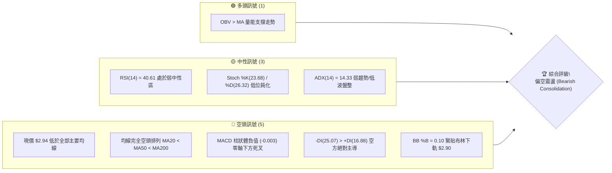

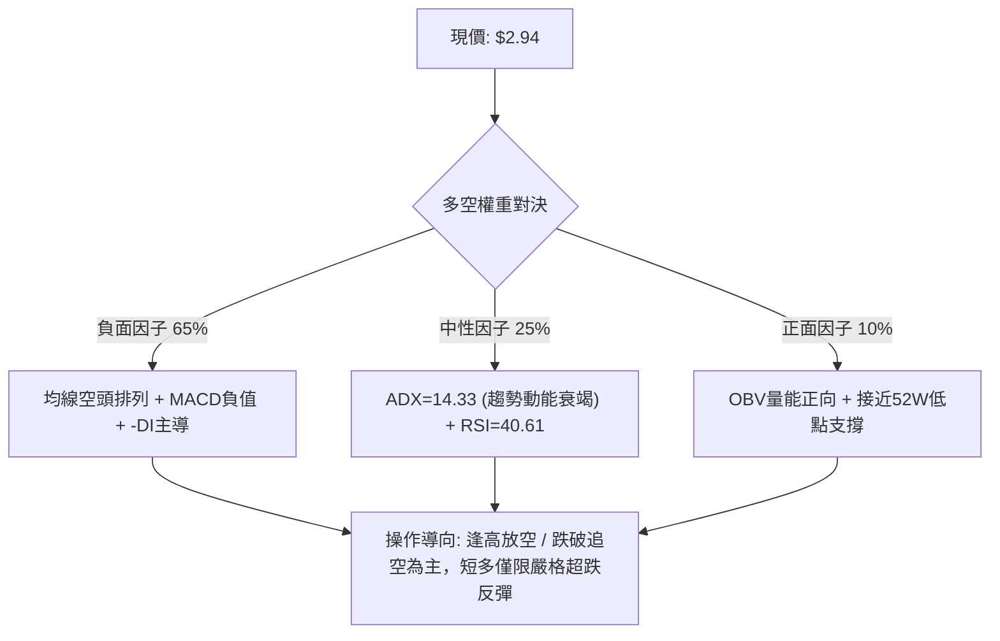

### 📊 核心指標速覽表

| 指標類別 | 指標名稱 | 當前數值 | 訊號 | 解讀 |
|----------|----------|----------|------|------|
| **價格** | 當前價格 | $2.94 | 🔴 | 位於52週區間5.7%極低分位，逼近歷史支撐區 |
| **均線** | MA20 | $3.08 | 🔴 | 價格低於MA20達-4.62%，短期反彈第一動態阻力 |
| **均線** | MA50 | $3.27 | 🔴 | 價格低於MA50達-10.09%，中期波段多空分水嶺 |
| **均線** | MA200 | $3.74 | 🔴 | 價格低於MA200達-21.39%，長期結構處於極端空頭週期 |
| **動能** | RSI(14) | 40.61 | 🟡 | 位於30-70中性區間偏空，尚未進入超賣區，具向下貫穿動能 |
| **動能** | MACD (12,26,9) | -0.063 / -0.060 | 🔴 | MACD線位於訊號線下方，柱狀體為-0.003，空方控制盤面 |
| **動能** | 隨機指標 (%K/%D) | 23.68 / 26.32 | 🟡 | 位於超賣區邊緣徘徊，未出現實質多頭金叉確認信號 |
| **趨勢強度** | ADX / ±DI | 14.33 (-DI:25.07) | 🔴 | ADX<25顯示無方向性大趨勢，但-DI大幅壓制+DI(16.88)，呈陰跌盤整 |
| **通道** | 布林通道 (%B) | 0.10 (軌道 $2.90-$3.26) | 🔴 | 價格貼近下軌，帶寬收斂後具向下破位風險 |
| **量能** | 20日成交量比 | 0.67x (52.35M vs 77.57M) | 🟡 | 量能萎縮，反映追空意願放緩，但買盤承接力道同樣極度匱乏 |
| **波動** | ATR(14) | $0.12 (3.94%) | 🟡 | 每日平均波動幅度窄化，顯示盤面即將迎來方向性選擇 |

### 🏆 技術評分卡

```
╔══════════════════════════════════════════════════════════════════╗
║                技術評分卡 — GRAB (2026-10-18)                    ║
╠══════════════════════════════════════════════════════════════════╣
║ 趨勢強度 (ADX/方向)   █████░░░░░░░░░░░░░░░  25/100 🔴 空頭主導/弱盤整 ║
║ 動能指標 (RSI/MACD)   ███████░░░░░░░░░░░░░  35/100 🔴 弱勢偏空無金叉 ║
║ 支撐穩定度 (S1/52W)   ████████░░░░░░░░░░░░  40/100 🟡 S1 $2.74面臨考驗║
║ 成交量配合 (OBV/Volume)███████████░░░░░░░░░  55/100 🟡 OBV背離但量縮 ║
║ 形態完整度 (通道/格局) ██████░░░░░░░░░░░░░░  30/100 🔴 空頭旗形向下發散║
║ 均線排列 (MA5-MA240)  ██░░░░░░░░░░░░░░░░░░  10/100 🔴 完美全空格局   ║
╠══════════════════════════════════════════════════════════════════╣
║ 綜合評分              ███████░░░░░░░░░░░░░  32.5/100 🔴 強烈偏空   ║
╚══════════════════════════════════════════════════════════════════╝
```

---

## 2. 趨勢分析

### 🌐 多時框趨勢分析

根據「嚴格要求 14」之多時框收斂規則：日線 ADX(14) 為 14.33（小於 25），顯示當前市場處於**盤整衰竭行情**，波動被壓縮在日線布林通道內；但在長線與中線格局上，均線呈現高度一致的空頭下行趨勢，因此日線的任何弱反彈均屬於中長線空頭週期中的修正波。

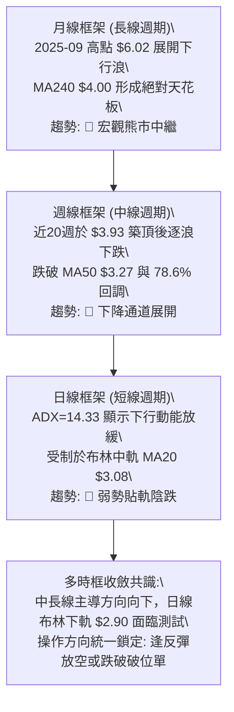

### 📈 長期趨勢 — 12個月走勢圖（Unicode）

```
GRAB 月線走勢圖（過去12個月：2025-11 至 2026-10）
價格軸 ($)
$6.00 ┤ ● (2025-10 高點聚類 $6.01-$6.02)
$5.50 ┤   ●
$5.00 ┤       ●
$4.50 ┤           ●
$4.00 ┤               ●                       (MA200: $3.74)
$3.50 ┤                   ●       ●   ●
$3.00 ┤                       ●           ●   ● ← 現在 ($2.94)
$2.50 ┤                                       (52W Low: $2.74)
      └───────────────────────────────────────────
       11  12  01  02  03  04  05  06  07  08  09  10 (月份)
      [ 2025年 ] [                2026年                ]
```

#### 走勢特徵分析表格

| 階段區間 | 起始價與終點價 | 區間漲跌幅 | 主要技術特徵與動能演變 |
|----------|----------------|------------|------------------------|
| **高位築頂期** (2025-09 ~ 2025-11) | $6.02 → $5.45 | -9.47% | 於 $6.00-$6.24 形成雙頂高點，成交量高位縮量，展開長線回撤。 |
| **第一下行段** (2025-11 ~ 2026-03) | $5.45 → $3.66 | -32.84% | 單邊瀑布式下跌，連續摜破 MA20、MA50 與 MA200，空頭排列確立。 |
| **弱勢抵抗期** (2026-03 ~ 2026-06) | $3.66 → $3.77 | +3.01% | 於 $3.50-$3.80 區間進行箱型震盪，未能有效站回 MA120，反彈無量。 |
| **二次破位段** (2026-07 ~ 2026-10) | $3.93 → $2.94 | -25.19% | 2026-07 衝刺 $3.93 遭阻力 R3($3.96) 壓制，隨後破位下行，目前逼近 $2.74。 |

### 📊 中期趨勢（週線分析）

從近 20 週收盤走勢可精確觀察到中線動能的惡化路徑：
- **頂部確認**：2026-07-12 週收盤於 $3.93，RSI 衝高至 68.4，MACD 柱狀體達到峰值 +0.039，隨後量能無法跟進，形成中期圓弧頂。
- **加速殺跌**：2026-09-13 至 2026-09-20，週收盤由 $3.42 斷崖式跌至 $2.80，RSI 創下 10.6 的極端讀數，週成交量放大至 3.62 億股。
- **無力弱反彈**：2026-09-27 週爆出 5.27 億股天量反彈至 $3.13，但隨後的 10-04 至 10-18 週，收盤價再度由 $3.19 滑落至 $2.94，量能萎縮至 2.80 億股，說明該次爆量僅為空頭回補，現貨買盤意願不足。

```
中期阻力與支撐分佈架構示意：
阻力 R3: $3.96 ════════════════════════════════════════ [中期大頂部]
阻力 R2: $3.64 ------------------------------------ [2026-08 箱頂]
阻力 R1: $3.25 ==================================== [MA50 與前波平臺]
現  價:  $2.94 ◄── [弱勢下探]
支  撐:  $2.74 ------------------------------------ [52W 低點 S1]
```

### ⚡ 趨勢強度評估（ADX 解讀）

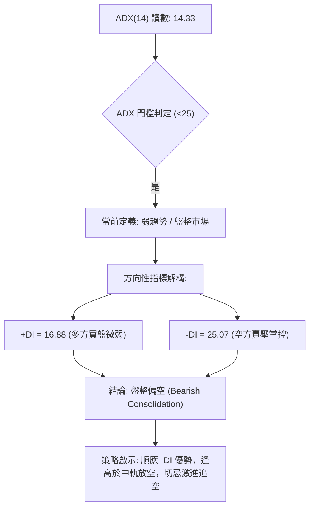

#### ADX 趨勢強度對照解讀

```
ADX 強度進度條:
▓▓▓▓▓▓▓░░░░░░░░░░░░░  14.33/50 (弱趨勢區間)
-DI 空方優勢條:
█████████████░░░░░░░  25.07/50 (主導市場)
+DI 多方能量條:
████████░░░░░░░░░░░░  16.88/50 (受壓制)
```

- **趨勢狀態**：ADX 數值 14.33 遠低於 25 的趨勢分水嶺，意味著前期從 $3.93 殺跌至 $2.80 的單邊快速暴跌暫時告一段落，目前市場正處於「以橫代跌」或「小幅逐波陰跌」的磨底/盤整階段。
- **多空力量**：-DI(25.07) 明顯高於 +DI(16.88)，差值達到 8.19。這表明即使缺乏強大的趨勢動能推動價格崩跌，空方依然完全掌控定價權，反彈高度將持續受限於移動平均線。

---

## 3. 圖表形態分析

### 🔍 形態識別系統

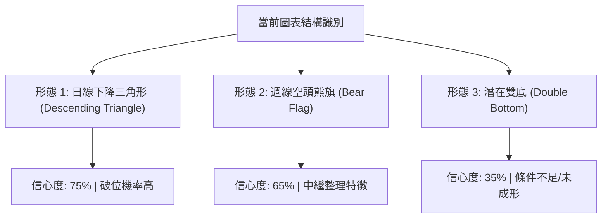

#### 圖表形態信心度與目標價明細表

| 形態名稱 | 信心度 | 判斷依據（引用數據） | 完成度 | 目標價（附計算式） |
|----------|--------|----------------------|--------|--------------------|
| **下降三角形** | 75% | 水平下邊界為 S1 $2.74，下壓趨勢線受阻於 R1 $3.25 與 MA20 $3.08。高點持續走低。 | 85% | 跌破點 $2.74 - 形態高度($3.25 - $2.74 = $0.51) = **$2.23** (若跌破確認) |
| **週線空頭旗形** | 65% | 2026-09 暴跌為旗桿 ($3.93 → $2.80，高度 $1.13)，近 4 週於 $2.80-$3.19 弱勢反彈為旗面。 | 70% | 旗面下軌跌破點 $2.80 - 旗桿高度 $1.13 = **$1.67** (長線中繼推算) |
| **潛在雙重底** | 35% | 第一低點 2026-09-20 週低 $2.80，當前逼近 $2.74，但 MACD 與 RSI 尚未出現金叉確認信號。 | 20% | 訊號不足，僅做指標型解讀。頸線為 R1 $3.25，目前無法滿足形態成立條件。 |

### 🕯️ 重要K線形態分析

| 週/月份 | 收盤價 | K線形態 | 解讀 | 訊號 |
|---------|--------|---------|------|------|
| **2026-09-20 週** | $2.80 | 長陰帶下影線 (Long Bearish Candle) | 恐慌性殺跌跌破 $3.00，觸及 52W 低點區，觸發短期技術性超賣回補。 | 🔴 趨勢破位 |
| **2026-09-27 週** | $3.13 | 爆量長陽線 (High Volume Bullish) | 週成交量爆出 5.27 億股，收復 $3.00 整數關卡，確認 S1 $2.74 支撐有效性。 | 🟢 空頭回補強彈 |
| **2026-10-11 週** | $3.19 | 上吊線 / 倒錘頭 (Inverted Hammer) | 衝高觸及 MA50 $3.27 附近即遭遇猛烈拋壓，週漲幅收窄，預示反彈見頂。 | 🔴 衝高受阻 |
| **2026-10-18 週** | $2.94 | 中黑實體陰線 (Bearish Candle) | 直接吃掉前週漲幅，重新跌破 MA20 $3.08 與 $3.00 整數關卡，重啟下行探底。 | 🔴 短線翻空 |

### 📉 ASCII 走勢形態示意圖

```
GRAB 日線/週線複合形態結構圖：
價格
$3.30 ┤            [下壓趨勢線 / Resistance R1: $3.25]
$3.20 ┤          ● (10-11 高點 $3.19)
$3.10 ┤        /   \     (MA20: $3.08)
$3.00 ┤       /     ● ← 現價 ($2.94)
$2.90 ┤      /        \  (BB下軌: $2.90)
$2.80 ┤     ● (09-20 低點 $2.80)
$2.70 ┤═════●══════════●══════════════════════ [水平支撐 S1 / 52W Low: $2.74]
      └────────────────────────────────────────
       09-20    09-27    10-11    10-18 (時間)
      [ 形態特徵：下降三角形逼近末端收斂，支撐面臨第三次測試 ]
```

### 🎯 形態目標價計算

1. **下行破位目標價（基準情境）**：
   - 形態名稱：日線下降三角形破位
   - 頂部壓力基準：R1 = $3.25
   - 底部支撐基準：S1 = $2.74
   - 三角形垂直高度：$3.25 - $2.74 = $0.51
   - 理論跌破目標價：$2.74 - $0.51 = **$2.23**

2. **向上突破翻轉目標價（替代情境，需有效站穩 R1）**：
   - 形態名稱：雙底底抽突破
   - 突破確認頸線：R1 = $3.25
   - 形態底部低點：S1 = $2.74
   - 理論上升目標價：$3.25 + ($3.25 - $2.74) = **$3.76**（恰好共振阻力位 MA200 $3.74 附近）

---

## 4. 支撐與阻力

### 🗺️ 關鍵價位分布圖（Unicode）

```
GRAB 價位結構分布圖（OHLCV 精確計算）
═══════════════════════════════════════════════════════════════════
$3.96 ║██████████████████████████████║ 強阻力 R3 (2026-07 衝頂波段高點)
$3.74 ║------------------------------║ 動態均線阻力 MA200
$3.64 ║████████████████████          ║ 阻力 R2 (2026-08 波段平臺高點)
$3.49 ║- - - - - - - - - - - - - - - ║ 斐波那契 78.6% 回調位
$3.27 ║------------------------------║ 動態均線阻力 MA50
$3.25 ║██████████████████████████████║ 關鍵阻力 R1 (日線下降趨勢線頂點)
$3.08 ║------------------------------║ 動態均線阻力 MA20 (布林中軌)
$2.94 ╠══════════════════════════════╣ ◄ 當前市價 ($2.94)
$2.90 ║- - - - - - - - - - - - - - - ║ 動態支撐 布林下軌
$2.74 ║▓▓▓▓▓▓▓▓▓▓▓▓▓▓▓▓▓▓▓▓▓▓▓▓▓▓▓▓▓▓║ 關鍵支撐 S1 (52週最低價 / 100%回調)
═══════════════════════════════════════════════════════════════════
```

### 🚧 阻力位分析表

所有價位均嚴格引用 OHLCV 計算聚類數據：

| 阻力級別 | 價位 | 形成原因 | 突破難度 | 重要性 |
|----------|------|----------|----------|--------|
| **R1** | **$3.25** | 近一年波段高點聚類；與日線 MA50($3.27) 及布林上軌($3.26) 形成三合一高密集壓制區。 | 極高 | ★★★★★ |
| **R2** | **$3.64** | 近一年中繼反彈波段高點聚類（2026-08 箱體頂部）；大量籌碼解套套牢區。 | 高 | ★★★★☆ |
| **R3** | **$3.96** | 2026-07 衝高波段大頂聚類；長期下降通道上軌天花板，牛熊轉換終極分水嶺。 | 極高 | ★★★★★ |

### 🛡️ 支撐位分析表

| 支撐級別 | 價位 | 形成原因 | 守住機率 | 重要性 |
|----------|------|----------|----------|--------|
| **動態支撐** | **$2.90** | 日線布林通道下軌；當前價格跌勢的即時減速緩衝帶。 | 55% | ★★★☆☆ |
| **S1** | **$2.74** | 52週歷史最低價（波段低點聚類）；斐波那契 100.0% 回調位，多頭最後生命線。 | 45% | ★★★★★ |
| **衍生支撐** | **$2.23** | 數據中未偵測到原生波段點，此為下降三角形破位($2.74 - $0.51)之形態等幅推算位。 | N/A | ★★★☆☆ |

### 📐 斐波那契回調位分析

依據 52 週波動極值（最高價 $6.24，最低價 $2.74，極值落差 $3.50）之回調階梯分析：

```
斐波那契回調位階圖：
0.0%  (52W High)  $6.24 ──────────────────────────────────
23.6%             $5.41 ──────────────────
38.2%             $4.90 ─────────────
50.0%             $4.49 ───────────
61.8%             $4.08 ─────────
78.6%             $3.49 ───────
現價 ($2.94)       $2.94 ──◄ [處於 78.6% 至 100.0% 極弱勢深水區]
100.0% (52W Low)  $2.74 ───
```

- **當前位置解讀**：現價 $2.94 處於 **78.6% ($3.49)** 與 **100.0% ($2.74)** 之間，距 100% 絕對底部僅差 $0.20 (-6.80%)。
- **技術意義**：股票深幅回撤跌破 78.6% 水平，通常意味著原先的上升週期已被徹底瓦解，市場進入殘酷的價值重估與出清階段。在回調位體系中，$3.49 現已轉化為強大的中期反彈天花板，而現價與 $2.74 之間的緩衝帶過於狹窄，一旦跌破 $2.74，下方將進入無歷史籌碼支撐的「價格真空區」。

---

## 5. 技術指標深度解讀

### 🎛️ 指標訊號總覽

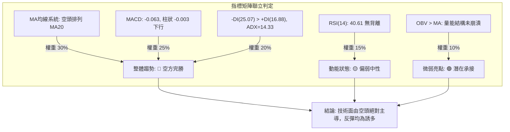

### 📈 移動平均線排列分析

```mermaid
graph LR
    MA240["MA240: $4.00"] --> MA200["MA200: $3.74"]
    MA200 --> MA120["MA120: $3.46"]
    MA120 --> MA60["MA60: $3.31"]
    MA60 --> MA50["MA50: $3.27"]
    MA50 --> MA20["MA20: $3.08"]
    MA20 --> MA10["MA10: $3.06"]
    MA10 --> MA5["MA5: $3.00"]
    MA5 --> PRICE["現價: $2.94"]
    
    style PRICE fill:#ff9999,stroke:#ff0000,stroke-width:2px
    style MA20 fill:#ffcccc,stroke:#ff3333
    style MA50 fill:#ffb3b3,stroke:#ff0000
    style MA200 fill:#ff8080,stroke:#cc0000
```

均線系統呈現教科書式的**完全標準空頭排列**（MA5 < MA10 < MA20 < MA60 < MA120 < MA200 < MA240）：
- **短期均線**：MA5($3.00)、MA10($3.06)、MA20($3.08) 呈現向下陡峭發散，現價 $2.94 受到 MA5 壓制達 -1.87%，短線多頭毫無還手之力。
- **中期壓制**：MA50($3.27) 與 MA60($3.31) 構成中期空頭防線，與阻力 R1($3.25) 高度重疊。
- **長期趨勢**：MA200($3.74) 遠在現價上方 +27.2%，且長期均線傾斜向下（MA240 達 $4.00），顯示機構投資者在過去一年內總體處於持續減碼狀態。

### 📉 RSI(14) 分析

```
RSI(14) 當前水位: 40.61
0        20       30               50               70       80      100
├────────┼────────┼────────────────┼────────────────┼────────┼────────┤
│ 極度超賣 │  超賣區 │    當前位置(40.61)  │     中性偏多   │  超買區 │ 極度超買 │
░░░░░░░░░░░░░░░░░░████████████████░░░░░░░░░░░░░░░░░░░░░░░░░░░░░░░░░░░░
```

- **當前數值解讀**：RSI(14) 讀數為 **40.61**，位於 30-70 的中性區間偏下緣。這是一個極為尷尬的位置——它既沒有深跌至 30 以下形成技術性超賣（無法吸引逆勢抄底買盤），又被壓制在 50 多空分界線下方，證實下行下挫動能尚未出清。
- **背離判斷**：
  - **日線背離判定**：**無明顯背離**。價格在 2026-10-18 跌至 $2.94，RSI 為 40.61，較 2026-09-20 低點（價格 $2.80，RSI 約 10.6）明顯偏高，但此乃反彈見頂後的自然回落，不構成標準底背離（因為當前價格未創出新低）。
  - **結論**：指標目前純粹跟隨價格下行，不存在即時反轉信號。

### 📊 MACD(12/26/9) 訊號解讀

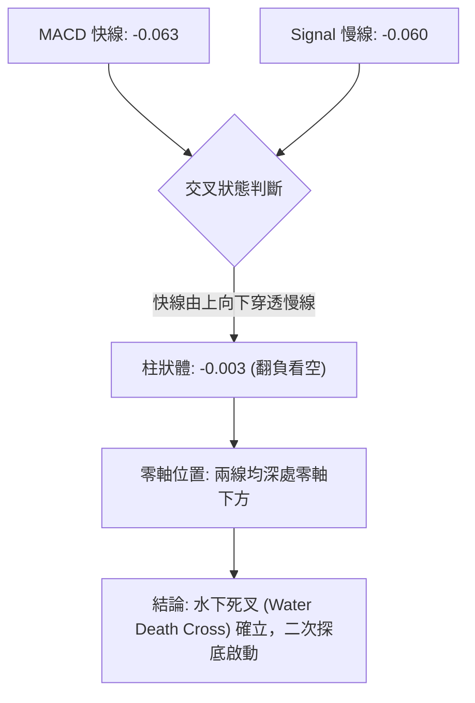

- **數值分析**：MACD 線 (-0.063) 低於 Signal 線 (-0.060)，Hist 柱狀體為 **-0.003**。
- **動能演變**：回顧 9 月底至 10 月初，MACD 柱狀體曾短暫上升至 +0.028 進行技術性修復，但快線始終未能衝上零軸，便在零軸下方再度走平並向下死叉。在技術分析中，「水下死叉」是典型的極弱勢助跌信號，表明反彈動能耗盡，空方將發動新一輪下探尋底。

### 📦 布林通道分析

```
布林通道帶寬架構圖 (日線參數 20, 2)：
$3.30 ┤
$3.26 ┤ ═══════════════════════════════════════════ BB 上軌 ($3.26)
$3.20 ┤
$3.10 ┤ ------------------------------------------- BB 中軌 MA20 ($3.08)
$3.00 ┤
$2.94 ┤                                     ● ← 現價 ($2.94, %B=0.10)
$2.90 ┤ ═══════════════════════════════════════════ BB 下軌 ($2.90)
$2.80 ┤
      └────────────────────────────────────────────
```

- **%B 指標分析**：當前 **%B = 0.10**（0 代表下軌，0.5 代表中軌，1 代表上軌）。數值極端偏向 0，顯示價格正緊貼下軌運行。
- **帶寬特徵（Bandwidth）**：上軌 $3.26 與下軌 $2.90 帶寬僅為 $0.36 (12.2%)，處於近牛熊波動週期的相對收窄期。在均線全空頭排列下，價格貼著下軌運行且帶寬收縮，通常預示著**布林通道即將開口向下（Band Walking Down）**，這往往伴隨著破位加速行情。

### 💹 成交量分析（量價配合度）

- **量能萎縮**：最新成交量為 52,353,500 股，相較於 20 日均量 77,566,385 股，量比僅為 **0.67x**，呈現縮量陰跌。
- **量價關係解讀**：
  - 縮量下跌通常顯示市場拋壓並非恐慌盤湧出，而是呈現「無承接買盤」的流動性真空。
  - 週線歷史數據顯示，2026-09-27 週爆出 5.27 億股天量後，成交量逐週遞減（3.37億 → 4.06億 → 2.80億），價跌量縮反映市場參與者在反彈受阻後情緒再度陷入觀望。
- **OBV 能量潮解讀**：
  - 數據標注「**OBV > MA → 量能支撐上漲**」。這在全盤偏空的指標中是唯一的潛在正面背馳亮點。OBV 保持在均線上方，說明在長線籌碼層面，部分機構投資者在 $2.80-$3.00 區間並未進行恐慌性清倉，甚至存在隱性吸籌跡象；然而，由於短線缺乏主動買盤催化劑，這種底部的量能支撐暫時只能延緩跌勢，無法扭轉均線的實質壓制。

---

## 6. 動能與波動率

### ⚡ 動能評估四象限

動能評估聚焦於「趨勢動能（由 MACD/±DI 衡量）」與「波動率（由 ATR 衡量）」之交互關係：

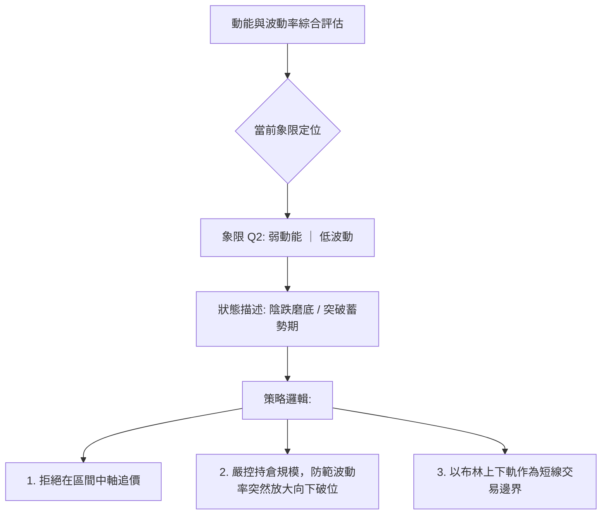

| 象限 | 動能維度 | 波動維度 | 歷史定義 | GRAB 當前定位與評估 |
|------|----------|----------|----------|-------------------|
| **Q1** | 強動能 | 低波動 | 穩健單邊趨勢 | 排除。多空雙方均未展現單邊推動力。 |
| **Q2** | **弱動能** | **低波動** | **收斂盤整 / 陰跌** | **✓ 正確定位。ADX=14.33 表明無動能，ATR=3.94% 顯示波動壓縮，防範向下開口。** |
| **Q3** | 強動能 | 高波動 | 暴漲暴跌主升/主跌浪 | 排除。目前非主跌加速浪。 |
| **Q4** | 弱動能 | 高波動 | 無序震盪洗盤 | 排除。波動率已被高度壓縮。 |

### 📊 ATR 波動率分析

```
ATR(14) 波動率儀表：
數值: $0.12  (佔現價比例: 3.94%)
████████░░░░░░░░░░░░░░░░░░░░  低波動水準 (區間正常值: 3%-5%)
```

- **ATR 數值解讀**：ATR(14) 為 **$0.12**，每日波動幅度為 3.94%。這代表 GRAB 當前的日常日間波動已被壓縮至極致，每日平均波動區間約在 ±$0.12 左右。
- **止損距離建議**：
  - **日間交易/極短線**：建議止損距離為 1.0 × ATR = **$0.12**。
  - **波段交易（Swing Trading）**：建議止損距離為 1.5 × 至 2.0 × ATR = **$0.18 至 $0.24**。
  - 若在現價 $2.94 建立空頭倉位，向上 1.5 倍 ATR 止損價為 $2.94 + $0.18 = **$3.12**（恰好覆蓋 MA20 $3.08 緩衝區）。

### 📐 Beta 與市場相關性

- **Beta 數值**：**0.908**。
- **特徵解讀**：Beta 略小於 1.0，表明該股與標普 500 或整體美股大盤具有較高的同步性，但波動彈性略低於大盤成長股。在市場整體避險情緒高漲時，GRAB 不具備獨立抗跌屬性；反之，若大盤展開反彈，GRAB 由於自身基本面轉型與技術面全均線壓制，反彈彈性亦將被嚴重削弱（Alpha 為負）。

---

## 7. 多時框架總結

### 📋 時框架評分表

| 時框架 | 趨勢方向 | 動能狀態 | 均線排列 | 關鍵形態 | 綜合評分 | 建議 |
|--------|----------|----------|----------|----------|----------|------|
| **月線 (長期)** | 🔴 熊市回撤 | 弱勢下探 | 位於 MA240($4.00) 下方 | 雙頂下行浪 | 25/100 | 長期投資者觀望，禁止左側抄底 |
| **週線 (中期)** | 🔴 下行通道 | MACD微弱 | 跌破 MA50($3.27) | 空頭旗形中繼 | 30/100 | 中線逢高放空，反彈至 R1 減碼 |
| **日線 (短期)** | 🔴 弱勢盤整 | RSI=40.61 偏空 | 完全空頭排列 | 下降三角形末端 | 35/100 | 依循布林下軌運作，嚴設停損 |

### 🔲 綜合訊號矩陣

```
訊號維度對照矩陣：
╔════════════════╦══════════════╦══════════════╦══════════════╗
║ 分析維度       ║ 短期 (日線)  ║ 中期 (週線)  ║ 長期 (月線)  ║
╠════════════════╬══════════════╬══════════════╬══════════════╣
║ 趨勢方向       ║ 🔴 弱盤偏空  ║ 🔴 空頭下行  ║ 🔴 宏觀走熊  ║
║ 均線系統       ║ 🔴 全空排列  ║ 🔴 MA50之下  ║ 🔴 MA200之下 ║
║ 擺動動能       ║ 🟡 RSI中性偏弱║ 🔴 柱狀負值  ║ 🔴 空方控盤  ║
║ 成交量能       ║ 🟡 萎縮 0.67x║ 🟡 逐週遞減  ║ 🟢 OBV未破   ║
║ 關鍵支撐狀態   ║ 🟡 逼近下軌  ║ 🔴 破位風險  ║ 🟡 52W低點邊緣║
╠════════════════╬══════════════╬══════════════╬══════════════╣
║ 綜合判定       ║ 🔴 空方主導  ║ 🔴 逢高做空  ║ 🔴 趨勢偏空  ║
╚════════════════╩══════════════╩══════════════╩══════════════╝
```

### ⚖️ 多時框收斂結論

依據多時框收斂規則第 14 條嚴格收斂：
1. **行情性質定義**：當前日線 ADX(14) 為 14.33（< 25），嚴格定義為**盤整行情（Consolidation Market）**。
2. **主導時框與交易邊界**：在盤整行情下，依規則以**日線布林通道上下軌（$2.90 - $3.26）**作為核心交易邊界。
3. **方向取捨與優先級**：雖然日線動能衰竭進入窄幅震盪，但週線與月線均線呈現全面空頭反壓，且 -DI 壓制 +DI。因此，絕不可將日線盤整誤判為多頭反轉。日線震盪僅提供**更優質的空頭進場點位**（通道上軌附近）或**短線破位下殺的操作窗口**。
4. **唯一方向性結論**：**【強烈偏空觀望 / 逢高做空】**。任何多頭策略僅限於極小倉位博取下軌超跌反彈，主策略必須全面鎖定空頭方向。

---

## 8. 交易策略建議

### 🗺️ 策略決策流程圖

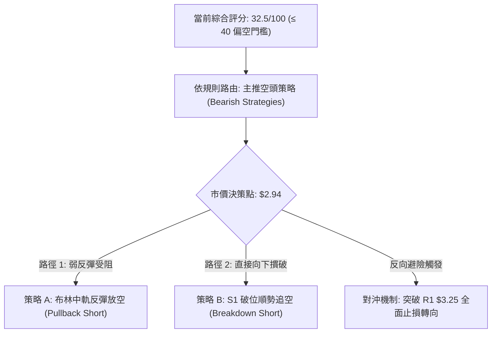

### 🧭 策略路由

**當前主策略方向 = 【主推空頭策略】（依綜合技術評分 32.5/100 判定）**

依據評分卡規則，綜合評分低於 40 分，盤面由空方完全掌控，多頭勝率低下。主推兩套空頭操作架構，多頭僅列為關鍵反轉觸發防禦線。

### 🎯 價格情境階梯（Price Scenarios）

所有價位精確引用 OHLCV 計算聚類與回調位：

| 觸發條件 | 下一目標 | 後續延伸 | 情境含義 |
|----------|----------|----------|----------|
| **向上突破 R1 $3.25** | R2 $3.64 | R3 $3.96 | 短線反轉轉強，空頭必須無條件平倉止損。 |
| **向上承壓 MA20 $3.08** | $2.94 (現價) | S1 $2.74 | 反彈無力，空頭最佳加碼做空點。 |
| **跌破布林下軌 $2.90** | S1 $2.74 | 形態推算 $2.23 | 破位加速，日線下降三角形展開向下收斂出清。 |
| **失守 52W 底 $2.74** | 形態目標 $2.23 | 數據未偵測更低點 | 創歷史新低，進入無支撐真空暴跌段。 |

### 📊 情境機率分佈

| 情境劇本 | 機率 | 主要依據（指標狀態） |
|----------|------|----------------------|
| **向下破位探底 (跌破S1)** | **55%** | 均線全空排列、MACD零軸下死叉、布林 %B=0.10 帶寬向下發散。 |
| **通道區間震盪 ($2.90-$3.08)** | **35%** | ADX=14.33 顯示趨勢動能微弱，成交量極度萎縮至 0.67x。 |
| **向上強勁反彈 (挑戰R1)** | **10%** | 僅依託 OBV 量能未崩與分析師平均目標價 $5.58 之情緒修復，技術面無支撐。 |

### 🟢 主策略詳情（空頭導向主策略）

所有價位均嚴格基於第 4 章聚類數據與 ATR 計算，無捏造數值：

| 策略要素 | 策略 A（反彈高空 — 穩健型） | 策略 B（破位追空 — 激進型） |
|----------|----------------------------|----------------------------|
| **進場條件** | 價格反彈至 MA20 與布林中軌受阻，日K收長上影線 | 價格實體陰線跌破 52W 低點 S1，成交量放大確認 |
| **進場價格** | **$3.08**（精確對齊 MA20 / 布林中軌） | **$2.72**（跌破 S1 $2.74 觸發空單入場） |
| **目標價 T1** | **$2.90**（布林通道下軌） | **$2.48**（S1 與推算目標 $2.23 之 50% 空間） |
| **目標價 T2** | **$2.74**（波段低點聚類 S1） | **$2.23**（下降三角形高度推算目標價） |
| **止損價格** | **$3.20**（覆蓋 10-11 高點 $3.19 與 1.0×ATR） | **$2.86**（S1 上方 1.0×ATR = $2.74 + $0.12） |
| **風險報酬比** | **1 : 2.83** (冒險 $0.12 獲取 $0.34 至 T2) | **1 : 3.50** (冒險 $0.14 獲取 $0.49 至 T2) |
| **成功機率** | **65%** | **55%** |
| **建議倉位** | **15% - 20%** 總資產 | **10%** 總資產（破位追空需嚴控倉位） |

### 🔴 反向風險觸發點（對沖提示）

若市場出現未預期利多推動價格逆勢上漲，以下為**徹底推翻空頭邏輯的平倉/反手線**：
1. **反轉預警點**：價格收盤強勢站上 **$3.08 (MA20)**，空頭部位應減碼 50%。
2. **多頭翻轉成立點**：日線實體大陽線收盤突破 **$3.25 (阻力位 R1 / MA50)**。若此情況發生，代表下降三角形形態被向上無效化，技術面將形成島狀反轉，所有空頭必須**立即無條件市價止損出場**，甚至可反手短多博取向上回補至 R2($3.64)。

### ⭐ 整體訊號強度評星

```
做多訊號強度：★☆☆☆☆  (1.0/5星 — 僅存在超跌技術修復可能)
做空訊號強度：★★★★☆  (4.0/5星 — 順應長中短共振空頭排列)
整體可信度：  ★★★★☆  (4.0/5星 — 指標收斂高度一致，趨勢明朗)
```

---

## 9. 風險提示與監控

### ✅ 關鍵監控指標 Checklist

```
╔══════════════════════════════════════════════════════════════════╗
║              GRAB 技術面每日風控監控清單 (Checklist)             ║
╠══════════════════════════════════════════════════════════════════╣
║ [ ] 監控項 1: 收盤價是否跌破 S1 $2.74 (跌破即進入單邊崩跌期)      ║
║ [ ] 監控項 2: MACD 柱狀體負值是否擴大低於 -0.010 (動能加速訊號)    ║
║ [ ] 監控項 3: 日成交量是否放大至 1.0 億股以上 (爆量破位或爆量洗盤) ║
║ [ ] 監控項 4: RSI(14) 是否跌破 30 進入超賣鈍化區 (考驗下軌支撐)   ║
║ [ ] 監控項 5: 現價是否反彈觸及 MA20 $3.08 (空單最佳回補/防守點)   ║
║ [ ] 監控項 6: 布林通道帶寬是否由收窄轉為開口向下發散             ║
╚══════════════════════════════════════════════════════════════════╝
```

### ⚠️ 風險場景分析

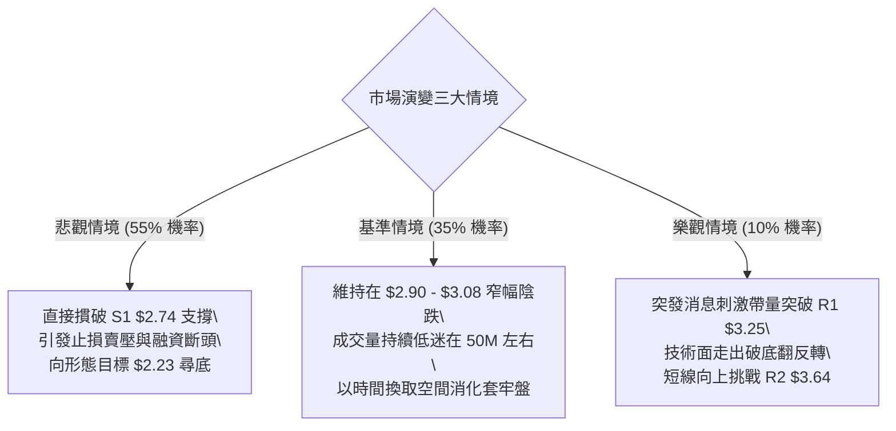

### 🛡️ 風險管理重要提醒

1. **基本面與技術面嚴重背離風險**：
   - 數據顯示華爾街分析師共識評級為 `strong_buy`，平均目標價高達 **$5.58**（最低目標 $4.42 亦遠高於現價 $2.94），且公司具備 45 億美元淨現金與 21.9% 的營收成長率。
   - **操作禁忌**：**絕對不可因為基本面估值便宜而在技術面破位時盲目「重倉抄底」**。技術圖表反映的是市場微觀結構中的籌碼出逃與流動性折價，在均線未拐頭之前，資本市場可能長期維持非理性定價。
2. **流動性與波動陷阱**：
   - 當前 ATR 僅 $0.12，盤面波動看似鈍化，但低波動往往是暴風雨的前奏。嚴禁使用高槓桿金融衍生品（如深度虛值期權）博取反彈，以防時間價值迅速磨滅或突然向下跳空破位引發巨大滑點。
3. **倉位管理防線**：
   - 總部位風險暴露建議控制在投資組合淨值的 **3% 以內**。
   - 單筆空頭交易嚴格執行最大虧損不超過總資本 1% 的風控原則（以止損點 $0.12-$0.14 推算合理股數）。

---

## 📋 報告總結

```
╔══════════════════════════════════════════════════════════════════╗
║                   GRAB 技術分析報告總結                          ║
╠══════════════════════════════════════════════════════════════════╣
║ 報告日期：2026-10-18                                             ║
║ 當前價格：$2.94                                                  ║
║ 分析評級：🔴 強烈偏空 / 逢高做空 (Bearish / Sell on Rallies)    ║
║ 綜合評分：32.5 / 100 ▓▓▓▓▓▓▓░░░░░░░░░░░░░                       ║
╠══════════════════════════════════════════════════════════════════╣
║ 關鍵技術結論：                                                   ║
║ ├─ 長期趨勢：🔴 宏觀熊市週期，受制於 MA200 $3.74 與 MA240 $4.00    ║
║ ├─ 中期趨勢：🔴 下降通道展開，週線 MACD 零軸下死叉，反彈動能衰竭 ║
║ ├─ 短期趨勢：🔴 日線標準全空頭排列，價格貼著布林下軌 $2.90 陰跌 ║
║ ├─ 關鍵支撐：S1: $2.74 (52W歷史低點) ｜ 形態破位目標: $2.23      ║
║ ├─ 關鍵阻力：R1: $3.25 (MA50與波段頂) ｜ MA20動態阻力: $3.08     ║
║ └─ 分析師目標：均價 $5.58 (技術面嚴重背離，暫不可作為買入依據)    ║
╠══════════════════════════════════════════════════════════════════╣
║ 最優策略組合：                                                   ║
║ 1. 🥇 最佳機會：等待反彈至 MA20 $3.08 建立空單，止損 $3.20，     ║
║                 目標 $2.74 (風險報酬比 1:2.83)。                 ║
║ 2. 🥈 次選機會：實體破位跌破 S1 $2.74 順勢追空至 $2.48-$2.23，   ║
║                 止損 $2.86 (嚴格控制 10% 輕倉)。                 ║
║ 3. 🥉 保守選擇：空手觀望，靜待日線 RSI 出現底背離且突破 R1 $3.25 ║
║                 確認底部形成後，方可進場佈局長線多頭。           ║
╚══════════════════════════════════════════════════════════════════╝
```

---

> ⚠️ **免責聲明**：本報告為依據標準量化與技術圖表指標體系自動生成之技術分析報告，所有引用數據（包括支撐阻力位、斐波那契回調點、均線參數與量能指標）均嚴格源自歷史 OHLCV 統計。本報告**僅供研究與學術參考**，**不構成任何要約、招攬或投資建議**。金融市場具有高度風險，資產價格可升亦可跌，投資人應獨立評估風險並自負盈虧。

---

*報告生成時間：2026-10-18 ｜ 數據來源：Yahoo Finance ｜ 分析框架：資深多時框技術分析體系*