# GRAB 技術分析報告

> **報告日期**：2026-10-19 ｜ **語言**：繁體中文 ｜ **數據來源**：Yahoo Finance ｜ **當前價格**：$2.94

---

## 目錄

| 章節 | 內容 |
|------|------|
| [1. 技術面概覽](#1-技術面概覽) | 訊號儀表板、核心指標、評分卡 |
| [2. 趨勢分析](#2-趨勢分析) | 多時框趨勢、長中短期走勢 |
| [3. 圖表形態分析](#3-圖表形態分析) | 形態識別、K線組合、目標價 |
| [4. 支撐與阻力](#4-支撐與阻力) | 關鍵價位、斐波那契回調 |
| [5. 技術指標深度解讀](#5-技術指標深度解讀) | MA/RSI/MACD/布林/成交量 |
| [6. 動能與波動率](#6-動能與波動率) | 動能評估、ATR、Beta |
| [7. 多時框架總結](#7-多時框架總結) | 時框架評分矩陣、收斂結論 |
| [8. 交易策略建議](#8-交易策略建議) | 策略路由、多空情境、風險報酬比 |
| [9. 風險提示與監控](#9-風險提示與監控) | 監控清單、情境模擬、風控準則 |

---

## 1. 技術面概覽

### 🎯 技術訊號儀表板

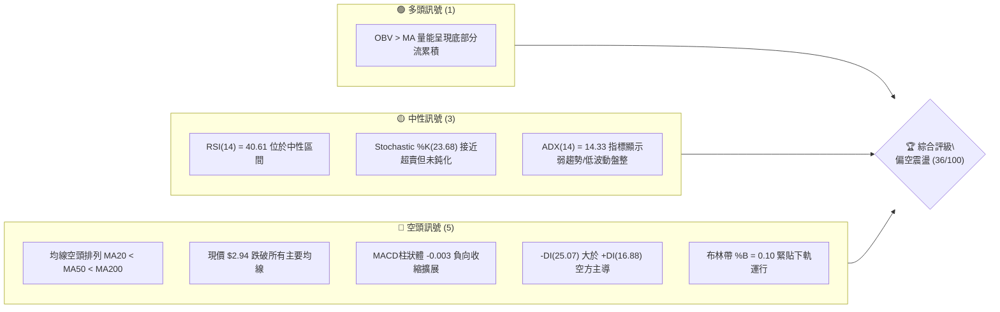

### 📊 核心指標速覽表

| 指標類別 | 指標名稱 | 當前數值 | 訊號 | 專業解讀 |
|:---|:---|:---|:---:|:---|
| **價格** | 當前收盤價 | $2.94 | 🔴 | 位於 52 週區間 ($2.74 - $6.24) 的 5.7% 極低位，防守脆弱 |
| **均線** | 短期 MA20 | $3.08 | 🔴 | 價格低於 MA20 (-4.62%)，短線反彈壓力顯著 |
| **均線** | 中期 MA50 | $3.27 | 🔴 | 價格低於 MA50，中期下降趨勢未扭轉 |
| **均線** | 長期 MA200 | $3.74 | 🔴 | 價格低於 MA200 (-21.39%)，長期牛熊分界線失守 |
| **動能** | RSI(14) | 40.61 | 🟡 | 位於中性偏弱區，未跌破 30 超賣線，缺乏短線超賣反彈動能 |
| **動能** | MACD (12,26,9) | -0.063 | 🔴 | MACD 線低於訊號線 (-0.060)，Hist 為 -0.003，動能偏向空方 |
| **趨勢** | ADX(14) / DMI | 14.33 | 🟡 | ADX < 25 表明趨勢動能極弱，但 -DI(25.07) > +DI(16.88) 空方佔優 |
| **通道** | 布林帶 %B | 0.10 | 🔴 | 價格貼近下軌 $2.90，通道開口微擴，存在弱勢破底風險 |
| **波動** | ATR(14) | $0.12 | 🟢 | 波動率佔股價 3.94%，處於低波動壓縮期，醞釀變盤 |
| **籌碼** | OBV 量能 | OBV > MA | 🟢 | 量能指標高於其均線，顯示低檔有被動資金吸收籌碼 |

### 🏆 技術評分卡

```
╔══════════════════════════════════════════════════════════════════╗
║              技術評分卡 — GRAB (2026-10-19)                     ║
╠══════════════════════════════════════════════════════════════════╣
║ 趨勢強度 (Trend)      ██████░░░░░░░░░░░░░░  30/100  🔴 空頭排列  ║
║ 動能指標 (Momentum)   ████████░░░░░░░░░░░░  40/100  🟡 弱勢中性  ║
║ 支撐穩定度 (Support)  ████████░░░░░░░░░░░░  40/100  🟡 考驗S1    ║
║ 成交量配合 (Volume)   ████████████░░░░░░░░  60/100  🟢 OBV底背離 ║
║ 形態完整度 (Pattern)  ██████░░░░░░░░░░░░░░  30/100  🔴 低檔無形  ║
║ 均線發散度 (Moving A) ████░░░░░░░░░░░░░░░░  20/100  🔴 完全空頭  ║
╠══════════════════════════════════════════════════════════════════╣
║ 綜合技術評分          ███████░░░░░░░░░░░░░  36/100  🔴 偏空觀望  ║
╚══════════════════════════════════════════════════════════════════╝
```

---

## 2. 趨勢分析

### 🌐 多時框趨勢分析

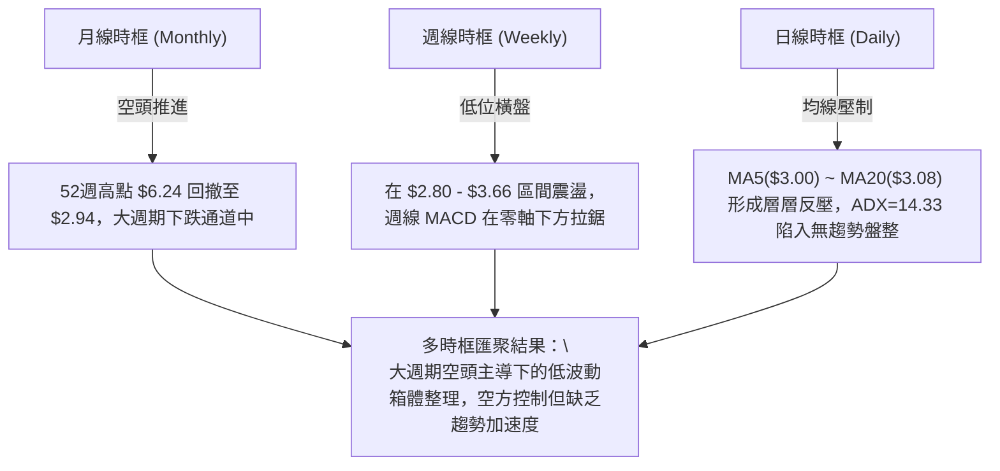

### 📈 長期趨勢 — 12個月走勢圖（Unicode）

以下為 GRAB 自 2025 年 11 月至 2026 年 10 月之月線收盤價格軌跡與關鍵轉折分析：

```
GRAB 月線收盤走勢圖 (2025-11 至 2026-10)
價格 ($)
$6.00 ┤                               
$5.45 ┤ ● (2025-11)                   
$4.99 ┤   ↘ ● (2025-12)               
$4.30 ┤       ↘ ● (2026-01)           
$4.22 ┤           ● (2026-02)         
$3.82 ┤                   ● (2026-04) 
$3.77 ┤                           ● (2026-06)
$3.66 ┤               ● (2026-03)     
$3.54 ┤                       ● ──── ● ─ ● (2026-05,07,08)
$3.11 ┤                                   ↘ ● (2026-09)
$2.94 ┤                                       ● (2026-10 現價)
$2.74 ┴───────────────────────────────────────── (52W Low S1)
        11  12  01  02  03  04  05  06  07  08  09  10 (月份)
```

**走勢特徵分析表格**：

| 階段區間 | 時間跨度 | 起訖價位 | 漲跌幅 | 趨勢特徵與價量結構說明 |
|:---|:---|:---:|:---:|:---|
| **第一階段：主跌段釋放** | 2025-11 → 2026-03 | $5.45 → $3.66 | -32.84% | 單邊下行，失守 $5.00 與 $4.00 整數關卡，估值修正劇烈 |
| **第二階段：弱勢次級反彈** | 2026-03 → 2026-04 | $3.66 → $3.82 | +4.37% | 量能不濟，遇 MA60 反壓受阻回落，形成下降中繼高點 |
| **第三階段：箱型下飄橫盤** | 2026-05 → 2026-08 | $3.54 → $3.54 | 0.00% | 股價於 $3.50 - $3.77 進行窄幅拉鋸，動能指標收縮 |
| **第四階段：破位二次探底** | 2026-09 → 2026-10 | $3.54 → $2.94 | -16.95% | 跌破 $3.50 平台，下探至 $2.94，測試 52 週最低點 $2.74 |

### 📊 中期趨勢（週線分析）

從近 20 週歷史數據審視，GRAB 在 2026 年 7 月初曾見週線高點 $3.93（RSI 達 77.2 超買區），隨後引發連續拋壓。

```
GRAB 週線壓力與支撐階梯示意圖
$3.96 ══════════════════════════════════════════ [R3 近一年波段強阻力]
        ↑ 2026-07-12 高點 $3.93 觸發見頂
$3.64 ────────────────────────────────────────── [R2 中期反彈頸線阻力]
        ↑ 2026-08-09 週線反彈高點 $3.66
$3.25 ------------------------------------------ [R1 短線密集套牢區]
        ↑ 2026-10-11 反彈高點 $3.19 ~ MA60 所在
$2.94 ─── ◄ 當前收盤價 ($2.94) ───
$2.74 ══════════════════════════════════════════ [S1 52週極限低點 / 波段支撐]
```

在 2026 年 9 月 20 日當週，股價打出週線低點 $2.80，週線 RSI 降至 10.6 的極度超賣水位，促發 2026-09-27 當週 5.27 億股的歷史天量反彈至 $3.13。然而，10 月中旬受制於 $3.19 反壓，近一週（2026-10-18）再度滑落至 $2.94，顯示中期走勢仍為空方主導的下降旗形或弱勢盤整。

### ⚡ 趨勢強度評估（ADX 解讀）

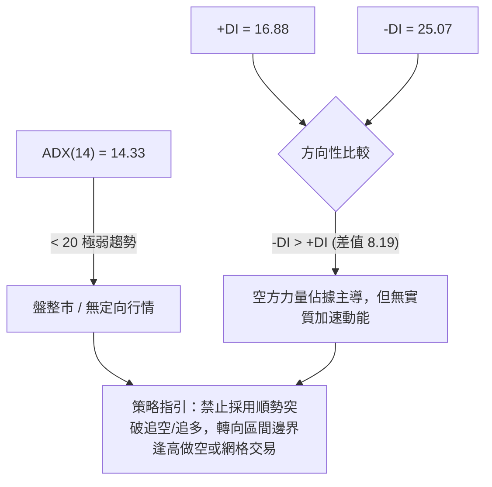

| 指標變數 | 當前讀數 | 門檻區間 | 當前狀態判定 | 交易意涵 |
|:---|:---:|:---:|:---:|:---|
| **ADX (14)** | **14.33** | < 25 (弱趨勢/盤整) | 🟢 弱勢盤整階段 | 單邊突破多為假突破，動能不足以發動持久趨勢 |
| **+DI (14)** | **16.88** | 參考值 | 🔴 多頭動能匱乏 | 買盤力道低迷，難以組織持續性多頭進攻 |
| **-DI (14)** | **25.07** | 參考值 | 🔴 空頭動能佔優 | 拋壓雖未急遽失控，但空方仍控制盤面定價權 |

---

## 3. 圖表形態分析

### 🔍 形態識別系統

依據嚴格規則 15，所有形態必須具備客觀幾何條件與信心度評估。


#### 形態識別與信心度評估表

| 識別形態 | 信心度 | 判斷依據（引用數據） | 完成度 | 目標價（附嚴謹計算式） | 交易指引 |
|:---|:---:|:---|:---:|:---|:---|
| **低檔橫盤整理區間** | **75%** | 價格受制於 R1($3.25) 與 S1($2.74) 之間，ADX=14.33 符合盤整特徵 | 85% | **目標價 T1: $2.74**<br>計算式：區間底邊支撐位直接測算 | 區間內高拋低吸，以靠近區間邊界操作為主 |
| **下降通道內嵌結構** | **65%** | 2026-07 高點 $3.93 聯結 2026-10 高點 $3.19，低點 $2.80 對應支撐 | 70% | **目標價 T1: $2.74**<br>若跌破 S1，下探下軌推算約 $2.60（形態高度推算：$3.19 - ($3.66-$3.19)） | 順應均線下行趨勢逢高布空 |
| **雙底結構 (W-Bottom)** | **35%** | 2026-09-20 低點 $2.80 與 52W 低點 $2.74 構成潛在二度探底 | 30% | *訊號不足，僅做指標型解讀*<br>（未越過頸線 R1 $3.25 前形態不成立） | 嚴禁提前押注形態突破 |

### 🕯️ 重要K線形態分析

| 觀測週期 | 關鍵價位 | K線結構形態 | 技術解讀 | 訊號強度 |
|:---|:---:|:---|:---|:---:|
| **2026-09-20 週** | 收 $2.80 | **極長下影大陰線** | 測試歷史低位引發恐慌拋售，RSI 觸及 10.6 極值，空頭竭盡徵兆 | 🟡 止跌雛形 |
| **2026-09-27 週** | 收 $3.13 | **爆量長陽包覆線** | 單週成交 5.27 億股吞噬前陰，確認 $2.80 附近有強力主力承接買盤 | 🟢 短線多頭反彈 |
| **2026-10-11 週** | 收 $3.19 | **長上影流星線** | 反彈至 MA60($3.31) 與 R1($3.25) 前哨即遭遇解套賣壓，衝高受阻 | 🔴 上檔反壓沉重 |
| **2026-10-18 週** | 收 $2.94 | **實體破位中陰線** | 連續兩週回吐，重新收於 MA20($3.08) 與 MA5($3.00) 下方，回吐反彈成果 | 🔴 空方重掌主控 |

### 📉 ASCII 走勢形態示意圖

```
GRAB 日線/週線 箱體整理結構示意圖
$3.25 ───────┬─────────────────────────────── [R1 / 區間頂部阻力]
             │      ╭──╮
             │     ╭╯  ╰╮   ╭──╮ (2026-10-11 衝高 $3.19 受阻)
$3.08 ───────┼─────╯────╰───┼──╰──── [MA20 / 中軌反壓]
             │             ╰╮
$2.94 ───────┼──────────────● ◄─── (現價 $2.94，弱勢滑落中)
             │  ╭─╮
$2.80 ───────┼──╯ ╰──────── [2026-09-20 週線低點]
$2.74 ───────┴─────────────────────────────── [S1 / 52W Low 極限支撐]
```

### 🎯 形態目標價計算

根據低檔整理區間形態測算：
*   **區間頂部頸線**：$3.25 (R1)
*   **區間底部支撐**：$2.74 (S1)
*   **形態垂直高度 (H)**：$3.25 - $2.74 = $0.51
*   **向下破位理論量度目標**：若實體跌破 $2.74，向下等幅測算 = $2.74 - $0.51 = **$2.23**（數據中未偵測到此支撐，純屬幾何測算）
*   **向上突破理論量度目標**：若實體帶量突破 $3.25，向上等幅測算 = $3.25 + $0.51 = **$3.76**（高度逼近 MA200 之 $3.74 與 R2 $3.64 擴展帶）

---

## 4. 支撐與阻力

### 🗺️ 關鍵價位分布圖（Unicode）

```
GRAB 價位結構分布圖（資料來源：OHLCV 計算數據）
═════════════════════════════════════════════════════════════════
$3.96 ║████████████████████████║ 強阻力 R3 (近一年波段高點聚類)
      ║                        ║
$3.64 ║████████████████████    ║ 阻力 R2 (中期波段頸線反壓)
      ║                        ║
$3.49 ║▒▒▒▒▒▒▒▒▒▒▒▒▒▒▒▒▒▒▒▒    ║ 斐波那契 78.6% 回調位
      ║                        ║
$3.25 ║████████████████████████║ 關鍵阻力 R1 (布林上軌 $3.26 / 近期波段頂部)
      ║                        ║
$3.08 ║────────────────────────║ 短期均線密集區 (MA20 / 布林中軌)
      ║                        ║
$2.94 ╠════════════════════════╣ ◄ 現價 ($2.94，貼近布林下軌 $2.90)
      ║                        ║
$2.74 ║████████████████████████║ 強支撐 S1 (52週最低點聚類 / 斐波那契 100%)
═════════════════════════════════════════════════════════════════
註：數據中未偵測到 S2 與 S3 級別支撐位。
```

### 🚧 阻力位分析表

所有阻力位數值嚴格引用 OHLCV 計算聚類：

| 阻力級別 | 準確價位 | 距現價空間 | 形成技術原因 | 突破難度評估 | 戰略重要性 |
|:---|:---:|:---:|:---|:---:|:---:|
| **R1** | **$3.25** | +10.54% | 近一年波段高點聚類，重疊布林帶上軌($3.26)與 MA50($3.27) | 🔴 極難 | ★★★★☆ |
| **R2** | **$3.64** | +23.81% | 近一年次級反彈高點聚類，重疊 2026-08 週線高點 $3.66 | 🔴 極難 | ★★★☆☆ |
| **R3** | **$3.96** | +34.69% | 近一年波段高點聚類，重疊 2026-07 週線見頂價位 $3.93 | 🔴 極難 | ★★★★★ |

### 🛡️ 支撐位分析表

所有支撐位數值嚴格引用 OHLCV 計算聚類：

| 支撐級別 | 準確價位 | 距現價空間 | 形成技術原因 | 守住機率評估 | 戰略重要性 |
|:---|:---:|:---:|:---|:---:|:---:|
| **S1** | **$2.74** | -6.80% | 52 週最低點聚類，斐波那契 100.0% 終極防守基石 | 🟡 60% | ★★★★★ |
| **S2** | *數據未偵測* | — | 歷史數據中未偵測到次級支撐，一旦失守 S1 將進入無籌碼真空區 | — | — |
| **S3** | *數據未偵測* | — | 歷史數據中未偵測到 | — | — |

### 📐 斐波那契回調位分析

依據 52 週區間極值點（$2.74 → $6.24，總波動空間 $3.50）之回調計算如下：

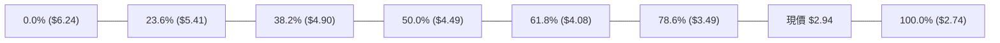

| 回調比率 | 價位基準 | 與現價相對位置 | 技術意義與市場行為解讀 |
|:---:|:---:|:---:|:---|
| **0.0%** | **$6.24** | 52W High (+112.24%) | 多頭週期的歷史巔峰，強大套牢盤 |
| **23.6%** | **$5.41** | 上方阻力區 (+84.01%) | 2025-11 反彈衰竭位置 |
| **38.2%** | **$4.90** | 上方阻力區 (+66.67%) | 2025-12 盤整中樞 |
| **50.0%** | **$4.49** | 上方阻力區 (+52.72%) | 長期多空分水嶺，重大心理關卡 |
| **61.8%** | **$4.08** | 上方阻力區 (+38.78%) | 黃金分割強防守轉阻力位，重疊 MA240($4.00) |
| **78.6%** | **$3.49** | 上方阻力區 (+18.71%) | 2026-05 至 2026-08 平台底部，跌破後轉為極強反壓 |
| **現價** | **$2.94** | **基準錨點** | **位於 78.6% ($3.49) 與 100.0% ($2.74) 之間的深度回撤區域** |
| **100.0%** | **$2.74** | 52W Low (-6.80%) | 全年最後防線，若跌破代表下跌波段展開新一輪延伸浪 |

---

## 5. 技術指標深度解讀

### 🎛️ 指標訊號總覽

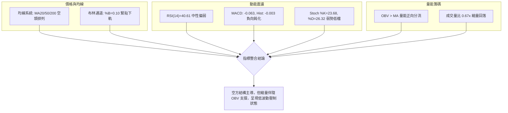

### 📈 移動平均線排列分析

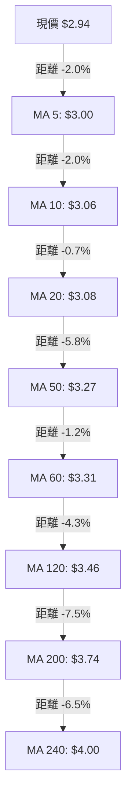

*   **均線結構狀態**：呈現極其嚴整的**完全空頭排列**（$MA5 < MA10 < MA20 < MA50 < MA60 < MA120 < MA200 < MA240$）。
*   **均線離差特徵**：現價距離長期均線 MA200 負乖離達 -21.39%，距離短期均線 MA20 負乖離 -4.62%。雖有乖離修復需求，但在弱勢盤整中，多以橫盤時間換取空間，難以觸發猛烈軋空。

### 📉 RSI(14) 分析

*   **數值展示**：
    `RSI(14): 40.61` ▓▓▓▓▓▓▓▓░░░░░░░░░░░░ 40.61%
*   **區間定位**：處於 30 至 70 之普通中性偏弱區。既非超買（>70），亦未達超賣（<30）。
*   **背離檢測**：
    *   2026-09-20 週線低點 $2.80 對應 RSI 為 10.6；
    *   當前日線價格 $2.94，RSI 為 40.61。
    *   **結論：無頂背離，亦無日線級別底背離**。指標隨價格回落自然下修，反映常規拋壓。

### 📊 MACD(12,26,9) 訊號解讀

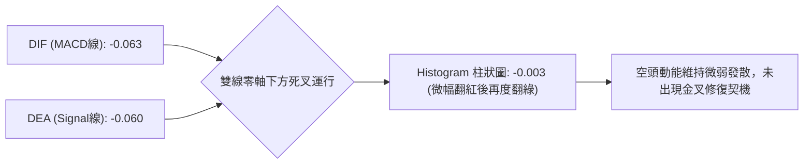

MACD 指標在零軸遠下方運行，負柱狀體再度擴展（-0.003），顯示短線的反彈動能已於 10 月上旬耗盡，市場重新由空頭掌控微幅壓制盤面。

### 📦 布林通道分析

```
GRAB 布林通道與現價位階示意圖
$3.26 ══════════════════════════════════════════ 上軌 (Upper Band)
      │
      │
$3.08 ────────────────────────────────────────── 中軌 (MA20)
      │
      │                                 ╭──● (現價 $2.94，%B = 0.10)
$2.90 ══════════════════════════════════╧═══════ 下軌 (Lower Band)
```

*   **參數狀況**：上軌 $3.26，中軌 $3.08，下軌 $2.90，通道寬度僅 $0.36 (約 12.2% 帶寬)，處於高度收斂後微幅擴張狀態。
*   **%B 指標**：0.10，顯示現價正極度貼近下軌（0 代表下軌，$2.94 僅高出下軌 $0.04）。若下軌無法提供彈性支撐，價格有沿著下軌「通道貼軌下行」（Band Walking）的隱憂。

### 💹 成交量分析（量價配合度）

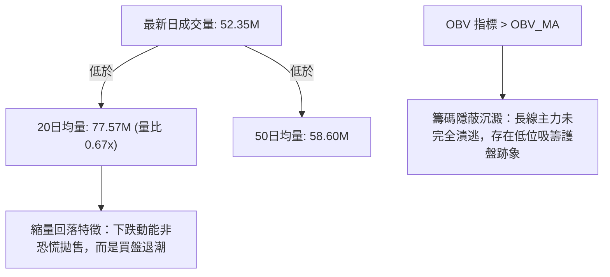

當前呈現「量縮價跌」結構，最新成交量僅 5,235 萬股，量比 0.67x，顯示當前空方砸盤意願亦在衰減。OBV 仍維持在均線之上，與破位走勢形成輕微的量價背離，提供了低檔具備防禦性買盤的佐證。

---

## 6. 動能與波動率

### ⚡ 動能評估四象限

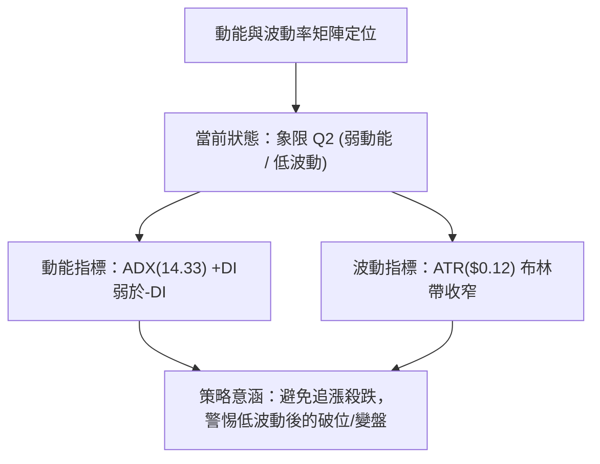

| 象限標記 | 動能維度 | 波動維度 | 當前狀態吻合 | 實戰策略指引 |
|:---:|:---:|:---:|:---:|:---|
| **Q1** | 強動能 (ADX > 25) | 低波動 (ATR 偏低) | — | 趨勢初升段，最佳順勢加碼點 |
| **Q2** | **弱動能 (ADX < 25)** | **低波動 (ATR = 3.94%)** | **✓ 符合當前特徵** | **謹慎觀望，以區間極值高拋低吸為主，預防變盤** |
| **Q3** | 強動能 (ADX > 25) | 高波動 (ATR 偏高) | — | 主升/主跌浪，盈虧比高但停損幅度需放大 |
| **Q4** | 弱動能 (ADX < 25) | 高波動 (ATR 偏高) | — | 混亂震盪洗盤，容易兩頭打臉，應停止交易 |

### 📊 ATR 波動率分析

*   **ATR(14) 讀數**：**$0.12**（佔現價 $2.94 的 **3.94%**）。
*   **日內平均波幅空間**：約 12 美分，表明個股處於波動極度壓縮的休眠階段。
*   **風控止損參數設定建議**：
    *   *超短線交易止損距離*：$1.0 \times \text{ATR} = \$0.12$
    *   *波段交易標準止損距離*：$1.5 \times \text{ATR} = \$0.18$
    *   *結構性防守止損距離*：$2.0 \times \text{ATR} = \$0.24$

### 📐 Beta 與市場相關性

*   **Beta 係數**：**0.908**。
*   **特性分析**：Beta 略低於 1.00，顯示 GRAB 與美股大盤（標普 500 / 納斯達克）維持正相關，但在市場系統性波動時展現輕微的防禦性鈍化。當前跌勢主要由基本面估值再平衡與自身技術面拋壓驅動，而非大盤 Beta 單一因素引發。

---

## 7. 多時框架總結

### 📋 時框架評分表

| 時框架 | 趨勢方向 | 動能狀態 | 均線排列狀態 | 圖表形態特徵 | 綜合評分 | 戰略建議 |
|:---|:---:|:---:|:---:|:---:|:---:|:---|
| **月線 (長期)** | 🔴 空頭 | 🔴 弱勢負值 | 完全空頭 ($MA200=\$3.74$) | 52W 高點下行之主跌浪中繼 | **25/100** | 空頭壓制，嚴禁盲目長線抄底 |
| **週線 (中期)** | 🔴 偏空 | 🟡 中性超賣修復 | 空頭排列 ($MA50=\$3.27$) | 下降通道內嵌入 $2.80-$3.66 箱體 | **35/100** | 逢反彈至阻力位建立避險部位 |
| **日線 (短期)** | 🟡 盤整偏空 | 🟡 ADX=14.33 鈍化 | 空頭排列但貼近下軌 | $2.74 - $3.25 低位橫盤拉鋸 | **40/100** | 區間震盪交易，依布林軌道操作 |

### 🔲 綜合訊號矩陣

```
時框訊號收斂矩陣 (Multi-Timeframe Convergence Matrix)
═════════════════════════════════════════════════════════════════
時框級別     均線系統   動能指標   布林通道   量價關係   維度定性
─────────────────────────────────────────────────────────────────
短期 (日線)    🔴 空頭    🟡 中性    🔴 貼下軌  🟢 縮量OBV  【偏空震盪】
中期 (週線)    🔴 空頭    🔴 偏弱    🟡 中軌下  🟡 爆量後衰 【下行整理】
長期 (月線)    🔴 空頭    🔴 衰退    🔴 空頭帶  🔴 缺乏支撐 【結構性走熊】
═════════════════════════════════════════════════════════════════
```

### ⚖️ 多時框收斂結論

依據多時框收斂規範（嚴格要求 14）：
1.  **趨勢行情 vs 盤整行情判定**：當前 ADX(14) 讀數為 **14.33**（遠低於 25 臨界線），定義為**典型盤整行情**。
2.  **時框衝突收斂取捨**：在 ADX < 25 的盤整結構中，日線布林通道上下軌（$2.90 - $3.26）與波段支撐/阻力為主要導航邊界，中長期空頭均線則作為反彈高度的「硬頂天花板」。
3.  **唯一方向性結論**：**【偏空觀望／區間邊界操作】**。綜合評分為 **36/100**（≤40），主策略全面定調為**偏空防禦與反彈遇阻做空**。

---

## 8. 交易策略建議

### 🗺️ 策略決策流程圖

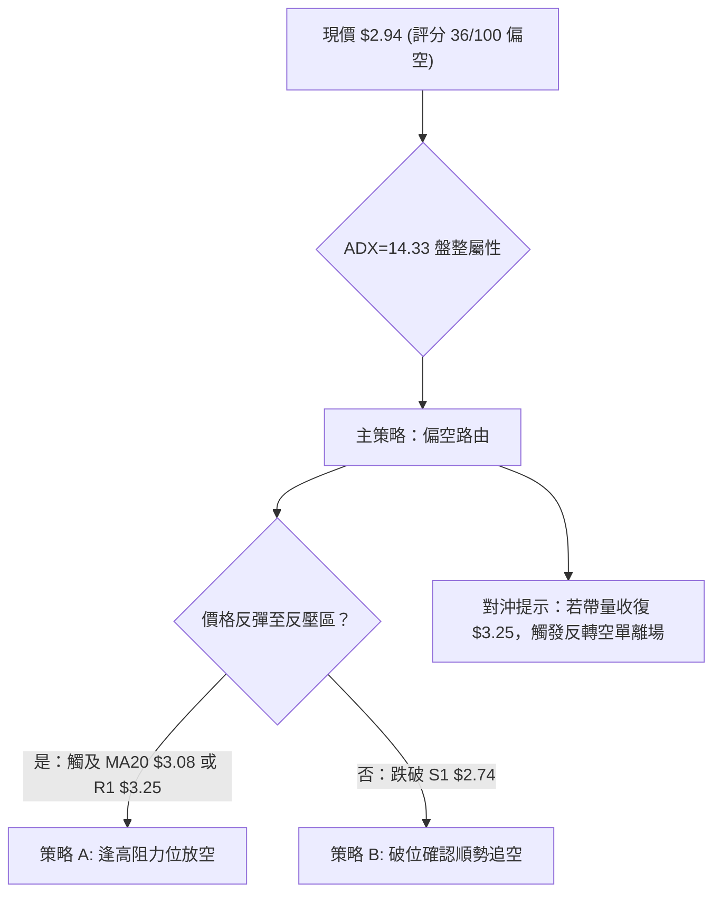

### 🧭 策略路由

*   **當前主策略方向 = 【主推空頭策略（防守偏空）】（依據綜合評分 36/100 ≤ 40 嚴格定調）**
*   多頭操作在此架構下不作為主要推薦，僅在「反向風險觸發點」中作為對沖或極端空頭平倉參考。

### 🎯 價格情境階梯（Price Scenarios）

價位嚴格引用 OHLCV 計算之關鍵價位：

| 觸發條件 | 下一目標價 | 後續延伸目標 | 情境技術含義說明 |
|:---|:---:|:---:|:---|
| **強勢突破 R1 ($3.25)** | **R2 ($3.64)** | **R3 ($3.96)** | 空頭排列遭受破壞，引發空頭回補與均線修復多頭反彈 |
| **維持於 $2.74 - $3.25 震盪** | **MA20 ($3.08)** | **布林下軌 ($2.90)** | 無方向橫盤拉鋸，時間換取空間，動能持續鈍化 |
| **有效跌破 S1 ($2.74)** | *下方數據未偵測* | *形態測算 $2.23* | 創 52 週新低，開啟新一輪單邊跌勢，進入價格發現真空 |

### 📊 情境機率分佈

| 演化情境 | 發生機率 | 主要技術依據與指標佐證 |
|:---|:---:|:---|
| **情境一：弱勢回落再探底 S1** | **55%** | 均線完全空頭排列、-DI(25.07) > +DI(16.88)、MACD柱為負、%B=0.10 貼軌下滑 |
| **情境二：區間窄幅震盪消化** | **35%** | ADX=14.33 顯示無趨勢動能、成交量大幅萎縮 (0.67x)、ATR 壓縮至 $0.12 |
| **情境三：向上逆轉突破 R1** | **10%** | OBV > MA 存在資金護盤，但上方受制於 MA20($3.08)、MA50($3.27) 層層密集套牢壓 |

### 🟢 主策略詳情（偏空路由）

針對當前弱勢與盤整格局，制定兩套嚴謹空頭交易策略：

| 策略要素 | 策略 A：反彈遇阻做空 (主推) | 策略 B：破位順勢做空 (備選) |
|:---|:---|:---|
| **交易邏輯** | 趁弱勢反彈測試均線與 R1 阻力時高空 | 跌破 52 週關鍵低點確認新跌浪形成時追空 |
| **進場條件** | 股價反彈至 MA20 或 R1 遇阻收上影線 | 日線實體收盤價跌破 S1 $2.74 確認破位 |
| **進場價格** | **$3.08** (MA20 處) 至 **$3.25** (R1 處) | **$2.70** (跌破 S1 $2.74 後之順勢點) |
| **止損價格** | **$3.32** (突破 MA60 $3.31 + $0.01) | **$2.86** ($2.74 支撐轉阻力上方 + 1x ATR) |
| **目標價 T1** | **$2.94** (回測現價水平) | **$2.50** (波段心理整數支撐) |
| **目標價 T2** | **$2.74** (回測 52W 低點 S1) | **$2.23** (箱體等幅垂直量度目標) |
| **風險報酬比** | **1 : 2.08** (以 $3.08 空，損 $3.32，利 $2.74 測算) | **1 : 2.94** (以 $2.70 空，損 $2.86，利 $2.23 測算) |
| **勝率評估** | **65%** | **50%** |
| **建議倉位** | **8% - 10%** 總資產 | **5%** 總資產 (突破單風控從嚴) |

### 🔴 反向風險觸發點（對沖與平倉提示）

若市場出現以下情況，主空頭策略宣告失效，應嚴格執行避險或平倉：
1.  **關鍵突破點**：日線實體收盤價帶量**突破 R1 $3.25**，且日成交量放大至 20 日均量以上（> 7,750 萬股）。
2.  **指標反轉訊號**：日線 MACD 於零軸下方出現金叉，且 RSI(14) 向上貫穿 50 中軸。
3.  **對沖行動**：空單全數止損離場，部位可暫時轉為觀望；激進投資人方可輕倉試多，上行目標鎖定 R2 ($3.64)。

### ⭐ 整體訊號強度評星

```
做多訊號強度：★☆☆☆☆  (1.0/5星 — 均線壓制強烈，缺乏買盤動能)
做空訊號強度：★★★★☆  (3.5/5星 — 空頭排列明確，但ADX低顯示下行趨緩)
整體可信度：  ★★★★☆  (4.0/5星 — 技術指標高度收斂共振)
```

---

## 9. 風險提示與監控

### ✅ 關鍵監控指標 Checklist

```
╔══════════════════════════════════════════════════════════════════╗
║              GRAB 技術面日常監控清單 (Checklist)                 ║
╠══════════════════════════════════════════════════════════════════╣
║ [ ] 價格是否跌破 52 週最低點 S1 ($2.74) 觸發加速下跌             ║
║ [ ] 價格能否有效站回 MA20 ($3.08) 結束短期單邊壓制               ║
║ [ ] RSI(14) 是否跌破 30 進入超賣鈍化區                           ║
║ [ ] ADX(14) 是否向上突破 25，確認單邊趨勢（爆發性破位）啟動     ║
║ [ ] 成交量是否異常放大至 1.5 億股以上（如 2026-09 底之異動）     ║
║ [ ] 布林通道帶寬是否由 $0.36 急劇擴張，%B 是否跌破 0 進入極端區  ║
╚══════════════════════════════════════════════════════════════════╝
```

### ⚠️ 風險場景分析

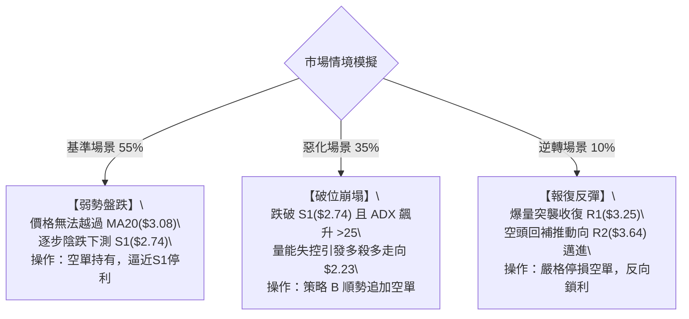

### 🛡️ 風險管理重要提醒

1.  **低價股波幅陷阱**：當前股價為 $2.94，ATR 為 $0.12（每日波動率約 3.94%）。小於 $3.00 的股票每跳動 1 美分即代表 0.34% 的損益變動，投資人切忌因名義價格低而盲目重倉。
2.  **華爾街分析師目標價與技術面之背離**：分析師平均目標價高達 **$5.58**（最高 $7.00，最低 $4.42），且評級維持 `strong_buy`。基本面共識與當前嚴峻的技術面空頭排列存在極大認知落差。在技術面未重返 MA200 ($3.74) 之前，基本面目標價不可作為短線交易依據，務必以盤面客觀走勢為準。
3.  **空頭資金回補風險**：GRAB 目前 Short % Float 達 7.6%，Short Ratio 為 3.55 天。一旦公司釋放突發利多或遭遇大盤反撲，可能誘發空頭快速平倉擠壓，因此空頭部位必須嚴格設置止損（如策略 A 之 $3.32）。

---

## 📋 報告總結

```
╔══════════════════════════════════════════════════════════════════╗
║                    GRAB 技術分析報告總結                         ║
╠══════════════════════════════════════════════════════════════════╣
║ 報告日期：2026-10-19                                             ║
║ 當前價格：$2.94                                                  ║
║ 分析評級：🔴 偏空觀望 / 逢高做空 (綜合評分: 36/100)               ║
╠══════════════════════════════════════════════════════════════════╣
║ 關鍵維度定性：                                                   ║
║ ├─ 長期趨勢 (月線)：🔴 空頭排列，大週期下行通道未破               ║
║ ├─ 中期趨勢 (週線)：🔴 反彈衰竭，週線再次失守短期均線           ║
║ ├─ 短期趨勢 (日線)：🟡 弱勢盤整，ADX=14.33 低波動運行           ║
║ ├─ 關鍵支撐：S1: $2.74 (52W最低點 / 斐波那契100%)                ║
║ ├─ 關鍵阻力：R1: $3.25 / R2: $3.64 / R3: $3.96                   ║
║ └─ 外部分析師目標：Mean $5.58 (技術面嚴重落後於基本面預期)       ║
╠══════════════════════════════════════════════════════════════════╣
║ 最優交易策略組合：                                               ║
║ 1. 🥇 最佳機會：策略 A (反彈至 MA20 $3.08 ~ R1 $3.25 逢高做空)   ║
║    目標價 $2.74，止損價 $3.32，風報比 1:2.08                     ║
║ 2. 🥈 次選機會：策略 B (實體跌破 S1 $2.74 後順勢追空至 $2.23)    ║
║    進場價 $2.70，止損價 $2.86，風報比 1:2.94                     ║
║ 3. 🥉 保守選擇：場外空倉觀望，等待 ADX > 25 或價格站上 R1 再行抉擇║
╚══════════════════════════════════════════════════════════════════╝
```

---

> ⚠️ **免責聲明**：本報告為技術分析專業研究，所有數據與價位估算均基於歷史量價及客觀技術模型。本報告**僅供學術研究與交易思路參考**，**不構成任何要約或投資建議**。市場具有高度不確定性，交易者應獨立評估風險並嚴格執行資金管理。

---
*報告生成時間：2026-10-19 ｜ 數據來源：Yahoo Finance ｜ 分析框架：多時框技術分析模型*