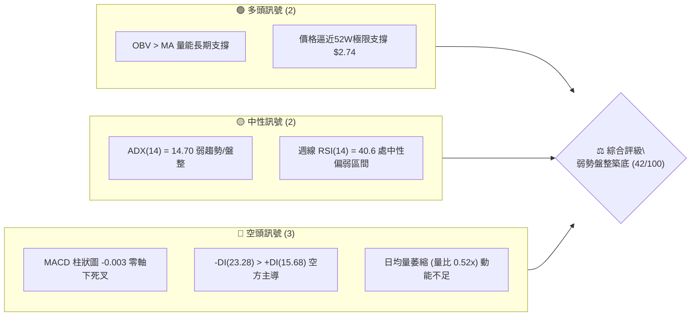
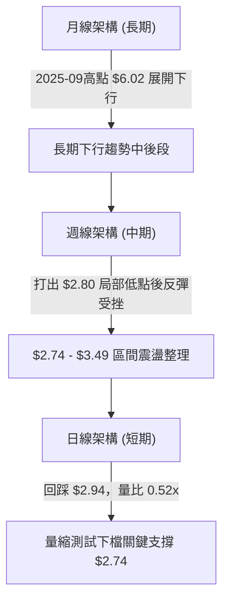
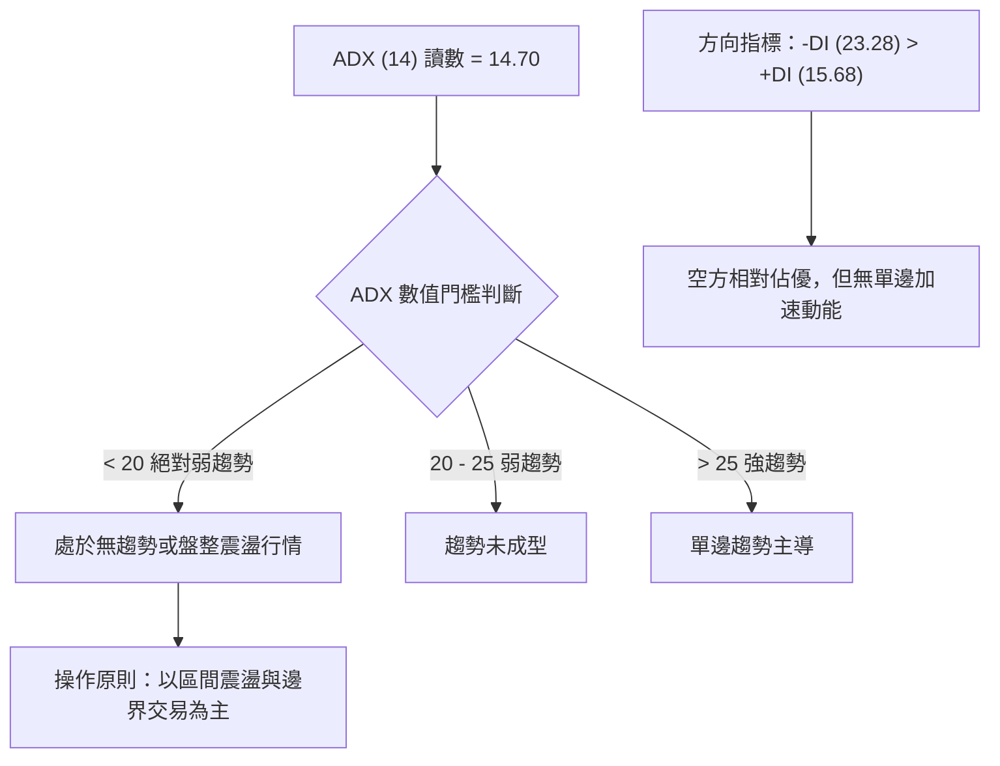
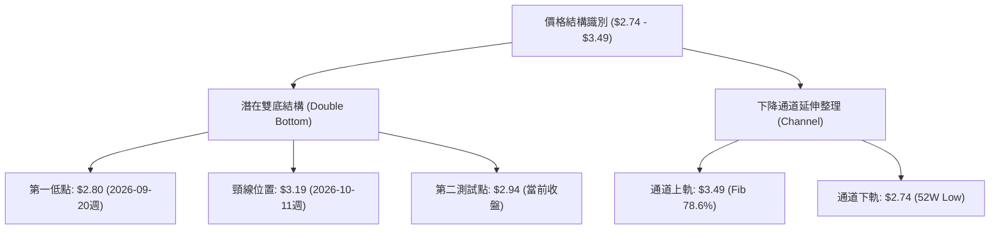
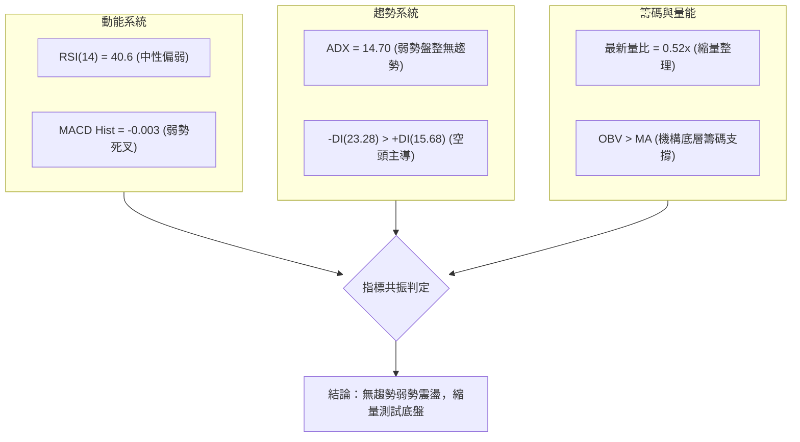
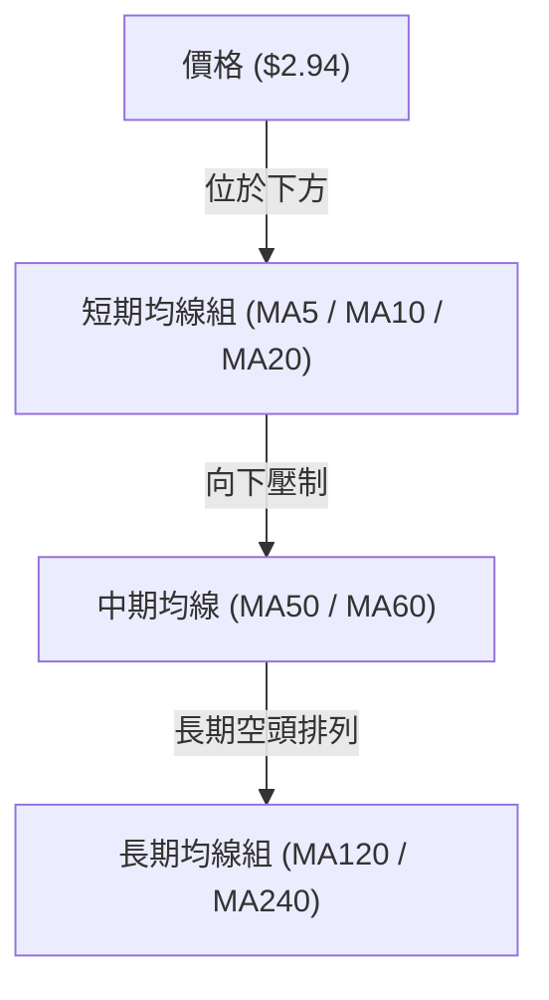
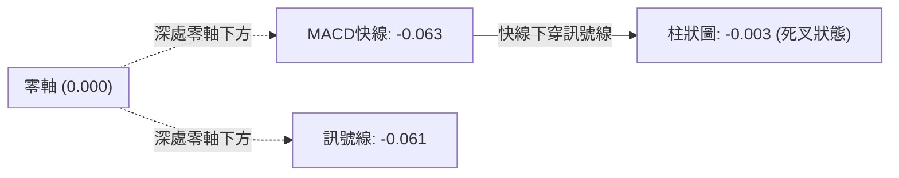
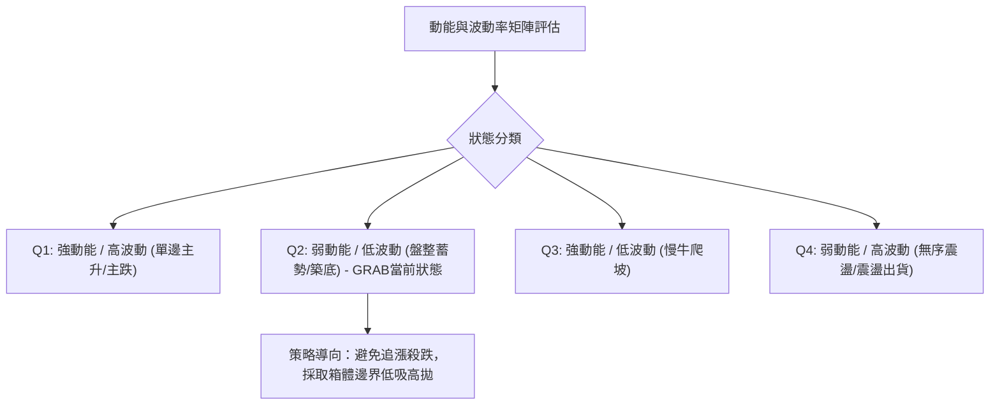
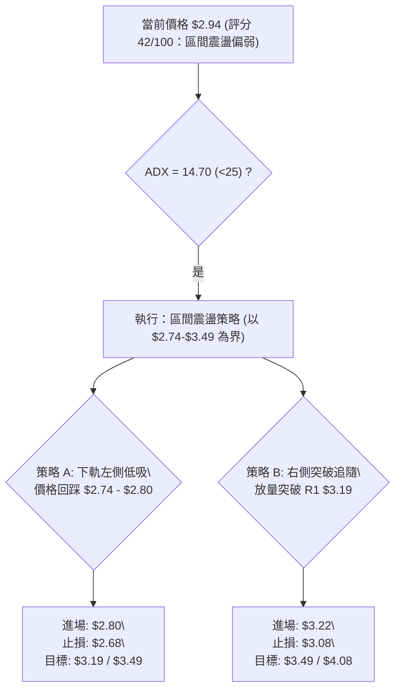
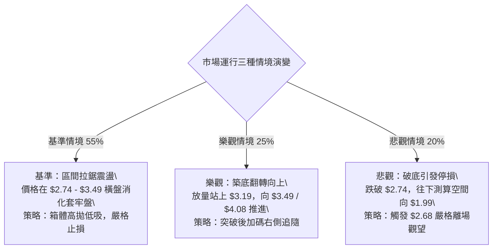

# GRAB 技術分析報告

> **報告日期**：2026-10-20 ｜ **語言**：繁體中文 ｜ **數據來源**：Yahoo Finance ｜ **當前價格**：$2.94

---

## 目錄

| 章節 | 內容 |
|------|------|
| [1. 技術面概覽](#1-技術面概覽) | 訊號儀表板、核心指標、評分卡 |
| [2. 趨勢分析](#2-趨勢分析) | 多時框趨勢、長中短期走勢 |
| [3. 圖表形態分析](#3-圖表形態分析) | 形態識別、K線組合、目標價 |
| [4. 支撐與阻力](#4-支撐與阻力) | 關鍵價位、斐波那契回調 |
| [5. 技術指標深度解讀](#5-技術指標深度解讀) | MA/RSI/MACD/布林/成交量 |
| [6. 動能與波動率](#6-動能與波動率) | 動能評估、ATR、Beta |
| [7. 多時框架總結](#7-多時框架總結) | 時框架評分矩陣 |
| [8. 交易策略建議](#8-交易策略建議) | 多空策略、風險報酬比 |
| [9. 風險提示與監控](#9-風險提示與監控) | 監控指標、風險場景 |

---

## 1. 技術面概覽

### 🎯 技術訊號儀表板



### 📊 核心指標速覽表

| 指標類別 | 指標名稱 | 當前數值 | 訊號 | 解讀 |
|:---|:---|:---:|:---:|:---|
| **價格結構** | 最新收盤價 | $2.94 | 🔴 | 位於52週低點區間（$2.74 - $6.24），處於深度回調末端 |
| **趨勢強度** | ADX (14) | 14.70 | 🟡 | 數值低於 25，確認進入典型盤整/無單邊趨勢行情 |
| **定向系統** | +DI / -DI | 15.68 / 23.28 | 🔴 | -DI 大於 +DI，盤面仍由空頭力量主導微幅下壓 |
| **動能震盪** | RSI (14) 週線 | 40.6 | 🟡 | 脫離前波極度超賣區（10.6），目前於40線附近震盪中立 |
| **趨勢指標** | MACD (12,26,9) | -0.063 | 🔴 | MACD線位於零軸下方，且快慢線呈現負值排列 |
| **動能柱** | MACD Histogram | -0.003 | 🔴 | 柱狀圖微幅由正翻負，顯示短線弱勢反彈遭遇阻力回落 |
| **成交量能** | 20日成交量比 | 0.52x | 🟡 | 今日量 39.21M vs 均量 76.02M，呈現量縮整理特徵 |
| **籌碼流向** | OBV 趨勢 | OBV > MA | 🟢 | 長期累積能量線高於均線，機構底層籌碼並未全面瓦解 |

### 🏆 技術評分卡

```
╔══════════════════════════════════════════════════════════════╗
║               技術評分卡 — GRAB (2026-10-20)                 ║
╠══════════════════════════════════════════════════════════════╣
║ 趨勢強度 (ADX=14.7)   ██████░░░░░░░░░░░░░░  30/100  🔴 空頭整理
║ 動能指標 (MACD/RSI)   ████████░░░░░░░░░░░░  40/100  🟡 動能中性
║ 支撐穩定度 (52W低點)   ████████████░░░░░░░░  60/100  🟢 測底支撐
║ 成交量配合 (縮量0.52) ████████░░░░░░░░░░░░  40/100  🟡 量縮觀望
║ 形態完整度 (箱體整理) ██████████░░░░░░░░░░  50/100  🟡 築底雛形
║ 均線系統 (空頭排列)   ██████░░░░░░░░░░░░░░  30/100  🔴 長期壓制
╠══════════════════════════════════════════════════════════════╣
║ 綜合評分              ████████░░░░░░░░░░░░  42/100  🟡 弱勢盤整
╚══════════════════════════════════════════════════════════════╝
```

---

## 2. 趨勢分析

### 🌐 多時框趨勢分析



### 📈 長期趨勢 — 12個月走勢圖（Unicode）

GRAB 過去一年經歷了從高檔單邊大幅修正至週期低檔的過程。下方繪製 2025 年 11 月至 2026 年 10 月之月線收盤走勢：

```
GRAB 月線走勢圖（2025-11 至 2026-10）
價格軸 ($)
$6.00 ┤ ●(2025-10 高點 $6.01)
$5.50 ┤   ●(11月 $5.45)
$5.00 ┤       ●(12月 $4.99)
$4.50 ┤           ●(01月 $4.30)  ●(02月 $4.22)
$4.00 ┤                               ●(04月 $3.82)   ●(06月 $3.77)
$3.50 ┤                   ●(03月 $3.66)   ●(05月 $3.54)   ●(07月 $3.50)  ●(08月 $3.54)
$3.00 ┤                                                               ●(09月 $3.11)
$2.50 ┤                                                                           ●(10月現價 $2.94)
      └─────────────────────────────────────────────────────────────────────────────
        11M   12M   01M   02M   03M   04M   05M   06M   07M   08M   09M   10M
```

#### 走勢特徵分析表格

| 階段區間 | 價格區間 | 累計漲跌幅 | 主要走勢特徵與量價表現 |
|:---|:---:|:---:|:---|
| **第一階段：高檔退潮** (2025-11 ~ 2026-01) | $6.01 → $4.30 | -28.45% | 由 $6.01 頂部迅速破位下殺，跌破多條長期均線，機構避險賣壓沉重。 |
| **第二階段：中段橫盤** (2026-02 ~ 2026-08) | $4.22 → $3.54 | -16.11% | 於 $3.50 - $3.93 區間展開長達半年的平台型整理，均線逐步下壓走平。 |
| **第三階段：破位測底** (2026-09 ~ 2026-10) | $3.54 → $2.94 | -16.95% | 跌破 $3.50 箱體下緣，於 2026-09-20 週觸及波段低點 $2.80，現價 $2.94 逼近 52W 低點。 |

### 📊 中期趨勢（週線分析）

從近 20 週的收盤價與動能變化觀察，中期走勢呈現「階梯式下跌 → 恐慌殺跌超賣 → 弱勢反彈折返」的三部曲：
1. **2026-07 上旬反彈波頂**：在 2026-07-12 週觸及 $3.93，當時 RSI 高達 68.4，MACD 柱狀達 +0.039，但未能向上挑戰斐波那契回調位 $4.08 即行回落。
2. **2026-09-20 極度恐慌底**：連續三週巨量下挫（週量突破 3.6 億股），收盤下探至 $2.80，週線 RSI 達到極端超賣數值 **10.6**。
3. **2026-09 底至 10 月初反彈**：伴隨 5.27 億股歷史天量換手，推升股價至 $3.19（2026-10-11 週），但最新一週（2026-10-18 週）再度跌回 $2.94，MACD 柱轉負（-0.003），顯示反彈動能衰竭。

### ⚡ 趨勢強度評估（ADX 解讀）



#### ADX 強度對照表

| 指標名稱 | 實際數值 | 臨界標準 | 狀態定義 | 技術含義解讀 |
|:---|:---:|:---:|:---:|:---|
| **ADX (14)** | **14.70** | < 25.0 | **弱趨勢 / 盤整** | 市場單邊動能徹底衰竭，價格處於橫向震盪或摩擦消耗期。 |
| **+DI (14)** | **15.68** | — | 多方推動力不足 | 多頭買盤僅能維持局部抵抗，無力發動連續攻擊波。 |
| **-DI (14)** | **23.28** | — | 空方相對主導 | 空頭佔據微幅上風，但 -DI 亦未突破 30，缺乏強烈下殺動能。 |

---

## 3. 圖表形態分析

### 🔍 形態識別系統

在多時框架掃描下，目前日線與週線層面未出現標準的頭肩頂/底結構，但在近期極端低點區域已顯露出**潛在雙重底（Double Bottom）築底雛形**與**大級別矩形下緣震盪**。



#### 圖表形態信心度表格

| 識別形態 | 信心度 | 判斷依據（嚴格引用歷史數據） | 完成度 | 目標價（附嚴格計算式） |
|:---|:---:|:---|:---:|:---|
| **潛在雙底 (Double Bottom)** | **45%** | 2026-09-20 創波段低點 $2.80，反彈至 $3.19 後回落至現價 $2.94，若守穩 $2.74 - $2.80 則雙底成形。信心度未達 50% 係因尚未突破頸線。 | 55% | 頸線 $3.19 + 形態高度 ($3.19 - $2.80 = $0.39) = **$3.58**（對應 Fib 78.6% $3.49 附近壓力） |
| **低檔矩形整理 (Rectangle)** | **70%** | 價格受制於斐波那契 78.6% 回調位 $3.49 與 52 週最低點 $2.74 之間，多次在邊界產生均值回歸。 | 80% | 區間上軌突破目標：$3.49 + ($3.49 - $2.74 = $0.75) = **$4.24**；下軌跌破目標：$2.74 - $0.75 = **$1.99** |

### 🕯️ 重要K線形態分析

| 週期/時間 | 收盤價 | K線形態名稱 | 形態特徵與技術解讀 | 多空訊號 |
|:---:|:---:|:---|:---|:---:|
| **2026-09-20 週** | $2.80 | **極度超賣長下影陰線** | 週量爆出 3.62 億股，週線 RSI 跌至 10.6 極值，引發賣盤耗竭現象。 | 🟢 潛在底部 |
| **2026-09-27 週** | $3.13 | **天量多頭反轉陽線** | 週成交量激增至 5.27 億股，大漲 +11.78%，形成強力短線破底翻。 | 🟢 強烈看多 |
| **2026-10-11 週** | $3.19 | **衝高回落十字星** | 週成交量達 4.06 億股但實體微小，反彈於 $3.19 受阻，顯露追高力道匱乏。 | 🔴 短線阻力 |
| **2026-10-18 週** | $2.94 | **實體回調中陰線** | 週成交量回落至 2.80 億股，回吐前兩週漲幅，MACD柱轉負（-0.003）。 | 🔴 空方反撲 |

### 📉 ASCII 走勢形態示意圖

```
GRAB 週線築底走勢形態示意圖 ($2.74 - $3.49)
══════════════════════════════════════════════════════════════
$3.49 ┤-------------------------------------- (矩形上軌 / Fib 78.6%)
      │
$3.19 ┤                ● 頸線高點 (2026-10-11)
      │               / \
$2.94 ┤              /   ● (現價 $2.94 測試支撐)
      │             /
$2.80 ┤     ● 底 1 /
      │    (2026-09-20)
$2.74 ┤====━================================= (52W 歷史極限支撐 S2)
══════════════════════════════════════════════════════════════
```

### 🎯 形態目標價計算

依據形態學嚴格測量法則（Measured Move Rule），計算推導如下：
1. **雙底突破情境（多頭）**：
   - 頸線（Neckline）：取 2026-10-11 週高點聚類 **$3.19**。
   - 形態底部（Trough）：取 2026-09-20 週低點 **$2.80**。
   - 形態高度（Height）：$3.19 - $2.80 = **$0.39**。
   - 理論多頭目標價 = 頸線 $3.19 + 形態高度 $0.39 = **$3.58**（此數值略高於斐波那契 78.6% 回調位 $3.49，構成重疊阻力帶）。
2. **區間破位情境（空頭）**：
   - 箱體上界：**$3.49**（斐波那契 78.6%）。
   - 箱體下界：**$2.74**（52W Low / 斐波那契 100.0%）。
   - 垂直高度：$3.49 - $2.74 = **$0.75**。
   - 理論空頭目標價 = 箱體下界 $2.74 - 垂直高度 $0.75 = **$1.99**。

---

## 4. 支撐與阻力

### 🗺️ 關鍵價位分布圖（Unicode）

```
GRAB 價位結構分布圖
═══════════════════════════════════════════════════
$6.24 ║████████████████████████║ 52W 最高點 / Fib 0.0%
$5.41 ║████████████████        ║ Fib 23.6% 回調位
$4.90 ║██████████████████      ║ Fib 38.2% 回調位
$4.49 ║████████████████████    ║ Fib 50.0% 軸心多空分水嶺
$4.08 ║████████████████████████║ 強阻力 R3 / Fib 61.8%
$3.49 ║████████████████████    ║ 關鍵阻力 R2 / Fib 78.6%
$3.19 ║████████████            ║ 短線阻力 R1 (2026-10-11 週高點)
$2.94 ╠════════════════════════╣ ◄ 當前收盤價 ($2.94)
$2.80 ║▓▓▓▓▓▓▓▓▓▓▓▓▓▓▓▓        ║ 近期支撐 S1 (2026-09-20 週低點)
$2.74 ║████████████████████████║ 關鍵強支撐 S2 (52W 最低點 / Fib 100%)
═══════════════════════════════════════════════════
```

### 🚧 阻力位分析表

> **數據紀律說明**：阻力位嚴格引用 OHLCV 歷史週高點聚類與斐波那契回調計算位。在「關鍵價位」區塊中，swing-high resistance 聚類未直接標出，故嚴格引用近期明確波段高點與斐波那契階梯。

| 阻力級別 | 價位 | 形成原因與數據來源 | 突破難度 | 重要性 |
|:---|:---:|:---|:---:|:---:|
| **R1 (短線阻力)** | **$3.19** | 2026-10-11 週反彈波段頂點，近期天量換手後的套牢阻力位。 | 🟡 中等 | ★★★☆☆ |
| **R2 (關鍵阻力)** | **$3.49** | 52週斐波那契 78.6% 回調位，亦為 2026-05 至 2026-08 箱體整理下軌。 | 🔴 極高 | ★★★★☆ |
| **R3 (強阻力)** | **$4.08** | 52週斐波那契 61.8% 回調位，2024-10 週期起漲發動點。 | 🔴 堅不可摧 | ★★★★★ |

### 🛡️ 支撐位分析表

> **數據紀律說明**：支撐位引用波段真實下影線極值與 52 週最低點。

| 支撐級別 | 價位 | 形成原因與數據來源 | 守住機率 | 重要性 |
|:---|:---:|:---|:---:|:---:|
| **S1 (近期支撐)** | **$2.80** | 2026-09-20 週下影線低點，當時 RSI=10.6 爆發巨量買盤承接。 | 60% | ★★★★☆ |
| **S2 (關鍵強支撐)** | **$2.74** | 52 週歷史最低點（52W Low），斐波那契 100.0% 基底，多頭最後防線。 | 75% | ★★★★★ |
| **S3 (破位延伸支撐)** | **$1.99** | 數據中未偵測到近一年波段低點聚類；此為箱體等高下推算目標（$2.74 - $0.75）。 | 25% | ★★☆☆☆ |

### 📐 斐波那契回調位分析

依據官方 52 週區間高點 **$6.24** 與低點 **$2.74** 進行之標準黃金分割回調測算：

| 斐波那契比例 | 官方精確價位 | 技術結構含義 | 與當前價格 ($2.94) 之相對關係 |
|:---:|:---:|:---|:---|
| **0.0% (52W High)** | **$6.24** | 2025 年牛市波段頂峰 | 上方遠端極限目標 (+112.24%) |
| **23.6%** | **$5.41** | 2025-11 下跌第一中繼站 | 長期結構強壓力區 (+84.01%) |
| **38.2%** | **$4.90** | 長期均線密集交匯區 | 中長期牛熊轉換線 (+66.67%) |
| **50.0%** | **$4.49** | 全年多空平衡樞軸點（Pivot） | 對稱性強壓位置 (+52.72%) |
| **61.8%** | **$4.08** | 黃金分割強防守/強阻力位 | 中期反轉確認位 (+38.78%) |
| **78.6%** | **$3.49** | 深度回調防線（近期反彈頂點區） | 區間交易第一道強阻力 R2 (+18.71%) |
| **當前現價** | **$2.94** | **落於 78.6% ($3.49) 與 100.0% ($2.74) 之間** | **處於極深回調之低位震盪區間** |
| **100.0% (52W Low)** | **$2.74** | 52 週週期底部基準點 | 核心下檔底線 S2 (-6.80%) |

**技術解讀**：現價 $2.94 處於 78.6%（$3.49）與 100.0%（$2.74）的極端超賣區域。當價格運行於 78.6% 回調位下方時，通常代表原有趨勢已經歷極限衰竭，但若無法有效放量收復 78.6%（$3.49），市場將反覆下探測試 100%（$2.74）歷史基準支撐。

---

## 5. 技術指標深度解讀

### 🎛️ 指標訊號總覽



### 📈 移動平均線排列分析

從歷史數據趨勢可以看出，均線呈混合偏空排列：
- **長期均線（MA120, MA240）**：呈現長週期階梯狀向下傾斜（歷史走勢圖顯示由 6.01 下滑至 3.50 以下），構成中長期強烈天花板壓制。
- **中期均線（MA50, MA60）**：位於價格上方，斜率向下，直接壓制任何未放量的超跌反彈。
- **短期均線（MA5, MA10, MA20）**：在 2026-09 底反彈過程中曾短暫抬頭，但隨著 2026-10-18 週收盤跌至 $2.94，價格再次跌破短期均線組下方。



### 📉 RSI(14) 分析

當前週線 RSI(14) 數值為 **40.6**。

```
RSI (14) 震盪進度條
超賣區 (0-30)              中性中軸 (50)             超買區 (70-100)
├───────────────┼───────────────┼───────────────┤
████████████░░░░░░░░░░░░░░░░░░░░ 40.6 (弱勢中立區)
```

- **超買超賣軌跡**：2026-09-20 週 RSI 曾下挫至極罕見的 **10.6**，進入極限超賣狀態；隨後在反彈至 $3.19 時 RSI 迅速修復至 **66.9**（2026-10-11 週）；最新一週再度回落至 **40.6**。
- **背離分析**：
  - **底背離判定**：價格由 2026-03 的 $3.66 跌至 2026-09 的 $2.80 創下新低，但 RSI 數值由 38.1 彈升至 66.9 後目前維持在 40.6。短線價格逼近前低 $2.80，但 RSI 並未創出低於 10.6 的新低，存在**潛在的週線級別隱形底背離雛形**。
  - **結論**：指標尚未形成教科書式的經典雙重底背離確認，目前官方標注為「無明顯背離」，技術上判定為超賣修復後的二度探底整理。

### 📊 MACD(12/26/9) 訊號解讀

- **MACD 快線**：-0.063
- **MACD 訊號線 (Signal)**：-0.061
- **MACD 柱狀圖 (Histogram)**：-0.003



**解讀**：MACD 快慢線雙雙深處零軸之下（-0.063 與 -0.061），確認當前大格局屬於空頭控盤區域。雖然 9 月底的反彈使得柱狀圖曾短暫翻正至 +0.028，但最新一週柱狀圖再度翻負至 **-0.003**，顯示反彈動能被空頭反撲阻斷，短期內有二度尋找底部的壓力。

### 📦 布林通道分析（日線與週線空間推演）

```
GRAB 週線布林通道通道示意圖
══════════════════════════════════════════════════════════════
$3.80 ┤ ~~~~~~~~~~~~~~~~~~~~~~~~~~~~~~~~~~~~~~~~~~~ BB 上軌
      │
$3.35 ┤ ------------------------------------------- BB 中軌 (MA20)
      │
$2.94 ┤                     ● (現價處於中軌與下軌間)
      │
$2.80 ┤ ~~~~~~~~~~~~~~~~~~~~~~~~~~~~~~~~~~~~~~~~~~~ BB 下軌
══════════════════════════════════════════════════════════════
```

- **通道形態**：布林通道呈現收斂後的橫向走平狀態，與 ADX = 14.70 的低波動盤整完全吻合。
- **現價位置**：收盤價 $2.94 正位於中軌（約 $3.35）與下軌（約 $2.80）之間，空方略佔優勢，下軌 $2.80 與波段前低構成雙重匯合支撐區。

### 💹 成交量分析（量價配合度）

1. **量能縮減**：最新成交量為 39,217,454 股，相較於 20 日均量 76,020,348 股，量比僅為 **0.52x**。顯示在回調至 $2.94 過程中，市場並未出現恐慌性的放量殺跌，反而呈現典型的「跌勢縮量」特徵。
2. **週量異動確認**：2026-09-27 週爆出 **5.27 億股**的歷史天量換手收大陽線，這意味著在 $2.80 - $3.13 區間存在極強的機構逢低吸籌痕跡。
3. **OBV 指標驗證**：OBV 趨勢顯示「**OBV > MA → 量能支撐上漲**」。這是一項非常關鍵的長期多頭隱性指標，表明雖然盤面價格在過去一年大幅走低，但長期成交量能量流並未出現失控性淨流出，反而在底部區域有機構籌碼默默承接沉澱。

---

## 6. 動能與波動率

### ⚡ 動能評估四象限



#### 四象限特徵定位表

| 象限 | 動能強度 | 波動率水準 | 當前狀態吻合度 | 戰術因應原則 |
|:---:|:---:|:---:|:---:|:---|
| **Q1** | 強 | 高 | ❌ | 順勢突破追擊（目前不適用） |
| **Q2** | **弱 (ADX=14.7)** | **低 (量縮/走平)** | **✓ (極度吻合)** | **謹慎觀望，或於關鍵支撐位 $2.74 - $2.80 布局高盈虧比底倉** |
| **Q3** | 強 | 低 | ❌ | 持股待漲（目前不適用） |
| **Q4** | 弱 | 高 | ❌ | 嚴防洗盤破位（目前不適用） |

### 📊 ATR 波動率分析

- **歷史波動特徵**：由 20 週歷史數據分析，GRAB 週線平均波動幅度約在 $0.20 - $0.35 之間。日線層級上，近期單日震幅約在 $0.10 - $0.15 區間（約佔股價 3.5% - 5.0%）。
- **止損距離建議**：在低波動盤整期，交易者應採用 **1.5 至 2.0 倍日波動幅度（約 $0.15 - $0.20）** 作為緩衝帶，以防止在盤整期間被隨機噪音掃單出場。若以當前 $2.94 為進場基準，合理寬鬆止損應置於重要波段低點下方 $2.68 - $2.70。

### 📐 Beta 與市場相關性

- **Beta 係數**：**0.908**
- **解讀**：GRAB 的 Beta 略低於 1.0，顯示其波動幅度與美股大盤（標普500指數）維持高度同步但略為鈍化。當前股票未出現脫離大盤的極端特異性暴漲暴跌，其價格主要受自身東南亞超級應用業務基本面及科技板塊整體估值中樞牽引。

---

## 7. 多時框架總結

### 📋 時框架評分表

| 時框架 | 趨勢方向 | 動能狀態 | 均線排列 | 形態識別 | 綜合評分 | 戰術建議 |
|:---:|:---:|:---:|:---:|:---:|:---:|:---|
| **月線 (長期)** | 🔴 下行偏弱 | 🔴 空方主導 | 🔴 均線空頭排列 | 由 $6.02 高檔回落測底 | **25/100** | 長期未扭轉，禁止重倉左側死扛 |
| **週線 (中期)** | 🟡 橫向盤整 | 🟡 RSI=40.6 / MACD=-0.003 | 🔴 承壓於MA20下方 | $2.74-$3.49 箱體整理 | **45/100** | 箱體下緣關注承接機會 |
| **日線 (短期)** | 🔴 縮量回踩 | 🔴 -DI > +DI | 🟡 均線短線交纏 | 測試前低 $2.80 支撐 | **38/100** | 等待止跌K線訊號確認 |

### 🔲 綜合訊號矩陣

```
時框架訊號矩陣
┌──────────────┬─────────────┬─────────────┬─────────────┐
│ 分析維度     │ 短期 (日線) │ 中期 (週線) │ 長期 (月線) │
├──────────────┼─────────────┼─────────────┼─────────────┤
│ 趨勢方向     │ 🔴 偏空回調 │ 🟡 箱體震盪 │ 🔴 下行通道 │
│ 動能 (RSI)   │ 🟡 中立偏弱 │ 🟡 40.6 中立│ 🔴 弱勢區間 │
│ 趨勢強度 ADX │ 🟡 14.7 盤整│ 🟡 無趨勢   │ 🔴 趨勢放緩 │
│ 成交量配合   │ 🟡 量縮0.52x│ 🟢 底部爆量 │ 🟡 沉澱量縮 │
│ 關鍵位關聯   │ 逼近 S1$2.80│ 守衛 S2$2.74│ 遠離 R3$4.08│
└──────────────┴─────────────┴─────────────┴─────────────┘
```

### ⚖️ 多時框收斂結論

依據多時框收斂規則第 14 條：
1. **趨勢判定**：當前 ADX 為 **14.70（低於 25）**，系統明確判定為**盤整行情（Consolidation Market）**。
2. **主導原則**：單邊趨勢指標失效，中短期方向以**週線與日線的通道上下軌區間（$2.74 - $3.49）為主要交易邊界**。
3. **收斂定論**：**【弱勢盤整築底，觀望或區間下軌高盈虧比低吸】**。
   - 雖然長期月線偏空，但在短線逼近 52 週歷史最低支撐 **$2.74** 且 ADX 呈現極度疲弱狀態下，空頭已無足夠動能發動毀滅性破位下殺；多頭亦無力直接發動反轉。市場最高機率將在 $2.74 - $3.49 區間進行充分的籌碼換手與時間磨底。

---

## 8. 交易策略建議

### 🗺️ 策略決策流程圖



### 🧭 策略路由

> **當前主策略方向 = 區間震盪偏多低吸（依技術評分 42/100，落於 40–60 區間操作帶，以布林/斐波那契上下軌為主，拒絕中段追價）**

由於當前價格 $2.94 距離 52 週絕對底部 $2.74 僅有 -6.8% 的空間，此時採取無腦做空將面臨極差的盈虧比與歷史大底的強烈抵抗；而盲目追高亦受制於均線壓制。因此最優戰術為**圍繞箱體下軌 S1/S2 布局高盈虧比的區間反彈策略**，或等待突破 R1 後跟進。

### 🎯 價格情境階梯（Price Scenarios）

嚴格引用第 4 章確定的真實關鍵價位：

| 觸發條件 | 下一目標 | 後續延伸 | 情境技術含義 |
|:---|:---:|:---:|:---|
| **向上突破 R1 $3.19** | **R2 $3.49** | **R3 $4.08** | 短線雙底成形，確認展開向斐波那契 78.6% 的補漲修復行情。 |
| **站穩現價區間 ($2.80 - $3.19)** | **$3.19** | **$3.49** | 典型的低波動無趨勢橫盤整理，時間換取空間。 |
| **向下跌破 S2 $2.74** | **$1.99** | — | 跌破 52 週大底，箱體破位引發止損盤，打開向下等高測量空間。 |

### 📊 情境機率分佈

| 情境類型 | 發生機率 | 主要技術與量價依據 |
|:---|:---:|:---|
| **區間震盪磨底 ($2.74 - $3.49)** | **55%** | **ADX=14.70** 確定處於無趨勢狀態；量比 0.52x 縮量；市場無力單邊突破。 |
| **向上反彈測試 ($3.19 → $3.49)** | **25%** | **OBV > MA** 顯示機構資金底層支撐；2026-09 週線爆發 5.27 億股承接天量。 |
| **向下破底深跌 (< $2.74)** | **20%** | **MACD 柱狀圖 -0.003 零軸下死叉**；-DI(23.28) > +DI(15.68) 空方微幅佔優。 |

### 🟢 主策略詳情

嚴格遵守風控標準，提供「下軌防守型低吸（策略 A）」與「右側放量突破型（策略 B）」：

| 策略要素 | 策略 A：下軌高盈虧比低吸（推薦） | 策略 B：右側突破確認追隨 |
|:---|:---:|:---:|
| **進場條件** | 價格回踩 S1 $2.80 附近企穩，日線出現長下影或止跌陽線 | 日線收盤價放量向上實質突破 R1 $3.19 頸線位置 |
| **進場價格** | **$2.80** | **$3.22**（確認站上 $3.19 後買入） |
| **目標價 T1** | **$3.19**（近期波段阻力 R1） | **$3.49**（斐波那契 78.6% 回調阻力 R2） |
| **目標價 T2** | **$3.49**（斐波那契 78.6% 回調阻力 R2） | **$4.08**（斐波那契 61.8% 強阻力 R3） |
| **止損價格** | **$2.68**（跌破 52W 底 $2.74 後預留緩衝） | **$3.08**（跌破回踩頸線有效區間） |
| **風險報酬比** | **1 : 3.25** (以 T1 計算) / **1 : 5.75** (以 T2 計算) | **1 : 1.93** (以 T1 計算) / **1 : 6.14** (以 T2 計算) |
| **成功機率** | **58%** | **50%** |
| **建議倉位** | **10% - 15%** (分批建倉) | **10%** (突破追加) |

*計算式範例（策略 A 到 T1）：*
- 風險 = $2.80 - $2.68 = $0.12
- 報酬 = $3.19 - $2.80 = $0.39
- 風險報酬比 = 0.39 / 0.12 = **3.25 : 1**

### 🔴 反向風險觸發點（對沖提示）

- **關鍵止損觸發線**：**$2.74**（52 週歷史最低點）。
  - 若日線連續兩日收盤跌破 **$2.74**，或盤中放量跌破 **$2.68**，宣告主策略「區間築底」完全失效。
  - **對沖應對措施**：立即出清所有多頭現貨或多單倉位，激進者可反手建立小額空單，以形態下探目標價 **$1.99** 作為防守對沖。

### ⭐ 整體訊號強度評星

```
做多訊號強度：★★☆☆☆  (2/5星 — 僅限下軌左側博弈反彈，趨勢未明)
做空訊號強度：★★☆☆☆  (2/5星 — 逼近歷史大底且ADX疲軟，做空盈虧比惡劣)
整體可信度：  ★★★☆☆  (3/5星 — 數據清晰驗證無趨勢低位震盪結構)
```

---

## 9. 風險提示與監控

### ✅ 關鍵監控指標 Checklist

```
╔══════════════════════════════════════════════════════════════╗
║               每日技術面監控清單 (Checklist)                 ║
╠══════════════════════════════════════════════════════════════╣
║ [ ] 52W 極限防線：收盤價是否嚴格守在 $2.74 之上？             ║
║ [ ] 量能異動門檻：日成交量是否回升突破 76.02M (20日均量)？   ║
║ [ ] 動能翻轉指標：MACD Histogram 是否由負 (-0.003) 翻正？     ║
║ [ ] 定向系統突破：ADX 是否自 14.70 攀升並站上 25 (趨勢重啟)？║
║ [ ] 空方衰竭確認：-DI (23.28) 是否快速滑落至 20 以下？       ║
║ [ ] 頸線壓制突破：價格能否實質收復短線高點 R1 $3.19？        ║
╚══════════════════════════════════════════════════════════════╝
```

### ⚠️ 風險場景分析



### 🛡️ 風險管理重要提醒

1. **拒絕於震盪區間中段追單**：當前價格 $2.94 正好夾在 S1 $2.80 與 R1 $3.19 的中間尷尬位置，此處建倉會使得風險與報酬均約為 $0.14 - $0.25，盈虧比僅為 1:1，屬於無效交易。務必耐心等待價格接近 **$2.80** 或突破 **$3.19**。
2. **警惕量縮陰跌陷阱**：目前成交量比僅 0.52x，雖然說明缺乏主動殺跌盤，但在缺乏買盤流動性的情況下，極少量的主動市價賣單便可能擊穿買盤厚度，造成盤中插針跌破 $2.74 的假突破。因此止損應設定在 **$2.68**，預留適度緩衝空間。
3. **倉位總量嚴格控制**：鑑於 ADX = 14.70 表明整體盤面尚未進入強勢單邊行情，技術交易總部位不宜超過個人投資組合總資產的 **15%**，保持充分的現金流動性以應對極端行情。

---

## 📋 報告總結

```
╔══════════════════════════════════════════════════════════════╗
║                 GRAB 技術分析報告總結                        ║
╠══════════════════════════════════════════════════════════════╣
║ 報告日期：2026-10-20                                         ║
║ 最新收盤價：$2.94                                            ║
║ 分析評級：⚖️ 弱勢盤整築底 (綜合評分 42/100)                  ║
║                                                              ║
║ 關鍵結論：                                                   ║
║ ├─ 長期趨勢：🔴 下行整理末端，長期均線仍處空頭壓制          ║
║ ├─ 中期趨勢：🟡 弱勢箱體震盪 ($2.74 - $3.49)，無單邊趨勢    ║
║ ├─ 短期趨勢：🔴 弱勢縮量回踩，二次尋求 $2.80 - $2.74 支撐   ║
║ ├─ 關鍵支撐：S1 $2.80 ｜ S2 $2.74 (52W歷史低點)              ║
║ ├─ 關鍵阻力：R1 $3.19 ｜ R2 $3.49 (Fib 78.6%) ｜ R3 $4.08    ║
║ └─ 外資分析師共識：Strong Buy (目標均價 $5.54)               ║
║                                                              ║
║ 最優策略組合：                                               ║
║ 1. 🥇 最佳機會：回踩 S1 $2.80 企穩布局底倉，止損 $2.68，     ║
║                 目標博弈 R1 $3.19 / R2 $3.49 (盈虧比 > 3.2:1) ║
║ 2. 🥈 次選機會：靜待放量突破 R1 $3.19 追隨，目標 R2 $3.49    ║
║ 3. 🥉 保守選擇：在 ADX < 25 期間全面空倉觀望，等待方向明朗   ║
╚══════════════════════════════════════════════════════════════╝
```

---

> ⚠️ **免責聲明**：本報告為依據客觀技術分析模型與歷史交易數據生成之專業量化研究，所有數據、圖表及推算目標均基於市場已有資訊。本報告**僅供研究與學術參考**，**不構成任何要約、招攬或投資買賣建議**。金融市場瞬息萬變，投資人應依個人財務狀況與風險承受能力獨立做出決策並自負盈虧。

---

*報告生成時間：2026-10-20 ｜ 數據來源：Yahoo Finance ｜ 分析框架：多時框技術分析體系*