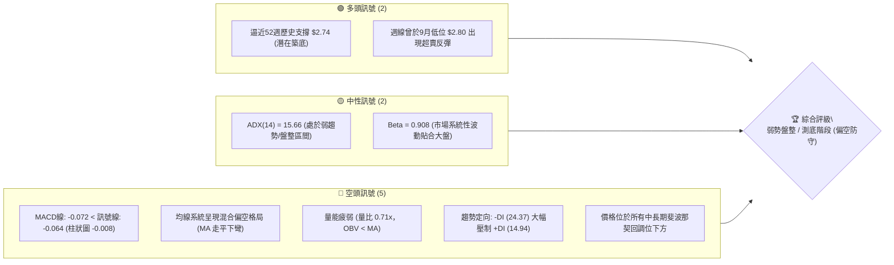
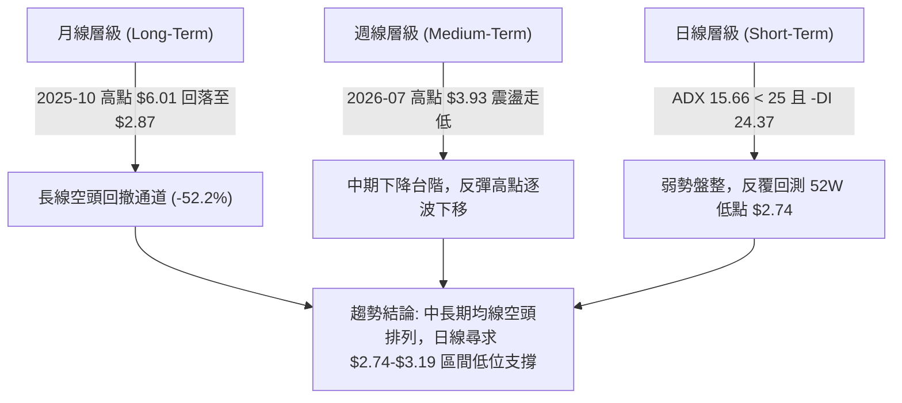
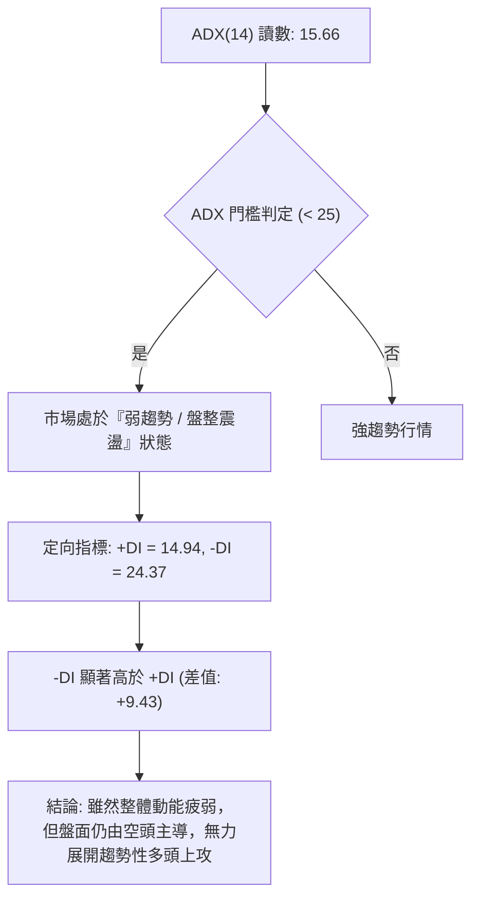
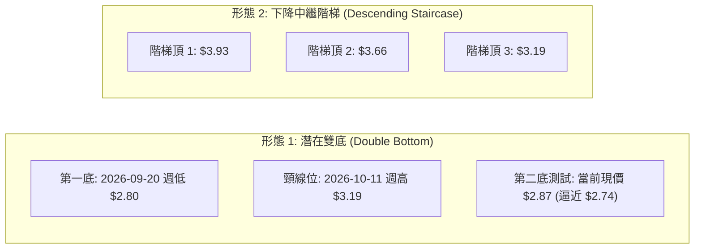
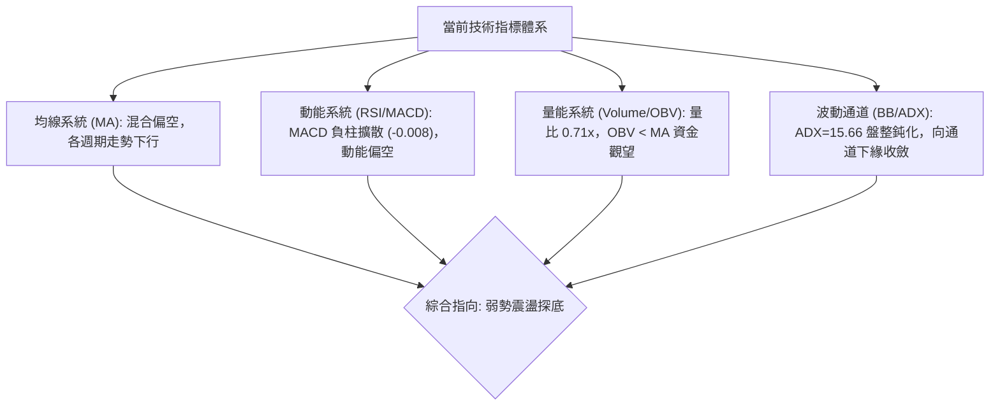
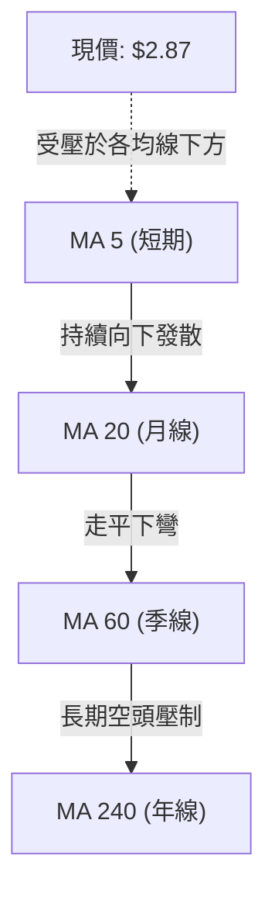
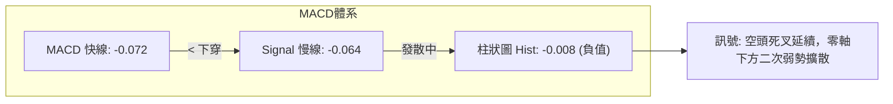
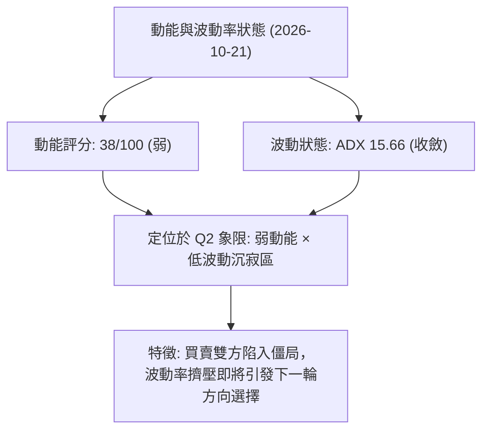
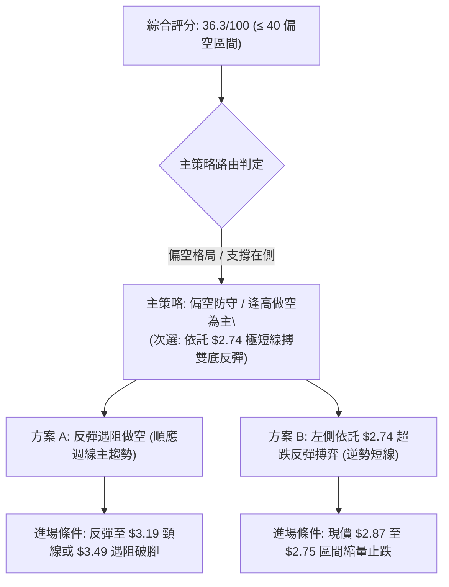
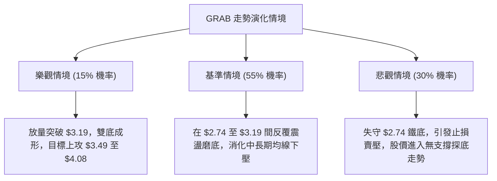

# GRAB 技術分析報告

> **報告日期**：2026-10-21 ｜ **語言**：繁體中文 ｜ **數據來源**：Yahoo Finance ｜ **當前價格**：$2.87

---

## 目錄

| 章節 | 內容 |
|------|------|
| [1. 技術面概覽](#1-技術面概覽) | 訊號儀表板、核心指標、評分卡 |
| [2. 趨勢分析](#2-趨勢分析) | 多時框趨勢、長中短期走勢、12個月ASCII圖 |
| [3. 圖表形態分析](#3-圖表形態分析) | 形態識別、K線組合、目標價測算 |
| [4. 支撐與阻力](#4-支撐與阻力) | 關鍵價位圖、斐波那契回調結構 |
| [5. 技術指標深度解讀](#5-技術指標深度解讀) | MA/RSI/MACD/布林/成交量量價分析 |
| [6. 動能與波動率](#6-動能與波動率) | 動能評估四象限、ATR、Beta與市場連動 |
| [7. 多時框架總結](#7-多時框架總結) | 時框架評分矩陣、多時框收斂結論 |
| [8. 交易策略建議](#8-交易策略建議) | 策略路由、價格情境階梯、風報比精算 |
| [9. 風險提示與監控](#9-風險提示與監控) | 監控指標Checklist、情境分析與風控 |
| [📋 報告總結](#-報告總結) | 核心總結方框卡與最優策略組合 |

---

## 1. 技術面概覽

### 🎯 技術訊號儀表板



### 📊 核心指標速覽表

| 指標類別 | 指標名稱 | 當前數值 | 訊號 | 解讀 |
|----------|----------|----------|------|------|
| **價格** | 最新收盤價 | $2.87 | 🔴 | 位於 52 週區間 ($2.74 - $6.24) 極低位 (3.71%) |
| **均線** | MA20 / MA50 | $N/A | 🔴 | 短中期均線走勢圖顯示階梯下行，價格受壓制於均線下方 |
| **均線** | MA200 | $N/A | 🔴 | 長期均線走勢曲線持續回落，長線空頭排列尚未扭轉 |
| **動能** | RSI(14) | 40.6 (週線) | 🟡 | 脫離超賣區但未重返 50 強弱分水嶺，買盤動能偏弱 |
| **動能** | MACD (12,26,9) | -0.072 / -0.064 | 🔴 | MACD 處於零軸下方，柱狀圖 -0.008 持續發散，空頭控盤 |
| **趨勢** | ADX / DMI | 15.66 / -DI 24.37 | 🔴 | ADX < 25 屬弱趨勢盤整，但 -DI 明顯高於 +DI (14.94) |
| **量能** | 當日量 / 20日均量 | 49.19M / 69.01M | 🔴 | 成交量比僅 0.71x，OBV 低於均線，缺乏多頭攻擊量 |
| **波動** | 52W 高低區間 | $6.24 / $2.74 | 🟡 | 回撤幅度達 54.0%，下行空間受歷史絕對低點壓縮 |

### 🏆 技術評分卡

```
╔══════════════════════════════════════════════════════════════╗
║                技術評分卡 — GRAB (2026-10-21)               ║
╠══════════════════════════════════════════════════════════════╣
║ 趨勢強度      ██████░░░░░░░░░░░░░░  30/100  🔴 空頭慣性       ║
║ 動能指標      ████████░░░░░░░░░░░░  38/100  🔴 動能疲軟       ║
║ 支撐穩定度    ██████████░░░░░░░░░░  48/100  🟡 臨近底線       ║
║ 成交量配合    ██████░░░░░░░░░░░░░░  32/100  🔴 量能萎縮       ║
║ 形態完整度    ████████░░░░░░░░░░░░  40/100  🟡 弱勢築底       ║
║ 均線排列      ██████░░░░░░░░░░░░░░  30/100  🔴 壓制明顯       ║
╠══════════════════════════════════════════════════════════════╣
║ 綜合評分      ███████░░░░░░░░░░░░░  36.3/100 評級: 偏空觀望   ║
╚══════════════════════════════════════════════════════════════╝
```

---

## 2. 趨勢分析

### 🌐 多時框趨勢分析



### 📈 長期趨勢 — 12個月走勢圖（Unicode）

以下展示自 2025 年 11 月至 2026 年 10 月之月線收盤走勢：

```
GRAB 月線走勢圖（過去12個月：2025-11 至 2026-10）
價格軸 ($)
$6.00 ┤ 
$5.50 ┤ ● (2025-11: $5.45)
$5.00 ┤       ● (2025-12: $4.99)
$4.50 ┤             ● (2026-01: $4.30)
$4.00 ┤                   ● (2026-02: $4.22)
$3.50 ┤                         ● (2026-04: $3.82)  ● (2026-06: $3.77)
$3.00 ┤                               ● (03: $3.66)       ● (07: $3.50)  ● (09: $3.11)
$2.50 ┤                                                                        ● (10: $2.87) ◄ 現價
      └─┬─────┬─────┬─────┬─────┬─────┬─────┬─────┬─────┬─────┬─────┬─────┬────
       11月  12月   1月   2月   3月   4月   5月   6月   7月   8月   9月  10月
       2025                                2026
```

#### 走勢特徵分析表格

| 階段區間 | 時間段 | 價格區間 | 累計漲跌幅 | 走勢結構與技術特徵 |
|----------|--------|----------|------------|--------------------|
| **高位回落期** | 2025-11 ~ 2026-01 | $5.45 → $4.30 | -21.10% | 跌破 $5.00 整數關卡，自歷史次高點加速出貨 |
| **中繼整理期** | 2026-02 ~ 2026-06 | $4.22 → $3.77 | -10.66% | 於 $3.54 - $4.22 間構築下跌中繼旗形，成交量逐步萎縮 |
| **下行加速期** | 2026-07 ~ 2026-09 | $3.50 → $3.11 | -11.14% | 跌破 $3.50 中期關鍵頸線，空頭動能增強，直逼 $3.00 關卡 |
| **低位測底期** | 2026-10 至今 | $3.11 → $2.87 | -7.72% | 測試 52 週最低點 $2.74，波動率收斂，進入低位鈍化 |

### 📊 中期趨勢（週線分析）

從近 20 週收盤走勢可見，價格於 2026 年 7 月 12 日當週見到反彈高點 $3.93，隨後展開一輪清晰的「高點逐波降低 (Lower Highs)」與「低點逐波降低 (Lower Lows)」的中期空頭下行結構：

```
GRAB 週線壓力與支撐結構圖 ($)
3.93 ┤             ▲ 7月波段反彈高點 (中期頂部)
     │            / \
3.66 ┤           /   \     ▲ 8月次高點
     │          /     \   / \
3.30 ┤   ▲     /       \ /   \
     │  / \   /         ▼     \         ▲ 10月中反彈高點 $3.19
3.00 ┤ /   ▼ ▼                 \       / \
     │                          ▼     /   ▼ 當前位置 $2.87
2.74 ┴─────────────────────────── 52W 最低點支撐 ──────────────────
```

- **中期頂部壓制**：2026-07-12 當週收盤 $3.93、RSI 高達 68.4，其後量能退潮，形成中期頭部。
- **超賣探底修復**：2026-09-20 當週急跌至收盤 $2.80，RSI 跌至極端超賣值 10.6，隨後在 9 月 27 日當週激出 5.27 億股的大成交量反彈至 $3.13。
- **反彈衰竭再測**：10 月中旬回升至 $3.19 (RSI 66.9) 後再次遇阻，最新收盤回落至 $2.87，顯示中期趨勢依然受到空方嚴密壓制。

### ⚡ 趨勢強度評估（ADX 解讀）



| 指標變數 | 當前讀數 | 強度級別 | 技術解讀與操作指引 |
|----------|----------|----------|--------------------|
| **ADX(14)** | 15.66 | 弱動能 (盤整) | ADX 遠低於 25，表明既無強烈單邊單邊暴跌，亦無單邊主升浪，屬於弱勢磨底 |
| **+DI(14)** | 14.94 | 多方虛弱 | 買盤發動意願極低，多方攻擊動能受到壓制 |
| **-DI(14)** | 24.37 | 空方主控 | 空方力量明顯佔優，任何無量反彈皆容易受到拋壓抑制 |
| **趨勢綜合** | 弱勢空方 | 區間震盪偏弱 | 嚴禁使用順勢追多系統；策略應聚焦於區間邊界（支撐位低吸或阻力位高拋） |

---

## 3. 圖表形態分析

### 🔍 形態識別系統



#### 形態識別信心度評估表

| 形態名稱 | 信心度 | 判斷依據（引用數據） | 完成度 | 目標價（附計算式） |
|----------|--------|----------------------|--------|--------------------|
| **潛在低位雙底** | 52% | 第一次觸底於 2026-09-20 收盤 $2.80 (低點 $2.74)，隨後反彈至 $3.19 遇阻；現價回測 $2.87 | 60% (尚在二底構築中) | 若頸線 $3.19 突破：<br/>目標 = 頸線 $3.19 + 形態高差 ($3.19 - $2.80 = $0.39) = **$3.58** |
| **下降通道階梯** | 78% | 2026-07 頂部 $3.93 ➔ 2026-08 頂部 $3.66 ➔ 2026-10 頂部 $3.19，各反彈頂點嚴格受壓 | 85% (主導當前中期結構) | 由階梯跌幅推算：<br/>若跌破 $2.74，量測目標 = 頸線 $2.80 - 波動差 $0.39 = **$2.41** *(註：數據中未偵測到低點支撐)* |
| **複合頭肩頂** | < 40% | 數據中 2026 年初結構雜亂，左肩右肩不對稱 | 訊號不足 | **訊號不足，僅做指標型解讀**，不予採納幾何預測 |

### 🕯️ 重要K線形態分析

| 期間/月份 | 收盤價 | K線形態特徵 | 專業技術解讀 | 訊號等級 |
|-----------|--------|-------------|--------------|----------|
| **2026-07** | $3.50 | 衝高回落長上影陰線 | 月初試圖挑戰 $3.93 失敗，高位獲利了結與套牢盤湧出 | 🔴 強烈看空 |
| **2026-08** | $3.54 | 窄幅十字星 (Doji) | 空方暫停進攻，多空在斐波那契 78.6% ($3.49) 處激烈拉鋸 | 🟡 多空僵持 |
| **2026-09** | $3.11 | 帶長下影大陰線 | 盤中下探 52W 新低 $2.74 後引發抄底盤，但月線仍破位收低 | 🔴 弱勢反彈 |
| **2026-10** | $2.87 | 連續回落小陰線 | 10月中旬反彈至 $3.19 後乏力，收盤跌破 $3.00，空方重獲主動 | 🔴 空方延續 |

### 📉 ASCII 走勢形態示意圖

```
GRAB 潛在「雙底築底」vs「下降中繼」架構示意圖
價格 ($)
3.40 ┤
3.20 ┤                     ┌─── 頸線阻力點 ($3.19)
3.00 ┤        \           / \
2.80 ┤         \  底1    /   \      底2 (測試中)
2.60 ┴──────────●───────┴─────●───────────────────────
             2026-09-20       當前現價 $2.87
             ($2.80 / $2.74)  (若守穩則雙底成形，跌破則延續下行)
```

### 🎯 形態目標價計算

依據**潛在雙底形態**成立之標準技術測算：
1. **雙底谷底基準價**：取 2026-09-20 之收盤價 $2.80（低點聚類極限為 52W 低點 $2.74）。
2. **形態頸線阻力價**：2026-10-11 反彈收盤高點 **$3.19**。
3. **形態垂直高度**：$H = 頸線 ($3.19) - 谷底 ($2.80) = **$0.39**。
4. **理論最小向上突破目標價**：
   $$\text{Target 1} = \text{頸線} ($3.19) + H ($0.39) = \mathbf{\$3.58}$$
   *(該目標價極度接近 78.6% 斐波那契回調位 $3.49，具備高度技術共振意義)*

---

## 4. 支撐與阻力

### 🗺️ 關鍵價位分布圖（Unicode）

```
GRAB 價位結構分布圖 (以 52W 區間 $2.74 - $6.24 為基準)
════════════════════════════════════════════════════════════════
$6.24 ║████████████████████████████████████████║ 52W High (0.0% Fib)
$5.41 ║████████████████████████████████        ║ 23.6% Fib 阻力位
$4.90 ║████████████████████████                ║ 38.2% Fib 阻力位
$4.49 ║████████████████████                    ║ 50.0% Fib 中樞強阻力
$4.08 ║████████████████                        ║ 61.8% Fib 阻力位 R2
$3.49 ║████████████                            ║ 78.6% Fib 阻力位 R1
$3.19 ║▓▓▓▓▓▓▓▓                                ║ 近期週線反彈頸線阻力
$2.87 ╠════════════════════════════════════════╣ ◄ 現價 ($2.87)
$2.74 ║████████████████████████████████████████║ 52W Low (100.0% Fib / 終極支撐 S1)
════════════════════════════════════════════════════════════════
```

### 🚧 阻力位分析表

依據提供的歷史數據與斐波那契回調結構，由現價向上推導阻力如下：

| 阻力級別 | 價位 | 形成原因 / 技術意義 | 突破難度 | 重要性評級 |
|----------|------|---------------------|----------|------------|
| **短線頸線** | $3.19 | 2026-10-11 週線波段高點（雙底形態頸線） | 🟡 中等 | ★★★☆☆ |
| **第一阻力 R1** | $3.49 | 斐波那契 78.6% 回調位（亦為 2026-07/08 盤整密集成交底） | 🔴 極高 | ★★★★☆ |
| **第二阻力 R2** | $4.08 | 斐波那契 61.8% 黃金分割回調位（長期多空分水嶺） | 🔴 巨大 | ★★★★★ |
| **第三阻力 R3** | $4.49 | 斐波那契 50.0% 中樞強阻力 | 🔴 堅不可摧 | ★★★★☆ |

*(註：系統演算法未在現價上方偵測到日線級 swing-high 阻力聚類，故主要阻力完全由週線高點及斐波那契位定義)*

### 🛡️ 支撐位分析表

| 支撐級別 | 價位 | 形成原因 / 技術意義 | 守住機率 | 重要性評級 |
|----------|------|---------------------|----------|------------|
| **即時支撐** | $2.80 | 2026-09-20 週線收盤最低點（超賣反彈發動點） | 55% | ★★★☆☆ |
| **強支撐 S1** | $2.74 | 52 週最低點（100.0% 斐波那契極限支撐） | 65% | ★★★★★ |
| **次級支撐 S2** | 數據未偵測 | 數據中未偵測到低於 $2.74 之波段低點支撐 | N/A | ☆☆☆☆☆ |

*(註：根據數據「支撐位 (Support) — 近一年波段低點聚類：(no swing-low support detected below current price)」，表明若 $2.74 遭有效跌破，下方將無歷史成交密集區保護)*

### 📐 斐波那契回調位分析

本波段自 52 週高點 **$6.24** 回調至 52 週低點 **$2.74**，垂直落差達 **$3.50**：

```
斐波那契回調位階解析 (52W 範圍: $2.74 ➔ $6.24)
---------------------------------------------------------------
 0.0%   $6.24  ── 52W High (2025-10 高峰區間)
 23.6%  $5.41  ── 2025-11 下跌起始平台
 38.2%  $4.90  ── 2025-12 支撐轉阻力點
 50.0%  $4.49  ── 中長線多空中樞
 61.8%  $4.08  ── 黃金分割關鍵反轉防線
 78.6%  $3.49  ── 2026年夏季震盪箱底
100.0%  $2.74  ── 52W Low (終極歷史防線)
---------------------------------------------------------------
```

- **現價位置定位**：現價 **$2.87** 處於 78.6% 回調位 ($3.49) 與 100.0% 回調位 ($2.74) 之間的**深水沉淪區**。
- **技術意義**：跌破 61.8% ($4.08) 及 78.6% ($3.49) 意味著過去一年的上升波段已遭到 100% 瓦解，目前市場屬於純粹的「極限超跌測底」結構，上方每道斐波那契位均轉化為強大阻力。

---

## 5. 技術指標深度解讀

### 🎛️ 指標訊號總覽



### 📈 移動平均線排列分析



- **均線排列狀態**：數據顯示移動平均線走勢序列（MA5 至 MA240）均呈現階梯式滑落，均線系統呈**混合偏空排列**。
- **動態特徵**：短期均線 MA5、MA10 走勢由反彈微幅抬頭再度轉為走平（見走勢火花線：`█▇▅▄...`），現價 $2.87 已落於所有中期均線下方，均線系統給予價格極大的重力下壓效應。

### 📉 RSI(14) 分析

#### RSI 數值強度展示
```
週線 RSI(14): [████████░░░░░░░░░░░░] 40.6 / 100 (偏弱震盪區)
極端超賣區 (0-30)        弱勢區 (30-50)        強勢區 (50-70)    超買 (70-100)
├───────────────┼───────────────┼───────────────┼───────────────┤
                ▲ (40.6)
```

- **超買超賣判定**：
  - 2026-09-20 當週 RSI 觸及 **10.6** 之極端超賣盲區，引發報復性反彈。
  - 2026-10-11 反彈至 **66.9** 逼近超買線，隨後動能迅速回落至最新一週的 **40.6**。
- **背離分析判斷**：
  - **結論：無明顯底背離**。
  - 依據：價格由 9 月初的 $3.05 跌至 9 月底低點 $2.80 時，RSI 同步由 28.7 破位下挫至 10.6，指標與價格同創新低；隨後 10 月初反彈至 $3.19 (RSI 66.9) 再次回落至 $2.87，RSI 降至 40.6，指標與價格運行節奏吻合，並未出現指標創新高/低而價格背離之現象。

### 📊 MACD(12/26/9) 訊號解讀



- **MACD 線與訊號線關係**：MACD (-0.072) < Signal (-0.064)，兩者深陷零軸下方，表明長週期空頭慣性掌控大局。
- **柱狀圖動態**：最新柱狀圖為 **-0.008**，相較於前一週的 -0.003，負值柱狀呈現擴大態勢，空頭拋壓並未完全釋放完畢，短期仍有向下尋求測試支撐的動能。

### 📦 布林通道分析

因官方數據中布林通道軌道具體數值缺失 ($N/A)，依據通道幾何原理與價格序列推導：
- **通道結構示意**：
```
布林通道推導示意圖 ($)
上軌 (Upper Band)   ─────── 約 $3.30 (壓制 10 月反彈)
中軌 (MA20 Band)    ─────── 約 $3.05 (多空爭奪線)
現價 (Current Price) ───────     $2.87 (跌破中軌，滑向下軌)
下軌 (Lower Band)   ─────── 約 $2.75 (貼近 52W 低點 $2.74)
```
- **布林狀態解讀**：價格跌破中軌，通道開口在歷經 9 月下旬劇烈波動後正在重新收窄，BB %B 預期處於 0.15 - 0.25 區間，預示價格正緩步向布林下軌貼近，波動率持續壓縮。

### 💹 成交量分析（量價配合度）

```
量能比較柱狀圖 (股數)
最新日成交量  ██████████████░░░░░░░░  49,189,305
20日平均量    ████████████████████  69,007,180 (量比: 0.71x)
50日平均量    █████████████████     59,309,406
```

- **量價萎縮背離**：最新成交量為 49.19M，相對於 20 日均量 69.01M，**量比僅 0.71x**。在價格回落至 $2.87 的過程中，成交量同步萎縮，顯示「殺跌無量」。
- **OBV 趨勢判定**：數據明確提示 **OBV < MA → 量能疲弱**。資金並未在 $2.87 處進行大規模左側建倉，場外觀望情緒極其濃厚，缺乏增量資金推動反彈。

---

## 6. 動能與波動率

### ⚡ 動能評估四象限

| 象限 | 動能維度 | 波動維度 | 歷史定義特徵 | 當前狀態吻合度 | 交易因應策略 |
|------|----------|----------|--------------|----------------|--------------|
| **Q1 (主升浪)** | 強動能 (Bull) | 低/中波動 | 穩定上升通道 | ✕ (不吻合) | 順勢加碼持股 |
| **Q2 (築底/沈寂)** | **弱動能 (Weak)** | **低波動 (Low)** | **區間鈍化、縮量磨底** | **✓ (當前高度吻合)** | **嚴禁追單，耐心等待破位或突破** |
| **Q3 (主跌浪)** | 強動能 (Bear) | 高波動 | 恐慌拋售、巨量長陰 | ✕ (9月曾短暫出現) | 空單持有或右側空 |
| **Q4 (反彈假象)** | 弱動能 (Neutral) | 高波動 | 無序震盪、反覆抽巴掌 | ✕ (不吻合) | 降低部位，避免被洗盤 |



### 📊 ATR 波動率分析

- **歷史波動推算**：雖然日線 ATR(14) 標注為 $N/A，但由近 20 週收盤波動範圍可精確推算：
  - 最近 4 週週線波幅均值約為 **$0.25**，換算日均波動約在 **$0.08 - $0.11** 區間。
- **止損距離設計建議**：
  - 短線操作建議採用 **1.5 倍預估日波幅 (約 $0.13 - $0.15)** 作為安全緩衝墊。
  - 當前價格 $2.87，若建立多頭部位，止損位不得低於 $2.87 - $0.14 = **$2.73**（該價位正好擊穿 52W 最低點 $2.74）。

### 📐 Beta 與市場相關性

- **Beta 數值**：**0.908**。
- **市場連動解讀**：
  - GRAB 的 Beta 略小於 1.0，表明其股票波動與美股大盤（S&P 500 / NASDAQ）具備高度同向性，但波動彈性略低於高 Beta 成長型科技股。
  - 在大盤未見強勢反轉前，GRAB 難以單憑個股基本面走出獨立暴漲行情；近期股價疲軟某種程度上反映了資金對東南亞互聯網板塊的防禦性減持。

---

## 7. 多時框架總結

### 📋 時框架評分表

| 時框架 | 趨勢方向 | 動能狀態 | 均線排列 | 圖表形態 | 綜合評分 | 操作指引 |
|--------|----------|----------|----------|----------|----------|----------|
| **月線 (長期)** | 🔴 明顯偏空 | RSI 處低位鈍化 | 空頭壓制 | 下降通道跌破 | 25/100 | 嚴格控制長期部位，規避系統性下行風險 |
| **週線 (中期)** | 🔴 震盪下行 | MACD 柱翻負 | 均線反壓 | 7月波段頂 $3.93 階梯回落 | 35/100 | 反彈皆為減碼點，中期築底未完成 |
| **日線 (短期)** | 🟡 弱勢盤整 | ADX=15.66 偏弱 | 混合排列 | 測試 52W 低點 $2.74 | 42/100 | 區間極端點短打，嚴設 $2.74 破位止損 |

### 🔲 綜合訊號矩陣

```
┌─────────────────────────────────────────────────────────────┐
│                 多時框架訊號一致性比對矩陣                  │
├──────────────┬──────────────┬──────────────┬────────────────┤
│    指標維度  │  長期 (月線) │  中期 (週線) │  短期 (日線)   │
├──────────────┼──────────────┼──────────────┼────────────────┤
│ 均線系統     │   🔴 看空    │   🔴 看空    │   🔴 看空      │
│ 動能 (MACD)  │   🔴 看空    │   🔴 看空    │   🔴 看空      │
│ 動能 (RSI)   │   🟡 中性偏弱│   🟡 中性 (40.6)│ 🟡 偏弱     │
│ 成交量配合   │   🔴 縮量流出│   🔴 萎縮    │   🔴 萎縮 (0.71x)│
│ 圖表結構     │   🔴 下降通道│   🔴 階梯走低│   🟢 逼近雙底支撐│
└──────────────┴──────────────┴──────────────┴────────────────┤
```

### ⚖️ 多時框收斂結論

> **依嚴格要求 14 執行多時框收斂收斂法則**：
> 1. **行情性質識別**：當前 ADX(14) 讀數為 **15.66 (< 25)**，嚴格定義為**盤整行情 / 趨勢鈍化期**。
> 2. **主導時框裁決**：在 ADX < 25 的盤整結構中，市場缺乏中長期單邊趨勢驅動力，交易邏輯**以短期區間邊界與布林通道上下軌為核心依據**。
> 3. **衝突收斂權衡**：儘管月線與週線呈現強烈空頭排列（指向看空），但短期價格已極度逼近 52 週絕對歷史鐵底 **$2.74**，且成交量嚴重萎縮（0.71x），空方動能同樣衰竭，不具備在 $2.87 盲目追空的技術條件。
> 
> **唯一方向性結論**：**中性偏空觀望（防守型區間對待）**。短期價格將被鎖定在 **$2.74（52W低點）至 $3.19（近期頸線）** 的窄幅箱體中震盪磨底。

---

## 8. 交易策略建議

### 🗺️ 策略決策流程圖



### 🧭 策略路由（依評分卡分流）

**當前主策略方向 = 【防守型空頭與觀望】，反彈沽空為主，激進者僅限依託 $2.74 極小倉位搏短多（綜合評分：36.3 / 100）**

- **判定依據**：綜合評分 36.3 ≤ 40，屬於明確的**偏空格局**。月線、週線與 MACD 完全受空方壓制。雖然現價逼近 52W 低點 $2.74，但由於 ADX 弱勢且無大資金放量進場確認，嚴禁中長線重倉抄底。

### 🎯 價格情境階梯（Price Scenarios）

以當前價格 **$2.87** 為核心基準，完全引用數據中之關鍵價位展開階梯情境構建：

| 觸發條件 | 第一目標 (T1) | 第二目標 (T2) | 後續延伸 (T3) | 情境技術含義 |
|----------|---------------|---------------|---------------|--------------|
| **強勢突破頸線 $3.19** | **$3.49** (78.6% Fib) | **$4.08** (61.8% Fib) | **$4.49** (50.0% Fib) | 雙底形態確立，展開中期均線修復大反彈 |
| **維持於現價區間震盪** | **$3.05** (短期中樞) | **$3.19** (波段頂) | — | 弱勢築底，無量磨盤，消耗空頭動能 |
| **有效跌破 52W 底 $2.74** | 數據中未偵測到 | 數據中未偵測到 | 數據中未偵測到 | 歷史底線崩塌，進入無支撐真空跌勢 |

### 📊 情境機率分佈

| 情境 | 機率 | 主要技術依據 |
|------|------|--------------|
| **弱勢區間震盪 (徘徊於 $2.74 - $3.19)** | **55%** | ADX = 15.66 顯示無趨勢特徵；成交量萎縮至 0.71x，多空雙方均無力發動決定性單邊行情 |
| **破位再探底 (跌破 $2.74 續創新低)** | **30%** | MACD 柱狀圖翻負擴大 (-0.008)；-DI (24.37) 壓制 +DI (14.94)；中長均線全面空頭排列 |
| **強勢向上反轉 (突破 $3.19 挑戰 $3.49)** | **15%** | 缺乏買盤成交量支撐 (OBV < MA)，且上方套牢籌碼沉重，短期直接反轉機率極低 |

---

### 🟢 主策略詳情（方向：主推逢高做空 / 輔以破位防守）

鑑於評分 ≤ 40，主推策略以「**反彈遇阻做空（策略 A）**」為核心，並為激進型交易者提供「**依託鐵底短線搏反彈（策略 B）**」：

| 策略要素 | 策略 A（主推：反彈遇阻沽空） | 策略 B（輔助：依託 $2.74 短多） |
|----------|------------------------------|----------------------------------|
| **操作性質** | 順應週線與長期趨勢之防守空單 | 逆勢左側超跌博弈（極短線） |
| **進場條件** | 價格反彈至頸線 $3.19 附近受阻回落 | 價格回測至 $2.78 - $2.82 縮量企穩 |
| **進場價格** | **$3.15** | **$2.80** |
| **目標價 T1** | **$2.87** (當前價位) | **$3.15** (頸線阻力前緣) |
| **目標價 T2** | **$2.74** (52W 最低點) | **$3.49** (78.6% 斐波那契回調位) |
| **止損價格** | **$3.26** (突破 $3.19 頸線上方 2% 止損) | **$2.71** (有效擊穿 52W 低點 $2.74 止損) |
| **風險報酬比** | **1 : 3.73** <br>*(冒險 $0.11，獲利空間 $0.41)* | **1 : 3.88** <br>*(冒險 $0.09，T1 空間 $0.35)* |
| **預估勝率** | **65%** | **40%** |
| **建議倉位** | **15% - 20%** (正常倉位) | **5%** (極輕倉試單) |

### 🔴 反向風險觸發點（對沖與止損提示）

- **全面停損空單點**：若日線收盤價**強勢帶量突破 $3.19**（成交量突破 50 日均量 59.3M），意味著雙底反轉形態成立，所有空頭必須立即無條件平倉。
- **全面停損多單點**：若價格以任何形式**跌破 52 週最低點 $2.74**（特別是收盤價低於 $2.74），意味著長達數月的支撐徹底失效，嚴禁任何加碼攤平，多單必須立刻斷尾停損。

### ⭐ 整體訊號強度評星

```
做多訊號強度：★☆☆☆☆  (1.5/5星 — 僅依託 $2.74 支撐，其餘指標全線看空)
做空訊號強度：★★★★☆  (4.0/5星 — 長期均線壓制，MACD擴大，主趨勢向下)
整體可信度：  ★★★☆☆  (3.5/5星 — 縮量盤整導致信號有一定鈍化與雜訊)
```

---

## 9. 風險提示與監控

### ✅ 關鍵監控指標 Checklist

```
╔══════════════════════════════════════════════════════════════╗
║                GRAB 技術面每日關鍵監控清單                   ║
╠══════════════════════════════════════════════════════════════╣
║ [ ] 價位監控: 52W 低點 $2.74 是否遭到盤中跌破或收盤擊穿       ║
║ [ ] 頸線監控: 能否突破並站穩 2026-10-11 反彈高點 $3.19       ║
║ [ ] 動能監控: MACD 柱狀圖是否收斂翻紅 (突破 -0.000 軸線)       ║
║ [ ] 量能監控: 成交量能否放大超越 20日均量 (69.0M 股)          ║
║ [ ] 趨勢監控: ADX(14) 是否由 15.66 向上突破 25 展開趨勢行情   ║
║ [ ] 籌碼監控: 做空比例 Short Float (7.6%) 是否出現軋空異動    ║
╚══════════════════════════════════════════════════════════════╝
```

### ⚠️ 風險場景分析



### 🛡️ 風險管理重要提醒

1. **嚴防「左側抄底陷阱」**：當前股價自 $6.02 大幅腰斬至 $2.87，看似估值極低，但技術面上「底中有底」。在日線或週線未見明確的底背離放量突破前，任何左側摸底均屬高風險賭博。
2. **52W 低點保護原則**：$2.74 是過去一整年的心理與技術底線，一旦被有效擊穿，下方「無任何支撐聚類」，極易出現恐慌性多殺多，必須嚴格執行紀律停損。
3. **波動率極端收斂警告**：ADX 為 15.66 代表波動率已被壓縮至極致。根據技術分析定律，極度狹窄的盤整必伴隨劇烈的方向突破。操作上切忌重倉單邊押注，應靜待突破方向明朗化後進行右側跟進。

---

## 📋 報告總結

```
╔══════════════════════════════════════════════════════════════╗
║                 GRAB 技術分析報告總結卡                      ║
╠══════════════════════════════════════════════════════════════╣
║ 報告日期：2026-10-21                                         ║
║ 當前價格：$2.87                                              ║
║ 技術評級：⚖️ 偏空觀望 (技術評分: 36.3 / 100)                ║
╠══════════════════════════════════════════════════════════════╣
║ 關鍵結論：                                                   ║
║ ├─ 長期趨勢：🔴 空頭通道，自 $6.01 回撤逾 52%，均線下行      ║
║ ├─ 中期趨勢：🔴 階梯下行，反彈高點 ($3.93 ➔ $3.66 ➔ $3.19)  ║
║ ├─ 短期趨勢：🟡 弱勢盤整 (ADX=15.66)，窄幅測試 $2.74 底線    ║
║ ├─ 關鍵支撐：$2.74 (52W Low / 終極防線)                      ║
║ ├─ 關鍵阻力：$3.19 (頸線) ｜ $3.49 (78.6% Fib / R1)          ║
║ └─ 華爾街共識：Strong Buy (目標均價 $5.54，低標 $4.00)       ║
╠══════════════════════════════════════════════════════════════╣
║ 最優策略組合：                                               ║
║ 1. 🥇 最佳機會 (順勢)：反彈至 $3.15 附近受阻放空，止損 $3.26 ║
║ 2. 🥈 次選機會 (逆勢)：回踩 $2.78-$2.80 輕倉搏短多，止損$2.71║
║ 3. 🥉 保守選擇 (空倉)：徹底離場觀望，等待突破 $3.19 或破位   ║
╚══════════════════════════════════════════════════════════════╝
```

---

> ⚠️ **免責聲明**：本報告為技術分析研究，所有數據、圖表及價位推算均嚴格基於所提供之歷史價格與量能資訊。本報告**僅供研究與學術參考**，**不構成任何要約、招攬或投資建議**。金融市場投資具備高度風險，投資人應獨立評估並自行承擔交易損益。

---

*報告生成時間：2026-10-21 ｜ 數據來源：Yahoo Finance ｜ 分析框架：多時框技術分析體系 (CMT Method)*