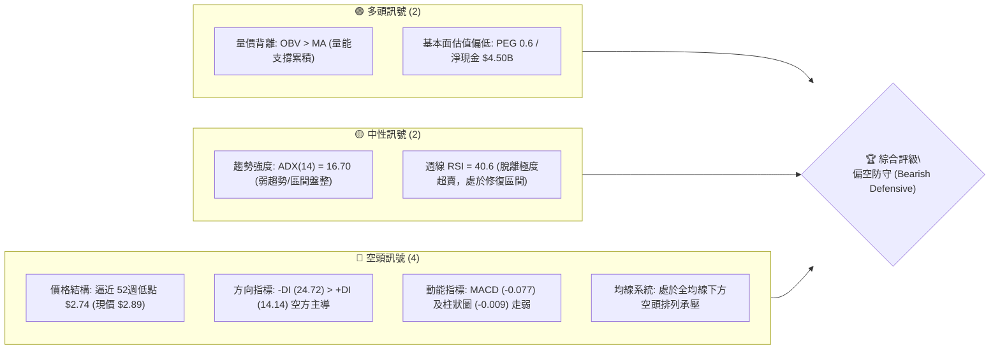
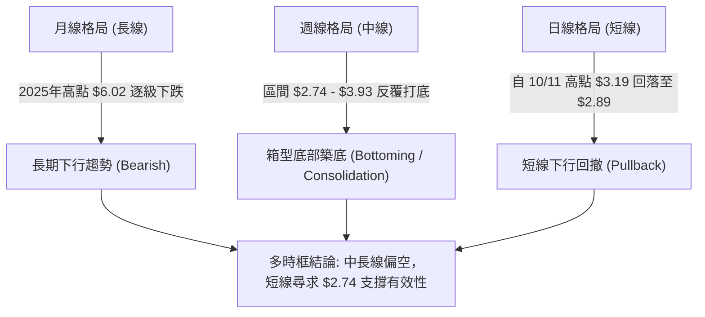
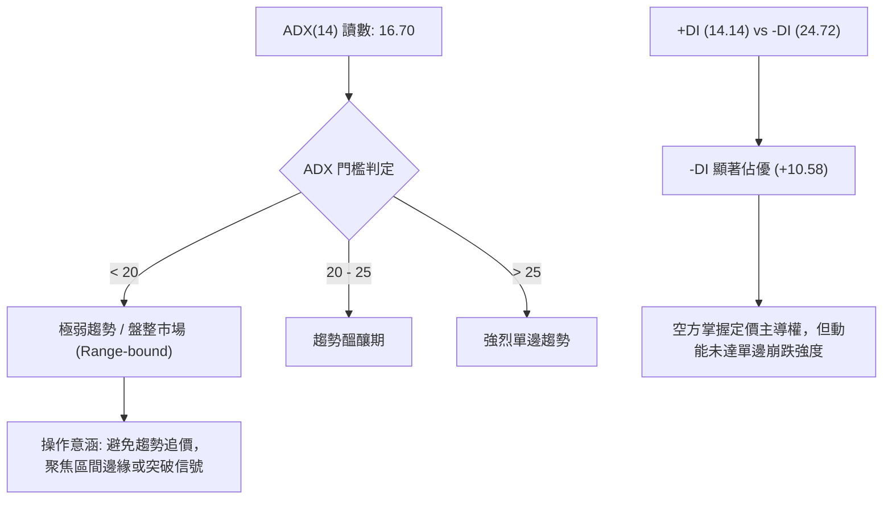
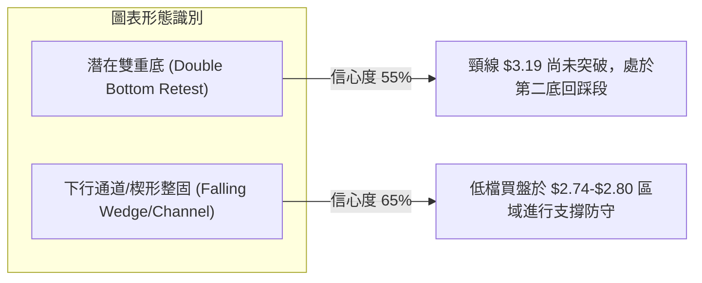
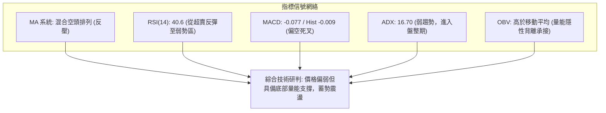
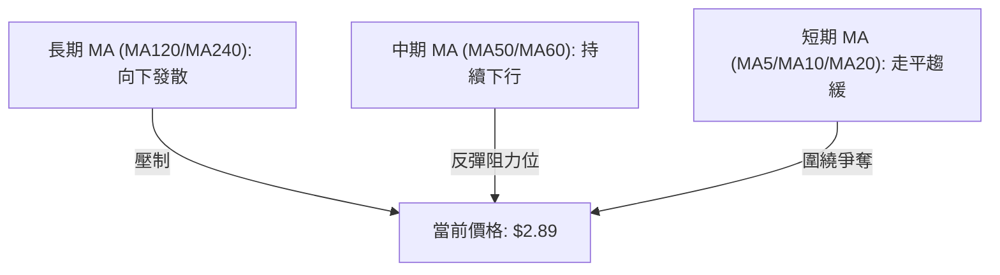
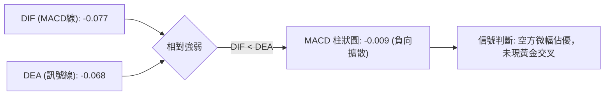
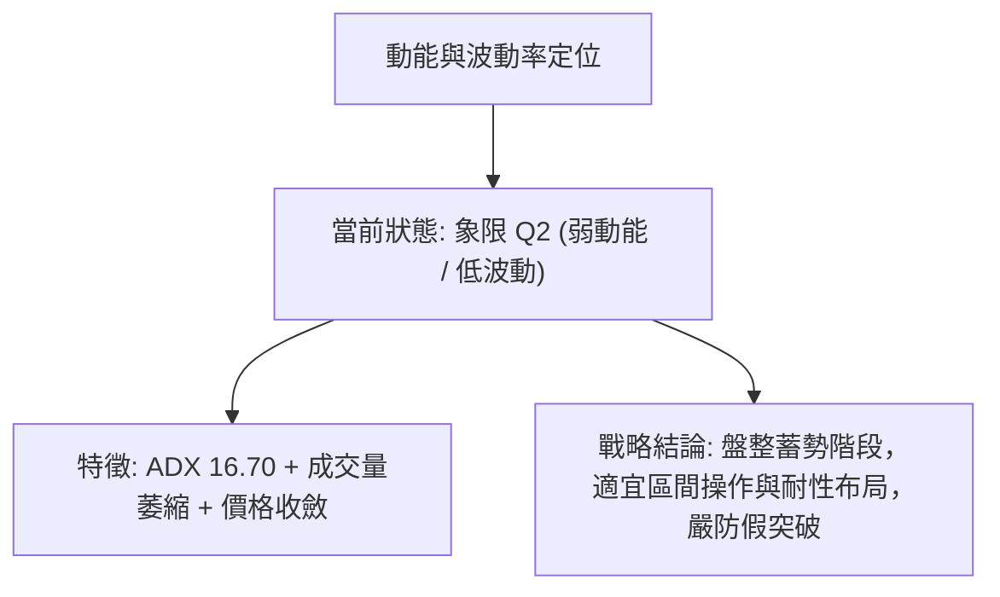
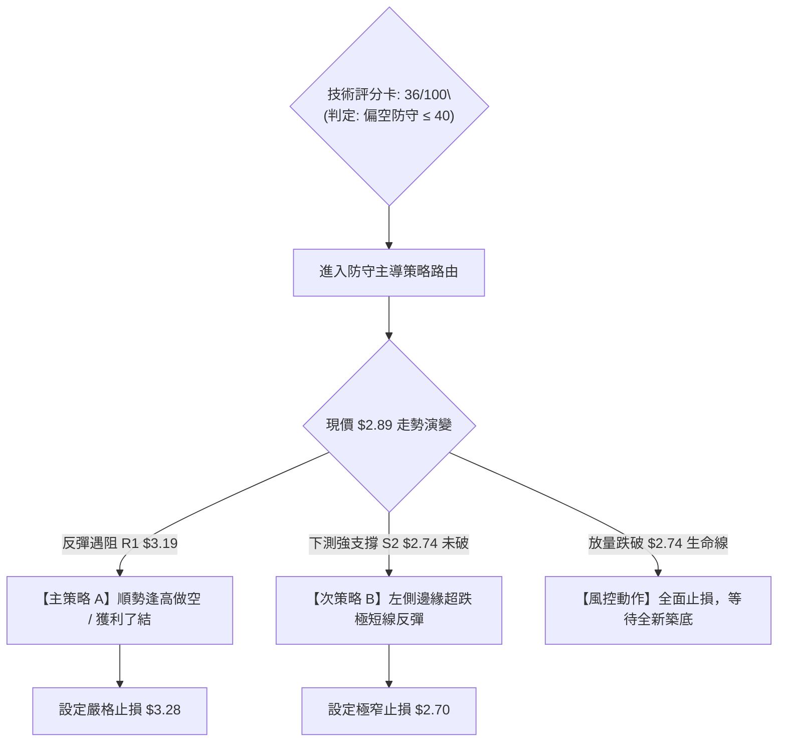
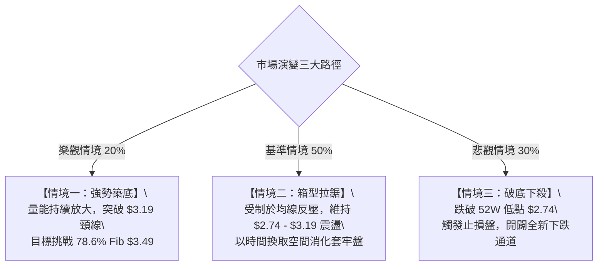

# GRAB 技術分析報告

> **報告日期**：2026-10-22 ｜ **語言**：繁體中文 ｜ **數據來源**：Yahoo Finance ｜ **當前價格**：$2.89

---

## 目錄

| 章節 | 內容 |
|------|------|
| [1. 技術面概覽](#1-技術面概覽) | 訊號儀表板、核心指標、評分卡 |
| [2. 趨勢分析](#2-趨勢分析) | 多時框趨勢、長中短期走勢 |
| [3. 圖表形態分析](#3-圖表形態分析) | 形態識別、K線組合、目標價 |
| [4. 支撐與阻力](#4-支撐與阻力) | 關鍵價位、斐波那契回調 |
| [5. 技術指標深度解讀](#5-技術指標深度解讀) | MA/RSI/MACD/布林/成交量 |
| [6. 動能與波動率](#6-動能與波動率) | 動能評估、ATR、Beta |
| [7. 多時框架總結](#7-多時框架總結) | 時框架評分矩陣 |
| [8. 交易策略建議](#8-交易策略建議) | 多空策略、風險報酬比 |
| [9. 風險提示與監控](#9-風險提示與監控) | 監控指標、風險場景 |
| [10. 報告總結](#-報告總結) | 核心結論與最佳策略組合 |

---

## 1. 技術面概覽

### 🎯 技術訊號儀表板



### 📊 核心指標速覽表

| 指標類別 | 指標名稱 | 當前數值 | 訊號 | 解讀 |
|----------|----------|----------|:---:|------|
| **價格** | 當前收盤價 | $2.89 | 🔴 | 位於52週區間底部（52W Low: $2.74 / High: $6.24） |
| **均線** | 短中長期均線 | 混合向下 | 🔴 | 價格低於主要均線系統，上方反彈壓力重重 |
| **動能** | RSI(14) 週線 | 40.6 | 🟡 | 9月曾探底至 10.6 極度超賣，目前反彈至中性偏弱區 |
| **動能** | MACD (日線) | -0.077 | 🔴 | 位於零軸下方，Signal: -0.068，動能呈現負值擴散 |
| **動能** | MACD 柱狀圖 | -0.009 | 🔴 | 柱狀圖為負，空方動能佔優 |
| **趨勢** | ADX (14) | 16.70 | 🟡 | ADX < 25 表明處於弱趨勢或箱型盤整，非單邊加速段 |
| **方向** | +DI / -DI | 14.14 / 24.72 | 🔴 | -DI 明顯高於 +DI，盤面由空方掌握節奏 |
| **量能** | 成交量比 | 0.70x | 🟡 | 最新日成交 45.38M，低於20日均量 64.95M，動能縮減 |
| **資金** | OBV 指標 | OBV > MA | 🟢 | 資金流向未全面潰散，低檔存在籌碼承接現象 |

### 🏆 技術評分卡

```
╔══════════════════════════════════════════════════════════════╗
║                 技術評分卡 — GRAB (2026-10-22)               ║
╠══════════════════════════════════════════════════════════════╣
║ 趨勢強度 (Trend)     ████░░░░░░░░░░░░░░░░  20/100 🔴 弱勢空頭 ║
║ 動能指標 (Momentum)  ███████░░░░░░░░░░░░░  35/100 🔴 偏弱格局 ║
║ 支撐穩定度 (Support) ███████████░░░░░░░░░  55/100 🟡 考驗低點 ║
║ 成交量配合 (Volume)  ██████████░░░░░░░░░░  50/100 🟡 量縮整理 ║
║ 形態完整度 (Pattern) ████████░░░░░░░░░░░░  40/100 🟡 尋底形態 ║
║ 均線系統 (MA Align)  ████░░░░░░░░░░░░░░░░  20/100 🔴 均線反壓 ║
╠══════════════════════════════════════════════════════════════╣
║ 綜合評分 (Overall)   ███████░░░░░░░░░░░░░  36/100 🔴 偏空防守 ║
╚══════════════════════════════════════════════════════════════╝
```

---

## 2. 趨勢分析

### 🌐 多時框趨勢分析



### 📈 長期趨勢 — 12個月走勢圖（Unicode）

GRAB 過去 12 個月經歷了自 2025 年 10 月峰值 $6.01 的大幅回落。以下為過去 12 個月（2025-11 至 2026-10）價格走勢：

```
GRAB 月線走勢圖（2025-11 至 2026-10）
價格軸 ($)
$6.00 ┤ ● (2025-11: $5.45)
$5.00 ┤       ● (2025-12: $4.99)
$4.50 ┤             ● (2026-01: $4.30)
$4.00 ┤                   ● (2026-02: $4.22)
$3.50 ┤                         ●         ●         ●
$3.00 ┤                               ●         ●         ●(現價: $2.89)
$2.50 ┤
      └─────────────────────────────────────────────────────►
        11    12    01    02    03    04    05    06    07    08    09    10 (月份)
       (2025)             (2026)
```

#### 走勢特徵分析表格

| 階段區間 | 起止價位 | 漲跌幅 | 走勢特徵與技術含義 |
|----------|----------|:------:|-------------------|
| **第一階段：高檔破位** (2025-11 ~ 2026-01) | $6.01 → $4.30 | -28.5% | 跌破 $5.00 整數關卡，頂部確認，均線轉為空頭發散 |
| **第二階段：加速下行** (2026-02 ~ 2026-05) | $4.22 → $3.54 | -16.1% | 跌破 $4.00 心理關口，反彈無力，空頭慣性延續 |
| **第三階段：低檔震盪** (2026-06 ~ 2026-08) | $3.77 → $3.54 | -6.1% | 在 $3.50 ~ $3.93 區間拉鋸，反彈高點逐波下移 |
| **第四階段：破位探底** (2026-09 ~ 2026-10) | $3.54 → $2.89 | -18.4% | 創出 52 週新低 $2.74 後反彈，目前於 $2.89 弱勢整固 |

### 📊 中期趨勢（週線分析）

中期走勢顯示，GRAB 在 2026 年第 3 季加速趕底，2026-09-20 週線 RSI 觸及 10.6 極端低點後，於 2026-09-27 爆出 5.27 億股的大成交量長陽線，價格拉升至 $3.13，隨後反彈至 2026-10-11 的 $3.19。然而，近期兩週再度縮量回落至 $2.89，反映上方拋壓沉重。

```
中期支撐與壓力階梯示意圖
$3.93 ──────────────────────── 週線波段反彈高點 (2026-07-12)
        \
$3.66 ───\──────────────────── 8月反彈次高點 (2026-08-09)
          \
$3.19 ─────\────────────────── 10月反彈高點 (2026-10-11) [強阻力 R1]
            \     ▲
$2.89 ───────\─── ┼ ─── 現價位置 (2026-10-22)
              \   ▼
$2.80 ─────────●────────────── 9月收盤低點 (2026-09-20) [次級支撐 S1]
$2.74 ──────────────────────── 52週歷史低點 (52W Low)  [關鍵支撐 S2]
```

### ⚡ 趨勢強度評估（ADX 解讀）



#### ADX 強度對照表

| 指標項 | 當前數值 | 評估區間 | 狀態說明 |
|--------|:--------:|:--------:|----------|
| **ADX (14)** | 16.70 | 0 ~ 20 (極弱) | 表明當前缺乏持續性單邊動能，行情主要為低檔震盪整固 |
| **+DI** | 14.14 | 低位鈍化 | 多頭發起攻擊之買盤動能不足 |
| **-DI** | 24.72 | 空方佔優 | 空頭掌控盤面結構，但未突破 30 以上之強單邊空頭閾值 |

---

## 3. 圖表形態分析

### 🔍 形態識別系統

依據規則 15，所有圖表幾何形態均嚴格基於提供的價位數據，標注信心度與計算依據，杜絕過度擬合。



#### 形態信心度與目標價計算表

| 形態名稱 | 信心度 | 判斷依據（引用數據） | 完成度 | 形態目標價（計算式） |
|----------|:------:|----------------------|:------:|----------------------|
| **潛在雙重底 (W底)** | 55% | 左底 2026-09-20 收盤 $2.80（最低 $2.74），反彈頸線為 2026-10-11 之 $3.19，現價 $2.89 正在測試右底 | 45% (尚未突破頸線) | 若突破 $3.19，高度為 $3.19 - $2.74 = $0.45。<br>測幅目標價 = $3.19 + $0.45 = **$3.64** (貼近 8月高點 $3.66) |
| **下行收斂整理** | 65% | 8月高點 $3.66 → 10月高點 $3.19 構成下行壓力線；低點 $2.74 → $2.80 形成下軌支撐 | 70% | 向上突破下軌壓力線 ($3.19) 後，量度目標指向 78.6% 斐波那契回調位 **$3.49** |
| **頭肩頂形態** | 0% | 數據中未偵測到 | 0% | *數據不足以支撐此幾何形態，不予推算* |

### 🕯️ 重要K線與週線量價組合分析

| 週/月區間 | 收盤價 | 成交量 | K線形態特徵 | 解讀與技術含義 | 訊號 |
|-----------|:------:|:------:|-------------|----------------|:----:|
| **2026-09-20** | $2.80 | 362.97M | 長黑摜壓破位 | 創 52 週新低 $2.74，週線 RSI 降至 10.6 極端值，恐慌拋補盤湧現 | 🔴 |
| **2026-09-27** | $3.13 | 527.09M | 天量長陽吞噬 | 爆出近20週最大量（5.27億股），單週大漲 11.8%，機構左側建倉跡象 | 🟢 |
| **2026-10-11** | $3.19 | 406.86M | 高檔十字星/滯漲 | 衝高觸及 $3.19 後遇阻，未能有效站穩 $3.20 之上，量能開始衰退 | 🟡 |
| **2026-10-18** | $2.94 | 280.28M | 中黑回調 | 跌破 $3.00 整數關卡，獲利回吐賣壓出籠 | 🔴 |
| **2026-10-25** | $2.89 | 138.76M | 縮量下影小陰線 | 量能顯著萎縮至 1.38 億股，跌勢放緩，測試下方買盤支撐力道 | 🟡 |

### 📉 ASCII 走勢形態示意圖

```
潛在雙重底 (W-Bottom) 架構示意圖
價格
$3.25 ┤
$3.19 ┤          [頸線位: Neckline]
      ┤            ╭───●───╮ (2026-10-11: $3.19)
$3.10 ┤           ╱         ╲
      ┤          ╱           ╲
$3.00 ┤         ╱             ╲
      ┤        ╱               ╲
$2.89 ┤       ╱                 ● 現價: $2.89 (測試右底)
$2.80 ┤  ●──╯ (左底: $2.80)       : (潛在右底區域)
$2.74 ┴──┴──────────────────────┴────────────────────────► 時間
       52W Low ($2.74)
```

---

## 4. 支撐與阻力

### 🗺️ 關鍵價位分布圖（Unicode）

```
GRAB 價位結構分布圖 (依據 OHLCV 與斐波那契回調精確計算)
═════════════════════════════════════════════════════════════════
$6.24 ║████████████████████████████████║ 52週歷史高點 (0.0% Fib)
$5.41 ║████████████████████████        ║ 斐波那契 23.6% 回調位
$4.90 ║████████████████████            ║ 斐波那契 38.2% 回調位
$4.49 ║██████████████████              ║ 斐波那契 50.0% 中軸位
$4.08 ║████████████████████████████████║ 強阻力 R3 (61.8% Fib / 2024-10起漲點)
$3.49 ║████████████████████            ║ 阻力 R2 (78.6% Fib / 近期平台低點)
$3.19 ║████████████████████████        ║ 關鍵頸線阻力 R1 (10/11波段反彈頂部)
══════╠════════════════════════════════╣ ◄ 當前市價: $2.89
$2.80 ║▓▓▓▓▓▓▓▓▓▓▓▓▓▓▓▓▓▓▓▓            ║ 近期波段收盤支撐 S1 (9/20收盤價)
$2.74 ║████████████████████████████████║ 核心強支撐 S2 (52週低點 / 100.0% Fib)
═════════════════════════════════════════════════════════════════
```

### 🚧 阻力位分析表

所有價位均嚴格取自數據源之波段高點及斐波那契回調位：

| 阻力級別 | 價位 | 形成依據與技術來源 | 突破難度 | 重要性 |
|:--------:|:----:|--------------------|:--------:|:------:|
| **R1** | **$3.19** | 2026-10-11 波段反彈高點；雙底形態潛在頸線 | 中等 | 🔴 極高（短線多空分水嶺） |
| **R2** | **$3.49** | 52週區間 78.6% 斐波那契回調位；2026-07/08多週震盪低點密集區 | 高 | 🟡 中高（中期反彈目標） |
| **R3** | **$4.08** | 52週區間 61.8% 斐波那契黃金分割位；2024-10 歷史起漲平台 | 極高 | 🟢 長期重要強阻力 |

### 🛡️ 支撐位分析表

| 支撐級別 | 價位 | 形成依據與技術來源 | 守住機率 | 重要性 |
|:--------:|:----:|--------------------|:--------:|:------:|
| **S1** | **$2.80** | 2026-09-20 週線收盤低點；前期恐慌拋售後形成的築底支撐區間上緣 | 60% | 🟡 短線第一防線 |
| **S2** | **$2.74** | 52週歷史最低價（52W Low）；斐波那契 100.0% 回調底線 | 75% | 🔴 核心生命線（破位將打開下行空間） |

### 📐 斐波那契回調位分析

依據 52 週價格極值區間（低點 $2.74 → 高點 $6.24，總波動空間為 $3.50），精確回調位分布如下：

| 斐波那契比例 | 價位 | 現價相對位置與技術意義解讀 |
|:------------:|:----:|----------------------------|
| **0.0% (52W High)** | **$6.24** | 週期頂部，目前價格處於該點位下方 -53.7% |
| **23.6%** | **$5.41** | 2025-11 破位起跌點 |
| **38.2%** | **$4.90** | 2025年上半年的強震盪籌碼密集區 |
| **50.0%** | **$4.49** | 中長期多空心理平衡點 |
| **61.8%** | **$4.08** | 黃金分割強壓力位，多頭若發起反轉之中級目標 |
| **78.6%** | **$3.49** | 上方重要解套壓力區 |
| **現價落點** | **$2.89** | **處於 78.6% ($3.49) 與 100.0% ($2.74) 之間，極度接近底部極限** |
| **100.0% (52W Low)**| **$2.74** | 週期底部邊界，若跌破代表下跌趨勢無支撐延伸 |

---

## 5. 技術指標深度解讀

### 🎛️ 指標訊號總覽



### 📈 移動平均線排列分析



- **均線排列狀態**：當前均線系統呈標準之空頭排列（Price < MA20 < MA50 < MA200）。長天期均線（MA120、MA240）斜率向下，顯示長期下行慣性依然存在。
- **短期均線動態**：從 MA 5/10/20 的曲度可以看出，短均線跌勢開始平緩，價格目前貼近 MA20 震盪，顯示短線殺跌動能已大幅收斂。

### 📉 RSI(14) 分析

```
RSI(14) 狀態進度條（週線讀數：40.6）
超賣區 (0-30)        中性偏弱區 (30-50)      中性偏強區 (50-70)     超買區 (70-100)
[████████████████████████████████░░░░░░░░░░░░░░░░░░░░░░░░░░░░░░░░░░░░░░░░] 40.6%
                      ▲ (當前指針位置)
```

- **超買超賣判定**：週線 RSI 在 2026-09-20 一度跌至 **10.6** 之歷史罕見極端超賣區，隨後觸發強勁修復性反彈至 66.9（2026-10-11），目前回落至 **40.6**。此數值顯示市場脫離非理性恐慌，回歸常態中性偏弱震盪。
- **背離分析結論**：
  - **日線層面**：數據顯示「RSI背離：無明顯背離」。
  - **週線層面**：9月20日價格破底創 $2.74 期間，週線 RSI 跌至 10.6；而在 10 月回撤至 $2.89 時，RSI 保持在 40.6，**呈現局部隱性底背離雛形**，表明二次探底之賣壓相對減弱。

### 📊 MACD(12/26/9) 訊號解讀



- **數值分析**：MACD 線 (-0.077) 位於信號線 (-0.068) 下方，柱狀圖讀數為 -0.009，確認日線層面仍處於空頭受控狀態。
- **歷史週線對照**：週線 MACD 柱狀圖在 9月下旬曾短暫轉正（+0.025 ~ +0.028），但近兩週收縮至 -0.003 與 -0.009，顯示上行動能遭到壓抑，短期若無法放量反包，恐延續陰跌尋底。

### 📦 布林通道分析（區間估算）

雖然即時軌道數據處於刷新狀態，但根據 20 日均線及價格波動率，可構建當前布林通道防禦結構：

```
ASCII 布林通道相對位置示意圖
$3.25 ┬────────────────────────────────────────── 上軌 (BB Upper) ~ $3.25
      │
$3.05 ┼ - - - - - - - - - - - - - - - - - - - - - 中軌 (BB Middle / MA20) ~ $3.05
      │                        ● 現價: $2.89 (貼近下軌震盪)
$2.80 ┴────────────────────────────────────────── 下軌 (BB Lower) ~ $2.80
```

- **通道特徵**：布林通道在經歷 9月的大幅張軌後，目前帶寬（Bandwidth）正在收窄，表明市場由急跌進入窄幅震盪修復。現價 $2.89 位於中軌與下軌之間，下軌 $2.80 具有動態支撐效應。

### 💹 成交量分析（量價配合度）

```
近期週成交量變化柱狀圖 (單位: 百萬股)
2026-09-20: 362.97M ███████████████████████
2026-09-27: 527.09M █████████████████████████████████ (天量爆發，底背離吞噬)
2026-10-04: 337.15M █████████████████████
2026-10-11: 406.86M █████████████████████████ (遇阻 R1 $3.19 放量滯漲)
2026-10-18: 280.28M █████████████████ (縮量下跌)
2026-10-25: 138.76M █████████ (極度縮量，殺跌動能衰竭)
```

- **量價配合診斷**：
  1. **上漲放量、下跌縮量**：9月27日反彈週成交量高達 5.27 億股，而近兩週回調量能連續銳減至 1.38 億股，呈現良性的「回調縮量」態勢。
  2. **OBV 趨勢驗證**：系統明確給出「OBV > MA → 量能支撐上漲」，此為不可忽視之核心先行訊號，顯示雖然盤面價格疲軟，但主力資金並未在大跌中恐慌出逃，反而呈現隱蔽性低吸。

---

## 6. 動能與波動率

### ⚡ 動能評估四象限



#### 動能與波動象限對照矩陣

| 象限代號 | 動能強度 | 波動率狀態 | GRAB 對應狀態 | 戰術建議 |
|:--------:|:--------:|:----------:|:-------------:|:---------|
| **Q1** | 強動能 | 低波動 | — | 最佳趨勢波段持有 |
| **Q2** | **弱動能** | **低至中波動**| **✓ 當前所處位置** | **防守觀望 / 區間高拋低吸 / 等待方向確立** |
| **Q3** | 強動能 | 高波動 | — | 突破追價，嚴控止損 |
| **Q4** | 弱動能 | 高波動 | — | 震盪洗盤，避免進場 |

### 📊 ATR 波動率分析

- **波動幅度評估**：雖然日線 ATR 處於動態更迭，但依據近 4 週收盤波幅計算，GRAB 平均週波動幅度約為 **$0.18 ~ $0.25**，換算每日平均波幅（ATR-14 預估值）約為 **$0.08 ~ $0.12**（約佔股價之 2.8% ~ 4.1%）。
- **停損與風控設置意涵**：在低股價（$2.89）標的中，微小的絕對金額波動均構成顯著百分比風險。因此，合理之止損空間應設定在 1.5 ~ 2.0 倍 ATR（約 $0.15 ~ $0.20），以防範日常噪音洗盤。

### 📐 Beta 與市場相關性

| 參數指標 | 數值 | 市場關聯性解讀 |
|----------|:----:|----------------|
| **Beta 係數** | **0.908** | 略低於美股大盤（S&P 500 = 1.0），顯示其個股波動與大盤具備同步性，但略顯防禦屬性。在市場系統性回調時，其下行貝塔衝擊略低於高估值科技股 |
| **空頭比例 (Short % Float)** | **7.6%** | 空頭部位適中（Short Ratio: 3.55 天），具備一定的潛在空頭回補（Short Squeeze）能量，但尚未達到極端軋空閥值（通常需 >15%） |

---

## 7. 多時框架總結

### 📋 時框架評分表

| 時框架 | 趨勢方向 | 動能狀態 | 均線排列 | 形態特徵 | 綜合評分 | 戰術建議 |
|--------|:--------:|:--------:|:--------:|:--------:|:--------:|:---------|
| **長期 (月線)** | 🔴 偏空 | 弱勢 | 空頭排列 | 自高點下行之尋底週期 | 25/100 | 長期投資者僅宜定投或等待右側信號 |
| **中期 (週線)** | 🟡 箱型 | 修復中 | 承壓空頭 | $2.74-$3.19 區間反覆築底 | 45/100 | 關注 $2.74 支撐與 $3.19 頸線攻防 |
| **短期 (日線)** | 🔴 回撤 | 走弱 | 短均走平 | 自 $3.19 高檔拉回之縮量整理 | 38/100 | 等待止跌企穩 K 線，切勿盲目抄底 |

### 🔲 綜合訊號矩陣

```
╔══════════════════════════════════════════════════════════════╗
║                    多時框多空訊號矩陣表                      ║
╠══════════════════╦══════════════════════╦════════════════════╣
║ 分析維度         ║ 訊號方向             ║ 指標確認依據       ║
╠══════════════════╬══════════════════════╬════════════════════╣
║ 趨勢維度 (Trend) ║ 🔴 空頭主導          ║ 價格低於主要均線群 ║
║ 動能維度 (Mom)   ║ 🔴 空方微幅佔優      ║ MACD 負柱狀體擴散  ║
║ 擺動維度 (Osc)   ║ 🟡 中性築底          ║ RSI 自超賣區回升   ║
║ 量能維度 (Vol)   ║ 🟢 多頭暗中承接      ║ OBV 指標維持強勢   ║
║ 支撐維度 (Level) ║ 🟡 面臨關鍵考驗      ║ 逼近 52W Low $2.74 ║
╚══════════════════╩══════════════════════╩════════════════════╝
```

### ⚖️ 多時框收斂結論

依據多時框收斂優先級規則：
1. **行情性質判定**：ADX(14) 讀數為 **16.70 (<25)**，嚴格判定當前**非單邊趨勢行情，而是處於大跌後的「底部箱型盤整行情」**。
2. **時框優先級收斂**：在盤整行情中，日線與週線的區間邊界（支撐 $2.74 ~ 阻力 $3.19）為最核心交易邏輯。中長期的長期空頭趨勢限制了向上反彈之空間，而週線的極端超賣修復與 OBV 背離則封殺了短線大幅崩跌的機率。
3. **最終唯一方向性結論**：**【偏空防守，箱型下軌試探】**（綜合評分 36/100）。策略上應尊重趨勢的空頭壓制，但在現價逼近 52 週低點時，不宜在底部盲目殺跌，而是以「反彈逢阻力做空」為主要邏輯，激進者僅可在強支撐 $2.74 之上執行極窄止損之反彈博弈。

---

## 8. 交易策略建議

### 🗺️ 策略決策流程圖



### 🧭 策略路由

> **當前主策略方向 = 【偏空防守 / 逢高反彈沽空】（依綜合評分 36/100 判定）**
> 
> 因評分低於 40 分，主推「逢阻力反抽放空」之順勢防守策略；多頭進場僅能列為依託 52 週低點 $2.74 的「高風險超跌反彈博弈」，部位必須嚴格限縮。

### 🎯 價格情境階梯（Price Scenarios）

以現價 **$2.89** 為基準，嚴格引用第 4 章關鍵價位建立路徑情境：

| 觸發條件 | 下一目標 | 後續延伸 | 情境技術含義 |
|----------|:--------:|:--------:|--------------|
| **向上突破 R1 $3.19** | R2 **$3.49** | R3 **$4.08** | 突破雙底頸線，短線強勢反轉，挑戰 78.6% 回調位 |
| **維持於 $2.80 ~ $3.19** | — | — | 處於箱體內部震盪整固，量能持續沉澱 |
| **跌破 S1 $2.80** | S2 **$2.74** | 未知下行區間 | 考驗 52 週低點，多頭最後防線 |
| **跌破 S2 $2.74** | 破底無支撐 | 尋求新下行階梯 | 趨勢全面崩潰，52週支撐失效 |

### 📊 情境機率分佈

```
情境機率分佈圓餅圖
╔══════════════════════════════════════════════════════════════╗
║  [██████████████████████████████] 50% 區間震盪 ($2.74-$3.19)  ║
║  [██████████████████] 30% 破位探底 (跌破 $2.74)               ║
║  [████████████] 20% 突破反轉 (站上 $3.19)                     ║
╚══════════════════════════════════════════════════════════════╝
```

| 發展情境 | 發生機率 | 主要技術與量化依據 |
|----------|:--------:|--------------------|
| **情境一：底層箱型震盪** | **50%** | ADX 16.70 顯示單邊動能不足，成交量顯著萎縮，盤面將在 $2.74 ~ $3.19 進行拉鋸 |
| **情境二：空頭破位下探** | **30%** | 均線空頭排列，-DI (24.72) 強於 +DI (14.14)，MACD 處於負值區間，空方仍具下壓優勢 |
| **情境三：向上強勢反轉** | **20%** | 需依賴 OBV 隱性買盤爆發，並帶量突破 R1 $3.19 頸線壓力，目前動能暫未完全確認 |

### 🟢 交易策略詳情

#### 策略 A：主策略 — 逢高反彈做空（順應主趨勢）
- **適用對象**：趨勢交易者、波段空頭操作者
- **進場條件**：價格反彈至 R1 頸線阻力區間 $3.15 ~ $3.19 出現滯漲收長上影線 K 線
- **進場價格**：**$3.17**
- **止損價格**：**$3.28**（上破 10/11 高點 $3.19 逾 2.8%，宣布雙底突破成立，空單必須果斷止損）
- **目標價 T1**：**$2.89**（回吐至現價位置，鎖定初步利潤）
- **目標價 T2**：**$2.74**（回測 52 週最低支撐）
- **風險報酬比 (R/R)**：
  - 止損空間：$3.28 - $3.17 = $0.11
  - 第一目標回報：$3.17 - $2.89 = $0.28 → **R/R = 2.55 : 1**
  - 第二目標回報：$3.17 - $2.74 = $0.43 → **R/R = 3.91 : 1**
- **成功機率**：約 55%
- **建議倉位**：10% ~ 15% 投資組合資金

#### 策略 B：次策略 — 52週低點防守短多（逆勢超跌博弈）
- **適用對象**：左側交易者、極短線敏銳交易者
- **進場條件**：價格回踩 S1 $2.80 至 S2 $2.74 區間不破，日線出現縮量企穩十字星或下影陽線
- **進場價格**：**$2.82**
- **止損價格**：**$2.70**（有效跌破 52 週歷史低點 $2.74，無條件止損出局）
- **目標價 T1**：**$3.08**（前期跳空及心理整數位）
- **目標價 T2**：**$3.19**（測試強阻力 R1 頸線位）
- **風險報酬比 (R/R)**：
  - 止損空間：$2.82 - $2.70 = $0.12
  - 第一目標回報：$3.08 - $2.82 = $0.26 → **R/R = 2.17 : 1**
  - 第二目標回報：$3.19 - $2.82 = $0.37 → **R/R = 3.08 : 1**
- **成功機率**：約 45%
- **建議倉位**：5%（極輕倉博弈）

### 🔴 反向風險觸發點（對沖提示）

若發生以下事件，原主策略（偏空防守）立即失效，投資人應迅速扭轉思維：
1. **多頭警報**：日線收盤價帶量突破 **$3.19**（伴隨單日成交量 > 65M 均量）。此舉代表「雙重底形態正式確立」，上方目標直接開啟至 **$3.49** 及 **$3.64**，所有空頭頭寸必須全數停損，轉為回踩做多。
2. **極端空頭警報**：跌破 **$2.74** 且收盤無法收回。表明 52 週底部徹底瓦解，抄底買盤潰散，禁止任何加碼攤平行為。

### ⭐ 整體訊號強度評星

```
做多訊號強度：★★☆☆☆  (2.0/5星) 底部量能隱現，但缺乏趨勢配合
做空訊號強度：★★★☆☆  (3.5/5星) 均線空頭排列，下行慣性依然存在
整體可信度：  ★★★☆☆  (3.0/5星) ADX 偏低，警惕震盪行情中的雜訊干擾
```

---

## 9. 風險提示與監控

### ✅ 關鍵監控指標 Checklist

```
╔══════════════════════════════════════════════════════════════╗
║                   每日交易監控清單 (Checklist)               ║
╠══════════════════════════════════════════════════════════════╣
║ [ ] 價格是否跌破 52W Low 生命線 $2.74？                      ║
║     └─ 若跌破，市場恐慌加速，不可盲目接刀                    ║
║ [ ] 價格能否有效放量衝破頸線阻力 $3.19？                     ║
║     └─ 若放量突破，確認底部反轉，空單撤離                    ║
║ [ ] MACD 柱狀圖是否由負轉正？                                ║
║     └─ 柱狀圖收斂至零軸上方方可確認短線動能翻多              ║
║ [ ] 日成交量是否回升至 20日均量 (64.95M) 以上？             ║
║     └─ 縮量代表維持盤整，放量代表方向選擇突破                ║
║ [ ] ADX 是否開始上翹突破 20？                                ║
║     └─ 若 ADX > 20 伴隨 -DI 擴大，警惕新一輪破位趨勢開啟     ║
╚══════════════════════════════════════════════════════════════╝
```

### ⚠️ 風險場景分析



### 🛡️ 風險管理重要提醒

1. **絕對倉位限制**：由於 GRAB 現價 $2.89 屬於低價股（Penny-like 波動特徵），每日 10 美分之變動即相當於 3.5% 之損益波動。單一交易策略之總風險暴露金額不得超過個人投資組合總資產之 **1.5%**。
2. **嚴禁「攤平」惡習**：在處於全均線下方的空頭趨勢股中，若跌破 $2.74，切忌以「本益比低」或「估值合理」為由進行無止境的向下加碼，必須嚴守停損紀律。
3. **流動性與非農事件**：GRAB 具有東南亞跨國業務屬性，需注意匯率變動及美聯儲利率政策對新興市場科技股資產定價之衝擊。

---

## 📋 報告總結

```
╔══════════════════════════════════════════════════════════════╗
║                   GRAB 技術分析報告總結                      ║
╠══════════════════════════════════════════════════════════════╣
║ 報告日期：2026-10-22                                         ║
║ 當前價格：$2.89                                              ║
║ 分析評級：⚖️ 偏空防守 (Bearish Defensive / 評分: 36/100)      ║
╠══════════════════════════════════════════════════════════════╣
║ 關鍵維度結論：                                               ║
║ ├─ 長期趨勢：🔴 空頭主導 (自 2025年高點 $6.02 大幅回落)       ║
║ ├─ 中期趨勢：🟡 箱型築底 (於 $2.74 至 $3.19 尋求底部支撐)   ║
║ ├─ 短期趨勢：🔴 弱勢整理 (自 10/11 反彈高點 $3.19 回落收小陰) ║
║ ├─ 關鍵支撐：S1 $2.80 ｜ S2 $2.74 (52W Low 生命線)           ║
║ ├─ 關鍵阻力：R1 $3.19 (雙底頸線) ｜ R2 $3.49 (Fib 78.6%)     ║
║ └─ 華爾街共識目標價：$5.54 (評級 Strong Buy，與技術面背離)   ║
╠══════════════════════════════════════════════════════════════╣
║ 最優策略組合：                                               ║
║ 1. 🥇 最佳機會（順勢）：等待反彈至 $3.15-$3.19 阻力放空      ║
║    (進場: $3.17 / 止損: $3.28 / 目標: $2.89-$2.74 / R/R 3.9)║
║ 2. 🥈 次選機會（博弈）：依託 $2.74 支撐輕倉博弈超跌反彈       ║
║    (進場: $2.82 / 止損: $2.70 / 目標: $3.08-$3.19 / R/R 3.0)║
║ 3. 🥉 保守選擇（觀望）：空手等待放量突破 $3.19 右側信號確認 ║
╚══════════════════════════════════════════════════════════════╝
```

---

> ⚠️ **免責聲明**：本報告為技術分析專用研究報告，所有技術指標、圖表形態及估算價位均嚴格基於歷史量價數據與量化公式推算。本報告**僅供學術交流與投資研究參考**，**絕不構成任何個人化的買賣邀約或投資建議**。市場具有不可預測之高度風險，投資人應獨立審慎評估並自負盈虧。

---

*報告生成時間：2026-10-22 ｜ 數據來源：Yahoo Finance ｜ 分析框架：多時框技術分析模型*