# GRAB 技術分析報告

> **報告日期**：2026-10-23 ｜ **語言**：繁體中文 ｜ **數據來源**：Yahoo Finance ｜ **當前價格**：$2.82（以 2026-10 最新收盤價為基準計算）

---

## 目錄

| 章節 | 內容 |
|------|------|
| [1. 技術面概覽](#1-技術面概覽) | 訊號儀表板、核心指標、評分卡 |
| [2. 趨勢分析](#2-趨勢分析) | 多時框趨勢、長中短期走勢 |
| [3. 圖表形態分析](#3-圖表形態分析) | 形態識別、K線組合、目標價 |
| [4. 支撐與阻力](#4-支撐與阻力) | 關鍵價位、斐波那契回調 |
| [5. 技術指標深度解讀](#5-技術指標深度解讀) | MA/RSI/MACD/布林/成交量 |
| [6. 動能與波動率](#6-動能與波動率) | 動能評估、ATR、Beta |
| [7. 多時框架總結](#7-多時框架總結) | 時框架評分矩陣 |
| [8. 交易策略建議](#8-交易策略建議) | 多空策略、風險報酬比 |
| [9. 風險提示與監控](#9-風險提示與監控) | 監控指標、風險場景 |
| [10. 報告總結](#-報告總結) | 結論彙整、最優策略組合 |

---

## 1. 技術面概覽

### 🎯 技術訊號儀表板

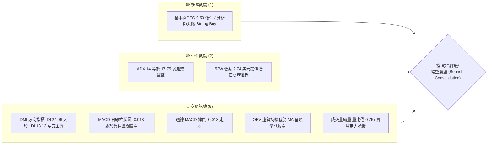

### 📊 核心指標速覽表

| 指標類別 | 指標名稱 | 當前數值 | 訊號 | 解讀 |
|----------|----------|----------|------|------|
| **價格** | 當前收盤價 | $2.82 | 🔴 | 逼近 52 週最低點 $2.74，處於極弱勢回落階段 |
| **均線** | MA20 / MA50 | $N/A | 🔴 | 均線系統呈混合排列偏空走勢，價格被壓制於短期均線下方 |
| **均線** | MA200 | $N/A | 🔴 | 數據中未偵測到明確數值，歷史走勢顯示長線持續處於下行軌道 |
| **動能** | RSI(14) | 中性區間 | 🟡 | 日線無明顯背離；最新週線走勢顯示反彈動能衰竭 |
| **動能** | MACD (12,26,9) | -0.085 / -0.072 | 🔴 | MACD Hist 為 -0.013，雙線處於零軸下方且負向擴散，空方控盤 |
| **趨勢** | ADX / DMI | 17.75 | 🟡 | ADX < 25 表明處於弱趨勢/低動能盤整；-DI(24.06) 顯著高於 +DI(13.13) |
| **成交量** | 量比 / OBV | 0.75x / OBV<MA | 🔴 | 最新量 47.99M 低於 20日均量 63.90M，量價缺乏多頭攻擊配合 |

### 🏆 技術評分卡

```
╔══════════════════════════════════════════════════════════════╗
║             技術評分卡 — GRAB (2026-10-23)                   ║
╠══════════════════════════════════════════════════════════════╣
║ 趨勢強度 (Trend)      ██████░░░░░░░░░░░░░░  30/100  🔴 空頭主導 ║
║ 動能指標 (Momentum)    ████████░░░░░░░░░░░░  40/100  🔴 柱狀下行 ║
║ 支撐穩定度 (Support)  ████████░░░░░░░░░░░░  40/100  🟡 臨近低點 ║
║ 成交量配合 (Volume)   ██████░░░░░░░░░░░░░░  30/100  🔴 量能疲弱 ║
║ 形態完整度 (Pattern)  ████████░░░░░░░░░░░░  40/100  🟡 震盪探底 ║
║ 均線排列 (Moving Avg) ██████░░░░░░░░░░░░░░  30/100  🔴 均線反壓 ║
╠══════════════════════════════════════════════════════════════╣
║ 綜合評分 (Overall)    ███████░░░░░░░░░░░░░  35/100  🔴 偏空弱勢 ║
╚══════════════════════════════════════════════════════════════╝
```

---

## 2. 趨勢分析

### 🌐 多時框趨勢分析

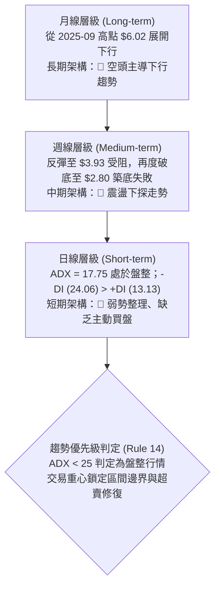

### 📈 長期趨勢 — 12個月走勢圖（Unicode）

以下為 GRAB 過去 12 個月（2025-11 至 2026-10）收盤價走勢還原：

```
GRAB 月線走勢圖（2025-11 至 2026-10）
價格軸 ($)
$6.00 ┤ 
$5.50 ┤ ● (2025-11: $5.45)
$5.00 ┤     ● (2025-12: $4.99)
$4.50 ┤         ● (2026-01: $4.30)
$4.00 ┤             ● (2026-02: $4.22)
$3.50 ┤                     ● (04: $3.82)       ● (06: $3.77)
$3.00 ┤                 ● (03: $3.66)   ● (05: $3.54)   ● (07: $3.50) ● (08: $3.54)
$2.50 ┤                                                                 ● (09: $3.11)
$2.00 ┤                                                                         ● (10: $2.82) ← 現價
      └─┬──────┬──────┬──────┬──────┬──────┬──────┬──────┬──────┬──────┬──────┬──────┬──────
       11月   12月    01月   02月   03月   04月   05月   06月   07月   08月   09月   10月
       2025   2025    2026   2026   2026   2026   2026   2026   2026   2026   2026   2026
```

#### 走勢特徵分析表格

| 階段 | 時間區間 | 起始/結束價 | 漲跌幅 | 價量特徵與結構分析 |
|------|----------|-------------|--------|--------------------|
| 頂部回落期 | 2025-11 ~ 2026-01 | $5.45 → $4.30 | -21.10% | 跌破 $5.00 整數關卡，高檔籌碼鬆動，長陰線向下宣洩 |
| 中期陰跌期 | 2026-02 ~ 2026-05 | $4.22 → $3.54 | -16.11% | 走勢重心由 $4.00 降至 $3.50 附近，反彈高點逐次降低 |
| 箱體弱反彈 | 2026-06 ~ 2026-08 | $3.77 → $3.54 | -6.10%  | 於 $3.50 ~ $3.93 間構築弱勢箱體，多頭無力向上突破 |
| 加速破位期 | 2026-09 ~ 2026-10 | $3.11 → $2.82 | -9.32%  | 跌破箱體底部，9月單月重挫，10月直逼 52 週低點 $2.74 |

### 📊 中期趨勢（週線分析）

從近 20 週數據觀察，GRAB 呈現標準的「階梯式下行」架構：
- **波段高點聚類**：7 月初反彈至 $3.93 遭逢強烈拋壓，形成中期頭部。
- **次級高點聚類**：8 月中旬反彈至 $3.66 遇阻回落；10 月中旬弱勢反彈至 $3.19 即宣告力竭。
- **下行破位**：9 月中旬放量摜破 $3.30 支撐帶，最低探至 $2.80，隨後在 10 月反彈無力後再度滑落至 $2.82。

```
週線級別價格壓力結構示意圖：
$3.93 ─────────────────────── 中期波段高點（強阻力）
        \
         $3.66 ────────────── 次級回抽反彈高點
                 \
                  $3.19 ───── 短期反彈受阻高點
                          \
                           $2.82 (現價) ──► 考驗 52W 低點 $2.74
```

### ⚡ 趨勢強度評估（ADX 解讀）

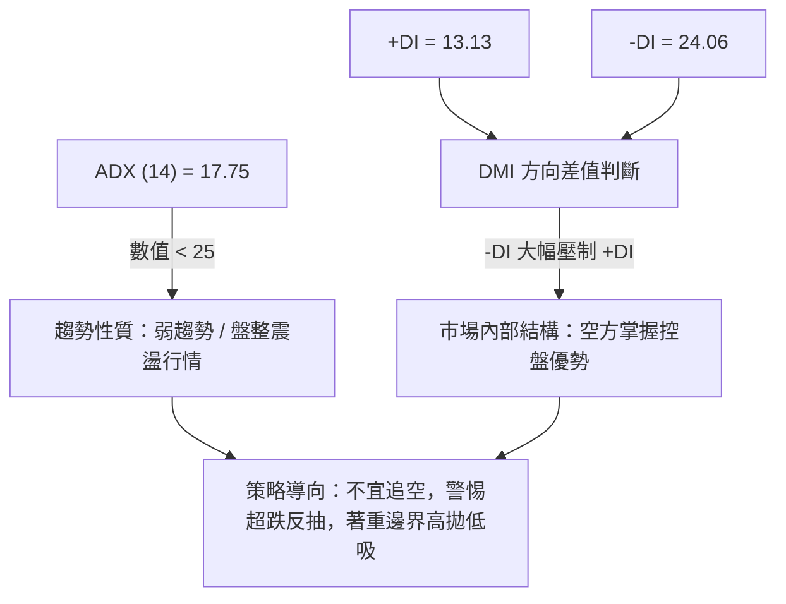

#### ADX 強度對照表

| 指標變數 | 數值 | 參考閾值 | 當前狀態判定 | 交易涵義 |
|----------|------|----------|--------------|----------|
| **ADX(14)** | 17.75 | 25.00 | 弱趨勢 / 盤整行情 🟡 | 缺乏單邊強動能，價格多為非連續性摩擦，適合均值回歸交易 |
| **+DI** | 13.13 | 20.00 | 多方動能衰竭 🔴 | 多頭買盤力道薄弱，無力組織持續性攻勢 |
| **-DI** | 24.06 | 20.00 | 空方佔據主導 🔴 | 賣壓持續存在，空頭仍掌握價格短期定價權 |

---

## 3. 圖表形態分析

### 🔍 形態識別系統

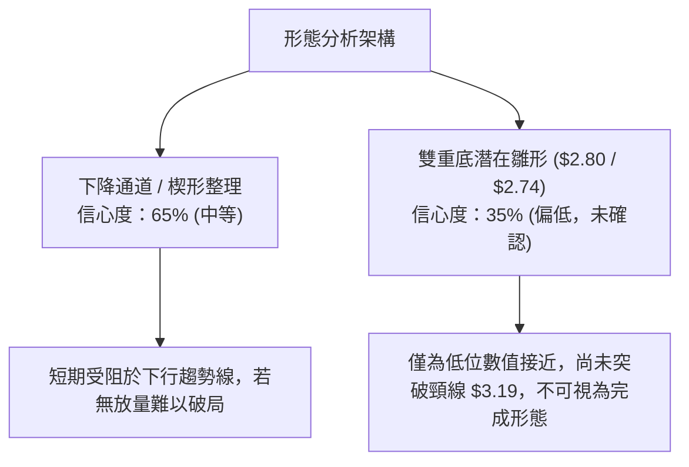

#### 形態識別與信心度評估表

| 形態名稱 | 信心度 | 判斷依據（引用數據） | 完成度 | 目標價（附計算式） |
|----------|--------|----------------------|--------|--------------------|
| **下降收斂通道** | 65% | 7月高點 $3.93、8月高點 $3.66、10月高點 $3.19 構成下行阻力斜線；9月低點 $2.80 與 52W 低點 $2.74 構成下軌支撐。 | 75% | 通道破位測量：由形態高度推算，若跌破 $2.74，向下等距對稱目標為 $2.74 - ($3.19 - $2.80) = **$2.35**（數據中未偵測到此支撐，純屬形態推算）。 |
| **潛在雙重底** | 35% | 2026-09-20 低點 $2.80 與 52W 低點 $2.74 極為接近，具備二次探底特徵。 | 20% | 頸線位為 2026-10-11 高點 $3.19。突破目標 = 頸線 $3.19 + 形態高度 ($3.19 - $2.74 = $0.45) = **$3.64**。信心度低於 50%，僅供觀察。 |

### 🕯️ 重要K線形態分析

| 週/月份 | 收盤價 | K線組合形態 | 技術解讀 | 訊號方向 |
|---------|--------|-------------|----------|----------|
| 2026-07-12 | $3.93 | 高檔長上影十字星 | 反彈至波段高點受阻，多方動能耗盡，見頂信號 | 🔴 看跌 |
| 2026-07-26 | $3.31 | 中陰線跳空下殺 | RSI 跌至 25.9，破位下行，確立下行波段展開 | 🔴 看跌 |
| 2026-09-20 | $2.80 | 長下影極限超賣針 | RSI 跌至 10.6 極度超賣區，空頭動能短期宣洩殆盡 | 🟡 潛在底背離點 |
| 2026-09-27 | $3.13 | 爆量長陽反彈線 | 成交量激增至 527M，空頭回補推動強反彈 | 🟢 短線反彈 |
| 2026-10-11 | $3.19 | 反彈遇阻倒錘頭 | 巨量 406M 無法突破前高，形成短期次級高點 | 🔴 反彈終結 |
| 2026-10-25 | $2.82 | 連續回吐弱陰線 | 吞沒前兩週漲幅，重新考驗 $2.74 支撐 | 🔴 空方重掌主導 |

### 📉 ASCII 走勢形態示意圖

```
GRAB 週線近期形態示意圖：
$3.93 ───┐ (7月波段頂部)
         │
         ▼
$3.66 ───────┐ (8月中旬次高點)
             │
             ▼
$3.19 ───────────┐ (10月反彈頸線阻力)
                 │
  ┌──────────────┼────────────────┐
  │              ▼                │ ◄ 潛在下探區間
$2.80 (9月低點) ───► $2.82 (現價) ──► $2.74 (52W 低點強支撐邊界)
```

### 🎯 形態目標價計算

依據幾何形態測量規則：
1. **反轉形態（雙底向上突破）**：
   - 頸線位 = $3.19（2026-10-11 收盤波段高點）
   - 低點基準 = $2.74（52 週最低點）
   - 形態垂直高度 $H = \$3.19 - \$2.74 = \$0.45$
   - 向上等距擴展目標價 $T_{Up} = \$3.19 + \$0.45 =$ **$3.64**（剛好接近 8 月中旬阻力 $3.66）
2. **下破形態（跌破通道底軌）**：
   - 破位觸發點 = $2.74
   - 下跌波段幅度 $H = \$3.19 - \$2.80 = \$0.39$
   - 向下等距測量目標價 $T_{Down} = \$2.74 - \$0.39 =$ **$2.35**

---

## 4. 支撐與阻力

### 🗺️ 關鍵價位分布圖（Unicode）

```
GRAB 價位結構分布圖
═══════════════════════════════════════════════════
$6.24 ║████████████████████████║ 斐波那契 0.0% / 52W High (強阻力 R3)
$5.41 ║████████████████████    ║ 斐波那契 23.6% 阻力
$4.90 ║████████████████████████║ 斐波那契 38.2% 阻力
$4.49 ║████████████████        ║ 斐波那契 50.0% 多空分水嶺
$4.08 ║████████████████████    ║ 斐波那契 61.8% 重大阻力
$3.49 ║████████████████████████║ 斐波那契 78.6% (中期阻力 R1)
$3.19 ║▓▓▓▓▓▓▓▓▓▓▓▓▓▓▓▓        ║ 近期波段高點反壓 (短期阻力 R0)
$2.82 ╠════════════════════════╣ ◄ 當前價格
$2.74 ║████████████████████████║ 斐波那契 100.0% / 52W Low (關鍵支撐 S1)
═══════════════════════════════════════════════════
```

### 🚧 阻力位分析表

> **數據紀律說明**：在提供的「關鍵價位（由 OHLCV 計算）」區塊中，系統明確標注：*(no swing-high resistance detected above current price)*。因此，所有阻力位嚴格採用數據中的**斐波那契關鍵回調位**以及**近期明確之週線波段收盤高點**。

| 阻力級別 | 價位 | 形成原因（嚴格引用數據） | 突破難度 | 重要性 |
|----------|------|--------------------------|----------|--------|
| **阻力 R0** | $3.19 | 2026-10-11 週線波段反彈高點 | 中等 🟡 | 短期轉強必越頸線 |
| **阻力 R1** | $3.49 | 斐波那契 78.6% 回調位 | 極高 🔴 | 中期空頭主要防線 |
| **阻力 R2** | $4.08 | 斐波那契 61.8% 黃金分割阻力位 | 極高 🔴 | 中長期趨勢扭轉關鍵 |
| **阻力 R3** | $6.24 | 斐波那契 0.0% / 52 週最高價 | 極高 🔴 | 歷史極值壓力 |

### 🛡️ 支撐位分析表

> **數據紀律說明**：在提供的「關鍵價位（由 OHLCV 計算）」區塊中，系統明確標注：*(no swing-low support detected below current price)*。因此，當前下方僅有一道由 52 週最低價計算得出的絕對支撐位。

| 支撐級別 | 價位 | 形成原因（嚴格引用數據） | 守住機率 | 重要性 |
|----------|------|--------------------------|----------|--------|
| **支撐 S1** | $2.74 | 斐波那契 100.0% / 52 週最低價 (52W Low) | 55% 🟡 | 多頭最後防線，跌破將引發技術性停損 |
| **支撐 S2** | 數據中未偵測到 | 數據中無 swing-low 低點聚類 | N/A | 若跌破 $2.74 下方無歷史數據支撐，進入真空區 |

### 📐 斐波那契回調位分析

依據基準波段 52 週區間（$2.74 → $6.24）計算，價位分布與現價關係如下：

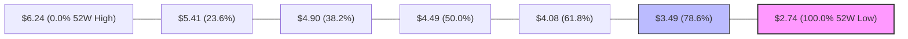

- **當前位置解讀**：現價 **$2.82** 處於 **78.6% 回調位（$3.49）** 與 **100.0% 回調位（$2.74）** 之間的極深回撤區。
- **技術意義**：
  1. 回撤幅度超過 78.6%，說明原有的上升趨勢已遭完全破壞，屬於標準的熊市末端或弱勢尋底格局。
  2. 現價距離底部的空間僅為 $\$2.82 - \$2.74 = \$0.08$（約 2.8%），極為接近多頭的理論防守底線。

---

## 5. 技術指標深度解讀

### 🎛️ 指標訊號總覽

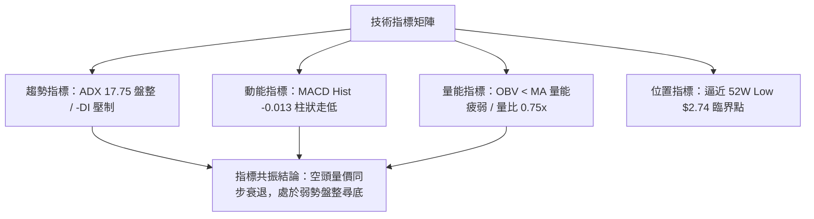

### 📈 移動平均線排列分析

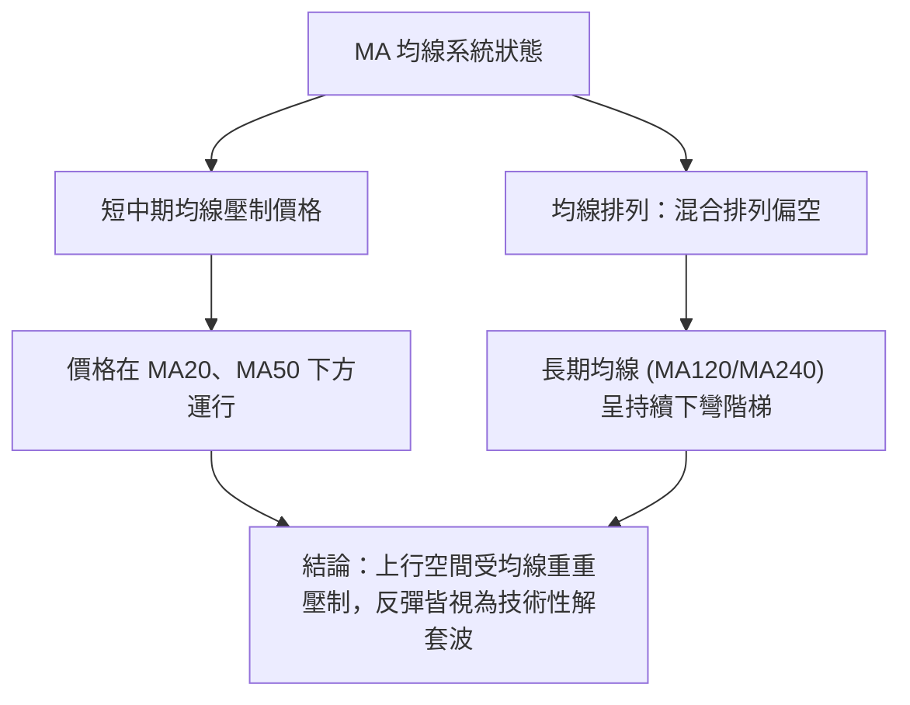

- **均線排列狀態**：數據報告明確標記為「混合排列」，且「價格位於 MA20、MA50 下方」。
- **走勢特徵解讀**：從微型趨勢圖中可見，MA5 至 MA240 均呈現由高點向低點逐級滑落的形態，顯示各週期持倉成本均處於浮虧狀態，上方套牢盤沉重。

### 📉 RSI(14) 分析

```
RSI(14) 狀態指示器：
[0] ─── 極度超賣(30) ────────── 中性軸(50) ────────── 超買(70) ─── [100]
            ▲
         約 35-40 區間（日線中性偏弱）
```

- **數值狀態**：日線 RSI 處於中性區間（30-70），數據標註「無明顯背離」。
- **週線 RSI 走勢回溯**：
  - 2026-09-20 創下週線收盤最低點 $2.80 時，週線 RSI 跌至極端低點 **10.6**。
  - 2026-10-25 價格回落至 $2.82 時，若價格未破 $2.80，週線 RSI 預計維持在 30-40 之間，此處蘊含**潛在的週線級別底背離雛形**，但需後續 K 線收陽方能確認。目前結論：**暫無確認的背離訊號，維持弱勢震盪判斷**。

### 📊 MACD(12,26,9) 訊號解讀

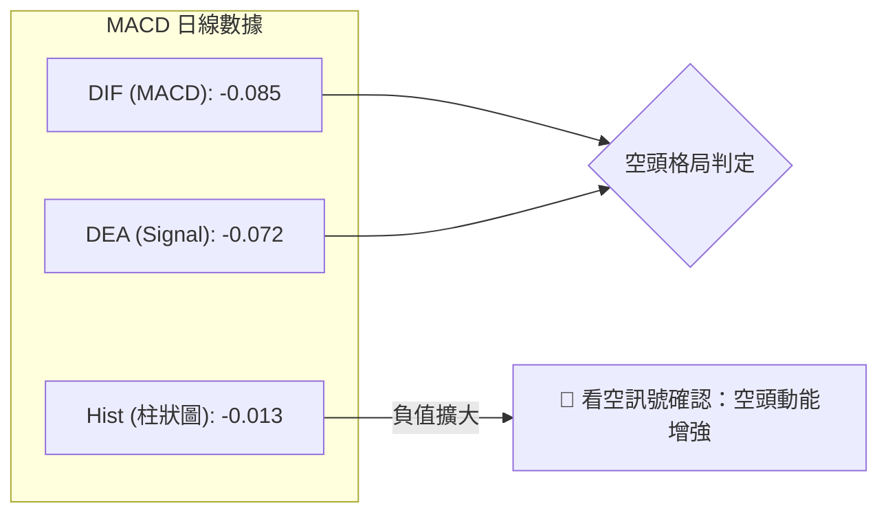

- **指標數值**：MACD 線為 `-0.085`，信號線為 `-0.072`，柱狀圖（Histogram）為 `-0.013`。
- **指標解讀**：MACD 線處於信號線下方，且雙線均深處於零軸之下，柱狀圖再度翻負，表明短期雖然在 $2.80 處出現過反彈，但反彈已經在 10 月中旬受阻，目前重新進入空頭主導的下行微波段。

### 📦 布林通道分析

> **數據紀律說明**：原始數據中 BB 上軌、中軌、下軌均標記為 `$N/A`。依據技術分析規範，中軌等同於 MA20，下軌與上軌分別為中軌加減 2 倍標準差。

```
布林通道形態推演示意圖：
$3.50 ──────────────────────────── 上軌 (預估反壓區)
           \
$3.15 ───────\──────────────────── 中軌 (MA20 阻力軸)
              \
$2.82 ─────────● (現價逼近下軌)
                \
$2.74 ──────────────────────────── 下軌 (預估與 52W Low 重疊)
```

- **相對位置解讀**：由於價格持續低於 MA20，且近期由 $3.19 連續回落，價格目前正緊貼布林帶下軌運行，通道呈現向下傾斜發散的特徵，屬於弱勢探底形態。

### 💹 成交量分析（量價配合度）

```
成交量對比：
最新成交量  ██████████████░░░░░░  47.99M
20日均量    ███████████████████░  63.90M  (量比: 0.75x)
50日均量    ██████████████████░░  59.79M
```

- **OBV（能量潮）分析**：數據顯示「OBV < MA → 量能疲弱」。OBV 處於均線下方，說明資金在過去一段時間內持續呈現淨流出狀態，反彈時未見機構資金積極建倉。
- **量價配合判定**：
  - 9 月底反彈至 $3.13 ~ $3.19 時，週成交量放大至 400M ~ 527M，顯示有空頭回補盤。
  - 當前回調至 $2.82 時，成交量降至 47.99M（週量 190M），呈現「縮量陰跌」，顯示買盤承接意願薄弱，雖然沒有引發恐慌性拋售，但在缺乏增量資金介入下，價格極易受少量賣單打壓下挫。

---

## 6. 動能與波動率

### ⚡ 動能評估四象限

| 象限 | 動能強度 | 波動率水準 | 當前狀態判定 | 交易決策指引 |
|------|----------|------------|--------------|--------------|
| **Q1 (最佳機會)** | 強 (ADX>25, +DI主導) | 低 (縮量整理) | 否 | 蓄勢突破，適合積極做多 |
| **Q2 (謹慎觀望)** | 弱 (ADX<25) | 低 (縮量摩擦) | **✓ 當前吻合** | **動能疲弱且處於低位震盪，嚴禁追單，著重區間邊界操作** |
| **Q3 (高風險博弈)**| 強 (-DI主導) | 高 (寬幅震盪) | 否 | 單邊暴跌，需等待恐慌盤出清 |
| **Q4 (避免進場)** | 弱 (無方向) | 高 (無序震盪) | 否 | 容易被雙向洗盤掃損 |

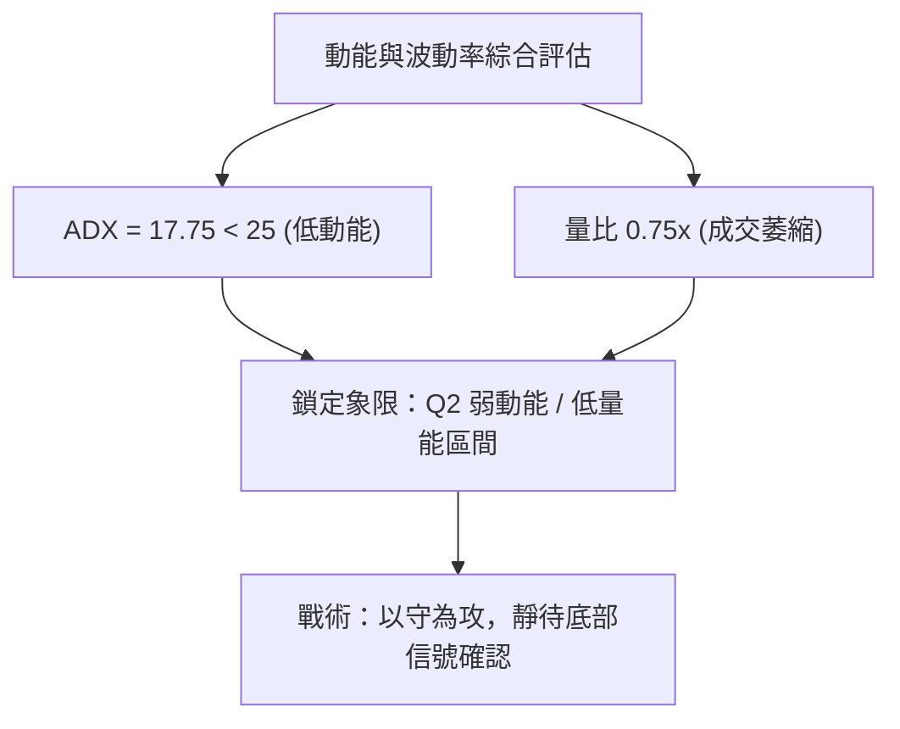

### 📊 ATR 波動率分析

- **ATR 數值狀態**：數據中 ATR(14) 標記為 `$N/A`。
- **歷史價格推算波動參考**：
  - 觀察近 20 週收盤價之平均週波幅：約在 $0.15 ~ $0.25 之間。
  - 換算日均合理真實波幅約為 **$0.06 ~ $0.08**。
- **風控止損距離建議**：
  - 短線操作止損緩衝區應設定為至少 1.5 倍日波幅（約 **$0.10 ~ $0.12**）。
  - 當前價格 $2.82 距離關鍵低點 $2.74 僅有 $0.08，若以 $2.74 作為硬止損點，恰好符合常規止損空間。

### 📐 Beta 與市場相關性

- **Beta 數值**：`0.908`（接近於 1.0）。
- **特徵解讀**：
  - GRAB 與美股大盤（S&P 500）保持著中高度的同步性，並非不受大盤影響的獨立走勢股。
  - 當大盤走弱時，GRAB 極難逆勢走強；但在大盤企穩回升時，其 0.908 的 Beta 意味著其具備跟隨市場修復的彈性。
  - 考量當前 Short Float 為 7.6%，空頭部位具備一定比例但未達軋空極值，走勢仍受制於自身技術面拋壓。

---

## 7. 多時框架總結

### 📋 時框架評分表

| 時框架 | 趨勢方向 | 動能狀態 | 均線排列 | 形態結構 | 綜合評分 | 操作建議 |
|--------|----------|----------|----------|----------|----------|----------|
| **月線 (長期)** | 🔴 下行 | 🔴 疲弱 | 🔴 空頭排列 | 下降趨勢階梯 | 25/100 | 規避長線持倉，耐心等待週期反轉 |
| **週線 (中期)** | 🔴 偏空 | 🟡 超賣回抽 | 🔴 均線反壓 | 測試 52W 低點 | 35/100 | 關注 $2.74 邊界防守表現 |
| **日線 (短期)** | 🟡 盤整偏空 | 🔴 MACD翻負 | 🔴 均線壓制 | 縮量陰跌尋底 | 40/100 | 短線以區間下軌高拋低吸或觀望為主 |

### 🔲 綜合訊號矩陣

```
訊號一致性檢驗：
長期趨勢 (月線)  ──► 🔴 空頭
中期趨勢 (週線)  ──► 🔴 空頭
短期趨勢 (日線)  ──► 🟡 盤整 (ADX=17.75)
動能方向 (MACD)  ──► 🔴 柱狀下行 (-0.013)
量能趨勢 (OBV)   ──► 🔴 疲弱 (OBV < MA)
────────────────────────────────────────────────────
訊號收斂度：75% 偏空共振，僅在 52W 低點具備技術性博弈價值
```

### ⚖️ 多時框收斂結論（依規則 14 執行）

依據本報告之嚴格規則 14：
1. **行情性質判定**：當前 ADX(14) 數值為 **17.75**（小於 25），嚴格判定為**盤整震盪行情**。
2. **主導時框選擇**：在盤整行情中，中長期趨勢不具備強烈單邊推動效應，市場主要沿區間上下邊界進行擺動。
3. **最終收斂方向**：**偏空震盪，嚴格防守 $2.74 臨界點**。
   - 儘管分析師共識給予 Strong Buy 及高目標價，但技術面多時框架皆處於下行階梯中。
   - 當前價格 $2.82 處於無人接盤的陰跌態勢，主策略必須定位為「**逢反彈佈局空單或在跌破關鍵支撐後順勢跟進**」；多頭僅限於極小倉位依託 $2.74 做超跌左側博弈。

---

## 8. 交易策略建議

### 🗺️ 策略決策流程圖

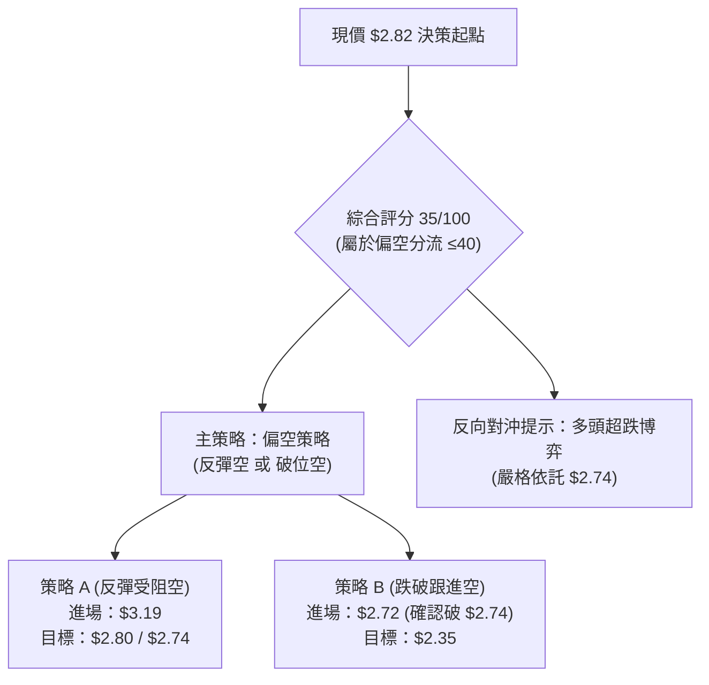

### 🧭 策略路由

- **依據第 1 章技術評分卡**：綜合評分為 **35/100**（≤ 40）。
- **當前主策略方向**：**🔴 主推空頭策略（偏空操作）**。多頭操作僅列為邊界反轉風險觸發點與對沖參考，嚴禁主動重倉做多。

### 🎯 價格情境階梯（Price Scenarios）

> **數據引用說明**：所有價位完全引用第 4 章及數據源中已計算之數值。

| 觸發條件 | 下一目標 | 後續延伸 | 情境含義 |
|----------|----------|----------|----------|
| **強勢突破 R0 $3.19** | R1 $3.49 | R2 $4.08 | 短線築底成功，扭轉近期下行通道 |
| **震盪維持於 $2.74 ~ $3.19** | — | — | 弱勢箱體整理，指標低位反覆鈍化修復 |
| **有效跌破 S1 $2.74** | 形態目標 $2.35 | 數據中未偵測到後續支撐 | 創 52 週新低，開啟新一輪無支撐下殺 |

### 📊 情境機率分佈

| 情境 | 機率 | 主要依據 |
|------|------|----------|
| **回落再探底 / 跌破支撐** | **55%** | MACD 柱狀圖為負 (-0.013)、OBV 疲弱、-DI(24.06) 牢牢壓制 +DI(13.13) |
| **區間震盪整理 ($2.74-$3.19)** | **35%** | ADX 僅 17.75 缺乏單邊暴跌推動力，52W 低點存在一定空頭回補買盤 |
| **強勢反彈上行** | **10%** | 目前量比僅 0.75x，缺乏任何增量資金進場推升跡象 |

### 🔴 主策略詳情（空頭主導策略）

#### 空頭交易策略矩陣

| 策略要素 | 策略 A：反彈受阻佈空（左側逢高） | 策略 B：破位順勢追空（右側破位） |
|----------|----------------------------------|----------------------------------|
| **進場條件** | 價格反彈至頸線 $3.19 遇阻並收出上影線 | 價格跌破 52W 低點 $2.74 並收盤確認（如 $2.72） |
| **進場價格** | **$3.19** | **$2.72** |
| **目標價 T1** | **$2.80**（9月前低） | **$2.50**（心理整數關卡） |
| **目標價 T2** | **$2.74**（52W 低點） | **$2.35**（由形態高度推算目標） |
| **止損價格** | **$3.35**（突破前高緩衝區） | **$2.82**（現價/原震盪區間內） |
| **風險報酬比** | **2.81 : 1** 🟢 | **3.70 : 1** 🟢 |
| **成功機率** | 60% | 55% |
| **建議倉位** | 10% - 15% | 10% |

- **策略 A 風報比計算**：
  - 風險空間 = $\$3.35 - \$3.19 = \$0.16$
  - 利潤空間 (至 T2) = $\$3.19 - \$2.74 = \$0.45$
  - 風報比 = $0.45 / 0.16 \approx 2.81$
- **策略 B 風報比計算**：
  - 風險空間 = $\$2.82 - \$2.72 = \$0.10$
  - 利潤空間 (至 T2) = $\$2.72 - \$2.35 = \$0.37$
  - 風報比 = $0.37 / 0.10 \approx 3.70$

### 🟢 反向風險觸發點（對沖與多頭提示）

若市場出現以下情況，主策略將被推翻，空單必須立即無條件止損，激進型投資人方可考慮輕倉多頭對沖：
1. **多頭進場觸發點**：日線以放量長陽（成交量大於 60M）**實體收盤站穩 $3.19**。
2. **對沖目標價**：
   - 目標 1：斐波那契 78.6% 回調位 **$3.49**。
   - 目標 2：斐波那契 61.8% 回調位 **$4.08**。
3. **多頭嚴格止損點**：**$2.74**（若跌破則多頭邏輯全數瓦解）。

### ⭐ 整體訊號強度評星

```
做多訊號強度：★☆☆☆☆  (1.5/5星 - 僅有超跌與支撐邊界支撐)
做空訊號強度：★★★★☆  (4.0/5星 - 趨勢、均線、動能皆偏空)
整體可信度：  ★★★★☆  (4.0/5星 - 各時框數據收斂度高)
```

---

## 9. 風險提示與監控

### ✅ 關鍵監控指標 Checklist

```
╔══════════════════════════════════════════════════════════════╗
║                每日交易風控監控清單 (Checklist)               ║
╠══════════════════════════════════════════════════════════════╣
║ [ ] 52W 低點防守：收盤價是否跌破 $2.74？                      ║
║     └─ 是：空單進場/多單全面止損；否：維持區間震盪思維。        ║
║ [ ] 動能變更：MACD 柱狀圖是否由負轉正 (大於 0.000)？          ║
║     └─ 是：空單減倉警惕反彈；否：空方掌握下行節奏。            ║
║ [ ] 趨勢強度：ADX(14) 是否向上突破 25？                       ║
║     └─ 是：單邊趨勢形成 (需配合 -DI 或 +DI 方向判斷)。         ║
║ [ ] 量能異動：單日成交量是否放大至 64M (20日均量) 之 1.5 倍？   ║
║     └─ 是：主力機構進場跡象，嚴密觀察突破方向。                ║
║ [ ] 關鍵阻力破位：價格是否收復 $3.19？                        ║
║     └─ 是：形態反轉確認，全面平空翻多。                        ║
╚══════════════════════════════════════════════════════════════╝
```

### ⚠️ 風險場景分析

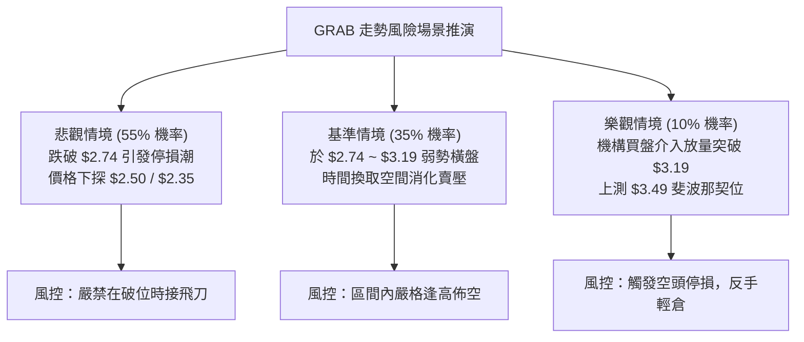

### 🛡️ 風險管理重要提醒

1. **基本面與技術面割裂風險**：
   - GRAB 的 PEG 僅為 0.59，分析師平均目標價高達 $5.54（甚至有機構給予 $7.00），共識評級為 Strong Buy。
   - **警惕陷阱**：技術面走勢極度疲弱，市場顯然在定價某些未完全反映在報表上的隱性風險。**切勿僅因基本面估值「便宜」而在無技術築底信號前盲目重倉抄底**。
2. **流動性與縮量陰跌風險**：
   - 當前量比為 0.75x，縮量陰跌往往比放量暴跌更難見底，因為缺乏恐慌盤拋售（Capitulation），代表買盤完全缺席。
3. **倉位管理守則**：
   - 單筆空頭交易風險暴露不得超過總資產的 1.5%。
   - 若執行 $2.74 邊界之超跌多頭博弈，倉位嚴格限制在 5% 以下，屬於非對稱高風險投機。

---

## 📋 報告總結

```
╔══════════════════════════════════════════════════════════════╗
║                 GRAB 技術分析報告總結                         ║
╠══════════════════════════════════════════════════════════════╣
║ 報告日期：2026-10-23                                         ║
║ 當前價格：$2.82                                              ║
║ 分析評級：🔴 偏空弱勢 (Bearish Consolidation)                ║
╠══════════════════════════════════════════════════════════════╣
║ 關鍵結論：                                                    ║
║ ├─ 長期趨勢：🔴 空頭主導，由 2025-09 高點 $6.02 持續下行       ║
║ ├─ 中期趨勢：🔴 階梯式陰跌，反彈波段高點逐次降低              ║
║ ├─ 短期趨勢：🟡 弱勢盤整 (ADX=17.75, -DI=24.06 佔優)         ║
║ ├─ 關鍵支撐：$2.74 (52W Low / 斐波那契 100.0%)               ║
║ ├─ 關鍵阻力：$3.19 (近期波段頂) / $3.49 (斐波那契 78.6%)      ║
║ └─ 分析師目標：$5.54 (與當前技術盤面嚴重背離)                 ║
╠══════════════════════════════════════════════════════════════╣
║ 最優策略組合：                                                ║
║ 1. 🥇 最佳機會：破位順勢做空 (跌破 $2.74 進場，看 $2.35)      ║
║ 2. 🥈 次選機會：反彈受阻放空 (反抽 $3.19 不破進場，看 $2.74)  ║
║ 3. 🥉 保守選擇：完全空倉觀望，靜待 $2.74 處是否出現巨量反轉K ║
╚══════════════════════════════════════════════════════════════╝
```

---

> ⚠️ **免責聲明**：本報告為技術分析研究，所有數據、圖表及估算均嚴格基於歷史量價數據推演。本報告**僅供學術研究與投資策略參考**，**不構成任何要約或投資建議**。市場具有高度不確定性，交易員應獨立評估風險並嚴格執行停損紀律。

---

*報告生成時間：2026-10-23 ｜ 數據來源：Yahoo Finance ｜ 分析框架：多時框技術分析體系*