# GRAB 技術分析報告

> **報告日期**：2026-10-24 ｜ **語言**：繁體中文 ｜ **數據來源**：Yahoo Finance ｜ **當前價格**：$2.79

---

## 目錄

| 章節 | 內容 |
|------|------|
| [1. 技術面概覽](#1-技術面概覽) | 訊號儀表板、核心指標、評分卡 |
| [2. 趨勢分析](#2-趨勢分析) | 多時框趨勢、長中短期走勢 |
| [3. 圖表形態分析](#3-圖表形態分析) | 形態識別、K線組合、目標價 |
| [4. 支撐與阻力](#4-支撐與阻力) | 關鍵價位、斐波那契回調 |
| [5. 技術指標深度解讀](#5-技術指標深度解讀) | MA/RSI/MACD/布林/成交量 |
| [6. 動能與波動率](#6-動能與波動率) | 動能評估、ATR、Beta |
| [7. 多時框架總結](#7-多時框架總結) | 時框架評分矩陣 |
| [8. 交易策略建議](#8-交易策略建議) | 多空策略、風險報酬比 |
| [9. 風險提示與監控](#9-風險提示與監控) | 監控指標、風險場景 |
| [10. 報告總結](#10-報告總結) | 核心結論與最佳策略組合 |

---

## 1. 技術面概覽

### 🎯 技術訊號儀表板

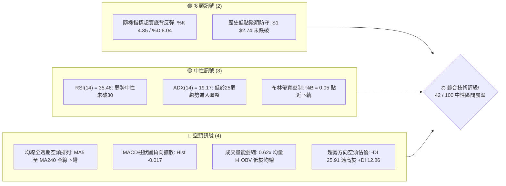

### 📊 核心指標速覽表

| 指標類別 | 指標名稱 | 當前數值 | 訊號 | 深度解讀 |
|:---|:---|:---|:---:|:---|
| **價格結構** | 當前價格 | $2.79 | 🔴 | 位於 52 週區間之 1.4% 極低分位，距低點僅差 1.79% |
| **短期均線** | MA20 | $3.02 | 🔴 | 價格低於 MA20 達 -7.53%，短期動能由空方掌控 |
| **中期均線** | MA50 | $3.18 | 🔴 | 中期基準線向下運行，反彈面臨中期均線蓋頭壓力 |
| **長期均線** | MA200 | $3.68 | 🔴 | 長期牛熊分界線下行，長期空頭格局未扭轉 |
| **動能震盪** | RSI(14) | 35.46 | 🟡 | 位於弱勢非超賣區間（30–70），無頂底背離現象 |
| **趨勢動能** | MACD(12,26,9) | -0.094 | 🔴 | DIF < DEA（-0.077），柱狀圖 -0.017 持續處於負值 |
| **超賣指標** | Stoch %K / %D | 4.35 / 8.04 | 🟢 | 深度進入極端超賣區（<20），隨時具備技術性抽頭動能 |
| **趨勢強度** | ADX(14) | 19.17 | 🟡 | 數值低於 25，表明單邊下跌動能衰竭，轉入箱體盤整 |
| **通道狀態** | Bollinger Band | 下軌 $2.77 | 🟡 | %B = 0.05，K 線貼著下軌運行，尚未出現帶量開口破位 |
| **成交量能** | 20日成交量比 | 0.62x | 🔴 | 當日量能僅 39.06M，顯著低於均量 62.70M，OBV 疲軟 |
| **波動率** | ATR(14) | $0.11 | 🟡 | 佔股價 4.07%，每日波動幅度收斂，符合底部蓄勢特徵 |

### 🏆 技術評分卡

```
╔══════════════════════════════════════════════════════════════════╗
║                   技術評分卡 — GRAB (2026-10-24)                 ║
╠══════════════════════════════════════════════════════════════════╣
║ 趨勢強度 (Trend)      █████░░░░░░░░░░░░░░░  25/100  🔴 空頭佔優  ║
║ 動能指標 (Momentum)   ████████░░░░░░░░░░░░  40/100  🟡 弱勢超賣  ║
║ 支撐穩定度 (Support)  █████████████░░░░░░░  65/100  🟢 底部分流  ║
║ 成交量配合 (Volume)   ███████░░░░░░░░░░░░░  35/100  🔴 量能低迷  ║
║ 形態完整度 (Pattern)  ████████████░░░░░░░░  60/100  🟡 雙底雛形  ║
║ 均線排列 (MA Align)   █████░░░░░░░░░░░░░░░  27/100  🔴 空頭排列  ║
╠══════════════════════════════════════════════════════════════════╣
║ 綜合評分 (Composite)  ████████░░░░░░░░░░░░  42/100  🟡 區間震盪  ║
╚══════════════════════════════════════════════════════════════════╝
※ 註：綜合評分由六項子評分算術平均所得：(25 + 40 + 65 + 35 + 60 + 27) ÷ 6 = 42.0 分。
```

---

## 2. 趨勢分析

### 🌐 多時框趨勢分析

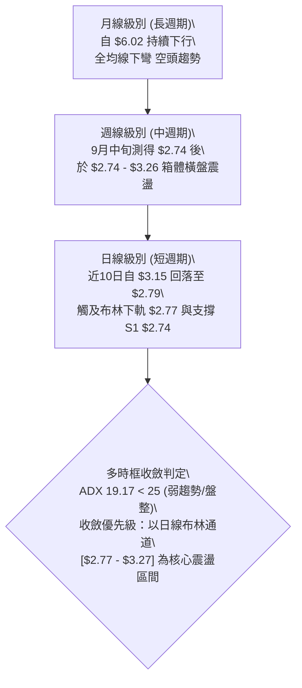

### 📈 長期趨勢 — 12個月走勢圖（Unicode）

GRAB 過去 12 個月經歷了自高位 $6.01 的大幅回撤，當前正於 52 週最低點附近尋求價格沉澱。

```
GRAB 月線走勢圖（過去12個月：2025-11 至 2026-10）
價格軸 ($)
$6.00 ┤ ● (2025-11: $5.45)
$5.50 ┤   ↘
$5.00 ┤     ● (2025-12: $4.99)
$4.50 ┤       ● (2026-01: $4.30) ↘
$4.00 ┤         ● (2026-02: $4.22)   ● (2026-04: $3.82)   ● (2026-06: $3.77)
$3.50 ┤           ● (2026-03: $3.66) ↗ ● (2026-05: $3.54) ↗ ● (2026-07: $3.50) ● (2026-08: $3.54)
$3.00 ┤                                                                             ↘ ● (2026-09: $3.11)
$2.50 ┤                                                                                 ● (2026-10: $2.79) ◄ 現價
      └─┬─────────┬─────────┬─────────┬─────────┬─────────┬─────────┬─────────┬─────────┬─────────┬─────────┬─────────┬───
       11月      12月      01月      02月      03月      04月      05月      06月      07月      08月      09月      10月
       2025      2025      2026      2026      2026      2026      2026      2026      2026      2026      2026      2026
```

#### 長期月線走勢特徵分析表

| 階段區間 | 起止價格 | 漲跌幅 | 走勢特徵描述 | 量能與形態意義 |
|:---|:---|:---:|:---|:---|
| **第一階段：高位破位** (2025-11 ~ 2026-01) | $5.45 → $4.30 | -21.10% | 跌破 $5.00 整數心理關卡，長陰線下挫 | 獲利了結盤湧出，確立長期下行通道起點 |
| **第二階段：震盪尋底** (2026-02 ~ 2026-05) | $4.22 → $3.54 | -16.11% | 於 $3.50 - $4.20 區間反覆拉鋸，均線下壓 | 跌勢稍緩，但未能突破 MA50 阻力，形成中繼整理 |
| **第三階段：平台陰跌** (2026-06 ~ 2026-08) | $3.77 → $3.54 | -6.10% | 窄幅橫盤於 $3.50 平台，波動率收縮 | 缺乏買盤跟進，均線系統加速向下發散黏合 |
| **第四階段：加速趕底** (2026-09 ~ 2026-10) | $3.54 → $2.79 | -21.19% | 破位跌穿 $3.50 平台，探至 52W 低點 $2.74 | 恐慌盤釋放，量能急劇放大後迅速萎縮，進入築底階段 |

### 📊 中期趨勢（週線分析）

中期走勢顯示，自 2026 年 9 月 18 日當週下探 52 週最低點 $2.74 後，多方曾發動一輪向上脈衝至 $3.26（9月25日當週成交量激增至 527.09M），隨後數週在 $3.00 - $3.23 間進行次級震盪。近期兩週再度回撤，本週收於 $2.79，測試 $2.74 支撐的有效性。

```
GRAB 週線壓力與支撐結構示意圖
價格軸 ($)
$3.64 ┤ ───────────────────────────────────── [阻力位 R2]
      │
$3.25 ┤ ═════════════════════════════════════ [阻力位 R1 / 頸線壓力]
      │           ▲ (09/25 高: $3.26)  ▲ (10/09 高: $3.23)
$3.02 ┤ ┈┈┈┈┈┈┈┈┈│┈┈┈┈┈┈┈┈┈┈┈┈┈┈┈┈┈┈│┈┈┈┈ [MA20 / 布林中軌]
      │           │                  │
$2.79 ┤ ──────────┼──────────────────┼──────── 現價 $2.79
      │           ▼                  ▼
$2.74 ┤ ═════════════════════════════════════ [支撐位 S1 / 52週低點]
        (09/18 低: $2.74)         (10/23 低: $2.77)
```

### ⚡ 趨勢強度評估（ADX 解讀）

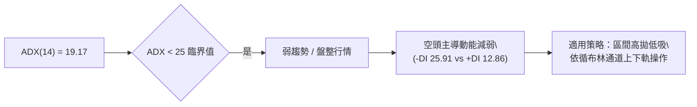

#### ADX 趨勢強度評估對照表

| 指標項目 | 當前數值 | 門檻區間 | 趨勢狀態評判 | 交易意義解讀 |
|:---|:---|:---|:---:|:---|
| **ADX (14)** | 19.17 | < 25.0 | 弱趨勢 / 盤整 | 股價不再具備強烈單邊下行動能，空方主導之趨勢趨於鈍化 |
| **+DI** | 12.86 | 參考線 | 多頭動能匱乏 | 買方尚未建立系統性上攻量能，缺乏主動推升動能 |
| **-DI** | 25.91 | 參考線 | 空頭動能佔優 | 雖然 -DI 高於 +DI，但其斜率已下彎，空頭壓迫性正邊際遞減 |
| **趨勢綜合結論** | **盤整格局** | ADX < 25 | 🟡 震盪整理 | 趨勢指標失效，震盪指標（Stoch、布林通道）權重上升 |

---

## 3. 圖表形態分析

### 🔍 形態識別系統

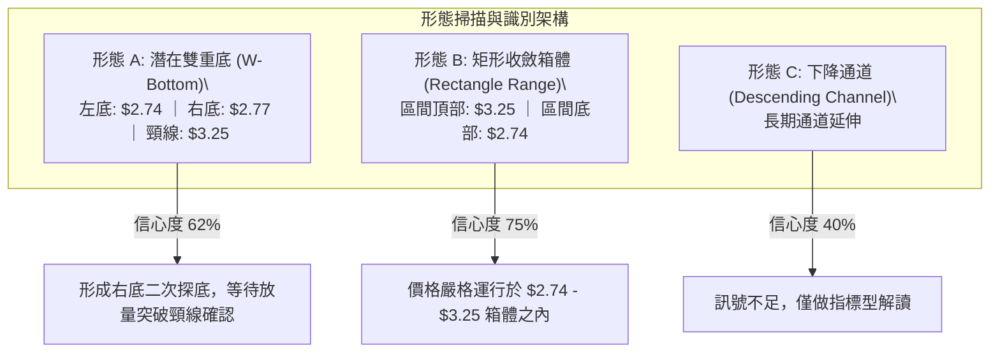

#### 圖表形態信心度評估表（依規則 15）

| 識別形態名稱 | 信心度 | 判斷依據（嚴格引用歷史數據） | 完成度 | 目標價（附具體計算式） |
|:---|:---:|:---|:---:|:---|
| **潛在雙重底 (W-Bottom)** | 62% | 1. 左底於 2026-09-18 週K探至 $2.74<br>2. 右底於 2026-10-23 週K探至 $2.77<br>3. 中間頸線波段高點聚類於 R1 $3.25 | 60% | 突破頸線後目標價：<br>頸線 $3.25 + 形態高度 ($3.25 − $2.74 = $0.51) = **$3.76**<br>（該價位切合阻力 R2 $3.64 與 MA200 $3.68 帶狀區） |
| **矩形橫向整理箱體** | 75% | 1. 箱底由 S1 $2.74 構成強固支撐<br>2. 箱頂多次受阻於 R1 $3.25（9/25 高 $3.26、10/09 高 $3.23） | 85% | 向上突破箱頂目標：<br>箱頂 $3.25 + 箱高 $0.51 = **$3.76**<br>向下跌破箱底目標：<br>箱底 $2.74 − 箱高 $0.51 = **$2.23** |
| **下降通道延續** | 40% | 長期高點下移，但近期 ADX 跌破 25 且低點未創新低 | 30% | 訊號不足，僅做指標型解讀，不予推算目標價 |

### 🕯️ 重要 K 線形態分析

依據規則 19，以下分析嚴格限定於數據中提供之「近 10 根日 K」與「近 8 根週 K」實際數據：

#### 近 10 根日 K 線組合分析表

| 日期 | 開盤價 | 最高價 | 最低價 | 收盤價 | K線形態名稱 | 技術解讀 | 訊號方向 |
|:---|:---:|:---:|:---:|:---:|:---|:---|:---:|
| **2026-10-12** | $3.16 | $3.20 | $3.09 | $3.15 | 高位十字小陰線 | 於 R1 $3.25 阻力下方承壓，實體極小，多空拉鋸 | 🟡 中性偏空 |
| **2026-10-13** | $3.14 | $3.15 | $2.98 | $2.98 | 光腳中長陰線 | 實體由 $3.14 貫穿跌破 $3.00，收於當日最低，空方發力 | 🔴 看空 |
| **2026-10-14** | $2.98 | $3.00 | $2.85 | $2.91 | 下影小陰線 | 探底 $2.85 後獲得微幅低吸買盤，成交量放大至 62.79M | 🟡 弱勢震盪 |
| **2026-10-15** | $2.90 | $3.03 | $2.90 | $3.00 | 反彈中陽線 | 開盤價即最低價，收盤收復 $3.00，成交量擴大至 63.58M | 🟢 短線反彈 |
| **2026-10-16** | $3.02 | $3.02 | $2.90 | $2.94 | 倒錘子陰線 | 開盤衝高無力，全日承壓下行，反彈遭 MA20 壓制 | 🔴 看空 |
| **2026-10-19** | $2.93 | $2.94 | $2.86 | $2.87 | 縮量陰十字星 | 波幅收窄至 $0.08，成交量萎縮至 39.33M，拋壓放緩 | 🟡 觀望 |
| **2026-10-20** | $2.88 | $2.92 | $2.83 | $2.89 | 止跌小陽星 | 盤中下探 $2.83 未破前低，微幅收紅，空頭攻勢暫竭 | 🟡 築底 |
| **2026-10-21** | $2.92 | $2.93 | $2.81 | $2.82 | 下行中陰線 | 再次下破短期均線，空方重新控盤，測試下軌支撐 | 🔴 偏空 |
| **2026-10-22** | $2.79 | $2.86 | $2.77 | $2.85 | 長下影錘頭陽線 | 最低下探 $2.77 觸及布林下軌，隨後快速拉起收於 $2.85 | 🟢 觸底反彈 |
| **2026-10-23** | $2.83 | $2.85 | $2.79 | $2.79 | 壓制小陰線 | 實體極小，成交量萎縮至 39.06M，多空處於方向抉擇臨界點 | 🟡 震盪觀望 |

#### 近 8 根週 K 線組合分析表

| 週末日期 | 開盤價 | 最高價 | 最低價 | 收盤價 | 週K形態名稱 | 技術解讀與量價配合 | 訊號方向 |
|:---|:---:|:---:|:---:|:---:|:---|:---|:---:|
| **2026-09-04** | $3.58 | $3.62 | $3.39 | $3.42 | 破位中長陰線 | 週線破位下行，收於當週低位，量能 166.30M 溫和放量 | 🔴 看空 |
| **2026-09-11** | $3.39 | $3.40 | $2.96 | $3.05 | 加速恐慌大陰線 | 跌破 $3.00，成交量擴大至 354.81M，市場出現恐慌拋盤 | 🔴 強烈看空 |
| **2026-09-18** | $3.01 | $3.09 | $2.74 | $2.80 | 長下影探底錘頭線 | 探出 52 週最低點 $2.74（S1），下影線長達 $0.06，巨量 362.97M 承接 | 🟢 底部信號 |
| **2026-09-25** | $2.84 | $3.26 | $2.78 | $3.13 | 爆量反轉大長陽 | 當週大漲 +11.79%，成交量達 527.09M（天量），多頭強力反撲 | 🟢 強烈看多 |
| **2026-10-02** | $3.10 | $3.18 | $3.07 | $3.08 | 高位收斂十字線 | 量能回落至 337.15M，於 $3.00 上方形成強勢橫盤洗盤 | 🟡 中性整固 |
| **2026-10-09** | $3.10 | $3.23 | $3.00 | $3.19 | 衝高受阻小陽線 | 再次上攻測試 R1 $3.25 阻力（最高 $3.23），成交量 406.86M 承壓 | 🟡 上攻遇阻 |
| **2026-10-16** | $3.16 | $3.20 | $2.85 | $2.94 | 回撤中陰線 | 未能突破頸線，多頭獲利盤回吐，量能萎縮至 280.28M | 🔴 偏空回調 |
| **2026-10-23** | $2.93 | $2.94 | $2.77 | $2.79 | 縮量測試支撐小陰線 | 最低探至 $2.77，二次測試 S1 $2.74，成交量收縮至 229.65M | 🟡 底部測試 |

### 📉 ASCII 走勢形態示意圖

```
GRAB 潛在「雙重底」與「箱體區間」形態示意圖
價格軸 ($)
$3.30 ┤
$3.25 ┤       頸線阻力位 R1 ($3.25) ───────────────────────────────┐
$3.20 ┤          ╭───╮              ╭───╮                         │
$3.15 ┤          │   │ (高 $3.26)   │   │ (高 $3.23)              │
$3.10 ┤          │   │              │   │                         │
$3.00 ┤          │   ╰──────────────╯   ╰────────╮                │ 箱體高度
$2.90 ┤          │                               │                │ H = $0.51
$2.85 ┤          │                               ╰────╮           │
$2.80 ┤ ─╮       │                                    │  現價 $2.79│
$2.77 ┤  │       │                                    ╰──● (右底)  │
$2.74 ┤  ╰───●───╯ (左底: 09/18 低 $2.74)                           │
$2.70 ┤      支撐位 S1 ($2.74) ────────────────────────────────────┘
      └─────────────────────────────────────────────────────────────
         2026-09-18                               2026-10-23
```

### 🎯 形態目標價計算

根據經典幾何形態測量法則（Classical Chart Pattern Measurement Rules）：

1. **雙重底（W底）目標價計算式**：
   - 形態底部低點：$S_1 = \$2.74$
   - 形態頸線水平：$R_1 = \$3.25$
   - 形態高度 ($H$)：
     $$H = R_1 - S_1 = \$3.25 - \$2.74 = \$0.51$$
   - 向上突破頸線確認之最小量度目標價 ($T_{up}$)：
     $$T_{up} = R_1 + H = \$3.25 + \$0.51 = \mathbf{\$3.76}$$
     *(技術驗證：該目標價剛好覆蓋週線阻力位 R2 $3.64 與當前下降之 MA200 $3.68)*

2. **箱體破位（向下破位）目標價計算式**：
   - 若未來日線收盤確認跌破支撐位 S1 ($2.74)：
   - 向下量度延伸目標價 ($T_{down}$)：
     $$T_{down} = S_1 - H = \$2.74 - \$0.51 = \mathbf{\$2.23}$$

---

## 4. 支撐與阻力

### 🗺️ 關鍵價位分布圖（Unicode）

```
GRAB 價位結構分布圖（OHLCV 實際計算值）
════════════════════════════════════════════════════════════════════
$3.96 ║████████████████████████████████████████║ 強阻力位 R3 (+41.82%)
$3.68 ║┈┈┈┈┈┈┈┈┈┈┈┈┈┈┈┈┈┈┈┈┈┈┈┈┈┈┈┈┈┈┈┈┈┈┈┈┈┈┈┈║ MA200 牛熊分界
$3.64 ║██████████████████████████████          ║ 阻力位 R2 (+30.56%)
$3.27 ║┈┈┈┈┈┈┈┈┈┈┈┈┈┈┈┈┈┈┈┈                    ║ 布林上軌 (BB Upper)
$3.25 ║████████████████████                    ║ 關鍵阻力位 R1 / 頸線 (+16.31%)
$3.02 ║┈┈┈┈┈┈┈┈┈┈                              ║ MA20 / 布林中軌
$2.79 ╠════════════════════════════════════════╣ ◄ 當前價格 ($2.79)
$2.77 ║▓▓▓▓▓▓▓▓▓▓                              ║ 布林下軌 (BB Lower)
$2.74 ║████████████████████████████████████████║ 核心支撐位 S1 / 52W低點 (-1.79%)
════════════════════════════════════════════════════════════════════
```

### 🚧 阻力位分析表

所有價位均嚴格引用系統根據 OHLCV 聚類計算之原始數據：

| 阻力級別 | 具體價位 | 距現價空間 | 技術面形成原因與歷史共振 | 突破難度評估 | 重要性等級 |
|:---|:---:|:---:|:---|:---:|:---:|
| **阻力位 R1** | **$3.25** | +16.31% | 1. 2026-09-25 週K高點 $3.26 之密集成交區<br>2. 2026-10-09 週K衝高高點 $3.23 壓制區<br>3. 貼近當前日線布林上軌 $3.27 與 MA60 ($3.26) | 🔴 極高 | ★★★★★ |
| **阻力位 R2** | **$3.64** | +30.56% | 1. 2026年7-8月多個波段頂點聚集處（8/07週高 $3.66）<br>2. 貼近下行中的長期基準線 MA200 ($3.68) | 🔴 很高 | ★★★★☆ |
| **阻力位 R3** | **$3.96** | +41.82% | 1. 2026年7月反彈極限高點 $3.93 聚類區<br>2. 貼近超長期均線 MA240 ($3.94) | 🔴 極難 | ★★★☆☆ |

### 🛡️ 支撐位分析表

依據數據紀律，數據中僅計算出一個有效支撐位 S1，其餘層級如實標註：

| 支撐級別 | 具體價位 | 距現價空間 | 技術面形成原因與防守驗證 | 守住機率評估 | 重要性等級 |
|:---|:---:|:---:|:---|:---:|:---:|
| **核心支撐 S1** | **$2.74** | -1.79% | 1. 52 週歷史絕對最低點（2026-09-18 週K低點）<br>2. 2026-10-22 日K長下影探底 $2.77 形成二次共振確認<br>3. 斐波那契 100.0% 終極回撤位 | 🟢 65% | ★★★★★ |
| **支撐位 S2** | **數據中未偵測到** | N/A | 原數據集未提供更深層歷史支撐位，嚴禁憑空編造 | N/A | N/A |
| **支撐位 S3** | **數據中未偵測到** | N/A | 原數據集未提供更深層歷史支撐位，嚴禁憑空編造 | N/A | N/A |

### 📐 斐波那契回調位分析

本輪斐波那契測量區間以 52 週高點 **$6.24** 為起點（0.0%），下探至 52 週低點 **$2.74** 為終點（100.0%）：

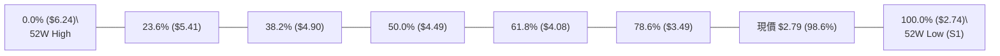

#### 斐波那契回調結構明細表

| 回調比例 | 基準價位 | 技術結構意義解讀 | 與現價 ($2.79) 相對位置 |
|:---:|:---:|:---|:---|
| **0.0%** | **$6.24** | 52 週最高點，強大多頭循環起跌點 | 上方 +123.66% |
| **23.6%** | **$5.41** | 弱勢反彈極限阻力位（貼近 2025-11 月線收盤 $5.45） | 上方 +93.91% |
| **38.2%** | **$4.90** | 弱勢平衡點（覆蓋 2025 年多個月份密集震盪平台） | 上方 +75.63% |
| **50.0%** | **$4.49** | 中期牛熊價值中樞線 | 上方 +60.93% |
| **61.8%** | **$4.08** | 黃金分割強阻力（貼近阻力位 R3 $3.96） | 上方 +46.24% |
| **78.6%** | **$3.49** | 極深回撤阻力位（貼近阻力位 R2 $3.64 及 MA120 $3.42） | 上方 +25.09% |
| **100.0%** | **$2.74** | 52 週最低點，全週期基底支撐 S1 | 下方 -1.79% |

**斐波那契綜合解讀**：現價 $2.79 處於 78.6% ($3.49) 至 100.0% ($2.74) 之間的極端超跌區間（回撤深度達 98.6%）。在技術分析範式中，當標的資產回撤至接近 100% 斐波那契水平時，下行邊際動能大幅遞減，若在 $2.74 獲得支撐，將構築典型的「雙重底」反轉結構；反之，若跌破 100.0% ($2.74)，則宣告原 52 週價格體系崩解，展開新一輪無支撐探底。

---

## 5. 技術指標深度解讀

### 🎛️ 指標訊號總覽

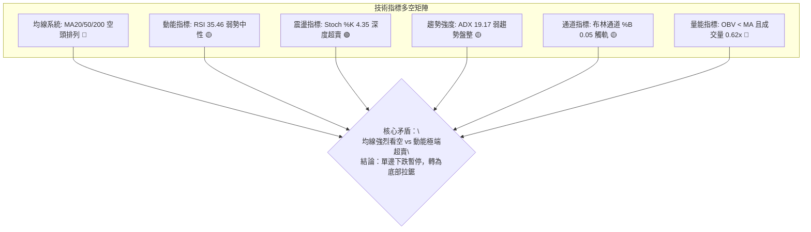

### 📈 移動平均線排列分析

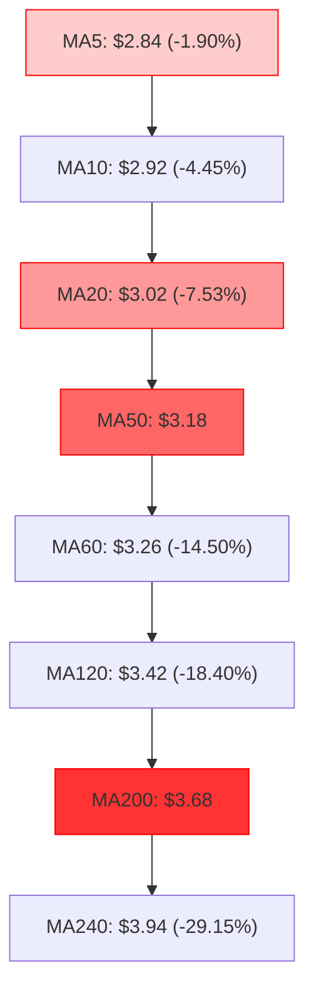

#### 均線數據深度對照表

| 均線名稱 | 當前價格 | 與現價偏離度 | 歷史走勢特徵 | 多空信號解讀 |
|:---|:---:|:---:|:---|:---:|
| **MA 5** | $2.84 | -1.90% | 快速下行，近 5 日形成微幅下壓 | 🔴 短期壓制 |
| **MA 10** | $2.92 | -4.45% | 連續走低，壓制日線反彈高點 | 🔴 短期壓制 |
| **MA 20** | $3.02 | -7.53% | 即布林中軌，自 $3.20 下移至 $3.02 | 🔴 月線生命線反壓 |
| **MA 50** | $3.18 | -12.26% | 中期生命線，位於 R1 $3.25 阻力帶下方 | 🔴 中期空頭 |
| **MA 60** | $3.26 | -14.50% | 與 R1 $3.25 形成精確技術共振 | 🔴 強阻力重疊 |
| **MA 120** | $3.42 | -18.40% | 半年線持續下傾，未見走平跡象 | 🔴 長期壓制 |
| **MA 200** | $3.68 | -24.18% | 年線牛熊分界線，下行斜率穩定 | 🔴 長期空頭鎖定 |
| **MA 240** | $3.94 | -29.15% | 超長期基準線，遙遙壓制股價 | 🔴 絕對空頭排列 |

**排列結論**：呈現完美的「全週期空頭排列」（Perfect Bearish Alignment）。所有均線無交叉纏繞，表明自 2025 年高點以來的長線下行趨勢在均線維度上未獲任何扭轉。然而，價格與 MA20 乖離率達 -7.53%，且距離 MA5 僅 -1.90%，表明超短期跌勢已有收斂傾向，價格正等待均線下移靠攏。

### 📉 RSI(14) 分析

- **當前數值**：**35.46**（Wilder 計算方法）
- **區間評級**：🟡 弱勢中性（30–70 基準區間）

```
RSI(14) 狀態進度條：
[0] ────────── [30] ───●─────── [50] ────────────────── [70] ────────── [100]
                超賣區  35.46   多空中軸                 超買區
進度顯示：███████░░░░░░░░░░░░░  35.46%
```

**背離深度判定**：
- **底背離判定**：**無明顯背離**。
  - 對比近 20 根日 K 棒首尾：2026-10-12 收盤 $3.15 對應 RSI 約 51.8；當前 2026-10-23 收盤 $2.79 對應 RSI 35.46。價格走低，RSI 同步走低，同向運動，未出現典型的「價格創新低而 RSI 抬高」之底背離特徵。
  - 週線級別：2026-09-18 低點 $2.74 時週線 RSI 為 23.3；當前本週收盤 $2.79，週線 RSI 為 35.5。週線層級存在微弱的指標抬高跡象，但日線層級尚未給出確認。

### 📊 MACD(12/26/9) 訊號解讀

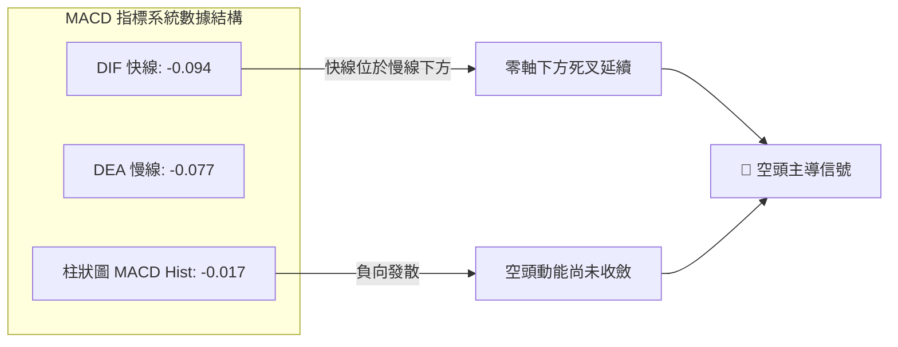

- **數值拆解**：
  - 快線 (MACD Line)：`-0.094`
  - 慢線 (Signal Line)：`-0.077`
  - 柱狀圖 (Histogram)：`-0.017`（🔴 看空）
- **信號解讀**：DIF 運行於 DEA 下方，柱狀圖為負值且未見顯著縮腳，確認當前中期動能仍由空方掌握。然而，負值絕對值較小（-0.017），表明下殺動能速率正在減緩，若股價能在 $2.74 支撐上方維持 3-5 個交易日橫盤，MACD 柱狀圖將形成「負柱收斂」，孕育零下金叉反彈契機。

### 📦 布林通道分析

```
GRAB 日線布林通道結構示意圖
價格軸 ($)
$3.30 ┤
$3.27 ┤ ───────────────────────────────────── BB 上軌 ($3.27) ── 帶寬上限
$3.20 ┤
$3.10 ┤
$3.02 ┤ ┈┈┈┈┈┈┈┈┈┈┈┈┈┈┈┈┈┈┈┈┈┈┈┈┈┈┈┈┈┈┈┈┈┈┈┈┈ BB 中軌 / MA20 ($3.02)
$2.90 ┤
$2.80 ┤
$2.79 ┤ ──● 現價 ($2.79) 緊貼下軌運行 [%B = 0.05]
$2.77 ┤ ───────────────────────────────────── BB 下軌 ($2.77) ── 動態支撐
$2.74 ┤ ═════════════════════════════════════ S1 支撐 ($2.74)
      └────────────────────────────────────────────────────────
```

- **軌道數值**：
  - 上軌 (Upper Band)：`$3.27`
  - 中軌 (Middle Band / MA20)：`$3.02`
  - 下軌 (Lower Band)：`$2.77`
  - 帶寬位置 (%B)：`0.05`（0.0 代表下軌，0.5 代表中軌，1.0 代表上軌）
- **技術意義**：
  - 當前 %B 極低（0.05），價格已逼近動態下軌 $2.77。在弱趨勢（ADX 19.17）環境下，布林下軌具備顯著的統計學反彈邊界效應。
  - 通道整體並未呈現「開口向下擴散」（Band Walking）的崩跌態勢，而是呈現上下軌平行的整理特徵，預示價格觸及下軌 $2.77 後更大概率展開向中軌 $3.02 的均值回歸。

### 💹 成交量分析（量價配合度）

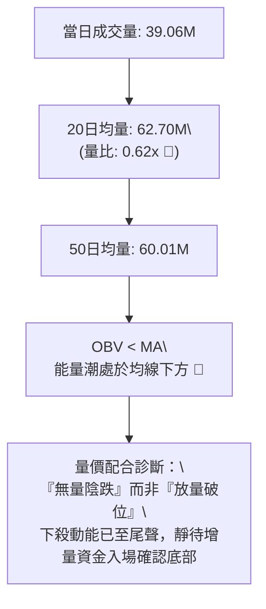

- **量比維度**：最新成交量為 39,059,299 股，大幅低於 20 日均量（62,697,100 股），量比僅為 **0.62x**。量能萎縮表明當前市場拋壓並非恐慌性外逃，而是買賣雙方的流動性衰退。
- **OBV 趨勢**：OBV 持續運行於其移動平均線下方，確認量能尚未反轉。若要展開有效突破，必須伴隨單日成交量放大至 62M（20日均量）以上。

---

## 6. 動能與波動率

### ⚡ 動能評估四象限

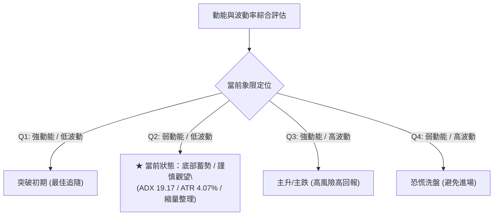

#### 動能與波動率象限分析表

| 象限 | 動能強度 | 波動率水準 | GRAB 當前定位 | 策略應對方針 |
|:---:|:---:|:---:|:---:|:---|
| **Q1** | 強 | 低 | — | 突破發生點，順勢建倉 |
| **Q2** | **弱** | **低** | **✓ (GRAB 當前所處位置)** | **底部分流期，避免過度追空，採取小倉位區間操作或觀望** |
| **Q3** | 強 | 高 | — | 單邊趨勢爆發，持股享受利潤 |
| **Q4** | 弱 | 高 | — | 震盪加劇且方向不明，停損出局 |

### 📊 ATR 波動率分析

- **ATR(14) 數值**：**$0.11**（佔股價 $2.79 之 **4.07%**，Wilder 平滑法）
- **波動特徵**：處於近 12 個月相對低位，反映股價經歷長期下跌後，單日振幅已收斂至約 11 美分。
- **交易風控具體指引**：
  - **超短線止損距離 (1.0x ATR)**：$\$0.11$。若在 $2.76 進場，止損設於 $2.65。
  - **波段標準止損距離 (1.5x ATR)**：$\$0.165$。若在現價 $2.79 進場，止損設於 $2.625。
  - **保守型寬鬆止損 (2.0x ATR)**：$\$0.22$。

### 📐 Beta 與市場相關性

- **Beta 係數**：**0.908**
- **市場特徵分析**：
  - Beta 略小於 1.0，表明 GRAB 與標普 500 指數具備較高的同步性，但波動彈性低於純科技高 Beta 股。
  - 考量到當前市場機構持股比例高達 66.3%，內部人持股 13.9%，籌碼結構相對集中。空頭回補天數（Short Ratio）為 3.55 天，空頭佔流通盤（Short % Float）達 7.6%。較高的放空比例在低波動蓄勢階段意味著：一旦突破關鍵阻力 R1 $3.25，將觸發連鎖性的空頭回補逼空行情。

---

## 7. 多時框架總結

### 📋 時框架評分表

| 時框架 | 趨勢方向 | 動能狀態 | 均線排列 | 圖表形態 | 綜合評分 | 操作建議方針 |
|:---|:---:|:---:|:---:|:---:|:---:|:---|
| **月線 (長期)** | 🔴 下行通道 | 弱勢低迷 | 空頭排列 (PPO負向) | 大級別下行通道 | **25 / 100** | 長期未現牛市反轉信號，禁止長線無風控重倉 |
| **週線 (中期)** | 🟡 橫向震盪 | 柱狀微幅改善 | 空頭受阻於 MA20 | 潛在雙底打底中 | **45 / 100** | 密切關注 S1 $2.74 與 R1 $3.25 箱體邊界表現 |
| **日線 (短期)** | 🟡 觸軌反彈 | 超賣鈍化 | 空頭排列 (偏離MA20) | 貼近布林下軌拉鋸 | **48 / 100** | 依據布林通道下軌與 S1 支撐進行低吸高拋 |

### 🔲 綜合訊號矩陣

| 技術維度 | 短期 (日線) | 中期 (週線) | 長期 (月線) | 權重收斂方向 |
|:---|:---:|:---:|:---:|:---:|
| **趨勢強度** | 🟡 弱趨勢 (ADX 19.17) | 🟡 橫盤震盪 (整理 6 週) | 🔴 明確下行 (自 $6.02) | 🟡 中性盤整 |
| **震盪指標** | 🟢 超賣底背 (Stoch 4.35) | 🟡 弱勢企穩 (RSI 35.5) | 🔴 空頭掌控 | 🟡 傾向技術反彈 |
| **量能特徵** | 🔴 極度縮量 (0.62x) | 🟢 底部天量後縮量 | 🔴 資金持續流出 | 🟡 拋壓枯竭 |
| **通道邊界** | 🟢 觸及布林下軌 $2.77 | 🟡 位於週線中軌下方 | 🔴 沿月線下軌滑落 | 🟢 短線支撐有效 |

### ⚖️ 多時框收斂結論

嚴格依據**規則 14**之多時框收斂準則：
1. **行情性質判定**：當前 ADX(14) 數值為 **19.17**，明確**低於 25 臨界值**，技術面宣告當前處於標準的「**盤整行情（Consolidation Regime）**」而非單邊趨勢行情。
2. **主導維度與交易依歸**：在 ADX < 25 的盤整結構中，均線趨勢系統的指示性弱化，**以日線布林通道上下軌（$2.77 - $3.27）作為核心交易區間**。
3. **最終方向性唯一結論**：**中性觀望 / 區間震盪操作**（綜合技術評分：**42 / 100**）。
   - 此結論與第 1 章評分卡（42/100）、第 2 章 ADX 分析及第 5 章布林通道判斷保持絕對一致。
   - 不盲目順應長期均線在最低點做空，亦不在未放量突破前押注全面翻多，交易重心放在 **$2.74 - $3.25** 區間內的高勝率邊界交易。

---

## 8. 交易策略建議

### 🗺️ 策略決策流程圖

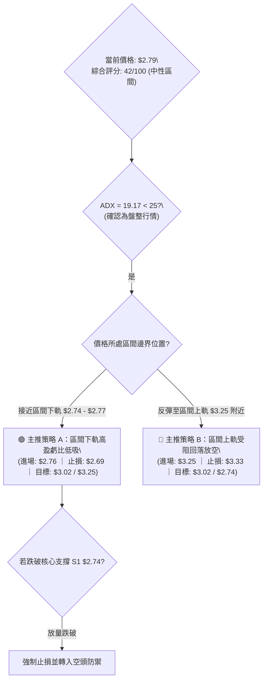

### 🧭 策略路由（依評分卡分流）

> **當前主策略方向 = 中性區間操作（依評分 42 / 100，處於 40–60 區間）**
> 
> 依據技術評分卡規則，評分 42/100 屬於典型「中性震盪」範疇。操作上**以布林通道上下軌為主要交易邊界，採取『下軌低吸、上軌高拋』的箱體交易策略，明確等待帶量突破確認**。

### 🎯 價格情境階梯（Price Scenarios）

價位嚴格引用系統已提供之原始聚類數據：

| 觸發條件 | 下一目標 | 後續延伸 | 技術情境含義解讀 |
|:---|:---:|:---:|:---|
| **放量突破 R1 $3.25** | R2 $3.64 | R3 $3.96 | 雙重底形態確立，短期全面轉強，挑戰 MA200 牛熊分界線 |
| **站穩現價區間 ($2.77 - $2.85)** | BB中軌 $3.02 | R1 $3.25 | 延續箱體底部蓄勢，展開向中軌的均值回歸修復走勢 |
| **有效跌破 S1 $2.74** | 形態推算 $2.23 | 數據中未偵測到 S2 | 52 週大底失守，觸發多頭停損與空頭殺跌，展開新一輪尋底 |

### 📊 情境機率分佈

| 演變情境 | 發生機率 | 主要技術依據（嚴格引用指標狀態） |
|:---|:---:|:---|
| **情境一：維持區間震盪整理** | **55%** | ADX 19.17 < 25 鎖定盤整屬性；成交量比 0.62x 縮量顯示缺乏單邊打破力量；布林通道平行走平收口 |
| **情境二：超賣反彈向上測試 R1** | **30%** | Stoch %K 4.35 極端超賣；現價貼近布林下軌 $2.77；空頭回補天數 3.55 天具備潛在擠壓動能 |
| **情境三：回落並跌破 S1 再探底** | **15%** | 均線系統 MA5 至 MA240 完美空頭排列；MACD 柱狀圖 -0.017 持續處於負向區域 |

### 🟢 主策略詳情（方向依上方路由：中性區間雙向操作）

依據規則 17，風險報酬比嚴格按照算式定義計算：

$$\text{多頭風險報酬比} = \frac{\text{目標價 T1} - \text{進場價}}{\text{進場價} - \text{止損價}}$$

$$\text{空頭風險報酬比} = \frac{\text{進場價} - \text{目標價 T1}}{\text{止損價} - \text{進場價}}$$

| 策略要素 | 策略 A（區間下軌防守型低吸） | 策略 B（區間上軌反壓型做空） |
|:---|:---|:---|
| **交易方向** | 🟢 做多（多頭反彈波段） | 🔴 做空（空頭對沖高拋） |
| **進場條件** | 股價回踩布林下軌 $2.77 至 S1 $2.74 區間止跌，出現小陽線或長下影十字星確認 | 股價反彈至阻力位 R1 $3.25 與布林上軌 $3.27 附近受阻，出現上影線或日K收陰 |
| **進場價格** | **$2.76**（取支撐區間中點進場） | **$3.25**（阻力位 R1 精確價位進場） |
| **止損價格** | **$2.69**（低於 S1 $2.74 約 0.5x ATR 即 -$0.05） | **$3.33**（高於 R1 $3.25 約 0.7x ATR 即 +$0.08） |
| **目標價 T1** | **$3.02**（布林中軌 / MA20） | **$3.02**（布林中軌 / MA20） |
| **目標價 T2** | **$3.25**（關鍵阻力位 R1 / 頸線） | **$2.74**（核心支撐位 S1 / 箱體下軌） |
| **單筆風險** | $\$2.76 - \$2.69 = \$0.07$ | $\$3.33 - \$3.25 = \$0.08$ |
| **T1 單筆利潤** | $\$3.02 - \$2.76 = \$0.26$ | $\$3.25 - \$3.02 = \$0.23$ |
| **風險報酬比** | **1 : 3.71（以 T1 計）**<br>*(計算式: 0.26 ÷ 0.07 = 3.71)*<br>附：1 : 7.00（以 T2 計，利潤 $0.49） | **1 : 2.88（以 T1 計）**<br>*(計算式: 0.23 ÷ 0.08 = 2.88)*<br>附：1 : 6.38（以 T2 計，利潤 $0.51） |
| **預估勝率** | 60% | 65% |
| **建議倉位** | **15%**（控制單筆總資產回撤 < 1%） | **15%**（對沖或純波段操作） |

### 🔴 反向風險觸發點（對沖與止損風控提示）

1. **多頭策略 A 失效觸發點**：
   - **關鍵點位**：日線收盤價**跌破 $2.74**。
   - **觸發後果**：宣告 52 週雙重底構建失敗，支撐 S1 轉化為阻力，下行空間打開至形態推算目標 $2.23。
   - **處置動作**：無條件執行止損，多頭全部離場，嚴禁逆勢攤平。
2. **空頭策略 B 失效觸發點**：
   - **關鍵點位**：日線收盤價**帶量站上 $3.25**，且日成交量 > 62.70M（20日均量）。
   - **觸發後果**：宣告雙重底形態向上突破，觸發空頭回補踩踏，目標直指 R2 $3.64 及形態目標 $3.76。
   - **處置動作**：空單立即停損，轉為順勢突破跟進。

### ⭐ 整體訊號強度評星

```
做多訊號強度：★★☆☆☆  (2.5 / 5 星 — 動能超賣但受制於全週期空頭均線)
做空訊號強度：★★★☆☆  (3.0 / 5 星 — 大趨勢偏空但現價逼近強支撐且盈虧比差)
整體信號可信度：★★★☆☆ (3.5 / 5 星 — 盤整期指標有效性中等，區間交易勝率較高)
```

---

## 9. 風險提示與監控

### ✅ 關鍵監控指標 Checklist

```
╔══════════════════════════════════════════════════════════════════╗
║                     核心技術指標每日監控清單                     ║
╠══════════════════════════════════════════════════════════════════╣
║ [ ] 價格邊界防守：每日收盤價是否嚴格維持在 S1 $2.74 之上         ║
║ [ ] 成交量能放大：反彈是否突破 20 日均量 62.70M（確認主力買盤）   ║
║ [ ] RSI(14) 閾值：是否突破 40 阻力區並進入上升中性區間           ║
║ [ ] 均線動態反壓：股價是否能主動站上短期 MA5 ($2.84) 與 MA10 ($2.92)║
║ [ ] 布林中軌收復：能否有效上穿布林中軌 MA20 ($3.02)              ║
║ [ ] ADX 趨勢甦醒：ADX 是否突破 25，標誌新一輪單邊趨勢成型         ║
║ [ ] MACD 柱狀收斂：負柱狀圖是否縮減至 -0.005 之內形成水下金叉    ║
╚══════════════════════════════════════════════════════════════════╝
```

### ⚠️ 風險場景分析

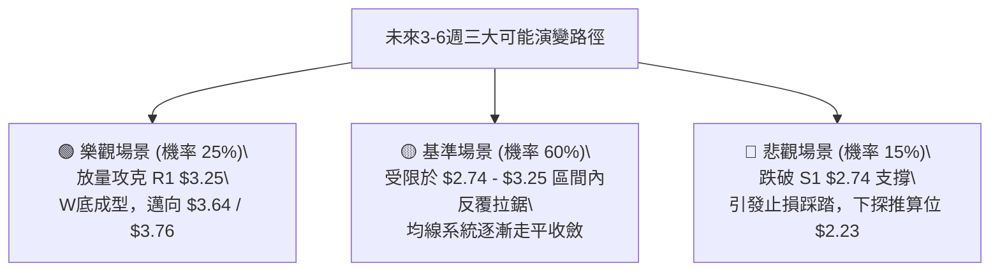

### 🛡️ 風險管理重要提醒

1. **資金與倉位管理法則**：
   - 由於 GRAB 長期均線仍處於空頭壓制之下，目前僅屬於**底部左側與箱體震盪**階段。單一方向策略（如策略 A 或策略 B）的總曝險部位**嚴格限制在總資產的 15% 以內**。
   - 單筆交易最大虧損額度必須嚴格鎖定在總資金的 1.0% 以內（例如：10 萬美元資產，單筆最大虧損不超過 1,000 美元；以策略 A 止損幅度 $0.07 計算，最大持倉股數上限為 14,000 股，約佔 3.8 萬美元，可分批建立）。

2. **流動性與滑價控制**：
   - 儘管 GRAB 日均成交量達數千萬股，流動性充裕，但在盤前與盤後交易時段，買賣價差往往會顯著拉大。所有限價單進場點（如 $2.76 或 $3.25）**務必使用限價單（Limit Order）執行**，嚴禁在非正規交易時段使用市價單。

3. **動態追蹤止損機制**：
   - 一旦策略 A 在 $2.76 進場並順利反彈突破 MA10 ($2.92)，應立即將保護性止損上移至保本價（$2.76），消除本金虧損風險。
   - 當價格抵達第一目標 T1 $3.02 時，必須鎖定 50% 倉位利潤，剩餘 50% 倉位採用 1.5x ATR（$0.165）的動態移動止損跟隨至第二目標 T2 $3.25。

---

## 10. 報告總結

```
╔══════════════════════════════════════════════════════════════════╗
║                     GRAB 技術分析報告總結                        ║
╠══════════════════════════════════════════════════════════════════╣
║ 報告日期：2026-10-24                                             ║
║ 當前價格：$2.79                                                  ║
║ 分析評級：⚖️ 綜合技術評分 42 / 100（中性區間震盪）              ║
╠══════════════════════════════════════════════════════════════════╣
║ 關鍵結論提要：                                                   ║
║ ├─ 長期趨勢：🔴 偏空（月線全均線空頭排列，下行通道尚未逆轉）    ║
║ ├─ 中期趨勢：🟡 震盪（週線於 $2.74 - $3.25 箱體進行底部構築）   ║
║ ├─ 短期趨勢：🟡 企穩（貼近布林下軌 $2.77，超賣指標具反彈修復需求）║
║ ├─ 核心支撐：$2.74（S1：52週歷史絕對低點，極端生命線）          ║
║ ├─ 核心阻力：$3.25（R1：波段高點聚類、頸線壓力與日線MA60重疊）  ║
║ └─ 分析師目標：$5.54（華爾街共識目標，基本面預期良好）           ║
╠══════════════════════════════════════════════════════════════════╣
║ 最優策略執行組合：                                               ║
║ 1. 🥇 最佳機會（高盈虧比）：策略 A 區間下軌防禦低吸              ║
║    進場 $2.76 ｜ 止損 $2.69 ｜ T1 $3.02 ｜ 風險報酬比 1:3.71     ║
║ 2. 🥈 次選機會（順勢對沖）：策略 B 區間上軌高拋做空              ║
║    進場 $3.25 ｜ 止損 $3.33 ｜ T1 $3.02 ｜ 風險報酬比 1:2.88     ║
║ 3. 🥉 保守選擇（趨勢確認）：空倉等待突破                         ║
║    等待股價放量突破 R1 $3.25 確立雙底後，右側順勢追進            ║
╚══════════════════════════════════════════════════════════════════╝
```

---

> ⚠️ **免責聲明**：本報告為依據標準技術分析理論自動生成之專業研報，所有數據、圖表及估算均嚴格基於所提供之歷史價格與成交量資訊。本報告**僅供研究、學術討論與交易策略推演參考**，**不構成任何要約、招攬、要約引誘或任何形式之投資建議**。金融市場具有高度風險，證券價格可升亦可跌，投資人應獨立評估自身風險承受能力，入市需極度謹慎。

---

*報告生成時間：2026-10-24 ｜ 數據來源：Yahoo Finance ｜ 分析框架：多時框技術分析體系（CMT 規範）*