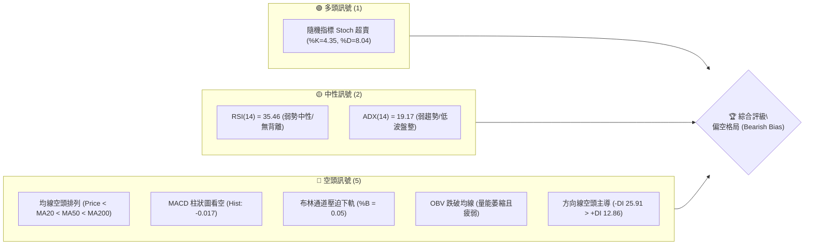
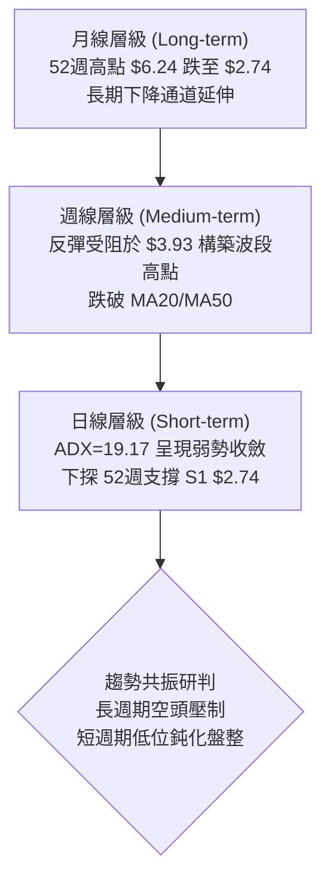
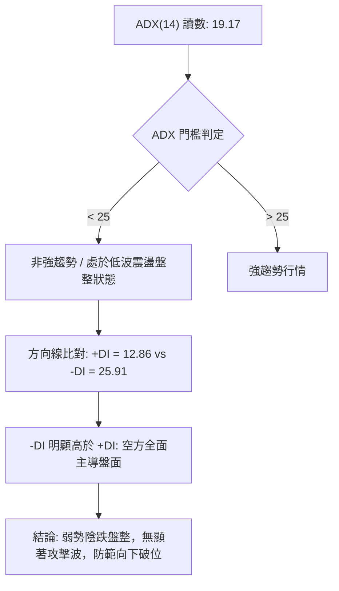
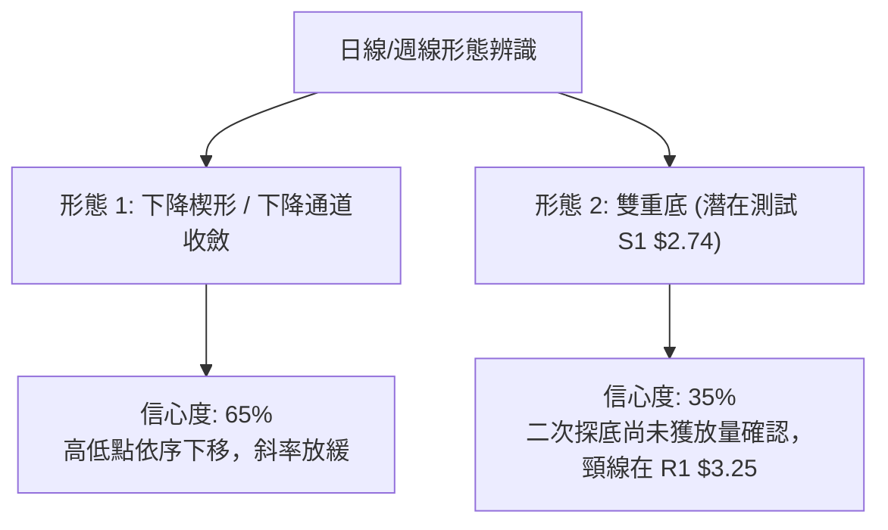
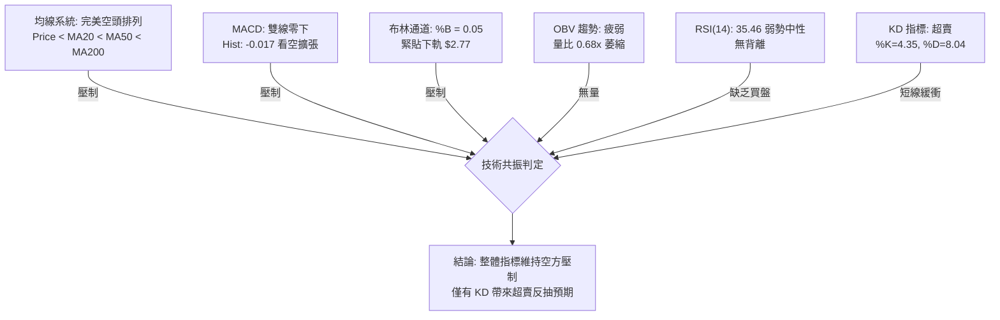
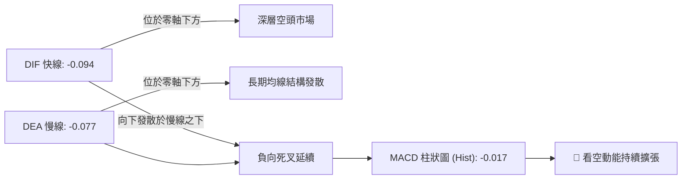
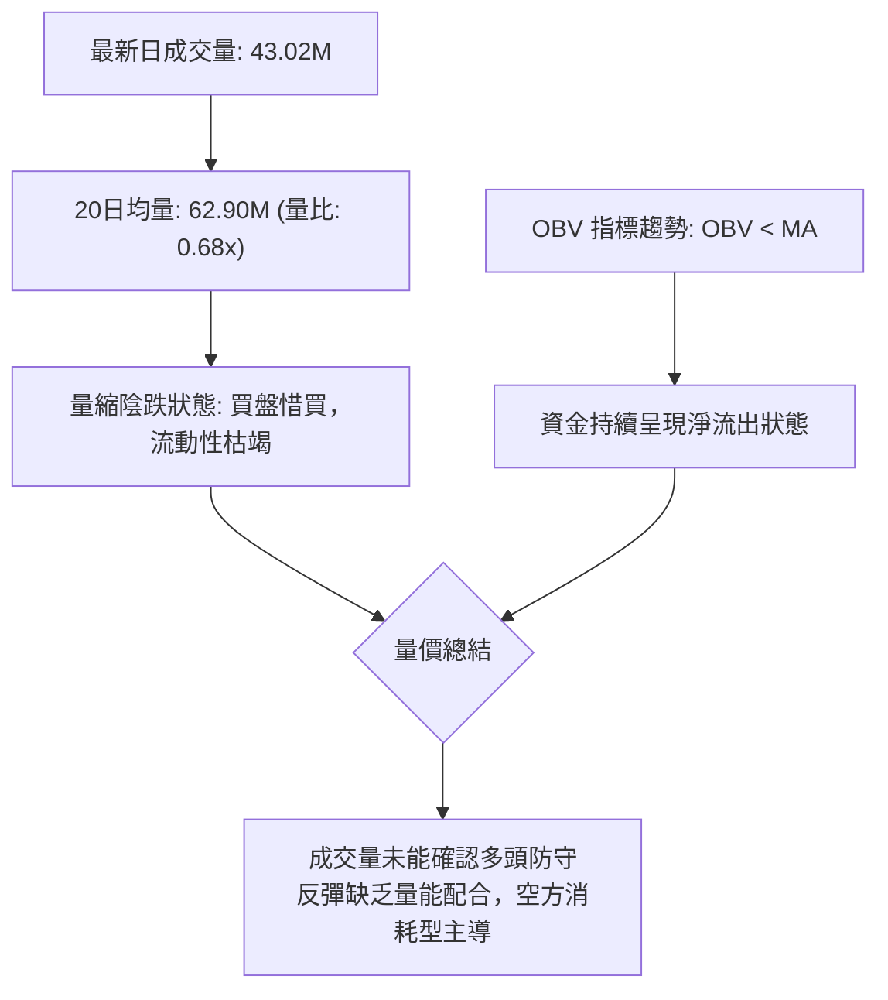
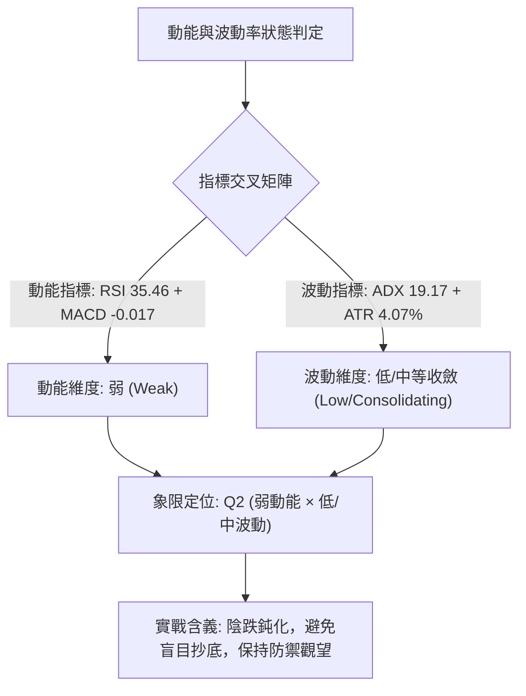
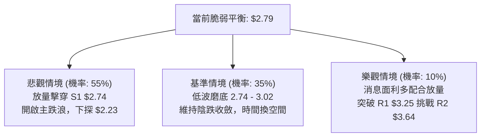

# GRAB 技術分析報告

> **報告日期**：2026-10-25 ｜ **語言**：繁體中文 ｜ **數據來源**：Yahoo Finance ｜ **當前價格**：$2.79 USD

---

## 目錄

| 章節 | 內容 |
|------|------|
| [1. 技術面概覽](#1-技術面概覽) | 訊號儀表板、核心指標、評分卡 |
| [2. 趨勢分析](#2-趨勢分析) | 多時框趨勢、長中短期走勢 |
| [3. 圖表形態分析](#3-圖表形態分析) | 形態識別、K線組合、目標價 |
| [4. 支撐與阻力](#4-支撐與阻力) | 關鍵價位、斐波那契回調 |
| [5. 技術指標深度解讀](#5-技術指標深度解讀) | MA/RSI/MACD/布林/成交量 |
| [6. 動能與波動率](#6-動能與波動率) | 動能評估、ATR、Beta |
| [7. 多時框架總結](#7-多時框架總結) | 時框架評分矩陣 |
| [8. 交易策略建議](#8-交易策略建議) | 多空策略、風險報酬比 |
| [9. 風險提示與監控](#9-風險提示與監控) | 監控指標、風險場景 |

---

## 1. 技術面概覽

### 🎯 技術訊號儀表板



### 📊 核心指標速覽表

| 指標類別 | 指標名稱 | 當前數值 | 訊號 | 解讀 |
|:---|:---|:---|:---:|:---|
| **價格** | 當前收盤價 | $2.79 | 🔴 | 位於 52 週區間底端 1.4% 分位，逼近歷史極端低位 |
| **均線** | MA20 | $3.02 | 🔴 | 價格低於 MA20 (-7.53%)，短週期下行壓力沉重 |
| **均線** | MA50 | $3.18 | 🔴 | 價格低於 MA50，中期下降趨勢維持完整 |
| **均線** | MA200 | $3.68 | 🔴 | 價格低於 MA200 (-24.18%)，長期空頭結構壓制 |
| **動能** | RSI(14) | 35.46 | 🟡 | 位於弱勢區間（30–40），尚未進入極端超賣，無背離 |
| **動能** | MACD (12,26,9) | -0.094 | 🔴 | DIF 與 DEA 雙雙處於零軸下方，Hist 擴張至 -0.017 |
| **動能** | KD (%K/%D) | 4.35 / 8.04 | 🟢 | 深度超賣區間，技術性隨時可能觸發短線跌深反彈 |
| **趨勢** | ADX(14) | 19.17 | 🟡 | ADX < 25 處於弱趨勢/低波盤整，-DI(25.91) 佔據主導 |
| **通道** | 布林通道 %B | 0.05 | 🔴 | 緊貼布林下軌（$2.77），下行波動打開風險升高 |
| **量能** | 成交量比 | 0.68x | 🔴 | 成交量僅 43.02M（低於20日均量62.90M），OBV弱勢 |
| **波動** | ATR(14) | $0.11 | 🟡 | 佔股價 4.07%，每日波動幅度中等偏緊縮 |

### 🏆 技術評分卡

```
╔══════════════════════════════════════════════════════════════════╗
║                   技術評分卡 — GRAB (2026-10-25)                 ║
╠══════════════════════════════════════════════════════════════════╣
║ 趨勢強度 (Trend Strength)     █████░░░░░░░░░░░░░░░  25/100  🔴   ║
║ 動能指標 (Momentum)           ██████░░░░░░░░░░░░░░  30/100  🔴   ║
║ 支撐穩定度 (Support Level)    █████████░░░░░░░░░░░  45/100  🟡   ║
║ 成交量配合 (Volume Flow)      ██████░░░░░░░░░░░░░░  30/100  🔴   ║
║ 形態完整度 (Pattern Integrity)███████░░░░░░░░░░░░░  35/100  🔴   ║
║ 均線排列 (MA Alignment)       ███░░░░░░░░░░░░░░░░░  15/100  🔴   ║
╠══════════════════════════════════════════════════════════════════╣
║ 綜合評分 (Composite Score)   ██████░░░░░░░░░░░░░░  30/100  🔴   ║
║ 綜合評級：偏空 (Bearish) — 規則 18 算術平均四捨五入整數          ║
╚══════════════════════════════════════════════════════════════════╝
```

---

## 2. 趨勢分析

### 🌐 多時框趨勢分析



### 📈 長期趨勢 — 12個月走勢圖（Unicode）

```
GRAB 月線走勢圖（過去12個月：2025-11 至 2026-10）
價格軸 ($)
$5.45 ┤● (2025-11 高位起跌)
$5.00 ┤   ●
$4.50 ┤      ●
$4.00 ┤         ●        ●
$3.50 ┤            ●  ●     ●  ●  ●
$3.00 ┤                                 ●
$2.79 ┤                                    ● ← 現價 ($2.79)
$2.74 ┤                                 ●    (2026-09 波段低點)
      └───────────────────────────────────────────────
        11  12  01  02  03  04  05  06  07  08  09  10 (月份)
```

#### 走勢特徵分析表格

| 階段區間 | 起止價格 | 漲跌幅 | 成交量特徵 | 趨勢性質與市場結構 |
|:---|:---|:---:|:---|:---|
| **第一階段：加速破位**<br>(2025-11 ~ 2026-03) | $5.45 → $3.66 | -32.84% | 量能維持高位放量 | 機構籌碼持續派發，失守多道整數關卡，長空格局確立 |
| **第二階段：低位箱體**<br>(2026-04 ~ 2026-08) | $3.82 → $3.54 | -7.33% | 量能逐漸萎縮至低點 | 股價於 $3.50–$3.90 區間構建假底，反彈動能匱乏 |
| **第三階段：破位探底**<br>(2026-09 ~ 2026-10) | $3.54 → $2.79 | -21.19% | 破位放量後低位量縮 | 跌破 $3.50 箱體底，加速探底至 52週低點 $2.74 |

### 📊 中期趨勢（週線分析）

中期走勢呈現「階梯式下跌」結構。近 20 週數據顯示，2026-07 上旬反彈至高點 $3.93（RSI 觸及 68.2）後動能衰竭；隨後進入連續陰跌，MACD 週柱狀圖由正轉負。9月下旬雖一度放量 527M 帶長上影線反彈至 $3.26，但隨後三週量能遞減，價格自 $3.19 連續下挫至 $2.79。

```
週線近期關鍵結構示意：
[阻力 R2 $3.64] ─── 7月中旬高點密集成交區
       │
[阻力 R1 $3.25] ─── 9月下旬放量反彈高點 $3.26 / 均線重壓
       │
[現價 $2.79]   ─── 貼近布林下軌
       │
[支撐 S1 $2.74] ─── 52週歷史低點防線 (2026-09-18 低點)
```

### ⚡ 趨勢強度評估（ADX 解讀）



| 指標變數 | 當前讀數 | 門檻區間 | 強度評估 | 實戰解讀 |
|:---|:---:|:---:|:---:|:---|
| **ADX(14)** | 19.17 | < 25 (弱趨勢/盤整) | ░░░░░ 弱 | 行情缺乏單邊持續性動量，屬於震盪陰跌磨底階段 |
| **+DI(14)** | 12.86 | 多方強度基準線 20 | ░░░░░ 極弱 | 多方買盤極度匱乏，反彈無力 |
| **-DI(14)** | 25.91 | 空方主導基準線 25 | ████░ 強 | 空方持續控制局面，盤面反彈阻力極重 |

---

## 3. 圖表形態分析

### 🔍 形態識別系統



#### 圖表形態信心度評估表

| 形態名稱 | 信心度 | 判斷依據（引用數據） | 完成度 | 目標價（附計算式） |
|:---|:---:|:---|:---:|:---|
| **下降通道 (Descending Channel)** | 65% | 價格高點由 $3.93 (2026-07) 降至 $3.26 (2026-09)，低點由 $3.31 降至 $2.74，均線完全空頭排列 | 85% | 跌破通道下軌測算：<br>下破 S1($2.74) 後，延伸目標 = $2.74 − 通道波幅($3.25 − $2.74 = $0.51) = **$2.23** |
| **雙重底 (Potential Double Bottom)** | 35% | 2026-09-18 錄得前低 $2.74，當前價格 $2.79 測試該支撐區間。訊號不足，僅做指標型超賣解讀 | 25% | 若確立守住 $2.74 並突破頸線 R1($3.25)：<br>理論目標 = 頸線 $3.25 + 形態高度($3.25 − $2.74 = $0.51) = **$3.76** |

### 🕯️ 重要 K 線形態分析

依據規則 19，嚴格採用數據中「近 10 根日 K」與「近 8 根週 K」之實際 OHLC 數據進行解讀：

#### 近 10 根日 K 線形態解讀

| 日期 (日K) | 開 | 高 | 低 | 收 | K線形態 | 解讀 | 訊號 |
|:---|:---:|:---:|:---:|:---:|:---|:---|:---:|
| 2026-10-12 | 3.16 | 3.20 | 3.09 | 3.15 | 帶長下影小黑K | 盤中回踩 3.09 獲買盤支撐，但受阻於 3.20 | 🟡 |
| 2026-10-13 | 3.14 | 3.15 | 2.98 | 2.98 | 光腳中黑K (長黑) | 開盤即承壓，實體下破 3.00 整數關卡，收在全日最低 | 🔴 |
| 2026-10-14 | 2.98 | 3.00 | 2.85 | 2.91 | 跳空下行中黑K | 跳空低開跌破 2.90 支撐，盤中創 2.85 新低 | 🔴 |
| 2026-10-15 | 2.90 | 3.03 | 2.90 | 3.00 | 低檔中紅反彈K | 低開高走吞噬前一日跌幅，測試 3.00 大關 | 🟢 |
| 2026-10-16 | 3.02 | 3.02 | 2.90 | 2.94 | 倒狀烏雲蓋頂 | 高開於 3.02 後無以為繼，賣壓湧現回吐全數漲幅 | 🔴 |
| 2026-10-19 | 2.93 | 2.94 | 2.86 | 2.87 | 縮量陰十字星 | 波動區間壓縮至 $0.08，市場觀望氣氛極濃 | 🟡 |
| 2026-10-20 | 2.88 | 2.92 | 2.83 | 2.89 | 帶上下影微幅紅K | 窄幅整理，多空僵持於 2.83–2.92 | 🟡 |
| 2026-10-21 | 2.92 | 2.93 | 2.81 | 2.82 | 破線小黑K | 實體下破 2.83，空方重新佔據盤面主導權 | 🔴 |
| 2026-10-22 | 2.79 | 2.86 | 2.77 | 2.85 | 低檔長下影小紅K | 探底至 2.77 逼近 S1($2.74) 誘發技術買盤 | 🟢 |
| 2026-10-23 | 2.83 | 2.85 | 2.79 | 2.79 | 壓制收低黑K | 反彈無力，收盤回落至全日最低 $2.79，逼近布林下軌 | 🔴 |

#### 近 8 根週 K 線形態解讀

| 日期 (週K) | 開 | 高 | 低 | 收 | K線形態 | 解讀 | 訊號 |
|:---|:---:|:---:|:---:|:---:|:---|:---|:---:|
| 2026-09-04 | 3.58 | 3.62 | 3.39 | 3.42 | 下跌黑K棒 | 跌破 3.50 支撐平台，開啟波段破位走勢 | 🔴 |
| 2026-09-11 | 3.39 | 3.40 | 2.96 | 3.05 | 放量破位長黑K | 大跌 -10.82%，成交量放大至 354.8M，恐慌盤湧現 | 🔴 |
| 2026-09-18 | 3.01 | 3.09 | 2.74 | 2.80 | 長下影探底黑K | 創 52 週最低點 $2.74，引發空頭回補，留長下影線 | 🟡 |
| 2026-09-25 | 2.84 | 3.26 | 2.78 | 3.13 | 爆量長上影大紅K | 成交 527.1M 天量，多頭暴拉至 3.26 後遭遇解套賣壓 | 🟡 |
| 2026-10-02 | 3.10 | 3.18 | 3.07 | 3.08 | 高位收斂小黑K | 天量拉升後量縮整理，無法突破 3.20 壓力區 | 🟡 |
| 2026-10-09 | 3.10 | 3.23 | 3.00 | 3.19 | 上攻受阻紅K | 再次衝擊 3.23 未果，成交量維持 406.8M，多頭動能見頂 | 🟡 |
| 2026-10-16 | 3.16 | 3.20 | 2.85 | 2.94 | 破線中黑K | 週線轉弱跌破 3.00 整數關卡，長多信心潰散 | 🔴 |
| 2026-10-23 | 2.93 | 2.94 | 2.77 | 2.79 | 縮量陰線壓低K | 跌破前週低點，收在 2.79，再次逼近 $2.74 歷史底部 | 🔴 |

### 📉 ASCII 走勢形態示意圖

```
GRAB 關鍵日K形態示意（2026-10-12 至 2026-10-23）
$3.20 ┬─── [10/12 高點 3.20]
      │      ┌─┐
$3.00 ┼──────│ │─────────── [10/15 反彈高點 3.03]
      │      │ └──┐ ┌─┐      ┌─┐
$2.90 ┼──────┴────┴─┤ │──────│ │──────────
      │             │ │┌─┐ ┌─┘ └──┐
$2.80 ┼─────────────┴─┴┤ │─┴──────┴─┬─┐ ◄── 現價 $2.79
      │                   └─┘         │ │
$2.74 ┴───────────────────────────────┴─┴── 支撐 S1 $2.74 (52週低點)
      └───────────────────────────────────
         12  13  14  15  16  19  20  21  22  23 (10月日K)
```

### 🎯 形態目標價計算

1. **下降通道跌破測算**：
   - 頂部阻力頸線：$3.25（波段高點 R1）
   - 底部支撐基線：$2.74（波段低點 S1）
   - 垂直高度 $H = \$3.25 - \$2.74 = \$0.51$
   - **下行跌破測算目標價** = $\$2.74 - \$0.51 =$ **$2.23**

2. **潛在雙重底反彈測算（若 S1 守穩並向上突破）**：
   - 頸線位置：$3.25（R1）
   - 形態底部：$2.74（S1）
   - 形態高度 $H = \$0.51$
   - **上行突破測算目標價** = $\$3.25 + \$0.51 =$ **$3.76**

---

## 4. 支撐與阻力

### 🗺️ 關鍵價位分布圖（Unicode）

```
GRAB 價位結構分布圖
═══════════════════════════════════════════════════
$3.96 ║████████████████████████║ 強阻力 R3 (波段高點聚類)
$3.64 ║████████████████████    ║ 阻力 R2 (MA200密集反壓區)
$3.25 ║████████████████████████║ 關鍵阻力 R1 (近期反彈高點頸線)
$2.79 ╠════════════════════════╣ ◄ 現價 ($2.79)
$2.74 ║▓▓▓▓▓▓▓▓▓▓▓▓▓▓▓▓▓▓▓▓▓▓▓▓║ 關鍵支撐 S1 (52週最低點)
 N/A  ║░░░░░░░░░░░░░░░░░░░░░░░░║ 次級支撐 S2 (數據未提供)
═══════════════════════════════════════════════════
```

### 🚧 阻力位分析表

依據系統關鍵價位聚類計算，各阻力位分析如下：

| 阻力級別 | 價位 | 形成原因 | 突破難度 | 重要性 |
|:---|:---:|:---|:---:|:---:|
| **R1** | $3.25 | 近期波段反彈高點聚類（2026-09-25 實體高點 $3.26、10-09 高點 $3.23 聚合處，貼近 MA60 $3.26） | 極高 | ★★★★★<br>多空生命線 |
| **R2** | $3.64 | 近一年波段高點聚類，重疊 MA200（$3.68）長期平均成本套牢區 | 極高 | ★★★★☆<br>中期牛熊分水嶺 |
| **R3** | $3.96 | 近一年頂部密集交易區高點聚類（重疊 MA240 $3.94 與 2026-07 高點 $3.93） | 極高 | ★★★★☆<br>長線強壓 |

### 🛡️ 支撐位分析表

依據系統關鍵價位計算，支撐位數據如下：

| 支撐級別 | 價位 | 形成原因 | 守住機率 | 重要性 |
|:---|:---:|:---|:---:|:---:|
| **S1** | $2.74 | 近一年波段低點聚類（52 週歷史最低點，2026-09-18 低點） | 45% | ★★★★★<br>全線生死支撐 |
| **S2** | N/A（數據未提供） | 數據中未偵測到進一步歷史低點聚類 | N/A | N/A |
| **S3** | N/A（數據未提供） | 數據中未偵測到進一步歷史低點聚類 | N/A | N/A |

### 📐 斐波那契回調位分析

依據 52 週完整波動區間（高點 $6.24 → 低點 $2.74，落差 $3.50）之回調位排列如下：

| 斐波那契回調比例 | 對應價位 | 與現價距離 | 技術意義與市場結構解讀 |
|:---:|:---:|:---:|:---|
| **0.0% (52W High)** | $6.24 | +123.66% | 52 週週期最高峰，長線多頭頂部 |
| **23.6%** | $5.41 | +93.91% | 第一道波段回撤位，2025 年底跌破後確立空頭行情 |
| **38.2%** | $4.90 | +75.63% | 重要分割位，2025 年底失守後加速下行 |
| **50.0%** | $4.49 | +60.93% | 多空平衡中軸 |
| **61.8%** | $4.08 | +46.24% | 黃金分割強防守位，2026 年初破位後形成永久阻力 |
| **78.6%** | $3.49 | +25.09% | 深度回撤防線，2026-08 箱體破位關鍵點 |
| **100.0% (52W Low)**| $2.74 | -1.79% | 週期底端支撐 S1，空頭極限回撤位置 |

> **當前價位位置解讀**：現價 $2.79 位於 78.6%（$3.49）與 100.0%（$2.74）回調位之間，且極度偏向 100.0% 邊界（距離 S1 僅 -1.79%）。這顯示技術面已回吐過去一年全數漲幅，若 100.0%（$2.74）遭實體陰線擊穿，技術結構將由斐波那契回撤轉入未知的空頭擴展區間。

---

## 5. 技術指標深度解讀

### 🎛️ 指標訊號總覽



### 📈 移動平均線排列分析

```mermaid
graph LR
    P["現價 $2.79"] -->|"下方 -1.90%"| MA5["MA5: $2.84"]
    MA5 -->|"下方 -4.45%"| MA10["MA10: $2.92"]
    MA10 -->|"下方 -7.53%"| MA20["MA20: $3.02"]
    MA20 -->|"下方 -14.50%"| MA60["MA60: $3.26"]
    MA60 -->|"下方 -18.40%"| MA120["MA120: $3.42"]
    MA120 -->|"下方 -24.18%"| MA200["MA200: $3.68"]
    MA200 -->|"下方 -29.15%"| MA240["MA240: $3.94"]
```



#### 移動平均線詳細數據表

| 均線天期 | 當前價位 | 與現價乖離率 | 排列狀態 | 走勢微型圖表 | 技術解讀 |
|:---:|:---:|:---:|:---:|:---:|:---|
| **MA 5** | $2.84 | -1.90% | 空頭排列 | ▇▅▄▃▁▁▂▄▆█████████▇██▇▇▆▅▃▃▂▁▁ | 短線第一道動態阻力，反彈不過此線屬極弱走勢 |
| **MA 10** | $2.92 | -4.45% | 空頭排列 | █▇▆▄▃▂▁▂▂▂▂▃▃▄▅▅▅▅▅▅▅▅▄▄▄▃▃▂▁▁ | 短期波段控盤線，下彎速率加快 |
| **MA 20** | $3.02 | -7.53% | 空頭排列 | ██▇▆▆▅▅▄▄▃▃▃▂▂▁▁▁▁▁▁▁▁▁▂▂▂▁▁▁▁ | 月線阻力與布林中軌重疊，構成強空頭反壓 |
| **MA 50** | $3.18 | -12.26% | 空頭排列 | 空頭主導下行 | 中期下降趨勢未有任何扭轉跡象 |
| **MA 60** | $3.26 | -14.50% | 空頭排列 | ████▇▇▇▇▆▆▆▅▅▅▄▄▄▃▃▃▃▂▂▂▂▁▁▁▁▁ | 季線位置，與 R1($3.25) 共振形成重壓 |
| **MA 120** | $3.42 | -18.40% | 空頭排列 | ████▇▇▇▇▇▆▆▆▆▆▅▅▅▅▄▄▄▃▃▂▂▂▁▁▁▁ | 半年線持續下壓 |
| **MA 200** | $3.68 | -24.18% | 空頭排列 | 長期空頭壓制 | 牛熊分界線，距離現價過遠，長期熊市確立 |
| **MA 240** | $3.94 | -29.15% | 空頭排列 | ████▇▇▇▆▆▆▆▅▅▅▅▄▄▄▄▃▃▃▂▂▂▂▁▁▁▁ | 年線位置，與阻力 R3($3.96) 吻合 |

### 📉 RSI(14) 分析

- **RSI 數值進度條**：
  ```
  RSI(14): 35.46  [███████░░░░░░░░░░░░░] 弱勢中性 (Wilder)
  超賣臨界: 30.00  |  中軸分水嶺: 50.00  |  超買臨界: 70.00
  ```
- **區間評估**：RSI 讀數為 35.46，處於弱勢空方掌控區（30–50），尚未進入小於 30 的極端超賣區。
- **背離判斷**：
  - 根據系統檢驗標準（比較近 20 根 K 棒首尾之價格與 RSI）：20 根 K 棒前收盤價在 $3.13–$3.19 區間，RSI 位於 45–51 區間；現價下跌至 $2.79，RSI 相應下移至 35.46。
  - **結論**：價格創新低伴隨 RSI 創波段次低，**無明顯底背離，亦無頂背離**，指標健康反映現行下行趨勢，尚未出現動能竭盡反轉訊號。

### 📊 MACD (12, 26, 9) 訊號解讀



MACD 主線目前位於 -0.094，信號線位於 -0.077，柱狀體為 -0.017。雙線在負軸區域持續走低並向下方發散，柱狀圖負值擴大，顯示空頭拋壓仍佔據主導，尚未出現金叉或底背離雛形。

### 📦 布林通道分析

```
GRAB 布林通道與現價相對位置圖（日線）
$3.27 ┬──────────────────────────────────────── 布林上軌 ($3.27)
      │
$3.02 ┼┄┄┄┄┄┄┄┄┄┄┄┄┄┄┄┄┄┄┄┄┄┄┄┄┄┄┄┄┄┄┄┄┄┄┄┄┄┄ 布林中軌 (MA20: $3.02)
      │
$2.79 ┼━━━━━━━━━━━━━━━━━━━━━━━━━━━━━━━━━━━━ 現價 ($2.79, %B=0.05)
$2.77 ┴──────────────────────────────────────── 布林下軌 ($2.77)
```

- **通道帶寬與形態**：布林帶寬為 $3.27 - $2.77 = $0.50（約佔中軌價位之 16.5%）。
- **當前位置**：%B 為 **0.05**，極度逼近下軌（$2.77）。
- **技術含義**：股價緊貼下軌滑落，屬於典型的「沿軌下跌（Band Walking）」空頭弱勢特徵。此時若未見長下影線或放量陽線拉回中軌以上，通道下軌往往將被動向下張開，形成破位下殺。

### 💹 成交量分析（量價配合度）



- **量比與均量**：最新成交量為 43,024,400 股，大幅低於 20 日均量（62,895,355 股，量比 0.68x）與 50 日均量（60,090,330 股）。
- **OBV（能量潮）分析**：OBV 處於其移動平均線下方，整體資金流向疲弱，呈現「價格破位陰跌、量能遞減」的消極特徵。這說明當前市場並非放量恐慌出逃，而是處於「無承接盤（缺乏買盤流動性）」的自然滑落狀態。

---

## 6. 動能與波動率

### ⚡ 動能評估四象限



| 象限標籤 | 動能狀態 | 波動率狀態 | 當前符合度 | 操作策略含義 |
|:---:|:---:|:---:|:---:|:---|
| **Q1 (最佳順勢)** | 強 (Bullish) | 低 (Low Vol) | ░░░░░ 無 | 穩定多頭主升段（不符合） |
| **Q2 (陰跌鈍化)** | **弱 (Bearish)** | **低 (Low Vol)** | **█████ 符合** | **缺乏動量但重心持續下移，持幣觀望或逢高布空** |
| **Q3 (極端博弈)** | 強 (Strong) | 高 (High Vol) | ░░░░░ 無 | 主跌浪恐慌釋放或暴拉突破（不符合） |
| **Q4 (陷阱震盪)** | 弱 (Neutral) | 高 (High Vol) | ░░░░░ 無 | 無序洗盤震盪（不符合） |

### 📊 ATR 波動率分析

- **ATR(14) 讀數**：**$0.11**（佔現價 $2.79 之 **4.07%**，Wilder 平滑法）。
- **單日預期波幅**：每日正常技術波動區間約在 $\pm \$0.11$ 左右。
- **止損距離建議**：
  - 保守型技術止損距離（$1.5 \times \text{ATR}$）：$1.5 \times \$0.11 = \mathbf{\$0.165}$。
  - 激進型技術止損距離（$1.0 \times \text{ATR}$）：$1.0 \times \$0.11 = \mathbf{\$0.110}$。
  - 考量現價 $2.79 距支撐 S1（$2.74）僅有 $\$0.05$ 空間（不及 1 倍 ATR），顯示股價已來到極度脆弱的邊界，極易被正常的日內雜訊打穿。

### 📐 Beta 與市場相關性

- **Beta 數值**：**0.908**。
- **市場關聯性解讀**：
  - GRAB 的 Beta 值略低於 1.0，表明相較於大盤整體（S&P 500 / NASDAQ），其系統性波動放大效應相對溫和。
  - 然而近期走勢中，新聞面指出大盤上漲之際 GRAB 逆勢下挫（新聞："GRAB Stock Falls Amid Market Uptick"），顯示當前個股受到基本面阻力（台灣併購案遭監管阻擋）與特定賣壓影響，出現脫離大盤的特異性下行風險。

---

## 7. 多時框架總結

### 📋 時框架評分表

| 時框架 | 趨勢方向 | 動能狀態 | 均線排列 | 圖表形態 | 綜合評分 | 戰術建議 |
|:---:|:---:|:---:|:---:|:---:|:---:|:---|
| **長期 (月線)** | 🔴 空頭下行 | 🔴 極弱 (跌幅超50%) | 🔴 空頭排列 (下壓) | 下降通道延伸 | 20/100 | 規避長線持倉，逢高減碼 |
| **中期 (週線)** | 🔴 階梯下跌 | 🔴 MACD柱轉負 | 🔴 跌破MA20/50 | 反彈遇阻回落 | 30/100 | 逢反彈關鍵阻力布設空單 |
| **短期 (日線)** | 🔴 弱勢磨底 | 🟡 KD超賣/RSI弱勢 | 🔴 均線發散向下 | 貼軌下滑測試S1 | 35/100 | 嚴禁盲目追多，等待破位或放量站穩 |

### 🔲 綜合訊號矩陣

```
時框共振訊號矩陣
═════════════════════════════════════════════════════════════════
指標類別        短期 (日線)          中期 (週線)          長期 (月線)
─────────────────────────────────────────────────────────────────
趨勢 (Trend)    🔴 沿下軌下滑        🔴 波段下行          🔴 長期空頭
均線 (MA Stack) 🔴 全線空頭          🔴 跌破均線          🔴 均線反壓
動能 (Momentum) 🟡 KD超賣/RSI弱勢    🔴 MACD柱擴大        🔴 零軸深處
成交量 (Volume) 🔴 萎縮至0.68x       🔴 反彈無量          🔴 機構流出
═════════════════════════════════════════════════════════════════
整體共振研判    🔴 空方力量在所有時框架中佔據絕對控制地位
═════════════════════════════════════════════════════════════════
```

### ⚖️ 多時框收斂結論

依據多時框收斂規則（規則 14）：
1. **行情性質判定**：當前 ADX(14) 讀數為 **19.17 (< 25)**，嚴格定義為**盤整/弱趨勢行情**。在低波盤整行情下，市場缺乏單邊暴跌或暴漲動量，價格波幅主要受制於日線布林通道區間（$2.77 至 $3.27）。
2. **多時框主導權收斂**：雖然 ADX < 25 意味著短線處於下軌附近的低波磨底，但中長期均線（MA20 $3.02、MA50 $3.18、MA200 $3.68）呈現完全空頭排列，且週線 MACD 重新翻負。這表明日線層級的反彈均受到中長期趨勢的嚴厲壓制。
3. **最終唯一方向性結論**：**偏空觀望（Bearish / 防範下軌破位）**。操作上不可因日線 Stoch 處於超賣區而進行左側抄底，應以防禦性空頭思維主導，警惕股價在布林下軌（$2.77）處失守支撐 S1（$2.74）。

---

## 8. 交易策略建議

### 🗺️ 策略決策流程圖

```mermaid
graph TD
    START["當前價格: $2.79<br/>綜合評分: 30/100 (偏空)"] --> COND{"關鍵支撐 S1: $2.74 考驗"}
    COND -->|"場景 A: 實體跌破 $2.74"| S_SHORT1["策略 A (主推): 順勢破位做空<br/>目標下看測算價 $2.23"]
    COND -->|"場景 B: 低位微幅反抽"| PULLBACK{"反抽測試阻力"}
    PULLBACK -->|"遇阻 MA10("$2.92") 或 MA20("$3.02")"| S_SHORT2["策略 B (次選): 逢高反彈沽空<br/>目標回看 S1 $2.74"]
    PULLBACK -->|"放量突破 R1 $3.25"| S_STOP["觸發多頭對沖 / 空單全面止損"]
```

### 🧭 策略路由（依評分卡分流）

> **當前主策略方向 = 主推空頭策略（依綜合評分 30/100，嚴格符合 ≤40 偏空路由規則）**  
> 綜合評分僅為 30/100，均線呈現空頭排列，MACD 翻空擴張，故交易策略以**空頭操作為主**。多頭訊號（如 KD 超賣）僅作為空頭部位回補或反轉風險控制之參考，不主動推薦做多買入。

### 🎯 價格情境階梯（Price Scenarios）

價位嚴格引用關鍵價位與測算數值：

| 觸發條件 | 下一目標 | 後續延伸 | 情境含義與技術解讀 |
|:---|:---:|:---:|:---|
| **跌破 S1 $2.74** | 下降通道測算目標 **$2.23** | N/A（數據未提供） | **空頭突破**：52 週最低支撐徹底瓦解，觸發停損賣盤 |
| **受制於布林下軌與中軌** | 考驗 S1 **$2.74** | 反彈受限 MA10 **$2.92** | **弱勢陰跌**：在 $2.74–$3.02 區間進行均線壓制型弱震盪 |
| **反彈突破 MA20 $3.02** | 阻力 R1 **$3.25** | 阻力 R2 **$3.64** | **技術修正**：空頭回補帶動之跌深反抽，挑戰中期頸線 |

### 📊 情境機率分佈

| 情境劃分 | 機率估計 | 主要技術依據 |
|:---|:---:|:---|
| **回落 / 破位探底 (下破 $2.74)** | **55%** | 均線空頭壓迫、MACD 負向擴大、OBV 資金持續外流、%B=0.05 緊貼下軌 |
| **區間弱勢震盪 ($2.74 - $3.02)** | **35%** | ADX 19.17 處於弱趨勢盤整模式，KD 進入極度超賣區（%K=4.35）提供跌幅緩衝 |
| **反轉向上 (突破 R1 $3.25)** | **10%** | 上方各級均線反壓沉重，成交量持續萎縮（0.68x），缺乏推升資金動能 |

### 🟢 主策略詳情（空頭交易策略）

所有風險報酬比計算嚴格遵守規則 17，做空風報比 $= (\text{進場價} - \text{T1}) \div (\text{止損價} - \text{進場價})$：

| 策略要素 | 策略 A（順勢破位做空 - 主推） | 策略 B（逢反彈高空 - 次選） |
|:---|:---|:---|
| **交易邏輯** | 股價實體跌破 52 週最低點 S1($2.74) 順勢追空 | 股價受 KD 超賣激勵弱勢反彈，在下彎均線處承壓布空 |
| **進場條件** | 日K收盤跌破 $2.74 或盤中擊穿 $2.73 確認破位 | 反彈至 MA10 附近遇阻，出現上影線確認受阻 |
| **進場價格** | **$2.73**（確認破位） | **$2.92**（MA10 阻力位） |
| **目標價 T1** | **$2.23**（由下降通道高度測算：$2.74 - $0.51） | **$2.74**（波段支撐位 S1） |
| **目標價 T2** | N/A（數據未提供更低支撐位） | **$2.23**（下降通道測算延伸目標） |
| **止損價格** | **$2.84**（上方 MA5 動態壓制位） | **$3.03**（突破 MA20 / 布林中軌 $3.02 上方） |
| **風險報酬比** | **1 : 4.55（以 T1 計）**<br>計算式：$(2.73 - 2.23) \div (2.84 - 2.73) = 0.50 \div 0.11 = 4.55$ | **1 : 1.64（以 T1 計）**<br>計算式：$(2.92 - 2.74) \div (3.03 - 2.92) = 0.18 \div 0.11 = 1.64$ |
| **成功機率** | 55% | 60% |
| **建議倉位** | 10%–15%（破位確認後執行） | 15%–20%（分批逢高建倉） |

### 🔴 反向風險觸發點（對沖提示）

若市場出現以下情況，主推空頭策略即刻失效，空頭部位必須無條件停損出場或轉為多頭避險：
1. **突破關鍵阻力**：股價放量收復布林中軌與 MA20（**$3.02**），且日 K 實體站穩。
2. **反轉形態確立**：若價格守住 $2.74 形成雙底，並進一步以大陽線突破頸線 R1（**$3.25**），測算目標將轉向 **$3.76**。
3. **指標底背離確認**：若價格跌破 $2.74 但日線 RSI(14) 逆勢拉升穿越 40，形成清晰日線底背離時，必須立刻回補空單。

### ⭐ 整體訊號強度評星

```
做多訊號強度：★☆☆☆☆  (1/5星 — 僅有超賣指標支撐，多頭毫無防守縱深)
做空訊號強度：★★★★☆  (4/5星 — 均線與動能空頭共振，貼軌壓迫破位邊緣)
整體可信度：  ★★★★☆  (4/5星 — 技術形態與指標數據具有高度一致性)
```

---

## 9. 風險提示與監控

### ✅ 關鍵監控指標 Checklist

```
╔══════════════════════════════════════════════════════════════════╗
║                   GRAB 技術風險監控清單 (Checklist)              ║
╠══════════════════════════════════════════════════════════════════╣
║ [ ] 支撐防線檢驗：收盤價是否跌破 52週低點 S1 ($2.74)              ║
║ [ ] 均線動態反壓：反彈是否始終受制於 MA5 ($2.84) 與 MA10 ($2.92)  ║
║ [ ] 布林帶寬動態：布林下軌 ($2.77) 是否向下開口放大 (%B < 0)     ║
║ [ ] 動能背離監控：RSI(14) 下探 30 以下時是否出現與價格之背離     ║
║ [ ] 成交量能異動：單日成交量是否突發放大超過 20日均量 (62.90M)   ║
║ [ ] 借券放空變數：目前放空比率 7.6%，觀察是否有軋空異動回補      ║
╚══════════════════════════════════════════════════════════════════╝
```

### ⚠️ 風險場景分析



### 🛡️ 風險管理重要提醒

1. **極端低位流動性風險**：當前成交量僅 43.02M（量比 0.68x），反映低位買盤退潮。在流動性欠佳之際，突發賣單極易引發價格滑價打穿 S1（$2.74）。
2. **消息面外部衝擊**：近期關於台灣主管機關否決 Grab 收購 Foodpanda 業務之新聞，為基本面蒙上陰影，技術面跌破平台即是反映該項監管利空，短期內恐難以迅速消化。
3. **倉位管理防線**：在股價未重新站上 MA20（$3.02）之前，絕不可進行左側大額抄底；若採空頭交易，單筆最大風險暴露應控制在總資金的 1.5%–2.0% 以內，並以 ATR（$0.11）為基準嚴設移動止損。

---

## 📋 報告總結

```
╔══════════════════════════════════════════════════════════════════╗
║                    GRAB 技術分析報告總結                         ║
╠══════════════════════════════════════════════════════════════════╣
║ 報告日期：2026-10-25                                             ║
║ 當前價格：$2.79 USD                                              ║
║ 分析評級：🔴 偏空觀望 / 防範下破 (綜合評分: 30/100)              ║
╠══════════════════════════════════════════════════════════════════╣
║ 關鍵結論：                                                       ║
║ ├─ 長期趨勢：🔴 空頭排列，高點由 $6.24 跌至 $2.74                 ║
║ ├─ 中期趨勢：🔴 週線反彈竭盡，重新步入陰跌通道                   ║
║ ├─ 短期趨勢：🔴 貼近布林下軌 $2.77，考驗 52週極限支撐           ║
║ ├─ 關鍵支撐：S1: $2.74 (52週最低點)                              ║
║ ├─ 關鍵阻力：R1: $3.25 ｜ R2: $3.64 ｜ R3: $3.96                 ║
║ └─ 分析師目標：均價 $5.54 (基本面共識與當前技術面嚴重背離)       ║
╠══════════════════════════════════════════════════════════════════╣
║ 最優策略組合：                                                   ║
║ 1. 🥇 最佳機會：破位順勢做空 (跌破 $2.74 後追空至 $2.23，風報比 1:4.55)║
║ 2. 🥈 次選機會：反彈逢高沽空 (反彈至 MA10 $2.92 做空至 $2.74，風報比 1:1.64)║
║ 3. 🥉 保守選擇：空倉持幣觀望，等待日線級別底背離或站穩 MA20      ║
╚══════════════════════════════════════════════════════════════════╝
```

---

> ⚠️ **免責聲明**：本報告為技術分析研究，所有數據及走勢推演均基於市場歷史行情與量化指標。報告內容**僅供學術交流與投資研究參考**，**不構成任何邀約、招攬或具體投資建議**。金融市場波動劇烈，交易者應獨立評估風險並嚴格執行資金控管。

---

*報告生成時間：2026-10-25 ｜ 數據來源：Yahoo Finance ｜ 分析框架：多時框技術分析模型*