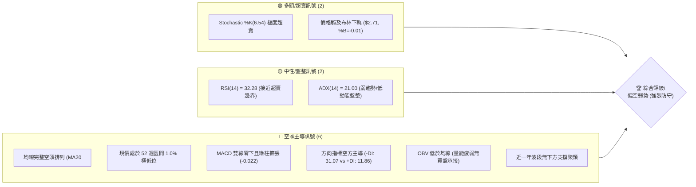
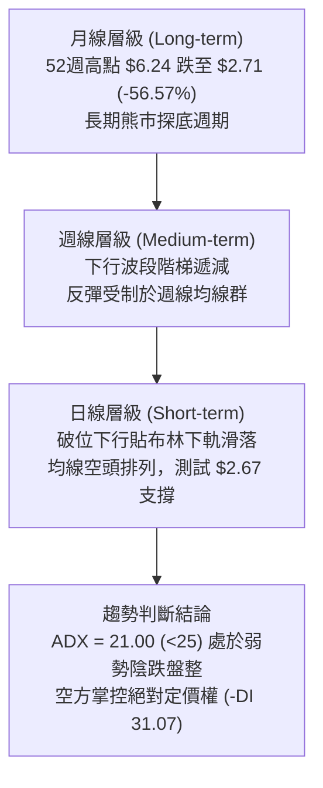
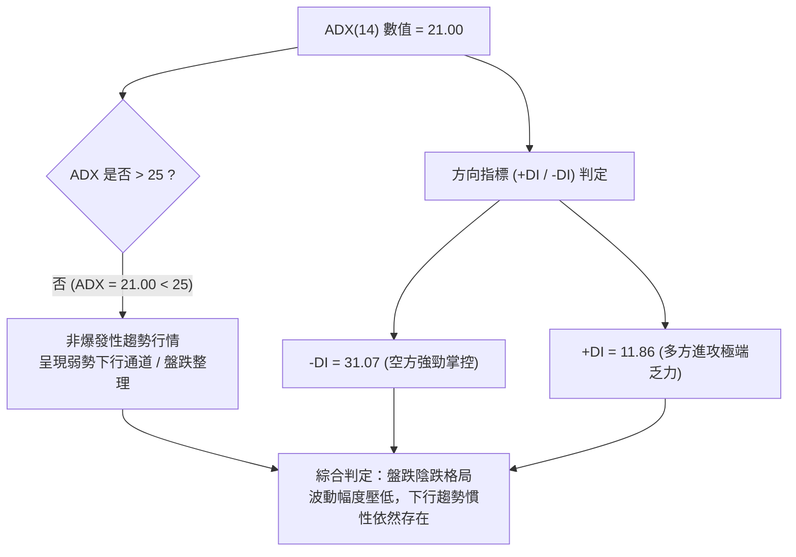
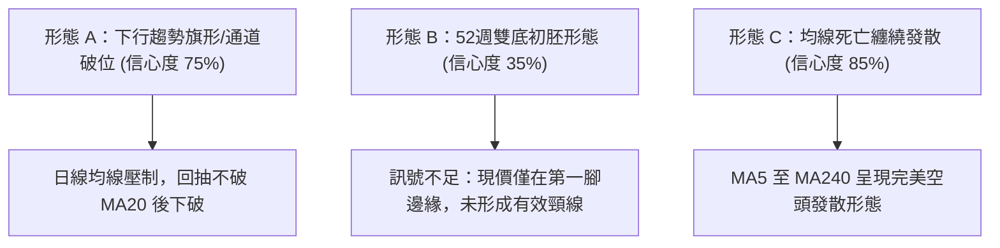
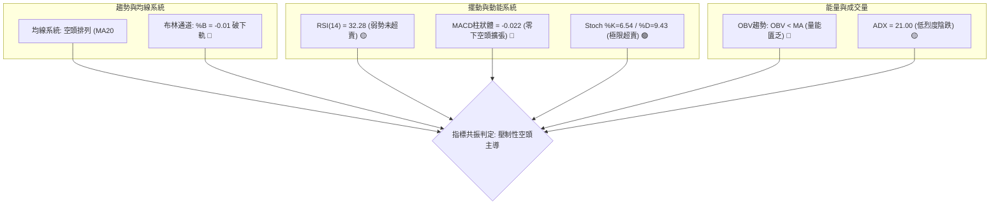
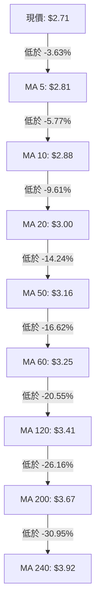
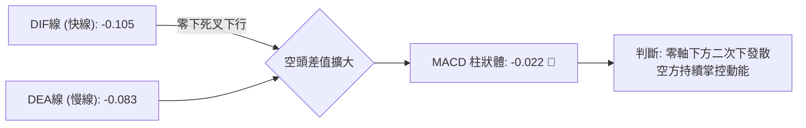
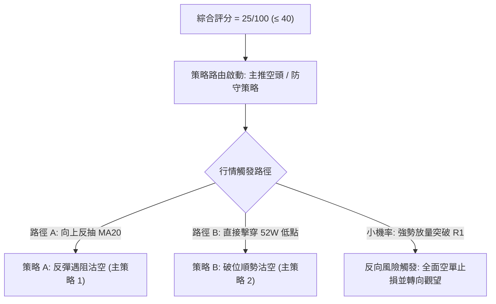
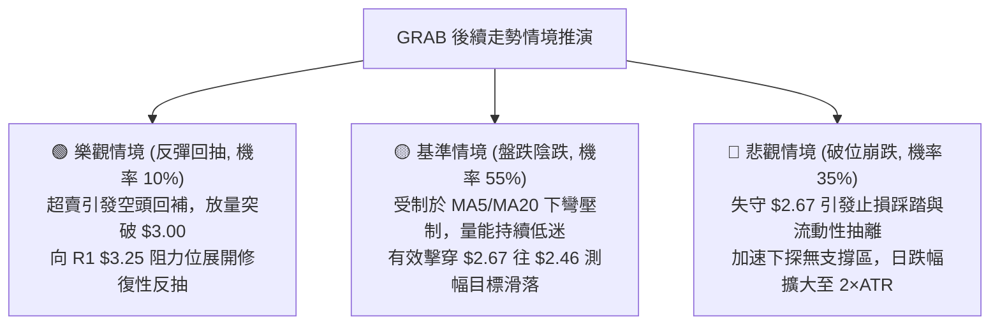

# GRAB 技術分析報告

> **報告日期**：2026-10-27 ｜ **語言**：繁體中文 ｜ **數據來源**：Yahoo Finance ｜ **當前價格**：$2.71 USD

---

## 目錄

| 章節 | 內容 |
|------|------|
| [1. 技術面概覽](#1-技術面概覽) | 訊號儀表板、核心指標、評分卡 |
| [2. 趨勢分析](#2-趨勢分析) | 多時框趨勢、長中短期走勢、ADX 解讀 |
| [3. 圖表形態分析](#3-圖表形態分析) | 形態識別、K線組合、形態目標價 |
| [4. 支撐與阻力](#4-支撐與阻力) | 關鍵價位、斐波那契回調結構 |
| [5. 技術指標深度解讀](#5-技術指標深度解讀) | 均線系統、RSI、MACD、布林通道、OBV |
| [6. 動能與波動率](#6-動能與波動率) | 動能象限、ATR 波動率、Beta 市場敏感度 |
| [7. 多時框架總結](#7-多時框架總結) | 時框架矩陣、多時框收斂與權重判定 |
| [8. 交易策略建議](#8-交易策略建議) | 策略路由、價格情境階梯、精確交易計劃 |
| [9. 風險提示與監控](#9-風險提示與監控) | 監控清單、極端情境推演、風控紀律 |
| [報告總結](#-報告總結) | 關鍵結論與最優策略組合摘要 |

---

## 1. 技術面概覽

### 🎯 技術訊號儀表板



---

### 📊 核心指標速覽表

| 指標類別 | 指標名稱 | 當前數值 | 訊號 | 專業技術解讀 |
|:---|:---|:---|:---:|:---|
| **價格** | 當前收盤價 | $2.71 | 🔴 | 貼近 52 週歷史低點（$2.67），位於 52 週區間僅 1.0% 分位 |
| **短期均線** | MA20 | $3.00 | 🔴 | 價格低於 MA20 達 -9.61%，短期下行斜率陡峭，為第一反彈反壓 |
| **中期均線** | MA50 | $3.16 | 🔴 | 中期生命線持續下彎，空頭波段下壓動能未見減緩跡象 |
| **長期均線** | MA200 | $3.67 | 🔴 | 遠低於長期牛熊分界線達 -26.16%，整體架構處於長期空頭週期 |
| **擺動動能** | RSI(14) | 32.28 | 🟡 | 位於弱勢中性格局，尚未進入 <30 極端超賣區，空頭動能仍具延伸空間 |
| **趨勢動能** | MACD (12,26,9) | -0.105 | 🔴 | DIF 線與 DEA 線均位於零軸下方，柱狀體為 -0.022，空頭動能主導 |
| **隨機指標** | Stoch %K / %D | 6.54 / 9.43 | 🟢 | 指標進入個位數極端超賣鈍化區，短線隨時存在超跌技術性抽頭修復可能 |
| **趨勢強度** | ADX(14) | 21.00 | 🟡 | ADX < 25 表明單邊爆發力不足，走勢呈現緩跌、陰跌探底的盤整弱勢特徵 |
| **通道指標** | Bollinger Bands | 上 $3.28 / 下 $2.71 | 🔴 | %B 為 -0.01，價格破位貼於下軌滑行，通道未開口，呈現壓制緩跌形態 |
| **量能指標** | OBV 走勢 | OBV < MA | 🔴 | 能量潮指標持續低於移動平均線，最新成交量僅均量 0.85x，買盤嚴重匱乏 |
| **波動指標** | ATR(14) | $0.11 | 🟡 | 日內平均真實波幅為 4.22%，絕對金額波動收窄但相對於現價比例適中 |

---

### 🏆 技術評分卡

```
╔══════════════════════════════════════════════════════════════════╗
║               技術評分卡 — GRAB (2026-10-27)                    ║
╠══════════════════════════════════════════════════════════════════╣
║ 評估維度         進度條指標                 得分     狀態評定    ║
╟──────────────────────────────────────────────────────────────────╢
║ 趨勢強度 (Trend) █████░░░░░░░░░░░░░░░      25/100    🔴 空頭壓制 ║
║ 動能指標 (Mom.)  ██████░░░░░░░░░░░░░░      30/100    🔴 疲弱鈍化 ║
║ 支撐穩定 (Supp.) ████░░░░░░░░░░░░░░░░      20/100    🔴 瀕臨破底 ║
║ 成交配合 (Vol.)  ███████░░░░░░░░░░░░░      35/100    🟡 量能萎縮 ║
║ 形態完整 (Patt.) ██████░░░░░░░░░░░░░░      30/100    🔴 下行通道 ║
║ 均線排列 (MAs)   ██░░░░░░░░░░░░░░░░░░      10/100    🔴 完美空頭 ║
╠══════════════════════════════════════════════════════════════════╣
║ 綜合評分         █████░░░░░░░░░░░░░░░      25/100    🔴 強烈偏空 ║
║ 【計算式】：(25 + 30 + 20 + 35 + 30 + 10) ÷ 6 = 25/100 (四捨五入)║
╚══════════════════════════════════════════════════════════════════╝
```

---

## 2. 趨勢分析

### 🌐 多時框趨勢分析



---

### 📈 長期趨勢 — 12個月走勢圖（Unicode）

以下展示過去 12 個月（2025-11 至 2026-10）月線收盤價之歷史軌跡與波段演變：

```
GRAB 月線收盤走勢圖（2025-11 至 2026-10）
價格軸 ($)
$6.00 ┤                                                    
$5.45 ┤ ● (2025-11)                                         
$4.99 ┤       ●                                             
$4.30 ┤             ●                                       
$4.22 ┤                   ●                                 
$3.82 ┤                               ●                     
$3.66 ┤                         ●                           
$3.54 ┤                                     ●         ●     
$3.50 ┤                                           ●         
$3.11 ┤                                                 ●   
$2.71 ┤                                                     ● ← 現價
      └─┬─────┬─────┬─────┬─────┬─────┬─────┬─────┬─────┬─────┬─────┬───
       11月  12月  01月  02月  03月  04月  05月  06月  07月  08月  09月 10月
       (2025)             (2026)
```

#### 走勢特徵分析表格

| 階段區間 | 起止價格 | 漲跌幅 (%) | 量價與結構特徵 | 階段定性 |
|:---|:---|:---:|:---|:---|
| **2025-11 ~ 2025-12** | $5.45 → $4.99 | -8.44% | 高位跌破 $5.00 整數關卡，獲利了結賣壓湧現 | 頂部確立期 |
| **2026-01 ~ 2026-03** | $4.30 → $3.66 | -14.88% | 快速下行階段，連續擊穿 $4.00 平台支撐 | 主跌浪初段 |
| **2026-04 ~ 2026-08** | $3.82 → $3.54 | -7.33% | 於 $3.50 ~ $3.80 區間反覆橫盤，成交量逐步萎縮 | 弱勢中繼整理 |
| **2026-09 ~ 2026-10** | $3.11 → $2.71 | -12.86% | 平台再度破位，加速下探 52 週低點 $2.67 | 空頭延續破底 |

---

### 📊 中期趨勢（週線分析）

從近 20 週收盤走勢可見，股價在 2026 年 7 月初見到波段高點 $3.93 後，便展開明確的「高點降低（Lower Highs）與低點降低（Lower Lows）」結構：

```
GRAB 週線壓力與下行通道結構示意
價格 ($)
$3.96 ┼────────────────────────────── 波段強阻力 R3
      │         ▲ $3.93 (2026-07-10)
$3.64 ┼─────────┼──────────────────── 波段阻力 R2
      │         │     ▲ $3.66 (2026-08-07)
$3.25 ┼─────────┼─────┼────────────── 關鍵頸線/阻力 R1
      │         │     │         ▲ $3.19 (2026-10-09)
$3.00 ┼─────────┼─────┼─────────┼──── MA20 / 心理整數關卡
      │         │     │         │     
$2.71 ┼─────────┴─────┴─────────┴──── ● 現價 $2.71
$2.67 ┼────────────────────────────── 52W 低點 (100.0% Fib) 脆弱邊界
```

---

### ⚡ 趨勢強度評估（ADX 解讀）



#### ADX 趨勢強度參照表

| 指標變數 | 當前讀數 | 門檻區間 | 技術含義解讀 | 對交易策略之指示 |
|:---|:---:|:---:|:---|:---|
| **ADX(14)** | **21.00** | < 25 (弱趨勢/震盪) | 趨勢缺乏單邊快速爆發力，市場處於動能耗盡後的弱勢滑落 | 避免追空於破位瞬間，以反彈測試阻力為沽空主軸 |
| **+DI(14)** | **11.86** | < 20 (極端低迷) | 多頭完全不具備反攻能力，主動性買盤匱乏 | 嚴禁任何左側大幅抄底操作 |
| **-DI(14)** | **31.07** | > 30 (空方主導) | 空頭實質控制行情節奏，回調阻力難以被有效突破 | 任何反彈均應視為空頭防守反壓 |

---

## 3. 圖表形態分析

### 🔍 形態識別系統

依據當前日線與週線的結構幾何推演，識別出以下圖表形態：



#### 形態識別與信心度評估表（依規則 15）

| 形態名稱 | 信心度 (%) | 判斷依據（引用數據） | 完成度 (%) | 目標價（附嚴謹計算式） | 訊號評級 |
|:---|:---:|:---|:---:|:---|:---:|
| **下行通道破位** | 75% | 價格受制於 MA20 ($3.00)，連續跌破前低 $2.79，貼布林下軌滑落 | 85% | 跌破 $2.67 後之等距測幅：<br/>$2.67 - ($2.88 - $2.67) = **$2.46** | 🔴 偏空 |
| **均線空頭排列** | 85% | 短中長期均線（MA5 $2.81 至 MA240 $3.92）全線下彎並依序空頭排列 | 95% | 均線反壓持續推進，第一動態壓制點為 MA20 = **$3.00** | 🔴 偏空 |
| **潛在雙重底** | 35% | 價格接近 2026-10-26 測試之 52 週低點 $2.67 | 20% | **訊號不足，僅做指標型解讀**（無頸線確認，不得視為有效反轉形態） | 🟡 觀望 |

---

### 🕯️ 重要 K 線形態分析

依據規則 19，以下嚴格採用數據源中「近 10 根日 K」與「近 8 根週 K」之實際 OHLC 數據進行解讀：

#### 近 10 根日 K 線形態解讀表

| 日期 | 開盤價 | 最高價 | 最低價 | 收盤價 | 成交量 | K線形態識別 | 技術意涵與訊號 |
|:---|:---:|:---:|:---:|:---:|:---:|:---|:---|
| **2026-10-13** | $3.14 | $3.15 | $2.98 | $2.98 | 48,675,400 | 光腳中黑線 | 帶量長黑跌破 $3.00 整數關卡，賣壓沉重 🔴 |
| **2026-10-14** | $2.98 | $3.00 | $2.85 | $2.91 | 62,793,700 | 下影小黑線 | 放量再創波段新低 $2.85，低檔出現微弱抵抗 🔴 |
| **2026-10-15** | $2.90 | $3.03 | $2.90 | $3.00 | 63,583,600 | 光頭中陽線 | 反彈上碰 $3.00 關卡，多頭嘗試回補但遭均線壓制 🟡 |
| **2026-10-16** | $3.02 | $3.02 | $2.90 | $2.94 | 52,411,800 | 實體黑線 | 開高走低，確認 $3.00 之上套牢壓力沉重 🔴 |
| **2026-10-19** | $2.93 | $2.94 | $2.86 | $2.87 | 39,331,900 | 窄幅漸縮黑線 | 量縮盤跌，多方完全喪失抵抗意願 🔴 |
| **2026-10-20** | $2.88 | $2.92 | $2.83 | $2.89 | 54,046,500 | 紡錘十字線 | 於 $2.83 ~ $2.92 弱勢橫盤，多空僵持 🟡 |
| **2026-10-21** | $2.92 | $2.93 | $2.81 | $2.82 | 49,194,500 | 陰跌實體黑線 | 收在當日相對低點 $2.82，破位信號顯現 🔴 |
| **2026-10-22** | $2.79 | $2.86 | $2.77 | $2.85 | 48,018,000 | 帶長下影小陽線 | 盤中下探 $2.77 後獲得超跌反彈買盤 🟢 |
| **2026-10-23** | $2.83 | $2.85 | $2.79 | $2.79 | 43,024,400 | 光腳小黑線 | 反彈夭折，收盤再度收在最低點 $2.79 🔴 |
| **2026-10-26** | $2.80 | $2.80 | $2.67 | $2.71 | 53,048,339 | 長下影測底黑K | 盤中重挫至 52W 低點 $2.67 後微幅收斂至 $2.71 🔴 |

#### 近 8 根週 K 線形態解讀表

| 日期 | 開盤價 | 最高價 | 最低價 | 收盤價 | 週成交量 | 週K形態識別 | 技術意涵與訊號 |
|:---|:---:|:---:|:---:|:---:|:---:|:---|:---|
| **2026-09-11** | $3.39 | $3.40 | $2.96 | $3.05 | 354,811,400 | 崩跌大黑線 | 跌破中期頸線，空頭波段加速成型 🔴 |
| **2026-09-18** | $3.01 | $3.09 | $2.74 | $2.80 | 362,971,800 | 續跌實體黑K | 續創低點至 $2.74，空頭強烈主導 🔴 |
| **2026-09-25** | $2.84 | $3.26 | $2.78 | $3.13 | 527,094,200 | 巨量長上影陽K | 逾5億股巨量拉升至 $3.26，但長上影線顯示高檔解套賣壓爆發 🟡 |
| **2026-10-02** | $3.10 | $3.18 | $3.07 | $3.08 | 337,148,400 | 窄幅十字黑K | 多頭攻勢停滯，於 $3.08 處面臨轉折 🟡 |
| **2026-10-09** | $3.10 | $3.23 | $3.00 | $3.19 | 406,864,800 | 帶上影多頭受阻線 | 衝高 $3.23 未能突破前高，形成中期雙頂雛形 🔴 |
| **2026-10-16** | $3.16 | $3.20 | $2.85 | $2.94 | 280,278,600 | 實體中黑棒 | 失守 $3.00 整數支撐，週線空頭反轉確認 🔴 |
| **2026-10-23** | $2.93 | $2.94 | $2.77 | $2.79 | 233,615,300 | 下跌實體黑K | 連續第二週量縮下挫，完全無承接盤 🔴 |
| **2026-10-26** | $2.80 | $2.80 | $2.67 | $2.71 | 53,048,339 | 週線初段破底K | 本週初始即破位下測 52W 新低 $2.67 🔴 |

---

### 📉 ASCII 走勢形態示意圖

```
GRAB 日線級別下行楔形 / 下跌滑軌形態示意
價格軸 ($)
$3.25 ┤ 阻力 R1 (MA60) ───┐
      │                   ▼ (10/09 高點 $3.23)
$3.16 ┤ ─────────────── MA50 下彎壓制
      │                       ╲
$3.00 ┤ 頸線破位點 (MA20) ───── ╲ ─── (10/15 反彈高點 $3.03 遇阻)
      │                            ╲
$2.88 ┤ ─────────────────────────── ╲ ─ MA10 壓制線
      │                                ╲   (10/20 震盪高點 $2.92)
$2.81 ┤ ──────────────────────────────── ╲ ─ MA5 下壓
      │                                    ╲
$2.71 ┤ 現價 $2.71 ═════════════════════════ ● (貼布林下軌滑落)
      │                                        │
$2.67 ┤ 52W 低點 ───────────────────────────── ┴ (10/26 測試最低 $2.67)
```

---

### 🎯 形態目標價計算

根據日線近期箱體震盪區間（2026-10-14 至 2026-10-21 高點 $2.92，低點 $2.77，形態高度 $0.15）以及下行突破推算：

*   **下行等距測幅公式**：
    $$\text{破位目標價} = \text{關鍵支撐位 (52W Low)} - \text{短期震盪形態高度}$$
    $$\text{測幅目標價} = \$2.67 - (\$2.88 - \$2.67) = \$2.46$$
*   **若反彈受阻於均線（動態向上回抽測幅）**：
    若短線超賣觸發反抽，反彈第一受阻目標為 MA20 所在之 **$3.00**；第二強壓目標為近一年聚類阻力 R1 之 **$3.25**。

---

## 4. 支撐與阻力

### 🗺️ 關鍵價位分布圖（Unicode）

```
GRAB 價位結構分布圖（嚴格依據 OHLCV 聚類計算數據）
═════════════════════════════════════════════════════════════════
$3.96 ║████████████████████████████████║ 強阻力 R3 (+46.00%)
      ║                                ║
$3.64 ║████████████████████████        ║ 中期波段阻力 R2 (+34.41%)
      ║                                ║
$3.25 ║████████████████████████████    ║ 關鍵頸線阻力 R1 (+19.74%)
      ║                                ║
$3.00 ║▓▓▓▓▓▓▓▓▓▓▓▓▓▓▓▓▓▓              ║ 短線動態均線反壓 (MA20/BB中軌)
──────╫────────────────────────────────╫─────────────────────────
$2.71 ╠════════════════════════════════╣ ◄ 當前市價 ($2.71)
──────╫────────────────────────────────╫─────────────────────────
$2.67 ║████████████████████████████████║ 52週歷史低點 (100.0% Fib)
      ║                                ║ 
 N/A  ║░░░░░░░░░░░░░░░░░░░░░░░░░░░░░░░░║ (下方無近一年波段低點聚類)
═════════════════════════════════════════════════════════════════
```

---

### 🚧 阻力位分析表

以下阻力位嚴格引用技術數據中的波段高點聚類數值：

| 阻力級別 | 精確價位 | 距現價空間 (%) | 形成原因與技術重合性 | 突破難度評級 | 戰略重要性 |
|:---|:---:|:---:|:---|:---:|:---:|
| **R1** | **$3.25** | +19.74% | 近一年波段高點聚類位；與 MA60 ($3.25) 及布林上軌 ($3.28) 形成重疊共振 | 🔴 極高 | ★★★★★ (中期牛熊轉折防線) |
| **R2** | **$3.64** | +34.41% | 近一年次級高點聚類；緊鄰 MA200 長期均線 ($3.67) | 🔴 極高 | ★★★★☆ (長期空頭波段阻壓) |
| **R3** | **$3.96** | +46.00% | 2026 年 7 月波段頂部密集成交區 ($3.93 ~ $3.96) | 🔴 極限 | ★★★☆☆ (強多頭反轉終極目標) |

---

### 🛡️ 支撐位分析表

依據數據規範，支撐位精確記錄如下：

| 支撐級別 | 精確價位 | 距現價空間 (%) | 形成原因與技術特徵 | 守住機率評級 | 戰略重要性 |
|:---|:---:|:---:|:---|:---:|:---:|
| **S1 (52W Low)**| **$2.67** | -1.48% | 52 週最低點；斐波那契 100.0% 極限回調位；2026-10-26 實測低點 | 🟡 40% (面臨考驗) | ★★★★★ (多頭最後心理防線) |
| **S2 / S3** | **N/A** | N/A | **數據中未偵測到近一年波段低點（no swing-low support detected below current price）** | N/A | ⚠️ 跌破 $2.67 將步入技術無支撐之價格發現真空區 |

---

### 📐 斐波那契回調位分析

本週期斐波那契回調尺規以 52 週高點 **$6.24** 與 52 週低點 **$2.67** 為基準錨定：

```
斐波那契回調結構 (區間: $2.67 → $6.24)
─────────────────────────────────────────────────────────────────
  0.0%  (52W High)        $6.24   ──────────────────────────────
 23.6%                    $5.40   ──────────────────────────────
 38.2%                    $4.88   ──────────────────────────────
 50.0%                    $4.46   ──────────────────────────────
 61.8%                    $4.04   ──────────────────────────────
 78.6%                    $3.44   ──────────────────────────────
100.0%  (52W Low)         $2.67   ──────────────────────────────
                                  ▲ 現價 $2.71 位於 100.0% 邊緣
─────────────────────────────────────────────────────────────────
```

*   **當前落點區間分析**：
    現價 **$2.71** 目前精確落於 **78.6% 回調位（$3.44）與 100.0% 回調位（$2.67）之間**，且極度逼近 100.0% 的極限底部（僅高出 $0.04 或 +1.48%）。
*   **技術意義解讀**：
    價格已完全吞噬整輪 52 週行情的所有漲幅。依斐波那契理論，當標的失守 78.6%（$3.44）深層支撐後，走勢將不可避免地全數回吐至 100.0%（$2.67）。若 $2.67 一旦有效失守，將開啟斐波那契下行擴展波段（例如 127.2% 或 138.2% 擴展位），市場將陷入無歷史密集交易支撐的自由落體階段。

---

## 5. 技術指標深度解讀

### 🎛️ 指標訊號總覽



---

### 📈 移動平均線排列分析



#### 均線階層架構解讀

*   **完全空頭排列**：短期（MA5/10/20）、中期（MA50/60/120）至長期（MA200/240）呈現教科書級別的「向下發散空頭排列」。
*   **乖離率現況**：現價與 MA20 負乖離為 -9.61%，與 MA200 負乖離高達 -26.16%。雖然負乖離擴大具備修復誘因，但由於各均線下行斜率陡峭，反彈均將在短期均線處遭遇極強反壓。

---

### 📉 RSI(14) 分析

*   **當前數值**：**32.28**（採用 Wilder 平滑計算）
*   **數值視覺化進度條**：
    `超賣 [█████████████░░░░░░░░░░░░░░░░░] 超買  32.28 / 100`
*   **區間定性**：目前數值落於 30 至 70 之「弱勢中性偏空」區間。
*   **背離分析判斷**：
    依據近 20 根 K 棒首尾之價格與 RSI 方向進行比對：
    *   價格端：由 $3.19（10/09）持續跌落至 $2.71（10/26），呈現明確之低點下移。
    *   RSI 端：由 51.8 同步滑落至 32.28，未出現指標底部抬高的情況。
    *   **結論：當前無底背離，亦無頂背離訊號。** RSI 忠實印證價格下行趨勢，未出現反轉先行訊號。

---

### 📊 MACD (12, 26, 9) 訊號解讀



*   **數值狀態**：DIF (-0.105) 低於 DEA (-0.083)，兩者均深陷於零軸之下。
*   **柱狀圖動能**：Histogram 最新值為 **-0.022**，綠柱（空方動能）維持擴展狀態。
*   **技術總結**：零軸下方的持續死叉屬於典型的弱勢主跌特徵，確認目前空頭動能尚未耗盡。

---

### 📦 布林通道分析

```
GRAB 布林通道 (20, 2) 結構示意圖
價格 ($)
$3.28 ┤ ═════════════════════════════════ 上軌 $3.28
      │
$3.00 ┤ ───────────────────────────────── 中軌 $3.00 (MA20)
      │
$2.71 ┤ ═════════════════════════════════ 下軌 $2.71 ◄ 現價 ($2.71, %B = -0.01)
```

*   **通道寬度與走勢**：布林帶寬呈現向下傾斜滑動走勢，並未發生極端喇叭口張開，亦未出現帶寬極度收窄。
*   **%B 指標含義**：當前 %B 讀數為 **-0.01**（突破下軌界限）。表明現價正「貼著下軌向下磨損」，屬於典型的下行趨勢壓制形態，而非觸軌即反彈的震盪特徵。

---

### 💹 成交量分析（量價配合度）

*   **量能水平**：最新單日成交量為 **53,048,339 股**，相較於 20 日均量（62,196,072 股）量比僅為 **0.85x**。
*   **量價關係判定**：
    在價格下探 52 週低點 $2.67 的過程中，市場成交量並未爆出巨量恐慌盤（Panic Selling），亦無機構資金大舉進場換手跡象，呈現「陰跌無量」的量能耗竭特徵。
*   **OBV 能量潮判讀**：
    **OBV 趨勢確認為 OBV < MA**。能量潮持續處於均線下方，驗證大資金持續維持淨流出或觀望態度，技術面不存在任何資金吸籌背離。

---

## 6. 動能與波動率

### ⚡ 動能評估四象限


| 象限分類 | 動能狀態 | 波動率狀態 | 當前股票狀態 | 戰略應對評估 |
|:---:|:---:|:---:|:---:|:---|
| **Q1** | 強 | 低 | — | 最佳趨勢持倉環境 |
| **Q2** | **弱** | **低/中** | **✓ (GRAB 狀態)** | **動能疲弱且單日波幅壓低，宜耐心觀望等待破位或築底確認** |
| **Q3** | 強 | 高 | — | 高風險高報酬爆發行情 |
| **Q4** | 弱 | 高 | — | 假突破頻繁，嚴格避免交易 |

---

### 📊 ATR 波動率分析

*   **ATR(14) 數值**：**$0.11**（Wilder 平滑演算法）
*   **波動比率**：ATR 佔當前股價之百分比為 **4.22%**。
*   **風控與止損距離建議**：
    *   **短線日內交易保護性緩衝（1.0 × ATR）**：距進場點 **$0.11**。
    *   **波段防守止損設定（1.5 × 至 2.0 × ATR）**：距進場點 **$0.16 ~ $0.22**。
    *   **意義**：任何在此震盪區間內小於 $0.11 的波動均屬市場隨機噪音，止損點設置必須大於 $0.11 以免遭到無謂洗盤。

---

### 📐 Beta 與市場相關性

*   **Beta 係數**：**0.908**
*   **市場敏感度解讀**：
    *   Beta 略低於 1.00，表明 GRAB 理論上對標普 500 指數的系統性波動敏感度略低於大盤平均水準。
    *   **背離現實**：在近期市場環境中，GRAB 未能展現防禦屬性，反而在 52 週低點附近弱勢盤跌，其走勢主要受自身基本面（自由現金流為負 $-186.00M、併購監管受阻新聞）與技術面拋壓主導，與整體大盤關聯度弱化。

---

## 7. 多時框架總結

### 📋 時框架評分表

| 時框架 | 趨勢方向 | 動能狀態 | 均線排列 | 圖表形態 | 綜合評分 | 建議方向 |
|:---|:---:|:---:|:---:|:---:|:---:|:---:|
| **日線 (Daily)** | 🔴 偏空 | 🔴 柱狀下行 | 🔴 完美空頭排列 | 破位下行貼軌 | 20/100 | 反彈沽空 / 逢高減碼 |
| **週線 (Weekly)** | 🔴 空頭 | 🔴 弱勢收斂 | 🔴 均線下壓壓制 | 波段階梯下行 | 25/100 | 中期空頭控制 |
| **月線 (Monthly)** | 🔴 熊市 | 🟡 跌勢趨緩 | 🔴 遠離長期均線 | 52週低點測試 | 30/100 | 長期築底未成 |

---

### 🔲 綜合訊號矩陣

| 技術指標系統 | 日線訊號 (短期) | 週線訊號 (中期) | 多時框一致性解讀 |
|:---|:---:|:---:|:---|
| **移動平均線 (MAs)** | 🔴 空頭排列 (MA20: $3.00) | 🔴 週線下彎壓制 | **強烈一致偏空**，不存在任何多頭均線防護 |
| **MACD 擺動指標** | 🔴 零下負柱 (-0.022) | 🔴 零下弱勢徘徊 | **一致偏空**，中期反彈動能已完全衰竭 |
| **RSI 動能** | 🟡 32.28 (弱勢) | 🔴 32.3 (持續走低) | **偏空**，未見底背離支撐 |
| **成交量能 (OBV)** | 🔴 低於均線 | 🔴 週量能收縮 | **一致偏空**，資金追價意願極度匱乏 |

---

### ⚖️ 多時框收斂結論（依嚴格要求 14）

1.  **市場屬性收斂判斷**：
    日線當前 **ADX(14) 數值為 21.00**（明確小於 25 臨界值），技術上定義為**「非爆發性弱勢盤整/陰跌行情」**。
2.  **交易區間依據**：
    依收斂規則，行情主要以**日線布林通道區間（下軌 $2.71 至 上軌 $3.28）**為動態波動邊界，中軌 MA20（$3.00）為核心強弱分水嶺。
3.  **時框衝突取捨與方向唯一性**：
    雖然 Stochastic 出現個位數超賣，但在中長期週線、月線均線完整空頭排列壓制下，超賣訊號僅能視為「跌勢趨緩或微幅反抽」，日線框架僅用於尋找反彈賣點或破位點。
4.  **唯一方向性結論**：
    **強烈偏空（Bearish）**。市場受控於空方，交易應秉持順勢防守或逢高沽空思維，嚴禁盲目左側抄底。

---

## 8. 交易策略建議

### 🗺️ 策略決策流程圖



---

### 🧭 策略路由（依規則 18 判定）

> **當前主策略方向 = 強烈偏空（依評分 25/100，嚴格主推空頭/反彈做空策略，多頭僅列為反轉風險提示）**

---

### 🎯 價格情境階梯（Price Scenarios）

價位嚴格引用技術數據中已計算之阻力、均線與支撐數值：

| 觸發條件 | 下一目標 | 後續延伸 | 情境技術含義 |
|:---|:---:|:---:|:---|
| **反彈受阻於 MA20 $3.00** | 回測現價 $2.71 | 下探 52W 低點 $2.67 | 短線技術性修復完成，空頭再度發力下擊 |
| **放量突破 R1 $3.25** | 測試 R2 $3.64 | 上探 R3 $3.96 | 突破中期生命線，空頭排列破壞，轉入強反彈 |
| **跌破 S1 $2.67** | 測幅目標 $2.46 | 開啟價格發現真空區 | 跌破 52 週絕對低點，引發停損與恐慌賣盤 |

---

### 📊 情境機率分佈

| 情境劃分 | 機率 (%) | 核心主要技術依據 |
|:---|:---:|:---|
| **情境一：破位下跌 / 再探新低** | **55%** | 均線完美空頭發散、MACD零下綠柱擴展、-DI (31.07) 強烈主導、無下方支撐聚類 |
| **情境二：區間震盪 / 弱勢橫盤** | **35%** | ADX = 21.00 (<25) 缺乏單邊動能、Stochastic %K(6.54) 極度超賣引發鈍化震盪 |
| **情境三：強勢反彈 / V型反轉** | **10%** | 缺乏任何多頭底背離與大額買盤確認，OBV 疲軟，短期難以攻克 $3.00 反壓 |

---

### 🟢 主策略詳情（空頭主導，精確數值計算）

依據規則 17，風險報酬比嚴格定義為：
$$\text{做空風險報酬比} = \frac{\text{進場價} - \text{目標價 T1}}{\text{止損價} - \text{進場價}}$$

| 策略要素 | 策略 A（反彈遇阻做空 — 穩健型） | 策略 B（跌破 52W 低點追空 — 激進型） |
|:---|:---|:---|
| **進場條件** | 股價弱勢反彈測試 MA20 阻力無力突破，日 K 出現滯漲上影線 | 收盤價有效跌破 52 週最低點 $2.67，破位確認 |
| **進場價格** | **$3.00**（MA20 / 布林中軌共振壓制位） | **$2.67**（跌破 52W Low 觸發點） |
| **目標價 T1** | **$2.67**（52 週歷史低點測試） | **$2.46**（形態高度等距下行測幅點，計算見第3章） |
| **目標價 T2** | **$2.46**（形態高度等距下行測幅點） | **$2.30**（依 ATR 擴展測幅：$2.67 - 3×ATR $0.33） |
| **止損價格** | **$3.25**（關鍵阻力位 R1 / MA60 強阻力） | **$2.81**（MA5 動態阻力位） |
| **風險報酬比** | **1 : 1.32（以 T1 計）**<br/>【計算式】：($3.00 - $2.67) ÷ ($3.25 - $3.00) = 0.33 ÷ 0.25 = 1.32<br/>*另：至 T2 為 1 : 2.16（以 T2 計）* | **1 : 1.50（以 T1 計）**<br/>【計算式】：($2.67 - $2.46) ÷ ($2.81 - $2.67) = 0.21 ÷ 0.14 = 1.50<br/>*另：至 T2 為 1 : 2.64（以 T2 計）* |
| **成功機率預估** | 65% | 55% |
| **建議配置倉位** | 10% ~ 15% 總資金倉位 | 5% ~ 10% 總資金倉位（破位防假突破） |

---

### 🔴 反向風險觸發點（對沖與多頭反轉提示）

此處並非多頭推薦，而係為空頭策略設定嚴格的失效警戒線：
1.  **警報位 1（減碼空單）**：若日 K 收盤價帶量重新站上 MA20（**$3.00**），需將既有空單部位減碼至少 50%。
2.  **警報位 2（全面平倉對沖）**：若日 K 收盤強勢突破關鍵聚類阻力 R1（**$3.25**），且日成交量突破 62,000,000 股（高於 20 日均量），則宣告中期空頭壓制失敗，必須無條件止損所有空單。

---

### ⭐ 整體訊號強度評星

```
做多訊號強度：★☆☆☆☆  (1/5 星 — 僅具備超賣鈍化，無結構支撐)
做空訊號強度：★★★★☆  (4/5 星 — 均線與趨勢動能高度共振壓制)
整體策略可信度：★★★★☆  (4/5 星 — 數據結構清晰，價位邊界嚴密)
```

---

## 9. 風險提示與監控

### ✅ 關鍵監控指標 Checklist

```
╔══════════════════════════════════════════════════════════════════╗
║               每日盤後關鍵監控檢核表 (Checklist)                 ║
╠══════════════════════════════════════════════════════════════════╣
║ [ ] 52W 低點 $2.67 是否失守？ (跌破立即啟動破位追空風控)         ║
║ [ ] RSI(14) 是否跌破 30 進入極度超賣？ (觀察是否觸發短線抽頭)    ║
║ [ ] 日成交量是否超越 6,200 萬股？ (研判是否有機構異常換手進場)   ║
║ [ ] MACD 柱狀體是否出現零下收斂？ (由 -0.022 轉向 0，警惕反彈)   ║
║ [ ] 股價是否觸碰 MA20 ($3.00)？ (逢高布局空單之核心監控價位)     ║
║ [ ] 新聞面監管動態：台灣 Foodpanda 併購審查後續外溢效應          ║
╚══════════════════════════════════════════════════════════════════╝
```

---

### ⚠️ 風險場景分析



---

### 🛡️ 風險管理重要提醒

1.  **破位滑點風險管理**：
    由於 $2.67 為 52 週最低點，該位置聚集了大量零售投資人的停損賣單。若價格跌破 $2.67，市場委託簿極易出現流動性斷層，執行破位追空策略時務必採用限價單（Limit Order）或具備價格保護機制的停損單，嚴禁使用市價單追單以防止嚴重滑點。
2.  **超賣修復之突襲風險**：
    當前 Stochastic %K 為 6.54，處於 10 以下的罕見超低數值。儘管趨勢極度看空，但超賣隨時可能在微小利多刺激下引發 +5% 至 +8% 的快速日內抽頭（即「死貓跳」）。因此，**空頭部位切忌在 $2.71 現價重倉盲目追入**，耐心等待向上回抽 $2.90 ~ $3.00 阻力區間布局，能顯著優化盈虧比。
3.  **倉位曝險與資金控管**：
    鑑於 GRAB 為中型科技股且自由現金流尚未轉正（TTM FCF 為 $-186.00M），單一方向投機部位之最大曝險資金不應超過個人投資組合總資產之 **5%**。

---

## 📋 報告總結

```
╔══════════════════════════════════════════════════════════════════╗
║                    GRAB 技術分析報告總結                         ║
╠══════════════════════════════════════════════════════════════════╣
║ 報告日期：2026-10-27                  分析標的：GRAB (美股)      ║
║ 當前價格：$2.71 USD                   52週區間：$2.67 - $6.24    ║
║ 綜合技術評分：25 / 100                整體技術評級：🔴 強烈偏空  ║
╟──────────────────────────────────────────────────────────────────╢
║ 關鍵結論提要：                                                   ║
║ ├─ 長期趨勢：🔴 熊市探底週期，MA200 ($3.67) 形成難以逾越之長期天花板║
║ ├─ 中期趨勢：🔴 週線階梯下行，自 7 月高點 $3.93 以來波段高點持續壓低║
║ ├─ 短期趨勢：🔴 貼布林下軌滑落 (%B -0.01)，受制於 MA20 ($3.00) 下壓║
║ ├─ 關鍵支撐：S1: $2.67 (52W Low / 100% Fib)；其下無近一年支撐聚類 ║
║ ├─ 關鍵阻力：R1: $3.25 (+19.74%)；動態短期反壓 MA20: $3.00       ║
║ └─ 華爾街共識目標價：$5.54 (技術面與基本面分析師預期存在嚴重脫節)║
╟──────────────────────────────────────────────────────────────────╢
║ 最優交易策略組合：                                               ║
║ 1. 🥇 最佳主策略：反彈至 $3.00 (MA20) 遇阻布局空單，止損設 $3.25  ║
║    目標 T1: $2.67 (風報比 1 : 1.32) ｜ 目標 T2: $2.46            ║
║ 2. 🥈 突破次策略：實體跌破 $2.67 順勢追空，止損設 $2.81 (MA5)     ║
║    目標 T1: $2.46 (風報比 1 : 1.50) ｜ 目標 T2: $2.30            ║
║ 3. 🥉 保守風控建議：嚴禁在 $2.71 處左側盲目摸底，現金觀望為上策 ║
╚══════════════════════════════════════════════════════════════════╝
```

---

> ⚠️ **免責聲明**：本報告為依據標準技術分析模型與歷史量價數據生成之專業量化研究報告，所有指標參數、價位測算均基於既定技術規則。本報告**僅供研究與學術參考**，**不構成任何要約、招攬或實質投資建議**。金融市場瞬息萬變，技術形態隨時可能發生突發性轉化，投資人應獨立承擔市場風險並嚴守停損紀律。

---

*報告生成時間：2026-10-27 ｜ 數據來源：Yahoo Finance ｜ 分析框架：多時框技術分析系統*