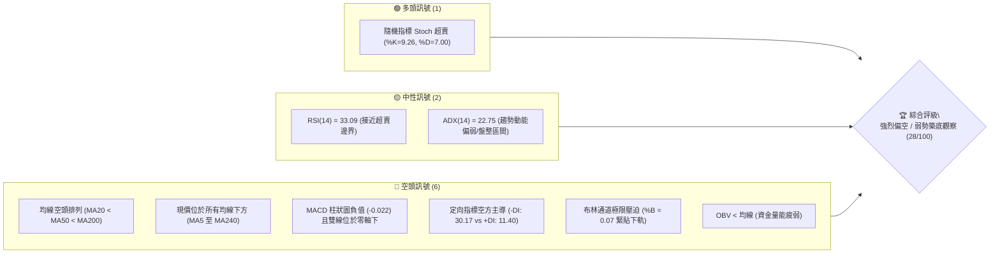
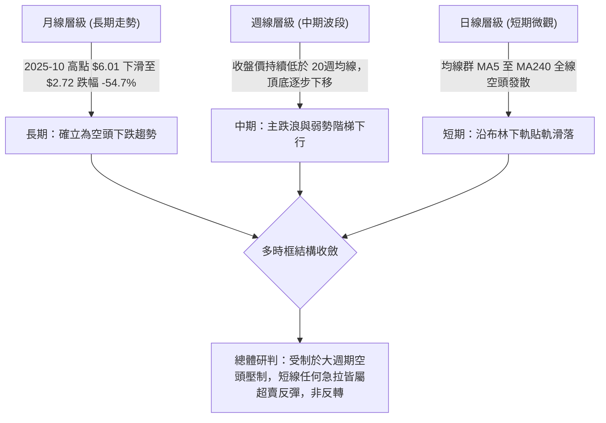
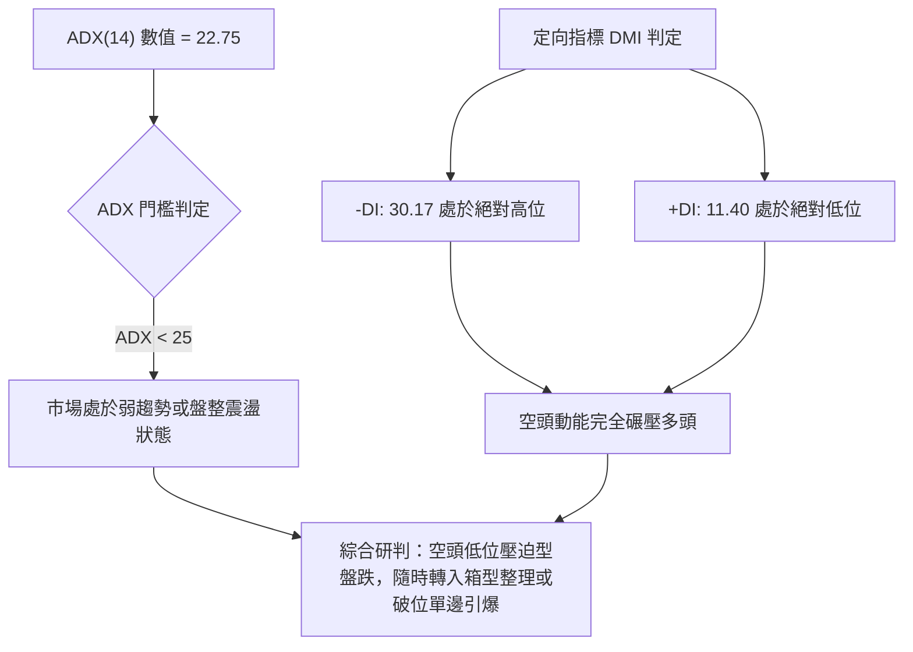
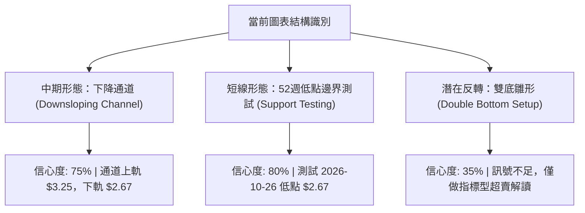
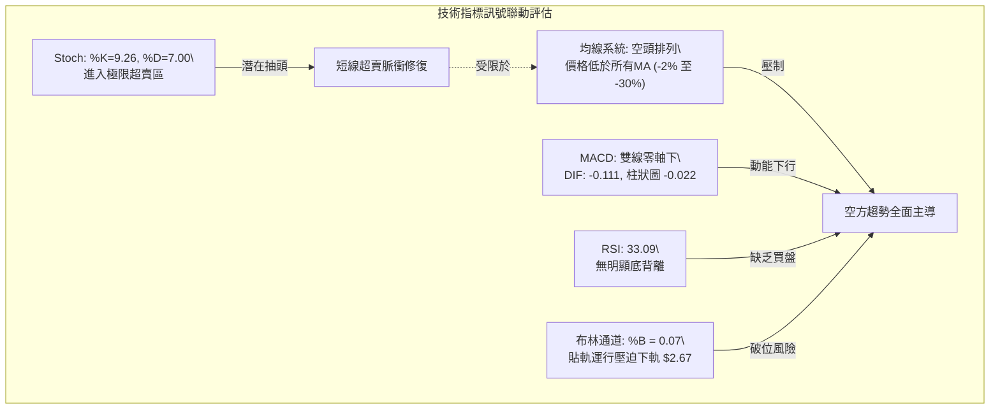
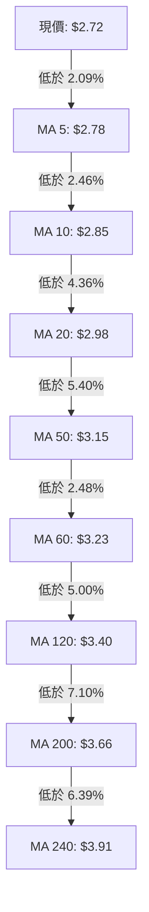
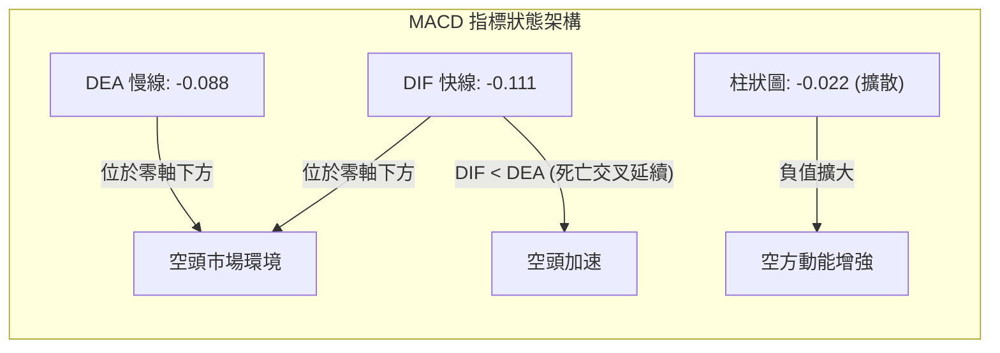
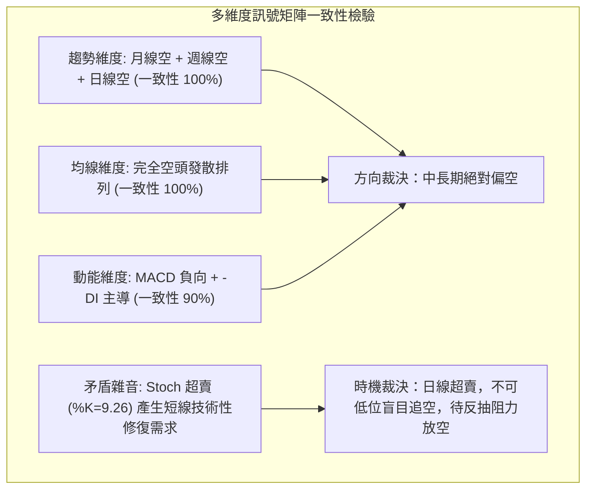
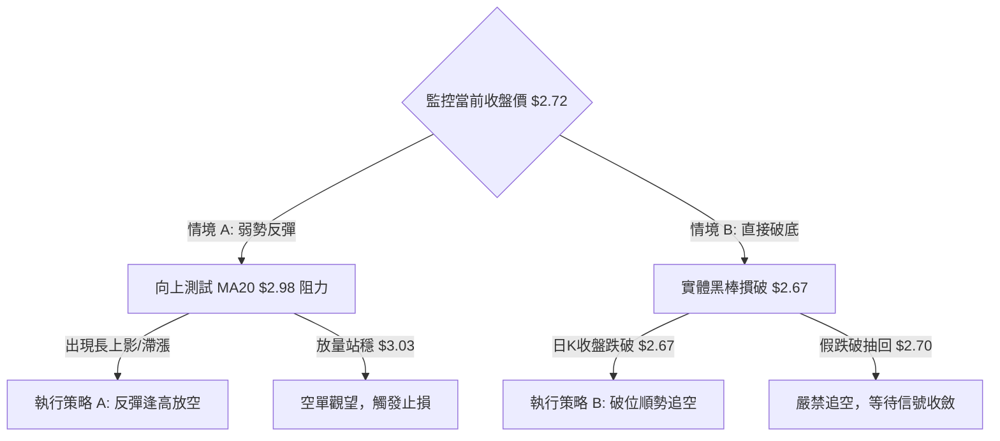
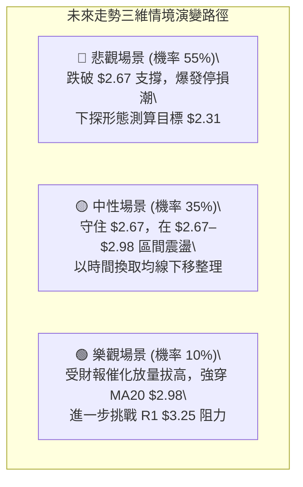

# GRAB 技術分析報告

> **報告日期**：2026-10-28 ｜ **語言**：繁體中文 ｜ **數據來源**：Yahoo Finance ｜ **當前價格**：$2.72 USD

---

## 目錄

| 章節 | 內容 |
|------|------|
| [1. 技術面概覽](#1-技術面概覽) | 訊號儀表板、核心指標、評分卡 |
| [2. 趨勢分析](#2-趨勢分析) | 多時框趨勢、長中短期走勢 |
| [3. 圖表形態分析](#3-圖表形態分析) | 形態識別、K線組合、目標價 |
| [4. 支撐與阻力](#4-支撐與阻力) | 關鍵價位、斐波那契回調 |
| [5. 技術指標深度解讀](#5-技術指標深度解讀) | MA/RSI/MACD/布林/成交量 |
| [6. 動能與波動率](#6-動能與波動率) | 動能評估、ATR、Beta |
| [7. 多時框架總結](#7-多時框架總結) | 時框架評分矩陣、收斂結論 |
| [8. 交易策略建議](#8-交易策略建議) | 多空策略、風險報酬比 |
| [9. 風險提示與監控](#9-風險提示與監控) | 監控指標、風險場景 |

---

## 1. 技術面概覽

### 🎯 技術訊號儀表板



---

### 📊 核心指標速覽表

| 指標類別 | 指標名稱 | 當前數值 | 訊號 | 解讀 |
|:---|:---|:---|:---:|:---|
| **價格** | 當前收盤價 | $2.72 | 🔴 | 位於 52 週價格區間 1.4% 位置，逼近 52 週低點 $2.67 |
| **均線** | MA20 (短線基準) | $2.98 | 🔴 | 現價低於 MA20 達 -8.66%，短期空方強烈壓制 |
| **均線** | MA50 (中期波段) | $3.15 | 🔴 | 現價低於 MA50，中期趨勢嚴重向下傾斜 |
| **均線** | MA200 (長期牛熊) | $3.66 | 🔴 | 現價遠在牛熊線下方 -25.68%，長期處於完全空頭格局 |
| **動能** | RSI(14) | 33.09 | 🟡 | 位於中性偏超賣區間，無明顯底背離，下行動能尚未衰竭 |
| **動能** | MACD (12,26,9) | -0.111 / -0.088 | 🔴 | DIF 與 DEA 雙雙落於零軸之下，柱狀圖 -0.022 持續綠柱擴散 |
| **動能** | Stoch %K / %D | 9.26 / 7.00 | 🟢 | 指標進入極端超賣區 (<20)，短線隨時具備技術性抽頭動能 |
| **趨勢** | ADX(14) / DMI | 22.75 | 🔴 | ADX < 25 處於偏弱趨勢/低位盤整；-DI (30.17) 遠高於 +DI (11.40) |
| **波動** | ATR(14) | $0.11 | 🟡 | 日內波幅佔比約 4.06%，波動適中，利於嚴格設定風控距離 |
| **通道** | 布林通道帶寬 | $2.67 - $3.28 | 🔴 | %B 為 0.07，價格貼近下軌 $2.67，呈現弱勢下行「走軌」現象 |
| **量能** | 最新量 / 20日均量 | 66.60M / 61.63M | 🔴 | 量比 1.08x，OBV < MA，反彈縮量、下跌帶量，量能偏空 |

---

### 🏆 技術評分卡

```
╔════════════════════════════════════════════════════════════════╗
║                   技術評分卡 — GRAB (2026-10-28)               ║
╠════════════════════════════════════════════════════════════════╣
║ 趨勢強度 (Trend)      ██████░░░░░░░░░░░░░░  30/100   🔴 弱勢/空方主導  ║
║ 動能指標 (Momentum)   ██████░░░░░░░░░░░░░░  30/100   🔴 極度偏弱超賣  ║
║ 支撐穩定度 (Support)   ██████░░░░░░░░░░░░░░  30/100   🔴 僅守52W低點   ║
║ 成交量配合 (Volume)    ███████░░░░░░░░░░░░░  35/100   🔴 量能疲弱背離  ║
║ 形態完整度 (Pattern)   ██████░░░░░░░░░░░░░░  30/100   🔴 下跌通道運行  ║
║ 均線排列 (MAs)        ███░░░░░░░░░░░░░░░░░  15/100   🔴 完美空頭排列  ║
╠════════════════════════════════════════════════════════════════╣
║ 綜合評分 (Overall)    ██████░░░░░░░░░░░░░░  28/100   🔴 強烈偏空       ║
╚════════════════════════════════════════════════════════════════╝
*註：綜合評分 = (30 + 30 + 30 + 35 + 30 + 15) ÷ 6 = 170 ÷ 6 = 28.33，四捨五入至整數為 28/100。
```

---

## 2. 趨勢分析

### 🌐 多時框趨勢分析



---

### 📈 長期趨勢 — 12個月走勢圖（Unicode）

```
GRAB 月線走勢圖（過去12個月：2025-11 至 2026-10）
價格軸 ($)
$6.00 ┤ ● (2025-10: $6.01)
$5.50 ┤   ● (2025-11: $5.45)
$5.00 ┤       ● (2025-12: $4.99)
$4.50 ┤           ● (2026-01: $4.30)  ● (2026-02: $4.22)
$4.00 ┤                                   ● (2026-04: $3.82)  ● (2026-06: $3.77)
$3.50 ┤                                       ● ($3.66)   ● ($3.54)   ● ($3.50)  ● ($3.54)
$3.00 ┤                                                                              ● (2026-09: $3.11)
$2.50 ┤                                                                                      ● (現價 $2.72)
      └─┬──────┬──────┬──────┬──────┬──────┬──────┬──────┬──────┬──────┬──────┬──────┬───────
       11月   12月    01月   02月   03月   04月   05月   06月   07月   08月   09月   10月
       '25    '25    '26    '26    '26    '26    '26    '26    '26    '26    '26    '26
```

#### 長期走勢特徵分析表格

| 階段區間 | 月份起迄 | 起始價 → 結束價 | 漲跌幅 (%) | 價量結構與形態特徵 |
|:---|:---|:---|:---:|:---|
| **第一階段：高位崩跌** | 2025-10 → 2026-01 | $6.01 → $4.30 | -28.45% | 自 $6.01 波段頂點連續長黑放量摜破 $5.00 心理整數關卡，頂部確認 |
| **第二階段：震盪盤跌** | 2026-01 → 2026-03 | $4.30 → $3.66 | -14.88% | 跌破 2025 初盤整平台，反彈無力，空方主導權牢固 |
| **第三階段：中期箱型平台** | 2026-04 → 2026-08 | $3.82 → $3.54 | -7.33% | 於 $3.50–$3.82 區間構築弱勢橫盤，量能逐步萎縮，形成下跌旗形整理 |
| **第四階段：破位加速探底** | 2026-08 → 2026-10 | $3.54 → $2.72 | -23.16% | 箱體下軌 $3.50 失守後引發技術性停損賣壓，單邊下挫測試 52W 低點 $2.67 |

---

### 📊 中期趨勢（週線分析）

中期走勢（近 20 週）呈現規律的「階梯式下跌」通道。近期週 K 線自 2026-10-09 當週高點 $3.23 回落後，連續三週收黑（$3.19 → $2.94 → $2.79 → $2.72），週成交量雖由高點逾 4 億股萎縮至當前 1.19 億股（本週未完），但下跌角度陡峭，週 MACD 柱狀圖由正轉負（-0.022），宣告中期反彈波段正式夭折。

```
GRAB 中期週線支撐與阻力階梯示意圖
價格 ($)
$3.96 ───────┬──────────────────────────────────────── R3 強阻力（2026-07前高聚類）
             │      ┌─────┐
$3.64 ───────┼──────┤ 週K ├─────────────────────────── R2 阻力（2026-08反彈高點聚類）
             │      └─────┘     ┌─────┐
$3.25 ───────┼──────────────────┤ 週K ├─────────────── R1 關鍵短線反壓（2026-09-25反彈高點）
             │                  └─────┘     ┌─────┐
$2.98 ───────┼──────────────────────────────┤ MA20├──── 布林中軌動態反壓
             │                              └─────┘
$2.72 ───────┼──────────────────────────────────────── ◄ 現價 (弱勢貼軌)
$2.67 ───────┴──────────────────────────────────────── 52W 最低點 / 布林下軌 / 斐波那契 100%
```

---

### ⚡ 趨勢強度評估（ADX 解讀）



#### ADX 與趨勢強度對照表

| 指標項 | 數值 | 門檻區間 | 技術意義解讀 |
|:---|:---:|:---:|:---|
| **ADX(14)** | **22.75** | < 25.0 | 趨勢強度處於「非強趨勢 / 弱盤整」區間，代表此處單邊殺跌速率放緩，空方動能非狂暴宣洩，而是鈍刀割肉式陰跌 |
| **+DI (14)** | **11.40** | 極弱 (<15) | 多頭買盤動能枯竭，市場缺乏主動性買盤進場承接 |
| **-DI (14)** | **30.17** | 強勢 (>25) | 空頭賣壓全面主導盤面，-DI 與 +DI 差值達 18.77，空方優勢顯著 |
| **綜合狀態** | **盤整偏空** | ADX < 25 且 -DI 占優 | 符合規則 14 之「盤整行情（ADX<25）」特徵，交易策略以布林通道上下軌 ($2.67–$3.28) 為核心邊界 |

---

## 3. 圖表形態分析

### 🔍 形態識別系統



#### 圖表形態評估表（依規則 15）

| 形態名稱 | 信心度 | 判斷依據（嚴格引用數據） | 完成度 | 目標價（附嚴謹計算式） |
|:---|:---:|:---|:---:|:---|
| **下降通道 (中短期)** | **75%** | 高點聚類逐步下移 ($3.96 → $3.64 → $3.25)；低點由 $2.96 跌至 $2.67 | 85% | 下軌支撐測試 $2.67，上軌反抽目標見 R1 $3.25 |
| **52W低點箱型邊界** | **80%** | 2026-10-26 探底 $2.67 觸及 52W 低點，10-27 收 $2.72 暫未實質跌破 | 90% | 守住則反彈至箱頂中軌 MA20 $2.98；破位測幅見下方延伸 |
| **雙底形態 (潛在反轉)** | **35%** | 僅有 10-26 低點 $2.67 一個低點，右底尚未成型，頸線遠在 $3.25 | 15% | 訊號不足，僅做指標型解讀（嚴禁臆測成型） |

---

### 🕯️ 重要 K 線形態分析

依據嚴格規則 19，僅針對數據提供的**近 10 根日 K** 與**近 8 根週 K** 進行量化解讀：

#### 近 10 根日 K 線形態解讀表

| 日期 (日K) | 開盤 | 最高 | 最低 | 收盤 | 成交量 | K線形態名稱 | 技術解讀與多空隱含 | 訊號 |
|:---|:---:|:---:|:---:|:---:|:---:|:---|:---|:---:|
| 2026-10-14 | 2.98 | 3.00 | 2.85 | 2.91 | 62,793,700 | 下跌中黑棒 | 開高走低，實體下穿 $2.95，確立短期回檔破位 | 🔴 |
| 2026-10-15 | 2.90 | 3.03 | 2.90 | 3.00 | 63,583,600 | 帶上影中紅棒 | 多頭反撲觸及 $3.03，但遇 MA20 ($2.98) 解套賣壓壓回 | 🟡 |
| 2026-10-16 | 3.02 | 3.02 | 2.90 | 2.94 | 52,411,800 | 假突破長黑棒 | 跳空開高 $3.02 即為全日最高，收盤重挫，形成空頭吞噬雛形 | 🔴 |
| 2026-10-19 | 2.93 | 2.94 | 2.86 | 2.87 | 39,331,900 | 縮量陰線 | 量能急凍至 39.3M，多頭毫無抵抗，陰跌延續 | 🔴 |
| 2026-10-20 | 2.88 | 2.92 | 2.83 | 2.89 | 54,046,500 | 低檔小陽十字 | 下影線測 $2.83 有微弱買盤，但收盤仍受制於 $2.90 關卡 | 🟡 |
| 2026-10-21 | 2.92 | 2.93 | 2.81 | 2.82 | 49,194,500 | 破位實體中陰 | 開盤即承壓，收在次低點 $2.82，破壞前日企穩企圖 | 🔴 |
| 2026-10-22 | 2.79 | 2.86 | 2.77 | 2.85 | 48,018,000 | 帶長下影小陽 | 探底 $2.77 獲逢低回補買盤，實體翻紅，但反彈量能不足 | 🟡 |
| 2026-10-23 | 2.83 | 2.85 | 2.79 | 2.79 | 43,101,500 | 光頭陰線 | 開高走低收全日最低 $2.79，週五避險情緒濃厚 | 🔴 |
| 2026-10-26 | 2.79 | 2.80 | 2.67 | 2.71 | 53,258,700 | 長下影鎚頭陰線 | 盤中摜壓至 52W 最低點 $2.67 後獲技術性承接，收 $2.71 | 🟡 |
| 2026-10-27 | 2.71 | 2.75 | 2.69 | 2.72 | 66,602,230 | 低檔窄幅放量小陽 | 低點 $2.69 未破前日低點，成交量放大至 66.6M，呈現籌碼換手 | 🟢 |

#### 近 8 根週 K 線形態解讀表

| 週末交易日 | 開盤 | 最高 | 最低 | 收盤 | 週成交量 | 週K線形態名稱 | 技術解讀與多空隱含 | 訊號 |
|:---|:---:|:---:|:---:|:---:|:---:|:---|:---|:---:|
| 2026-09-11 | 3.39 | 3.40 | 2.96 | 3.05 | 354,811,400 | 長黑破位棒 | 一舉擊穿 $3.30–$3.40 長期支撐區，量能顯著放大 | 🔴 |
| 2026-09-18 | 3.01 | 3.09 | 2.74 | 2.80 | 362,971,800 | 續跌長陰線 | 恐慌性下探 $2.74，收盤重挫，確立空方波段主跌浪 | 🔴 |
| 2026-09-25 | 2.84 | 3.26 | 2.78 | 3.13 | 527,094,200 | 超賣長陽反彈棒 | 創下逾 5.27 億股天量，強拉長紅覆蓋前週高點，超跌反彈 | 🟢 |
| 2026-10-02 | 3.10 | 3.18 | 3.07 | 3.08 | 337,148,400 | 高位窄幅十字陰 | 遭遇 MA50 與 R1 壓力前猶豫不決，多頭上攻力道衰減 | 🟡 |
| 2026-10-09 | 3.10 | 3.23 | 3.00 | 3.19 | 406,864,800 | 帶長上影小紅棒 | 衝高 $3.23 受阻於 R1 ($3.25) 聚類阻力，引發高位解套沉重賣壓 | 🔴 |
| 2026-10-16 | 3.16 | 3.20 | 2.85 | 2.94 | 280,278,600 | 轉向實體長黑 | 高檔反轉確認，失守 $3.00 整數心理關卡，中線重回弱勢 | 🔴 |
| 2026-10-23 | 2.93 | 2.94 | 2.77 | 2.79 | 233,692,400 | 連續中黑下探 | 空頭續推破位，高低點全面下移，毫無下影線支撐信號 | 🔴 |
| 2026-10-27 | 2.79 | 2.80 | 2.67 | 2.72 | 119,860,930 | 探底測試未完棒 | （僅2個交易日）下探 $2.67 測試年度底線，處於敏感防守期 | 🟡 |

---

### 📉 ASCII 走勢形態示意圖

```
GRAB 日線級別雙重下探測試形態示意圖（2026-10-14 至 2026-10-27）
價格 ($)
$3.03 ┤      ┌─● (10-15 反彈高點 $3.03)
$3.00 ┤      │ └─┐
$2.95 ┤  ┌──┘   └──┐ (10-16 假突破轉跌)
$2.90 ┤  │         └───● (10-19: $2.87)
$2.85 ┤  │             └──┐   ┌──● (10-22: $2.85)
$2.80 ┤  │                └───┘  └───● (10-23: $2.79)
$2.75 ┤  │                            └──┐   ┌──● (10-27: 現價 $2.72)
$2.70 ┤  │                               └───┼──┘
$2.67 ┴──┴────────────────────────────────────● (10-26 探底低點 $2.67 = 52W Low)
          14日  15日  16日  19日  20日  21日  22日  23日  26日  27日
```

---

### 🎯 形態目標價計算

根據規則 13 與規則 15，絕不臆測缺乏支撐的幾何形態，純粹依據當前已確認之**近期震盪箱體形態**計算上下測幅：

1. **近期反彈破位箱體高度**：
   - 箱頂（2026-10-15 波段反彈高點）：$3.03
   - 箱底（2026-10-26 測試 52W 低點）：$2.67
   - 形態箱體垂直高度 $H = \$3.03 - \$2.67 = \$0.36$
2. **向下破位等幅測算（跌破 $2.67 確認時）**：
   - 下跌目標價 = 跌破頸線點 − 形態高度
   - 計算式：$\text{Target}_{\text{Down}} = \$2.67 - \$0.36 = \$2.31$（標注：由 10 日箱體破位高度等幅推算）
3. **向上超賣修復測算（守穩 $2.67 觸發反彈時）**：
   - 第一反彈目標 = 箱底 + 0.5 × 形態高度 = $\$2.67 + 0.18 = \$2.85$（恰吻合 MA10 $2.85）
   - 第二反彈目標 = 箱底 + 1.0 × 形態高度 = $\$2.67 + 0.36 = \$3.03$（逼近 MA20 $2.98 與前高）

---

## 4. 支撐與阻力

### 🗺️ 關鍵價位分布圖（Unicode）

```
╔══════════════════════════════════════════════════════════════════╗
║                    GRAB 價位結構分布圖                           ║
╠══════════════════════════════════════════════════════════════════╣
║ $3.96 ║████████████████████████████████║ 強阻力 R3 (波段高點聚類) ║
║ $3.64 ║████████████████████████        ║ 中期阻力 R2 (反彈高點聚類)║
║ $3.25 ║████████████████████████████████║ 關鍵頸線阻力 R1          ║
║ $3.15 ║--------------------------------║ 動態均線 MA50 反壓       ║
║ $2.98 ║--------------------------------║ 布林中軌 / MA20 動態反壓 ║
║ $2.72 ╠════════════════════════════════╣ ◄ 當前收盤價 ($2.72)     ║
║ $2.67 ║▓▓▓▓▓▓▓▓▓▓▓▓▓▓▓▓▓▓▓▓▓▓▓▓▓▓▓▓▓▓║ 52週低點 / 布林下軌極限   ║
║ (N/A) ║░░░░░░░░░░░░░░░░░░░░░░░░░░░░░░░░║ 現價下方無波段低點聚類   ║
╚══════════════════════════════════════════════════════════════════╝
```

---

### 🚧 阻力位分析表

阻力價位嚴格引用系統由 OHLCV 計算之聚類高點數據：

| 阻力級別 | 精確價位 | 距現價空間 (%) | 形成原因與技術共振 | 突破難度評估 | 戰略重要性 |
|:---|:---:|:---:|:---|:---:|:---:|
| **R1** | **$3.25** | +19.30% | 近一年波段高點聚類；與布林上軌 ($3.28) 及 2026-10-09 當週高點 ($3.23) 形成強共振 | 極高 🔴 | ★★★★★ (多空生命線) |
| **R2** | **$3.64** | +33.92% | 近一年波段次高聚類；緊鄰長期年線 MA200 ($3.66)，為中長期牛熊轉換關鍵分界 | 極高 🔴 | ★★★★☆ (中期反轉點) |
| **R3** | **$3.96** | +45.47% | 2026 年夏季（7月）反彈雙頂峰值聚類；逼近 MA240 ($3.91) 與斐波那契 61.8% ($4.03) | 銅牆鐵壁 🔴 | ★★★★★ (歷史套牢重災區) |

---

### 🛡️ 支撐位分析表

依據數據規範，在當前價格下方之波段聚類低點檢測結果如下：

| 支撐級別 | 精確價位 | 距現價空間 (%) | 形成原因與技術依據 | 守住機率 | 戰略重要性 |
|:---|:---:|:---:|:---|:---:|:---:|
| **S1 (年度底線)** | **$2.67** | -1.84% | **52週絕對最低價** (52W Low)、布林通道當前下軌、斐波那契 100.0% 回調位三重共振 | 45% 🟡 | ★★★★★ (短線唯一實質防線) |
| **S2 (波段聚類)** | **N/A** | N/A | **數據中未偵測到現價下方之波段低點聚類** (no swing-low detected) | N/A | 🔴 (下方無歷史結構保護) |
| **S3 (測幅支撐)** | **$2.31** | -15.07% | **由 10 日箱體高度破位測幅推算**：$2.67 − ($3.03 − $2.67) = $2.31 | 55% (若破S1) | ★★★☆☆ (下行空間測算點) |

*說明：數據源明確顯示在現價 $2.72 下方無任何 swing-low support。一旦 $2.67 實質失守，股價將步入歷史級價格真空區（Price Discovery），下檔僅能仰賴形態等幅測算點。*

---

### 📐 斐波那契回調位分析

依據 52 週完整波段高點 $6.24 至低點 $2.67 計算之斐波那契回調矩陣：

```
斐波那契回調梯隊 ($6.24 → $2.67)
  0.0% (52W High) ────────────────────────── $6.24
 23.6%            ────────────────────────── $5.40
 38.2%            ────────────────────────── $4.88
 50.0%            ────────────────────────── $4.45
 61.8%            ────────────────────────── $4.03 (黃金分割關鍵壓制)
 78.6%            ────────────────────────── $3.43 (深次回調反壓)
────────────────────────────────────────────────────
 現價區間：$2.72 (落於 78.6% 與 100.0% 之間，極端弱勢區)
────────────────────────────────────────────────────
100.0% (52W Low)  ────────────────────────── $2.67 (極限底線支撐)
```

#### 斐波那契回調位技術解讀表

| 回調層級 | 精確價位 | 技術位置與含義 | 當前價格相對位置判定與市場心理 |
|:---|:---:|:---|:---|
| **0.0%** | $6.24 | 52 週最高點 | 2025 年多頭繁榮頂點，目前已跌去 -56.41% |
| **23.6%** | $5.40 | 初級回調位 | 2025-11 月破位點，已成為遠期不可逾越之天花板 |
| **38.2%** | $4.88 | 弱勢修正位 | 2025 年多個月份（1月、4月、5月）密集重疊換手區 |
| **50.0%** | $4.45 | 半數平衡點 | 多空分水嶺，跌破此點確認為大週期單邊崩跌浪 |
| **61.8%** | $4.03 | 黃金分割強防守 | 與長期阻力 R3 ($3.96) 及 MA240 ($3.91) 形成強大阻力重疊區 |
| **78.6%** | $3.43 | 極限回調位 | 跌破此位宣告中期任何反轉型態徹底瓦解，轉入陰跌 |
| **當前現價** | **$2.72** | **極弱探底區** | **現價處於 78.6% ($3.43) 至 100.0% ($2.67) 之間，距離 100% 僅剩 1.84%，屬極端瀕臨破底狀態** |
| **100.0%** | $2.67 | 52 週最低點 | 整個 52 週波段之基底，多頭退無可退之最後戰壕 |

---

## 5. 技術指標深度解讀

### 🎛️ 指標訊號總覽



---

### 📈 移動平均線排列分析



#### 移動平均線數據分析表

| 均線名稱 | 當前價格 | 與現價乖離率 (%) | 均線歷史走勢圖表特徵 | 空頭均線層級解讀 |
|:---|:---:|:---:|:---|:---|
| **MA 5** | $2.78 | -2.09% | ▅▄▃▂▃▅▆█████████████▇▆▅▄▄▃▃▂▁▁ | 超短線極速下彎，第一動態反壓 |
| **MA 10** | $2.85 | -4.56% | █▇▅▄▃▄▄▄▄▅▆▆▇██▇▇██▇▇▆▆▅▅▄▃▂▁▁ | 短期防守線，空方控盤基準 |
| **MA 20** | $2.98 | -8.66% | ██▇▆▆▆▅▄▄▃▃▃▂▂▂▂▂▂▂▂▂▃▃▃▂▂▂▁▁▁ | 月線生死線，布林中軌，跌破後斜率轉負 |
| **MA 50** | $3.15 | -13.65% | 逐步走平後加速下移 | 中期波段防線，多頭翻盤門檻 |
| **MA 60** | $3.23 | -15.90% | █████▇▇▇▆▆▆▅▅▅▄▄▄▃▃▃▃▃▂▂▂▂▂▁▁▁ | 季線下壓，與 R1 ($3.25) 形成雙重阻力 |
| **MA 120** | $3.40 | -20.05% | █████▇▇▇▇▇▇▆▆▆▆▅▅▅▄▄▃▃▃▂▂▂▁▁▁▁ | 半年線持續滑落，長期資金持續流出 |
| **MA 200** | $3.66 | -25.68% | 穩定下行 | 長期牛熊分界線，空頭排列關鍵指標 |
| **MA 240** | $3.91 | -30.46% | ████▇▇▇▆▆▆▆▅▅▅▅▄▄▄▄▃▃▃▂▂▂▂▁▁▁▁ | 年線，現價貼近其下方三成處，熊市特徵顯著 |

**均線結構綜合判定**：從短天期 MA5 至長天期 MA240 呈現**教科書級別之「完全空頭排列」**（Perfect Bearish Alignment）。所有均線排列次序井然，無任何短期均線向上金叉，代表每一輪反彈均被上方的解套浮額精準獵殺。

---

### 📉 RSI(14) 分析

#### RSI 數值強度進度條
```
RSI(14): 33.09
[██████░░░░░░░░░░░░░░] 33.09% ── 處於弱勢偏超賣臨界 (超賣線 30)
```

- **區間判定**：RSI 當前為 33.09（Wilder 平滑法），位於 30–70 之中性偏空區間，尚未實質跌入 <30 的絕對超賣區。
- **背離嚴格檢驗**：
  - 比對日線近 20 根 K 棒走勢：價格自 10-09 當週高點 $3.23 下挫至 10-26 最低點 $2.67（創 52 週新低），同期間 RSI 由 51.8 跌至 33.09，斜率同步向下。
  - 系統量化檢驗結論：「**無明顯背離（No Divergence）**」。
  - **技術隱含**：缺乏多頭底背離（Bullish Divergence）護體，代表價格走低是由實質拋壓驅動，而非動能枯竭造成的假跌破，切忌在此時盲目猜底。

---

### 📊 MACD(12,26,9) 訊號解讀



- **參數配置**：快線 EMA(12) = -0.111，慢線 EMA(26) = -0.088，差離值 MACD Hist = -0.022。
- **形態分析**：DIF 於零軸下方持續發散下穿 DEA，MACD 負向綠柱未見縮頭（Ticking up）跡象，反而小幅放大。零軸之下的死亡交叉代表空頭主導的主跌動能仍在延續，短線反轉概率極低。

---

### 📦 布林通道分析

```
GRAB 日線布林通道運行示意圖 (20-day, 2-sigma)
價格 ($)
$3.28 ┬──────────────────────────────────────── 上軌 Upper Band (阻力)
      │
$3.10 ┼
      │
$2.98 ┼──────────────────────────────────────── 中軌 Mid Band (MA20 基線反壓)
      │
$2.80 ┼
      │
$2.72 ┼                      ◄ 現價 $2.72 (%B = 0.07, 極度壓迫)
$2.67 ┴──────────────────────────────────────── 下軌 Lower Band (S1 支撐)
```

- **軌道邊界**：上軌 $3.28 ｜ 中軌 $2.98 ｜ 下軌 $2.67 ｜ 帶寬 (Bandwidth) = 20.47%。
- **%B 指標位置**：當前 %B 數值為 **0.07**（0 代表位於下軌，0.5 為中軌，1.0 為上軌）。
- **通道走勢研判**：
  1. %B = 0.07 顯示股價已緊貼布林通道下軌邊緣，處於典型的「**布林貼軌下行（Walking the Lower Band）**」狀態。
  2. 此形態在強空頭市場中並非超賣買入訊號，反而是空方動能強勢推動通道向下開口的徵兆。
  3. 若 52W 低點兼下軌 $2.67 告失，布林下軌將被迫向下急劇開口，引爆「波動率擴張型」殺跌。

---

### 💹 成交量分析（量價配合度）

1. **量能指標現狀**：
   - 最新交易日成交量：**66,602,230** 股。
   - 20 日成交均量：**61,631,106** 股。
   - 50 日成交均量：**61,366,281** 股。
   - 最新量比（Volume Ratio）：**1.08x**（小幅溫和放大）。
2. **OBV（能量潮）趨勢解讀**：
   - 數據狀態：**OBV < MA → 量能疲弱**。
   - OBV 穩定低於其均線，且隨著價格破位持續創出階段新低，表明機構法人資金在反彈過程中未見實質性加倉，主動性逢高派發跡象明顯。
3. **量價背離檢驗**：
   - 觀察近 10 根日 K：10-15 反彈陽線成交量為 63.5M，而 10-27 探底回升陽線成交量達 66.6M。量能雖有企穩放大，但在空頭排列下，低位放量卻未能強勢推升股價脫離 $2.70 危險區，呈現「**放量滯漲、籌碼沉澱困難**」的弱勢特徵。

---

## 6. 動能與波動率

### ⚡ 動能評估四象限

```
動能與波動率四象限矩陣分析
────────────────────────────────────────────────────────────
              高波動率 (High Volatility)
                      │
        Q3 (高風險高收益) │ Q4 (突破殺跌/強空頭)
        動能強 / 波動高   │ 動能弱 / 波動高
                      │
──────────────────────┼──────────────────────
                      │   ★ GRAB 當前落點 (Q2 偏向邊界)
        Q1 (最佳趨勢機會) │ Q2 (弱勢陰跌/觀望期)
        動能強 / 波動低   │ 動能弱 / 波動低 (ADX=22.75, ATR=0.11)
                      │
              低波動率 (Low Volatility)
────────────────────────────────────────────────────────────
```

#### 動能與波動率四象限分析表

| 象限 | 動能維度 | 波動維度 | 當前狀態標註 | 戰術應對與市場行為解讀 |
|:---:|:---:|:---:|:---:|:---|
| **Q1** | 強 (+DI主導) | 低 (縮量突破) | — | 最佳買點：蓄勢後多頭平穩上行 |
| **Q2** | **弱 (-DI主導/ADX<25)** | **低 (ATR=4.06%)** | **✓ (當前所處區間)** | **謹慎觀望：市場處於陰跌縮量盤整期，波動率受到壓縮，缺乏向上爆發力** |
| **Q3** | 強 (多空對決) | 高 (帶量巨震) | — | 高風險投機：暴漲暴跌波段交易 |
| **Q4** | 弱 (單邊殺跌) | 高 (放量破位) | **潛在演變風險** | 若下軌 $2.67 失守，將迅速由 Q2 跳躍轉入 Q4 破位宣洩 |

---

### 📊 ATR 波動率分析

- **ATR(14) 數值**：**$0.11 USD**（採 Wilder 平滑算法）。
- **ATR 相對波動佔比**：$\frac{\$0.11}{\$2.72} \times 100\% = \mathbf{4.06\%}$。
- **日內波動特徵**：股價每日正常價格震盪區間約在 $\pm \$0.11$。這意味著在 $2.72 的價位下，正常的市場隨機噪聲即可能觸發小於 $0.11 的過於緊密的止損。
- **動態風控停損距離設置依據**：
  - 超短線（日內/隔夜）：$1.0 \times \text{ATR} = \$0.11$。
  - 波段空單防守：$1.5 \times \text{ATR} = 1.5 \times \$0.11 = \mathbf{\$0.165}$。
  - 中期波段防守：$2.0 \times \text{ATR} = 2.0 \times \$0.11 = \mathbf{\$0.22}$。

---

### 📐 Beta 與市場相關性

- **Beta 係數**：**0.908**。
- **技術解讀**：
  1. Beta 略低於 1.0（0.908），顯示該標的相對於大盤（S&P 500 / 納斯達克指數）之系統性波動敏感度大致相當，但略顯鈍化。
  2. 近期大盤若出現回調，GRAB 由於處於內生性下跌趨勢（個股基本面承壓、均線空頭排列），其下行 Beta 往往會非對稱放大；反之，若大盤反彈，其跟漲動力將因上檔密集套牢賣壓而大幅受限（弱勢跟跌不跟漲）。

---

## 7. 多時框架總結

### 📋 時框架評分表

| 時框架 | 趨勢方向 | 動能狀態 | 均線排列 | 形態特徵 | 綜合評分 | 建議戰術方向 |
|:---|:---:|:---:|:---:|:---|:---:|:---|
| **長期 (月線)** | 🔴 強烈看空 | 下跌擴散 | 空頭排列 (低於 MA240 -30%) | 自 $6.01 腰斬，大週期下行通道 | **15/100** | 嚴禁長線多頭買入 |
| **中期 (週線)** | 🔴 看空 | MACD柱負向 | 承壓於 20週均線 | 階梯式殺跌，R1 $3.25 阻力堅固 | **25/100** | 逢反彈高空為主 |
| **短期 (日線)** | 🔴 偏空盤整 | 超賣鈍化 | 5至240日均線全線壓制 | 貼著布林下軌測試 52W 低點 $2.67 | **35/100** | 觀望或破位追空 |

---

### 🔲 綜合訊號矩陣



---

### ⚖️ 多時框收斂結論（依規則 14）

1. **行情性質判定**：當前日線 ADX(14) 為 **22.75**，低於 25.0 臨界值，根據嚴格規範定義為「**盤整行情（ADX<25）**」。
2. **多時框衝突收斂與優先級判定**：
   - 在 ADX < 25 的盤整結構中，日線級別以布林通道上下軌（**$2.67 至 $3.28**）為核心震盪交易區間。
   - 然而，由於長線（月線）與中線（週線、MA50/MA200）方向呈現全面向下傾斜的強烈空頭排列，根據規則 14 之優先級原則，**中長期趨勢方向具備最終否決權**。日線的震盪結構不代表趨勢反轉，僅代表單邊下殺速率在 52W 低點附近暫時休克停頓。
3. **唯一方向性結論**：
   - **偏空操作（Bearish Dominance）**。綜合評分為 **28/100**（符合第 1 章算術平均評分）。
   - 主策略全面定調為**空方操作**（以反彈測試阻力位布空為主，向下突破破位追空為輔）；多頭在未突破 MA20 ($2.98) 與 R1 ($3.25) 之前，一律定性為高風險刀口舔血的反彈，僅供對沖提示，不作為主力交易推薦。

---

## 8. 交易策略建議

### 🗺️ 策略決策流程圖



---

### 🧭 策略路由（依規則 18 評分分流）

> **當前主策略方向 = 空頭策略（依綜合評分 28/100 ≤ 40 定調）**
> 
> 根據評分卡 28/100 之客觀判定，空方具備絕對統治力。本報告主推**兩套空頭交易策略**（策略 A：阻力位反彈高空；策略 B：52W 低點破位追空）。多頭策略僅作為反轉風控對沖與空單回補之觸發標記。

---

### 🎯 價格情境階梯（Price Scenarios）

價位嚴格引用第 4 章及關鍵數據區塊計算值：

| 觸發條件 | 下一目標價位 | 後續延伸價位 | 情境技術含義與市場行為解讀 |
|:---|:---:|:---:|:---|
| **向上反彈突破 MA20 ($2.98)** | R1 **$3.25** | R2 **$3.64** | 日線超賣帶動技術性抽頭修復，短線轉強，但面臨 R1 強大籌碼壁壘 |
| **維持於現價區間震盪** | $2.67 (箱底) | $2.98 (箱頂) | 於 52W 低點與布林中軌間進行以時間換空間之橫盤整理（ADX<25特徵） |
| **向下跌破 52W 低點 ($2.67)** | 形態測幅 **$2.31** | 心理整數 **$2.00** | 終結 52 週所有防線，引發融資停損與技術性程式賣壓，步入單邊崩跌 |

---

### 📊 情境機率分佈

| 價格演變情境 | 機率估計 (%) | 主要指標客觀依據 |
|:---|:---:|:---|
| **情境一：延續跌勢 / 破位探底** | **55%** | 均線系統全面空頭排列，MACD 處於零軸下且負柱發散，OBV 量能持續萎縮 |
| **情境二：低位區間震盪 (箱型築底)** | **35%** | ADX(14)=22.75 處於弱趨勢盤整模式，Stoch 處於極端超賣區 (%K=9.26, %D=7.00) |
| **情境三：強勢反轉 / 向上回補** | **10%** | 上方阻力重重（MA20/MA50/R1），+DI 僅 11.40 缺乏資金動能支撐大級別反轉 |

---

### 🟢 主策略詳情（空頭操作為主）

根據嚴格規則 17，風險報酬比公式為：$\text{RRR} = \frac{\text{進場價} - \text{目標價 T1}}{\text{止損價} - \text{進場價}}$（做空交易），數值經數學精確驗算。

| 策略要素 | 策略 A（主推：反彈遇阻放空） | 策略 B（輔助：破底順勢追空） |
|:---|:---|:---|
| **交易邏輯** | 利用 Stoch 超賣引發的技術反彈，於布林中軌關鍵反壓處布空 | 52 週最低點 $2.67 實質失守，順應大週期主跌浪加碼做空 |
| **進場條件** | 價格反彈至 MA20 附近，日 K 出現上影線或跌破前日低點滯漲訊號 | 日 K 實體跌破 $2.67，且當日成交量突破 6,000 萬股確認破位 |
| **進場價格** | **$2.98**（引用 MA20 / 布林中軌精確價位） | **$2.65**（跌破 52W 低點 $2.67 下方 2 檔確認進場） |
| **目標價 T1** | **$2.67**（引用 52W 最低點 / 布林下軌） | **$2.31**（標注：由 10 日箱體破位高度等幅測算點） |
| **目標價 T2** | **$2.31**（由箱體高度等幅推算：$2.67 - $0.36 = $2.31） | **$2.00**（大週期整數心理關卡） |
| **止損價格** | **$3.15**（引用 MA50 中期阻力位精確數值） | **$2.75**（引用 2026-10-27 日 K 最高點價位） |
| **風險報酬比** | **1 : 1.82（以 T1 計）**<br>計算式：$(2.98 - 2.67) \div (3.15 - 2.98) = 0.31 \div 0.17 = 1.82$<br>*另列 T2：1 : 3.94（以 T2 計，$(2.98 - 2.31) \div 0.17 = 3.94$）* | **1 : 3.40（以 T1 計）**<br>計算式：$(2.65 - 2.31) \div (2.75 - 2.65) = 0.34 \div 0.10 = 3.40$<br>*另列 T2：1 : 6.50（以 T2 計，$(2.65 - 2.00) \div 0.10 = 6.50$）* |
| **成功機率** | **65%** | **55%** |
| **建議倉位** | **總資金之 8%–10%** | **總資金之 5%–7% (破位波動劇烈，降額進場)** |

---

### 🔴 反向風險觸發點（對沖提示）

若市場出現非預期之多頭反撲，以下價位與訊號被觸發時，必須**立即終止所有空頭策略**並考慮停損或反向對沖：
1. **反轉關鍵價位**：日 K 線收盤價**實體站穩 $3.03**（2026-10-15 日線反彈高點）或突破 **R1 $3.25**。
2. **指標失效訊號**：
   - 日線 MACD 出現零軸下金叉，且柱狀圖由負轉正翻紅。
   - +DI 向上穿越 -DI，伴隨日成交量暴增至 1 億股以上（顯著高於 50 日均量 61.3M）。
3. **對沖措施**：一旦 $3.03 被向上實質穿透，空單全數離場，嚴禁逆勢扛單。

---

### ⭐ 整體訊號強度評星

```
╔══════════════════════════════════════════════════════╗
║ 做多訊號強度：★☆☆☆☆  (1.5/5星 — 僅有超賣，無底背離)    ║
║ 做空訊號強度：★★★★☆  (4.0/5星 — 均線與趨勢完美共振)    ║
║ 整體可信度：  ★★★★☆  (4.0/5星 — 數據鏈條完整收斂)      ║
╚══════════════════════════════════════════════════════╝
```

---

## 9. 風險提示與監控

### ✅ 關鍵監控指標 Checklist

```
╔══════════════════════════════════════════════════════════════════╗
║                     關鍵監控指標風控 CHECKLIST                    ║
╠══════════════════════════════════════════════════════════════════╣
║ [ ] 52W 低點防守：每日收盤價是否跌破 $2.67？(跌破即觸發破位行情)║
║ [ ] 均線動態壓制：價格是否持續受制於 MA20 ($2.98) 之下？         ║
║ [ ] 動能背離檢驗：RSI 跌入 30 以下後，是否出現價格新低而指標不破？║
║ [ ] MACD 柱狀演變：負柱是否由 -0.022 持續擴散，抑或開始向零軸收斂？║
║ [ ] 成交量異動：下破 $2.67 時量能是否大於 61.6M (20日均量)？     ║
║ [ ] 波動率警戒：單日真實波幅是否超過 1.5 倍 ATR ($0.165)？      ║
╚══════════════════════════════════════════════════════════════════╝
```

---

### ⚠️ 風險場景分析



---

### 🛡️ 風險管理重要提醒

1. **基本面催化劑風險警示**：
   - 根據市場最新新聞動態（"GRAB to Report Q3 Earnings"），公司即將公布最新季度財報。歷史數據顯示雖然淨利同比暴增 622.9%，但自由現金流仍為負值（TTM FCF 為 -$186.00M），且營業利益率波動劇烈。財報發布窗口將導致隱含波動率驟升，跳空開盤可能直接跨越技術止損位。**強烈建議在財報公布日前夕將部位縮減至 3% 以下或空倉規避**。
2. **放空交易之非對稱性風險**：
   - 當前股價已處於 $2.72 低基期，融券放空之上檔理論虧損無限而獲利空間受限（最大獲利空間僅 $2.72）。若市場傳出併購、重大人事變革或超預期獲利指引，極易引發軋空（Short Squeeze）行情（空頭部位比例佔流通盤 7.6%，天數比為 3.55 天）。
3. **部位嚴格管理守則**：
   - 單筆策略承受風險上限嚴格控制在總投資組合淨值之 **1.0%–1.5%** 範圍內。
   - 絕對禁止在價格未跌破 $2.67 或未反彈至 $2.98 阻力位的「模糊中間地帶（$2.70–$2.80）」過早建立重倉。

---

## 📋 報告總結

```
╔════════════════════════════════════════════════════════════════════════╗
║                     GRAB 技術分析報告總結                              ║
╠════════════════════════════════════════════════════════════════════════╣
║ 報告日期：2026-10-28                                                  ║
║ 當前價格：$2.72 USD                                                    ║
║ 分析評級：🔴 強烈偏空 / 弱勢尋底觀望 (技術評分: 28/100)                  ║
║                                                                        ║
║ 關鍵結論：                                                             ║
║ ├─ 長期趨勢：🔴 完全空頭走勢，自 $6.01 下滑逾 54%，受制於 MA240 ($3.91) ║
║ ├─ 中期趨勢：🔴 週線階梯式破位下行，MA20/MA50 呈強烈下壓斜率            ║
║ ├─ 短期趨勢：🔴 貼著布林下軌滑落，極度逼近 52W 低點 $2.67，超賣修復動能弱║
║ ├─ 關鍵支撐：S1 $2.67 (52W最低價)；跌破後測幅支撐見 $2.31               ║
║ ├─ 關鍵阻力：MA20 $2.98 ｜ R1 $3.25 ｜ R2 $3.64 (MA200 牛熊分水嶺)       ║
║ └─ 分析師目標：共識均價 $5.54 (偏離現價甚遠，技術面完全未反映)        ║
║                                                                        ║
║ 最優交易策略組合：                                                     ║
║ 1. 🥇 最佳機會（策略 A）：反彈至 MA20 $2.98 遇阻建立空單，停損 $3.15， ║
║    目標 T1 $2.67 (RRR = 1:1.82)，目標 T2 $2.31 (RRR = 1:3.94)          ║
║ 2. 🥈 次選機會（策略 B）：確認跌破 52W 低點 $2.67 後追空 ($2.65 進場)，║
║    停損設於 $2.75，目標 T1 $2.31 (RRR = 1:3.40)                       ║
║ 3. 🥉 保守選擇：完全空倉觀望，耐心等待日線級別底背離成型或收復 $3.03 ║
╚════════════════════════════════════════════════════════════════════════╝
```

---

> ⚠️ **免責聲明**：本報告為依據量化技術指標與歷史行情數據生成之技術分析研究報告，報告內所有價位、圖表與策略推演僅供**學術研究與投資架構參考**，**絕不構成任何個人化之投資要約、招攬或具體操作建議**。金融市場瞬息萬變，技術指標存在滯後性與失效風險，投資人應獨立評估自身財務狀況與風險承受能力，自負盈虧責任。

---
*報告生成時間：2026-10-28 ｜ 數據來源：Yahoo Finance ｜ 分析框架：資深多時框量化技術分析*