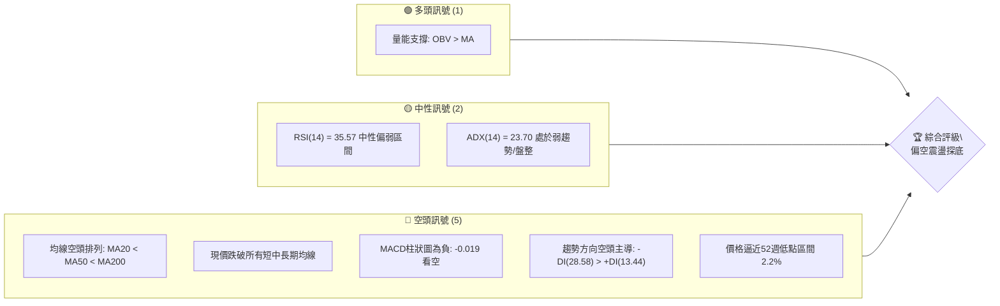
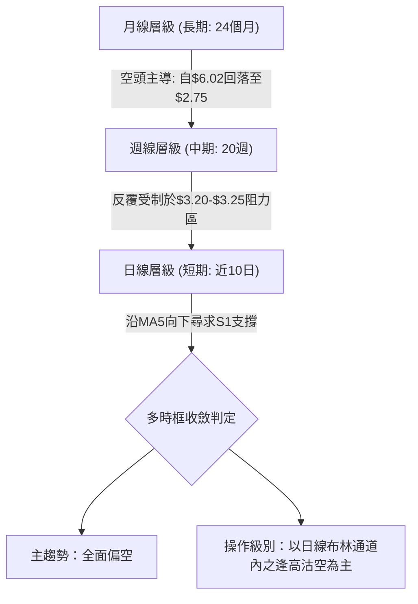
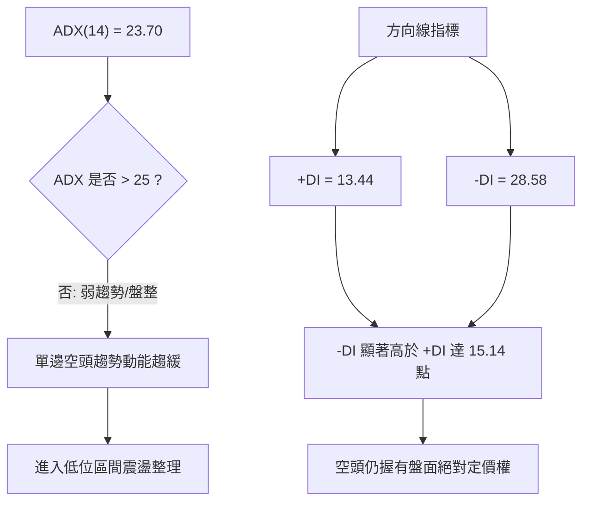
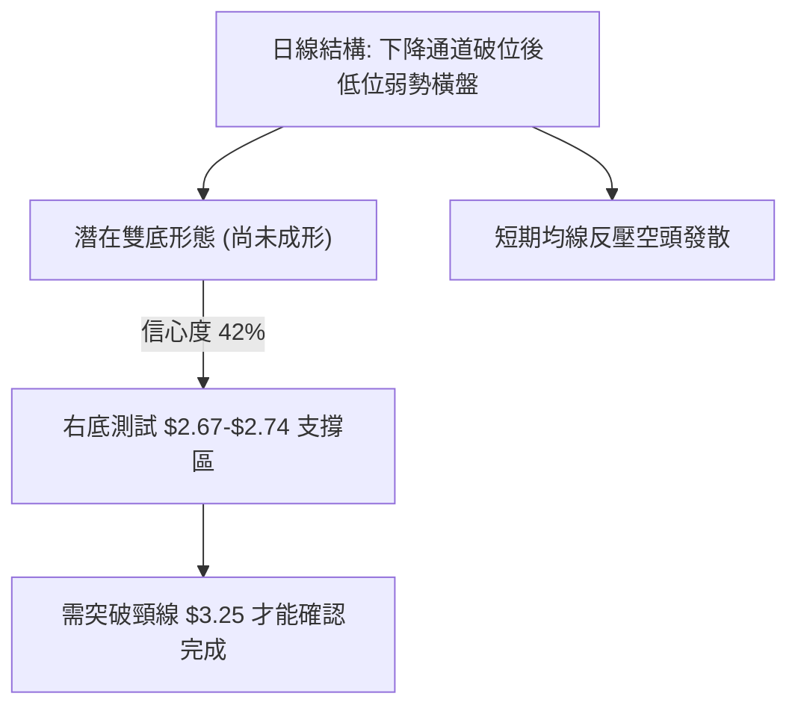
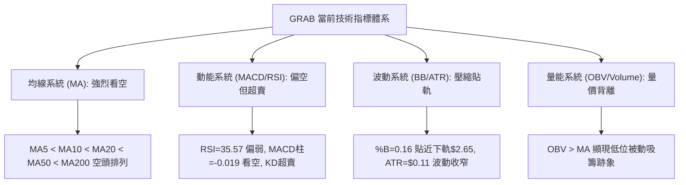
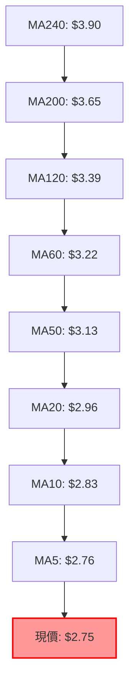
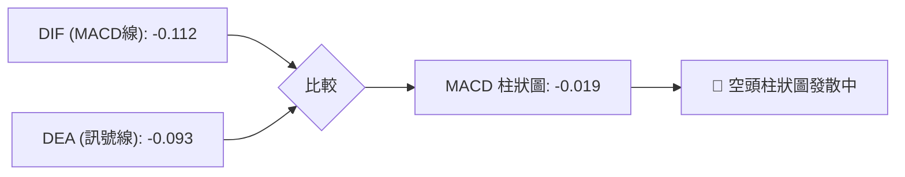
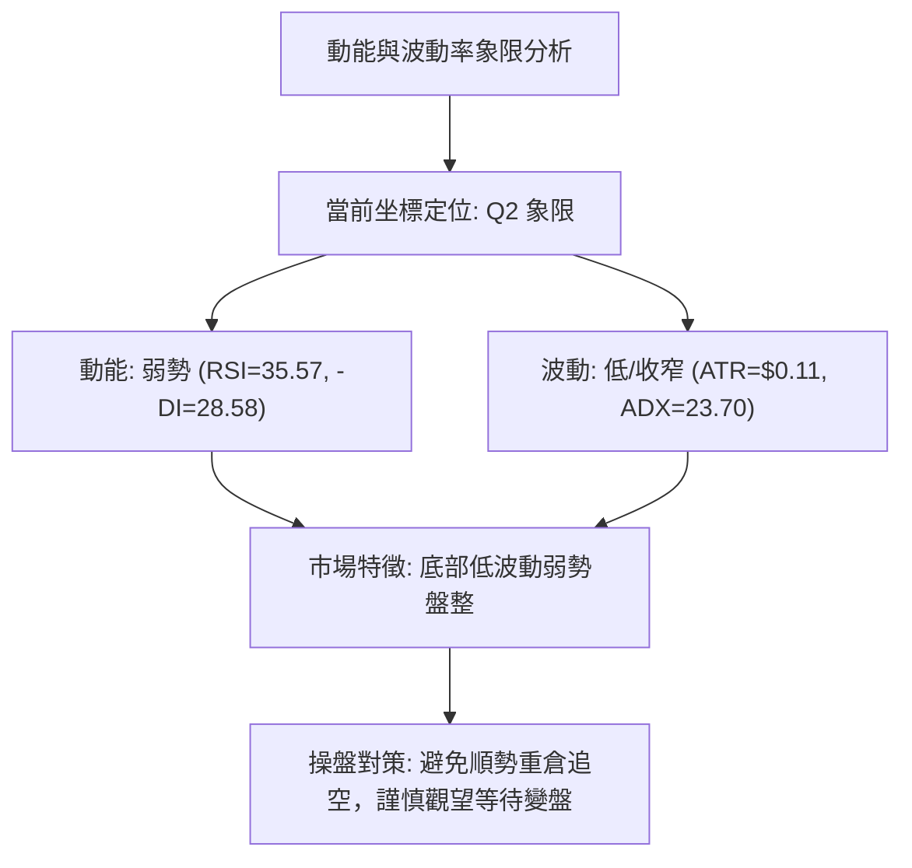
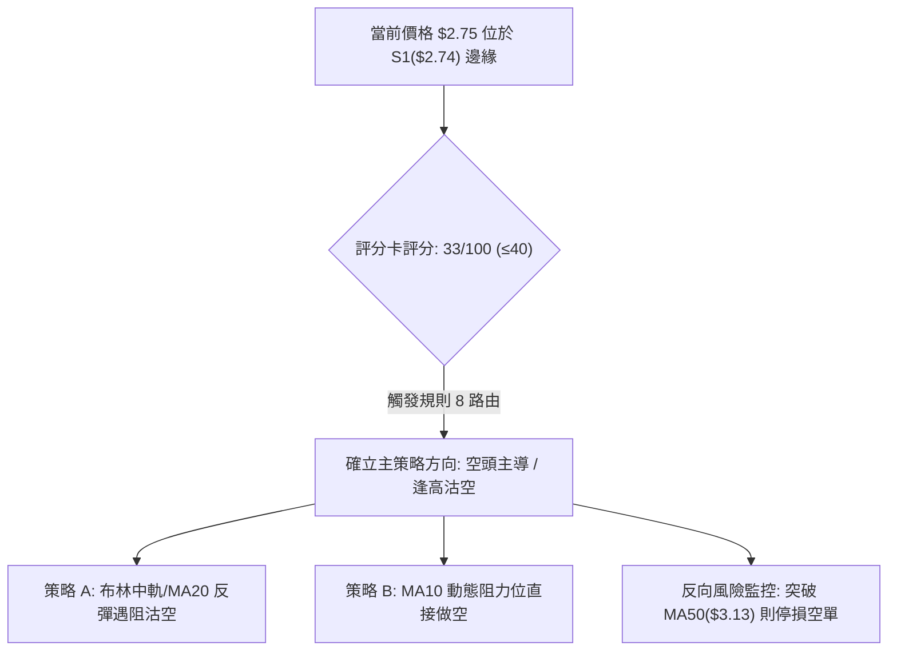
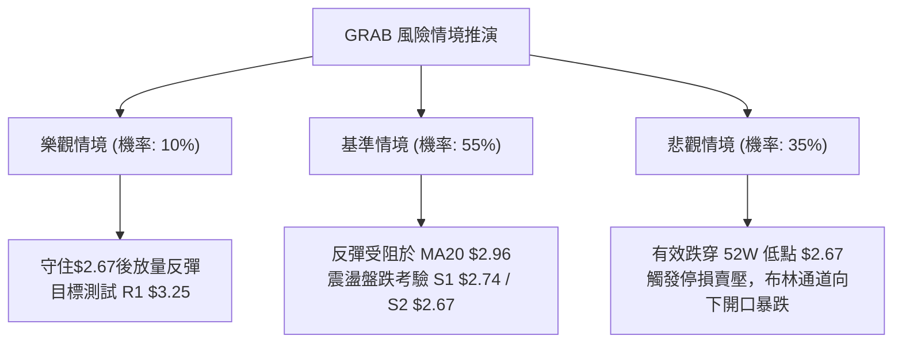

# GRAB 技術分析報告

> **報告日期**：2026-10-29 ｜ **語言**：繁體中文 ｜ **數據來源**：Yahoo Finance ｜ **當前價格**：$2.75

---

## 目錄

| 章節 | 內容 |
|------|------|
| [1. 技術面概覽](#1-技術面概覽) | 訊號儀表板、核心指標、評分卡 |
| [2. 趨勢分析](#2-趨勢分析) | 多時框趨勢、長中短期走勢 |
| [3. 圖表形態分析](#3-圖表形態分析) | 形態識別、K線組合、目標價 |
| [4. 支撐與阻力](#4-支撐與阻力) | 關鍵價位、斐波那契回調 |
| [5. 技術指標深度解讀](#5-技術指標深度解讀) | MA/RSI/MACD/布林/成交量 |
| [6. 動能與波動率](#6-動能與波動率) | 動能評估、ATR、Beta |
| [7. 多時框架總結](#7-多時框架總結) | 時框架評分矩陣 |
| [8. 交易策略建議](#8-交易策略建議) | 多空策略、風險報酬比 |
| [9. 風險提示與監控](#9-風險提示與監控) | 監控指標、風險場景 |

---

## 1. 技術面概覽

### 🎯 技術訊號儀表板



### 📊 核心指標速覽表

| 指標類別 | 指標名稱 | 當前數值 | 訊號 | 解讀 |
|:---|:---|:---|:---:|:---|
| **價格** | 當前收盤價 | $2.75 | 🔴 | 位於52週區間下緣 2.2%，緊貼S1關鍵支撐位 |
| **均線** | MA20 | $2.96 | 🔴 | 現價低於MA20達 -7.09%，短期承壓嚴重 |
| **均線** | MA50 | $3.13 | 🔴 | 現價低於MA50達 -12.14%，中期下降軌道未變 |
| **均線** | MA200 | $3.65 | 🔴 | 現價低於MA200達 -24.66%，長期處於熊市格局 |
| **動能** | RSI(14) | 35.57 | 🟡 | 位於30–70中性區間下沿，尚未觸及極度超賣 |
| **動能** | MACD柱狀圖 | -0.019 | 🔴 | MACD線(-0.112)在訊號線(-0.093)下方，負向發散 |
| **隨機指標** | Stoch %K / %D | 14.81 / 10.49 | 🟡 | 進入超賣區，存在技術性弱反彈需求但動能虛弱 |
| **趨勢** | ADX(14) | 23.70 | 🟡 | 數值低於25，代表日線單邊趨勢衰竭，轉入底部盤整 |
| **波動** | ATR(14) | $0.11 | 🟡 | 佔現價 3.93%，每日波動區間收窄，處於壓縮狀態 |
| **通道** | 布林帶 %B | 0.16 | 🔴 | 緊貼布林下軌($2.65)，價格極度偏弱運行 |

### 🏆 技術評分卡

```
╔══════════════════════════════════════════════════════════════════════╗
║                   技術評分卡 — GRAB (2026-10-29)                     ║
╠══════════════════════════════════════════════════════════════════════╣
║ 趨勢強度       █████░░░░░░░░░░░░░░░  25/100  🔴 空頭主導 (-DI遠大於+DI) ║
║ 動能指標       ███████░░░░░░░░░░░░░  35/100  🔴 MACD負向且RSI低位走平  ║
║ 支撐穩定度     ███████░░░░░░░░░░░░░  36/100  🔴 僅距S1支撐0.36%，脆弱  ║
║ 成交量配合     ██████████░░░░░░░░░░  50/100  🟡 OBV大於MA但總量未見放大║
║ 形態完整度     ███████░░░░░░░░░░░░░  35/100  🔴 底部形態尚未構築完成   ║
║ 均線排列       ███░░░░░░░░░░░░░░░░░  17/100  🔴 均線呈現全週期空頭瀑布 ║
╠══════════════════════════════════════════════════════════════════════╣
║ 綜合評分       ███████░░░░░░░░░░░░░  33/100  評級：偏空（空頭主導格局） ║
╚══════════════════════════════════════════════════════════════════════╝
```

> **評分計算說明（規則 18）**：綜合評分由六項子評分算術平均得出：(25 + 35 + 36 + 50 + 35 + 17) ÷ 6 = 198 ÷ 6 = **33/100**。

---

## 2. 趨勢分析

### 🌐 多時框趨勢分析



### 📈 長期趨勢 — 12個月走勢圖（Unicode）

```
GRAB 月線走勢圖（過去12個月：2025-11 至 2026-10）
價格軸 ($)
$6.00 ┤ 
$5.45 ┤ ● (2025-11)
$4.99 ┤       ● (2025-12)
$4.30 ┤             ● (2026-01)
$4.22 ┤                 ● (2026-02)
$3.82 ┤                             ● (2026-04)
$3.77 ┤                                         ● (2026-06)
$3.54 ┤                         ●       ● (2026-05/08)
$3.50 ┤                                     ● (2026-07)
$3.11 ┤                                                 ● (2026-09)
$2.75 ┤                                                             ● (現價)
      └────────────────────────────────────────────────────────────────
        11    12    01    02    03    04    05    06    07    08    09    10  (月份)
```

**走勢特徵分析表格**：

| 時間區間 | 起始價 | 結束價 | 區間漲跌幅 | 趨勢特徵描述 |
|:---|:---:|:---:|:---:|:---|
| **2025-11 ~ 2026-01** | $6.01 | $4.30 | -28.45% | 高位失守，長黑摜破5.00整數關口，開啟中長線下行波段 |
| **2026-02 ~ 2026-03** | $4.22 | $3.66 | -13.27% | 跌破4.00心理防線，均線加速向下發散 |
| **2026-04 ~ 2026-08** | $3.82 | $3.54 | -7.33% | 於 $3.50–$3.90 區間展開長達5個月的橫盤整理，多頭試圖築底 |
| **2026-09 ~ 2026-10** | $3.54 | $2.75 | -22.32% | 平台破位下殺，創52週新低 $2.67，目前於 $2.75 弱勢盤整 |

### 📊 中期趨勢（週線分析）

從近20週數據觀察，價格自2026年7月高點 $3.93 回落，9月中旬加速跌破 $3.00，於9月25日當週爆出 527,094,200 股巨量並拉出長下影線（最低 $2.78，收 $3.13）。然而後續反彈至 $3.19 後量能無法持續，10月中旬起再度連續三週收黑（$2.94 → $2.79 → $2.75），週線 MACD 柱狀圖自 +0.027 翻負至 -0.019，週線 RSI 降至 35.6，顯示中期下行壓力沉重，反彈均屬弱勢修正。

```
週線關鍵架構示意圖：
  $3.64 ─── [中期強阻力 R2 / 7-8月密集成交平台]
    │
  $3.25 ─── [波段阻力 R1 / 10月反彈高點聚類區]
    │
  $2.96 ─── [MA20 / 布林中軌壓制位]
    │
  $2.75 ─── ◄ 當前價格
    │
  $2.74 ─── [S1 支撐 / 9月18日波段低點聚類]
    │
  $2.67 ─── [52W 低點 / 100% 斐波那契回調位]
```

### ⚡ 趨勢強度評估（ADX 解讀）



**ADX 強度對照與解讀表**：

| 指標名稱 | 當前數值 | 門檻區間 | 趨勢狀態判定 | 交易指引 |
|:---|:---:|:---:|:---:|:---|
| **ADX(14)** | 23.70 | < 25 | 弱趨勢 / 盤整 | 不宜進行追空操作，應依循布林通道進行區間操作 |
| **+DI(14)** | 13.44 | 弱勢 (<20) | 多頭動能匱乏 | 多頭缺乏主動性買盤，僅能被動防守 |
| **-DI(14)** | 28.58 | 強勢 (>25) | 空頭主導格局 | 空方控盤，任何反彈遇均線阻力均面臨拋壓 |
| **DI 差值** | -15.14 | 負向擴大 | 空方佔優 | 反彈空間受限，空頭防線穩固 |

---

## 3. 圖表形態分析

### 🔍 形態識別系統



**形態信心度評估表（依規則 15）**：

| 形態名稱 | 信心度 | 判斷依據（引用數據） | 完成度 | 目標價（附計算式） |
|:---|:---:|:---|:---:|:---|
| **潛在雙底 (Double Bottom)** | 42% | 第一底於 2026-09-18 週低 $2.74，第二底於 2026-10-26 日低 $2.67。但頸線 $3.25 未突破且 ADX<25 | 35% | 若突破頸線 $3.25，形態高度 = $3.25 - $2.67 = $0.58。目標價 = $3.25 + $0.58 = **$3.83**（信心度不足50%，僅供參考） |
| **均線空頭排列型態** | 92% | MA5($2.76) < MA10($2.83) < MA20($2.96) < MA50($3.13) < MA200($3.65) | 100% | 沿通道下軌運行，指向下軌支撐 **$2.65** |
| **低位三角形整理** | 45% | 近期高點走低($3.03→$2.92→$2.80)，低點收斂於$2.67–$2.74。因K棒數量有限，信心度不足 | 40% | 訊號不足，依規則 15 轉為指標型解讀 |

### 🕯️ 重要K線形態分析

依規則 19，僅根據近10根日K與近8根週K的實際價格進行幾何分析：

**近10根日K分析表**：

| 日期 | 開 | 高 | 低 | 收 | 成交量 | K線形態 | 技術解讀與訊號 |
|:---|:---:|:---:|:---:|:---:|:---:|:---|:---|
| 2026-10-15 | 2.90 | 3.03 | 2.90 | 3.00 | 63,583,600 | 中陽線 | 試圖上攻MA50受阻，高點留上影線 🟡 |
| 2026-10-16 | 3.02 | 3.02 | 2.90 | 2.94 | 52,411,800 | 光頭陰線 | 開盤即最高，空方強力壓制，跌破MA20 🔴 |
| 2026-10-19 | 2.93 | 2.94 | 2.86 | 2.87 | 39,331,900 | 實體陰線 | 縮量陰跌，空方持續控盤 🔴 |
| 2026-10-20 | 2.88 | 2.92 | 2.83 | 2.89 | 54,046,500 | 紡錘線 | 多空短兵相接，留上下影線，暫獲喘息 🟡 |
| 2026-10-21 | 2.92 | 2.93 | 2.81 | 2.82 | 49,194,500 | 中陰線 | 吞噬前一日實體，創波段收盤新低 🔴 |
| 2026-10-22 | 2.79 | 2.86 | 2.77 | 2.85 | 48,018,000 | 偽陽線（下影小陽） | 低開高走，下影線探至 $2.77 見低位承接 🟡 |
| 2026-10-23 | 2.83 | 2.85 | 2.79 | 2.79 | 43,101,500 | 實體小陰線 | 高點未過前日，收盤回落至低位 🔴 |
| 2026-10-26 | 2.79 | 2.80 | 2.67 | 2.71 | 53,258,700 | 長下影陰線 | 盤中摜破S1打到52週低點 $2.67 後收斂 🔴 |
| 2026-10-27 | 2.71 | 2.75 | 2.69 | 2.72 | 66,737,600 | 低位微型陽十字 | 伴隨放量，顯示 $2.67–$2.70 區間有防守盤 🟡 |
| 2026-10-28 | 2.73 | 2.79 | 2.71 | 2.75 | 55,085,800 | 實體小陽線 | 收盤微漲，受阻於MA5($2.76)，低位震盪 🟡 |

**近8根週K分析表**：

| 週結束日 | 開 | 高 | 低 | 收 | 成交量 | K線形態 | 技術解讀與訊號 |
|:---|:---:|:---:|:---:|:---:|:---:|:---|:---|
| 2026-09-11 | 3.39 | 3.40 | 2.96 | 3.05 | 354,811,400 | 長黑破位陰線 | 破位下殺跌破 $3.20 關鍵平台 🔴 |
| 2026-09-18 | 3.01 | 3.09 | 2.74 | 2.80 | 362,971,800 | 帶下影大陰線 | 測試 S1 支撐 $2.74，恐慌性拋盤湧現 🔴 |
| 2026-09-25 | 2.84 | 3.26 | 2.78 | 3.13 | 527,094,200 | 爆量長陽倒錘 | 5.27億股歷史巨量抄底，多頭強力反彈 🟢 |
| 2026-10-02 | 3.10 | 3.18 | 3.07 | 3.08 | 337,148,400 | 高位窄幅十字 | 縮量滯漲，反彈受阻於MA50 🟡 |
| 2026-10-09 | 3.10 | 3.23 | 3.00 | 3.19 | 406,864,800 | 衝高受阻陽線 | 觸碰 R1 阻力位 $3.25 未果，留長上影線 🟡 |
| 2026-10-16 | 3.16 | 3.20 | 2.85 | 2.94 | 280,278,600 | 長陰包覆線 | 吞噬前週陽線，反彈宣告終結 🔴 |
| 2026-10-23 | 2.93 | 2.94 | 2.77 | 2.79 | 233,692,400 | 實體陰線 | 連續第二週破底，重回S1支撐防守區 🔴 |
| 2026-10-28 | 2.79 | 2.80 | 2.67 | 2.75 | 175,082,100 | 探底小錘頭（3日） | 觸及52週新低 $2.67，尋求雙底支撐 🟡 |

### 📉 ASCII 走勢形態示意圖

```
GRAB 日線走勢示意圖（2026-10-15 至 2026-10-28）
$3.05 ┤    ●(10/15 高點 3.03)
$3.00 ┤  ●──┘
$2.95 ┤    ●(10/16)
$2.90 ┤      └──●(10/19)
$2.85 ┤            ●(10/20)        ●(10/22)
$2.80 ┤                └──●(10/21)   └──●(10/23)
$2.75 ┤                                    ●(10/28收2.75 現價)
$2.70 ┤                                      ●──●(10/27)
$2.65 ┤                                  ●(10/26 觸及2.67)
      └─────────────────────────────────────────────────────────────
         15   16   19   20   21   22   23   26   27   28 (日期)
```

### 🎯 形態目標價計算

根據日線及週線形態，當前尚未形成有效突破：
1. **反彈測壓目標**：若於 $2.67–$2.75 完成微型底背離反彈，第一道目標為 MA20 阻力位 **$2.96**；若進一步突破，第二目標為波段高點聚類阻力 R1 **$3.25**。
2. **破位下行目標**：若有效摜破 52週低點 $2.67 及布林下軌 $2.65，下行通道將再度展開，由於下方無歷史波段聚類支撐（數據中未偵測到S2/S3），將進入無支撐的真空探底階段。

---

## 4. 支撐與阻力

### 🗺️ 關鍵價位分布圖（Unicode）

```
GRAB 價位結構分布圖
═══════════════════════════════════════════════════════════
$3.96 ║██████████████████████████████║ 強阻力 R3 (波段高點聚類)
$3.65 ║────────────────────────────║ 長期均線 MA200 反壓線
$3.64 ║██████████████████████      ║ 重點阻力 R2 (波段高點聚類)
$3.25 ║████████████████████████████  ║ 關鍵阻力 R1 (波段高點聚類)
$2.96 ║┄┄┄┄┄┄┄┄┄┄┄┄┄┄┄┄┄┄┄┄┄┄┄┄┄┄┄┄║ 短期均線 MA20 / 布林中軌
$2.75 ╠════════════════════════════╣ ◄ 現價 ($2.75)
$2.74 ║▓▓▓▓▓▓▓▓▓▓▓▓▓▓▓▓▓▓▓▓▓▓▓▓▓▓▓▓  ║ 關鍵支撐 S1 (波段低點聚類)
$2.67 ║██████████████████████████████║ 52週低點 / 100% 斐波那契回調位
$2.65 ║────────────────────────────║ 布林下軌支撐
═══════════════════════════════════════════════════════════
```

### 🚧 阻力位分析表

依據數據庫「關鍵價位」區塊波段高點聚類結果嚴格列出：

| 阻力級別 | 價位 | 形成原因 | 突破難度 | 重要性 |
|:---|:---:|:---|:---:|:---|
| **R1** | **$3.25** | 近一年波段高點聚類，與MA60($3.22)及布林上軌($3.27)共振 | 偏高 | 🔴 極高（多空分水嶺，站上始能扭轉中期空頭） |
| **R2** | **$3.64** | 近一年波段高點聚類，與MA200($3.65)形成強烈共振重合 | 極高 | 🔴 極高（長期牛熊分界線） |
| **R3** | **$3.96** | 近一年波段高點聚類，接近MA240($3.90)與4.00整數心理關卡 | 極高 | 🟡 中長期強固壓力帶 |

### 🛡️ 支撐位分析表

依據數據庫「關鍵價位」區塊波段低點聚類結果嚴格列出：

| 支撐級別 | 價位 | 形成原因 | 守住機率 | 重要性 |
|:---|:---:|:---|:---:|:---|
| **S1** | **$2.74** | 近一年波段低點聚類（距現價僅 -0.36%） | 45% | 🔴 短線防守第一道生命線 |
| **S2** | **$2.67** | 52週歷史低點，同時為52週斐波那契100.0%回調點 | 55% | 🔴 極高（年內最終硬支撐，失守將引發流動性踩踏） |
| **S3** | **數據中未偵測到** | 歷史數據中無更低聚類支撐（若跌破$2.67，下方進入歷史未知低價區） | N/A | ⚪ 無數據支撐參考 |

### 📐 斐波那契回調位分析

依據 52週區間最高點 $6.24 至最低點 $2.67 進行回調位對應分析：

| 回調比例 | 斐波那契價位 | 當前相對位置與技術解讀 |
|:---:|:---:|:---|
| **0.0% (52W High)** | $6.24 | 52週最高點，目前下距現價達 -55.93% |
| **23.6%** | $5.40 | 長期強阻力，對應分析師目標價均值 $5.49 附近 |
| **38.2%** | $4.88 | 中長期強阻力區，2025年上半年的密集成交帶 |
| **50.0%** | $4.45 | 中期多空平衡中軸 |
| **61.8%** | $4.03 | 黃金分割重要防守位，失守後加速下行 |
| **78.6%** | $3.43 | 下跌延伸重要參考阻力，接近前期整理平台下緣 |
| **100.0% (52W Low)**| $2.67 | 52週最低點，當前價格 $2.75 僅高於該點位 $0.08 (+2.99%) |

> **價位位置解讀**：現價 $2.75 處於 **78.6% ($3.43) 至 100.0% ($2.67)** 極度偏弱的底層區間。價格在跌破 78.6% 後未能迅速收復，意味著整個52週漲幅已被100%全數吞噬。當前價格極度貼近 100.0% 基準線，隨時面臨破底考驗。

---

## 5. 技術指標深度解讀

### 🎛️ 指標訊號總覽



### 📈 移動平均線排列分析



**移動平均線數值與狀態總覽表**：

| 均線名稱 | 數值 | 現價偏離幅度 | 排列狀態 | 趨勢涵義 |
|:---|:---:|:---:|:---:|:---|
| **MA5** | $2.76 | -0.51% | 空頭最前端 | 超短期反壓，現價連MA5都無法站上 |
| **MA10** | $2.83 | -2.96% | 下行 | 短期動能壓制線 |
| **MA20** | $2.96 | -7.09% | 下行 | 短期多空生命線（布林中軌） |
| **MA50** | $3.13 | -12.14% | 下行 | 中期波段防線 |
| **MA60** | $3.22 | -14.54% | 下行 | 季線重壓 |
| **MA120** | $3.39 | -18.97% | 下行 | 半年線壓制 |
| **MA200** | $3.65 | -24.66% | 下行 | 長期牛熊分界線 |
| **MA240** | $3.90 | -29.47% | 下行 | 年線壓制 |

### 📉 RSI(14) 分析

- **數值指標**：`RSI(14) = 35.57`
- **強度可視化**：
  `[超賣 0] ███████░░░░░░░░░░░░░ [中軸 50] ░░░░░░░░░░░░░░░░░░░░ [超買 100] (35.57%)`
- **區間評估**：位於 30–70 中性偏弱區間，雖未跌破 30 達到傳統定義的極端超賣，但已處於弱勢鈍化區域。
- **背離判斷**：數據明確提示「**無明顯背離**（僅比較近20根K棒首尾的價格與RSI方向）」。價格創低同時 RSI 同步在低檔徘徊，說明下行驅動力雖略有減弱，但多頭尚未展現背離反攻訊號。

### 📊 MACD(12,26,9) 訊號解讀



- **MACD數值**：DIF 為 **-0.112**，DEA 為 **-0.093**，柱狀圖（Histogram）為 **-0.019**。
- **交叉狀態**：DIF 線持續在 DEA 線下方運行，且雙線均處於零軸之下深度負值區，顯示市場完全受制於空方力量。
- **背離檢驗**：觀察近兩週柱狀圖，由 10-16 的 -0.003 擴大至 10-28 的 -0.019，呈現綠柱向下擴散狀態，**無底背離形態**。

### 📦 布林通道分析

```
GRAB 日線布林通道示意圖
$3.30 ┤ 
$3.27 ┤ ═════════════════════════════════ 上軌 ($3.27)
$3.15 ┤ 
$3.00 ┤ 
$2.96 ┤ ┄┄┄┄┄┄┄┄┄┄┄┄┄┄┄┄┄┄┄┄┄┄┄┄┄┄┄┄┄ 中軌 / MA20 ($2.96)
$2.85 ┤ 
$2.75 ┤                   ●◄ 現價 ($2.75, %B = 0.16)
$2.65 ┤ ═════════════════════════════════ 下軌 ($2.65)
      └──────────────────────────────────
```

- **通道帶寬**：上軌 $3.27 與下軌 $2.65 差距為 $0.62，帶寬處於相對收斂階段。
- **位置評估**：%B 指標為 **0.16**，價格運行於中軌（$2.96）與下軌（$2.65）之間的下半區，且極為靠近下軌。通道下軌目前構成動態下檔支撐，若強烈擊穿 $2.65，將觸發通道下軌向下開口的單邊暴跌走勢。

### 💹 成交量分析（量價配合度）

- **成交量對比**：最新單日成交量為 **55,085,800** 股，相較於 20日均量 **61,314,030** 股，量比為 **0.90x**；相較於 50日均量 **61,674,126** 股亦呈現萎縮。
- **量能屬性**：在股價逼近52週新低之際，成交量並未出現恐慌性爆量拋售（如 9月25日當週的 5.27億股），反而呈現低位量縮特徵，代表殺跌動能正在逐步消耗。
- **OBV 特徵**：技術數據顯示「**OBV > MA → 量能支撐上漲**」。雖然價格持續破底，但能量潮指標（OBV）維持在均線之上，這構成了典型的**中長線量價底背離特徵**，暗示機構資金在 $2.70–$3.00 低價區進行被動式吸籌承接，並未伴隨主力恐慌出逃。

---

## 6. 動能與波動率

### ⚡ 動能評估四象限



| 象限 | 動能維度 | 波動維度 | 當前狀態標註 | 操作意涵與策略評估 |
|:---:|:---:|:---:|:---:|:---|
| **Q1** | 強動能 | 低波動 | — | 穩定單邊趨勢，最佳加碼順風機會 |
| **Q2** | **弱動能** | **低波動** | **✓ (當前處於此象限)** | **低位築底或下跌中繼，謹慎觀望，防範突發變盤** |
| **Q3** | 強動能 | 高波動 | — | 劇烈突破行情，高風險高收益波段 |
| **Q4** | 弱動能 | 高波動 | — | 混亂無序震盪，容易多空雙巴，應嚴格空倉 |

### 📊 ATR 波動率分析

- **ATR(14) 數值**：**$0.11**（佔現價百分比為 **3.93%**）。
- **波動特徵**：日均振幅僅 11 美分，說明個股在經歷了9月的大幅波動後，當前交易活躍度收窄，進入籌碼沉澱期。
- **風控與止損距離參考**：
  - 激進型交易：1.0 × ATR = **$0.11**。
  - 穩健型交易：1.5 × ATR = **$0.165**（約 $0.17）。
  - 保守型交易：2.0 × ATR = **$0.22**。

### 📐 Beta 與市場相關性

- **Beta 係數**：**0.908**。
- **意涵解讀**：Beta 略小於 1.0，表明 GRAB 與美股大盤（標普500）保持同向但波動彈性略低。但在下行趨勢中，0.908 的 Beta 代表其價格下挫主要來自個股自身的估值修正與技術面拋壓，並非完全由大盤系統性風險所主導。

---

## 7. 多時框架總結

### 📋 時框架評分表

| 時框架 | 趨勢方向 | 動能狀態 | 均線排列 | 形態結構 | 綜合評分 | 操作建議 |
|:---|:---:|:---:|:---:|:---:|:---:|:---|
| **短期 (日線)** | 偏空震盪 | 弱勢超賣 (KD低檔) | 空頭排列 (破MA5/20) | 低位震盪整理 | 33/100 🔴 | 逢反彈中軌遇阻沽空 |
| **中期 (週線)** | 空頭主導 | MACD柱翻負 (-0.019) | 空頭排列 (承壓MA50) | 平台破位下探 | 28/100 🔴 | 逢反彈減碼或順勢做空 |
| **長期 (月線)** | 熊市深淵 | 均線瀑布下瀉 | 嚴重空頭 (距MA200 -24%) | 沿下降通道運行 | 25/100 🔴 | 戰略性觀望，未見底不抄底 |

### 🔲 綜合訊號矩陣

```
時框與維度訊號一致性矩陣：
┌──────────┬──────────┬──────────┬──────────┬──────────┐
│  時框架  │ 趨勢維度 │ 動能維度 │ 均線維度 │ 量能維度 │
├──────────┼──────────┼──────────┼──────────┼──────────┤
│ 日線層級 │ 🔴 偏空  │ 🟡 中性  │ 🔴 看空  │ 🟢 支撐  │
│ 週線層級 │ 🔴 看空  │ 🔴 看空  │ 🔴 看空  │ 🟡 中性  │
│ 月線層級 │ 🔴 強空  │ 🔴 強空  │ 🔴 強空  │ 🔴 偏空  │
└──────────┴──────────┴──────────┴──────────┴──────────┘
訊號共振結論：空頭訊號在週線與月線高度共振，日線僅在量能與隨機指標出現局部抵抗。
```

### ⚖️ 多時框收斂結論

> **依據規則 14 執行多時框收斂**：
> 1. **行情屬性判定**：當前 ADX(14) 數值為 **23.70**，明確小於 25 臨界線，技術定義為**盤整行情**。
> 2. **收斂規則指引**：在盤整行情（ADX < 25）中，交易以**日線布林通道上下軌（$2.65 – $3.27）為主要交易區間**；同時，因中長期（週線/MA50 $3.13、MA200 $3.65）為壓倒性空頭排列，反彈空間高度受限於布林中軌（$2.96）與阻力位 R1（$3.25）。
> 3. **唯一方向性結論**：**偏空（主基調為逢高沽空 / 防守破位）**。日線的短線超賣僅能引發微幅技術抽腳，絕不可誤判為反轉信號。第 8 章之主交易策略必須嚴格遵循此偏空結論。

---

## 8. 交易策略建議

### 🗺️ 策略決策流程圖



### 🧭 策略路由（依評分卡分流）

> **當前主策略方向 = 主推空頭策略（依技術評分 33/100，評級 ≤ 40 觸發）**
> 
> 因綜合技術評分僅為 **33/100**，多頭動能潰敗且均線全線壓制，本報告嚴禁向投資人主推激進逆勢抄底多單，主策略確立為**高拋低吸之「反彈遇阻沽空」或「順勢逢高做空」**；多頭僅列為短線反彈風險提示與空頭回補點。

### 🎯 價格情境階梯（Price Scenarios）

價位嚴格引用第 4 章「關鍵價位」之確定數值：

| 觸發條件 | 下一目標 | 後續延伸 | 情境含義 |
|:---|:---:|:---:|:---|
| **強勢突破 R1 $3.25** | R2 $3.64 | R3 $3.96 | 突破季線與平台重壓，空頭形態瓦解，短中線轉強 |
| **反彈受阻於 MA20 $2.96** | S1 $2.74 | S2 $2.67 | 典型的下降中繼反抽遇阻，空方重新進場摜壓 |
| **有效跌破 S1 $2.74** | S2 $2.67 (52W低點) | 布林下軌 $2.65 | 空頭開啟新一輪破底殺跌波段 |

### 📊 情境機率分佈

| 情境 | 機率 | 主要依據（引用指標狀態） |
|:---|:---:|:---|
| **回落 / 再探底** | **55%** | 均線空頭瀑布排列、MACD柱發散(-0.019)、-DI(28.58)強烈壓制 |
| **區間震盪** | **35%** | ADX(14)=23.70 顯示單邊動能不足、OBV>MA 具備低位承接力量 |
| **強勢反轉上行** | **10%** | 現價距離MA200達 -24.66%，在未放量突破R1前缺乏反轉邏輯 |

### 🟢 主策略詳情（方向：空頭主導 / 逢高沽空）

所有進場點、止損點、目標價均嚴格基於數據庫內確定價位，風險報酬比公式依規則 17 嚴格驗算：
- 做空風險報酬比 = (進場價 − 目標價 T1) ÷ (止損價 − 進場價)

| 策略要素 | 策略 A（穩健型：布林中軌反彈沽空） | 策略 B（激進型：MA10阻力逢高沽空） |
|:---|:---|:---|
| **策略邏輯** | 等待價格回抽布林中軌/MA20確認阻力後做空 | 趁短線反彈至MA10壓制位直接建立空頭部位 |
| **進場價格** | **$2.96**（精確對應 MA20 與布林中軌） | **$2.83**（精確對應 MA10 均線位置） |
| **目標價 T1** | **$2.74**（精確對應關鍵支撐 S1） | **$2.67**（精確對應 52週最低點） |
| **目標價 T2** | **$2.67**（精確對應 52週低點 / 100% Fib） | **$2.65**（精確對應日線布林下軌） |
| **止損價格** | **$3.13**（精確對應 MA50 阻力位） | **$2.96**（精確對應 MA20 阻力位） |
| **風險報酬比** | **1 : 1.29（以 T1 計）**<br>*(計算式: (2.96-2.74)÷(3.13-2.96) = 0.22÷0.17)* | **1 : 1.23（以 T1 計）**<br>*(計算式: (2.83-2.67)÷(2.96-2.83) = 0.16÷0.13)* |
| **T2 風險報酬比**| **1 : 1.71（以 T2 計）** *(0.29÷0.17)* | **1 : 1.38（以 T2 計）** *(0.18÷0.13)* |
| **成功機率** | 60% | 55% |
| **建議倉位** | 10%–15% 總資金倉位 | 5%–10% 總資金倉位 |

### 🔴 反向風險觸發點（對沖提示）

若市場出現超賣報復性反彈，觸發以下情境時，空頭策略必須**無條件停損出場或進行部位對沖**：
1. **價位突破條件**：日線收盤價強勢**站上 MA50 ($3.13)** 或放量突破關鍵阻力 **R1 ($3.25)**。
2. **量價突破條件**：單日成交量暴增至 1億股以上（量比 > 1.6x），且日線拉出實體長陽線包覆前期黑K。
3. **指標反轉條件**：日線 MACD 於零軸下方出現黃金交叉，且 RSI(14) 強勢升破 50 中軸。

### ⭐ 整體訊號強度評星

```
做多訊號強度：★☆☆☆☆  (1.0/5星) ── 僅靠隨機指標超賣支撐，勝率極低
做空訊號強度：★★★★☆  (4.0/5星) ── 均線瀑布壓制，順應多時框下行趨勢
整體可信度：  ★★★★☆  (4.0/5星) ── 技術指標與量價結構具備高度一致性
```

---

## 9. 風險提示與監控

### ✅ 關鍵監控指標 Checklist

```
╔══════════════════════════════════════════════════════════════════════╗
║                    技術面關鍵監控清單 (Checklist)                     ║
╠══════════════════════════════════════════════════════════════════════╣
║ [ ] 支撐防守測試：收盤價是否跌破 S1 ($2.74) 或 52W 低點 ($2.67)      ║
║ [ ] 動能變盤訊號：RSI(14) 是否跌破 30 (進入恐慌) 或升破 40 (反彈展開) ║
║ [ ] 趨勢強度指標：ADX(14) 是否由 23.7 向上突破 25 (單邊行情重啟)      ║
║ [ ] 均線動態壓制：每日收盤價是否持續受制於 MA5 ($2.76) 與 MA10 ($2.83) ║
║ [ ] 量能異動監控：單日成交量是否異常超越 20日均量 ($61.3M) 達 1.5倍  ║
║ [ ] 布林通道狀態：%B 是否跌破 0 (跌出下軌 $2.65 進入極端超跌形態)    ║
╚══════════════════════════════════════════════════════════════════════╝
```

### ⚠️ 風險場景分析



### 🛡️ 風險管理重要提醒

1. **嚴禁左側盲目抄底**：GRAB 均線呈現全週期空頭排列（MA20 < MA50 < MA200），且現價落於所有均線下方。在未見到「雙底頸線突破（$3.25）」或「MACD零下金叉放量」前，任何猜底行為風險極高。
2. **跌破歷史低點的流動性真空**：52週低點 **$2.67** 是技術面最重要的底線。若收盤跌破該位置，由於下方無歷史聚類支撐（數據中未偵測到S2/S3），容易引發被動基金的拋售與融資斷頭，造成滑點擴大。
3. **嚴格執行部位管理**：在弱趨勢/低波動環境下（ATR = $0.11），單筆交易的停損幅度應嚴格控制在 1.5 × ATR（約 $0.17）以內，個股總曝險部位不建議超過投資組合總資金的 10%。

---

## 📋 報告總結

```
╔══════════════════════════════════════════════════════════════════════╗
║                      GRAB 技術分析報告總結                           ║
╠══════════════════════════════════════════════════════════════════════╣
║ 報告日期：2026-10-29                                                 ║
║ 當前價格：$2.75 USD                                                  ║
║ 分析評級：🔴 偏空（空頭主導 / 弱勢整理格局）                         ║
║ 綜合評分：33 / 100                                                   ║
╠══════════════════════════════════════════════════════════════════════╣
║ 關鍵技術結論：                                                       ║
║ ├─ 長期趨勢：🔴 熊市格局，現價低於 MA200 ($3.65) 達 -24.66%          ║
║ ├─ 中期趨勢：🔴 空頭主導，反覆受制於下降通道與 MA50 ($3.13)          ║
║ ├─ 短期趨勢：🟡 弱勢盤整 (ADX=23.70)，緊貼 S1 ($2.74) 尋求支撐       ║
║ ├─ 關鍵支撐：S1: $2.74 ｜ 52W低點: $2.67 ｜ 布林下軌: $2.65         ║
║ ├─ 關鍵阻力：MA20: $2.96 ｜ MA50: $3.13 ｜ R1: $3.25 ｜ R2: $3.64    ║
║ └─ 分析師目標：均值 $5.49（基本面預期與當前技術面嚴重背離）           ║
╠══════════════════════════════════════════════════════════════════════╣
║ 最優策略組合（嚴格遵循評分分流）：                                   ║
║ 1. 🥇 最佳機會：等待反彈至 MA20 / 布林中軌 $2.96 遇阻沽空 (策略 A)    ║
║    目標價 $2.74 / $2.67，止損 $3.13，風險報酬比 1 : 1.29            ║
║ 2. 🥈 次選機會：激進者於 MA10 ($2.83) 逢高建立空單 (策略 B)          ║
║    目標價 $2.67，止損 $2.96，風險報酬比 1 : 1.23                    ║
║ 3. 🥉 保守選擇：空倉觀望，耐心等待價格放量突破 R1 ($3.25) 後再行動   ║
╚══════════════════════════════════════════════════════════════════════╝
```

---

> ⚠️ **免責聲明**：本報告為依據客觀量化技術指標與歷史走勢數據產出之技術分析研究，所有數據及計算均嚴格基於所提供之即時價格資訊。本報告**僅供研究與學術參考**，**不構成任何買賣要約或投資建議**。金融市場瞬息萬變，投資人應獨立思考，審慎評估風險並自負盈虧。

---
*報告生成時間：2026-10-29 ｜ 數據來源：Yahoo Finance ｜ 分析框架：多時框技術分析體系*