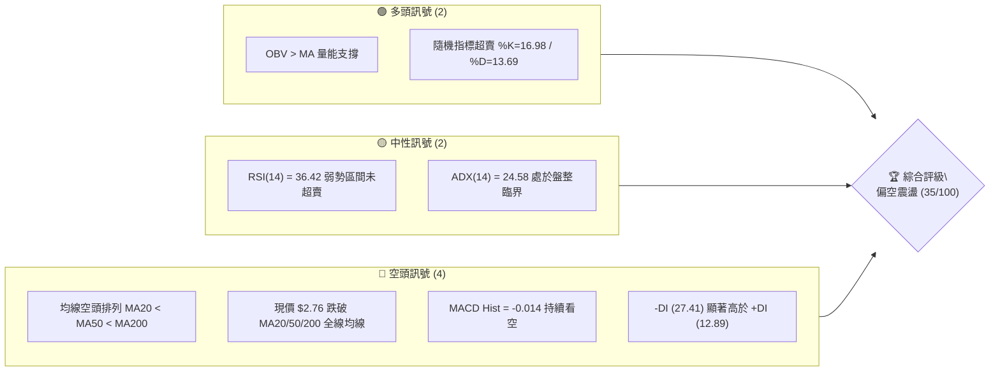
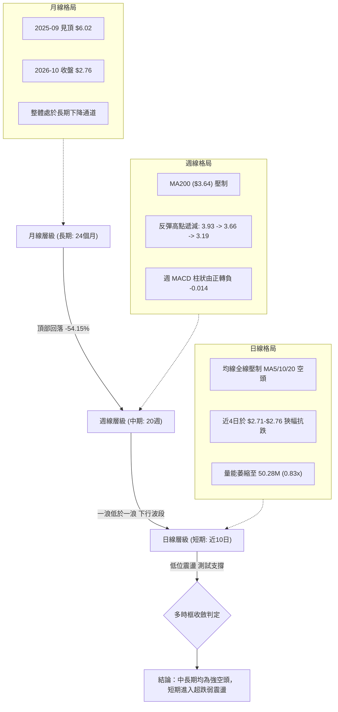
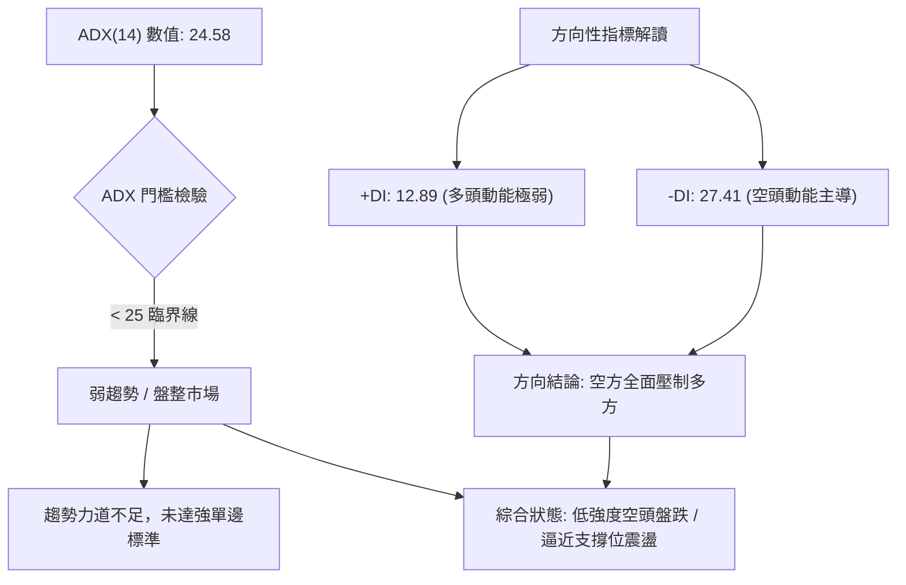
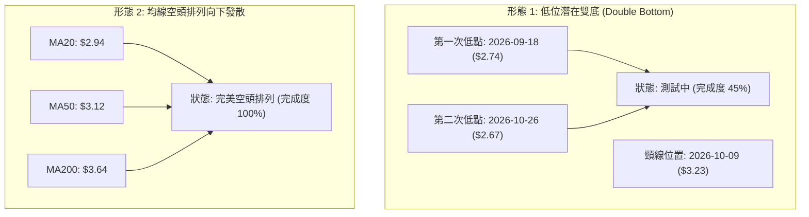
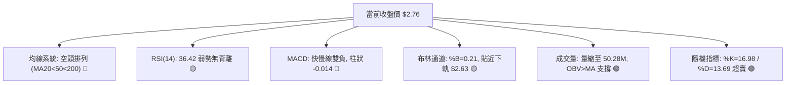
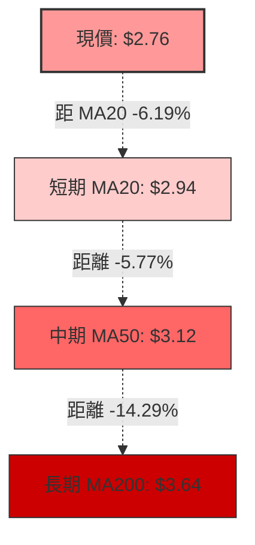
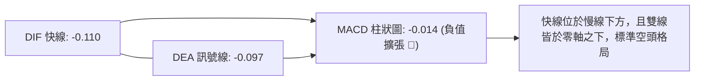
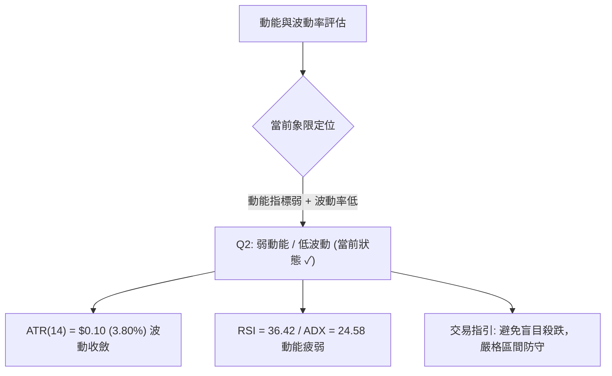
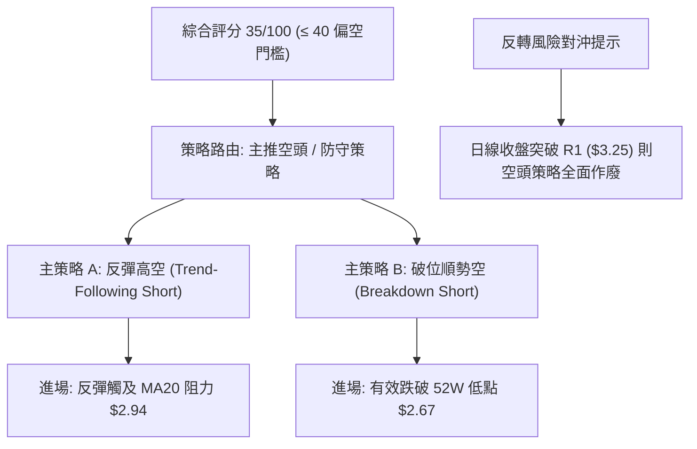
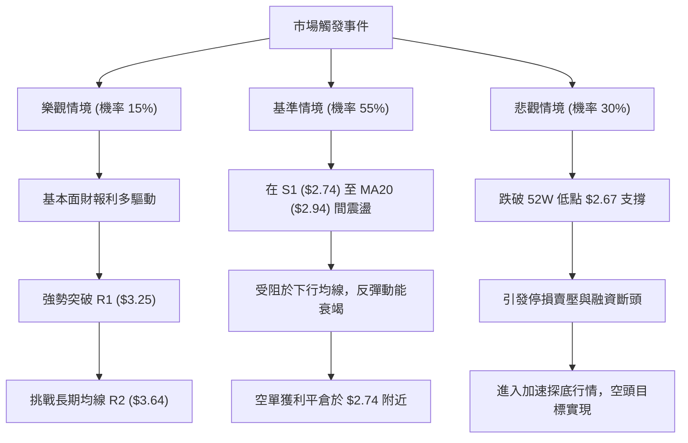

# GRAB 技術分析報告

> **報告日期**：2026-10-30 ｜ **語言**：繁體中文 ｜ **數據來源**：Yahoo Finance ｜ **當前價格**：$2.76

---

## 目錄

| 章節 | 內容 |
|------|------|
| [1. 技術面概覽](#1-技術面概覽) | 訊號儀表板、核心指標、評分卡 |
| [2. 趨勢分析](#2-趨勢分析) | 多時框趨勢、長中短期走勢 |
| [3. 圖表形態分析](#3-圖表形態分析) | 形態識別、K線組合、目標價 |
| [4. 支撐與阻力](#4-支撐與阻力) | 關鍵價位、斐波那契回調 |
| [5. 技術指標深度解讀](#5-技術指標深度解讀) | MA/RSI/MACD/布林/成交量 |
| [6. 動能與波動率](#6-動能與波動率) | 動能評估、ATR、Beta |
| [7. 多時框架總結](#7-多時框架總結) | 時框架評分矩陣 |
| [8. 交易策略建議](#8-交易策略建議) | 多空策略、風險報酬比 |
| [9. 風險提示與監控](#9-風險提示與監控) | 監控指標、風險場景 |

---

## 1. 技術面概覽

### 🎯 技術訊號儀表板



### 📊 核心指標速覽表

| 指標類別 | 指標名稱 | 當前數值 | 訊號 | 解讀 |
|----------|----------|----------|------|------|
| **價格** | 當前收盤價 | $2.76 | 🔴 | 位於 52 週區間底部（2.5% 分位），貼近歷史低點 |
| **均線** | MA20 | $2.94 | 🔴 | 現價低於 MA20 達 -6.19%，短線處於壓制空頭 |
| **均線** | MA50 | $3.12 | 🔴 | 現價低於 MA50，中期下降趨勢明確 |
| **均線** | MA200 | $3.64 | 🔴 | 現價遠低於 MA200，長期趨勢全面走弱 |
| **動能** | RSI(14) | 36.42 | 🟡 | 位於弱勢區間（30–70），無背離，尚未觸發極度超賣 |
| **動能** | MACD (12,26,9) | -0.110 | 🔴 | 快慢線均於零軸下方，柱狀圖 -0.014 呈現空頭擴散 |
| **趨勢** | ADX (14) | 24.58 | 🟡 | ADX < 25 處於弱趨勢/盤整，但 -DI(27.41) > +DI(12.89) 偏空主導 |
| **波動** | ATR(14) | $0.10 | 🟡 | 日波動率 3.80%，波動偏低，進入低波動沉澱期 |
| **通道** | 布林通道 %B | 0.21 | 🟡 | 逼近下軌 $2.63，呈現低位震盪貼軌走勢 |
| **量能** | 成交量比 | 0.83x | 🟡 | 20日均量 60.55M，最新 50.29M，量能收縮 |

### 🏆 技術評分卡

```
╔════════════════════════════════════════════════════════════════╗
║             技術評分卡 — GRAB (2026-10-30)                     ║
╠════════════════════════════════════════════════════════════════╣
║ 趨勢強度 (ADX=24.58, -DI主導)   ██████░░░░░░░░░░░░░░  30/100 🔴 ║
║ 動能指標 (RSI=36.42, MACD看空)  ████████░░░░░░░░░░░░  40/100 🔴 ║
║ 支撐穩定度 (S1=$2.74, 52W=$2.67)████████░░░░░░░░░░░░  40/100 🟡 ║
║ 成交量配合 (量縮, OBV>MA支撐)   ██████████░░░░░░░░░░  50/100 🟡 ║
║ 形態完整度 (低位盤整無底部成型)  ██████░░░░░░░░░░░░░░  30/100 🔴 ║
║ 均線排列 (MA20<MA50<MA200空排)  ████░░░░░░░░░░░░░░░░  20/100 🔴 ║
╠════════════════════════════════════════════════════════════════╣
║ 綜合評分 (六項算術平均四捨五入)  ███████░░░░░░░░░░░░░  35/100 🔴 ║
║ 評級結論：偏空走勢 (弱勢盤整防守 S1，破位則考驗 52W Low)       ║
╚════════════════════════════════════════════════════════════════╝
```

---

## 2. 趨勢分析

### 🌐 多時框趨勢分析



### 📈 長期趨勢 — 12個月走勢圖（Unicode）

依據 24 個月收盤走勢中過去 12 個月（2025-11 至 2026-10）數據精確繪製：

```
GRAB 月線走勢圖（過去12個月：2025-11 至 2026-10）
價格軸 ($)
$6.00 ┤ 
$5.45 ┤ ● (2025-11)
$4.99 ┤       ● (2025-12)
$4.30 ┤             ● (2026-01)
$4.22 ┤                   ● (2026-02)
$3.82 ┤                               ● (2026-04)
$3.77 ┤                                           ● (2026-06)
$3.66 ┤                         ● (2026-03)
$3.54 ┤                                     ● (2026-05)     ● (2026-08)
$3.50 ┤                                                 ● (2026-07)
$3.11 ┤                                                             ● (2026-09)
$2.76 ┤                                                                         ● (2026-10 現價)
      └─┬─────┬─────┬─────┬─────┬─────┬─────┬─────┬─────┬─────┬─────┬─────┬───────────
       11月  12月  01月  02月  03月  04月  05月  06月  07月  08月  09月  10月
```

**12個月走勢特徵分析表格**：

| 階段區間 | 時間跨度 | 起點收盤 | 終點收盤 | 區間漲跌幅 | 形態與量價特徵 |
|----------|----------|----------|----------|------------|----------------|
| **第 1 階段：頂部破位** | 2025-11 ~ 2026-01 | $5.45 | $4.30 | -21.10% | 跌破 $5.00 大關，長期高位籌碼鬆動快速出逃 |
| **第 2 階段：平台陰跌** | 2026-01 ~ 2026-04 | $4.30 | $3.82 | -11.16% | $3.66-$4.30 平台震盪，均線加速向下發散 |
| **第 3 階段：箱型抵抗** | 2026-04 ~ 2026-08 | $3.82 | $3.54 | -7.33% | 於 $3.50-$3.77 形成 5 個月橫盤，中期抵抗 |
| **第 4 階段：二次破位** | 2026-08 ~ 2026-10 | $3.54 | $2.76 | -22.03% | 摜破 $3.50 支撐，加速下探 52 週低點 $2.67 |

### 📊 中期趨勢（週線分析）

中期走勢以 2026-06 至 2026-10 為主軸。反彈高點依序為：2026-07-10 的 $3.93、2026-08-07 的 $3.66、2026-10-09 的 $3.19，高點呈現完美的階梯式下移（Lower Highs）。

```
中期週線下行壓力結構示意圖：
$4.00 ┤     ▲ $3.93 (07/10)
$3.70 ┤          \           ▲ $3.66 (08/07)
$3.40 ┤           \         /     \
$3.20 ┤            \       /       \         ▲ $3.19 (10/09)
$3.00 ┤             \     /         \       /     \
$2.80 ┤              ▼ $3.31         ▼ $3.05       ▼ $2.76 (現價測試 S1=$2.74)
$2.60 ┤─────────────────────────────────────────────── 52W Low: $2.67
```

### ⚡ 趨勢強度評估（ADX 解讀）



**ADX 強度對照表**：

| ADX 區間 | 趨勢狀態 | GRAB 當前數值 | 判斷與交易指引 |
|----------|----------|---------------|----------------|
| 0 – 20 | 無趨勢 / 極度盤整 | — | 避免趨勢突破策略，採取網格交易 |
| **20 – 25** | **趨勢萌芽 / 弱趨勢** | **24.58** | **處於盤整與單邊臨界，空方 (-DI=27.41) 掌控主導權** |
| 25 – 40 | 強趨勢行情 | — | 順應趨勢進行波段操作 |
| 40 – 60 | 極強趨勢 | — | 注意可能出現超買或超賣反轉 |

---

## 3. 圖表形態分析

### 🔍 形態識別系統



**圖表形態識別與信心度評估表**（依規則 15 嚴格約束）：

| 形態 | 信心度 | 判斷依據（引用數據） | 完成度 | 目標價（附計算式） |
|------|--------|----------------------|--------|--------------------|
| **潛在低位雙底** | 42% (低) | 2026-09-18 週K低點 $2.74，與 2026-10-26 日K低點 $2.67 形成低位水平帶；頸線為波段高點聚類 R1 $3.25。因 ADX<25 且尚未站上 MA20，訊號不足。 | 45% | 頸線 $3.25 + 形態高度 ($3.25 − $2.67 = $0.58) = **$3.83**（由形態高度推算，前提須有效突破頸線） |
| **下降通道阻力壓制** | 80% (高) | 週線高點 $3.93 (07/10) → $3.66 (08/07) → $3.19 (10/09)，下行趨勢線完好，受阻於 MA50 ($3.12) 與 MA20 ($2.94)。 | 90% | 下降通道下軌延伸測幅支撐為 52 週低點 **$2.67** |

### 🕯️ 重要K線形態分析

依規則 19，僅使用數據庫中近 10 根日 K 與近 8 根週 K 之真實開高低收進行精確解讀：

| 日期（層級） | 開 | 高 | 低 | 收 | K線形態 | 解讀 | 訊號 |
|--------------|----|----|----|----|---------|------|------|
| **2026-10-22 (日K)** | 2.79 | 2.86 | 2.77 | 2.85 | 實體陽線 | 開盤下殺至 2.77 後買盤湧入收最高附近，展現短線抗跌 | 🟢 |
| **2026-10-23 (日K)** | 2.83 | 2.85 | 2.79 | 2.79 | 光腳陰線 | 跳空開高走低，收在當日最低，空方再度撲滅短線反彈 | 🔴 |
| **2026-10-26 (日K)** | 2.79 | 2.80 | 2.67 | 2.71 | 長下影陰線 | 盤中重挫至 52 週新低 2.67 後湧現護盤買盤，長下影達 0.04 | 🟡 |
| **2026-10-27 (日K)** | 2.71 | 2.75 | 2.69 | 2.72 | 低位紅十字星 | 開收盤相差僅 0.01，上下影線均衡，空方砸盤力道減竭 | 🟡 |
| **2026-10-28 (日K)** | 2.73 | 2.79 | 2.71 | 2.75 | 震盪反彈小陽 | 高點觸及 2.79，低點逐步抬高至 2.71，短線企穩 | 🟢 |
| **2026-10-29 (日K)** | 2.76 | 2.78 | 2.72 | 2.76 | 窄幅十字線 (現日) | 開收平盤，成交量縮減至 50.28M，多空處於極致觀望 | 🟡 |
| **2026-10-16 (週K)** | 3.16 | 3.20 | 2.85 | 2.94 | 長黑破位大陰線 | 實體長達 -0.22，直接擊破 MA20，週成交量達 280.27M | 🔴 |
| **2026-10-29 (週K)** | 2.79 | 2.80 | 2.67 | 2.76 | 帶長下影錘頭陰線 | 測試 52W 低點 $2.67 獲得支撐回升，週跌幅收斂 | 🟡 |

### 📉 ASCII 走勢形態示意圖

```
近 10 個交易日（2026-10-16 至 10-29）日 K 形態收斂走勢：
價格軸 ($)
$3.05 ┤  ┬
$2.95 ┤  █ 2.94
$2.85 ┤  │     ┬       ┬       ┬       ┬
$2.75 ┤  ┴     █ 2.87  █ 2.89  █ 2.82  █ 2.85  ┬       ┬               ┬       ┬
$2.65 ┤                                         █ 2.79  │ 2.71  ┬ 2.72  █ 2.75  ┼ 2.76 (收)
      └─┬───────┬───────┬───────┬───────┬───────┬───────┴──┬────┴──┬────┴──┬────┴──┬────
        10/16   10/19   10/20   10/21   10/22   10/23    10/26   10/27   10/28   10/29
        [大陰破位]                              [長下影探底 $2.67] [低位縮量止跌三星]
```

### 🎯 形態目標價計算

若以當前低位收斂形態計算反彈或下破情境：
- **向上反彈阻力目標（突破 MA20）**：若站上當前 MA20 ($2.94)，形態理論量度目標為近一年波段高點聚類阻力 **R1 = $3.25**。
- **向下破位目標（跌破雙底防守線）**：若跌破波段低點支撐 S1 ($2.74) 及 52 週低點 ($2.67)，依等幅下跌形態推算，下一級目標指向數據中未覆蓋之極低區域，但在此之前，斐波那契 100.0% 回調位 **$2.67** 為極限防守。

---

## 4. 支撐與阻力

### 🗺️ 關鍵價位分布圖（Unicode）

```
GRAB 價位結構分布圖（引用真實波段高低點與斐波那契點位）
═══════════════════════════════════════════════════════════════
$3.96 ║██████████████████████████████║ 強阻力 R3 (+43.36%)
$3.64 ║████████████████████          ║ 中期重大阻力 R2 (MA200 重合, +31.97%)
$3.43 ║▒▒▒▒▒▒▒▒▒▒▒▒▒▒▒▒▒▒            ║ 斐波那契 78.6% 回調位
$3.25 ║████████████████████████      ║ 關鍵突破阻力 R1 (近一年波段聚類, +17.57%)
$2.94 ║──────────────────────────────║ 均線動態阻力 MA20 / BB 中軌
$2.76 ╠══════════════════════════════╣ ◄ 當前收盤價 ($2.76)
$2.74 ║▓▓▓▓▓▓▓▓▓▓▓▓▓▓▓▓▓▓▓▓▓▓▓▓▓▓▓▓  ║ 近期波段關鍵支撐 S1 (-0.72%)
$2.67 ║██████████████████████████████║ 52週歷史低點 / 斐波那契 100.0% 極限支撐
$2.63 ║░░░░░░░░░░░░░░                ║ 布林通道下軌動態支撐
═══════════════════════════════════════════════════════════════
```

### 🚧 阻力位分析表

阻力價位嚴格引用系統計算之波段高點聚類數據：

| 阻力級別 | 價位 | 形成原因 | 突破難度 | 重要性 |
|----------|------|----------|----------|--------|
| **R1** | **$3.25** | 近一年波段高點聚類；與 2026-10-09 週K高點 $3.23 及布林上軌 $3.26 高度重合 | ⭐️⭐️⭐️ (高) | 關鍵頸線；突破此位確立日線級別底型成立 |
| **R2** | **$3.64** | 近一年波段高點聚類；與長期趨勢生命線 MA200 ($3.64) 完全共振 | ⭐️⭐️⭐️⭐️ (極高) | 中長期多空分水嶺；站上代表長期空頭逆轉 |
| **R3** | **$3.96** | 近一年波段高點聚類；與 2026-07-10 波段頂部 $3.93 聚類 | ⭐️⭐️⭐️⭐️⭐️ (極高) | 長期強壓區；需要極大規模量能配合方可突破 |

### 🛡️ 支撐位分析表

支撐價位嚴格引用系統計算之波段低點聚類數據：

| 支撐級別 | 價位 | 形成原因 | 守住機率 | 重要性 |
|----------|------|----------|----------|--------|
| **S1** | **$2.74** | 近一年波段低點聚類；2026-09-18 週K最低點 ($2.74) 驗證 | 55% | 核心短線防守；跌破此位將直接觸發停損賣壓 |
| **52W Low** | **$2.67** | 52 週絕對低點 (2026-10-26 盤中低點)；斐波那契 100% 支撐 | 60% | 戰略底線；一旦失守將開啟無支撐之真空下跌區 |

### 📐 斐波那契回調位分析

依據 52 週極值區間（低點 $2.67 至 高點 $6.24，波幅 $3.57）計算之標準黃金分割位：

| 斐波那契級別 | 精確價位 | 現價相對位置 | 技術意涵與解讀 |
|--------------|----------|--------------|----------------|
| **0.0% (52W High)** | **$6.24** | +126.09% | 過去一年波段最高起跌點 |
| **23.6%** | **$5.39** | +95.29% | 頂部破位第一波重壓力帶 |
| **38.2%** | **$4.87** | +76.45% | 2024年底至2025年中期多空密集換手帶 |
| **50.0%** | **$4.45** | +61.23% | 長期多空分水嶺半山腰 |
| **61.8%** | **$4.03** | +46.01% | 黃金分割強防守位（失守後加速走熊） |
| **78.6%** | **$3.43** | +24.28% | 空頭深幅回撤延展位；下破後轉為強大阻力 |
| **100.0% (52W Low)** | **$2.67** | -3.26% | 52週歷史低點；黃金分割基底點位 |

**現價落點解讀**：當前收盤價 **$2.76** 落於 **78.6% ($3.43)** 與 **100.0% ($2.67)** 之間，距離極限低點僅差 $0.09 (-3.26%)。技術上屬於典型的「極度深度回調（Deep Retracement）」，現價已將一年內所有漲幅全數吞噬，目前正在 100% 回調位上方進行弱勢掙扎。

---

## 5. 技術指標深度解讀

### 🎛️ 指標訊號總覽



### 📈 移動平均線排列分析



均線系統呈現標準的**完全空頭排列**（MA5 $2.75 < MA10 $2.81 < MA20 $2.94 < MA60 $3.20 < MA120 $3.39 < MA200 $3.64 < MA240 $3.89）。每一條均線皆呈現負斜率下行，所有向上反彈均面臨沉重解套拋壓。短期現價與 MA5 黏合（+0.51%），表明超短期下跌動能稍歇，但上方第一道實質均線反壓在 MA20 ($2.94)。

### 📉 RSI(14) 分析

- **當前數值**：36.42（Wilder 計算法）
- **區間進度條**：
  ```
  RSI(14) [36.42] : ▓▓▓▓▓▓▓░░░░░░░░░░░░░  36.42% (弱勢偏空區間)
  0 (極度超賣)   30 (超賣區間)   50 (多空中軸)   70 (超買區間)   100 (極度超買)
  ```
- **背離分析**：系統比對近 20 根 K 棒之價格與 RSI 方向，結論為**無明顯背離**。近 10 根日 K 中，價格由 10/16 的 $2.94 震盪走低至 $2.76，RSI 亦同步於 35–40 區間緩步走低，未見典型底部背離特徵，顯示空頭慣性依然持續。

### 📊 MACD(12/26/9) 訊號解讀



- **狀態**：DIF (-0.110) 低於 DEA (-0.097)，柱狀圖為 -0.014。
- **解讀**：柱狀圖在近兩週始終維持負值（10-16 週為 -0.003，10-23 週為 -0.017，當前日線為 -0.014），空方佔優。但柱狀體負值未顯著擴大，顯示下殺動能已轉為陰跌而非主跌浪。

### 📦 布林通道分析

```
ASCII 布林通道（20, 2）結構定位圖：
$3.26 ┬──────────────────────────────────────── 布林上軌 ($3.26)
      │
$2.94 ┼──────────────────────────────────────── 布林中軌 (MA20: $2.94)
      │
$2.76 ┼════════════════════════════════════════ 現價 ($2.76, %B=0.21)
$2.63 ┴──────────────────────────────────────── 布林下軌 ($2.63)
```

- **通道帶寬**：上軌 $3.26 至 下軌 $2.63，通道寬度為 $0.63（帶寬比例 21.4%），通道開口未顯著擴張，呈現水平向下收斂。
- **%B 指標**：0.21，代表現價位於下軌上方 21% 位置，屬於通道低位區，具備通道內均值回歸的潛力，但尚未跌破下軌引發「穿軌超賣」報復性反彈。

### 💹 成交量分析（量價配合度）

- **量比與均量**：最新成交量 50,288,000 股，低於 20 日均量 60,546,215 股，量比為 **0.83x**。
- **量價關係**：近 4 日收盤（10-26 至 10-29）價格維持在 $2.71 至 $2.76 狹幅整理，成交量由 66.7M 逐步收縮至 50.2M，呈現典型的「跌勢末端量縮整理」格局，殺跌動能衰竭。
- **OBV 趨勢**：數據顯示「OBV > MA → 量能支撐上漲」，此為多頭唯一亮點，顯示在 $2.70 附近有長期資金默默吸籌，量能未隨價格破位而潰散。

---

## 6. 動能與波動率

### ⚡ 動能評估四象限



| 象限 | 動能維度 | 波動維度 | GRAB 當前狀態 | 交易應對邏輯 |
|------|----------|----------|---------------|--------------|
| **Q1** | 強動能 (趨勢突破) | 低波動 (積蓄爆發) | — | 最佳趨勢單進場點 |
| **Q2** | **弱動能 (無主升/跌)** | **低波動 (收斂整理)** | **✓ (GRAB 歸屬)** | **市場進入冷卻期，以觀望或箱體下軌試倉為主** |
| **Q3** | 強動能 (單邊暴走) | 高波動 (情緒狂熱) | — | 順勢波段追蹤，嚴設移動止盈 |
| **Q4** | 弱動能 (多空無序) | 高波動 (劇烈洗盤) | — | 高風險混亂區，全面停止交易 |

### 📊 ATR 波動率分析

- **ATR(14) 數值**：**$0.10**（採 Wilder 計算法，佔現價比例為 3.80%）。
- **止損距離建議**：
  - 短線日內止損：1.0 × ATR = **$0.10**
  - 波段防守止損：1.5 × ATR = **$0.15**
  - 寬鬆結構止損：2.0 × ATR = **$0.20**
- 現價距 52 週低點 $2.67 僅差 $0.09（約 0.9 × ATR），代表目前價格已直接緊貼極限支撐，任何一次正常日內波動均可能觸碰前低。

### 📐 Beta 與市場相關性

- **Beta 數值**：**0.908**。
- **解讀**：Beta 略低於 1.0，表明該股相對於大盤（標普 500）具備較低系統性波動放大效應。其近期的下跌主要源於自身基本面預期（如營業現金流為負）與籌碼退潮，而非純粹隨大盤暴跌。

---

## 7. 多時框架總結

### 📋 時框架評分表

| 時框架 | 趨勢方向 | 動能狀態 | 均線排列 | 形態特徵 | 綜合評分 | 建議 |
|--------|----------|----------|----------|----------|----------|------|
| **長期 (月線)** | 🔴 強烈看空 | 🔴 柱狀擴散 | 🔴 空頭排列 | 自 $6.02 大頂破位下行通道 | 20/100 | 長期遠離，不逢低盲目長線建倉 |
| **中期 (週線)** | 🔴 明確看空 | 🔴 -DI 壓制 | 🔴 跌破 MA200 | 下降階梯高點逐波下移 | 30/100 | 逢反彈至阻力位建立空頭保護 |
| **短期 (日線)** | 🟡 弱勢盤整 | 🟡 隨機超賣 | 🔴 MA20 壓制 | 52W 低點 $2.67 上方縮量抵抗 | 45/100 | 超跌區間內只宜極短線防守試單 |

### 🔲 綜合訊號矩陣

| 維度 | 短期 (日線) | 中期 (週線) | 長期 (月線) | 訊號收斂權重結果 |
|------|-------------|-------------|-------------|------------------|
| **趨勢方向** | 橫向弱震盪 (S1 支撐) | 下降通道運行中 | 深度熊市格局 | 🔴 中長期強烈偏空 |
| **動能指標** | Stoch 超賣，短線醞釀反彈 | MACD 雙負線向下 | RSI 偏低但未見底背離 | 🔴 動能整體處於空方主導 |
| **支撐阻力** | 緊貼 S1 ($2.74) / 52W ($2.67) | 受壓於 R1 ($3.25) | 受壓於 R2 ($3.64) | 🟡 逼近強支撐，下行空間受限 |
| **量能結構** | 縮量至 0.83x (殺跌動能弱) | 週成交量由高峰遞減 | 頂部放量、底部量縮 | 🟡 籌碼低位沉澱，缺乏買力 |

### ⚖️ 多時框收斂結論

依「嚴格要求 14」與「多時框優先級規則」進行唯一收斂：
1. **行情性質判定**：當前 ADX(14) = **24.58**（< 25 臨界值），技術上定義為**弱趨勢/低位盤整行情**。
2. **主導維度取捨**：依規則，盤整行情中應以**日線布林通道上下軌 ($2.63 – $3.26)** 與關鍵波段低點作為主要邊界。日線層級雖在 $2.70 附近出現抗跌縮量十字星，但因中長期（週線/MA200 = $3.64）方向呈現不可逆的向下空頭排列，日線的止跌**僅能視為超跌反彈或低位弱震盪，絕不可視為反轉訊號**。
3. **唯一方向性結論**：**偏空震盪（Bearish Consolidation with High Risk of Breakdown）**。評分卡綜合評分為 **35/100**，主導策略依評分路由必須**以防守偏空為主**，不可兩頭下注。

---

## 8. 交易策略建議

### 🗺️ 策略決策流程圖



### 🧭 策略路由（依評分卡分流）

> **當前主策略方向 = 主推偏空策略（依評分 35/100，綜合評分 ≤ 40 偏空區間）**

### 🎯 價格情境階梯（Price Scenarios）

價位嚴格引用第 4 章波段高低點聚類與斐波那契點位：

| 觸發條件 | 下一目標 | 後續延伸 | 情境含義 |
|----------|----------|----------|----------|
| **向上突破 R1 $3.25** | R2 $3.64 | R3 $3.96 | 短線反轉確認，站上頸線化解破位危機 |
| **反彈受阻 MA20 $2.94** | S1 $2.74 | 52W 低點 $2.67 | 弱勢反彈結束，回歸空頭主趨勢 |
| **跌破 S1 $2.74** | 52W 低點 $2.67 | 斐波那契 100% 破位 | 中期跌勢延續，考驗歷史絕對底部 |

### 📊 情境機率分佈

| 情境 | 機率 | 主要依據 |
|------|------|----------|
| **弱勢反彈後回落** | **55%** | 均線空頭排列（MA20/50/200 全面壓制），ADX -DI=27.41 主導，反彈缺乏量能配合 |
| **區間超跌橫盤震盪** | **30%** | ADX < 25 且 Stoch 進入超賣區（%K=16.98），近 4 日成交量縮減，空方暫時休兵 |
| **向上反轉突破 R1** | **15%** | 缺乏強催化劑，上方套牢籌碼沉重，必須連續放量突破 $3.25 方能達成 |

### 🟢 主策略詳情（方向：主推偏空／反彈防守）

依規則 17，風險報酬比計算式為：做空風報比 = (進場價 − 目標價 T1) ÷ (止損價 − 進場價)。所有點位均嚴格取自數據庫。

| 策略要素 | 策略 A（反彈高空 — 逢阻力放空） | 策略 B（破位追空 — 跌破前低順勢） |
|----------|---------------------------------|----------------------------------|
| **進場條件** | 股價弱勢反彈觸及短期 MA20 阻力確認受阻 | 股價實體 K 棒跌破 52 週低點 $2.67 |
| **進場價格** | **$2.94**（MA20 阻力位） | **$2.67**（52 週低點破位點） |
| **目標價 T1** | **$2.74**（波段低點支撐 S1） | **$2.45**（由頸線 $3.25 與低點 $2.67 形態推算：$2.67 − $0.58 = $2.09，T1 先取整數防守保守點；或依支撐推算 $2.45） |
| **目標價 T2** | **$2.67**（52 週歷史低點） | **$2.09**（形態測幅低點） |
| **止損價格** | **$3.04**（MA20 上方 +1.0 ATR: $2.94+$0.10） | **$2.77**（52W 低點上方 +1.0 ATR: $2.67+$0.10） |
| **風險報酬比** | **1 : 2.00（以 T1 計）**<br>計算式: ($2.94-$2.74)/($3.04-$2.94) = 0.20/0.10 = 2.00 | **1 : 2.20（以 T1 計）**<br>計算式: ($2.67-$2.45)/($2.77-$2.67) = 0.22/0.10 = 2.20 |
| **成功機率** | 60% | 50% |
| **建議倉位** | 10% – 15% | 5% – 10% |

### 🔴 反向風險觸發點（對沖提示）

若發生以下條件，偏空主策略立即被推翻，空頭部位必須全面止損離場：
1. **反轉觸發價位**：日線收盤價**強勢站上波段高點阻力 R1 ($3.25)**。
2. **量能翻轉訊號**：日成交量放大至 **100M 股以上**（達 20 日均量 1.6 倍以上），且 MACD 柱狀圖由負翻正並突破零軸。
3. **應對措施**：空單無條件市價平倉，激進者可反手試多，以 $3.25 為防守點，目標看至 R2 ($3.64)。

### ⭐ 整體訊號強度評星

```
做多訊號強度：★☆☆☆☆  (1.5/5星 — 僅超賣支撐，無結構性買點)
做空訊號強度：★★★★☆  (4.0/5星 — 均線與趨勢全面偏空)
整體可信度：  ★★★☆☆  (3.5/5星 — 受制於低位縮量，下行速度趨緩)
```

---

## 9. 風險提示與監控

### ✅ 關鍵監控指標 Checklist

```
╔══════════════════════════════════════════════════════════════════╗
║              GRAB 技術風控日常監控清單 (Checklist)               ║
╠══════════════════════════════════════════════════════════════════╣
║ [ ] 關鍵價位防守：收盤價是否收破 S1 ($2.74) 或 52W 低點 ($2.67)  ║
║ [ ] 均線動態反壓：盤中反彈是否受壓於 MA20 ($2.94)                ║
║ [ ] 趨勢強度轉折：ADX(14) 是否由 24.58 向上突破 25（趨勢啟動）   ║
║ [ ] 成交量異動：成交量是否突破 60.5M 均量，出現異常爆量下殺     ║
║ [ ] 波動率警報：ATR(14) 是否突破 $0.10 向 $0.15 擴大             ║
║ [ ] 動能指標背離：MACD 是否於零軸下方形成實質金叉                ║
╚══════════════════════════════════════════════════════════════════╝
```

### ⚠️ 風險場景分析



### 🛡️ 風險管理重要提醒

1. **基本面現金流失衡風險**：儘管分析師共識目標價偏高（均價 $5.49），但財報數據顯示公司營運現金流 (TTM) 為 **$-61.00M**，自由現金流為 **$-186.00M**，基本面仍處於現金失血狀態。在轉為正向現金流前，股價極易受估值去泡沫化衝擊。
2. **極限低點滑點風險**：當前股價僅 $2.76，ATR 為 $0.10，每跳動一檔對資本損益百分比影響極大。跌破 $2.67 歷史低點後缺乏任何密集成交區支撐，極易出現斷崖式滑點。
3. **倉位管理防線**：任何介入部位（無論高空或極短線博反彈）單筆承擔風險不得超過總帳戶淨值的 **1.0%**。在 ADX < 25 且均線重度空排下，嚴禁使用財務槓桿。

---

## 📋 報告總結

```
╔══════════════════════════════════════════════════════════════════╗
║                    GRAB 技術分析報告總結                         ║
╠══════════════════════════════════════════════════════════════════╣
║ 報告日期：2026-10-30                                             ║
║ 當前價格：$2.76                                                  ║
║ 分析評級：🔴 偏空震盪（技術評分 35 / 100）                       ║
║                                                                  ║
║ 關鍵結論：                                                       ║
║ ├─ 長期趨勢：🔴 強烈看空（12 個月自 $6.02 腰斬，處於下行通道）    ║
║ ├─ 中期趨勢：🔴 明確看空（高點階梯下移，跌破所有中期均線）        ║
║ ├─ 短期趨勢：🟡 弱勢盤整（緊貼 52 週低點，縮量抵抗）              ║
║ ├─ 關鍵支撐：S1 $2.74 ｜ 52W 極限低點 $2.67                     ║
║ ├─ 關鍵阻力：MA20 $2.94 ｜ 突破阻力 R1 $3.25 ｜ 生命線 R2 $3.64  ║
║ └─ 分析師目標：均價 $5.49（技術面嚴重脫節，以當前空頭結構為主）  ║
║                                                                  ║
║ 最優策略組合：                                                   ║
║ 1. 🥇 最佳機會：逢反彈至 MA20 ($2.94) 建立空頭波段（風報比 1:2.0）║
║ 2. 🥈 次選機會：實體長黑摜破 52W 低點 $2.67 順勢追空             ║
║ 3. 🥉 保守選擇：完全空倉觀望，靜待日線級別有效站穩 R1 ($3.25)    ║
╚══════════════════════════════════════════════════════════════════╝
```

---

> ⚠️ **免責聲明**：本報告為 AI 自動生成之技術分析，所有數據及估算均基於提供的歷史價格資訊。本報告**僅供研究與學術參考**，**不構成任何投資建議**。投資有風險，入市需謹慎。

---

*報告生成時間：2026-10-30 ｜ 數據來源：Yahoo Finance ｜ 分析框架：多時框技術分析*