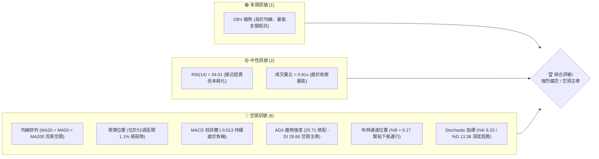
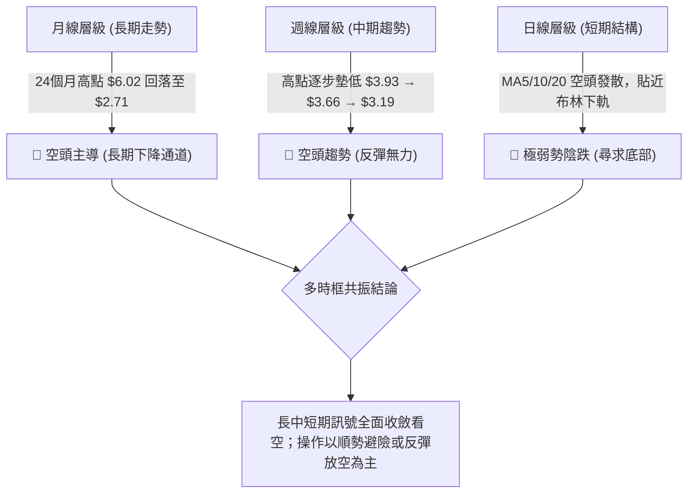
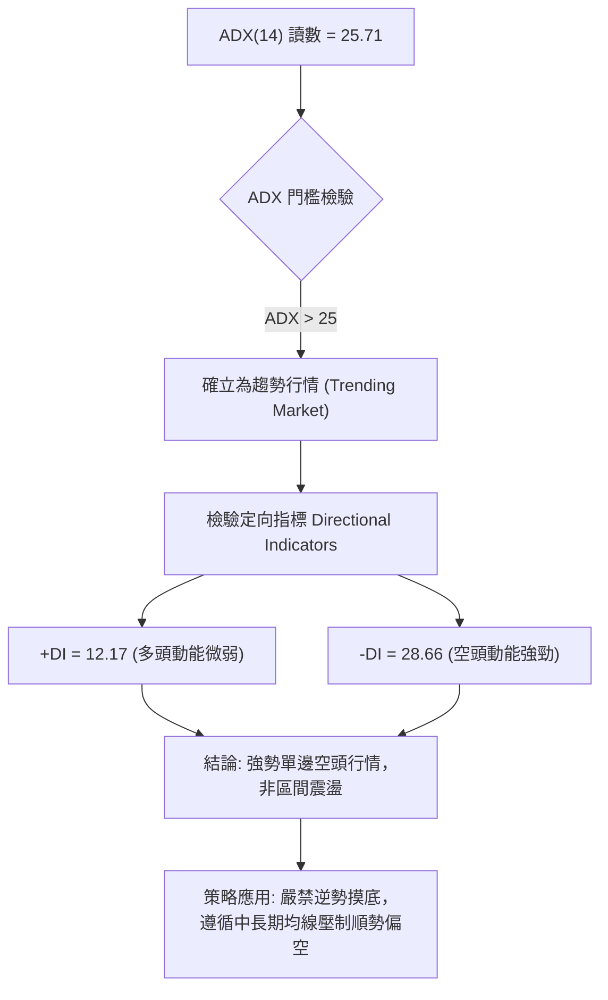
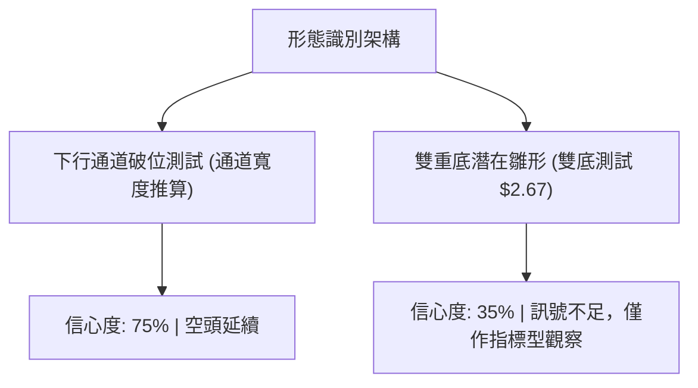
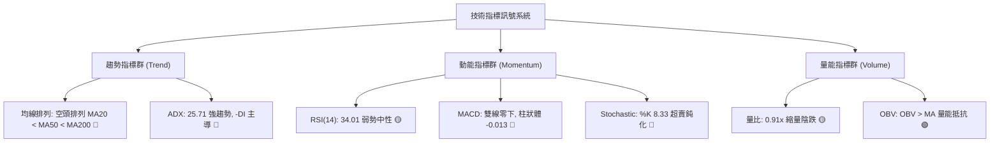
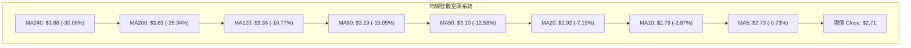
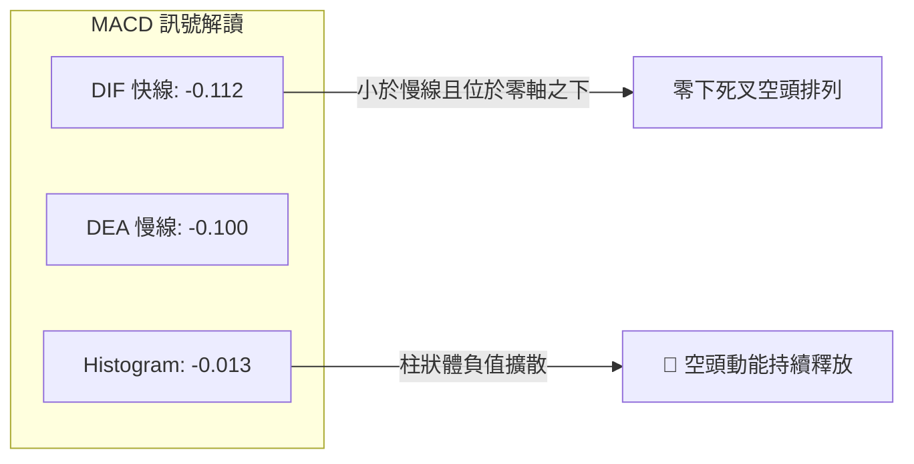
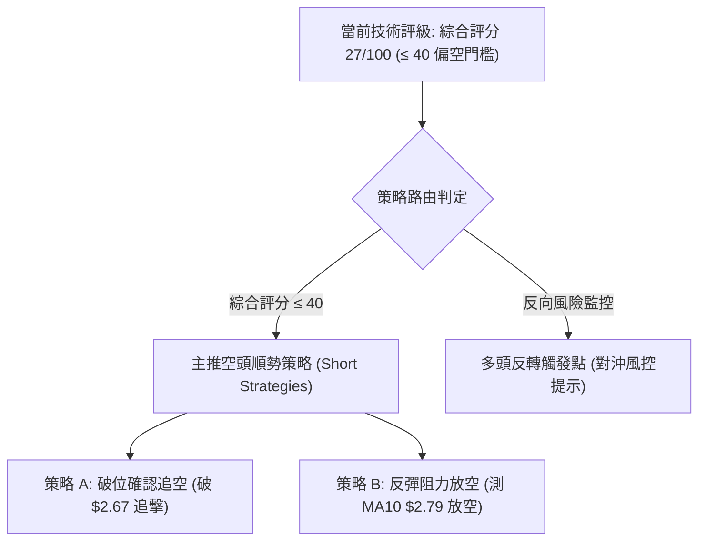
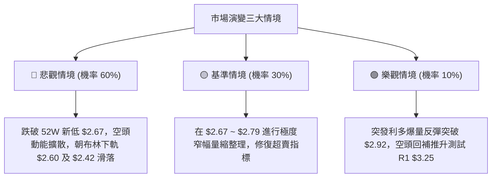

# GRAB 技術分析報告

> **報告日期**：2026-10-31 ｜ **語言**：繁體中文 ｜ **數據來源**：Yahoo Finance ｜ **當前價格**：$2.71 USD

---

## 目錄

| 章節 | 內容 |
|------|------|
| [1. 技術面概覽](#1-技術面概覽) | 訊號儀表板、核心指標、評分卡 |
| [2. 趨勢分析](#2-趨勢分析) | 多時框趨勢、長中短期走勢、ADX強趨勢解讀 |
| [3. 圖表形態分析](#3-圖表形態分析) | 形態識別、信心度評估、近10日/8週K線組合 |
| [4. 支撐與阻力](#4-支撐與阻力) | 關鍵價位結構、波段高點阻力、斐波那契回調 |
| [5. 技術指標深度解讀](#5-技術指標深度解讀) | 均線系統、RSI、MACD、布林通道、量價OBV |
| [6. 動能與波動率](#6-動能與波動率) | 動能四象限、ATR波幅止損、Beta市場聯動 |
| [7. 多時框架總結](#7-多時框架總結) | 時框架矩陣、ADX趨勢收斂規則 |
| [8. 交易策略建議](#8-交易策略建議) | 策略路由分流、主推空頭策略、情境階梯 |
| [9. 風險提示與監控](#9-風險提示與監控) | 關鍵監控清單、情境推演、風控紀律 |
| [📋 報告總結](#-報告總結) | 核心結論與策略配置綜合摘要 |

---

## 1. 技術面概覽

### 🎯 技術訊號儀表板



### 📊 核心指標速覽表

| 指標類別 | 指標名稱 | 當前數值 | 訊號 | 解讀 |
|:---|:---|:---|:---:|:---|
| **價格** | 當前收盤價 | $2.71 | 🔴 | 位於 52 週最低點 $2.67 邊緣（區間 1.1% 分位），破底風險極高 |
| **均線** | 短期 MA20 | $2.92 | 🔴 | 現價低於 MA20 達 -7.30%，短期反彈壓力沉重 |
| **均線** | 中期 MA50 | $3.10 | 🔴 | 中期下彎斜率陡峭，為中期空頭主要壓制防線 |
| **均線** | 長期 MA200 | $3.63 | 🔴 | 價格顯著低於年線，中長期多空分水嶺徹底失守 |
| **動能** | RSI(14) | 34.01 | 🟡 | 進入 30-70 中性偏超賣區，未見背離，空方動能佔優 |
| **動能** | MACD | -0.112 | 🔴 | 快慢線均在零軸下方，且柱狀體為 -0.013，空頭動能擴散 |
| **動能** | Stoch %K / %D | 8.33 / 13.38 | 🔴 | 進入極度超賣區，但在單邊趨勢行情中易出現鈍化下殺 |
| **趨勢** | ADX (14) | 25.71 | 🔴 | ADX > 25 確立趨勢行情；-DI (28.66) 遠高於 +DI (12.17) |
| **通道** | 布林通道 %B | 0.17 | 🔴 | 現價 $2.71 壓在下軌 $2.60 與中軌 $2.92 之間，偏向弱勢擴散 |
| **波動** | ATR(14) | $0.10 | 🟡 | 日波動率為 3.80%，處於近半年常規波動區間 |
| **量能** | 20日均量比 | 0.91x | 🟡 | 最新量 54,827,100 低於 20日均量 60,063,905，量縮陰跌特徵 |

### 🏆 技術評分卡

```
╔══════════════════════════════════════════════════════════════════╗
║                   技術評分卡 — GRAB (2026-10-31)                 ║
╠══════════════════════════════════════════════════════════════════╣
║ 趨勢強度 (Trend)       ▓▓▓▓▓░░░░░░░░░░░░░░░  25/100  🔴 極弱勢    ║
║ 動能指標 (Momentum)    ▓▓▓▓▓▓░░░░░░░░░░░░░░  30/100  🔴 空方主導  ║
║ 支撐穩定度 (Support)   ▓▓▓▓░░░░░░░░░░░░░░░░  20/100  🔴 逼近前低  ║
║ 成交量配合 (Volume)    ▓▓▓▓▓▓▓▓▓░░░░░░░░░░░  45/100  🟡 量價分歧  ║
║ 形態完整度 (Pattern)   ▓▓▓▓▓░░░░░░░░░░░░░░░  25/100  🔴 空頭延續  ║
║ 均線排列 (Moving Avg)  ▓▓▓░░░░░░░░░░░░░░░░░  15/100  🔴 空頭排列  ║
╠══════════════════════════════════════════════════════════════════╣
║ 綜合評分 (Overall)     ▓▓▓▓▓░░░░░░░░░░░░░░░  27/100  🔴 強烈偏空  ║
║ 評分公式依規則18：(25 + 30 + 20 + 45 + 25 + 15) ÷ 6 = 26.67 ≈ 27 ║
╚══════════════════════════════════════════════════════════════════╝
```

---

## 2. 趨勢分析

### 🌐 多時框趨勢分析



### 📈 長期趨勢 — 12個月走勢圖（Unicode）

依據月度歷史收盤價，繪製過去 12 個月（2025-11 至 2026-10）價格走勢：

```
GRAB 月線走勢圖（過去12個月：2025-11 至 2026-10）
價格軸 ($)
$6.00 ┤ 
$5.45 ┤ ● (2025-11)
$4.99 ┤       ● (2025-12)
$4.30 ┤             ● (2026-01)
$4.22 ┤                   ● (2026-02)
$3.82 ┤                               ● (2026-04)
$3.66 ┤                         ● (2026-03)
$3.54 ┤                                     ● (2026-05)   ● (2026-08)
$3.77 ┤                                           ● (2026-06)
$3.50 ┤                                                 ● (2026-07)
$3.11 ┤                                                       ● (2026-09)
$2.71 ┤                                                             ●←現價 (2026-10)
      └─┬─────┬─────┬─────┬─────┬─────┬─────┬─────┬─────┬─────┬─────┬─────┬───
       11月  12月  01月  02月  03月  04月  05月  06月  07月  08月  09月  10月
       2025  2025  2026  2026  2026  2026  2026  2026  2026  2026  2026  2026
```

#### 長期走勢特徵分析表

| 階段時間 | 起始至結束收盤價 | 期間漲跌幅 | 走勢特徵與結構分析 |
|:---|:---:|:---:|:---|
| **2025-11 ~ 2026-01** | $5.45 → $4.30 | -21.10% | 主跌第一段：由歷史高位 $6.02 急速墜落，跌破 $5.00 整數關卡，成交量萎縮 |
| **2026-02 ~ 2026-04** | $4.22 → $3.82 | -9.48% | 中繼整理段：於 $3.66 ~ $4.22 區間展開弱勢抵抗，反彈高點逐月下移 |
| **2026-05 ~ 2026-08** | $3.54 → $3.54 | 0.00% | 橫盤築平台：多空在 $3.50 ~ $3.77 進行窄幅拉鋸，形成密集成交套牢區 |
| **2026-09 ~ 2026-10** | $3.11 → $2.71 | -12.86% | 平台破位下殺：平台支撐徹底失守，月K線連續出現實體陰線，直逼年內新低 |

### 📊 中期趨勢（週線分析）

中期技術結構顯示，自 2026 年 7 月 10 日創下波段高點 $3.93 之後，走勢呈現標準的「高點降低（Lower Highs）與低點破底（Lower Lows）」下行軌道：

```
GRAB 週線壓力與下行軌道示意圖
════════════════════════════════════════════════════════════════════
$3.93 ───────● (2026-07-10 波段高點)
              \
$3.66 ─────────\───────● (2026-08-07 次高點)
                \       \
$3.19 ───────────\───────\───────● (2026-10-09 反彈高點)
                  \       \       \
$2.71 ─────────────\───────\───────\───────● 現價 (2026-10-30)
                    \       \       \       \
$2.67 ───────────────▼───────▼───────▼───────▼ 52週最低點
════════════════════════════════════════════════════════════════════
```

### ⚡ 趨勢強度評估（ADX 解讀）



#### ADX 趨勢強度對照表

| 指標變數 | 當前讀數 | 強度分級 | 技術意涵與分析 |
|:---|:---:|:---:|:---|
| **ADX (14)** | 25.71 | 強趨勢 (跨過25臨界線) | 行情已脫離無方向性震盪，空方下墜趨勢力量正在強化 |
| **-DI** | 28.66 | 極強 | 空方完全掌握盤面定價權，賣壓未見衰竭現象 |
| **+DI** | 12.17 | 極弱 | 買盤力道潰散，反彈無法形成連續性推升波 |
| **方向差距 (\|+DI - -DI\|)** | 16.49 | 顯著發散 | 多空落差擴大，預示價格若無爆量長紅難以逆轉下行趨勢 |

---

## 3. 圖表形態分析

### 🔍 形態識別系統



#### 圖表形態評估表

| 形態名稱 | 信心度 | 判斷依據（引用數據） | 完成度 | 目標價（附精確計算式） |
|:---|:---:|:---|:---:|:---|
| **下行趨勢通道破底** | 75% | 價格沿通道持續壓制，受阻於日線 MA20（$2.92）與 MA50（$3.10），現價逼近 52W 低點 $2.67 | 85% | 跌破 $2.67 後，等幅下行目標：$2.67 - (MA20 $2.92 - $2.67) = $2.42（由形態高度推算） |
| **潛在雙重底結構** | 35% | 前波 2026-10-26 測試低點 $2.67，2026-10-30 再次收黑於 $2.71，具備測試雙底構想 | 20% | 訊號不足，頸線位於 2026-10-28 高點 $2.79；若突破頸線，推算目標：$2.79 + ($2.79 - $2.67) = $2.91（由形態高度推算） |

*註：依規則 15，潛在雙重底因信心度低於 50%，不作幾何買入依據，僅列為指標型低檔觀察點。*

### 🕯️ 重要 K 線形態分析

依據資料集提供的「近10根日K」與「近8根週K」實際 OHLCV 數據進行客觀解讀：

#### 近 10 根日 K 線形態解讀

| 日期 | 開盤價 | 最高價 | 最低價 | 收盤價 | K線形態名稱 | 形態特徵與技術解讀 | 訊號 |
|:---|:---:|:---:|:---:|:---:|:---|:---|:---:|
| 2026-10-19 | 2.93 | 2.94 | 2.86 | 2.87 | 中陰線 | 開高走低，實體跌破 $2.90，短期動能走弱 | 🔴 |
| 2026-10-20 | 2.88 | 2.92 | 2.83 | 2.89 | 紡錘陽線 | 震盪幅度收窄，多空在 $2.88 展開拉鋸 | 🟡 |
| 2026-10-21 | 2.92 | 2.93 | 2.81 | 2.82 | 光頭下影陰線 | 高檔遭遇空頭反撲，回吐全部漲幅並收於低檔 | 🔴 |
| 2026-10-22 | 2.79 | 2.86 | 2.77 | 2.85 | 跳空下影小陽 | 跳空開低至 $2.79，盤中見買盤拉抬，但未補缺口 | 🟡 |
| 2026-10-23 | 2.83 | 2.85 | 2.79 | 2.79 | 壓制小陰線 | 開高後無以為繼，收在當日最低點 $2.79 | 🔴 |
| 2026-10-26 | 2.79 | 2.80 | 2.67 | 2.71 | 長下影穿刺陰線 | 盤中重挫至 52W 最低點 $2.67 後獲低接買盤支撐收於 $2.71 | 🟡 |
| 2026-10-27 | 2.71 | 2.75 | 2.69 | 2.72 | 窄幅十字小陽 | 成交量放大至 66.7M，多空於 $2.70 關卡展開激烈防守 | 🟡 |
| 2026-10-28 | 2.73 | 2.79 | 2.71 | 2.75 | 帶上影小陽線 | 盤中上攻測試 MA5（$2.79）承壓回落，買盤後勁不足 | 🟡 |
| 2026-10-29 | 2.76 | 2.78 | 2.72 | 2.76 | 平盤十字星 | 上下影線對稱，量能萎縮至 50.3M，市場觀望氣氛濃厚 | 🟡 |
| 2026-10-30 | 2.71 | 2.73 | 2.68 | 2.71 | 壓低收平黑K | 再次跳低開盤，收盤壓在 $2.71，空方重新取得壓制主動權 | 🔴 |

#### 近 8 根週 K 線形態解讀

| 日期 | 開盤價 | 最高價 | 最低價 | 收盤價 | 週K形態名稱 | 形態特徵與技術解讀 | 訊號 |
|:---|:---:|:---:|:---:|:---:|:---|:---|:---:|
| 2026-09-11 | 3.39 | 3.40 | 2.96 | 3.05 | 破位長黑K | 實體大跌 -0.37，週成交量放大至 354.8M，帶量下殺 | 🔴 |
| 2026-09-18 | 3.01 | 3.09 | 2.74 | 2.80 | 連續長黑K | 再次下破整數關卡，最低見 $2.74，下行趨勢加速 | 🔴 |
| 2026-09-25 | 2.84 | 3.26 | 2.78 | 3.13 | 爆量長紅長上影 | 成交量爆衝至 527.1M，最高攻至 $3.26 後遭遇強烈解套賣壓 | 🟡 |
| 2026-10-02 | 3.10 | 3.18 | 3.07 | 3.08 | 孕線十字陰星 | 爆量反彈後動能停滯，高低點均被前一週包覆 | 🟡 |
| 2026-10-09 | 3.10 | 3.23 | 3.00 | 3.19 | 帶上影多頭反撲 | 406.8M 大量上攻 $3.23，但無法有效越過 R1 阻力位 $3.25 | 🟡 |
| 2026-10-16 | 3.16 | 3.20 | 2.85 | 2.94 | 破線倒轉反轉陰K | 反彈確認失敗，直接摜破 $3.00 關卡收於 $2.94 | 🔴 |
| 2026-10-23 | 2.93 | 2.94 | 2.77 | 2.79 | 續跌黑K | 下行無支撐，量能收斂至 233.7M，買盤全面撤退 | 🔴 |
| 2026-10-30 | 2.79 | 2.80 | 2.67 | 2.71 | 探底極限弱勢K | 最低觸及 52W 最低價 $2.67，收在下緣，呈現探底未止跡象 | 🔴 |

### 📉 ASCII 走勢形態示意圖

```
GRAB 日K線近期低檔盤整與壓制形態示意圖
價格 ($)
$2.94 ┤  ● (10-19 高點)
$2.88 ┤    ●   ● (10-21 高點)
$2.82 ┤          ● (10-22 反彈)
$2.79 ┤                  ● (10-28 遇阻回落)
$2.75 ┤                    ●   ● (10-29 橫盤)
$2.71 ┤  ═════════════════════════●←現價 $2.71 (10-30)
$2.67 ┤              ● (10-26 52週新低支撐線)
      └──────┬──────┬──────┬──────┬──────┬──────
           10-19  10-21  10-23  10-26  10-28  10-30 (日期)
```

---

## 4. 支撐與阻力

### 🗺️ 關鍵價位分布圖（Unicode）

```
GRAB 價位結構分布圖（依據數據中心 OHLCV 計算聚類點與斐波那契點位）
══════════════════════════════════════════════════════════════════════
$3.96 ║████████████████████████████████████║ 強阻力 R3 (波段高點聚類)
$3.64 ║████████████████████████████        ║ 阻力 R2 (中期波段高點 / MA200)
$3.43 ║▓▓▓▓▓▓▓▓▓▓▓▓▓▓▓▓▓▓▓▓▓▓▓▓▓▓        ║ 斐波那契 78.6% 回調位
$3.25 ║████████████████████████████████████║ 關鍵阻力 R1 / 布林上軌
$2.92 ║▓▓▓▓▓▓▓▓▓▓▓▓▓▓▓▓                    ║ 短線均線壓制 (MA20 / 布林中軌)
$2.71 ╠════════════════════════════════════╣ ◄ 當前收盤價 $2.71
$2.67 ║████████████████████████████████████║ 關鍵支撐 S1 (52W最低點 / 斐波100.0%)
$2.60 ║▓▓▓▓▓▓▓▓▓▓▓▓▓▓▓▓▓▓▓▓▓▓▓▓▓▓        ║ 動態支撐 (布林下軌)
(無)  ║░░░░░░░░░░░░░░░░░░░░░░░░░░░░░░░░░░░░║ 數據中未偵測到下方歷史波段聚類支撐
══════════════════════════════════════════════════════════════════════
```

### 🚧 阻力位分析表

阻力價位完全引用自數據集「關鍵價位」與技術指標計算結果：

| 阻力級別 | 價位 | 形成原因與技術聚合 | 突破難度 | 重要性評級 |
|:---|:---:|:---|:---:|:---:|
| **短線阻力** | $2.92 | MA20 均線下行壓制點，同時為日線布林通道中軌 | 中等 | 🟡 次要阻力（短線空頭防守點） |
| **R1** | $3.25 | 近一年波段高點聚類點（+19.74%），亦為布林通道上軌位 | 極高 | 🔴 核心阻力（中期扭轉關鍵頸線） |
| **R2** | $3.64 | 近一年次級波段高點聚類點（+34.41%），緊鄰 MA200（$3.63） | 極高 | 🔴 強阻力（牛熊分界線） |
| **R3** | $3.96 | 近一年重大波段高點聚類點（+46.00%），2026-07 週線反轉高點 | 極高 | 🔴 終極套牢壓力區 |

### 🛡️ 支撐位分析表

依據數據集「關鍵價位」之明確警示：`(no swing-low support detected below current price)`。下方僅存 52 週最低點與通道下軌支撐：

| 支撐級別 | 價位 | 形成原因與技術依據 | 守住機率 | 重要性評級 |
|:---|:---:|:---|:---:|:---:|
| **S1 (當前前低)** | $2.67 | 52 週最低點（2026-10-26 盤中創下），斐波那契 100.0% 回調位 | 35% | 🔴 絕對防線（多頭最後防空洞） |
| **動態通道支撐** | $2.60 | 日線布林通道下軌極限擴散位 | 50% | 🟡 超賣支撐（通道下軌動態抵擋） |
| **波段聚類支撐** | N/A | 數據中未偵測到現價下方任何波段低點聚類支撐 | N/A | 🔴 空白區間（破底後恐面臨無支撐恐慌） |

### 📐 斐波那契回調位分析

依據 52 週區間高點 $6.24 至低點 $2.67 計算得出之標準斐波那契回調結構：

```
斐波那契回調結構（52W 區間：$6.24 → $2.67）
  0.0% (52W High) ─── $6.24  [波段最高點]
 23.6% ────────────── $5.39  [極強壓力帶]
 38.2% ────────────── $4.87  [中長期套牢平台]
 50.0% ────────────── $4.45  [強弱多空中軸]
 61.8% ────────────── $4.03  [黃金分割關鍵阻力]
 78.6% ────────────── $3.43  [深幅回撤反彈阻力]
100.0% (52W Low)  ─── $2.67  [當前測試低點]
```

- **當前價格落點分析**：現價 $2.71 緊密落於 **78.6% 回調位（$3.43）** 與 **100.0% 回調位（$2.67）** 之間，處於回調的最深邊界（現價相對於 52W 區間僅在 1.1% 位置）。
- **技術意義解讀**：價格已回吐整輪波段漲幅的 98.9%。在技術理論上，跌破 78.6%（$3.43）且無法重返其上，意味著原上升結構已全面瓦解；現價若進一步失守 100.0%（$2.67），將引發技術性停損與止損賣盤，步入無技術支撐保護的價格發現階段。

---

## 5. 技術指標深度解讀

### 🎛️ 指標訊號總覽



### 📈 移動平均線排列分析



#### 均線數據與偏離度矩陣

| 均線名稱 | 當前價格 | 與現價差額 | 偏離幅度 (%) | 走勢微型圖 | 空頭壓制狀態評估 |
|:---|:---:|:---:|:---:|:---|:---|
| **MA 5** | $2.73 | -$0.02 | -0.73% | ▁▁▁▁ | 極短期動能線，連日受壓，反彈無法收復 |
| **MA 10** | $2.79 | -$0.08 | -2.76% | ▁▁▁▁ | 短線進出防守線，空方主要阻擊點 |
| **MA 20** | $2.92 | -$0.21 | -7.30% | ▁▁▁ | 月線生命線，下彎速率持續擴大 |
| **MA 50** | $3.10 | -$0.39 | -12.58% | ▁▁▁ | 季線中期趨勢，為重要結構性下壓線 |
| **MA 60** | $3.19 | -$0.48 | -14.93% | ▁▁▁ | 中期波段強防線 |
| **MA 120**| $3.38 | -$0.67 | -19.77% | ▁▁▁▁ | 半年線，呈現長期傾斜下滑 |
| **MA 200**| $3.63 | -$0.92 | -25.34% | ▁▁▁▁ | 長期牛熊分界線，長期空頭趨勢確認 |
| **MA 240**| $3.88 | -$1.17 | -30.08% | ▁▁▁▁ | 年線基準，偏離逾 30%，沉積巨大套牢籌碼 |

*均線排列結論：從 MA5 至 MA240 呈現教科書級別的「完美空頭排列（Perfect Bearish Alignment）」，顯示全時態持股者均處於套牢虧損狀態，各級反彈皆面臨強烈的解套拋壓。*

### 📉 RSI(14) 分析

- **RSI 數值進度條**：
  ```
  RSI(14) 讀數: 34.01
  [0] ░░░░░░░░░░░░░░░░░░░░▓▓▓▓▓▓▓▓▓▓▓░░░░░░░░░░░░░░░░░░░░░░ [100]
      弱勢超賣邊界 (30) ──▲ (34.01)
  ```
- **超買超賣區間判斷**：RSI 位於 34.01，處於 30 至 70 之中性偏弱區間。雖然數值逼近 30 傳統超賣閾值，但由於在單邊空頭趨勢中，RSI 經常於 20–35 區間反覆鈍化，當前並未形成足以引發報復性反彈的極端讀數（如低於 20）。
- **背離嚴格檢驗**：
  - 根據近 20 根 K 棒數據檢驗首尾價格與 RSI 變動：價格自 10 月初之 $3.19 下滑至當前 $2.71，RSI 亦同步自 51.8 降至 34.01。
  - **結論：無明顯背離（Neither Bullish nor Bearish Divergence）**。價格創新低與指標走勢維持同向，表明下跌動能屬自然釋放，並非衰竭性下殺。

### 📊 MACD(12/26/9) 訊號解讀



- **MACD 核心數值**：DIF 線為 **-0.112**，DEA 訊號線為 **-0.100**，兩者均在零軸深處運行。
- **柱狀體分析**：MACD Hist 為 **-0.013**，柱狀體維持負向擴張狀態，顯示自 10 月中旬從 $3.19 下跌以來，空方動能並未收斂，短期內未出現黃金交叉的拐點徵兆。

### 📦 布林通道分析

```
GRAB 布林通道與現價相對位置示意圖（帶寬 = 20日 SMA ± 2σ）
══════════════════════════════════════════════════════════════════
$3.25 ─────────────────────────────── 上軌 (Upper Band)
        \
         \
$2.92 ────\────────────────────────── 中軌 MA20 (Middle Band)
           \
$2.71 ──────● ◄ 現價 ($2.71, %B = 0.17)
             \
$2.60 ────────\────────────────────── 下軌 (Lower Band)
══════════════════════════════════════════════════════════════════
```

- **通道參數與指標讀數**：
  - 布林上軌：**$3.25**
  - 布林中軌（MA20）：**$2.92**
  - 布林下軌：**$2.60**
  - **%B 指標**：**0.17**（0 代表下軌，0.5 代表中軌，1 代表上軌）
- **通道結構解讀**：%B 讀數 0.17 顯示價格緊貼通道下軌滑行，通道口呈現由收斂轉向擴張的跡象。當布林帶寬擴張伴隨 %B 持續壓在 0.20 以下時，屬於典型的「向下破位漫步（Walking the Lower Band）」形態，暗示極弱勢下行慣性依然強大。

### 💹 成交量分析（量價配合度）

- **量比與均量比較**：
  - 最新單日成交量：**54,827,100 股**
  - 20 日平均成交量：**60,063,905 股**（量比為 **0.91x**）
  - 50 日平均成交量：**62,661,076 股**
- **量價關係解讀**：價格逼近前低 $2.67 過程中，成交量出現收縮（低於 20 日與 50 日均量），顯示買方承接意願非常薄弱，處於「無量陰跌」格局。這種型態常因流動性匱乏，導致少量賣盤即可引發價格連續下挫。
- **OBV 趨勢深度分析**：
  - 數據顯示：`OBV > MA → 量能支撐上漲`。
  - **量價背離探討**：OBV 累積能量線高於其移動平均線，與價格跌破均線形成背離。這反映在 2026-09-25（527.1M）與 2026-10-09（406.8M）曾有資金大量入場抵抗換手。然而，由於價格始終受制於 MA20（$2.92），顯示底部的承接資金目前已被悉數套牢，若價格失守 $2.67，該批 OBV 累積的多頭能量將面臨停損轉化為巨大空頭賣壓。

---

## 6. 動能與波動率

### ⚡ 動能評估四象限

```
動能與波動率矩陣 (GRAB 位置分析)
       高波動 (High Volatility)
           │
     Q3    │    Q4
  高風險投機 │  破位劇震
           │
───────────┼───────────► 動能強度 (Momentum)
           │   [GRAB: Q2]
     Q1    │    Q2
  穩定上升區 │  弱動能低波動 (陰跌沉悶)
           │
       低波動 (Low Volatility)
```

| 象限位置 | 動能特徵 | 波動特徵 | GRAB 當前狀態 | 策略應對評估 |
|:---:|:---:|:---:|:---:|:---|
| **Q1 (左下)** | 強多頭動能 | 低波動 | — | 最佳趨勢波段持有區 |
| **Q2 (右下)** | **弱/負向動能** | **中低波動 (ATR 3.8%)** | **✓ 當前所處位置** | **謹慎觀望：陰跌磨底，反彈動能衰竭，適合順勢做空或離場** |
| **Q3 (左上)** | 強動能 | 高波動 | — | 突破行情，高風險高回報 |
| **Q4 (右上)** | 弱/負向動能 | 高波動 | — | 恐慌性殺跌拋售，避開右側崩跌 |

### 📊 ATR 波動率分析

- **ATR(14) 讀數**：**$0.10**，佔當前股價比例為 **3.80%**（Wilder 平滑法）。
- **日內波動區間推算**：單日預期波幅為現價 ±$0.10，日內合理震盪範圍為 **$2.61 至 $2.81**。
- **止損距離與風控設定**：
  - **日內交易止損（1.0 × ATR）**：$0.10 的緩衝空間。
  - **波段交易止損（1.5 ~ 2.0 × ATR）**：建議給予 **$0.15 ~ $0.20** 的波動餘裕。在目前股價 $2.71 下，做空止損設在現價 + 1.5×ATR = **$2.86**（高於 10-22 高點 $2.86），或直接採用 MA10 阻力點 **$2.79**（1.0×ATR 附近），以兼顧風控與結構有效性。

### 📐 Beta 與市場相關性

- **Beta 係數**：**0.908**（接近 1.0）。
- **市場聯動性解讀**：GRAB 具備與大盤（S&P 500 / 納斯達克科技板塊）中度偏高的同步性。然而，近 3 個月美股科技股維持高位震盪，GRAB 卻自 7 月 $3.93 大幅下挫至 $2.71，其 **相對強弱度（Relative Strength）顯著弱於大盤**。這表明公司股價下跌受個股特定利空（如 FCF 轉負、東南亞補貼競爭加劇）主導，具有高度「內生性弱勢」，大盤若回檔恐加速其破底進程。

---

## 7. 多時框架總結

### 📋 時框架評分表

| 時框架 | 趨勢方向 | 動能狀態 | 均線排列 | 圖表形態 | 綜合評分 | 操作建議方向 |
|:---|:---:|:---:|:---:|:---:|:---:|:---|
| **日線 (短期)** | 🔴 下行陰跌 | 🔴 MACD負軸擴散 | 🔴 完美空頭 MA5-20 | 🔴 逼近新低下殺 | **25/100** | 反彈偏空，嚴禁抄底 |
| **週線 (中期)** | 🔴 波段下行 | 🔴 連續收陰跌破 | 🔴 MA50向下貫穿 | 🔴 下行軌道擴張 | **30/100** | 順應中期賣壓，持幣或對沖 |
| **月線 (長期)** | 🔴 熊市格局 | 🟡 RSI走平低檔 | 🔴 MA200遠在上方 | 🔴 歷史高位墜落 | **25/100** | 長期結構破壞，等待築底 |

### 🔲 綜合訊號矩陣

```
綜合訊號矩陣 (Signal Matrix)
┌────────────────┬──────────────┬──────────────┬──────────────┐
│ 分析維度       │ 短期 (日線)  │ 中期 (週線)  │ 長期 (月線)  │
├────────────────┼──────────────┼──────────────┼──────────────┤
│ 均線系統 (MA)  │ 🔴 壓制下行  │ 🔴 空頭發散  │ 🔴 遠在年線下│
│ 動能指標 (Osc) │ 🟡 接近超賣  │ 🔴 柱狀擴大  │ 🔴 動能下沉  │
│ 趨勢強度 (ADX) │ 🔴 強勢空頭  │ 🔴 空方主導  │ 🔴 下跌延續  │
│ 型態結構 (Pat) │ 🔴 破底邊緣  │ 🔴 平台擊穿  │ 🔴 倒V下行   │
│ 量價關係 (Vol) │ 🟡 縮量陰跌  │ 🔴 反彈無量  │ 🟡 底部滯納  │
└────────────────┴──────────────┴──────────────┴──────────────┘
```

### ⚖️ 多時框收斂結論

依據本報告**嚴格要求 14（多時框收斂規則）**進行邏輯收斂：
1. **行情性質判定**：當前 ADX(14) 讀數為 **25.71 > 25**，明確判定當前盤面屬於**趨勢行情（Trending Market）**，而非無方向的盤整震盪。
2. **主導時框優先級**：在趨勢行情下，必須以**中長期方向（週線 / MA50 / MA200）為主導**，日線級別指標僅用作尋求順勢進場或加碼時機。
3. **收斂結論**：
   - 中長期週線結構均線全面下彎，高點持續墊低；
   - 日線級別雖有超賣現象，但在強趨勢壓制下極易鈍化失真；
   - **唯一方向性結論：強烈偏空（Bearish Dominated）**。第 8 章交易策略將完全依據此結論分流，主推順勢空頭策略。

---

## 8. 交易策略建議

### 🗺️ 策略決策流程圖



### 🧭 策略路由分流聲明

> **當前主策略方向 = 強烈偏空 / 主推空頭策略（依第 1 章技術評分卡：綜合評分 27/100）**
> 
> *依據規則嚴格分流：綜合評分 ≤ 40 分，報告全面主推順勢做空策略，絕不兩頭下注。多頭訊號僅作為逆向反轉防守與對沖風控參考。*

### 🎯 價格情境階梯（Price Scenarios）

價位完全採用數據集「關鍵價位」與計算結果：

| 觸發條件 | 下一目標 | 後續延伸 | 情境含義與技術解讀 |
|:---|:---:|:---:|:---|
| **有效跌破 $2.67 (52W Low)** | **$2.60** (布林下軌) | **$2.42** (形態推算) | **極度空頭延伸**：創下歷史新低，觸發無支撐停損潮 |
| **受阻於 $2.79 (MA10)** | **$2.71** (現價) | **$2.67** (前低) | **短線順勢延續**：反彈無力，空方再次奪取定價權 |
| **突破收復 $2.92 (MA20)** | **$3.25** (R1 阻力) | **$3.64** (R2 阻力) | **短線空頭力竭**：跌勢暫緩，展開超跌均線修復 |

### 📊 情境機率分佈

| 價格情境 | 機率估算 | 主要技術依據與指標佐證 |
|:---|:---:|:---|
| **下行破底 / 再探新低** | **60%** | ADX 25.71 趨勢強化、-DI 28.66 強勢主導、均線完美空頭發散、無歷史低點聚類支撐 |
| **低檔弱勢橫盤震盪** | **30%** | Stochastic 深度超賣（%K 8.33）、成交量比 0.91x 處於量縮、布林下軌 $2.60 具動態支撐 |
| **強勢反彈 / 底部反轉** | **10%** | OBV 與價格存在背離抵抗，但受制於 MA20（$2.92）極強壓制，反轉條件極其嚴苛 |

### 🟢 主策略詳情（空頭策略 A / B）

所有價位均嚴格取自數據集或明確形態計算式：

| 策略要素 | 策略 A（破位確認追空策略） | 策略 B（反彈阻力順勢放空策略） |
|:---|:---|:---|
| **進場條件** | 日K收盤實體跌破 52W 低點 $2.67 | 價格反彈至 MA10（$2.79）受阻回落 |
| **進場價格** | **$2.67** | **$2.79** |
| **止損價格** | **$2.73**（MA5 均線阻力） | **$2.92**（MA20 / 布林中軌強阻力） |
| **目標價 T1** | **$2.60**（日線布林下軌） | **$2.67**（52W 最低點） |
| **目標價 T2** | **$2.42**（下行通道等幅推算：$2.67 - ($2.92 - $2.67)） | **$2.60**（日線布林下軌） |
| **風險報酬比 (T1)** | **1 : 1.17（以 T1 計）**<br>*算式：(2.67 - 2.60) ÷ (2.73 - 2.67) = 0.07 ÷ 0.06* | **1 : 0.92（以 T1 計）**<br>*算式：(2.79 - 2.67) ÷ (2.92 - 2.79) = 0.12 ÷ 0.13* |
| **風險報酬比 (T2)** | **1 : 4.17（以 T2 計）**<br>*算式：(2.67 - 2.42) ÷ (2.73 - 2.67) = 0.25 ÷ 0.06* | **1 : 1.46（以 T2 計）**<br>*算式：(2.79 - 2.60) ÷ (2.92 - 2.79) = 0.19 ÷ 0.13* |
| **成功機率** | **65%** | **60%** |
| **建議倉位** | **10% ~ 15%** | **15% ~ 20%** |

### 🔴 反向風險觸發點（對沖提示）

若出現以下情況，即宣告上述空頭邏輯面臨嚴重挑戰，空單必須立即無條件止損或離場對沖：
1. **點位逆轉**：價格帶量長紅實體收盤站上 **$2.92（MA20 與布林中軌）**，破壞均線壓制架構。
2. **形態突破**：日K線突破並站穩近兩週反彈高點頸線 **$2.79**，引發雙重底等幅反彈至 **$2.91**。
3. **指標翻多**：日線 MACD 柱狀體由負翻正，且 RSI(14) 向上突破 50 中軸。

### ⭐ 整體訊號強度評星

```
做多訊號強度：★☆☆☆☆  (1/5星 — 缺乏右側訊號，僅極度超賣)
做空訊號強度：★★★★☆  (4/5星 — 趨勢明確、均線壓制完整)
整體可信度：  ★★★★☆  (4/5星 — 多時框指標高度共振收斂)
```

---

## 9. 風險提示與監控

### ✅ 關鍵監控指標 Checklist

```
╔══════════════════════════════════════════════════════════════════╗
║                     風控即時監控清單 (Checklist)                  ║
╠══════════════════════════════════════════════════════════════════╣
║ [ ] 關鍵前低 $2.67 是否失守？ (若跌破，開啟無支撐下墜風險)       ║
║ [ ] MA20 ($2.92) 與 MA10 ($2.79) 是否維持陡峭下彎？               ║
║ [ ] 日成交量是否異常放大至 80M 以上？ (警惕主力巨量換手吸籌)     ║
║ [ ] RSI(14) 是否在跌破 $2.67 時形成底背離？ (觀察跌勢衰竭訊號)    ║
║ [ ] ADX(14) 是否持續維持於 25 以上？ (若跌破 20 則轉入區間震盪)   ║
║ [ ] 美股大盤板塊是否出現系統性大幅拉回？ (注意 Beta 0.908 放大)   ║
╚══════════════════════════════════════════════════════════════════╝
```

### ⚠️ 風險場景分析



### 🛡️ 風險管理重要提醒

1. **破底無支撐風險**：當前價位 $2.71 距 52 週最低點 $2.67 僅差 $0.04（1.48%）。歷史波段聚類支撐在 $2.71 下方已完全空白，一旦跌破 $2.67，容易引發保證金追繳與演算法停損賣盤，跌幅可能迅速失控。
2. **空頭鈍化陷阱**：勿以 RSI 處於 34.01 或 Stochastic 極度超賣作為抄底依據。在強趨勢（ADX > 25）空頭市場中，超賣指標往往會連續數週鈍化失真。
3. **倉位管理防線**：任何嘗試順勢追空或左側交易者，單筆操作虧損上限嚴格控制在總資金的 **1.0% 以內**，嚴禁逆勢攤平虧損倉位。

---

## 📋 報告總結

```
╔══════════════════════════════════════════════════════════════════╗
║                     GRAB 技術分析報告總結                        ║
╠══════════════════════════════════════════════════════════════════╣
║ 報告日期：2026-10-31                                            ║
║ 當前價格：$2.71 USD (位於 52 週區間 1.1% 之極低位置)             ║
║ 分析評級：🔴 強烈偏空 / 空頭主導 (綜合評分: 27/100)               ║
║                                                                  ║
║ 關鍵結論：                                                       ║
║ ├─ 長期趨勢：🔴 空頭主導，過去一年自 $6.02 大跌逾 55%            ║
║ ├─ 中期趨勢：🔴 週線波段高點下移，跌破 $3.00 平台支撐           ║
║ ├─ 短期趨勢：🔴 MA5 至 MA240 完美空頭排列，逼近 52W 新低 $2.67   ║
║ ├─ 關鍵支撐：S1: $2.67 (52W新低) ｜ 動態支撐: $2.60 (布林下軌)  ║
║ ├─ 關鍵阻力：MA10: $2.79 ｜ MA20: $2.92 ｜ R1: $3.25             ║
║ └─ 外資分析師目標價：$5.49 (均價) ｜ 最低: $4.00 ｜ 最高: $7.00   ║
║                                                                  ║
║ 最優策略組合：                                                   ║
║ 1. 🥇 最佳機會：策略 A (跌破 $2.67 確認追空，目標 $2.60 / $2.42) ║
║ 2. 🥈 次選機會：策略 B (反彈至 MA10 $2.79 受阻放空，止損 $2.92)  ║
║ 3. 🥉 保守選擇：完全空倉觀望，靜待日K收復 MA20 ($2.92) 再行評估 ║
╚══════════════════════════════════════════════════════════════════╝
```

---

> ⚠️ **免責聲明**：本報告為 AI 自動生成之技術分析，所有數據及估算均基於客觀歷史價格資訊。本報告**僅供研究與學術參考**，**不構成任何投資建議**。金融市場瞬息萬變，投資有風險，入市需謹慎。

---

*報告生成時間：2026-10-31 ｜ 數據來源：Yahoo Finance ｜ 分析框架：多時框技術分析模型*