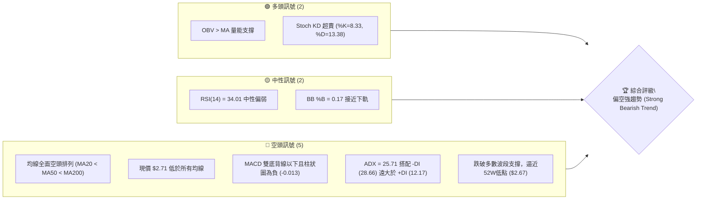
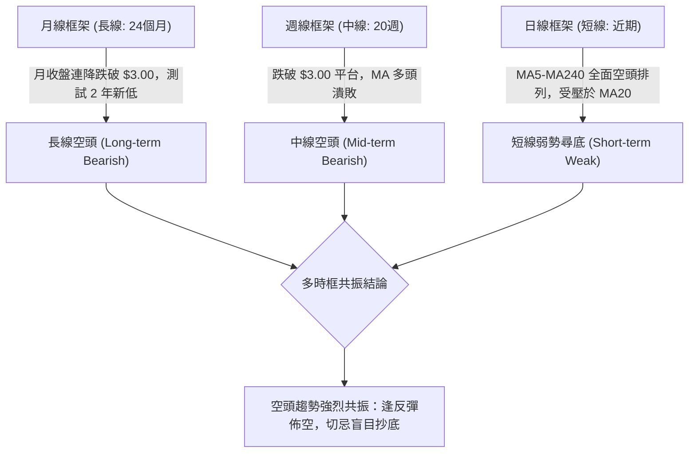
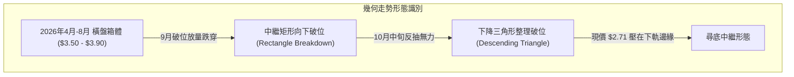
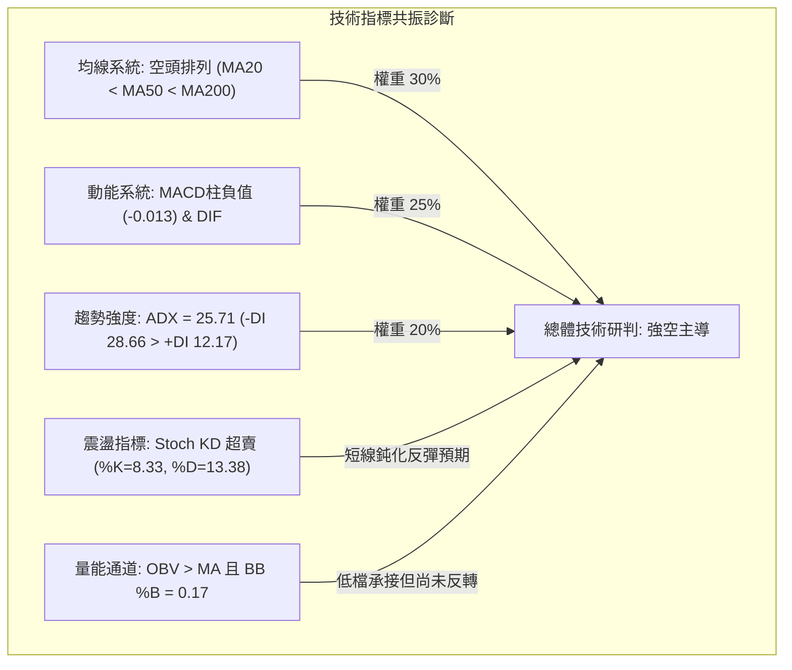
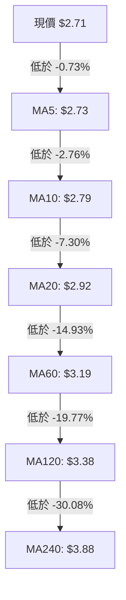
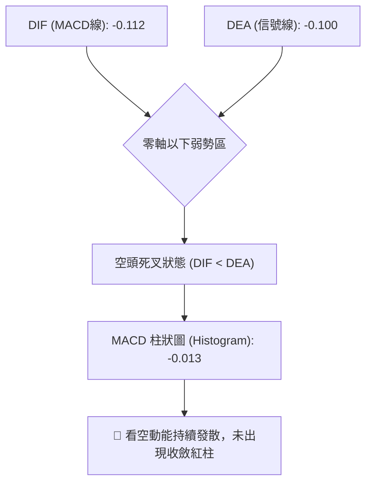
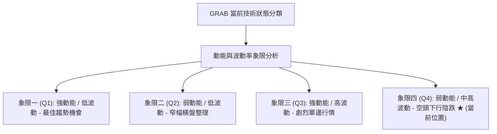
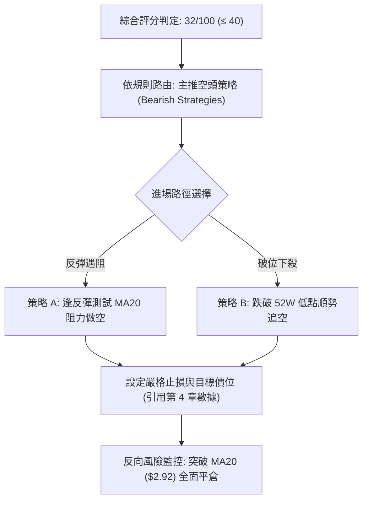
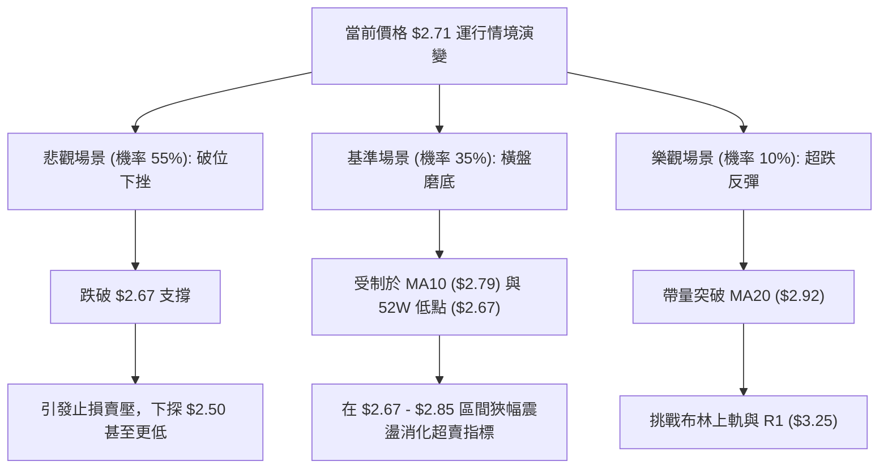

# GRAB 技術分析報告

> **報告日期**：2026-11-01 ｜ **語言**：繁體中文 ｜ **數據來源**：Yahoo Finance ｜ **當前價格**：$2.71 USD

---

## 目錄

| 章節 | 內容 |
|------|------|
| [1. 技術面概覽](#1-技術面概覽) | 訊號儀表板、核心指標、評分卡 |
| [2. 趨勢分析](#2-趨勢分析) | 多時框趨勢、長中短期走勢 |
| [3. 圖表形態分析](#3-圖表形態分析) | 形態識別、K線組合、目標價 |
| [4. 支撐與阻力](#4-支撐與阻力) | 關鍵價位、斐波那契回調 |
| [5. 技術指標深度解讀](#5-技術指標深度解讀) | MA/RSI/MACD/布林/成交量 |
| [6. 動能與波動率](#6-動能與波動率) | 動能評估、ATR、Beta |
| [7. 多時框架總結](#7-多時框架總結) | 時框架評分矩陣 |
| [8. 交易策略建議](#8-交易策略建議) | 多空策略、風險報酬比 |
| [9. 風險提示與監控](#9-風險提示與監控) | 監控指標、風險場景 |
| [📋 報告總結](#-報告總結) | 關鍵結論與最優策略總結 |

---

## 1. 技術面概覽

### 🎯 技術訊號儀表板



### 📊 核心指標速覽表

| 指標類別 | 指標名稱 | 當前數值 | 訊號 | 解讀 |
|----------|----------|----------|------|------|
| **價格** | 當前收盤價 | $2.71 | 🔴 | 位於52週區間底端（1.1%分位），極度逼近歷史年內低點 $2.67 |
| **均線** | MA20 | $2.92 | 🔴 | 現價低於MA20達 -7.30%，短線受制於下彎均線強壓 |
| **均線** | MA50 | $3.10 | 🔴 | 現價低於MA50達 -12.58%，中期空頭主導格局明確 |
| **均線** | MA200 | $3.63 | 🔴 | 現價低於MA200達 -25.34%，長期技術結構完全處於空頭市場 |
| **動能** | RSI(14) | 34.01 | 🟡 | 位於30-70中性區下緣，雖未進入絕對超賣（<30），但動能低迷 |
| **動能** | MACD (12,26,9) | -0.112 / -0.100 | 🔴 | DIF與DEA雙處於零軸下方，Histogram為 -0.013，空頭動能擴散 |
| **動能** | Stoch %K / %D | 8.33 / 13.38 | 🟢 | KD指標嚴重超賣（均小於20），短線存在技術性反抽動能 |
| **趨勢** | ADX(14) | 25.71 | 🔴 | ADX>25確認為單邊強趨勢；-DI (28.66) > +DI (12.17) 表明空頭牢固主導 |
| **通道** | 布林帶 (%B) | 0.17 | 🟡 | 位於下軌 $2.60 與中軌 $2.92 之間，通道下傾擴張，價格沿下軌走弱 |
| **波動** | ATR(14) | $0.10 | 🟡 | 每日平均真實波動幅度佔股價 3.80%，短線波動度穩定適中 |
| **量能** | OBV 趨勢 | OBV > MA | 🟢 | 累計成交量在跌勢中維持於均線上方，顯示低檔有特定防禦性承接盤 |

### 🏆 技術評分卡

```
╔══════════════════════════════════════════════════════════════════╗
║                 技術評分卡 — GRAB (2026-11-01)                  ║
╠══════════════════════════════════════════════════════════════════╣
║ 趨勢強度 (ADX/方向)   ██████░░░░░░░░░░░░░░  30/100  🔴 極度空頭  ║
║ 動能指標 (RSI/MACD)   ███████░░░░░░░░░░░░░  35/100  🔴 動能疲弱  ║
║ 支撐穩定度 (波段低點) ████░░░░░░░░░░░░░░░░  20/100  🔴 逼近臨界  ║
║ 成交量配合 (OBV/均量) ███████████░░░░░░░░░  55/100  🟡 局部背離  ║
║ 形態完整度 (K線/幾何) ██████░░░░░░░░░░░░░░  30/100  🔴 下跌中繼  ║
║ 均線排列 (MA矩陣)     ████░░░░░░░░░░░░░░░░  20/100  🔴 空頭排列  ║
╠══════════════════════════════════════════════════════════════════╣
║ 綜合評分              ██████░░░░░░░░░░░░░░  32/100  🔴 強烈看空  ║
║ 評分計算：(30 + 35 + 20 + 55 + 30 + 20) ÷ 6 = 31.67 ≈ 32/100     ║
╚══════════════════════════════════════════════════════════════════╝
```

---

## 2. 趨勢分析

### 🌐 多時框趨勢分析



### 📈 長期趨勢 — 12個月走勢圖（Unicode）

以下為根據月度歷史數據繪製之過去 12 個月（2025-11 至 2026-10）收盤價走勢：

```
GRAB 月線走勢圖（過去12個月：2025-11 至 2026-10）
價格軸 ($)
$6.00 ┤ 
$5.50 ┤ ● (2025-11: $5.45)
$5.00 ┤       ● (2025-12: $4.99)
$4.50 ┤             ● (2026-01: $4.30)
$4.00 ┤                   ● (2026-02: $4.22)   ● (2026-04: $3.82)  ● (2026-06: $3.77)
$3.50 ┤                               ● ($3.66)     ● ($3.54)     ● ($3.50)  ● ($3.54)
$3.00 ┤                                                                           ● ($3.11)
$2.50 ┤                                                                                 ●←現價 $2.71
      └─────────────────────────────────────────────────────────────────────────────────────────────
        11    12    01    02    03    04    05    06    07    08    09    10  (月份)
```

**月度走勢特徵分析表格**：

| 時間階段 | 起訖收盤價 | 區間漲跌幅 | 主要走勢特徵與結構演變 |
|----------|------------|------------|------------------------|
| **2025-11 ~ 2025-12** | $5.45 → $4.99 | -8.44% | 高檔（52W高點 $6.24）構築頂部後快速跌破 $5.00 大關 |
| **2026-01 ~ 2026-03** | $4.99 → $3.66 | -26.65% | 空頭加速重挫，跌破 $4.00 整數關卡，建立中長期下降趨勢軌道 |
| **2026-04 ~ 2026-08** | $3.82 → $3.54 | -7.33% | 於 $3.50 - $3.90 區間橫向縮量築平台，形成長達5個月的派發中繼形態 |
| **2026-09 ~ 2026-10** | $3.54 → $2.71 | -23.45% | 平台下軌破位崩跌，連續破 $3.11 及 $2.71，直接下探 52 週最低點 $2.67 |

### 📊 中期趨勢（週線分析）

在過去 20 週收盤走勢中，中期走勢呈現「抵抗性下行 → 破位加速」特徵：
1. **中期頂部形成**：2026-07-10 週收盤達到階段反彈高點 $3.93，週 RSI 達到 64.2，隨後無力上攻。
2. **防線瓦解**：2026-08-07 反彈至 $3.66 遇阻回落，隨後在 2026-09-11 破位跌穿 $3.30 平台，收於 $3.05。
3. **破底測試**：2026-09-25 週雖出現單週 5.27 億股放量反彈至 $3.13，但隨後三週高點逐週下移（$3.19 → $2.94 → $2.79 → $2.71），均線呈現壓制態勢。

```
中期週線價格通道示意圖：
$4.00 ┤      ▲ 07-10 高點 $3.93
$3.80 ┤     ╱ ╲
$3.60 ┤    ╱   ╲       ▲ 08-07 反彈高點 $3.66
$3.40 ┤   ╱     ╲     ╱ ╲
$3.20 ┤  ╱       ╲   ╱   ╲       ▲ 09-25 巨量反抽高點 $3.26
$3.00 ┤ ╱         ╲ ╱     ╲     ╱ ╲
$2.80 ┤                     ╲   ╱   ╲       ▲ 10-09 反抽高點 $3.23
$2.60 ┤                      ▼─▼     ╲     ╱ ╲
      └─────────────────────────────────▼───▼───▼ 10-30 測試低點 $2.67 / 現價 $2.71
```

### ⚡ 趨勢強度評估（ADX 解讀）

```mermaid
graph TD
    A["ADX(14) 數值 = 25.71"] --> B{"ADX 門檻判定"}
    B -->|"ADX > 25"| C["確認為強趨勢行情 (Trending Market)"]
    B -->|"ADX < 25"| D["判定為無趨勢/盤整行情 (Consolidation)"]
    C --> E["方向判定系統 (+DI vs -DI)"]
    E --> F["-DI: 28.66"]
    E --> G["+DI: 12.17"]
    F & G --> H["-DI 顯著超越 +DI (差值達 16.49)"]
    H --> I["🔴 結論：強烈空頭單邊主導趨勢，嚴格禁止逆勢做多"]
```



**ADX 指標強度對照表**：

| ADX 數值區間 | 當前數值 | 當前狀態判定 | 交易架構應對原則 |
|--------------|----------|--------------|------------------|
| **0 - 20** | — | 無趨勢 / 窄幅盤整 | 觀望或震盪高拋低吸 |
| **20 - 25** | — | 趨勢萌芽 / 方向醞釀 | 準備突破順勢單 |
| **25 - 50** | **25.71** | 🟢 **強趨勢確立 (當前狀態)** | **完全順勢操作，逢反彈依均線阻力做空** |
| **50 - 75** | — | 極強趨勢 / 單邊暴推 | 加速階段，注意尾端耗竭 |
| **75 - 100** | — | 超強走勢 / 即將反轉 | 極度過度延伸，預備反轉 |

---

## 3. 圖表形態分析

### 🔍 形態識別系統



**圖表形態信心度評估表**：

| 形態名稱 | 信心度 | 判斷依據（引用數據） | 完成度 | 目標價（附計算式） |
|----------|--------|----------------------|--------|--------------------|
| **箱體整理破位 (中繼)** | 85% | 2026年4-8月收盤低點聚類在 $3.50 附近，於 2026-09-11 破位跌至 $3.05，確立箱體頂部破位 | 100% | 箱體高度 = $3.93 - $3.50 = $0.43。破位目標 = $3.50 - $0.43 = $3.07（已於9月達成） |
| **次級下降旗形 (短線)** | 70% | 10-09 高點 $3.23 回落至 10-26 低點 $2.67，隨後數日旗面狹幅整理於 $2.71-$2.79 | 80% | 旗桿高度 = $3.23 - $2.67 = $0.56。破位目標 = 依突破點推算（目前數據中未偵測到低於 $2.67 支撐） |
| **底背離反轉形態** | 20% | 數據不足（數據報告指出 RSI 背離：無明顯背離，且 ADX>25 空頭強勢） | 10% | 訊號不足，僅做指標型解讀（Stoch 短線超賣） |

### 🕯️ 重要K線形態分析

根據提供的「近10根日K」與「近8根週K」實際開高低收數據進行嚴格識別：

| 日期（週期） | 開 | 高 | 低 | 收 | 成交量 | K線形態名稱 | 技術解讀與多空意涵 | 訊號 |
|--------------|----|----|----|----|--------|-------------|--------------------|------|
| **2026-09-25 (週K)** | 2.84 | 3.26 | 2.78 | 3.13 | 527,094,200 | 長下影帶量大陽線 | 5.27億股巨量下影線，多頭於 $2.78 展開強力自救，暫時阻跌 | 🟢 |
| **2026-10-16 (週K)** | 3.16 | 3.20 | 2.85 | 2.94 | 280,278,600 | 穿頭破腳中陰線 | 跌破前期週收盤支撐，宣告反彈行情徹底終結，轉向二度下殺 | 🔴 |
| **2026-10-23 (週K)** | 2.93 | 2.94 | 2.77 | 2.79 | 233,692,400 | 無上影禿頭小陰線 | 空頭持續打壓，開盤即最高，空方主動權完全掌控 | 🔴 |
| **2026-10-30 (週K)** | 2.79 | 2.80 | 2.67 | 2.71 | 280,442,300 | 帶下影弱勢實體小陰線 | 盤中下探 52 週最低點 $2.67，微幅收腳至 $2.71，但週收盤創下歷史新低 | 🔴 |
| **2026-10-26 (日K)** | 2.79 | 2.80 | 2.67 | 2.71 | 53,258,700 | 長下影探底陰線 | 下測 52W 低點 $2.67，低檔承接買盤浮現，但收盤仍偏低 | 🟡 |
| **2026-10-27 (日K)** | 2.71 | 2.75 | 2.69 | 2.72 | 66,737,600 | 放量低檔十字星變盤線 | 成交量放大至 6673 萬股，多空於 $2.70 關口劇烈爭奪，空方暫緩推進 | 🟡 |
| **2026-10-28 (日K)** | 2.73 | 2.79 | 2.71 | 2.75 | 55,245,600 | 短陽孕線 (Inside Bar) | 多頭嘗試反攻，受制於前高 $2.79，反彈動能微弱 | 🟡 |
| **2026-10-29 (日K)** | 2.76 | 2.78 | 2.72 | 2.76 | 50,373,300 | 窄幅縮量紡錘線 | 價格動能陷入停滯，波動壓縮，成交量萎縮至 5037 萬股 | 🟡 |
| **2026-10-30 (日K)** | 2.71 | 2.73 | 2.68 | 2.71 | 54,827,100 | 平開壓低小陰線 | 開盤 $2.71，最高僅 $2.73，收在 $2.71，再次回測 $2.68 低位，多方棄守 | 🔴 |

### 📉 ASCII 走勢形態示意圖

近 10 個交易日（2026-10-19 至 2026-10-30）日線收盤結構：

```
GRAB 近10日日K價格結構圖：
$2.95 ┤ 
$2.90 ┤    ●(10-20: 2.89)
$2.85 ┤ ●(10-19: 2.87)   ●(10-22: 2.85)
$2.80 ┤             ●(10-21: 2.82)  ●(10-23: 2.79)
$2.75 ┤                                           ●(10-28: 2.75) ●(10-29: 2.76)
$2.70 ┤                                     ●(10-26: 2.71)  ●(10-27: 2.72)  ●(10-30: 2.71)
      └─────────────────────────────────────────────────────────────────────────────────
        10-19 10-20 10-21 10-22 10-23 10-26 10-27 10-28 10-29 10-30 (交易日)
```

### 🎯 形態目標價計算

根據形態分析與數據界定：
1. **中期箱體破位量度跌幅**：2026-04 至 2026-08 箱體頂部 $3.93，底部 $3.50，高度 $0.43。破位後量度目標價 = $3.50 - $0.43 = $3.07（此目標已於 2026-09-11 破位達成）。
2. **次級下降台階計算**：2026-09-25 放量反彈高點 $3.26，至 2026-10-09 形成次高點 $3.23。頸線為 10-02 低點 $3.07。跌破頸線後下行對稱空間 = $3.07 - ($3.23 - $3.07) = $2.91（已跌破並轉為反壓 MA20 $2.92）。
3. **下行延伸風險**：當前價格 $2.71 逼近 52 週低點 $2.67。因數據庫明確註明「支撐位 (Support)：(no swing-low support detected below current price)」，若 $2.67 失守，下方將進入價格真空區。

---

## 4. 支撐與阻力

### 🗺️ 關鍵價位分布圖（Unicode）

```
GRAB 價位結構分布圖 (由 OHLCV 與斐波那契精確計算)
═══════════════════════════════════════════════════════════════════
$6.24 ║██████████████████████████████║ 52週最高點 (Fib 0.0%)
$5.39 ║████████████████████          ║ 斐波那契回調位 23.6%
$4.87 ║██████████████████            ║ 斐波那契回調位 38.2%
$4.45 ║████████████████              ║ 斐波那契中軸位 50.0%
$4.03 ║██████████████████████        ║ 斐波那契回調位 61.8%
$3.96 ║██████████████████████████████║ 強阻力位 R3 (+46.00%)
$3.64 ║████████████████████          ║ 中期阻力位 R2 (+34.41%)
$3.43 ║██████████████████            ║ 斐波那契回調位 78.6%
$3.25 ║██████████████████████████████║ 關鍵阻力位 R1 (+19.74%) / 布林上軌
$2.92 ║──────────────────────────────║ 動態阻力：MA20 / 布林中軌
$2.71 ╠══════════════════════════════╣ ◄ 當前收盤價 ($2.71)
$2.67 ║▓▓▓▓▓▓▓▓▓▓▓▓▓▓▓▓▓▓▓▓▓▓▓▓▓▓▓▓▓▓║ 52週最低點 (Fib 100.0%)
(無)  ║░░░░░░░░░░░░░░░░░░░░░░░░░░░░░░║ 數據未偵測到下方波段低點支撐
═══════════════════════════════════════════════════════════════════
```

### 🚧 阻力位分析表

依據數據「關鍵價位（由 OHLCV 計算）」區塊嚴格引用：

| 阻力級別 | 精確價位 | 距現價幅標 | 形成原因與技術聚集 | 突破難度 | 重要性評級 |
|----------|----------|------------|--------------------|----------|------------|
| **R1** | $3.25 | +19.74% | 近一年波段高點聚類位，疊加布林通道日線上軌（$3.25）及 10-09 週反彈高點（$3.23） | 🔴 極高 | ★★★★★ |
| **R2** | $3.64 | +34.41% | 近一年波段高點聚類位，重合日線 MA200（$3.63）及 2026-08-07 週線高點（$3.66） | 🔴 極高 | ★★★★☆ |
| **R3** | $3.96 | +46.00% | 近一年波段強阻力聚類位，重合 2026-07-10 週線頂部高點（$3.93）密集派發區 | 🔴 堅不可摧 | ★★★★★ |

### 🛡️ 支撐位分析表

依據數據「關鍵價位（由 OHLCV 計算）」區塊嚴格引用：

| 支撐級別 | 精確價位 | 距現價幅標 | 形成原因與技術聚集 | 守住機率 | 重要性評級 |
|----------|----------|------------|--------------------|----------|------------|
| **52W Low / 臨界支撐** | $2.67 | -1.48% | 52週最低價，2026-10-26 日內低點與斐波那契 100.0% 匯聚點 | 🟡 40% (面臨考驗) | ★★★★★ |
| **波段低點支撐** | N/A（數據未提供） | — | 數據明確標記：(no swing-low support detected below current price) | N/A（數據未提供） | N/A |

### 📐 斐波那契回調位分析

依據 52 週區間最高點 $6.24 至最低點 $2.67 進行回調位精確解析：

| 斐波那契回調層級 | 精確點位 | 與當前價格 ($2.71) 相對關係與技術意義 |
|------------------|----------|----------------------------------------|
| **0.0% (52W High)** | $6.24 | 長期歷史天花板，此輪長線熊市之起點 |
| **23.6%** | $5.39 | 長期空頭回撤的第一道多空分野，2025-11 跌破後未再站回 |
| **38.2%** | $4.87 | 中期強阻力區，2025 年多個月份（1月、3月、5月）密集換手區 |
| **50.0%** | $4.45 | 長期多空均衡中軸，跌破後確認進入深度熊市 |
| **61.8%** | $4.03 | 黃金分割重要防守位，2026 年初下破後成為難以踰越之高牆 |
| **78.6%** | $3.43 | 深度回調防線，2026 年 8-9 月跌破後觸發加速下跌 |
| **100.0% (52W Low)** | $2.67 | **極限防守點，距離當前價格僅 $0.04（-1.48%）** |

**現價落點解讀**：
當前收盤價 $2.71 處於 **78.6% ($3.43) 至 100.0% ($2.67)** 的極端超跌區間，位處整個 52 週波段波動範圍的 **1.1% 極低分位**。這代表多頭已回吐過去一年內的所有漲幅，若 100.0% 回調位 $2.67 被有效跌破（連續兩日收盤低於 $2.67），斐波那契擴展下行空間將全面打開。

---

## 5. 技術指標深度解讀

### 🎛️ 指標訊號總覽



### 📈 移動平均線排列分析



**移動平均線系統深度矩陣**：

| 均線名稱 | 數值 | 距現價幅度 | 排列方向與斜率 | 技術解讀 |
|----------|------|------------|----------------|----------|
| **MA5** | $2.73 | -0.73% | 下彎 (▼ -0.02) | 超短期動能被壓制，5日線壓在頭頂 |
| **MA10** | $2.79 | -2.76% | 下彎 (▼ -0.08) | 近兩週反彈高點均止步於此附近 |
| **MA20** | $2.92 | -7.30% | 下彎 (▼ -0.21) | 短期生命線，布林帶中軌，反彈首要強阻力 |
| **MA50** | $3.10 | -12.58% | 下彎 (▼) | 中期空頭分水嶺，與整數關卡重合 |
| **MA60** | $3.19 | -14.93% | 下彎 (▼ -0.48) | 季線下壓，中期反彈天花板 |
| **MA120**| $3.38 | -19.77% | 下彎 (▼ -0.67) | 半年線持續下移，中期熊市格局未變 |
| **MA200**| $3.63 | -25.34% | 下彎 (▼) | 牛熊分界線，長期走勢完全偏空 |
| **MA240**| $3.88 | -30.08% | 下彎 (▼ -1.17) | 年線壓制，空頭排列最長週期確認 |

**均線結構綜合評價**：所有短、中、長期均線呈現完全一致的「空頭發散排列」（Bearish Alignment: MA5 < MA10 < MA20 < MA60 < MA120 < MA240），未見任何均線走平或金叉跡象，顯示下行趨勢具有極強的慣性。

### 📉 RSI(14) 分析

- **當前數值**：34.01（Wilder 平滑法計算）
- **數值進度條**：
  ```
  RSI(14): 34.01 ▓▓▓▓▓▓▓░░░░░░░░░░░░░ 34.01% (區間: 30-70 中性偏弱)
  ```
- **區間評估**：RSI 處於 30 至 70 的中性區間偏下緣，尚未進入絕對超賣區（<30）。這說明雖然價格逼近新低，但 RSI 指標並未發生極度超賣衰竭，空方拋壓依然在有序釋放。
- **背離判斷**：
  - **日線背離狀態**：根據數據庫嚴格檢測，近 20 根 K 棒首尾之價格與 RSI 方向判定為「**無明顯背離**」。價格下行時 RSI 同步創低，未形成底背離，指標完全確認下行趨勢的真實性。
  - **週線走勢對照**：2026-09-18 週 RSI 曾探底至 23.3，隨後回抽至 51.8（2026-10-09），近期三週連續滑落至 34.0，反映反彈波段夭折，週線層級動能再次向空方傾斜。

### 📊 MACD(12/26/9) 訊號解讀



**MACD 細部參數解讀**：
1. **雙線位置**：DIF (-0.112) 與 Signal (-0.100) 雙雙深處零軸下方，屬於典型「水下死叉」延伸走勢，顯示市場仍處於弱勢空頭格局。
2. **動能柱變化**：MACD Histogram 為 -0.013，綠柱持續發散。在近三週週線數據中，MACD 柱狀圖由 +0.027（10-09）翻負至 -0.003（10-16）、-0.017（10-23）及 -0.013（10-30），確認週線級別反彈已經徹底結束，空頭動能重新主導。
3. **背離確認**：MACD 線未見底背離抬升跡象，柱狀圖在零軸下方運行，指標確認價格破底態勢。

### 📦 布林通道分析

```
GRAB 日線布林通道 (20, 2) 結構示意圖：
$3.30 ┤
$3.25 ┤ ════════════════════════════════════════ 上軌: $3.25
$3.20 ┤
$3.10 ┤
$3.00 ┤
$2.92 ┤ ──────────────────────────────────────── 中軌 (MA20): $2.92
$2.80 ┤
$2.71 ┤                          ● 現價: $2.71 (%B = 0.17)
$2.60 ┤ ════════════════════════════════════════ 下軌: $2.60
      └────────────────────────────────────────────────────────
```

**布林通道關鍵指標解讀**：
- **布林上軌**：$3.25（重合關鍵阻力 R1）
- **布林中軌 (MA20)**：$2.92
- **布林下軌**：$2.60
- **帶寬 (Bandwidth)**：($3.25 - $2.60) ÷ $2.92 = 22.26%，通道維持擴張下傾狀態。
- **%B 指標**：**0.17**（處於 0 至 0.5 之間的極弱區間）。價格緊貼布林下軌滑落，屬於典型的「沿下軌走弱」空頭特徵，並未跌破下軌產生「假突破回抽」訊號，下行趨勢依然有效。

### 💹 成交量分析（量價配合度）

1. **成交量對比**：
   - 最新交易日成交量：**54,827,100 股**
   - 20 日均量：**60,063,905 股**（量比：**0.91x**，呈現縮量陰跌）
   - 50 日均量：**62,661,076 股**
2. **OBV 趨勢解讀**：
   - 數據狀態標記：「**OBV > MA → 量能支撐上漲**」。
   - **深層量價矛盾分析**：雖然日線價格持續走跌，但 OBV 線仍高於其移動平均線。此現象主要源於 2026-09-25 週錄得 **5.27 億股**之歷史天量陽線，使 OBV 底層水位大幅墊高。
   - **量價背離結論**：價格創近幾週收盤新低（$2.71），但 OBV 未跌破新低，呈現「**價格破底而量能維持之弱底背離**」。這表明在 $2.70 附近存在中長線資金進場防守，但由於主動性追價買盤不足，目前僅發揮減緩下跌速率的作用，尚未能扭轉空頭趨勢。

---

## 6. 動能與波動率

### ⚡ 動能評估四象限



| 象限 | 動能狀態 | 波動狀態 | 判定特徵 | 當前狀態判定 | 交易策略指導 |
|------|----------|----------|----------|--------------|--------------|
| **Q1** | 強 | 低 | 穩健上升通道 | — | 順勢加碼做多 |
| **Q2** | 弱 | 低 | 窄幅無趨勢沉寂 | — | 突破前觀望 |
| **Q3** | 強 | 高 | 暴漲暴跌洗盤 | — | 嚴格停損短線參與 |
| **Q4** | **弱 (負向強)** | **中等 (ATR 3.8%)** | **空頭主導，下行陰跌** | **✓ (GRAB 當前位置)** | **以反彈佈空為主，嚴控多頭抄底風險** |

### 📊 ATR 波動率分析

- **ATR(14) 數值**：**$0.10**（採用 Wilder 平滑計算）
- **佔股價百分比**：**3.80%**
- **波動率屬性**：每日平均振幅為 $0.10，顯示該股目前屬於中等波動度標的。股價未出現極端失控的恐慌拋售（ATR 暴增），而是以每天約 3-4% 的波動區間呈現階梯式下行。
- **交易風控距離建議**：
  - **極短線止損距離 (1.0 × ATR)**：$0.10。若進場空單，可設為進場價 + $0.10。
  - **波段交易止損距離 (1.5 × ATR)**：$0.15。避開盤中隨機雜訊波動。
  - **強勢反轉判定距離 (2.0 × ATR)**：$0.20。若日線向上反彈超過 $0.20（例如突破 $2.91），意味著當前空頭微結構被打破。

### 📐 Beta 與市場相關性

- **Beta 數值**：**0.908**
- **解讀**：Beta < 1.0，表明該標的對美股大盤（標普500/納斯達克）的系統性敏感度微幅偏低。其近期獨立下行走勢更多反映東南亞市場基本面疲弱或非系統性拋壓，大盤反彈時其跟漲動能可能相對有限。
- **做空與避險比率 (Short Interest)**：
  - **Short Ratio (天數)**：**2.38 天**
  - **Short % of Float**：**5.5%**
  - 空頭部位佔流通盤 5.5%，空頭回補天數僅 2.38 天，顯示當前空方拋壓並非來自極度密集的軋空投機盤，而是廣泛的實質性機構減持，短線發生軋空暴拉（Short Squeeze）的機率極低。

---

## 7. 多時框架總結

### 📋 時框架評分表

| 時框架 | 趨勢方向 | 動能狀態 | 均線排列 | 圖表形態 | 綜合評分 | 操作建議方向 |
|--------|----------|----------|----------|----------|----------|--------------|
| **月線 (長期)** | 🔴 強烈看空 | 🔴 RSI 偏弱下傾 | 🔴 均線反壓沉重 | 破位尋底中繼 | 25/100 | 長期部位保持觀望或避險 |
| **週線 (中期)** | 🔴 空頭主導 | 🔴 MACD柱轉負 | 🔴 MA20/50蓋頭 | 反彈遭截斷走低 | 30/100 | 中線逢反彈建立防守性空單 |
| **日線 (短期)** | 🔴 弱勢震盪尋底 | 🟡 Stoch 超賣鈍化 | 🔴 MA5-MA20 全空 | 逼近 52W 低點整理 | 35/100 | 短線順勢做空，不猜底做多 |

### 🔲 綜合訊號矩陣

| 維度 | 短期 (日線) | 中期 (週線) | 長期 (月線) | 跨週期一致性判定 |
|------|-------------|-------------|-------------|------------------|
| **趨勢方向** | 空頭尋底 | 下行趨勢 | 熊市通道 | 🟢 高度一致 (全面看空) |
| **動能指標** | 超賣反彈需求 | 負向擴散 | 弱勢下沉 | 🟡 短中期存在動能時間差 |
| **均線結構** | 空頭排列 | 空頭排列 | 空頭排列 | 🟢 高度一致 (阻力重重) |
| **成交量配合** | 縮量陰跌 | 反彈無量下殺有量 | 均量走平 | 🟢 一致確認缺乏承接買盤 |

### ⚖️ 多時框收斂結論

依據多時框收斂規則（規則 14）：
1. **行情性質判定**：當前日線 **ADX(14) = 25.71**，明確大於 25 臨界值，判定為**趨勢行情**而非盤整震盪。
2. **主導時框優先級**：在強趨勢行情下，中長期（週線/MA50、MA200）方向為絕對主導力量，日線僅能作為進場點位與微結構風控之篩選工具。
3. **方向性結論收斂**：日線 Stoch (%K=8.33, %D=13.38) 雖處於極度超賣，但週線與月線均線呈現全面空頭反壓，且 ADX 顯示空頭強趨勢確立。日線超賣在強趨勢中多以「橫盤縮量」或「微幅回抽中軌」消化，不可視為反轉做多依據。
4. **唯一結論**：**強烈偏空（Bearish）**。整體操作以「順應中長線空頭趨勢、逢日線反彈阻力佈空」為主導方針，此結論與第 8 章之空頭主策略完全一致。

---

## 8. 交易策略建議

### 🗺️ 策略決策流程圖



### 🧭 策略路由（依評分卡分流）

> **當前主策略方向 = 主推空頭策略（依綜合評分 32/100，處於 ≤40 偏空區間）**

本報告依規則嚴格執行單向主策略路由，多頭部位僅列為「反轉風險觸發點（對沖提示）」，嚴禁兩頭下注。

### 🎯 價格情境階梯（Price Scenarios）

以當前價格 **$2.71** 為基準，結合第 4 章關鍵價位建立情境劇本：

| 觸發條件 | 下一目標 | 後續延伸 | 情境含義與技術演變 |
|----------|----------|----------|--------------------|
| **向上反彈突破 MA20 ($2.92)** | R1 $3.25 | R2 $3.64 | 短線空頭衰竭，技術性反彈延伸，空單全面止損離場 |
| **徘徊於現價與阻力間 ($2.71 - $2.79)** | — | — | 短期縮量低檔震盪，消化短線超賣指標，蓄勢再次選擇方向 |
| **向下有效跌破 52W 低點 ($2.67)** | 下方支撐未偵測到 | 真空下探 | 歷史關鍵低點失守，引發多頭停損與新一輪順勢放空賣壓 |

### 📊 情境機率分佈

| 情境 | 機率 | 主要依據（引用技術指標） |
|------|------|--------------------------|
| **向下破位 / 延續跌勢** | **55%** | ADX = 25.71 強趨勢確立；-DI (28.66) 遠高於 +DI；均線全面空頭排列；MACD 綠柱發散 |
| **區間震盪 / 縮量磨底** | **35%** | Stoch KD 嚴重超賣 (%K=8.33)；布林帶觸及下軌區間 (%B=0.17)；近5日縮量於 $2.70 防守 |
| **強勢反彈 / 突破中軌** | **10%** | OBV > MA 存在隱性承接，但目前受制於 MA5/MA10/MA20 重重蓋頭，缺乏主動量能配合 |

### 🟢 主策略詳情（做空交易架構）

以下兩套空頭策略之價位與風險報酬比均嚴格依據規則計算：
- **風險報酬比計算公式**：$(進場價 - 目標價 T1) ÷ (止損價 - 進場價)$，以「1 : X.XX（以 T1 計）」呈現。

| 策略要素 | 策略 A：反彈阻力位放空 (Pullback Short) | 策略 B：破位順勢做空 (Breakdown Short) |
|----------|-----------------------------------------|----------------------------------------|
| **交易邏輯** | 趁 Stoch 超賣引發的微幅反彈，於均線反壓處佈空 | 待現價正式跌破 52 週最低點 $2.67 後順勢破位放空 |
| **進場條件** | 股價反彈至 MA10 至 MA20 之間遇阻收陰線 | 日線收盤價跌破 $2.67 且日低刷出新低點 |
| **進場價格** | **$2.86**（區間 $2.79 - $2.92 中點，MA10-MA20區間） | **$2.65**（確認跌破 52W 低點 $2.67 後追空） |
| **目標價 T1** | **$2.67**（回測 52W 最低點 / Fib 100.0%） | **$2.50**（由 ATR 0.10 量度推算 1.5 倍跌幅） |
| **目標價 T2** | **$2.50**（破底後延伸空間） | **$2.35**（由形態等幅下移推算） |
| **止損價格** | **$2.95**（設於 MA20 $2.92 上方約 1 個 ATR 處） | **$2.73**（回抽站上 MA5 $2.73，假突破止損） |
| **風險報酬比** | **1 : 2.11（以 T1 計）** <br> 計算：$(2.86 - 2.67) ÷ (2.95 - 2.86) = 0.19 ÷ 0.09 = 2.11$ <br> [另至 T2: 1 : 4.00] | **1 : 1.88（以 T1 計）** <br> 計算：$(2.65 - 2.50) ÷ (2.73 - 2.65) = 0.15 ÷ 0.08 = 1.875 ≈ 1.88$ <br> [另至 T2: 1 : 3.75] |
| **成功機率** | **65%** | **55%** |
| **建議倉位** | **8% - 10%**（動態分批建倉） | **5% - 7%**（確認破位後順勢輕倉） |

### 🔴 反向風險觸發點（對沖提示）

若出現以下技術情境，主策略（做空）立即失效，投資人應迅速平倉空單並離場觀望：
1. **關鍵點位突破**：日線收盤價突破 **$2.92（MA20 / 布林中軌）**，並帶有單日超過 6,000 萬股的放大成交量。
2. **指標轉強確認**：MACD 出現水下黃金交叉，Histogram 翻正連續 2 個交易日以上，且 RSI 站回 50 多空分界線上方。
3. **形態推翻**：日K線於 $2.67 附近構築雙底形態，並以大陽線突破頸線 $2.79。

### ⭐ 整體訊號強度評星

```
做多訊號強度：★☆☆☆☆  (1/5星 - 僅 Stoch 超賣，逆勢做多風險極高)
做空訊號強度：★★★★☆  (4/5星 - 均線空頭、ADX強趨勢、MACD發散)
整體可信度：  ★★★★☆  (4/5星 - 多時框共振高度偏空，數據一致性強)
```

---

## 9. 風險提示與監控

### ✅ 關鍵監控指標 Checklist

```
╔══════════════════════════════════════════════════════════════════╗
║                  GRAB 每日交易監控清單 (Checklist)               ║
╠══════════════════════════════════════════════════════════════════╣
║ [ ] 52W 低點防守：盤中最低價是否跌破 $2.67？                    ║
║ [ ] MA20 動態反壓：收盤價是否壓制於 $2.92 之下？                ║
║ [ ] MACD 柱狀體：Histogram 是否持續為負值 (< 0)？               ║
║ [ ] 成交量異常：成交量是否突破 20 日均量 (60,063,905 股)？      ║
║ [ ] ADX 趨勢維持：ADX 是否保持在 25 以上且 -DI > +DI？          ║
║ [ ] 布林通道走勢：%B 是否維持在 0.20 以下沿下軌下行？           ║
║ [ ] Stoch 鈍化狀況：%K/%D 是否在超賣區 (<20) 形成低檔鈍化？     ║
╚══════════════════════════════════════════════════════════════════╝
```

### ⚠️ 風險場景分析



### 🛡️ 風險管理重要提醒

1. **嚴禁主觀猜底 (Do Not Catch Falling Knives)**：
   數據明確顯示當前支撐位下方「未偵測到任何波段低點支撐（no swing-low support detected below current price）」。在股價處於歷史未知區間且 ADX=25.71 呈現單邊強空趨勢時，任何左側抄底皆承擔不對稱之下行風險。
2. **嚴格控制單筆虧損**：
   單筆交易停損幅度不可超過投資組合總資金的 1.0% - 1.5%。若操作策略 A，止損設在 $2.95，每股承擔 $0.09 風險（約 3.15% 價格波動），應依此反推部位股數。
3. **留意美股大盤環境**：
   GRAB Beta 值為 0.908，大盤若出現系統性回調，將加速其破位下行；若大盤強勁反彈，其跟隨力度可能因個股技術結構偏弱而打折。

---

## 📋 報告總結

```
╔══════════════════════════════════════════════════════════════════╗
║                    GRAB 技術分析報告總結                         ║
╠══════════════════════════════════════════════════════════════════╣
║ 報告日期：2026-11-01                                             ║
║ 當前價格：$2.71 USD                                              ║
║ 分析評級：🔴 強烈偏空 / 逢高做空 (Bearish / Sell on Rallies)      ║
║ 技術評分：32 / 100 (六項指標算術平均)                            ║
╠══════════════════════════════════════════════════════════════════╣
║ 關鍵結論：                                                       ║
║ ├─ 長期趨勢：🔴 熊市格局，由 52W 高點 $6.24 跌至 $2.71           ║
║ ├─ 中期趨勢：🔴 箱體跌破，反彈遭截斷，週線 MACD 綠柱再次發散    ║
║ ├─ 短期趨勢：🔴 弱勢探底，MA5-MA240 全面空頭排列，逼近 $2.67     ║
║ ├─ 關鍵支撐：$2.67 (52週最低價 / Fib 100.0%)，下方無歷史低點支撐║
║ ├─ 關鍵阻力：$2.92 (MA20/中軌) ｜ $3.25 (R1/布林上軌)           ║
║ └─ 分析師目標：$5.49 (華爾街共識均價，與當前技術盤面嚴重背離)   ║
╠══════════════════════════════════════════════════════════════════╣
║ 最優策略組合：                                                   ║
║ 1. 🥇 最佳機會：策略 A (反彈做空) — 待反彈至 $2.86 佈空，        ║
║                 目標 $2.67，止損 $2.95 (風報比 1 : 2.11)         ║
║ 2. 🥈 次選機會：策略 B (破位做空) — 跌破 $2.67 順勢追空至 $2.50，║
║                 止損 $2.73 (風報比 1 : 1.88)                     ║
║ 3. 🥉 保守選擇：空手觀望，靜待日線站穩 MA20 且 ADX 跌回 20 以下 ║
╚══════════════════════════════════════════════════════════════════╝
```

---

> ⚠️ **免責聲明**：本報告為 AI 自動生成之技術分析，所有數據及估算均基於提供的歷史價格資訊。本報告**僅供研究與學術參考**，**不構成任何投資建議**。投資有風險，入市需謹慎。

---

*報告生成時間：2026-11-01 ｜ 數據來源：Yahoo Finance ｜ 分析框架：多時框技術分析*