# GRAB 技術分析報告

> **報告日期**：2026-11-02 ｜ **語言**：繁體中文 ｜ **數據來源**：Yahoo Finance ｜ **當前價格**：$2.71 USD

---

## 目錄

| 章節 | 內容 |
|------|------|
| [1. 技術面概覽](#1-技術面概覽) | 訊號儀表板、核心指標、評分卡 |
| [2. 趨勢分析](#2-趨勢分析) | 多時框趨勢、長中短期走勢 |
| [3. 圖表形態分析](#3-圖表形態分析) | 形態識別、K線組合、目標價 |
| [4. 支撐與阻力](#4-支撐與阻力) | 關鍵價位、斐波那契回調 |
| [5. 技術指標深度解讀](#5-技術指標深度解讀) | MA/RSI/MACD/布林/成交量 |
| [6. 動能與波動率](#6-動能與波動率) | 動能評估、ATR、Beta |
| [7. 多時框架總結](#7-多時框架總結) | 時框架評分矩陣 |
| [8. 交易策略建議](#8-交易策略建議) | 多空策略、風險報酬比 |
| [9. 風險提示與監控](#9-風險提示與監控) | 監控指標、風險場景 |

---

## 1. 技術面概覽

### 🎯 技術訊號儀表板

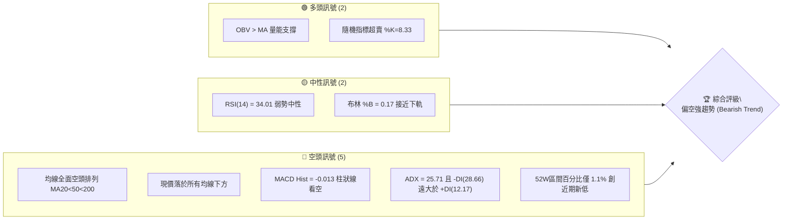

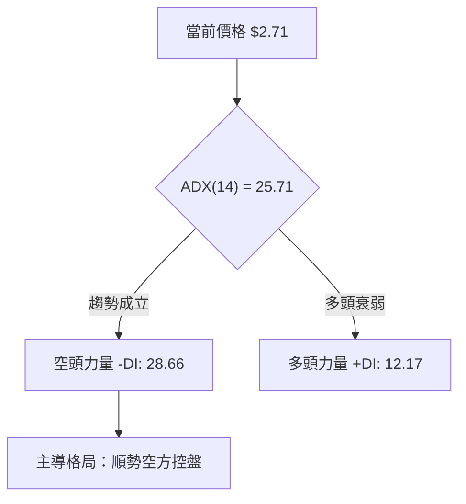

### 📊 核心指標速覽表

| 指標類別 | 指標名稱 | 當前數值 | 訊號 | 解讀 |
|----------|----------|----------|------|------|
| **價格** | 當前收盤價 | $2.71 | 🔴 | 位於 52 週區間（$2.67–$6.24）的 1.1% 位置，瀕臨歷史低點 |
| **均線** | 短期 MA20 | $2.92 | 🔴 | 現價低於 MA20 達 -7.30%，短期反彈壓力沉重 |
| **均線** | 中期 MA50 | $3.10 | 🔴 | 現價低於 MA50，中期下降通道維持完整 |
| **均線** | 長期 MA200 | $3.63 | 🔴 | 現價低於 MA200 達 -25.34%，長期熊市格局不變 |
| **均線系統** | 排列型態 | MA20 < MA50 < MA200 | 🔴 | 標準空頭排列，下行慣性強烈 |
| **動能** | RSI(14) | 34.01 | 🟡 | 位於中性區間偏下邊界，尚未進入極端超賣（<30） |
| **動能** | MACD (12,26,9) | -0.112 / 柱 -0.013 | 🔴 | 快慢線均在零軸下方，且負柱體維持擴張，空方主導 |
| **擺動** | Stochastic (14) | %K 8.33 / %D 13.38 | 🟢 | 深度超賣，短線存在技術性抽頭修復可能 |
| **趨勢強度** | ADX (14) | 25.71 | 🔴 | 大於臨界值 25，確認進入「強趨勢」行情，非震盪行情 |
| **通道** | 布林通道 (%B) | 0.17 (上$3.25/下$2.60) | 🟡 | 價格運行於下軌附近，軌道張口下行中 |
| **成交量** | 最新量 / 20日均量 | 54,827,100 / 60,063,905 | 🟡 | 量比 0.91x，低位下跌暫未見非理性恐慌放量 |
| **量能累計** | OBV 趨勢 | OBV > MA | 🟢 | 長期累計能量相對股價跌幅展現一定抗跌留存 |
| **波動** | ATR(14) | $0.10 | 🟡 | 日波動率為價格的 3.80%，處於中等可控波動範圍 |

### 🏆 技術評分卡

```
╔══════════════════════════════════════════════════════════════╗
║               技術評分卡 — GRAB (2026-11-02)                  ║
╠══════════════════════════════════════════════════════════════╣
║ 趨勢強度 (Trend)      ██████░░░░░░░░░░░░░░  30/100  🔴       ║
║ 動能指標 (Momentum)   ██████░░░░░░░░░░░░░░  30/100  🔴       ║
║ 支撐穩定度 (Support)  ████░░░░░░░░░░░░░░░░  20/100  🔴       ║
║ 成交量配合 (Volume)   ██████████░░░░░░░░░░  50/100  🟡       ║
║ 形態完整度 (Pattern)  ██████░░░░░░░░░░░░░░  30/100  🔴       ║
║ 均線排列 (MA Align)   ████░░░░░░░░░░░░░░░░  20/100  🔴       ║
╠══════════════════════════════════════════════════════════════╣
║ 綜合評分              ██████░░░░░░░░░░░░░░  30/100  🔴 偏空  ║
║ (六項子評分平均: (30+30+20+50+30+20)/6 = 30.0，依規則 18)     ║
╚══════════════════════════════════════════════════════════════╝
```

---

## 2. 趨勢分析

### 🌐 多時框趨勢分析

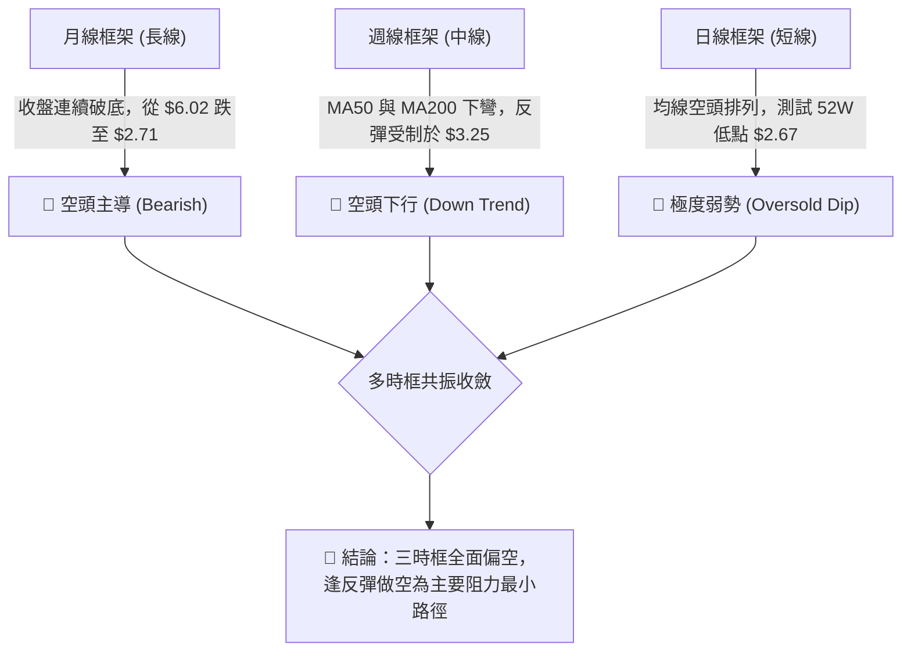

### 📈 長期趨勢 — 12個月走勢圖（Unicode）

```
GRAB 月線走勢圖（過去12個月：2025-11 至 2026-10）
價格軸 ($)
$6.00 ┤ 
$5.45 ┤● (2025-11 $5.45)
$4.99 ┤   ● (2025-12 $4.99)
$4.30 ┤      ● (2026-01 $4.30)
$4.22 ┤         ● (2026-02 $4.22)
$3.82 ┤                     ● (2026-04 $3.82)
$3.66 ┤               ● (2026-03 $3.66)   ● (2026-06 $3.77)
$3.54 ┤                           ● (05)      ● (07/08 $3.50/$3.54)
$3.11 ┤                                              ● (2026-09 $3.11)
$2.71 ┤                                                     ● (2026-10 $2.71 現價)
      └────────────────────────────────────────────────────────────
        11   12   01   02   03   04   05   06   07   08   09   10  (月份)
```

#### 過去 12 個月走勢特徵分析表

| 階段區間 | 月份起迄 | 價格變動 | 區間漲跌幅 | 結構形態特徵 |
|----------|----------|----------|------------|--------------|
| **高位崩解段** | 2025-11 → 2026-01 | $5.45 → $4.30 | -21.10% | 頂部 $6.02 確認跌破頸線，呈現快速落體式拋售 |
| **中繼沉淪段** | 2026-02 → 2026-03 | $4.22 → $3.66 | -13.27% | 跌破 $4.00 整數關卡，成交重心大幅向下移位 |
| **箱體掙扎段** | 2026-04 → 2026-08 | $3.82 → $3.54 | -7.33% | 於 $3.50–$3.82 進行長達 5 個月的弱勢盤整，反彈無力 |
| **加速破位段** | 2026-09 → 2026-10 | $3.11 → $2.71 | -12.86% | 跌破震盪下沿 $3.50，開啟新一輪主跌段，逼近 52W 低點 $2.67 |

### 📊 中期趨勢（週線分析）

```
GRAB 週線阻力與支撐示意圖（近20週）
═══════════════════════════════════════════════════════════════
$3.96 ═════════════════════════════════════ [波段阻力 R3]
      │   ┌─┐
      │   │ │ (07-02/10 衝高 $3.93 受阻)
$3.64 ────┴─┴────────────────────────────── [波段阻力 R2]
          │   ┌─┐
          │   │ │ (08-07 反彈高點 $3.66)
$3.25 ────┴───┴─┴────────────────────────── [近端頸線阻力 R1 / BB上軌]
              │   ┌─┐   ┌─┐
              │   │ │   │ │ (09-25 巨量 $3.13 / 10-09 $3.19)
$2.71 ────────┴───┴─┴───┴─┴──────────────── [當前收盤價 $2.71]
$2.67 ------------------------------------- [52週低點 100% 斐波支撐]
(下方無波段低點聚類支撐)
═══════════════════════════════════════════════════════════════
```

週線指標顯示，自 2026-07-10 創下中期高點 $3.93 以後，週線呈現「高點持續降低（Lower Highs）」與「低點持續破底（Lower Lows）」的典型下行軌跡。近 3 週（10-16 收 $2.94、10-23 收 $2.79、10-30 收 $2.71）形成持續連陰走勢，週 MACD 柱狀體亦處於負值區間（-0.013 至 -0.017），確認中期下行趨勢未見終止訊號。

### ⚡ 趨勢強度評估（ADX 解讀）

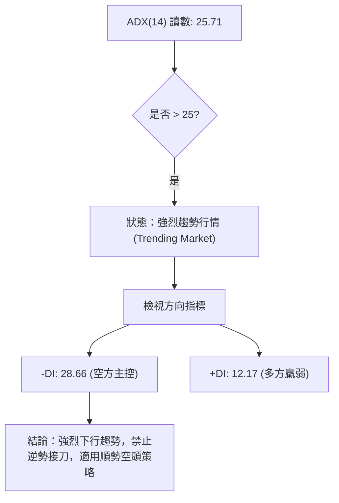

#### ADX 趨勢強度量化對照表

| 指標名稱 | 實際數值 | 門檻區間 | 趨勢屬性判斷 | 交易指引 |
|----------|----------|----------|--------------|----------|
| **ADX (14)** | **25.71** | > 25.0 | 強趨勢形成 | 順應主趨勢操作，擺動指標鈍化風險極高 |
| **+DI (14)** | **12.17** | < 20.0 | 多方動能極度渙散 | 多頭反彈無力，不具備自主推升股價能力 |
| **-DI (14)** | **28.66** | > 25.0 | 空方壓倒性掌控局面 | 下行拋壓強大，盤中衝高易遭空頭壓制 |
| **DI 差值** | **-16.49** | 絕對值擴大 | 空方擴張趨勢 | 趨勢擴散延續，尚未出現收斂跡象 |

---

## 3. 圖表形態分析

### 🔍 形態識別系統

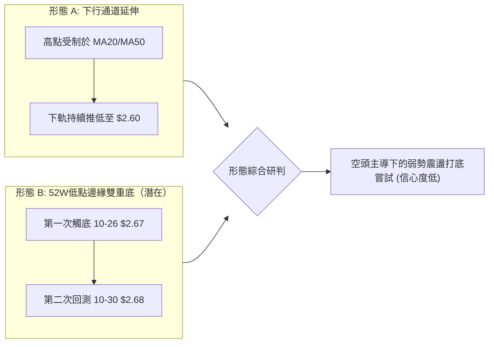

#### 圖表形態信心度量化表

| 形態名稱 | 信心度 | 判斷依據（引用數據） | 完成度 | 目標價（附計算式） |
|----------|--------|----------------------|--------|--------------------|
| **下降通道 (Down Channel)** | **85%** | MA5 ($2.73) < MA10 ($2.79) < MA20 ($2.92) < MA60 ($3.19) 逐級壓制，且日K低點由 10-19 的 $2.86 下移至 10-26 的 $2.67 | **90%** | 下行目標指向布林下軌 **$2.60**（通道下沿支撐推估） |
| **雙重底雛形 (Double Bottom)** | **35%** | 僅依據 10-26 低點 $2.67 與 10-30 低點 $2.68 暫未跌破，但未突破頸線 | **25%** | 頸線阻力 R1 $3.25。若突破：$3.25 + ($3.25 - $2.67) = **$3.83**（信心度不足50%，僅供參考） |

*依規則 15 註明：當前雙底形態信心度僅 35%（低於 50% 門檻），數據不足以確認底部反轉幾何形態，市場主要受制於空頭均線排列，此處僅做指標型低位鈍化解讀，不得視為確立底部。*

### 🕯️ 重要K線形態分析

嚴格依據提供的「近10根日K」與「近8根週K」實際開高低收數據進行客觀解讀：

#### 近 10 根日 K 線形態解讀

| 日期（日K） | 開 | 高 | 低 | 收 | 成交量 | K線形態 | 解讀與多空訊號 |
|-------------|----|----|----|----|--------|---------|----------------|
| **2026-10-19** | 2.93 | 2.94 | 2.86 | 2.87 | 39,331,900 | 中黑棒 | 開高走低，實體跌破 $2.90，空方展開下推 🔴 |
| **2026-10-20** | 2.88 | 2.92 | 2.83 | 2.89 | 54,046,500 | 紡錘線 (Spinning Top) | 量增但實體微小，多空在 $2.88 展開拉鋸 🟡 |
| **2026-10-21** | 2.92 | 2.93 | 2.81 | 2.82 | 49,194,500 | 光頭下影黑棒 | 向上測試 $2.93 均線未果，收在近全日最低 🔴 |
| **2026-10-22** | 2.79 | 2.86 | 2.77 | 2.85 | 48,018,000 | 下跳空反彈小紅棒 | 跳空低開於 $2.79 後收復，空頭力道稍緩 🟡 |
| **2026-10-23** | 2.83 | 2.85 | 2.79 | 2.79 | 43,101,500 | 下跌倒錘子線 | 反抽高點逐日降低，尾盤受壓收於低點 $2.79 🔴 |
| **2026-10-26** | 2.79 | 2.80 | 2.67 | 2.71 | 53,258,700 | 長下影長黑棒 | 盤中重挫至 52W 低點 $2.67，尾盤出現少量抄底 🔴 |
| **2026-10-27** | 2.71 | 2.75 | 2.69 | 2.72 | 66,737,600 | 爆量十字星 (Doji) | 近10日最大量 66.7M，低檔放量震盪，多空分歧 🟡 |
| **2026-10-28** | 2.73 | 2.79 | 2.71 | 2.75 | 55,245,600 | 短陽線 | 嘗試反彈測試 MA5，上影線顯示 $2.79 存在拋壓 🟢 |
| **2026-10-29** | 2.76 | 2.78 | 2.72 | 2.76 | 50,373,300 | 窄幅十字線 | 量能萎縮，追價動能匱乏，反彈停滯 🟡 |
| **2026-10-30** | 2.71 | 2.73 | 2.68 | 2.71 | 54,827,100 | 低位紡錘小黑棒 | 低開走低，收於全日低位 $2.71，空方維持壓制 🔴 |

#### 近 8 根週 K 線形態解讀

| 日期（週K最後日）| 開 | 高 | 低 | 收 | 週成交量 | 週K形態 | 解讀與中期訊號 |
|------------------|----|----|----|----|----------|---------|----------------|
| **2026-09-11** | 3.39 | 3.40 | 2.96 | 3.05 | 354,811,400 | 大長黑棒 | 帶量長黑跌破 $3.30，破位確立 🔴 |
| **2026-09-18** | 3.01 | 3.09 | 2.74 | 2.80 | 362,971,800 | 續跌中黑棒 | 下探 $2.74 低位，空方動能宣洩 🔴 |
| **2026-09-25** | 2.84 | 3.26 | 2.78 | 3.13 | 527,094,200 | 爆量巨幅長下影陽棒 | 5.27 億股巨量換手，強力反彈 🟢 |
| **2026-10-02** | 3.10 | 3.18 | 3.07 | 3.08 | 337,148,400 | 高位窄幅十字線 | 反彈無量跟進，多頭攻勢停頓 🟡 |
| **2026-10-09** | 3.10 | 3.23 | 3.00 | 3.19 | 406,864,800 | 帶量衝高受阻紅棒 | 衝擊阻力位 R1 $3.25 未果，形成高位阻力 🟡 |
| **2026-10-16** | 3.16 | 3.20 | 2.85 | 2.94 | 280,278,600 | 烏雲蓋頂長黑棒 | 跌破 $3.00，前兩週多頭成果盡失 🔴 |
| **2026-10-23** | 2.93 | 2.94 | 2.77 | 2.79 | 233,692,400 | 弱勢黑棒 | 量縮續跌，空頭推進行情 🔴 |
| **2026-10-30** | 2.79 | 2.80 | 2.67 | 2.71 | 280,442,300 | 觸底紡錘陰線 | 回測 52W 低點 $2.67，空方完全控盤 🔴 |

### 📉 ASCII 走勢形態示意圖

```
GRAB 日線近 10 日走勢形態示意圖
價位
$2.95 ┤
$2.90 ┤  [10-19: 2.87]  [10-20: 2.89]
$2.85 ┤          │              │     [10-22: 2.85]
$2.80 ┤          └──────┬───────┘            │
$2.75 ┤                 │ [10-21: 2.82]      └──────┬─────── [10-28: 2.75] [10-29: 2.76]
$2.70 ┤                 │                           │               │       │
$2.65 ┤                 │                    [10-23: 2.79]   [10-27: 2.72]  │
$2.60 ┤                 │                                           └─── [10-30: 2.71]
      └─────────────────┴───────────────────────────────────────────────────────
                         10-26 閃崩低點 $2.67 ◄── 臨界防線
```

### 🎯 形態目標價計算

根據日線下降通道及潛在打底結構計算關鍵測量目標：
1. **下降通道下軌支撐測算**：
   - 形態上軌以 MA20（$2.92）為壓力界限，目前價格偏離中軌之距離為 $\Delta = \$2.92 - \$2.71 = \$0.21$。
   - 推估對稱性下軌目標 = 布林下軌 = **$2.60**。
2. **52週低點若告失守之測算**：
   - 頸線區間高點為 2026-10-09 波段高點 **$3.25**（R1）。
   - 跌破 52W 低點 **$2.67** 後之箱體等幅下行測算：  
     $$\text{下行延伸目標} = \$2.67 - (\$3.25 - \$2.67) = \$2.67 - \$0.58 = \$2.09$$  
     *(註：數據庫中當前下方未偵測到低點聚類支撐，下行空間極度依賴整數心理防線)*。

---

## 4. 支撐與阻力

### 🗺️ 關鍵價位分布圖（Unicode）

```
GRAB 價位結構分布圖
═══════════════════════════════════════════════════════════════════
$3.96 ║████████████████████████████████████████║ 強阻力 R3 (波段高點)
$3.64 ║████████████████████████████            ║ 阻力 R2 (MA200密集區)
$3.25 ║████████████████████████████████████    ║ 關鍵阻力 R1 (BB上軌/前高)
$2.92 ║▓▓▓▓▓▓▓▓▓▓▓▓▓▓▓▓                        ║ 短期均線阻力 (MA20/BB中軌)
$2.71 ╠════════════════════════════════════════╣ ◄ 現價 ($2.71)
$2.67 ║████████████████████████████████████████║ 52週歷史低點 (100% 斐波)
$2.60 ║▓▓▓▓▓▓▓▓▓▓▓▓                            ║ 動態通道下軌 (BB下軌)
(下方)║░░░░░░░░░░░░░░░░░░░░░░░░░░░░░░░░░░░░░░░║ (無波段低點聚類支撐)
═══════════════════════════════════════════════════════════════════
```

### 🚧 阻力位分析表

阻力位嚴格引用系統由波段高點聚類計算之數值：

| 阻力級別 | 精確價位 | 距現價幅幅 | 形成原因與技術共振 | 突破難度 | 重要性 |
|----------|----------|------------|--------------------|----------|--------|
| **R1** | **$3.25** | +19.74% | 2026-10-09 波段高點 $3.23 與布林通道上軌（$3.25）高度聚類；接近 MA60（$3.19） | 🟢 困難 | ★★★★☆ |
| **R2** | **$3.64** | +34.41% | 2026-08-07 與 2026-08-14 密集震盪高點；重合 MA200（$3.63）強大技術均線 | 🟡 極難 | ★★★★★ |
| **R3** | **$3.96** | +46.00% | 2026-07-02 與 2026-07-10 所創波段反彈極限高點（$3.90–$3.93 聚類區間） | 🔴 極高 | ★★★☆☆ |

### 🛡️ 支撐位分析表

支撐位嚴格依據數據庫 OHLCV 計算結果：

| 支撐級別 | 精確價位 | 距現價幅幅 | 形成原因與技術共振 | 守住機率 | 重要性 |
|----------|----------|------------|--------------------|----------|--------|
| **S1 (動態)** | **$2.67** | -1.48% | 52週最低價（100.0% 斐波那契回調位，10-26 最低點）；最後防線 | 🟡 40% | ★★★★★ |
| **S2 (動態)** | **$2.60** | -4.06% | 當前日線布林通道下軌動態下限支撐 | 🟡 50% | ★★★☆☆ |
| **S3 (聚類)** | **N/A** | N/A | 系統原始數據明確標示：*(no swing-low support detected below current price)*。數據中未偵測到波段低點聚類 | 🔴 0% | ★☆☆☆☆ |

### 📐 斐波那契回調位分析

依據 52 週區間波段（最高點 **$6.24** → 最低點 **$2.67**）直接引用數據庫精確計算之回調位：

| 斐波那契回調水平 | 精確價位 ($) | 距現價空間 | 當前技術意涵解讀 |
|------------------|--------------|------------|------------------|
| **0.0% (52W High)** | **$6.24** | +130.26% | 52 週最高峰值，長期牛熊分水嶺 |
| **23.6%** | **$5.39** | +98.89% | 2025-11 破位起跌點區域 |
| **38.2%** | **$4.87** | +79.70% | 2025 年密集震盪中軸阻力 |
| **50.0%** | **$4.45** | +64.21% | 長期下行趨勢的中間平衡閥門 |
| **61.8% (黃金分割)** | **$4.03** | +48.71% | 牛熊轉折關鍵黃金分割壓力 |
| **78.6%** | **$3.43** | +26.57% | 2026-09 破位前之箱體下沿支撐轉阻力 |
| **100.0% (52W Low)**| **$2.67** | -1.48% | **現價 ($2.71) 目前運行於 78.6% ($3.43) 與 100.0% ($2.67) 之間，極度逼近 100% 臨界點** |

**意涵解讀**：現價位於 52W 區間僅 1.1% 之極低水位，股價已吞噬過去一年全部漲幅並測試 100% 斐波回調位（$2.67）。若此處失守，將形成技術面「破底真空」，可能引發被動止損與槓桿斷頭盤。

---

## 5. 技術指標深度解讀

### 🎛️ 指標訊號總覽

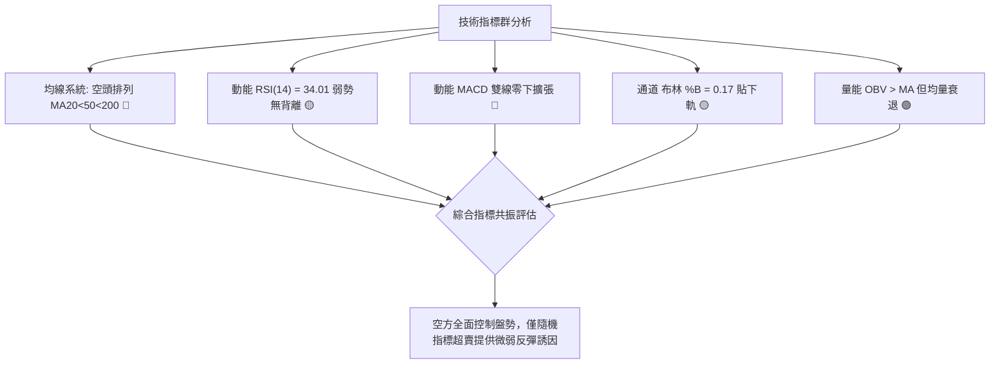

### 📈 移動平均線排列分析

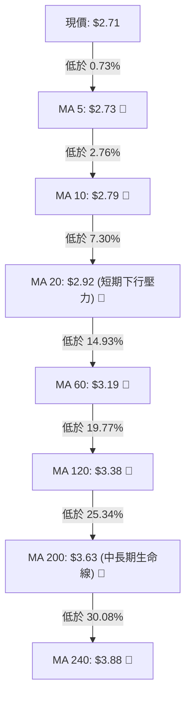

#### 均線發散與乖離監控表

| 均線天期 | 當前價位 | 現價乖離率 | 走勢斜率 | 技術信號判定 |
|----------|----------|------------|----------|--------------|
| **MA 5** | $2.73 | -0.73% | ▼ 向下 | 極短線空頭壓制，未現站上跡象 |
| **MA 10** | $2.79 | -2.76% | ▼ 向下 | 短線反彈第一道天花板（10-28 衝高 $2.79 受阻） |
| **MA 20** | $2.92 | -7.30% | ▼ 向下 | 短期多空分水嶺，與布林中軌重合，形成主跌通道頂 |
| **MA 60** | $3.19 | -14.93% | ▼ 向下 | 中期生命線沉淪，阻力位 R1 ($3.25) 下方防線 |
| **MA 120** | $3.38 | -19.77% | ▼ 向下 | 半年線持續下移，中期反轉機率極低 |
| **MA 200** | $3.63 | -25.34% | ▼ 向下 | 經典牛熊分界線，空頭完全佔領 |
| **MA 240** | $3.88 | -30.08% | ▼ 向下 | 年線沉降，確立長期熊市格局 |

### 📉 RSI(14) 分析

- **當前讀數**：**34.01**（Wilder 計算方法）
- **強度進度條**：
  ```
  RSI(14): 34.01 [███████░░░░░░░░░░░░░] 34% (🟡 中性偏弱 30–70)
  ```
- **背離分析判斷**：
  - **日線背離檢驗**：近 20 根 K 棒價格由 10-19 的 $2.87 下跌至 10-30 的 $2.71，價格走低；RSI 讀數維持在 34.01 水準，數據明確指出「**RSI 背離：無明顯背離**（僅比較近20根K棒首尾價格與RSI方向）」。
  - **結論**：指標如實反映價格下行，不存在隱形買盤底背離，下行動能未耗盡。

### 📊 MACD(12/26/9) 訊號解讀

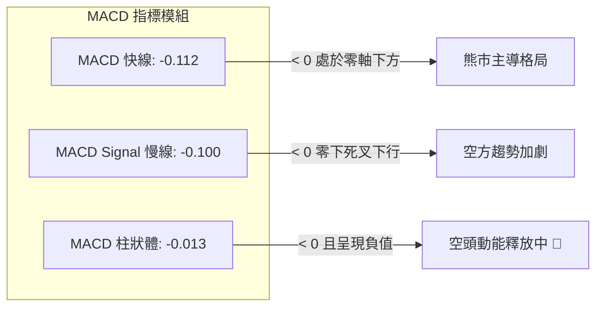

**解讀**：MACD 快線（-0.112）持續低於慢線（-0.100），且雙線深深沉於零軸以下，柱狀體（Hist）為 **-0.013**。雖然負柱體絕對值微小，但未見翻紅金叉，多頭反攻時機未成熟。

### 📦 布林通道分析

```
布林通道現狀示意圖 (寬度上軌 $3.25 至下軌 $2.60)
$3.25 ┬────────────────────────────────────────── BB 上軌 (阻力 R1)
      │
$2.92 ┼ - - - - - - - - - - - - - - - - - - - -  BB 中軌 (MA20)
      │
$2.71 ┼──────────────── ◄ [現價 $2.71，%B = 0.17]
$2.60 ┴────────────────────────────────────────── BB 下軌 (支撐)
```

- **布林參數**：上軌 **$3.25** ｜ 中軌 **$2.92** ｜ 下軌 **$2.60**
- **%B 位置分析**：當前 **%B = 0.17**，介於 0 與 0.5 之間，顯示價格受到中軌無情壓制並沿著下軌運行，這是在強趨勢行情中常見的「黏軌下行」特徵。

### 💹 成交量分析（量價配合度）

1. **量能水準對比**：
   - 最新交易日成交量：**54,827,100**
   - 20 日均量：**60,063,905**（量比 **0.91x**）
   - 50 日均量：**62,661,076**
2. **OBV 趨勢解讀**：
   - 數據顯示：`OBV > MA → 量能支撐上漲`。
   - **矛盾確認**：儘管長期能量潮（OBV）高於其均線，顯示長線資金籌碼未完全潰散（主要歸功於機構持股達 67.4% 與 2026-09-25 爆出 5.27 億股接盤），但近 10 日成交量縮減至 50M–60M 水平，呈現「價跌量平」格局，量能並未在突破關鍵點有效放大，屬被動陰跌。

---

## 6. 動能與波動率

### ⚡ 動能評估四象限

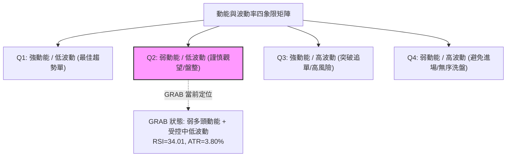

#### 動能評估象限分析表

| 象限代號 | 動能屬性 | 波動屬性 | 代表技術特徵 | GRAB 當前定位 | 策略應對指引 |
|----------|----------|----------|--------------|:-------------:|--------------|
| **Q1** | 強多頭 | 低波動 | 穩步上行通道 | — | 積極順勢做多 |
| **Q2** | **弱動能** | **低/中波動**| **沉降陰跌，ATR=3.80%** | **✓ (符合現況)** | **謹慎觀望，反彈逢高做空** |
| **Q3** | 強空頭 | 高波動 | 恐慌崩跌突破 | — | 嚴設停損快速追空 |
| **Q4** | 混亂 | 高波動 | 寬幅震盪洗盤 | — | 空倉退場休息 |

### 📊 ATR 波動率分析

- **ATR(14) 數值**：**$0.10**（佔股價比例 **3.80%**，採 Wilder 平滑計算法）
- **日內波動特徵**：近 10 日單日震幅平均介於 $0.06 至 $0.13 之間（如 10-26 高低差 $0.13、$2.80–$2.67），波動幅度處於理性範圍。
- **風控止損距離建議**：
  - **極短線（Day/Swing Trade）**：$1.5 \times \text{ATR} = \$0.15$
  - **波段操作（Position Trade）**：$2.0 \times \text{ATR} = \$0.20$
  - 止損價格設置應避開 ATR 正常噪音震盪區間。

### 📐 Beta 與市場相關性

- **Beta 係數**：**0.908**
- **市場特徵分析**：
  - Beta < 1.0 表明 GRAB 的系統性市場風險略低於標普500大盤指數，其波動對大盤暴跌或暴漲具備一定的內生防禦性。
  - 然而，近期走勢顯著弱於美股整體指數，主因係其自身基本面與財務沉重壓力（自由現金流 FCF 為 $-186.00M$、營業現金流為 $-61.00M$），導致走勢脫離宏觀指數，呈現個股特異性下行。

---

## 7. 多時框架總結

### 📋 時框架評分表

| 時框架 | 趨勢方向 | 動能狀態 | 均線排列 | 形態特徵 | 綜合評分 | 建議方針 |
|--------|----------|----------|----------|----------|:--------:|----------|
| **長線 (月線)** | 🔴 下行熊市 | 負向加速 | 空頭發散 | 連續破底，跌穿 $3.00 關卡 | **25/100** | 嚴禁長線無腦盲目抄底 |
| **中線 (週線)** | 🔴 主跌波段 | MACD 零下 | MA50 壓制 | 高點降低，測試 $2.67 低點 | **30/100** | 逢反彈測試阻力偏空操作 |
| **短線 (日線)** | 🔴 弱勢承壓 | Stoch 超賣 | 空頭排列 | 下降通道，布林下軌震盪 | **35/100** | 不追空，等待反抽阻力點進場 |

### 🔲 綜合訊號矩陣

```
訊號維度對照矩陣
╔══════════════════╦══════════════╦══════════════╦══════════════╗
║ 分析維度         ║ 短期 (日線)  ║ 中期 (週線)  ║ 長期 (月線)  ║
╠══════════════════╬══════════════╬══════════════╬══════════════╣
║ 趨勢方向         ║ 🔴 下跌      ║ 🔴 下跌      ║ 🔴 下跌      ║
║ 均線排列         ║ 🔴 空頭排列  ║ 🔴 空頭排列  ║ 🔴 空頭排列  ║
║ 動能指標         ║ 🟡 超賣中性  ║ 🔴 弱勢負值  ║ 🔴 負向加速  ║
║ 成交量能配合     ║ 🟡 縮量整理  ║ 🟢 長期量能  ║ 🟡 資金撤離  ║
║ 形態結構評估     ║ 🔴 逼近底邊  ║ 🔴 烏雲蓋頂  ║ 🔴 崩解破位  ║
╠══════════════════╬══════════════╬══════════════╬══════════════╣
║ 矩陣收斂結果     ║ 🔴 空方完勝  ║ 🔴 趨勢一致  ║ 🔴 阻力最小  ║
╚══════════════════╩══════════════╩══════════════╩══════════════╝
```

### ⚖️ 多時框收斂結論

依據多時框收斂規則（規則 14）：
1. **趨勢/盤整定性**：當前 **ADX(14) = 25.71 > 25**，明確定義當前盤面為**「趨勢行情（Trending Market）」**而非區間盤整行情。
2. **主導時框裁決**：在強趨勢下，日線級別的擺動指標（如 Stoch %K=8.33 嚴重超賣）僅能用來尋找反抽高點的優質進場時機，不可作為反轉逆向做多的主要藉口；行情方向必須完全服從中長期（週線、MA50 $3.10、MA200 $3.63）強大空頭壓制方向。
3. **唯一方向性結論**：**極度偏空（Bearish）**。日線的短暫抗跌並未改變多時框全面向下共振的格局。

---

## 8. 交易策略建議

### 🗺️ 策略決策流程圖

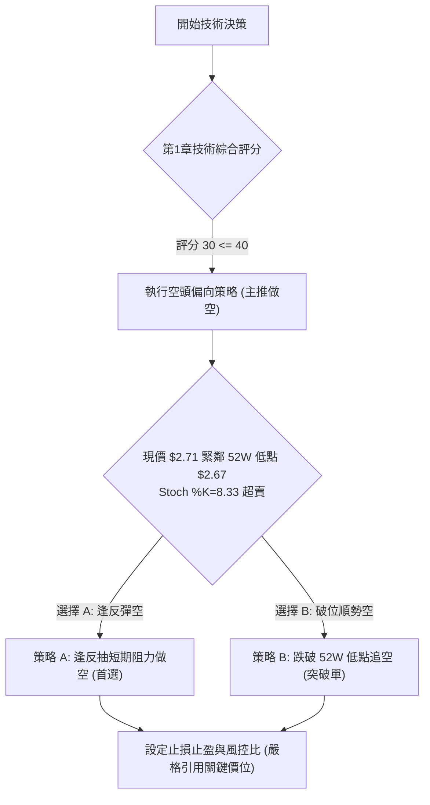

### 🧭 策略路由（依評分卡分流）

> **當前主策略方向 = 主推空頭策略（依綜合評分 30/100，低於 40 分標準，依規則 18 嚴格執行）**

多頭操作在此架構下風險極大，僅視為空頭部位的避險對沖或獲利平倉訊號，絕不可盲目重倉逆勢摸底。

### 🎯 價格情境階梯（Price Scenarios）

價位嚴格引用關鍵價位區塊與斐波那契回調數據：

| 觸發條件 | 下一目標 | 後續延伸 | 情境含義解讀 |
|----------|----------|----------|--------------|
| **強勢突破 R1 $3.25** | R2 **$3.64** | R3 **$3.96** | 空頭結構被破壞，中期轉強反轉訊號 |
| **小幅反彈至 MA20 $2.92** | 回測現價 **$2.71** | 測試 S1 **$2.67** | 短線超賣反抽，提供空方優質加碼點 |
| **維持現價區間震盪** | 上限 **$2.79 (MA10)**| 下限 **$2.67 (52W底)**| 築底分歧，指標以時間換取空間 |
| **有效跌破 S1 $2.67** | S2 **$2.60 (BB下軌)** | 無聚類支撐（真空） | 52週新低破位，觸發拋售潮，中期重度轉弱 |

### 📊 情境機率分佈

| 盤整與突破情境 | 機率 | 主要技術依據 |
|----------------|:----:|--------------|
| **空頭下破 / 再創新低** | **60%** | ADX=25.71 強趨勢確立；均線全面空頭排列；-DI=28.66 遠高於 +DI；現價距 52W 低點僅 1.1% |
| **低位區間弱勢震盪** | **30%** | Stoch %K=8.33 極度超賣；OBV 仍高於均線存在長線鎖倉籌碼；近4日低點在 $2.67–$2.71 抵抗 |
| **全面多頭反轉向上** | **10%** | 缺乏底背離確認；上方 R1 $3.25 與 MA20/MA50 形成重重重壓，無基本面現金流改善配合 |

### 🟢 主策略詳情（方向：空頭主推）

所有價位均精確引用已計算數值，嚴格遵循規則 17 計算風險報酬比：

| 策略要素 | 策略 A（反抽阻力放空 — 最佳勝率） | 策略 B（破位追空 — 順勢動能） |
|----------|-----------------------------------|--------------------------------|
| **進場條件** | 股價短線超賣反抽受阻於 MA20 ($2.92) 或 R1 下沿，出現遇阻黑棒 | 股價實體跌破 52W 低點 $2.67，空頭動能釋放 |
| **進場價格** | **$2.92**（精確取自 MA20 / 布林中軌） | **$2.67**（精確取自 52W Low / 100% 斐波） |
| **目標價 T1** | **$2.71**（現價 / 前期密集成交位） | **$2.60**（精確取自日線布林通道下軌） |
| **目標價 T2** | **$2.67**（52W 歷史低點防線） | **$2.09**（形態高度等幅推算值：$2.67 - ($3.25-$2.67)） |
| **止損價格** | **$3.02**（取進場價 + 1.0×ATR $0.10） | **$2.71**（現價 / 跌破前的起跌回抽點） |
| **風險報酬比** | **1 : 2.10（以 T1 計）**<br>計算式：$(2.92 - 2.71) \div (3.02 - 2.92) = 0.21 \div 0.10 = 2.10$<br>*[另列至 T2 比值：1 : 2.50（以 T2 計）]* | **1 : 1.75（以 T1 計）**<br>計算式：$(2.67 - 2.60) \div (2.71 - 2.67) = 0.07 \div 0.04 = 1.75$<br>*[另列至 T2 比值：1 : 14.50（以 T2 計）]* |
| **成功機率** | **65%** | **55%** |
| **建議倉位** | **總資金之 10%–15%** | **總資金之 5%–8%**（跌破追單謹防假突破） |

### 🔴 反向風險觸發點（對沖提示）

若發生以下事件，必須無條件推翻空頭邏輯並全數停損出場：
1. **日線收盤價帶量突破 MA20（$2.92）**：宣告極弱勢下行通道遭到破壞，可能轉為大規模寬幅震盪。
2. **週線級別站穩關鍵阻力 R1（$3.25）**：確立雙底或大型頭肩底反轉結構，屆時空頭必須全線翻多。

### ⭐ 整體訊號強度評星

```
做多訊號強度：★☆☆☆☆  (1/5星) ── 僅擺動超賣，無形態與結構支撐
做空訊號強度：★★★★☆  (4/5星) ── 趨勢、均線、動能指標多方共振偏空
整體可信度：  ★★★★☆  (4/5星) ── 數據完整，趨勢清晰，指標無重大衝突
```

---

## 9. 風險提示與監控

### ✅ 關鍵監控指標 Checklist

```
╔══════════════════════════════════════════════════════════════╗
║               關鍵監控指標 CHECKLIST (每日盤後覆核)           ║
╠══════════════════════════════════════════════════════════════╣
║ [ ] 52W 低點 $2.67 是否被盤中或收盤跌破？ (破位確認訊號)      ║
║ [ ] RSI(14) 是否跌破 30 進入極度超賣鈍化區？ (<30 加速拋售)   ║
║ [ ] 日成交量是否顯著超越 20 日均量 (60.06M) 達 1.5 倍以上？   ║
║ [ ] MACD 柱狀體是否由負翻正 (Hist > 0) 形成金叉？ (反抽警訊)  ║
║ [ ] 股價是否觸及或突破 MA20 ($2.92) 壓制線？ (空單停損點)     ║
║ [ ] 布林通道帶寬是否開始向外急劇張口？ (波動率擴張訊號)       ║
╚══════════════════════════════════════════════════════════════╝
```

### ⚠️ 風險場景分析

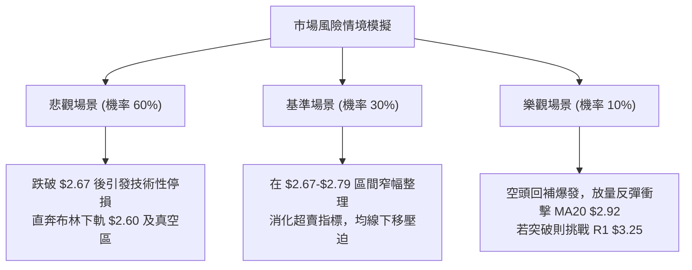

### 🛡️ 風險管理重要提醒

1. **破底無支撐真空風險**：
   - 由於目前價格 $2.71 緊鄰 52 週最低點 $2.67，且數據庫中明確認定下方「未偵測到底部波段低點支撐」。一旦 $2.67 被有效擊穿，技術買盤將徹底消失，容易引發流動性踩踏。
2. **超賣技術性抽頭風險**：
   - 隨機指標 Stochastic %K（8.33）已處於極端超賣區域，空頭在此位置切忌情緒化追空，必須提防突發性的無量空頭回補（Short Squeeze）反抽。
3. **倉位管理紀律**：
   - 單筆空單最大損失上限應嚴格限制於總投資組合淨值的 **1.0%–1.5%** 之內。
   - 嚴格採用分批建倉與金字塔式加碼，絕不逆勢攤平虧損部位。

---

## 📋 報告總結

```
╔══════════════════════════════════════════════════════════════════╗
║                    GRAB 技術分析報告總結                         ║
╠══════════════════════════════════════════════════════════════════╣
║ 報告日期：2026-11-02                                             ║
║ 當前價格：$2.71 USD                                              ║
║ 分析評級：🔴 偏空強趨勢 (綜合技術評分: 30/100)                    ║
║                                                                  ║
║ 關鍵結論：                                                       ║
║ ├─ 長期趨勢：🔴 崩解破位，12 個月內從 $6.02 陰跌至 $2.71         ║
║ ├─ 中期趨勢：🔴 週線烏雲蓋頂，反彈高點持續下移，承壓於 MA200     ║
║ ├─ 短期趨勢：🔴 空頭排列，逼近 52W 低點 $2.67，ADX=25.71 趨勢強  ║
║ ├─ 關鍵支撐：S1: $2.67 (52W底) ｜ S2: $2.60 (BB下軌)             ║
║ ├─ 關鍵阻力：R1: $3.25 ｜ R2: $3.64 ｜ R3: $3.96                 ║
║ └─ 分析師目標：共識 Target Mean $5.49 (技術面嚴重背離基本面預期)  ║
║                                                                  ║
║ 最優策略組合：                                                   ║
║ 1. 🥇 最佳機會：策略 A (反抽至 MA20 $2.92 做空，風報比 1:2.10)  ║
║ 2. 🥈 次選機會：策略 B (破位 $2.67 追空至 BB下軌 $2.60)          ║
║ 3. 🥉 保守選擇：完全空倉觀望，靜待 $2.67 攻防結果與明確底部形成 ║
╚══════════════════════════════════════════════════════════════════╝
```

---

> ⚠️ **免責聲明**：本報告為技術分析研究，所有數據、圖表及價位推算均嚴格基於所提供的歷史交易資訊與客觀技術指標運算。本報告**僅供研究與學術參考**，**不構成任何要約、招攬或投資建議**。市場有風險，交易需獨立判斷並自負盈虧。

---

*報告生成時間：2026-11-02 ｜ 數據來源：Yahoo Finance ｜ 分析框架：多時框技術分析*