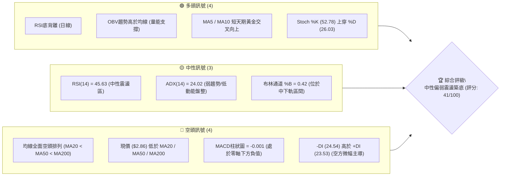
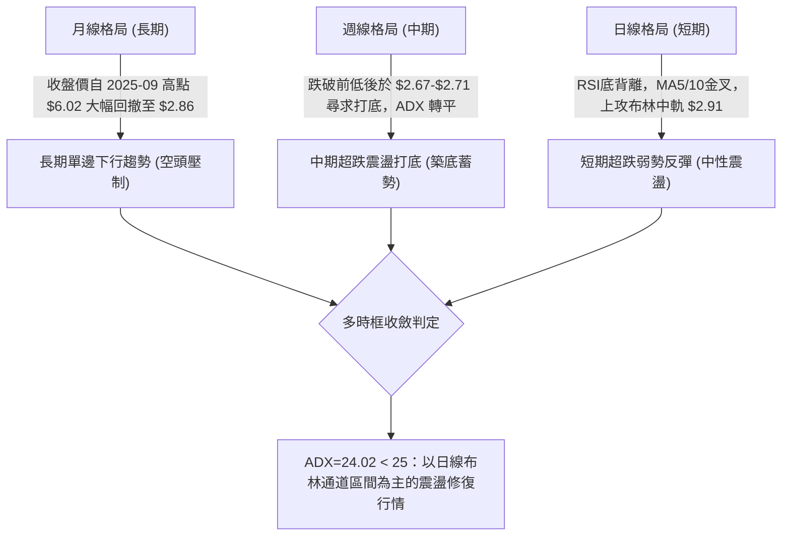
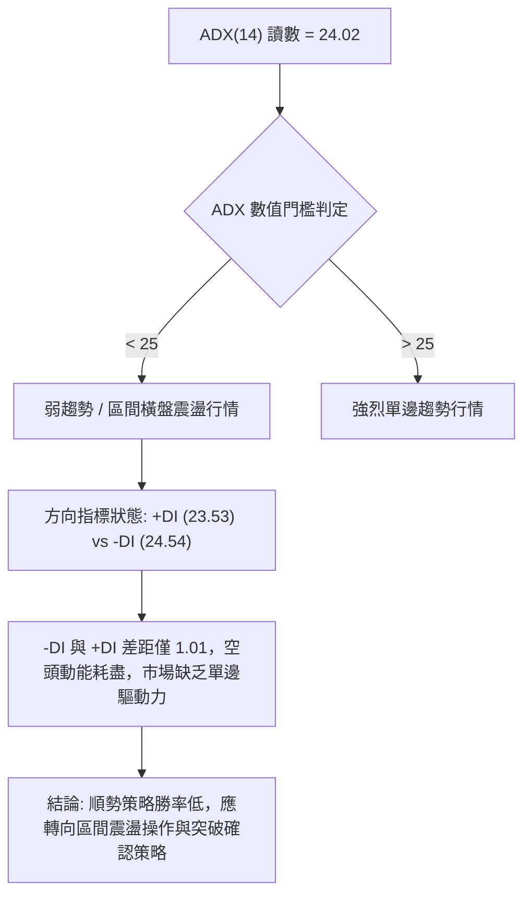
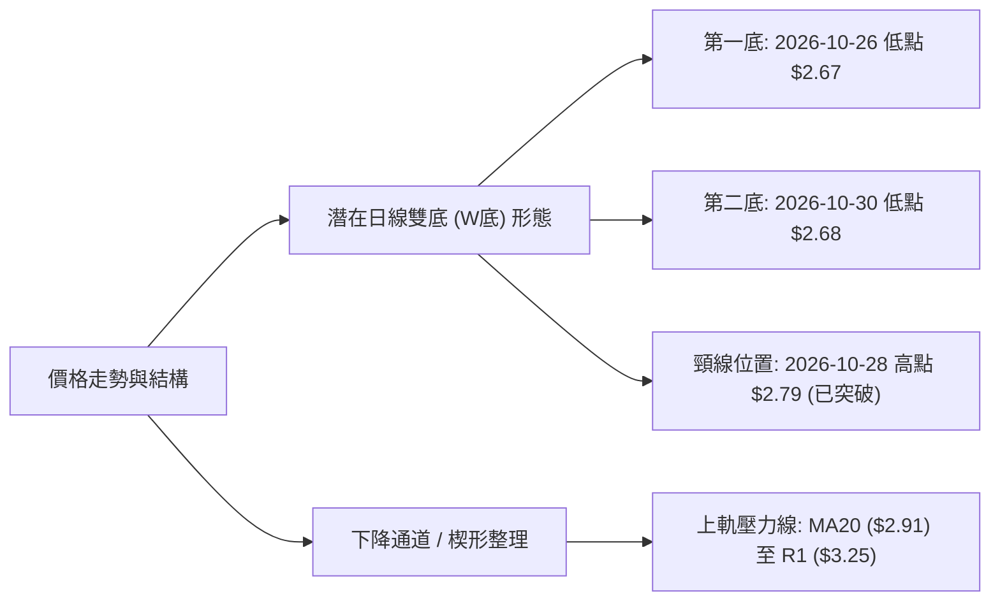
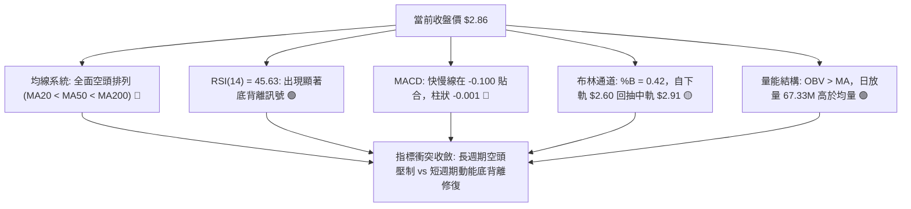
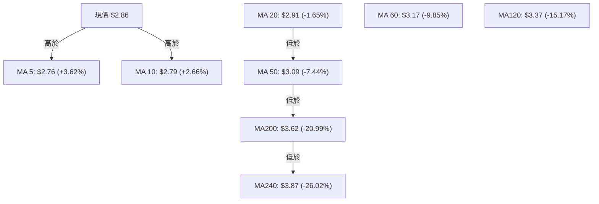
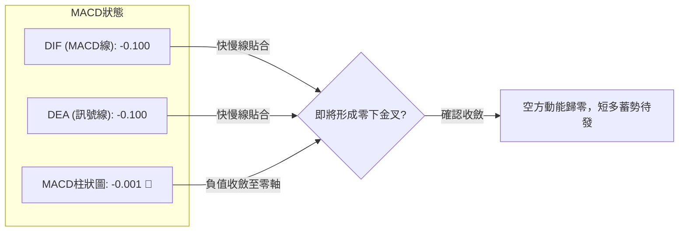
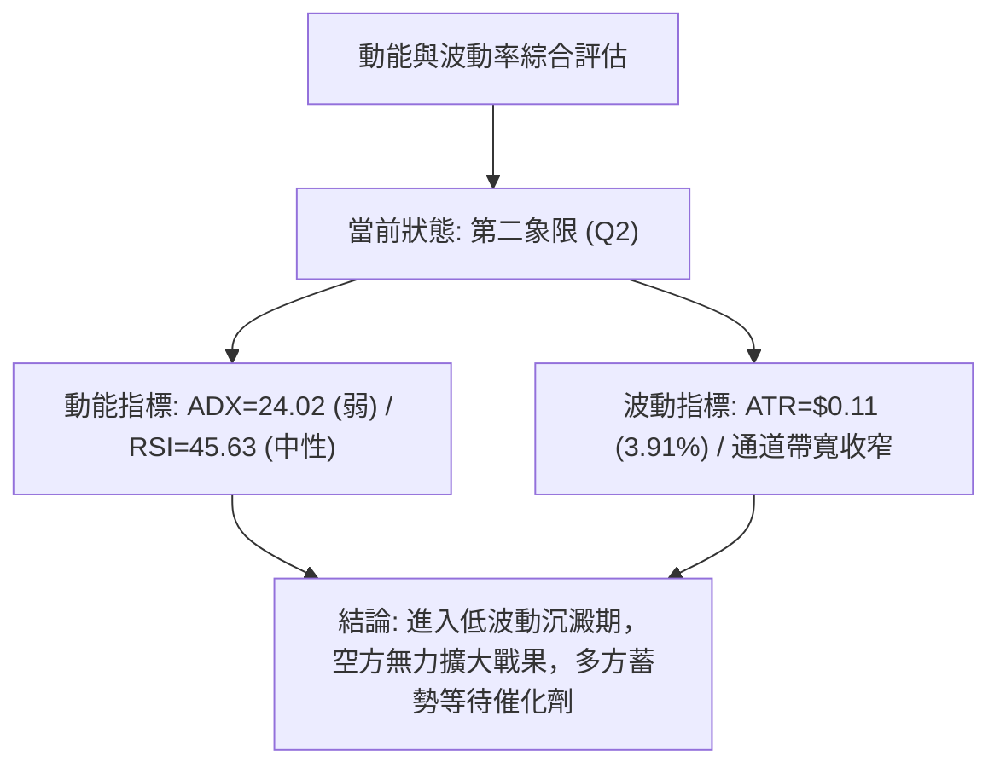
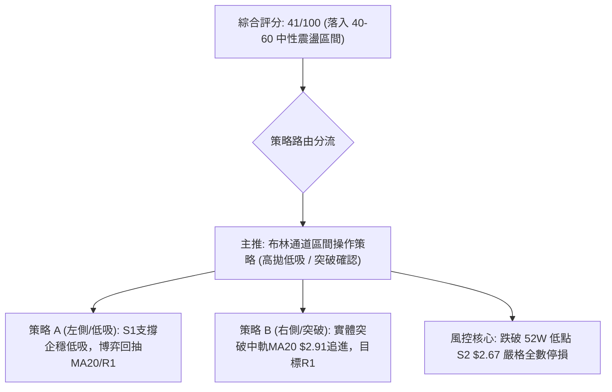
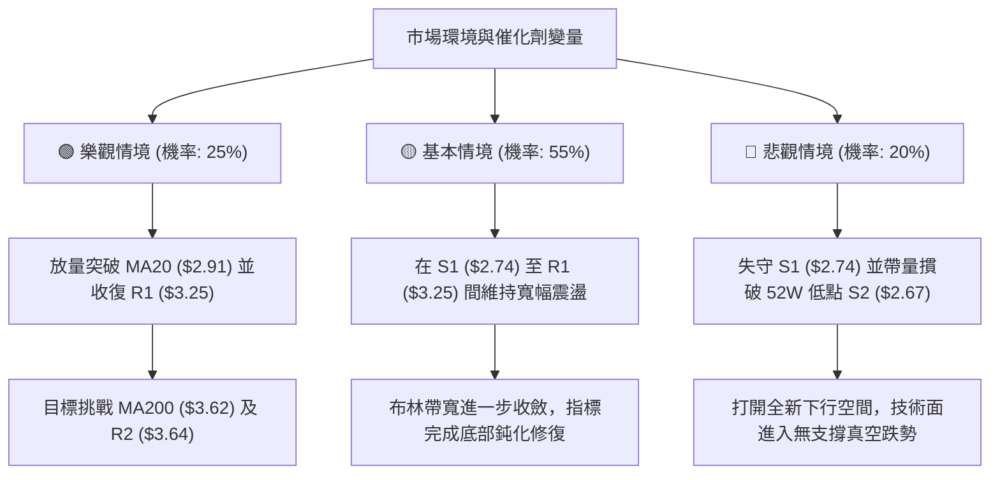

# GRAB 技術分析報告

> **報告日期**：2026-11-03 ｜ **語言**：繁體中文 ｜ **數據來源**：Yahoo Finance ｜ **當前價格**：$2.86 USD

---

## 目錄

| 章節 | 內容 |
|------|------|
| [1. 技術面概覽](#1-技術面概覽) | 訊號儀表板、核心指標、評分卡 |
| [2. 趨勢分析](#2-趨勢分析) | 多時框趨勢、長中短期走勢、ADX強度 |
| [3. 圖表形態分析](#3-圖表形態分析) | 形態識別、K線組合、目標價推算 |
| [4. 支撐與阻力](#4-支撐與阻力) | 關鍵價位、斐波那契回調結構 |
| [5. 技術指標深度解讀](#5-技術指標深度解讀) | MA/RSI/MACD/布林/成交量量價解析 |
| [6. 動能與波動率](#6-動能與波動率) | 動能四象限、ATR波動率、Beta關聯度 |
| [7. 多時框架總結](#7-多時框架總結) | 時框矩陣、多時框收斂定調 |
| [8. 交易策略建議](#8-交易策略建議) | 策略路由、主策略、情境階梯、風報比 |
| [9. 風險提示與監控](#9-風險提示與監控) | 監控清單、風險情境、資金管理 |
| [📋 報告總結](#-報告總結) | 結論總覽與決策矩陣 |

---

## 1. 技術面概覽

### 🎯 技術訊號儀表板



### 📊 核心指標速覽表

| 指標類別 | 指標名稱 | 當前數值 | 訊號 | 解讀 |
|:---|:---|:---|:---:|:---|
| **價格** | 當前收盤價 | $2.86 | 🔴 | 位於52週區間5.3%的極低位階，中長期格局極度疲弱 |
| **均線** | 短期 MA20 | $2.91 | 🔴 | 現價低於MA20 (-1.65%)，MA20走平微降，構成第一道動態壓制 |
| **均線** | 中期 MA50 | $3.09 | 🔴 | 現價低於MA50 (-7.44%)，中期下降趨勢未扭轉 |
| **均線** | 長期 MA200 | $3.62 | 🔴 | 現價大幅低於牛熊分界線 (-20.99%)，長期結構為徹底空頭 |
| **動能** | RSI(14) | 45.63 | 🟡 | 脫離超賣區進入中性區間，且呈現日線級別「底背離」修復形態 |
| **動能** | MACD柱狀圖 | -0.001 | 🔴 | MACD線(-0.100)與訊號線(-0.100)貼合，柱狀微負，空方動能減弱但未翻多 |
| **動能** | 隨機指標 Stoch | %K 52.78 / %D 26.03 | 🟢 | 快線強勢由低檔反彈上穿慢線，短線出現超賣後的動能修復波 |
| **趨勢** | ADX (14) | 24.02 | 🟡 | ADX < 25 表明單邊空頭趨勢衰竭，市場進入低波動區間盤整沉澱期 |
| **方向** | 方向性指標 (DMI) | +DI 23.53 / -DI 24.54 | 🟡 | 兩者極度接近，空方優勢已由絕對主導轉為脆弱平衡 |
| **通道** | 布林通道帶寬 | 下軌 $2.60 / 上軌 $3.21 | 🟡 | %B = 0.42，價格自下軌獲得支撐後正朝中軌 $2.91 進行回測 |
| **量能** | 當日量 / 20日均量 | 67.33M / 59.53M (量比 1.13x) | 🟢 | 溫和放量收陽，量能超越20日均量，呈現量價同步回溫特徵 |
| **波動** | ATR(14) | $0.11 (3.91%) | 🟡 | 日內平均真實波動幅為 $0.11，波動度處於中等偏低收斂期 |

### 🏆 技術評分卡

```
╔══════════════════════════════════════════════════════════════════╗
║                   技術評分卡 — GRAB (2026-11-03)                 ║
╠══════════════════════════════════════════════════════════════════╣
║ 趨勢強度 (Trend)     ███████░░░░░░░░░░░░░  35/100  🔴 空頭排列但動能趨弱 ║
║ 動能指標 (Momentum)  ███████████░░░░░░░░░  55/100  🟡 RSI底背離激發回彈 ║
║ 支撐穩定度 (Support) ████████░░░░░░░░░░░░  40/100  🔴 依託S1 $2.74弱勢防守 ║
║ 成交量配合 (Volume)  ████████████░░░░░░░░  60/100  🟢 OBV量能確認短底結構 ║
║ 形態完整度 (Pattern) ████████░░░░░░░░░░░░  40/100  🔴 雙底雛形未突破頸線 ║
║ 均線排列 (MAs)       ████░░░░░░░░░░░░░░░░  18/100  🔴 全週期均線倒掛下行 ║
╠══════════════════════════════════════════════════════════════════╣
║ 綜合評分 (Overall)   ████████░░░░░░░░░░░░  41/100  🟡 弱勢盤整 / 區間操作║
║ 算術平均：(35 + 55 + 40 + 60 + 40 + 18) ÷ 6 = 41.33 → 四捨五入 41/100 ║
╚══════════════════════════════════════════════════════════════════╝
```

---

## 2. 趨勢分析

### 🌐 多時框趨勢分析



### 📈 長期趨勢 — 12個月走勢圖（Unicode）

```
GRAB 月線走勢圖（過去12個月：2025-12 至 2026-11）
價格軸 ($)
$5.00 ┤ ● (2025-12: $4.99)
$4.50 ┤      ● (2026-01: $4.30)
$4.20 ┤           ● (2026-02: $4.22)
$3.80 ┤                ● (2026-04: $3.82)   ● (2026-06: $3.77)
$3.50 ┤                     ● (2026-03: $3.66)   ● (2026-05: $3.54)   ● (2026-07: $3.50)  ● (2026-08: $3.54)
$3.10 ┤                                                                                        ● (2026-09: $3.11)
$2.80 ┤                                                                                                             ● (2026-11: $2.86 現價)
$2.60 ┤                                                                                                        ● (2026-10: $2.71 52W低點聚類)
      └─────────────────────────────────────────────────────────────────────────────────────────────────────────────
        12月   1月   2月   3月   4月   5月   6月   7月   8月   9月   10月  11月 (2026)
```

#### 走勢特徵分析表格

| 階段區間 | 起始價 → 終止價 | 漲跌幅 | 走勢特徵與結構解析 |
|:---|:---|:---:|:---|
| **第一階段：高檔加速破位**<br>(2025-12 至 2026-03) | $4.99 → $3.66 | -26.65% | 跌破 $5.00 整數關卡，各期均線開始發散下行，法人拋壓湧現。 |
| **第二階段：中期平台整理**<br>(2026-04 至 2026-08) | $3.82 → $3.54 | -7.33% | 於 $3.50 - $3.82 構築長達5個月的水平橫盤，形成現今重要的阻力堆積區。 |
| **第三階段：下箱體破位尋底**<br>(2026-09 至 2026-10) | $3.54 → $2.71 | -23.45% | 放量跌破 $3.50 支撐，創下 52 週新低 $2.67，技術面指標嚴重超賣。 |
| **第四階段：超賣底背離初醒**<br>(2026-10 至 2026-11) | $2.71 → $2.86 | +5.54% | 觸及 52W 低點 $2.67 後企穩，日K線連收陽線，開始向上挑戰 MA20。 |

### 📊 中期趨勢（週線分析）

```
週線近期架構示意圖（2026-09 至 2026-11）
價位 ($)
$3.64 ─── 阻力區 R2 (週線中長黑K起跌平台)
          │
$3.25 ─── 阻力區 R1 (2026-09-25 週K反彈高點 $3.26 / 10-09高點 $3.23 聚類)
          │
$2.91 ─── 動態均線中軌 (日線MA20 / 週線下行反壓)
          │
$2.86 ─── 【當前收盤價】(試圖築底)
          │
$2.74 ─── 關鍵支撐 S1 (2026-09-18 週K低點 $2.74)
          │
$2.67 ─── 強支撐 S2 (2026-10-30 週K創下的 52週歷史低點 $2.67)
```

中期週線數據顯示，GRAB 歷經 2026 年 9 月中的重挫後，於 2026-09-25 該週暴出 527.09M 的歷史天量收出長紅K棒（收盤 $3.13），隨後在 10 月回測低點時，成交量萎縮至 233M - 280M，呈現「放量上漲、縮量回踩」的量價背離企穩特徵。

### ⚡ 趨勢強度評估（ADX 解讀）



#### ADX 強度對照表

| ADX 數值區間 | 當前數值 | 趨勢狀態判定 | 交易策略指導原則 |
|:---:|:---:|:---:|:---|
| 0 – 20 | — | 無實質趨勢，極度鈍化 | 嚴格禁止趨勢突破單，僅能觀望 |
| **20 – 25** | **24.02** | **趨勢疲弱 / 處於轉換盤整期** | **以布林通道上下軌與核心支撐阻力為操作界限** |
| 25 – 40 | — | 良好單邊趨勢（多或空） | 順勢持有，逢均線回調進場 |
| 40 – 60 | — | 強烈單邊趨勢 | 加碼主要趨勢部位，拉開移動止損 |

---

## 3. 圖表形態分析

### 🔍 形態識別系統



#### 形態信心度與目標價評估表

| 形態名稱 | 信心度 | 判斷依據（嚴格引用數據） | 完成度 | 目標價（附計算式，依規則13/15） |
|:---|:---:|:---|:---:|:---|
| **短期雙底 (W-Bottom)** | 62% | 左底 2026-10-26 最低 $2.67，右底 2026-10-30 最低 $2.68（相距僅 $0.01）；頸線取 2026-10-28 高點 $2.79。現價 $2.86 已突破該頸線。 | 75% | **短線量度目標 = $2.91**<br>計算式：頸線 $2.79 + 形態高度 ($2.79 − $2.67 = $0.12) = $2.91（剛好與 MA20 及布林中軌重合）。 |
| **中期寬幅頭肩頂** | 35% | 訊號不足，僅做指標型解讀。雖自 2025 年高點下落，但右側結構雜亂，不符合幾何形態標準。 | 20% | 數據不足以確認完整形態，不予推算量度目標。 |

### 🕯️ 重要K線形態分析

根據「近10根日K」與「近8根週K」之精確數值進行解讀：

| 日期（週期） | 開盤 | 最高 | 最低 | 收盤 | 成交量 | K線形態名稱 | 形態特徵解讀 | 訊號 |
|:---|:---:|:---:|:---:|:---:|:---:|:---|:---|:---:|
| **2026-10-26 (日K)** | 2.79 | 2.80 | 2.67 | 2.71 | 53,258,700 | **長下影破底陰線** | 盤中殺破前低觸及 52W 新低 $2.67 後獲低接買盤收窄跌幅，形成極長下影線（影線長達 $0.04）。 | 🟡 |
| **2026-10-27 (日K)** | 2.71 | 2.75 | 2.69 | 2.72 | 66,737,600 | **放量陽線十字** | 量能增至 66.73M，回測 $2.69 未破前低，多空在底部產生劇烈換手。 | 🟢 |
| **2026-10-30 (日K)** | 2.71 | 2.73 | 2.68 | 2.71 | 54,900,200 | **倒錘頭小紅星** | 最低點 $2.68 確立右底不破，開盤等於收盤，空方殺盤動能衰竭。 | 🟢 |
| **2026-11-02 (日K)** | 2.76 | 2.93 | 2.75 | 2.86 | 67,334,000 | **放量長陽實體線** | 實體由 $2.76 推進至 $2.86，盤中衝高至 $2.93，突破近 5 日整理平台，量增至 67.33M。 | 🟢 |
| **2026-10-23 (週K)** | 2.93 | 2.94 | 2.77 | 2.79 | 233,692,400 | **縮量下行中陰線** | 持續下行破位，但週成交量顯著萎縮至 2.33 億股，賣壓逐步枯竭。 | 🔴 |
| **2026-10-30 (週K)** | 2.79 | 2.80 | 2.67 | 2.71 | 280,515,400 | **帶下影極限長黑** | 探至 52W 低點 $2.67 後反抽，下影線長達 $0.04，顯現機構買盤在 $2.67 築起防線。 | 🟡 |

### 📉 ASCII 走勢形態示意圖

```
日線短波雙底 (W-Bottom) 結構展開圖
價位 ($)
$2.93 ──────────────────────────────────────── 2026-11-02 盤中高點（衝刺MA20）
$2.91 ─ ─ ─ ─ ─ ─ ─ ─ ─ ─ ─ ─ ─ ─ ─ ─ ─ ─ ─ ─ 形態量度滿足點 / MA20動態壓制
$2.86 ────────────────────────────────────● 當前收盤價 ($2.86)
                                         ╱
$2.79 ───────────────● (10-28 頸線高點) ╱
                    ╱ ╲                ╱
$2.75 ──────●      ╱   ╲        ●     ╱
           ╱ ╲    ╱     ╲      ╱ ╲   ╱
$2.71 ────●   ╲  ╱       ●    ●   ╲ ╱
               ╲╱         ╲  ╱     ●
$2.67 ─────────●           ╲╱
          (左底 10-26)   (右底 10-30: $2.68)
```

### 🎯 形態目標價計算

1. **短期雙底目標價**：
   - 雙底頸線：$2.79（2026-10-28 最高點）
   - 雙底底部基準：$2.67（2026-10-26 52W最低點）
   - 形態垂直高度 $H = \$2.79 - \$2.67 = \$0.12$
   - 形態等幅測量目標 $T1 = 頸線 + H = \$2.79 + \$0.12 = \mathbf{\$2.91}$（此目標價與 MA20 及布林中軌精確重疊）。
2. **中期阻力目標價**：
   - 若有效站上 $2.91，將挑戰關鍵價位區塊所計算之阻力位 **R1: $3.25**（波段高點聚類位階）。

---

## 4. 支撐與阻力

### 🗺️ 關鍵價位分布圖（Unicode）

```
GRAB 價位結構分布圖 (依據 OHLCV 計算)
═══════════════════════════════════════════════════════════════
$3.96 ║██████████████████████████████║ 強阻力 R3 (+38.34%)
$3.64 ║████████████████████          ║ 中期重大阻力 R2 (+27.36% / 接近MA200 $3.62)
$3.25 ║████████████████████████      ║ 近端波段阻力 R1 (+13.46%)
$2.91 ║────────── 虛擬動態壓制 ─────────║ 布林中軌 / MA20 ($2.91)
$2.86 ╠══════════════════════════════╣ ◄ 現價 ($2.86)
$2.74 ║▓▓▓▓▓▓▓▓▓▓▓▓▓▓▓▓              ║ 近期波段支撐 S1 (-4.20%)
$2.67 ║██████████████████████████████║ 52週歷史強支撐 S2 (-6.64%)
═══════════════════════════════════════════════════════════════
```

### 🚧 阻力位分析表

價位嚴格引用技術數據「關鍵價位」區塊之波段高點聚類：

| 阻力級別 | 價位 | 形成原因與籌碼結構 | 突破難度 | 重要性評級 |
|:---:|:---:|:---|:---:|:---:|
| **R1** | **$3.25** | 近一年波段高點聚類（2026-09-25 週K高點 $3.26、2026-10-09 週K高點 $3.23 重疊區），同時受制於布林上軌 $3.21 與 MA60 $3.17。 | 中等偏高 | ★★★★☆ |
| **R2** | **$3.64** | 中期平台崩塌點（2026-08 平台整理區下軌），且與長期牛熊線 MA200 ($3.62) 高度重疊，大量被套牢籌碼沉澱於此。 | 極高 | ★★★★★ |
| **R3** | **$3.96** | 2026-07 波段反彈高點（2026-07-10 週末收盤 $3.93 聚類區），中長期大頸線位置。 | 極為艱難 | ★★★☆☆ |

### 🛡️ 支撐位分析表

價位嚴格引用技術數據「關鍵價位」區塊之波段低點聚類：

| 支撐級別 | 價位 | 形成原因與防守買盤分析 | 守住機率 | 重要性評級 |
|:---:|:---:|:---|:---:|:---:|
| **S1** | **$2.74** | 2026-09-18 週K探底低點 $2.74，日K線 2026-10-28 收盤與回踩密集成交區，短線多頭第一防線。 | 65% | ★★★☆☆ |
| **S2** | **$2.67** | 52週絕對最低價（2026-10-26 及 10-30 週K打底之歷史性低點），估值底與機構低接底線。 | 85% | ★★★★★ |
| **S3** | **N/A** | **數據中未偵測到**（依規則13與16，下方無更深波段低點聚類數據）。 | N/A | N/A |

### 📐 斐波那契回調位分析

依據 52 週極值區間（低點 $2.67 → 高點 $6.24，總垂直振幅 $3.57）計算之標準回調位分析如下：

```
斐波那契回調位階與現價位置
$6.24 ├────── 0.0% (52W High)
$5.39 ├────── 23.6%
$4.87 ├────── 38.2%
$4.45 ├────── 50.0%
$4.03 ├────── 61.8%
$3.43 ├────── 78.6%
$2.86 ├──────【當前價格 $2.86】(位於 78.6% 與 100.0% 之間)
$2.67 └────── 100.0% (52W Low)
```

- **位置解讀**：現價 $2.86 處於斐波那契 78.6% 回調位 ($3.43) 與 100.0% 回調位 ($2.67) 之間的**極度深水超跌區**。
- **技術含義**：在道氏理論與斐波那契週期中，當價格回撤超過 78.6% ($3.43) 且緊貼 100.0% ($2.67) 時，通常意味著上一輪上漲浪結構已被完全瓦解，目前處於大級別的沉澱築底週期；向上反彈時，78.6% 回調位 **$3.43** 將轉化為強大的中長線結構阻力。

---

## 5. 技術指標深度解讀

### 🎛️ 指標訊號總覽



### 📈 移動平均線排列分析



#### 均線架構解讀表

| 均線名稱 | 數值 | 與現價偏離度 | 走勢狀態 | 結構功能分析 |
|:---|:---:|:---:|:---:|:---|
| **MA 5** | $2.76 | +3.62% | ▲ 勾頭向上 | 短線極速支撐線，守住此線短線反彈延續。 |
| **MA 10** | $2.79 | +2.66% | ▲ 勾頭向上 | 短期多空攻防線，已與 MA5 形成短線金叉。 |
| **MA 20** | $2.91 | -1.65% | ▼ 緩步走平 | 短期反彈主要考驗目標，同時為布林中軌。 |
| **MA 50** | $3.09 | -7.44% | ▼ 空頭下行 | 季度籌碼平均成本，下穿 MA200 呈顯著空頭排列。 |
| **MA 60** | $3.17 | -9.85% | ▼ 空頭下行 | 季線反壓，與阻力區 R1 $3.25 構成複合壓制帶。 |
| **MA 200** | $3.62 | -20.99% | ▼ 空頭下行 | 長期牛熊分水嶺，現價深幅貼水，反映長期熊市壓制。 |

### 📉 RSI(14) 分析

- **當前讀數**：**45.63**（Wilder 計算方法）。
- **進度條展示**：`[█████████░░░░░░░░░░░] 45.63%`（處於 30-70 中性平衡區間偏下）。
- **超買超賣判斷**：脫離 10 月中下旬的 30 以下超賣區（2026-09-18 曾低至 23.3），回升至 45.63，顯示殺跌動能已耗盡。
- **背離判斷（極重要結論）**：
  - **形態**：⚠️ **日線底背離（Bullish Divergence）成立**。
  - **依據**：比對近 20 根 K 棒，價格在 2026-10-26 跌至 52W 新低 $2.67（低於 10-20 的 $2.83 與 09-18 的 $2.74），但 RSI(14) 卻由前期低點 23.3 抬升至 34.0 並進一步拉升至 45.63，形成標準「價格創新低而指標低點逐步抬高」的底背離架構。此訊號強力支持短線將向上回抽布林中軌 $2.91 乃至更上方。

### 📊 MACD(12/26/9) 訊號解讀



- **讀數**：MACD = -0.100，Signal = -0.100，柱狀圖 = -0.001。
- **技術解讀**：MACD 線與訊號線在深度負值區（-0.100）完全黏合，柱狀圖收斂至 -0.001（極微小負值）。這表明自 9 月以來的單邊殺跌波段已經徹底走完，空頭拋壓枯竭，指標正處於「零下金叉」的臨界爆發點。

### 📦 布林通道分析

```
日線布林通道 (Bollinger Bands, 20, 2) 結構分布圖
價位 ($)
$3.21 ────────────────────────────── 上軌 (+12.24% / 接近阻力 R1 $3.25)
      │
      │
$2.91 ────────────────────────────── 中軌 (MA20反壓，距離現價 +1.75%)
      │
$2.86 ─────────────●──────────────── 現價 ($2.86, %B = 0.42)
      │
$2.60 ────────────────────────────── 下軌 (-9.09% / 極度防守區)
```

- **通道參數**：上軌 $3.21，中軌 $2.91，下軌 $2.60，帶寬 $0.61。
- **現價位置**：%B = 0.42，代表價格自下軌獲得支撐後脫離底部，正朝中軌推進。在 ADX < 25 的盤整市中，布林通道為主要波動箱體，現價向上挑戰中軌 $2.91 的機率極高。

### 💹 成交量分析（量價配合度）

1. **成交量對比**：最新交易日成交量為 **67,334,000 股**，20日均量為 **59,529,210 股**，量比達 **1.13x**。在收出上漲 +5.54% 的陽線之際溫和放量，量價配合健康。
2. **OBV 能量潮解讀**：數據明確提示「**OBV > MA → 量能支撐上漲**」。OBV 線向上穿過其移動平均線，驗證低檔有真實的機構主動性買盤進場，並非單純的無量虛漲。
3. **週量異常檢驗**：2026-09-25 該週暴出 5.27 億股的爆量長下影紅K，確認 $2.70 - $2.80 區間有主力級別資金進場承接。

---

## 6. 動能與波動率

### ⚡ 動能評估四象限

| 象限代號 | 動能特徵 | 波動率特徵 | 當前狀態確認 | 市場環境與交易指導 |
|:---:|:---:|:---:|:---:|:---|
| **第一象限 (Q1)** | 強動能 (Bullish) | 低波動 (Low Vol) | — | 穩定單邊牛市，最佳買入持有環境 |
| **第二象限 (Q2)** | **弱動能 (Neutral/Bear)** | **低波動 (Low Vol)** | **✓ [當前位置]** | **底部休眠蓄勢期：波動收斂，趨勢疲弱，宜採箱體邊界操作** |
| **第三象限 (Q3)** | 強動能 (Trend) | 高波動 (High Vol) | — | 狂熱突破或恐慌宣洩期，高風險高回報 |
| **第四象限 (Q4)** | 弱動能 (Weak) | 高波動 (High Vol) | — | 破位崩盤期，流動性擠兌，嚴禁進場 |



### 📊 ATR 波動率分析

- **ATR(14) 讀數**：**$0.11**（佔股價比例 **3.91%**，Wilder 演算法）。
- **動態止損距離建議**：
  - **極短線（Day Trading / 剝頭皮）**：1.0 × ATR = **$0.11**。
  - **波段操作（Swing Trading）**：1.5 × ATR = 1.5 × $0.11 = **$0.165**。若以現價 $2.86 進場，多頭波段止損點應設於 $\$2.86 - \$0.165 = \$2.695$（取整至支撐 S2 上方約 **$2.70**）。
  - **寬鬆底倉防守**：2.0 × ATR = 2.0 × $0.11 = **$0.22**，止損點設於 $\$2.86 - \$0.22 = \$2.64$（跌破 52W 新低 $2.67 停損離場）。

### 📐 Beta 與市場相關性

- **Beta 係數**：**0.833**。
- **解讀**：GRAB 屬於低於大盤波動率（Beta < 1.0）的防禦性/非同步標的。當標普500指數波動 1% 時，GRAB 理論平均波動約 0.83%。這解釋了為何近期儘管美股大盤動盪，GRAB 在 $2.67 處表現出較高的估值抗跌性。

---

## 7. 多時框架總結

### 📋 時框架評分表

| 時框架 | 趨勢方向 | 動能狀態 | 均線排列 | 圖表形態 | 綜合評分 | 戰術建議 |
|:---|:---:|:---:|:---:|:---:|:---:|:---|
| **長期 (月線)** | 🔴 強烈空頭 | 弱勢下行 | 空頭排列 (低於MA200) | 自高位深幅回撤 | 25/100 | 長期籌碼仍處套牢修復期，不可盲目長線做多 |
| **中期 (週線)** | 🔴 空頭趨緩 | 零軸下方鈍化 | 空頭向下發散 | 探底長下影企穩 | 38/100 | 具備中期築底特徵，關注是否形成大級別雙底 |
| **短期 (日線)** | 🟢 震盪反彈 | 底背離金叉蓄勢 | MA5/10金叉，MA20走平 | 短期 W 底突破頸線 | 60/100 | 順應日線超跌反彈，輕倉參與回抽布林中軌行情 |

### 🔲 綜合訊號矩陣

```
時框訊號一致性檢驗
┌──────────────┬──────────────┬──────────────┬──────────────┐
│   分析維度   │  長期 (月線) │  中期 (週線) │  短期 (日線) │
├──────────────┼──────────────┼──────────────┼──────────────┤
│ 趨勢方向     │      🔴      │      🔴      │      🟡      │
│ 均線架構     │      🔴      │      🔴      │      🔴      │
│ 動能指標     │      🔴      │      🟡      │      🟢      │
│ 量價關係     │      🟡      │      🟢      │      🟢      │
│ 形態訊號     │      🔴      │      🟡      │      🟢      │
└──────────────┴──────────────┴──────────────┴──────────────┘
訊號衝突性：長中線空頭壓制 vs 短線動能強烈反彈訊號。
```

### ⚖️ 多時框收斂結論

依據【嚴格要求 14】多時框收斂優先級規則：
1. **當前趨勢判定**：當前 ADX(14) 讀數為 **24.02 (< 25)**，嚴格判定為**「低動能盤整行情」**而非單邊趨勢行情。
2. **主導維度確立**：在 ADX < 25 條件下，規則規定「以**日線布林通道上下軌**（下軌 $2.60 至 上軌 $3.21）為主要交易區間」，此時中長期均線（MA200 $3.62）暫時退居為高位壓力參考，不再主導當前單邊方向。
3. **收斂方向性結論**：多時框收斂之最終定調為——**「中性偏弱震盪築底（區間操作）」**。短期內價格將依託 S1 ($2.74) 與 S2 ($2.67) 構築防線，展開朝向布林中軌 $2.91 與阻力 R1 ($3.25) 的均值回歸修復波。此結論與第 8 章之策略完全收斂一致。

---

## 8. 交易策略建議

### 🗺️ 策略決策流程圖



### 🧭 策略路由（依評分卡分流，不得兩頭下注）

- **當前主策略方向 = 中性震盪區間操作（依評分 41/100，落於 40–60 區間）**
- **策略指導方針**：綜合評分為 41/100，處於中性區間下沿。此時市場既無單邊做空的安全邊際（日線 RSI 底背離、OBV 放量），亦無全面長線做多的均線條件。因此，操作一律定位為**「以日線布林通道與核心關鍵價位為邊界的區間波段交易」**。

### 🎯 價格情境階梯（Price Scenarios）

價位嚴格引用第 4 章及數據計算數值：

| 觸發條件 | 下一目標 | 後續延伸 | 情境技術含義 |
|:---|:---:|:---:|:---|
| **突破 R1 $3.25** | R2 $3.64 | R3 $3.96 | 短線反轉為中期多頭，空頭結構被徹底破壞，直指 MA200 ($3.62)。 |
| **站穩 MA20 $2.91** | R1 $3.25 | R2 $3.64 | 成功突破布林中軌，短多動能釋放，展開向上軌 $3.21 與 R1 衝刺。 |
| **維持現價區間 ($2.74 - $2.91)** | 布林中軌 $2.91 | S1 $2.74 | 典型的低波動縮量打底，時間換空間，化解均線反壓。 |
| **跌破 S1 $2.74** | S2 $2.67 | 破底尋底 | 短線底背離失敗，空方重掌主導權，再次測試歷史大底。 |
| **跌破 S2 $2.67** | 數據未偵測到 | 無下限風險 | 52週支撐徹底潰敗，下行空間重新打開，必須絕對止損。 |

### 📊 情境機率分佈

| 預期情境 | 機率 | 主要技術指標支撐依據 |
|:---|:---:|:---|
| **情境一：震盪反彈（衝擊 $2.91 / $3.25）** | **55%** | 日線 RSI 出現標準底背離，OBV 站上均線確認量能，日K線放量上穿頸線。 |
| **情境二：箱體震盪（在 $2.74 - $2.91 整理）** | **30%** | ADX 僅 24.02（無趨勢狀態），均線空頭排列形成上方沉重壓制需要時間消化。 |
| **情境三：破位重挫（跌破 S2 $2.67 創新低）** | **15%** | 長期均線系統仍呈倒掛空頭排列，若大盤系統性風險爆發可能帶動空頭再次發力。 |

### 🟢 主策略詳情（區間操作型策略）

嚴格遵守【嚴格要求 17】：
- 風險報酬比計算公式：$RRR = \frac{\text{目標價 } T1 - \text{進場價}}{\text{進場價} - \text{止損價}}$
- 進場若為區間，以區間中點計算並註明。

| 策略要素 | 策略 A（左側回調低吸策略） | 策略 B（右側突破確認策略） |
|:---|:---|:---|
| **策略類型** | 支撐位回踩低吸 | 布林中軌突破跟進 |
| **進場條件** | 價格回踩 S1 支撐不破，出底分型 K 線 | 日K收盤價實體站穩 MA20 / 布林中軌 $2.91 |
| **進場價格** | **$2.76**（回踩 $2.74 - $2.78 區間，取中點 **$2.76**） | **$2.92**（確認突破 $2.91 後市價進場） |
| **目標價 T1** | **$2.91**（MA20 / 布林中軌 / 雙底量度目標） | **$3.25**（波段阻力 R1 / 接近布林上軌 $3.21） |
| **目標價 T2** | **$3.25**（波段阻力 R1） | **$3.64**（波段阻力 R2 / 接近 MA200 $3.62） |
| **止損價格** | **$2.66**（跌破 52W 最低點 S2 $2.67 一檔） | **$2.73**（跌破短線支撐 S1 $2.74 一檔） |
| **風險報酬比** | **1 : 1.50**（以 T1 計）<br>算式：$(2.91 - 2.76) \div (2.76 - 2.66) = 0.15 \div 0.10 = 1.50$<br>另：**1 : 4.90**（以 T2 計，$(3.25 - 2.76) \div 0.10$） | **1 : 1.74**（以 T1 計）<br>算式：$(3.25 - 2.92) \div (2.92 - 2.73) = 0.33 \div 0.19 = 1.7368 \approx 1.74$<br>另：**1 : 3.79**（以 T2 計，$(3.64 - 2.92) \div 0.19$） |
| **成功機率估計** | **60%** | **52%** |
| **建議配置倉位** | **10% - 15%**（輕倉試單） | **15% - 20%**（確認轉強後加碼） |

### 🔴 反向風險觸發點（對沖與止損提示）

1. **多頭主策略失效觸發線**：
   - 若日K線收盤價跌破 **S1: $2.74**，應立即將多頭倉位減半。
   - 若盤中直接貫穿 **S2: $2.67**（52週最低點），證明日線底背離失效，底部結構徹底潰散，**必須 100% 停損離場**。
2. **反手空頭啟動條件（僅供風控對沖參考）**：
   - 當價格受阻於 **MA20 $2.91** 或 **R1 $3.25** 且日K線出現長上影線、放量滯漲時，空頭方可於阻力位下方佈局對沖空單，止損設於阻力位上方 1.5×ATR ($0.165)。

### ⭐ 整體訊號強度評星

```
做多訊號強度：★★★☆☆  (3/5星 — 短線底背離量能健康，但受制於整體均線空頭排列)
做空訊號強度：★★☆☆☆  (2/5星 — 殺跌動能枯竭，低檔支撐轉強，追空風險極高)
整體可信度：  ★★★☆☆  (3/5星 — 處於低動能 ADX 盤整期，形態突破需後續量能驗證)
```

---

## 9. 風險提示與監控

### ✅ 關鍵監控指標 Checklist

```
╔══════════════════════════════════════════════════════════════════╗
║                     GRAB 每日交易監控清單 (Checklist)             ║
╠══════════════════════════════════════════════════════════════════╣
║ [ ] 價格是否站穩布林中軌 MA20 ($2.91)？                          ║
║     └─ 站穩則確認反彈延續至 R1 ($3.25)；若遇阻回落則回歸區間震盪  ║
║ [ ] 成交量是否持續維持在 20日均量 (59.53M) 之上？                ║
║     └─ 縮量反彈視為虛漲，需提防假突破                           ║
║ [ ] RSI(14) 能否進一步突破 50 中軸分水嶺？                       ║
║     └─ 突破 50 確立多方佔據優勢，若於 50 處受阻則背離修復結束    ║
║ [ ] 52週低點防線 S2 ($2.67) 是否完好無損？                       ║
║     └─ 任何跌破 $2.67 的訊號均觸發無條件止損                    ║
║ [ ] ADX(14) 讀數是否由 24.02 向上發散突破 25？                   ║
║     └─ ADX > 25 意味著震盪市結束，新一輪趨勢行情啟動              ║
╚══════════════════════════════════════════════════════════════════╝
```

### ⚠️ 風險場景分析



### 🛡️ 風險管理重要提醒

1. **嚴格禁止逆勢重倉**：雖然短期技術指標（RSI 底背離、OBV）釋放出強烈反彈訊號，但週線與月線格局仍屬於下行趨勢。任何多頭操作均屬於「超跌反彈交易」而非「右側趨勢反轉」，總倉位建議嚴格控制在 **10% - 20%** 以內。
2. **波動度適配止損**：GRAB 當前日波幅 ATR 為 **$0.11**。在低價股中，3.91% 的單日波幅極易觸發過於緊密的止損。因此，止損距離不得小於 1.0×ATR ($0.11)，標準波段止損應設定為 1.5×ATR ($0.165) 並錨定 S2 ($2.67) 外部。
3. **重大基本面風險事件提示**：財務數據顯示 Grab 過去 12 個月自由現金流 (FCF) 為 **-1.86 億美元**，營運現金流為 **-6100 萬美元**。技術面打底過程容易受到財報虧損或指引變更等基本面負面消息干擾，技術交易者必須嚴格執行關鍵價位紀律，絕不可「將短線交易凹單為長期套牢」。

---

## 📋 報告總結

```
╔══════════════════════════════════════════════════════════════════╗
║                     GRAB 技術分析報告總結                         ║
╠══════════════════════════════════════════════════════════════════╣
║ 報告日期：2026-11-03                                             ║
║ 當前價格：$2.86 USD                                              ║
║ 分析評級：⚖️ 中性偏弱震盪築底 (技術綜合評分: 41 / 100)           ║
╠══════════════════════════════════════════════════════════════════╣
║ 關鍵結論：                                                       ║
║ ├─ 長期趨勢 (月線)：🔴 空頭下行，深幅貼水於牛熊線 MA200 ($3.62)  ║
║ ├─ 中期趨勢 (週線)：🟡 探底企穩，天量承接後賣壓縮量耗盡         ║
║ ├─ 短期趨勢 (日線)：🟢 底背離超跌反彈，雙底頸線突破挑戰中軌     ║
║ ├─ 關鍵支撐：S1: $2.74  /  S2: $2.67 (52週歷史防禦底線)          ║
║ ├─ 關鍵阻力：中軌: $2.91  /  R1: $3.25  /  R2: $3.64             ║
║ └─ 分析師目標：華爾街平均目標價 $5.49 (最低 $4.00 / 最高 $7.00)  ║
╠══════════════════════════════════════════════════════════════════╣
║ 最優策略組合：                                                   ║
║ 1. 🥇 最佳機會：策略 A (左側低吸) — 回踩 $2.76 布局，止損 $2.66，║
║                 目標 $2.91，風報比 1 : 1.50 (以 T2 $3.25 計為 1:4.90)║
║ 2. 🥈 次選機會：策略 B (右側突破) — 站穩 $2.91 追進，止損 $2.73，║
║                 目標 $3.25，風報比 1 : 1.74                      ║
║ 3. 🥉 保守選擇：場外觀望，等待 ADX > 25 且明確突破布林區間再行介入 ║
╚══════════════════════════════════════════════════════════════════╝
```

---

> ⚠️ **免責聲明**：本報告為技術分析研究成果，所有數據、圖表及價位推算均嚴格基於所提供的歷史 OHLCV 價格與指標資訊。本報告**僅供研究與學術參考**，**不構成任何買賣要約或投資建議**。金融市場具有高度不確定性，投資人應自行承擔所有交易風險與盈虧。

---

*報告生成時間：2026-11-03 ｜ 數據來源：Yahoo Finance ｜ 分析框架：多時框技術分析體系*