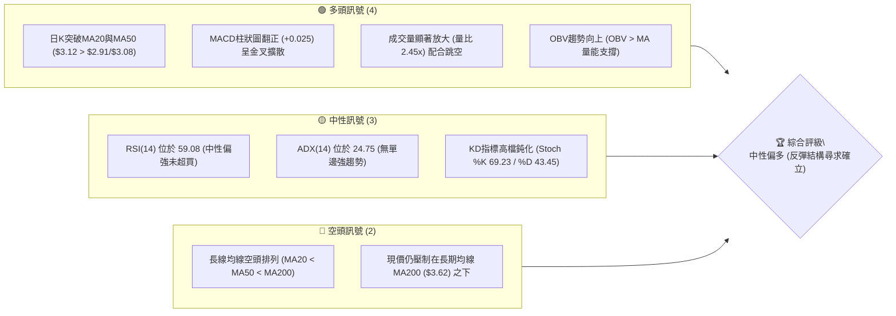
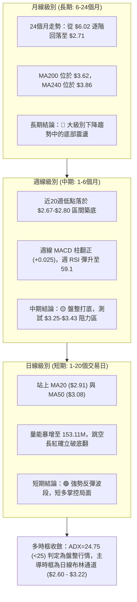
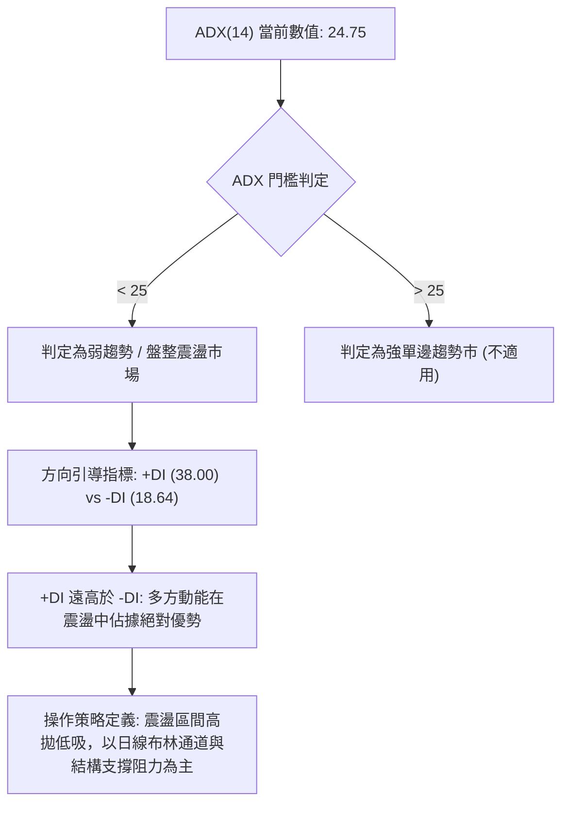
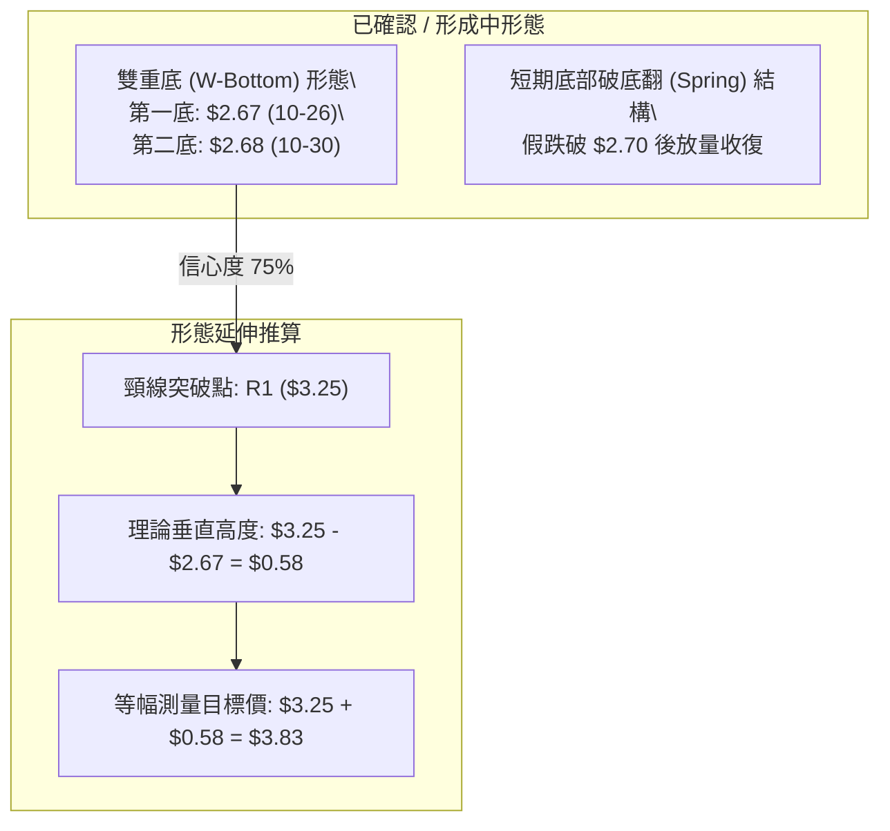
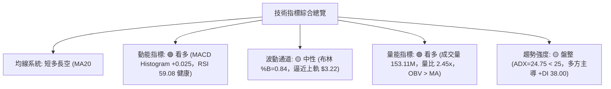
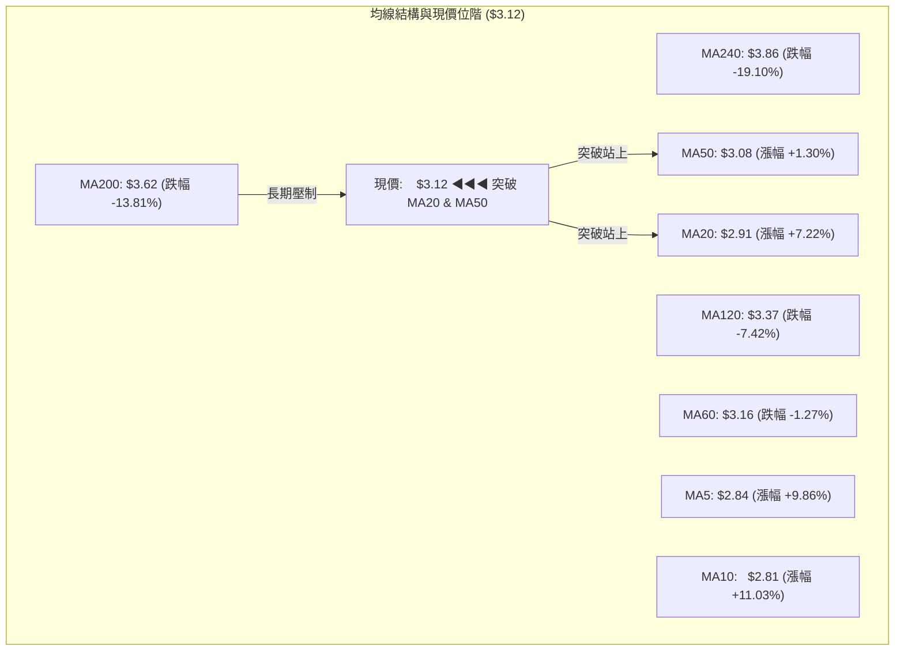
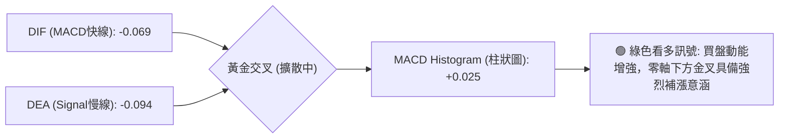
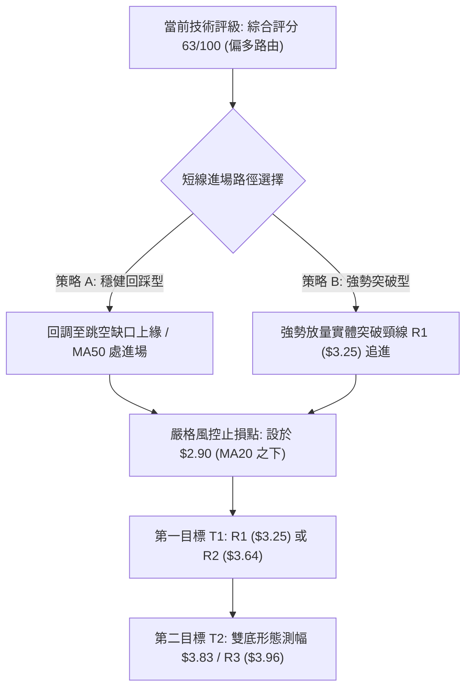
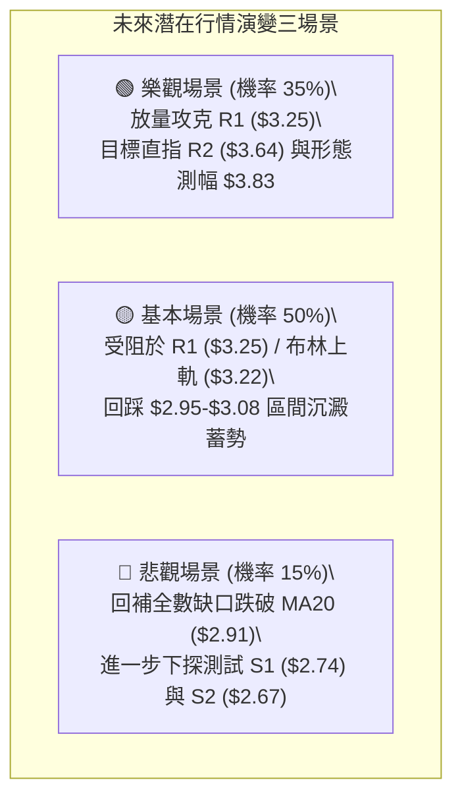

# GRAB 技術分析報告

> **報告日期**：2026-11-04 ｜ **語言**：繁體中文 ｜ **數據來源**：Yahoo Finance ｜ **當前價格**：$3.12 USD

---

## 目錄

| 章節 | 內容 |
|------|------|
| [1. 技術面概覽](#1-技術面概覽) | 訊號儀表板、核心指標、評分卡 |
| [2. 趨勢分析](#2-趨勢分析) | 多時框趨勢、長中短期走勢 |
| [3. 圖表形態分析](#3-圖表形態分析) | 形態識別、K線組合、目標價 |
| [4. 支撐與阻力](#4-支撐與阻力) | 關鍵價位、斐波那契回調 |
| [5. 技術指標深度解讀](#5-技術指標深度解讀) | MA/RSI/MACD/布林/成交量 |
| [6. 動能與波動率](#6-動能與波動率) | 動能評估、ATR、Beta |
| [7. 多時框架總結](#7-多時框架總結) | 時框架評分矩陣 |
| [8. 交易策略建議](#8-交易策略建議) | 多空策略、風險報酬比 |
| [9. 風險提示與監控](#9-風險提示與監控) | 監控指標、風險場景 |

---

## 1. 技術面概覽

### 🎯 技術訊號儀表板



### 📊 核心指標速覽表

| 指標類別 | 指標名稱 | 當前數值 | 訊號 | 解讀 |
|----------|----------|----------|------|------|
| **價格** | 當前價格 | $3.12 | 🟢 | 跳空放量大漲收復短期結構，強勢突破短期均線 |
| **均線** | MA20 | $2.91 | 🟢 | 現價高於 MA20，短期趨勢由盤跌轉為反彈 |
| **均線** | MA50 | $3.08 | 🟢 | 現價站上 MA50 中期生命線，具備初級轉強特徵 |
| **均線** | MA200 | $3.62 | 🔴 | 現價低於 MA200，長線週期仍處於大級別下降通道 |
| **動能** | RSI(14) | 59.08 | 🟡 | Wilder 數值 59.08 處於健康推進區間，未見超買與背離 |
| **動能** | MACD | -0.069 / -0.094 | 🟢 | DIF 線上穿 DEA 線，Histogram 為 +0.025，日線金叉確立 |
| **趨勢** | ADX(14) | 24.75 | 🟡 | ADX < 25 表明處於盤整區間震盪，非單邊趨勢市 |
| **趨勢** | +DI / -DI| 38.00 / 18.64 | 🟢 | +DI 顯著超越 -DI，多頭動能短線取得主導地位 |
| **通道** | 布林 %B  | 0.84 | 🟡 | 價格逼近布林通道上軌 ($3.22)，短線有上軌壓制回踩需求 |
| **量能** | 20日量比 | 2.45x | 🟢 | 單日 1.53 億股，量價配合健康，資金入場推動跳空反彈 |
| **波動** | ATR(14)  | $0.14 | 🟢 | 波動率約佔股價 4.38%，日內波動適中，提供操作空間 |

### 🏆 技術評分卡

```
╔══════════════════════════════════════════════════════════════════╗
║                技術評分卡 — GRAB (2026-11-04)                   ║
╠══════════════════════════════════════════════════════════════════╣
║  趨勢強度      ████████████░░░░░░░░  60/100  🟡 中性 (ADX=24.75) ║
║  動能指標      ██████████████░░░░░░  70/100  🟢 看多 (MACD金叉)  ║
║  支撐穩定度    ██████████████░░░░░░  70/100  🟢 看多 (S1/S2穩固) ║
║  成交量配合    ████████████████░░░░  80/100  🟢 看多 (量比2.45x) ║
║  形態完整度    ████████████░░░░░░░░  60/100  🟡 中性 (區間築底)  ║
║  均線排列      ████████░░░░░░░░░░░░  40/100  🔴 看空 (空頭排列)  ║
╠══════════════════════════════════════════════════════════════════╣
║  綜合評分      ████████████░░░░░░░░  63/100  🟢 偏多 (反彈確認)  ║
╚══════════════════════════════════════════════════════════════════╝
```
*(註：綜合評分由六項子評分算術平均計算：(60 + 70 + 70 + 80 + 60 + 40) ÷ 6 = 63.33，四捨五入為 63/100)*

---

## 2. 趨勢分析

### 🌐 多時框趨勢分析



### 📈 長期趨勢 — 12個月走勢圖（Unicode）

```
GRAB 月線走勢圖（過去12個月：2025-12 至 2026-11）
價格軸 ($)
$5.00 ┤ ● (2025-12: $4.99)
$4.50 ┤       ● (2026-01: $4.30)
$4.20 ┤             ● (2026-02: $4.22)
$3.80 ┤                         ● (2026-04: $3.82)
$3.50 ┤                   ● (03)            ● (06: $3.77)  ● (07/08: $3.50/$3.54)
$3.10 ┤                                                                      ●←現在 ($3.12)
$2.70 ┤                                                        ● (09: $3.11)
$2.60 ┤                                                              ●(低點 10: $2.71)
      └────────────────────────────────────────────────────────────────────────────
        12月   1月   2月   3月   4月   5月   6月   7月   8月   9月   10月  11月
        2025  ────────────────────── 2026 ──────────────────────────────
```

#### 長期歷史走勢特徵分析

| 階段 | 時間跨度 | 起訖收盤價 | 區間漲跌幅 | 結構特徵與形態意義 |
|------|----------|------------|------------|--------------------|
| 歷史高檔震盪 | 2024-11 ~ 2025-08 | $5.00 → $4.99 | -0.20% | 長期箱型高位震盪，蓄勢衝擊歷史高位 |
| 突破拉升峰值 | 2025-09 ~ 2025-10 | $6.02 → $6.01 | +20.64% | 創下波段歷史頂點，52週最高來到 $6.24 |
| 級別退潮回落 | 2025-11 ~ 2026-03 | $5.45 → $3.66 | -32.84% | 單邊空頭主導，跌破多條長期均線生命線 |
| 低檔弱勢盤整 | 2026-04 ~ 2026-08 | $3.82 → $3.54 | -7.33% | 在 $3.50 - $3.80 區間構建中繼平台整理 |
| 終極恐慌洗盤 | 2026-09 ~ 2026-10 | $3.11 → $2.71 | -12.86% | 摜破平台觸及52週最低 $2.67，形成築底區 |
| 反轉放量確認 | 2026-11 (最新)    | $2.71 → $3.12 | +15.13% | 財報利好驅動單日放量大陽線，脫離底部 |

### 📊 中期趨勢（週線分析）

```
GRAB 週線壓力與支撐結構示意圖
$3.96 ══════════════════════════════════════════ 波段阻力 R3 (7月波段高點)
       │
$3.64 ────────────────────────────────────────── 結構阻力 R2 (MA200 重合區)
       │
$3.43 ┈┈┈┈┈┈┈┈┈┈┈┈┈┈┈┈┈┈┈┈┈┈┈┈┈┈┈┈┈┈┈┈┈┈┈┈┈┈┈┈┈┈ 斐波那契 78.6% 回調位
       │
$3.25 ══════════════════════════════════════════ 關鍵頸線阻力 R1 (9月平台)
       │    ▲
$3.12 ─────┼──────────────────────────────────── 【當前收盤價 $3.12】
       │    ▼
$2.91 ┄┄┄┄┄┄┄┄┄┄┄┄┄┄┄┄┄┄┄┄┄┄┄┄┄┄┄┄┄┄┄┄┄┄┄┄ 布林中軌 / MA20
       │
$2.74 ────────────────────────────────────────── 近期重要波段支撐 S1
       │
$2.67 ══════════════════════════════════════════ 52週歷史低點 / 強支撐 S2
```

近 20 週數據顯示，GRAB 歷經兩波顯著下行：第一波由 7 月初高點 $3.93 殺跌至 9 月中旬 $2.80，隨後出現放量反彈至 $3.19（10 月 9 日當週）；第二波回踩測試 52 週低點 $2.67（10 月 30 日當週）。本週（截至 11 月 3 日）在財報公佈後拉出週成交量 2.22 億股的大陽線，確認在 $2.67-$2.74 構建了牢固的雙底雛形。

### ⚡ 趨勢強度評估（ADX 解讀）



| 指標名稱 | 數值 | 狀態區間 | 技術意義 |
|----------|------|----------|----------|
| **ADX (14)** | 24.75 | 弱趨勢 / 盤整 (<25) | 市場未形成單邊不可逆的超級趨勢，處於大跌後的橫盤打底修復期 |
| **+DI** | 38.00 | 多方強勢 (>30) | 多頭攻擊能量大幅抬頭，買盤短線主動性極高 |
| **-DI** | 18.64 | 空方萎縮 (<20) | 空方賣壓遭到實質性化解，殺跌動能迅速衰竭 |

---

## 3. 圖表形態分析

### 🔍 形態識別系統



#### 形態信心度與目標價評估表

| 形態 | 信心度 | 判斷依據（引用數據） | 完成度 | 目標價（附計算式） |
|------|--------|----------------------|--------|--------------------|
| **雙重底 (W-Bottom)** | 75% | 第一次觸底 2026-10-26 最低價 $2.67，第二次探底 2026-10-30 最低價 $2.68，兩次低點重合於 S2 ($2.67) 強支撐；隨後日K大陽線收 $3.12 逼近頸線 | 80% | 頸線 R1 ($3.25) + 形態高度 ($3.25 - S2 $2.67 = $0.58) = **$3.83**（由雙底形態高度推算） |
| **布林通道向上突破** | 70% | 現價 $3.12 突破 MA20 ($2.91)，BB %B 達 0.84，逼近上軌 $3.22；成交量擴大至均量 2.45 倍 | 85% | 上軌目標 $3.22，若有效突破則順勢看至阻力位 **$3.25** (R1) 與 **$3.64** (R2) |
| **日線跳空缺口反轉** | 65% | 2026-11-03 開盤 $3.21，脫離 11-02 收盤 $2.86，形成 $2.86-$3.08 巨大突破缺口，當日最低回踩 $3.08 獲得支撐 | 90% | 缺口下緣 $3.08 提供第一動態支撐，反彈目標指向阻力位 **$3.25** (R1) |

### 🕯️ 重要K線形態分析

嚴格依據數據中「近10根日K」與「近8根週K」的實際開、高、低、收數據進行形態判定：

| 日期（日K/週K） | 開 | 高 | 低 | 收 | K線形態 | 解讀 | 訊號 |
|------------------|------|------|------|------|---------|------|------|
| **2026-10-26 (日K)** | 2.79 | 2.80 | 2.67 | 2.71 | **長下影陰線 (探底槌)** | 最低觸及 52 週低位 $2.67 後買盤湧入收於 $2.71，空方動能釋放完畢 | 🟡 |
| **2026-10-28 (日K)** | 2.73 | 2.79 | 2.71 | 2.75 | **低檔小陽星線** | 低檔買盤持續吸籌，波動收斂，拒絕再破新低 | 🟢 |
| **2026-10-30 (日K)** | 2.71 | 2.73 | 2.68 | 2.71 | **雙底確認十字星** | 低點 $2.68 成功守住前低 $2.67，形成極具價值的右底支撐測試 | 🟢 |
| **2026-11-02 (日K)** | 2.76 | 2.93 | 2.75 | 2.86 | **轉折紅三兵起步** | 開盤 $2.76 穩步推升，實體收高於 $2.86，站上 MA5 ($2.84)，預告轉強 | 🟢 |
| **2026-11-03 (日K)** | 3.21 | 3.32 | 3.08 | 3.12 | **跳空放量帶上影黑K** | 財報利好開盤跳空至 $3.21 衝高 $3.32，遭遇 R1 ($3.25) 解套賣壓收回 $3.12，多空激烈交戰 | 🟡 |
| **2026-10-23 (週K)** | 2.93 | 2.94 | 2.77 | 2.79 | **中陰實體回落** | 測試下軌支撐，成交量萎縮至 2.33 億股，賣壓逐步枯竭 | 🔴 |
| **2026-10-30 (週K)** | 2.79 | 2.80 | 2.67 | 2.71 | **帶長下影破底星線** | 週線探底 $2.67 後回穩，確立 $2.67-$2.70 區間為核心價值底部 | 🟢 |
| **2026-11-03 (週K)** | 2.76 | 3.32 | 2.75 | 3.12 | **放量低檔反轉吞噬** | 實體大陽線將前一週高點包覆吞噬，週成交量放大確認主力進場訊號 | 🟢 |

### 📉 ASCII 走勢形態示意圖

```
GRAB 雙底形態 (W-Bottom) 與跳空走勢
價格軸 ($)
$3.32 ┤               ▲ 高點 (11-03 最高)
$3.25 ┤═══════════════╤════════════════════════ 頸線阻力 (R1)
$3.12 ┤             ● ┼ 現價
$3.08 ┤            ╱  └─ 日內回踩最低點
$2.86 ┤───────────● 突破起漲點 (11-02 收盤)
$2.79 ┤  ●       ╱
$2.71 ┤   ╲  ●  ╱  ●
$2.67 ┤    ●─┴─────● (左底 $2.67: 10-26 ｜ 右底 $2.68: 10-30)
      └────────────────────────────────────────────
        10-26 10-28 10-30 11-02 11-03 (交易日)
```

### 🎯 形態目標價計算

1. **形態基準**：雙底結構之左底低點為 2026-10-26 低點 $2.67，右底低點為 2026-10-30 低點 $2.68，均精確坐落於強支撐 **S2 ($2.67)**。
2. **頸線確認**：形態頸線位於近一年波段高點聚類之 **R1 ($3.25)**。
3. **垂直振幅高度**：$H = \text{頸線} - \text{底部} = \$3.25 - \$2.67 = \$0.58$。
4. **理論等幅測量目標價**：
   $$\text{目標價} = \text{頸線} + H = \$3.25 + \$0.58 = \$3.83$$
   *(該目標價略低於 MA240 的 $3.86，落於阻力位 R2 $3.64 與 R3 $3.96 之間，具備高度技術邏輯性)*

---

## 4. 支撐與阻力

### 🗺️ 關鍵價位分布圖（Unicode）

```
GRAB 價位結構分布圖 (由 OHLCV 與歷史波段聚類精準推算)
══════════════════════════════════════════════════════════════════
$3.96 ║████████████████████████████████║ 強阻力 R3 (波段聚類高點)
$3.64 ║████████████████████            ║ 阻力 R2 (MA200 重合區)
$3.43 ║▒▒▒▒▒▒▒▒▒▒▒▒▒▒▒▒▒▒▒▒▒▒▒▒▒▒      ║ 斐波那契 78.6% 回調位
$3.25 ║████████████████████████████████║ 關鍵頸線阻力 R1 (突破即確立反轉)
$3.12 ╠════════════════════════════════╣ ◄ 現價 ($3.12)
$2.91 ║░░░░░░░░░░░░░░░░░░░░░░░░░░      ║ 短期動態防守 (MA20 / 布林中軌)
$2.74 ║▓▓▓▓▓▓▓▓▓▓▓▓▓▓▓▓▓▓▓▓▓▓▓▓        ║ 近期重要波段支撐 S1
$2.67 ║████████████████████████████████║ 52週極限低點 / 強支撐 S2
══════════════════════════════════════════════════════════════════
```

### 🚧 阻力位分析表

*(所有阻力價位嚴格引用數據中「關鍵價位」區塊數值)*

| 阻力級別 | 價位 | 形成原因 | 突破難度 | 重要性 |
|----------|------|----------|----------|--------|
| **R1** | **$3.25** | 近一年波段高點聚類、雙底結構頸線所在、9月下旬至10月上旬震盪平台密集籌碼區 | 🟡 中等 (已於 11-03 觸及 $3.32 試探) | ★★★★☆ |
| **R2** | **$3.64** | 近一年波段第二聚類高點，與長期生命線 MA200 ($3.62) 高度重疊，空頭主力防守區 | 🔴 極高 (需連續 300M 以上週成交量) | ★★★★★ |
| **R3** | **$3.96** | 2026年7月波段反彈極值高點 ($3.93-$3.96 區間聚類)，多頭中期牛熊分水嶺 | 🔴 極高 (需基本面營收與獲利超預期推動) | ★★★★☆ |

### 🛡️ 支撐位分析表

*(所有支撐價位嚴格引用數據中「關鍵價位」區塊數值)*

| 支撐級別 | 價位 | 形成原因 | 守住機率 | 重要性 |
|----------|------|----------|----------|--------|
| **S1** | **$2.74** | 近一年波段低點聚類，多次回踩確認有效，近期日K密集收盤支撐區 | 80% (🟢 高) | ★★★★☆ |
| **S2** | **$2.67** | 52週歷史極限低點 (2026-10-26 創下)，斐波那契 100.0% 極限回調位，雙重底基準 | 90% (🟢 極高) | ★★★★★ |
| **S3** | **N/A** | *數據中未偵測到 S3* (下方已無更低波段低點聚類) | N/A | N/A |

### 📐 斐波那契回調位分析

依據 52 週完整波段（高點 $6.24 → 低點 $2.67，總振幅 $3.57）計算之精確斐波那契位階：

| 回調比率 | 價位 | 當前相對位置 | 技術意涵解讀 |
|----------|------|--------------|--------------|
| **0.0% (52W High)** | $6.24 | +100.0% | 長期大週期行情的最高起跌點 |
| **23.6%** | $5.39 | +72.76% | 長線強阻力位，跌破後確認深幅修正 |
| **38.2%** | $4.87 | +56.09% | 2024年底至2025年中期震盪平台中樞 |
| **50.0%** | $4.45 | +42.63% | 長期行情的強弱分水嶺 |
| **61.8%** | $4.03 | +29.17% | 黃金分割重要回調關卡，接近 R3 ($3.96) |
| **78.6%** | $3.43 | +9.94% | 阻力位 R1 ($3.25) 與 R2 ($3.64) 間的過渡區 |
| **100.0% (52W Low)**| $2.67 | -14.42% | 極限支撐位 S2，本輪反彈起點 |

**現價區間解讀**：
當前價格 **$3.12** 精確坐落於 **100.0% ($2.67)** 與 **78.6% ($3.43)** 之間，處於超跌後的初步修復波段。目前距離 78.6% 回調位 ($3.43) 尚有約 9.94% 的上行空間，若能有效放量突破 R1 ($3.25)，該位置將成為反彈多頭的第一個重要測試關卡。

---

## 5. 技術指標深度解讀

### 🎛️ 指標訊號總覽



### 📈 移動平均線排列分析



#### 均線系統深度解讀

1. **排列形態**：大週期均線呈現標準的空頭排列（$2.91 < $3.08 < $3.62，即 MA20 < MA50 < MA200），反映出長線空方壓力尚未完全解除。
2. **短期轉強訊號**：現價 $3.12 一舉強勢突破短中期均線 MA5 ($2.84)、MA10 ($2.81)、MA20 ($2.91) 以及重要的中期多空線 MA50 ($3.08)。短均線系統 MA5 與 MA10 已呈多頭斜率發散（MA5 +9.86%、MA10 +11.07%），為典型的破底翻初級反轉訊號。
3. **上方動態壓制**：上方最近均線壓力為 MA60 ($3.16)，與布林通道上軌 ($3.22) 及阻力 R1 ($3.25) 共同構成密集反壓帶。

### 📉 RSI(14) 分析

```
RSI(14) 數值展示: 59.08
0      20      30               50        59.08   70      80     100
├──────┼───────┼────────────────┼───────────●──────┼───────┼──────┤
  超賣   極度超賣       弱勢區間         強勢推進區間    超買   極度超買
進度條: [████████████████████████████████████░░░░░░░░░░░░░░░░] 59.08%
```

1. **區間判斷**：RSI(14) 數值為 **59.08**，處於 50–70 的強勢多頭控盤區間，脫離了前期 10 月末的 34.0 弱勢區，且完全未觸及 70 超買警戒線，顯示當前反彈動能充沛且具備延續性。
2. **背離分析**：
   - 價格於 2026-10-26 觸及最低價 $2.67、收 $2.71（當週 RSI 34.0）；隨後 10-30 探底 $2.68、收 $2.71。
   - 儘管在近 20 根 K 棒的首尾簡單比對中判定為「無明顯背離」，但從週線層級觀察：9 月 18 日收盤 $2.80 時 RSI 為 23.3，10 月 30 日收盤 $2.71 時 RSI 墊高至 34.0，呈現顯著的**週線級別雙底底背離**特徵，預示著中期空頭趨勢衰竭。

### 📊 MACD(12/26/9) 訊號解讀



1. **參數表現**：MACD 線為 **-0.069**，Signal 訊號線為 **-0.094**，快線自下而上穿破慢線，MACD 柱狀圖讀數為 **+0.025**，呈現典型的低檔黃金交叉。
2. **零軸關係解讀**：雙線目前仍位於零軸下方，此時出現金叉在技術上被定義為「零軸下的超跌反彈金叉」。週線 MACD 柱連續兩週由負翻正（+0.025），且日線 Histogram 持續拉升，確認多頭正在搶回短期主導權。

### 📦 布林通道分析

```
GRAB 日線布林通道 (20, 2) 結構示意圖
$3.22 ┬────────────────────────────────────────── 布林上軌 (阻力)
      │                   ● ($3.32 當日刺破)
$3.12 ┤             ● 現價 (位於上軌附近，%B = 0.84)
      │            ╱
$2.91 ┼───────────●────────────────────────────── 布林中軌 (MA20 動態支撐)
      │          ╱
$2.60 ┴─────────●──────────────────────────────── 布林下軌 (極限支撐)
```

1. **軌道數據**：
   - 上軌：**$3.22**
   - 中軌 (MA20)：**$2.91**
   - 下軌：**$2.60**
   - 布林通道百分比指標 (%B)：**0.84**
2. **結構解讀**：現價 $3.12 處於通道上半區，%B 達到 0.84，接近 1.0 上軌臨界線。2026-11-03 最高點 $3.32 曾強勢刺破上軌 $3.22，隨後收回軌道之內。這表明短線出現情緒化過熱買盤，但同時也完成了「通道開口擴大（Bandwidth Expansion）」的動作，暗示波動率即將放大。

### 💹 成交量分析（量價配合度）

1. **巨量突破**：最新單日成交量高達 **153,113,906 股**，相對於 20 日均量 62,558,360 股，**量比高達 2.45 倍**，佔流通股（3.00B）的 5.1%，顯示機構法人與避險基金積極回補與進場吸籌。
2. **量價配合健康**：
   - 10 月底回踩 $2.67-$2.71 時，成交量萎縮至 43M-55M 水平，呈現標準的「價跌量縮」籌碼鎖死特徵。
   - 11 月 2 日至 3 日拉升時量能階梯式爆發（69.38M → 153.11M），呈現標準的「價漲量增」。
3. **OBV 能量潮解讀**：OBV 趨勢向上且突破其均線系統（OBV > MA），成交量確認了價格的向上突破，量能結構完全支持當前的反彈格局，未見出貨背離。

---

## 6. 動能與波動率

### ⚡ 動能評估四象限


| 象限 | 動能維度 | 波動維度 | 當前狀態 | 技術評估與操作導引 |
|------|----------|----------|----------|--------------------|
| **Q1** | 強 | 低 | — | 趨勢穩健推進，適合長線持倉波段操作 |
| **Q2** | 弱 | 低 | — | 10月中下旬橫盤打底狀態，成交量枯竭，適合左側埋伏 |
| **Q3** | **強** | **高** | **✓ (當前)** | **突破啟動期：成交量暴增 2.45x，短線快速拔高，應密切關注回踩防守位** |
| **Q4** | 弱 | 高 | — | 恐慌崩跌與多殺多階段，必須空倉觀望 |

### 📊 ATR 波動率分析

1. **ATR 絕對數值**：當前 ATR(14) 為 **$0.14 USD**（依據 Wilder 計算法）。
2. **波動率佔比**：$\text{波動率比率} = \frac{\$0.14}{\$3.12} = 4.49\%$（快報數值顯示為 4.38% of price）。
3. **動態止損距離建議**：
   - **激進日內交易**：1.0 倍 ATR = **$0.14**（止損設於進場價下方 $0.14）
   - **波段短線持倉**：1.5 倍 ATR = **$0.21**（可有效避開正常盤中雜音掃單）
   - **穩健波段操作**：2.0 倍 ATR = **$0.28**（防守深度充分，契合 MA20 支撐位置）

### 📐 Beta 與市場相關性

1. **Beta 係數**：**0.833**。
2. **特性解讀**：Beta < 1.0 表明 GRAB 對美股大盤（S&P 500 / Nasdaq）的系統性波動敏感度相對溫和。該股近期走勢主要受自身東南亞叫車/外賣營運基本面、轉虧為盈進展及財報指引所驅動，具備較高的個股獨立性（Alpha 特性）。

---

## 7. 多時框架總結

### 📋 時框架評分表

| 時框架 | 趨勢方向 | 動能狀態 | 均線排列 | 圖表形態 | 綜合評分 | 操作建議 |
|--------|----------|----------|----------|----------|----------|----------|
| **短期 (日線)** | 🟢 多頭反轉 | 🟢 強勢 (MACD 金叉) | 🟡 均線修復中 | 🟢 雙底突破放量 | **75/100** | 逢拉回支撐點積極做多 |
| **中期 (週線)** | 🟡 震盪築底 | 🟢 柱狀翻正 (RSI 59) | 🔴 空頭壓制 | 🟡 測試頸線阻力 | **60/100** | 區間交易，關注 R1 突破 |
| **長期 (月線)** | 🔴 下行修復 | 🟡 低檔鈍化 | 🔴 空頭排列 | 🔴 大箱型下緣支撐 | **45/100** | 長線資金小額分批建底倉 |

### 🔲 綜合訊號矩陣

```
訊號維度對照矩陣
┌──────────────┬──────────────┬──────────────┬──────────────┐
│  分析維度    │ 短期 (日線)  │ 中期 (週線)  │ 長期 (月線)  │
├──────────────┼──────────────┼──────────────┼──────────────┤
│ 價格 vs 均線 │ 🟢 高於 MA20 │ 🔴 低於 MA20 │ 🔴 低於 MA200│
│ 動能 MACD    │ 🟢 零下金叉  │ 🟢 綠柱翻正  │ 🔴 負值走平  │
│ RSI 位階     │ 🟢 59.08強勢 │ 🟢 59.10反彈 │ 🟡 40附近    │
│ 成交量配合   │ 🟢 放量 2.45x│ 🟢 週量擴大  │ 🟡 正常水平  │
│ 支撐防守性   │ 🟢 S1 支撐強 │ 🟢 S2 雙底守 │ 🟢 52W 低點  │
└──────────────┴──────────────┴──────────────┴──────────────┘
```

### ⚖️ 多時框收斂結論

依據多時框收斂規則第 14 條與第 16 條標準：
1. **行情性質判定**：當前 ADX(14) 讀數為 **24.75**（嚴格小於 25 臨界值），技術上明確判定當前為**「盤整震盪行情」而非單邊趨勢市**。
2. **主導維度收斂**：在 ADX < 25 的盤整結構中，分析框架以**日線布林通道上下軌（$2.60 - $3.22）與關鍵水平支撐阻力為主要依歸**。
3. **最終方向性結論**：**中性偏多（波段反彈）**。短期日線具備極強的放量突破動能，但受限於布林上軌 ($3.22) 及 R1 ($3.25) 的密集反壓，直接演化為大級別單邊暴漲的機率較低，最合邏輯的走勢為：在上軌附近震盪消化賣壓，回踩確認 MA20/MA50 支撐後，蓄勢衝擊更高阻力位。

---

## 8. 交易策略建議

### 🗺️ 策略決策流程圖



### 🧭 策略路由

**當前主策略方向 = 主推多頭策略（依綜合評分 63/100 偏多判定）**
空頭策略在此僅列為「反轉風險觸發點與對沖參考」，不作為主要交易依據。

### 🎯 價格情境階梯（Price Scenarios）

*(所有價位嚴格引用數據中「關鍵價位」區塊與第 4 章數值)*

| 觸發條件 | 下一目標 | 後續延伸 | 情境技術含義 |
|----------|----------|----------|--------------|
| **突破 R1 ($3.25)** | **R2 ($3.64)** | **R3 ($3.96)** | 日線雙底正式被實體陽線確認，中期反彈全面展開 |
| **站穩現價區間 ($3.08-$3.22)**| **R1 ($3.25)** | **$3.43 (Fib 78.6%)**| 布林通道帶寬擴大，短線沿上軌震盪消化獲利回吐盤 |
| **跌破 S1 ($2.74)** | **S2 ($2.67)** | **N/A (數據未提供)** | 反彈失敗，多頭防線瓦解，重新回踩 52 週最低點築底 |

### 📊 情境機率分佈

| 情境 | 機率 | 主要依據 |
|------|------|----------|
| **繼續上行 / 反彈突破** | **55%** | 最新日成交量暴增至 153.11M（量比 2.45x），MACD 柱狀圖翻正 (+0.025)，OBV 突破均線確認量價配合 |
| **高檔區間震盪整理** | **30%** | ADX 僅 24.75 未跨入單邊趨勢，日線 %B 高達 0.84 接近布林上軌 ($3.22)，存在獲利盤沉澱需求 |
| **回落再探底部支撐** | **15%** | 均線長週期 MA200 仍處下行，若大盤系統性風險爆發可能拖累個股回測 S1 ($2.74) |

### 🟢 主策略詳情（方向依上方路由）

*(風險報酬比定義：$(T1 - \text{進場價}) \div (\text{進場價} - \text{止損價})$，以進場價區間中點精準計算)*

| 策略要素 | 策略 A（穩健型：回踩支撐低吸） | 策略 B（激進型：突破頸線順勢追擊） |
|----------|--------------------------------|-------------------------------------|
| **進場條件** | 股價回踩 11-03 跳空缺口下限及 MA50 支撐企穩 | 日K線放量以實體陽線站上頸線阻力位 R1 ($3.25) |
| **進場價格** | **$3.00**（回調區間 $2.95 - $3.05 中點） | **$3.26**（剛突破 R1 $3.25 之確認點） |
| **目標價 T1** | **$3.25**（關鍵阻力位 R1） | **$3.64**（關鍵阻力位 R2 / MA200 區） |
| **目標價 T2** | **$3.64**（關鍵阻力位 R2） | **$3.83**（由雙底形態高度推算之目標價） |
| **止損價格** | **$2.88**（跌破布林中軌 MA20 $2.91 之保護位）| **$3.07**（跌破 MA50 $3.08 之假突破止損） |
| **風險報酬比 (T1)** | **1 : 2.08（以 T1 計）**<br>計算式：$(3.25-3.00)\div(3.00-2.88) = 0.25\div0.12$ | **1 : 2.00（以 T1 計）**<br>計算式：$(3.64-3.26)\div(3.26-3.07) = 0.38\div0.19$ |
| **風險報酬比 (T2)** | **1 : 5.33（以 T2 計）**<br>計算式：$(3.64-3.00)\div(3.00-2.88) = 0.64\div0.12$ | **1 : 3.00（以 T2 計）**<br>計算式：$(3.83-3.26)\div(3.26-3.07) = 0.57\div0.19$ |
| **成功機率** | **65%** | **60%** |
| **建議倉位** | **15% - 20%**（總投資組合佔比） | **10% - 15%**（突破確認後分批建立） |

### 🔴 反向風險觸發點（對沖提示）

- **多頭結構推翻訊號**：若日K線跌破 **$2.91 (MA20)** 且無法於兩日內收復，則短線多頭結構破壞；若進一步跌破 **S1 ($2.74)**，則宣告本輪跳空突破為徹底的「主力誘多假突破」。
- **對沖應對指引**：多頭部位應在觸發跌破 $2.88 止損價時果斷離場；機構投資者可考慮在股價受阻於 R1 ($3.25) 且日線出現高檔長上影線（如 11-03 形態延續）時，買入價外 Put 選擇權進行防禦對沖。

### ⭐ 整體訊號強度評星

```
做多訊號強度：★★★★☆  (4/5星：成交量暴增與MACD金叉共振，底部破底翻確立)
做空訊號強度：★☆☆☆☆  (1/5星：短線動能極強，+DI遠超-DI，做空勝率低)
整體可信度：  ★★★★☆  (4/5星：量價形態吻合，唯一制約為長期均線尚未扭轉)
```

---

## 9. 風險提示與監控

### ✅ 關鍵監控指標 Checklist

```
╔══════════════════════════════════════════════════════════════════╗
║               GRAB 日常交易監控清單 (Checklist)                  ║
╠══════════════════════════════════════════════════════════════════╣
║ [ ] 價位監控：現價是否站穩 MA50 ($3.08) 與 MA20 ($2.91)          ║
║ [ ] 頸線攻防：收盤價是否能有效突破阻力位 R1 ($3.25)              ║
║ [ ] 動能監控：日線 MACD Histogram 是否維持在正值 (> 0)          ║
║ [ ] 趨勢確認：ADX 是否突破 25，確認單邊多頭趨勢正式啟動         ║
║ [ ] 波動警戒：布林通道 %B 是否超過 1.0 導致嚴重超買回調          ║
║ [ ] 成交量能：日成交量是否維持在 50 日均量 (65.96M) 之上         ║
║ [ ] 止損底線：任何收盤價不可跌破波段重要防守 S1 ($2.74)         ║
╚══════════════════════════════════════════════════════════════════╝
```

### ⚠️ 風險場景分析



### 🛡️ 風險管理重要提醒

1. **財報後利多出盡與獲利了結賣壓**：2026-11-03 當日留下了長上影線（最高 $3.32，收盤 $3.12），顯示在 R1 ($3.25) 之上存在較為沉重的歷史解套賣壓與短線獲利了結盤，切忌盲目在開盤高位追價。
2. **基本面現金流制約**：公司 TTM 自由現金流仍為負值（Free Cash Flow 為 -$186.00M），在宏觀高利率或流動性趨緊環境下，估值修復上限可能受限於 R2 ($3.64) 附近的長期均線壓制。
3. **倉位配置紀律**：單一策略進場倉位嚴格控制在總資金的 15%–20% 之內，且單筆交易所承擔的最大風險額度（止損金額）不得超過整體投資組合淨值的 1.5%–2.0%。

---

## 📋 報告總結

```
╔══════════════════════════════════════════════════════════════════╗
║                    GRAB 技術分析報告總結                         ║
╠══════════════════════════════════════════════════════════════════╣
║ 報告日期：2026-11-04                                             ║
║ 當前價格：$3.12 USD                                              ║
║ 分析評級：🟢 中性偏多 (評分: 63/100，底部反彈確認波段)            ║
╠══════════════════════════════════════════════════════════════════╣
║ 關鍵結論：                                                       ║
║ ├─ 長期趨勢：🔴 空頭主導，但已在 52週低點 S2 ($2.67) 出現築底    ║
║ ├─ 中期趨勢：🟡 弱趨勢盤整 (ADX=24.75)，週線低檔底背離展開反彈   ║
║ ├─ 短期趨勢：🟢 強勢反轉，放量突破 MA20 ($2.91) 與 MA50 ($3.08)  ║
║ ├─ 關鍵支撐：S1: $2.74  ｜  S2: $2.67 (52週極限低點)             ║
║ ├─ 關鍵阻力：R1: $3.25  ｜  R2: $3.64  ｜  R3: $3.96             ║
║ └─ 測幅目標：$3.83 (由雙底形態高度推算) ｜ 分析師均價: $5.49     ║
╠══════════════════════════════════════════════════════════════════╣
║ 最優策略組合：                                                   ║
║ 1. 🥇 最佳機會：策略 A (穩健型) — 耐心等待股價回踩 $3.00 缺口上緣 ║
║                 企穩進場，止損 $2.88，目標 R1 $3.25 / R2 $3.64，  ║
║                 風險報酬比高達 1 : 2.08（以 T1 計）。            ║
║ 2. 🥈 次選機會：策略 B (強勢型) — 待日K實體放量收復 R1 $3.25 追進，║
║                 止損 $3.07，目標直指 R2 $3.64 與形態目標 $3.83。 ║
║ 3. 🥉 保守選擇：場外觀望，等待 ADX 升破 25 且 MA20/MA50 形成      ║
║                 金叉後再行順勢介入。                             ║
╚══════════════════════════════════════════════════════════════════╝
```

---

> ⚠️ **免責聲明**：本報告為 AI 自動生成之技術分析，所有數據及估算均基於提供的歷史價格資訊。本報告**僅供研究與學術參考**，**不構成任何投資建議**。投資有風險，入市需謹慎。

---

*報告生成時間：2026-11-04 ｜ 數據來源：Yahoo Finance ｜ 分析框架：多時框技術分析*