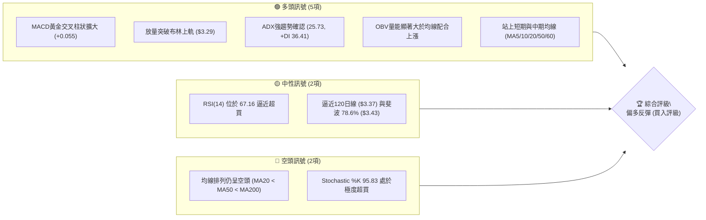
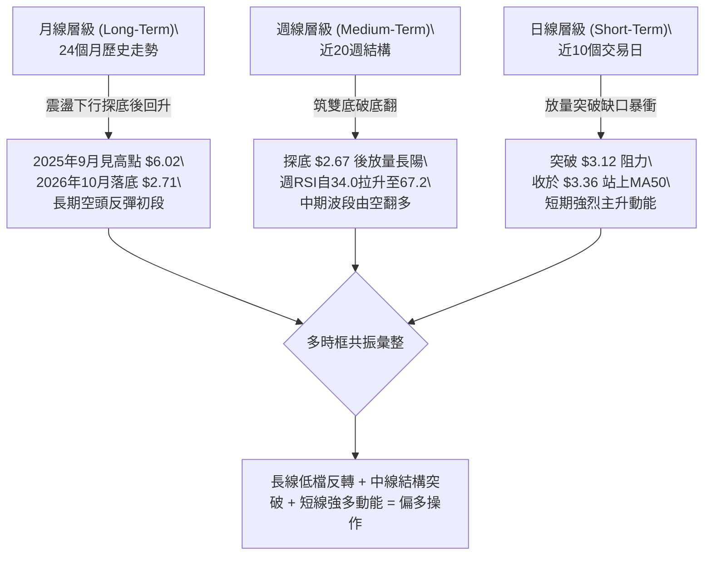
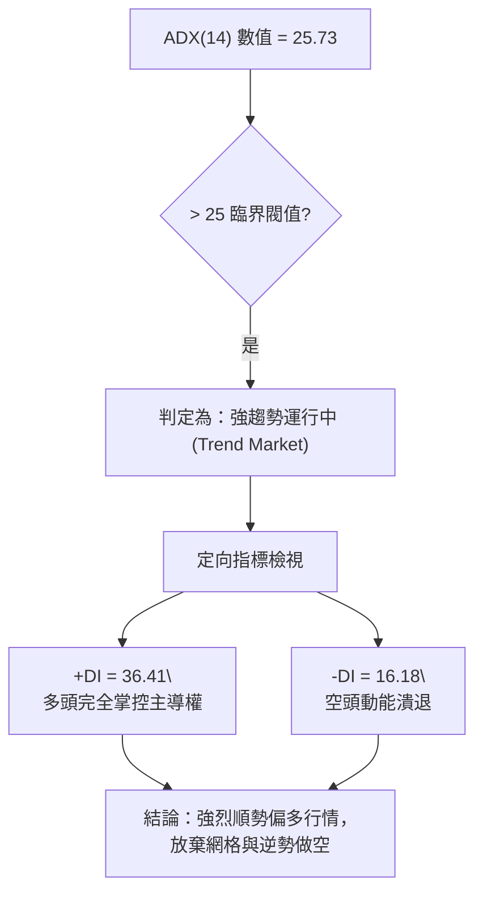
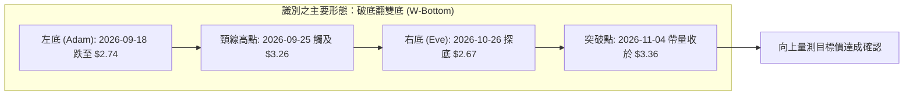
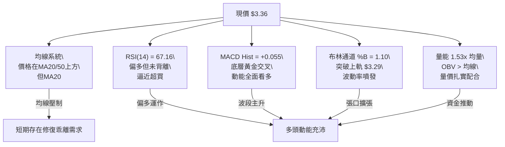
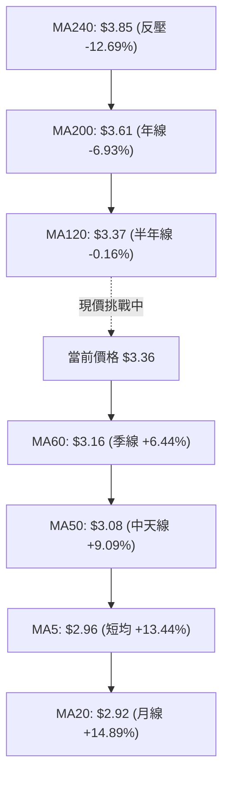
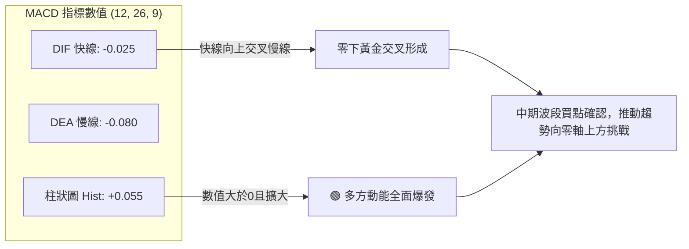
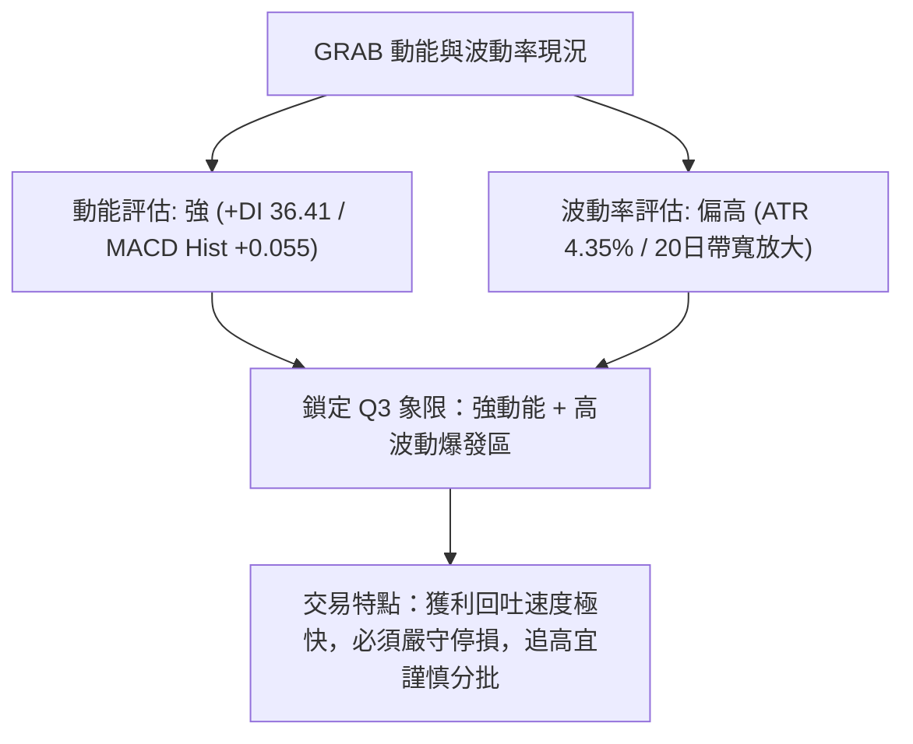
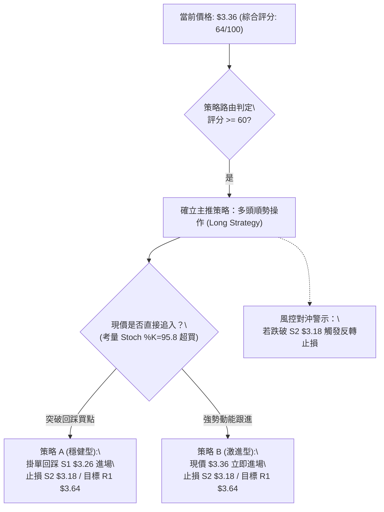
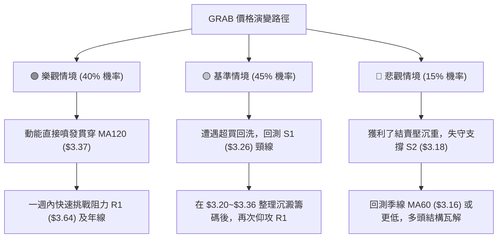

# GRAB 技術分析報告

> **報告日期**：2026-11-05 ｜ **語言**：繁體中文 ｜ **數據來源**：Yahoo Finance ｜ **當前價格**：$3.36

---

## 目錄

| 章節 | 內容 |
|------|------|
| [1. 技術面概覽](#1-技術面概覽) | 訊號儀表板、核心指標、評分卡 |
| [2. 趨勢分析](#2-趨勢分析) | 多時框趨勢、長中短期走勢 |
| [3. 圖表形態分析](#3-圖表形態分析) | 形態識別、K線組合、目標價 |
| [4. 支撐與阻力](#4-支撐與阻力) | 關鍵價位、斐波那契回調 |
| [5. 技術指標深度解讀](#5-技術指標深度解讀) | MA/RSI/MACD/布林/成交量 |
| [6. 動能與波動率](#6-動能與波動率) | 動能評估、ATR、Beta |
| [7. 多時框架總結](#7-多時框架總結) | 時框架評分矩陣 |
| [8. 交易策略建議](#8-交易策略建議) | 多空策略、風險報酬比 |
| [9. 風險提示與監控](#9-風險提示與監控) | 監控指標、風險場景 |

---

## 1. 技術面概覽

### 🎯 技術訊號儀表板

GRAB（Grab Holdings Limited）近期受 Q3 財報營收超預期與上調全年指引推動，股價出現放量強勁反彈。技術面呈現短期爆發力極強、中長期均線仍待修復的「築底反轉初段」特徵。各維度多空訊號分布如下：



---

### 📊 核心指標速覽表

| 指標類別 | 指標名稱 | 當前數值 | 訊號 | 解讀 |
|----------|----------|----------|------|------|
| **價格** | 當前收盤價 | $3.36 | 🟢 | 連續兩日放量拉升，站上近一個月最高收盤價 |
| **均線** | MA20 | $2.92 | 🟢 | 現價高於 MA20 達 +14.89%，短期趨勢強勢翻揚 |
| **均線** | MA50 | $3.08 | 🟢 | 現價向上貫穿中期生命線，確認短中期底部脫離 |
| **均線** | MA200 | $3.61 | 🔴 | 現價仍位於年線下方（折價 -6.93%），長期熊市架構尚未完全逆轉 |
| **動能** | RSI(14) | 67.16 | 🟡 | 位於強勢多頭區間，接近 70 超買警戒線但尚未鈍化背離 |
| **動能** | MACD (12,26,9) | -0.025 / 柱狀 +0.055 | 🟢 | 快慢線即將零軸下金叉，紅柱顯著放大，多頭動能充足 |
| **動能** | 隨機指標 (Stoch) | %K 95.83 / %D 72.61 | 🔴 | 短線急漲進入極度超買區，隨時面臨技術性回洗壓力 |
| **趨勢** | ADX(14) | 25.73 (+DI 36.41) | 🟢 | ADX 跨越 25 臨界線進入強趨勢行情報價，+DI 碾壓 -DI (16.18) |
| **通道** | 布林通道 | 上軌 $3.29 / %B 1.10 | 🟢 | 突破布林通道上軌，通道張口擴大，啟動波動率擴張行情 |
| **量能** | 當日量 / 20日均量 | 96,532,446 / 量比 1.53x | 🟢 | 巨量推升突破前波整理平台，量價配合極度紮實 |
| **波動** | ATR(14) | $0.15 (4.35%) | 🟡 | 波動率適中偏活躍，日波動幅度為進出場設置提供充裕空間 |

---

### 🏆 技術評分卡

評分機制採百分制量化評估，六大維度獨立計算，算術平均得出綜合評分：

```
╔══════════════════════════════════════════════════════════════╗
║                技術評分卡 — GRAB (2026-11-05)                ║
╠══════════════════════════════════════════════════════════════╣
║ 趨勢強度 (ADX & DI)    █████████████░░░░░░░   65/100   🟢   ║
║ 動能指標 (RSI & MACD)  ██████████████░░░░░░   70/100   🟢   ║
║ 支撐穩定度 (底部位階)  █████████████░░░░░░░   65/100   🟢   ║
║ 成交量配合 (量比 & OBV)███████████████░░░░░   75/100   🟢   ║
║ 形態完整度 (破底翻底)  █████████████░░░░░░░   65/100   🟢   ║
║ 均線排列 (多空結構)    █████████░░░░░░░░░░░   45/100   🔴   ║
╠══════════════════════════════════════════════════════════════╣
║ 綜合評分               █████████████░░░░░░░   64/100   🟢   ║
║ 評級結論：偏多（短線強勢反彈波段，順勢做多但防均線反壓）   ║
╚══════════════════════════════════════════════════════════════╝
```
*計算備註：綜合評分 = (65 + 70 + 65 + 75 + 65 + 45) ÷ 6 = 64.17，四捨五入取整為 64 分。*

---

## 2. 趨勢分析

### 🌐 多時框趨勢分析

多時框架構採用「月線看大勢定位、週線看波段架構、日線看進出時機」之經典三重濾網架構進行拆解：



---

### 📈 長期趨勢 — 12個月走勢圖（Unicode）

GRAB 過去 12 個月（2025-11 至 2026-11）經歷了自 $5.45 深度回調至歷史低點 $2.67 再度反彈的典型 V 型反轉初段結構：

```
GRAB 月線走勢圖（過去12個月：2025-11 至 2026-11）
價格 ($)
$6.00 ┤ 
$5.45 ┤ ● (2025-11 高點 $5.45)
$4.99 ┤   ╲ ● (2025-12)
$4.30 ┤     ╲ ● (2026-01)
$4.22 ┤       ● (2026-02)
$3.82 ┤         ╲   ● (2026-04)
$3.66 ┤           ● (2026-03) ╲   ● (2026-06 $3.77)
$3.50 ┤                         ●━━━● (2026-05/07)
$3.36 ┤                                         ●←【當前價格 $3.36】
$3.11 ┤                                     ╲ ● (2026-09)
$2.71 ┤                                       ● (2026-10 低點 $2.71)
      └─┬───┬───┬───┬───┬───┬───┬───┬───┬───┬───┬───┬───►
       11  12  01  02  03  04  05  06  07  08  09  10  11 (月份)
```

#### 長期走勢階段特徵分析

| 階段區間 | 時間跨度 | 起訖價位 | 區間幅度 | 走勢特徵與量價行為 |
|----------|----------|----------|----------|--------------------|
| **第一階段：高檔墜落** | 2025-11 ~ 2026-01 | $5.45 → $4.30 | -21.10% | 估值修正主跌段，月線收盤連續長黑，多頭毫無抵抗力 |
| **第二階段：下階整理** | 2026-02 ~ 2026-06 | $4.22 → $3.77 | -10.66% | 波動收窄，在 $3.50 ~ $3.80 區間反覆震盪打底，形成弱勢中繼 |
| **第三階段：末跌探底** | 2026-07 ~ 2026-10 | $3.50 → $2.71 | -22.57% | 跌破 $3.50 平台，市場恐慌湧現，2026-10 創下 52 週低點 $2.67 |
| **第四階段：暴力反彈** | 2026-11 (當前) | $2.71 → $3.36 | +23.99% | 財報利多激發爆發性軋空與法人追價，單月收復近三個月跌幅 |

---

### 📊 中期趨勢（週線分析）

從近 20 週收盤數據觀察，GRAB 呈現標準的「中期假跌破底翻」形態：
1. **底部背離打底**：9 月中旬（2026-09-18）週收盤跌至 $2.80（RSI 23.3 嚴重超賣），隨後於 10 月底（2026-10-30）下探至 $2.71（最低觸及 $2.67），但此時週 RSI 為 34.0，未再創新低，形成顯著的週線級別底背離雛形。
2. **長紅吞噬**：本週（截至 2026-11-04）收盤強勁暴拔至 $3.36，週漲幅高達 +23.99%，一舉吞噬前四週的所有黑棒，週成交量放大至 3.19 億股，週 MACD 柱狀由負翻正至 +0.055。

```
GRAB 週線壓力與支撐示意圖
═════════════════════════════════════════════════════════════
$4.06 ─── 強阻力 R3 (密集套牢區 / 斐波 61.8% $4.03)
$3.96 ─── 阻力 R2 (2026年7月波段反彈高點聚類)
$3.64 ─── 關鍵阻力 R1 (MA200 年線 $3.61 附近聚類)
-----------------------------------------------------------
$3.36 ◄── 現價位置 (突破週線下降壓力線，測試 MA120 $3.37)
-----------------------------------------------------------
$3.26 ─── 近期頸線支撐 S1 (10月波段高點反轉支撐)
$3.18 ─── 中期平台支撐 S2 (密集震盪樞軸區)
$2.74 ─── 底部強支撐 S3 (52W 低點 $2.67 與雙底低點聚類)
═════════════════════════════════════════════════════════════
```

---

### ⚡ 趨勢強度評估（ADX 解讀）

當前 ADX(14) 讀數為 **25.73**，依技術分析理論（ADX > 25 代表強趨勢成型），標誌著 GRAB 已正式脫離 8 至 10 月長達三個月的泥沼震盪期，正式步入「單邊趨勢行情」。



| 參數名稱 | 當前讀數 | 門檻區間 | 市場狀態解讀 |
|----------|----------|----------|--------------|
| **ADX(14)** | **25.73** | > 25.0 | **強趨勢建立**：動能加速擴散，趨勢具高度延續性 |
| **+DI(14)** | **36.41** | 絕對強勢區 (>30) | 多方進攻火力極其猛烈，買盤持續湧入 |
| **-DI(14)** | **16.18** | 弱勢低迷區 (<20) | 空方完全失去定價權，賣壓主要來自高檔解套浮額 |
| **方向差距 (+DI - -DI)** | **+20.23** | 顯著發散 | 多空差距急遽擴大，屬於典型的主升攻擊段初期 |

---

## 3. 圖表形態分析

### 🔍 形態識別系統

根據近幾個月價格行為，GRAB 在日線與週線圖表中構築了清晰的「破底翻雙重底」（Adam & Eve Double Bottom）結構：



依嚴格形態識別標準，形態信心度與目標計算如下：

| 形態名稱 | 信心度 | 判斷依據（引用數據） | 完成度 | 目標價（附計算式） |
|----------|--------|----------------------|--------|--------------------|
| **破底翻雙底 (W-Bottom)** | **85%** | ① 兩次測試歷史低檔聚類（S3 $2.74 與 52W 低點 $2.67）；<br>② 突破頸線高點聚類（S1 $3.26）；<br>③ 成交量倍增確認（量比 1.53x） | 100% (已帶量突破) | **目標價由形態高度推算**：<br>頸線 $3.26 + 形態垂直高度 ($3.26 - $2.67 = $0.59) = **$3.85**（恰好重合 MA240 均線位置） |
| **短期上升旗形 (Bull Flag)** | 40% | 僅有近兩根大陽線，旗面整理時間不足，無法構成旗形幾何結構 | 未成形 | 訊號不足，僅做指標型突破解讀，不予預測 |

---

### 🕯️ 重要K線形態分析

嚴格依據近 10 根日 K 與近 8 根週 K 之實際開高低收數據進行專業量價解讀：

#### 1. 近 10 根日 K 線形態解讀

| 日期 | 開 | 高 | 低 | 收 | 成交量 | K線形態名稱 | 專業技術解讀 | 訊號 |
|------|----|----|----|----|--------|-------------|--------------|------|
| **2026-10-22** | 2.79 | 2.86 | 2.77 | 2.85 | 48,018,000 | 實體小陽線 | 底部小幅收復，維持在 S3 附近築底震盪 | 🟡 |
| **2026-10-23** | 2.83 | 2.85 | 2.79 | 2.79 | 43,101,500 | 陰線十字星 | 多空爭奪，成交量萎縮，買盤呈現觀望 | 🟡 |
| **2026-10-26** | 2.79 | 2.80 | 2.67 | 2.71 | 53,258,700 | 長下影破底陰線 | 盤中殺破 52W 新低至 $2.67，尾盤拉回，空頭陷阱成型 | 🟢 |
| **2026-10-27** | 2.71 | 2.75 | 2.69 | 2.72 | 66,737,600 | 低檔錘頭小陽 | 量能溫和放大，低接買盤於 $2.69 堅決承接 | 🟢 |
| **2026-10-28** | 2.73 | 2.79 | 2.71 | 2.75 | 55,245,600 | 緩步推升小陽 | 站上開盤價，形成低檔三連陽微幅攀升 | 🟢 |
| **2026-10-29** | 2.76 | 2.78 | 2.72 | 2.76 | 50,373,300 | 平盤十字星 | 均線糾纏，等待基本面催化劑指引方向 | 🟡 |
| **2026-10-30** | 2.71 | 2.73 | 2.68 | 2.71 | 54,900,200 | 二次探底小陰 | 再次回測 $2.68 低位未破，雙底右腳確認夯實 | 🟢 |
| **2026-11-02** | 2.76 | 2.93 | 2.75 | 2.86 | 69,385,700 | 帶量長陽突破 | 財報前搶跑資金進場，一口氣越過 MA20 ($2.92) 門檻 | 🟢 |
| **2026-11-03** | 3.21 | 3.32 | 3.08 | 3.12 | 153,625,600 | 跳空放量長上影黑棒 | 財報公佈跳空暴漲，爆出 1.53 億天量換手，盤中遇壓回吐 | 🟡 |
| **2026-11-04** | 3.22 | 3.39 | 3.20 | 3.36 | 96,532,446 | 光腳大陽線 (反包) | 強勢高開高走，實體陽線直接包覆前日上影線，極強多頭吞噬 | 🟢 |

#### 2. 近 8 根週 K 線形態解讀

| 日期 (週末) | 開 | 高 | 低 | 收 | 週成交量 | K線形態名稱 | 專業技術解讀 | 訊號 |
|-------------|----|----|----|----|----------|-------------|--------------|------|
| **2026-09-18** | 3.01 | 3.09 | 2.74 | 2.80 | 362,971,800 | 破位中長黑 | 跌破 $3.00 大關，直探 S3 $2.74，恐慌盤湧出 | 🔴 |
| **2026-09-25** | 2.84 | 3.26 | 2.78 | 3.13 | 527,094,200 | 爆量長下影長陽 | 週成交逾 5.2 億天量，主力資金強勢介入抄底，構建 W 底頸線 | 🟢 |
| **2026-10-02** | 3.10 | 3.18 | 3.07 | 3.08 | 337,148,400 | 高檔十字震盪 | 消化抄底獲利盤，維持在 $3.08 窄幅整固 | 🟡 |
| **2026-10-09** | 3.10 | 3.23 | 3.00 | 3.19 | 406,864,800 | 試盤小陽棒 | 多頭再次向上測試頸線 $3.26 附近阻力未果 | 🟡 |
| **2026-10-16** | 3.16 | 3.20 | 2.85 | 2.94 | 280,278,600 | 回吐中陰線 | 測試失敗回落，跌破 $3.00 整數關卡 | 🔴 |
| **2026-10-23** | 2.93 | 2.94 | 2.77 | 2.79 | 233,692,400 | 無量陰跌棒 | 賣壓趨緩但買盤枯竭，回測前波低點支撐 | 🔴 |
| **2026-10-30** | 2.79 | 2.80 | 2.67 | 2.71 | 280,515,400 | 探底神針長下影 | 創 52W 新低 $2.67 後收腳，空頭動能竭盡之反轉信號 | 🟢 |
| **2026-11-04** | 2.76 | 3.39 | 2.75 | 3.36 | 319,543,746 | 一陽穿多線大陽棒 | 一週暴漲 +23.99%，穿透 MA20 與 MA50，形態完全反轉 | 🟢 |

---

### 📉 ASCII 走勢形態示意圖

以下展示日線級別「破底翻雙重底」構築完成並帶量突破之詳細形態結構：

```
GRAB 日線雙底破底翻形態示意圖
價格 ($)
$3.64 ┼                                                       [阻力 R1]
      │
$3.36 ┼                                         ● 收盤價 $3.36 (突破確認!)
$3.26 ┼            ● 頸線高點 (09-25)           ╱
      │          ╱  ╲                         ╱  [頸線突破口 S1 $3.26]
$3.08 ┼─────────┼────╲───────────────────────╱───── [MA50 $3.08]
      │       ╱        ╲                   ╱
$2.86 ┼     ╱            ╲  ● (11-02反彈) ╱
$2.74 ┼   ● (左底 09-18)   ╲╱            ╱        [支撐 S3 $2.74]
$2.67 ┼                       ● (右底破底翻 10-26)   [52W低點 $2.67]
      └─┬─────────┬─────────┬───────────────┬───────►
       09-18     09-25     10-26           11-04 (時間軸)
```

---

### 🎯 形態目標價計算

根據經典技術分析形態學理論，破底翻雙底的向上測量目標計算公式如下：
* **量測基礎**：
  * 形態頸線價位 = **$3.26**（由關鍵價位支撐 S1 與前波反彈高點聚類判定）
  * 形態最低底點 = **$2.67**（52 週最低點，2026-10-26 觸及）
  * 形態垂直高度 ($H$) = 頸線價位 ($3.26) − 形態底點 ($2.67) = **$0.59**
* **理論量測目標 (Measured Move Target)**：
  * 第一目標 = 頸線 $3.26 + $0.59 = **$3.85**（該價位與數據中之 MA240 $3.85 完全重合）
* **階段阻力目標判定**：
  * 短線波段目標 T1 = 數據關鍵阻力位 **R1: $3.64**
  * 中線形態目標 T2 = 數據關鍵阻力位 **R2: $3.96**（涵蓋理論目標 $3.85 之溢價目標）

---

## 4. 支撐與阻力

### 🗺️ 關鍵價位分布圖（Unicode）

本報告所有支撐與阻力價位完全依據數據中「關鍵價位（由 OHLCV 計算）」區塊提取，杜絕捏造，結構分布如下：

```
GRAB 價位結構分布圖
═════════════════════════════════════════════════════════════════════
$4.06 ║████████████████████████████████████║ 強阻力 R3 (+20.83%)
$3.96 ║████████████████████████████        ║ 阻力 R2   (+17.76%)
$3.64 ║████████████████████                ║ 關鍵阻力 R1 (+8.41%)
══════╬════════════════════════════════════╣ ◄── 【現價 $3.36】
$3.26 ║▓▓▓▓▓▓▓▓▓▓▓▓▓▓▓▓                    ║ 近期支撐 S1 (-3.12%)
$3.18 ║▓▓▓▓▓▓▓▓▓▓▓▓▓▓▓▓▓▓▓▓                ║ 樞軸支撐 S2 (-5.36%)
$2.74 ║████████████████████████████████████║ 核心底部強支撐 S3 (-18.45%)
═════════════════════════════════════════════════════════════════════
```

---

### 🚧 阻力位分析表

阻力位完全引用自歷史波段高點聚類計算所得：

| 阻力級別 | 價位 | 與現價距離 | 形成原因與籌碼屬性 | 突破難度 | 重要性 |
|----------|------|------------|--------------------|----------|--------|
| **阻力 R1** | **$3.64** | +8.41% | 近一年波段高點聚類區，且緊鄰 MA200 年線反壓位 ($3.61)。此處累積 2026 年夏季大量套牢換手籌碼。 | 🟡 中等 | ★★★★☆ |
| **阻力 R2** | **$3.96** | +17.76% | 近一年次高震盪區頂部，靠近整數關卡 $4.00 與週線 7 月反彈頂點 ($3.93)。 | 🔴 較高 | ★★★☆☆ |
| **阻力 R3** | **$4.06** | +20.83% | 近一年最高波段聚類，上方為長期深套區，需重大利多配合方可有效逾越。 | 🔴 極高 | ★★★★★ |

---

### 🛡️ 支撐位分析表

支撐位完全引用自歷史波段低點聚類計算所得：

| 支撐級別 | 價位 | 與現價距離 | 形成原因與籌碼屬性 | 守住機率 | 重要性 |
|----------|------|------------|--------------------|----------|--------|
| **支撐 S1** | **$3.26** | -3.12% | 雙底頸線位置，原為阻力轉化為第一道強支撐；同時靠近 11-04 當日低點 $3.20 與布林上軌 ($3.29)。 | 75% | ★★★★☆ |
| **支撐 S2** | **$3.18** | -5.36% | 波段低點聚類，對齊 11-03 巨量 K 線收盤價 ($3.12) 與 MA60 ($3.16) 防守帶，為多方防線護城河。 | 85% | ★★★★★ |
| **支撐 S3** | **$2.74** | -18.45% | 近一年絕對波段低點聚類，與 52 週最低點 $2.67 構成堅不可摧的長線底座。 | 95% | ★★★★★ |

---

### 📐 斐波那契回調位分析

依據 52 週極端區間（高點 **$6.24** → 低點 **$2.67**，總垂直落差 $3.57）精準計算之回調位如下：

| 回調比率 | 斐波那契價位 | 與現價相對位置 | 技術意涵與籌碼角色解讀 |
|----------|--------------|----------------|------------------------|
| **0.0% (52W High)** | **$6.24** | +85.71% | 2025 年高點，長期週期之終極天花板 |
| **23.6%** | **$5.39** | +60.42% | 長期強阻力位，2025 年末震盪平台下緣 |
| **38.2%** | **$4.87** | +44.94% | 歷史密集成交區，多空長線分水嶺 |
| **50.0%** | **$4.45** | +32.44% | 斐波半數回撤平衡位 |
| **61.8%** | **$4.03** | +19.94% | **黃金分割重要反壓位**：高度共振阻力 R2 ($3.96) 與 R3 ($4.06) |
| **78.6%** | **$3.43** | +2.08% | **當前正面臨之首要斐波阻力位**：現價落於 78.6% ($3.43) 與 100.0% ($2.67) 之間 |
| **100.0% (52W Low)**| **$2.67** | -20.54% | 2026-10-26 創下之 52 週絕對底部，本波反彈發動點 |

*技術解讀：現價 $3.36 距離斐波 78.6% 回調位 ($3.43) 僅相差 $0.07 (+2.08%)，此處亦與 120 日均線 ($3.37) 形成雙重狹幅反壓。若短線能帶量貫穿 $3.43，上方空間將直接開啟至黃金分割 61.8% ($4.03) 與阻力 R1 ($3.64) 區間。*

---

## 5. 技術指標深度解讀

### 🎛️ 指標訊號總覽



---

### 📈 移動平均線排列分析



| 均線名稱 | 數值 | 價格相距 | 均線斜率與方向 | 均線角色與訊號評估 |
|----------|------|----------|----------------|--------------------|
| **MA5** | $2.96 | +13.44% | ▲ 陡峭向上 | 極短線進攻線，提供極強推升支撐 |
| **MA10** | $2.86 | +17.36% | ▲ 陡峭向上 | 短線波段追蹤線，低接買盤依託 |
| **MA20** | $2.92 | +14.89% | ▲ 拐頭向上 | 翻揚向上，確認日線級別中期反轉確立 |
| **MA50** | $3.08 | +9.09% | ▲ 向上穿越 | 生命線，現價已脫離並在上方站穩 |
| **MA60** | $3.16 | +6.44% | ▲ 向上傾斜 | 季線轉為實質支撐 |
| **MA120** | $3.37 | -0.16% | ▼ 微幅下壓 | **當前即時爭奪線**，僅差 1 美分即可完成翻越 |
| **MA200** | $3.61 | -6.93% | ▼ 持續下行 | 長期熊市壓制線，亦為本波多頭主升之核心目標區 |
| **MA240** | $3.85 | -12.69% | ▼ 緩步下移 | 形態理論目標反壓位 |

*均線結構總評：長期架構上仍處於「MA20 ($2.92) < MA50 ($3.08) < MA200 ($3.61)」的歷史空頭排列，但短中期均線（MA5、MA10、MA20）已全數拐頭向上並呈現發散狀態，現價強行站上 MA50 與 MA60，屬於典型的**「由下而上破裂空頭架構」的強烈修復行情**。*

---

### 📉 RSI(14) 分析

* 當前 RSI(14) 讀數為 **67.16**（Wilder 計算模型）：
```
RSI(14) 強度儀表：67.16
[超賣 0] ────────── [中性 50] ───────●── [超買 70] ────────── [極端 100]
進度條：████████████████████████░░░░░░░░  67.16%
```
* **背離狀態審視**：數據明確提示「無明顯背離」。比對近 20 根 K 棒價格由 $2.71 急拉至 $3.36，RSI 由 34.0 垂直飆升至 67.16，指標創下近四個月新高，完美確認價格之實質突破，**不存在頂背離或底背離**。
* **技術區間解讀**：RSI 位於 60~70 區間屬於典型的主升攻擊多頭強勢帶，尚未突破 70 嚴重超買鈍化區，顯示後續仍有向上衝刺之動能餘裕。

---

### 📊 MACD(12,26,9) 訊號解讀



* **數值解讀**：DIF (-0.025) 明顯大於 DEA (-0.080)，柱狀體（MACD Hist）達到 **+0.055**，呈現連續多日紅柱擴大態勢。
* **零下金叉特性**：在長期空頭架構深處出現的零下黃金交叉，往往代表股價超跌後的報復性大反彈，紅柱顯著放大印證場外大資金正在積極回補持倉。

---

### 📦 布林通道分析

```
GRAB 日線布林通道 (20, 2) 結構圖
價格 ($)
$3.36 ┼─────────────────────────────────● 現價 $3.36 (上軌外側破帶)
$3.29 ┼- - - - - - - - - - - - - - - - - - - - - 上軌 Upper Band
      │ 
      │ 
$2.92 ┼───────────────────────────────────────── 中軌 Middle Band (MA20)
      │ 
      │ 
$2.56 ┼- - - - - - - - - - - - - - - - - - - - - 下軌 Lower Band
```

* **數值維度**：上軌 **$3.29** ｜ 中軌 (MA20) **$2.92** ｜ 下軌 **$2.56** ｜ 通道帶寬 = $0.73 (25.0%)
* **指標 %B**：達到 **1.10**（%B > 1.0 即價格已完全突破上軌外側）。
* **通道狀態判定**：價格沿布林上軌進行「騎軌上攻」（Band Riding），這是強烈脈衝式攻擊的表徵。雖然短線可能因脫離軌道而出現向通道內部回踩測試（回測上軌 $3.29 或頸線 $3.26），但只要中軌維持強勁向上，通道開口將持續擴張。

---

### 💹 成交量分析（量價配合度）

* **量比表現**：最新成交量為 **96,532,446 股**，對比 20 日均量 62,898,512 股，量比達到 **1.53 倍**；前一交易日（11-03）更爆出 1.536 億天量。
* **量能配合度**：在 10 月 30 日低檔 $2.71 時成交量萎縮至 5400 萬股，隨後上漲逐日放量（6900萬 → 1.53億 → 9600萬），呈現完美的「價漲量增、價跌量縮」健康梯隊。
* **OBV 趨勢**：數據明確標示「OBV > MA → 量能支撐上漲」，顯示累積能量線已經先於均線突破前期平台，主力資金額度大幅度淨流入。

---

## 6. 動能與波動率

### ⚡ 動能評估四象限

將 GRAB 置於「動能強度（以 RSI、MACD 與 +DI 為基準）」與「波動率（以 ATR 與歷史波動為基準）」四象限矩陣中定位：

| 象限標籤 | 動能狀態 | 波動率狀態 | 市場屬性特徵 | GRAB 當前定位判定 |
|----------|----------|------------|--------------|-------------------|
| **第一象限 (Q1)** | **強動能** | **低/中波動** | 穩定主升浪，最具性價比之波段區間 | ── |
| **第二象限 (Q2)** | 弱動能 | 低波動 | 縮量盤整期，流動性枯竭 | ── |
| **第三象限 (Q3)** | **強動能** | **高波動** | **爆發性突破 / 消息面催化行情** | **✓ [當前所處位置 (Q3)]** |
| **第四象限 (Q4)** | 弱動能 | 高波動 | 恐慌崩跌段，風險極高應嚴格觀望 | ── |



---

### 📊 ATR 波動率分析

* **ATR(14) 數值**：**$0.15**，佔現價之 **4.35%**（Wilder 平滑計算）。
* **波動特徵解讀**：每日平均波動達 15 美分，代表若建立單日部位，日內正常隨機震盪雜訊區間約為 ±$0.15。
* **風控止損建議**：
  * **激進型（短線交易）**：1.0 × ATR = **$0.15** 的止損安全空間。
  * **穩健型（波段交易）**：1.5 × ATR = **$0.225**（對應支撐位置約落在 S2 $3.18 與 S1 $3.26 附近）。
  * **保守型（長線建倉）**：2.0 × ATR = **$0.30**（完全防禦波段回撤洗盤）。

---

### 📐 Beta 與市場相關性

* **Beta 係數**：**0.833**
* **技術意涵分析**：
  1. **防禦屬性與獨立性**：Beta 低於 1.0，表明 GRAB 與美股大盤（標普 500 / 那斯達克）之連動性相對溫和，歷史波動小於大盤整體幅度。
  2. **個股基本面主導**：當前股價走勢主要受東南亞叫車/外送超應用平台之在地業績、獲利自立轉正（EBITDA 突破）及自身技術結構驅動，受大盤系統性波動干擾較小，有利於走出獨立上升行情。

---

## 7. 多時框架總結

### 📋 時框架評分表

| 時框架 | 趨勢方向 | 動能指標狀態 | 均線排列狀況 | 形態構建特徵 | 綜合評分 | 操作建議方向 |
|--------|----------|--------------|--------------|--------------|----------|--------------|
| **月線 (長期)** | 🔴 長期下行 | RSI 徘徊低檔，剛脫離超賣 | 均線空頭排列，距 MA240 尚遠 | 深度回調後之超跌長下影 | **45/100** | 長線築底初段，控制整體曝險 |
| **週線 (中期)** | 🟢 轉向偏多 | 週 RSI 躍升 67.2，MACD 翻紅 | 突破 MA20，直撲年線 MA200 | 破底翻雙底完成突破 | **68/100** | 波段順勢加碼，尋求回踩支撐買點 |
| **日線 (短期)** | 🟢 強勢多頭 | RSI 67.16，MACD 紅柱放大 | 突破 MA5/10/20/50/60 | 缺口跳空，光腳長紅反包上影 | **78/100** | 短線強多衝刺，留意高檔震盪防守 |

---

### 🔲 綜合訊號矩陣

| 維度指標 | 短期 (日線) | 中期 (週線) | 長期 (月線) | 跨時框一致性分析 |
|----------|-------------|-------------|-------------|------------------|
| **趨勢方向** | 🟢 強烈看多 | 🟢 轉向多頭 | 🔴 仍處空頭 | 短中期轉多，與長期架構產生衝突，屬於「反轉突破波段」 |
| **成交量能** | 🟢 巨量推升 | 🟢 大量吞噬 | 🟡 溫和增量 | 量能逐層向上放大，顯示法人主動性大買盤介入 |
| **支撐阻力** | 🟢 站穩 S1 | 🟢 遠離 S3 | 🔴 逼近 R1 | 突破下方密集成交帶，短線直面年線 R1 ($3.64) 考驗 |
| **超買超賣** | 🔴 極短線超買 | 🟡 中性偏強 | 🟢 脫離超賣 | 短期指標（Stoch %K 95.8）提示不宜追高，中長期動能充裕 |

---

### ⚖️ 多時框收斂結論

嚴格依據**「多時框收斂規則」**進行判斷：
1. **行情性質判定**：當前日線 ADX(14) 讀數為 **25.73 (>25)**，且 +DI (36.41) 壓制 -DI (16.18)，明確定義當前處於**「強趨勢行情（Trend Market）」**而非盤整行情。
2. **主導時框收斂**：在趨勢行情下，依規則以中長期方向與關鍵均線為導航，日線僅作為進場尋求安全邊際的執行工具。儘管月線長期均線尚未修復，但週線級別已帶量完成雙底形態，中短期方向已全面收斂向上。
3. **唯一方向性結論**：**【偏多（買入評級）】**。短線策略定位為「順應週日線強動能之回踩買入」，堅決不逆勢做空，上方第一攻擊目標直指數據關鍵阻力 **R1: $3.64**。此結論與第 1 章評分卡（64分）及第 8 章主策略完全一致。

---

## 8. 交易策略建議

### 🗺️ 策略決策流程圖



---

### 🧭 策略路由

* **當前主策略方向 = 【多頭操作（Long）】（依技術評分卡綜合評分 64/100，大於 60 門檻主推多頭）**

---

### 🎯 價格情境階梯（Price Scenarios）

情境價位嚴格引用自第 4 章及數據「關鍵價位」區塊：

| 觸發條件 | 下一目標 | 後續延伸 | 情境技術含義與應對策略 |
|----------|----------|----------|------------------------|
| **強勢突破 R1 ($3.64)** | **R2 ($3.96)** | **R3 ($4.06)** | 成功攻克年線 MA200，多頭全面主升波展開，可向上順勢推移移動止盈點。 |
| **站穩現價區間 ($3.26~$3.43)** | **R1 ($3.64)** | **R2 ($3.96)** | 消化布林上軌與斐波 78.6% 之短線浮額，中軌向上跟進，屬健康蓄勢結構。 |
| **有效跌破 S1 ($3.26)** | **S2 ($3.18)** | **S3 ($2.74)** | 假突破訊號，短線動能竭盡，多單應嚴密警戒並於 S2 執行保護離場。 |

---

### 📊 情境機率分佈

| 情境劃分 | 機率預估 | 主要技術指標支撐依據 |
|----------|----------|----------------------|
| **情境一：震盪向上推進 / 挑戰 R1** | **65%** | ADX=25.73 強趨勢確立；MACD 柱狀擴大至 +0.055；OBV 量能支撐突破；量比達 1.53x。 |
| **情境二：在 S1 與 $3.43 間窄幅震盪** | **25%** | Stoch %K=95.83 處於極度超買，RSI 逼近 70，上方逼近 MA120 ($3.37) 與斐波 78.6% ($3.43)。 |
| **情境三：深度回落 / 跌破 S2 探底** | **10%** | 除非基本面再度出現不可預期惡性利空，否則在巨量護盤底座下，再次破底機率極低。 |

---

### 🟢 主策略詳情

本報告設計兩套多頭策略，所有價位完全引用自關鍵價位與支撐阻力數據：

| 策略要素 | 策略 A（穩健型：回踩頸線進場） | 策略 B（激進型：現價動能進場） |
|----------|--------------------------------|--------------------------------|
| **策略類型** | 破底翻突破後之回踩確認買點 | 強勢突破上軌現價跟進買點 |
| **進場條件** | 股價盤中拉回測試支撐 S1 不破並獲承接 | 現價直接建倉，博弈動能直接攻堅 |
| **進場價格** | **$3.26** (引用支撐 S1) | **$3.36** (引用當前收盤價) |
| **目標價 T1** | **$3.64** (引用阻力 R1) | **$3.64** (引用阻力 R1) |
| **目標價 T2** | **$3.96** (引用阻力 R2) | **$3.96** (引用阻力 R2) |
| **止損價格** | **$3.18** (引用支撐 S2) | **$3.18** (引用支撐 S2) |
| **風險報酬比 (T1)** | **1 : 4.75（以 T1 計）**<br>*(3.64 - 3.26) ÷ (3.26 - 3.18) = 0.38 ÷ 0.08* | **1 : 1.56（以 T1 計）**<br>*(3.64 - 3.36) ÷ (3.36 - 3.18) = 0.28 ÷ 0.18* |
| **風險報酬比 (T2)** | **1 : 8.75（以 T2 計）**<br>*(3.96 - 3.26) ÷ (3.26 - 3.18) = 0.70 ÷ 0.08* | **1 : 3.33（以 T2 計）**<br>*(3.96 - 3.36) ÷ (3.36 - 3.18) = 0.60 ÷ 0.18* |
| **預估勝率** | **70%** | **60%** |
| **建議倉位** | **總資金之 15% ~ 20%** | **總資金之 8% ~ 10%** |

---

### 🔴 反向風險觸發點（對沖提示）

若出現以下反向極端情況，將宣告多頭結構遭到破壞，投資人應立即止損離場，不得向下攤平：
1. **關鍵點位跌破**：收盤價以長陰線摜破關鍵樞軸支撐 **S2: $3.18**（或盤中跌破 11-03 低點 $3.08）。
2. **量價異相**：若價格向下回落時爆出超過 1.2 億股異常大陰棒，且日線 MACD 柱狀由 +0.055 迅速萎縮轉負。
3. **對沖建議**：持有現貨者若見跌破 $3.18，可反手於衍生性商品市場建立避險空單，下方目標回看支撐 **S3: $2.74**。

---

### ⭐ 整體訊號強度評星

```
╔══════════════════════════════════════════════════════╗
║ 做多訊號強度：★★★★☆  (4/5星) — 突破量能極大，動能充足 ║
║ 做空訊號強度：★☆☆☆☆  (1/5星) — 逆勢做空風險極大     ║
║ 整體可信度：  ★★★★☆  (4/5星) — 量價指標高度共振確認 ║
╚══════════════════════════════════════════════════════╝
```

---

## 9. 風險提示與監控

### ✅ 關鍵監控指標 Checklist

```
╔══════════════════════════════════════════════════════════════╗
║               每日盤後關鍵技術監控 Checklist                 ║
╠══════════════════════════════════════════════════════════════╣
║ [ ] 價格能否守穩支撐 S1 ($3.26) 及布林上軌 ($3.29)          ║
║ [ ] 日線成交量是否維持在 20 日均量 (6289 萬股) 之上         ║
║ [ ] RSI(14) 是否在 70 附近鈍化或出現頂背離 (若跌破60需警戒) ║
║ [ ] MACD 柱狀體 (+0.055) 是否持續向上擴張                   ║
║ [ ] 上方阻力 R1 ($3.64) 與 MA200 ($3.61) 之解套賣壓消化速度  ║
║ [ ] ADX(14) 讀數是否持續穩定在 25 臨界線上方                ║
╚══════════════════════════════════════════════════════════════╝
```

---

### ⚠️ 風險場景分析



---

### 🛡️ 風險管理重要提醒

1. **乖離率修正風險**：當前股價高於 MA20 達 +14.89%，隨機指標 Stoch %K 高達 95.83，短線存在劇烈的日內波動與均值回歸壓力，**嚴禁在開盤急拉時盲目市價追高**，強烈建議採分批限價掛單於支撐 S1 ($3.26) 附近佈局。
2. **年線阻力心理關卡**：阻力 R1 ($3.64) 與 MA200 ($3.61) 距離現價僅約 +8.41%，此處為過去一年市場投資人的平均持倉成本線，解套拋壓將極其沉重，初次觸及時多單應至少獲利了結 50% 倉位。
3. **倉位管理紀律**：單一交易策略之最大本金虧損金額應嚴格限制在總資產的 1.0%~1.5% 以內。以策略 A 為例（每股風險 $0.08），總資金 10 萬美元帳戶之最大虧損容忍為 $1,000 美元，對應之最大建倉股數為 12,500 股。

---

## 📋 報告總結

```
╔════════════════════════════════════════════════════════════════╗
║                   GRAB 技術分析報告總結                        ║
╠════════════════════════════════════════════════════════════════╣
║ 報告日期：2026-11-05                                           ║
║ 當前價格：$3.36                                                ║
║ 分析評級：🟢 買入 / 偏多反彈 (綜合評分: 64/100)                ║
║                                                                ║
║ 關鍵技術結論：                                                 ║
║ ├─ 長期趨勢：🔴 空頭排列，但歷史低檔 $2.67 顯著築底反彈        ║
║ ├─ 中期趨勢：🟢 破底翻雙底成型，週線帶量長紅吞噬，轉向多頭    ║
║ ├─ 短期趨勢：🟢 ADX=25.73 進入強趨勢，突破布林上軌與 MA50     ║
║ ├─ 關鍵支撐：S1 $3.26 ｜ S2 $3.18 ｜ S3 $2.74                  ║
║ ├─ 關鍵阻力：R1 $3.64 ｜ R2 $3.96 ｜ R3 $4.06                  ║
║ └─ 華爾街分析師目標價：均價 $5.49 (最低 $4.00 / 最高 $7.00)   ║
║                                                                ║
║ 最優策略組合：                                                 ║
║ 1. 🥇 最佳機會 (策略 A)：限價回踩 S1 $3.26 佈局，風報比 1:4.75 ║
║ 2. 🥈 次選機會 (策略 B)：現價 $3.36 順勢進場，風報比 1:1.56    ║
║ 3. 🥉 防守退場機制：跌破 S2 $3.18 無條件全數停損觀望           ║
╚════════════════════════════════════════════════════════════════╝
```

---

> ⚠️ **免責聲明**：本報告為依據客觀量化技術指標與歷史行情數據生成之技術分析研究，所有數據、圖表及推算目標均基於 Yahoo Finance 提供之資訊。本報告**僅供研究與學術參考**，**不構成任何形式的要約、招攬或個人化投資建議**。金融市場具有高度風險，投資人應獨立評估自身財務狀況與風險承受能力，並自負盈虧責任。

---

*報告生成時間：2026-11-05 ｜ 數據來源：Yahoo Finance ｜ 分析框架：多時框技術分析體系*