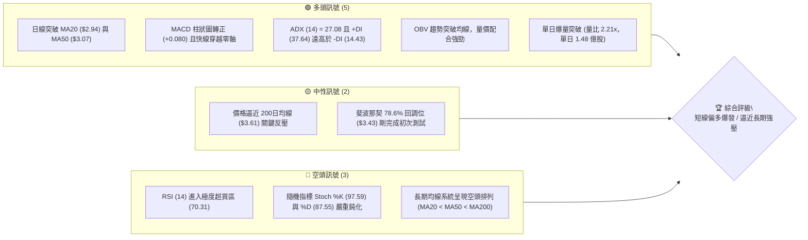
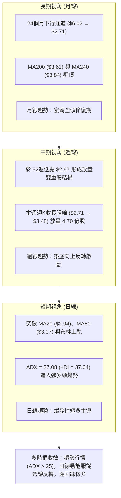
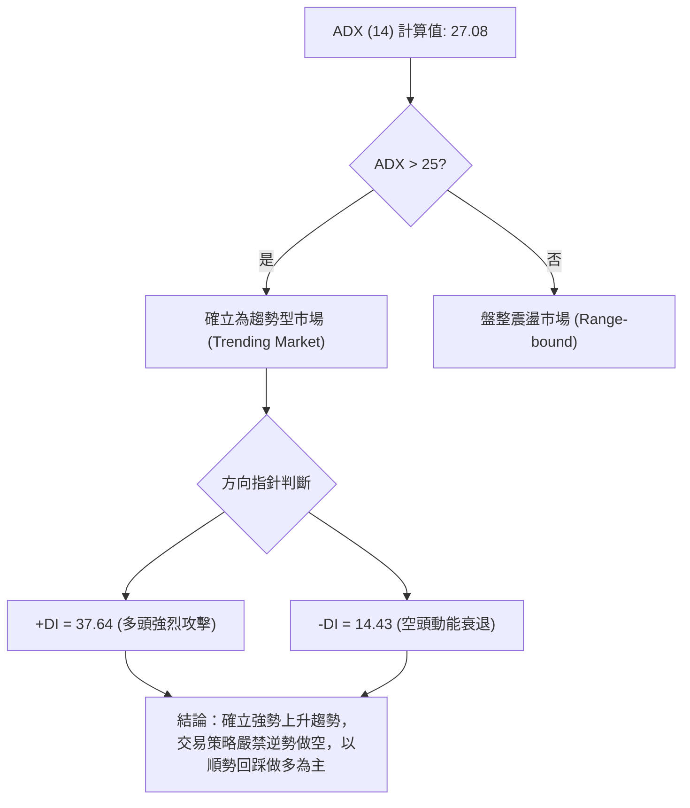
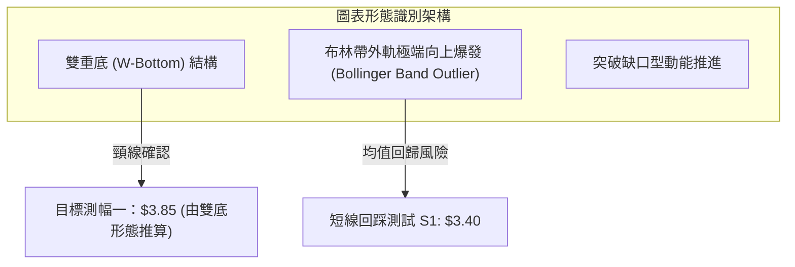
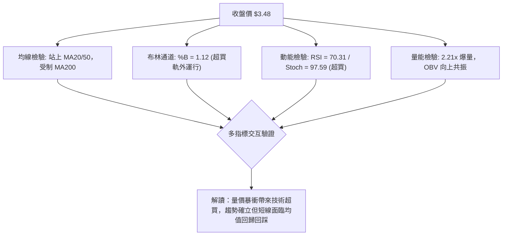
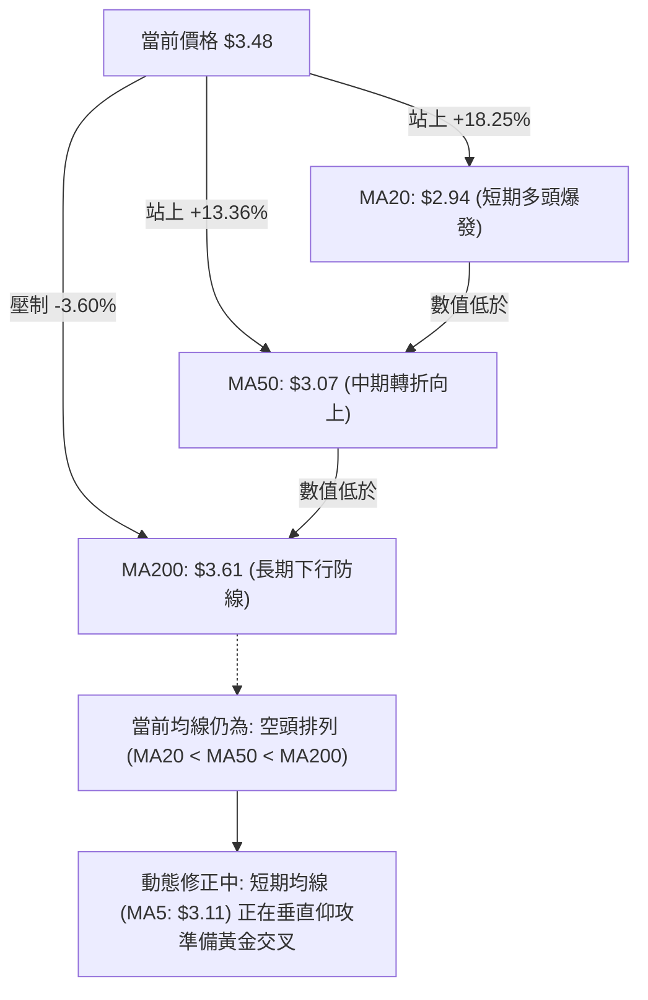
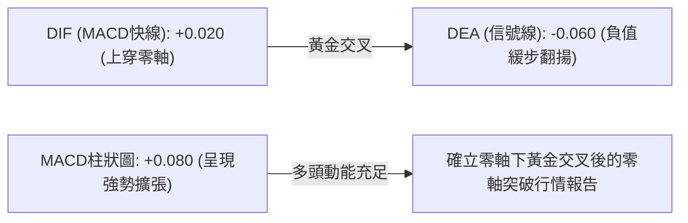
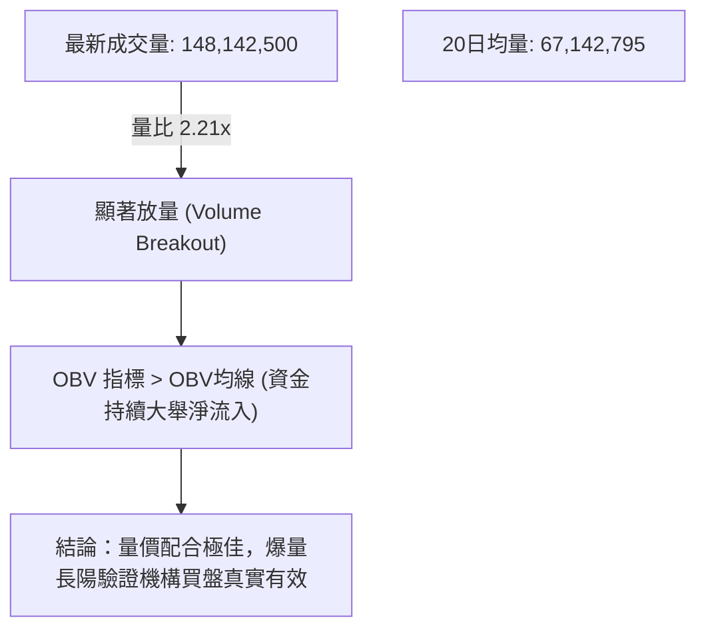
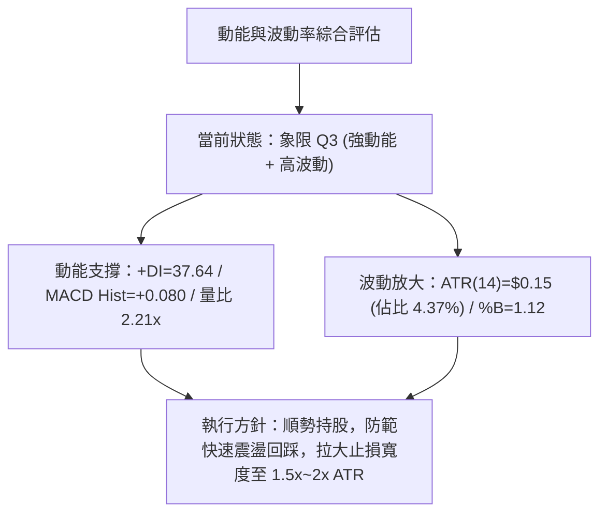
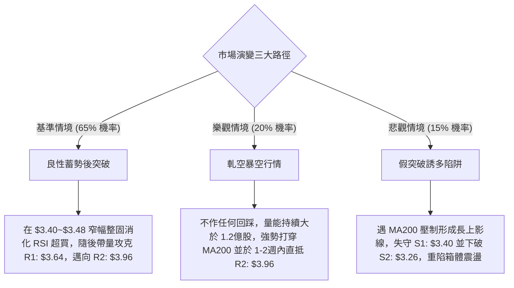

# GRAB 技術分析報告

> **報告日期**：2026-11-06 ｜ **語言**：繁體中文 ｜ **數據來源**：Yahoo Finance ｜ **當前價格**：$3.48 USD

---

## 目錄

| 章節 | 內容 |
|------|------|
| [1. 技術面概覽](#1-技術面概覽) | 訊號儀表板、核心指標、評分卡 |
| [2. 趨勢分析](#2-趨勢分析) | 多時框趨勢、長中短期走勢 |
| [3. 圖表形態分析](#3-圖表形態分析) | 形態識別、K線組合、目標價 |
| [4. 支撐與阻力](#4-支撐與阻力) | 關鍵價位、斐波那契回調 |
| [5. 技術指標深度解讀](#5-技術指標深度解讀) | MA/RSI/MACD/布林/成交量 |
| [6. 動能與波動率](#6-動能與波動率) | 動能評估、ATR、Beta |
| [7. 多時框架總結](#7-多時框架總結) | 時框架評分矩陣 |
| [8. 交易策略建議](#8-交易策略建議) | 多空策略、風險報酬比 |
| [9. 風險提示與監控](#9-風險提示與監控) | 監控指標、風險場景 |

---

## 1. 技術面概覽

### 🎯 技術訊號儀表板



### 📊 核心指標速覽表

| 指標類別 | 指標名稱 | 當前數值 | 訊號 | 解讀 |
|----------|----------|----------|------|------|
| **價格** | 當前收盤價 | $3.48 | 🟢 | 站上多條短中期均線，單週強勁反彈 +28.4% |
| **均線** | MA20 | $2.94 | 🟢 | 價格在均線上方 +18.25%，短線強勢脫離底部 |
| **均線** | MA50 | $3.07 | 🟢 | 價格在均線上方 +13.36%，中期生命線轉化為支撐 |
| **均線** | MA200 | $3.61 | 🔴 | 價格在均線下方 -3.60%，長期下行趨勢壓制尚未扭轉 |
| **動能** | RSI(14) | 70.31 | 🔴 | 突破 70 警戒線進入超買區，存在技術性回踩拉回需求 |
| **動能** | MACD (12,26,9) | 0.020 / -0.060 | 🟢 | MACD 快線向上穿越信號線，紅柱 +0.080 擴張看多 |
| **動能** | Stoch %K / %D | 97.59 / 87.55 | 🔴 | 雙線位於超買極限區，短線追價風險偏高 |
| **趨勢** | ADX (14) | 27.08 | 🟢 | ADX > 25 確立趨勢行情形成，+DI 主導多頭攻擊 |
| **通道** | 布林通道 %B | 1.12 | 🟡 | 突破布林上軌 ($3.38)，屬於極端強勢的軌道外擴張 |
| **波動** | ATR(14) | $0.15 | 🟡 | 佔股價 4.37%，單日波動幅度顯著放大 |
| **量能** | 當日成交量 | 148,142,500 | 🟢 | 為 20日均量 (67,142,795) 的 2.21倍，量增價揚 |

### 🏆 技術評分卡

```
╔══════════════════════════════════════════════════════════════════╗
║                   技術評分卡 — GRAB (2026-11-06)                 ║
╠══════════════════════════════════════════════════════════════════╣
║ 評估維度      評分進度條                         得分    狀態    ║
╠══════════════════════════════════════════════════════════════════╣
║ 趨勢強度      ██████████████░░░░░░  70/100  🟢 強勢動能突破      ║
║ 動能指標      ████████████░░░░░░░░  60/100  🟡 指標超買警戒      ║
║ 支撐穩定度    ██████████████░░░░░░  70/100  🟢 底部支撐堅實      ║
║ 成交量配合    ██████████████████░░  90/100  🟢 爆量多頭表態      ║
║ 形態完整度    ████████████░░░░░░░░  60/100  🟡 剛突破底部架構    ║
║ 均線排列      ████████░░░░░░░░░░░░  40/100  🔴 長期排列仍偏空    ║
╠══════════════════════════════════════════════════════════════════╣
║ 綜合評分      █████████████░░░░░░░  65/100  🟢 偏多（主推多頭）  ║
╚══════════════════════════════════════════════════════════════════╝
```
*註：綜合評分 = (70 + 60 + 70 + 90 + 60 + 40) ÷ 6 = 65.0，四捨五入為 65/100（依規則 18 算術平均）。*

---

## 2. 趨勢分析

### 🌐 多時框趨勢分析



### 📈 長期趨勢 — 12個月走勢圖（Unicode）

```
GRAB 月線收盤走勢圖（2025-12 至 2026-11）
價格 ($)
$5.00 ┤ ● (2025-12: $4.99)
$4.50 ┤    ● (2026-01: $4.30)
      │       ● (2026-02: $4.22)
$4.00 ┤          ● (2026-04: $3.82)
      │             ● (2026-06: $3.77)
$3.50 ┤                ● (2026-03: $3.66)
      │                   ● (2026-05: $3.54)  ● (2026-08: $3.54)        ●←現價 $3.48 (2026-11)
      │                      ● (2026-07: $3.50)
$3.00 ┤                                           ● (2026-09: $3.11)
$2.50 ┤                                              ● (2026-10: $2.71 底)
      └─┬─────┬─────┬─────┬─────┬─────┬─────┬─────┬─────┬─────┬─────┬─────┬─────
       12月  01月  02月  03月  04月  05月  06月  07月  08月  09月  10月  11月
       2025  2026 ----------------------------------------------------->
```

#### 走勢特徵分析表格

| 階段區間 | 起止價格 | 漲跌幅 | 趨勢特徵 | 關鍵推動驅動力與量價解讀 |
|----------|----------|--------|----------|--------------------------|
| **主跌下行段** (2025-12 ~ 2026-03) | $4.99 → $3.66 | -26.65% | 單邊空頭主導 | 高位獲利了結與基本面增長減速憂慮，均線呈現加速下彎。 |
| **箱體拉鋸段** (2026-04 ~ 2026-08) | $3.82 → $3.54 | -7.33%  | 弱勢橫盤整理 | 價格於 $3.50~$3.90 區間反覆震盪，量能萎縮，市場觀望氣氛濃厚。 |
| **二次探底段** (2026-09 ~ 2026-10) | $3.54 → $2.71 | -23.45% | 恐慌拋售打底 | 跌破 $3.00 整數關卡，於 2026-10 創下 52週新低點 $2.67。 |
| **強勢反轉段** (2026-10 ~ 2026-11) | $2.71 → $3.48 | +28.41% | 爆量長陽逆轉 | 財報利好與評級調升，帶動機構資金爆量進場回補，收復近兩月跌幅。 |

### 📊 中期趨勢（週線分析）

從近 20 週收盤走勢可清晰識別出中期趨勢經歷了完整的「下行發散 → 築底壓縮 → 爆量突破」過程：
1. **中期築底結構**：2026-09-18 週收盤 $2.80（最低 $2.74），隨後反彈至 2026-10-09 週收盤 $3.19，隨後於 2026-10-26~30 再次下探測試 52週低點 $2.67，形成極具防禦力的雙重低點架構。
2. **量能驗證反轉**：截至 2026-11-05 當週，週成交量達 470,013,400 股，週線 RSI 從超賣邊緣的 34.0 垂直飆升至 70.3，週線 MACD 柱狀圖由負翻正擴張至 +0.080，驗證中期空頭慣性已被打破。

```
中期阻力與支撐示意圖（週線層級）
$3.96 ═════════════════════════════════════════ 週線強阻力 R2 (7月波段高點聚類)
       ↑ 
$3.64 ----------------------------------------- 短線關鍵阻力 R1 / 200日線區間 ($3.61)
       ↑ 
$3.48 ◄════════════════════════════════════════ 現價（突破上攻中）
       ↓ 
$3.26 ----------------------------------------- 中期轉折支撐 S2 (10/09 反彈頸線聚類)
       ↓ 
$2.67 ═════════════════════════════════════════ 歷史絕對鐵底 (52週低點聚類)
```

### ⚡ 趨勢強度評估（ADX 解讀）



#### ADX 趨勢強度對照表

| 指標變數 | 當前讀數 | 門檻區間 | 技術含義解讀 | 戰術指引 |
|----------|----------|----------|--------------|----------|
| **ADX(14)** | **27.08** | 25.0 ~ 50.0 | **強趨勢建立**：市場告別盤整，進入具備單邊延伸力的趨勢週期。 | 採用順勢突破或回調進場策略。 |
| **+DI** | **37.64** | > 25.0 | **多方佔據壓倒性優勢**：買盤動能充沛且攻擊角度陡峭。 | 逢拉回皆為買點。 |
| **-DI** | **14.43** | < 20.0 | **空方潰散**：拋壓盤已被市場大額流動性全數吸收。 | 嚴格禁止盲目猜頂做空。 |
| **DI差值 (+DI - -DI)** | **+23.21** | > 15.0 | 多空力量失衡，多方具備絕對控盤能力。 | 趨勢具備延續性。 |

---

## 3. 圖表形態分析

### 🔍 形態識別系統



#### 圖表形態信心度評估表（依規則 15）

| 形態名稱 | 信心度 | 判斷依據（嚴格引用歷史數據） | 形態完成度 | 目標價（附嚴謹計算式） |
|----------|--------|------------------------------|------------|------------------------|
| **雙重底 (W-Bottom)** | **75%** | 第一底於 2026-09-18 週低 $2.74，第二底於 2026-10-26 日低 $2.67（雙底於 $2.67~$2.74 聚類）；頸線位於 2026-10-09 週高點聚類 $3.26 (支撐位 S2)。2026-11-03 日K以 $3.12~$3.32 帶量突破。 | **100%** (已突破頸線) | **$3.85**（由雙底形態高度推算：頸線 $3.26 + 形態高度 [$3.26 − 2.67 = $0.59] = $3.85） |
| **布林帶向上突破擴張** | **85%** | 2026-11-05 收盤價 $3.48 遠超 BB 上軌 $3.38，BB %B 達 1.12，通道口自 2026-10-30 歷史性收窄後劇烈開口。 | **100%** (完全穿越) | 指標型擴張，無幾何目標價，短線支撐參考上軌 $3.38 |
| **頭肩底形態** | **35%** | 左肩/頭部/右肩幾何對稱性不足，缺乏標準右肩結構。 | **30%** (未成形) | **訊號不足，僅做指標型解讀** |

### 🕯️ 重要K線形態分析（依規則 19 嚴格引用指定數據）

#### 近 10 根日K 形態解讀

| 日期 | 開盤 | 最高 | 最低 | 收盤 | 成交量 | K線形態特徵 | 技術解讀與多空隱含 | 訊號 |
|------|------|------|------|------|--------|-------------|--------------------|------|
| **2026-10-23** | 2.83 | 2.85 | 2.79 | 2.79 | 43,101,500 | 小陰線 | 弱勢下探，量能萎縮，市場觀望。 | 🔴 |
| **2026-10-26** | 2.79 | 2.80 | 2.67 | 2.71 | 53,258,700 | 錘頭帶下影線 | 下探 52週低點 $2.67 後獲買盤拉起，形成空頭陷阱。 | 🟢 |
| **2026-10-27** | 2.71 | 2.75 | 2.69 | 2.72 | 66,737,600 | 窄幅孕線 | 在底部進行籌碼沉澱，量能放大顯示有吸籌跡象。 | 🟡 |
| **2026-10-28** | 2.73 | 2.79 | 2.71 | 2.75 | 55,245,600 | 小陽線 | 價格溫和回升，逐步確立 $2.70 關卡支撐。 | 🟡 |
| **2026-10-29** | 2.76 | 2.78 | 2.72 | 2.76 | 50,373,300 | 紡錘線 (Spindle) | 多空陷入均衡膠著，波動率受擠壓至極限。 | 🟡 |
| **2026-10-30** | 2.71 | 2.73 | 2.68 | 2.71 | 54,900,200 | 低位小陰線十字 | 第二次下探不破前低 $2.67，完成雙底二次確認。 | 🟢 |
| **2026-11-02** | 2.76 | 2.93 | 2.75 | 2.86 | 69,385,700 | 突破中陽線 | 突破近兩週整理平台，多頭攻勢點火。 | 🟢 |
| **2026-11-03** | 3.21 | 3.32 | 3.08 | 3.12 | 153,625,600 | 跳空放量大長陽 | 財報利好刺激，跳空跳過 MA20/MA50，成交量爆出 1.53億股。 | 🟢 |
| **2026-11-04** | 3.22 | 3.39 | 3.20 | 3.36 | 98,859,600 | 光頭實體陽線 | 多頭續攻，完全吸收前日高檔賣壓，高價穩步墊高。 | 🟢 |
| **2026-11-05** | 3.35 | 3.50 | 3.27 | 3.48 | 148,142,500 | 強勢大陽線 | 巨量推升至收盤最高點附近，買方控盤力極強。 | 🟢 |

#### 近 8 根週K 形態解讀

| 日期 | 開盤 | 最高 | 最低 | 收盤 | 成交量 | K線形態特徵 | 中期格局影響解讀 | 訊號 |
|------|------|------|------|------|--------|-------------|------------------|------|
| **2026-09-18** | 3.01 | 3.09 | 2.74 | 2.80 | 362,971,800 | 破位長陰線 | 跌破 $3.00 整數關卡，形成恐慌拋售第一低點 ($2.74)。 | 🔴 |
| **2026-09-25** | 2.84 | 3.26 | 2.78 | 3.13 | 527,094,200 | 爆量長陽吞噬 | 底部爆出 5.27億股天量，多方反撲確立 $2.78 低檔承接。 | 🟢 |
| **2026-10-02** | 3.10 | 3.18 | 3.07 | 3.08 | 337,148,400 | 高位窄幅十字 | 消化反彈獲利盤，量縮橫向整理。 | 🟡 |
| **2026-10-09** | 3.10 | 3.23 | 3.00 | 3.19 | 406,864,800 | 衝高蓄勢陽線 | 測試 $3.26 頸線反壓後收高，構成雙底中間高點。 | 🟢 |
| **2026-10-16** | 3.16 | 3.20 | 2.85 | 2.94 | 280,278,600 | 轉折陰線 | 頸線阻力受阻，引發二次探底回調。 | 🔴 |
| **2026-10-23** | 2.93 | 2.94 | 2.77 | 2.79 | 233,692,400 | 下跌探底陰線 | 連續回落，市場情緒重回悲觀。 | 🔴 |
| **2026-10-30** | 2.79 | 2.80 | 2.67 | 2.71 | 280,515,400 | 長下影打底錘線 | 觸及 52週新低 $2.67 後迅速止跌，完成第二隻腳。 | 🟢 |
| **2026-11-05** | 2.76 | 3.50 | 2.75 | 3.48 | 470,013,400 | 一柱擎天週陽線 | 放量大陽線一舉包覆前四週陰線，完成底部反轉突破。 | 🟢 |

### 📉 ASCII 走勢形態示意圖

```
雙重底（W-Bottom）突破示意圖（日線層級）
價格 ($)
$3.85 ┤                                            [形態高度推算目標: $3.85]
      │                                                ↑
$3.64 ┤                                      (R1阻力) ─┼───
      │                                                │
$3.48 ┤                                              ●現價突破 ($3.48)
      │                                             ／
$3.26 ┤            ●頸線 ($3.26) -----------------／-------- (頸線被放量向上貫穿)
      │          ／  ＼                          ／
$3.00 ┤        ／      ＼                      ／
      │      ／          ＼                  ／
$2.74 ┤    ●(左底)       ＼              ／
$2.67 ┤                      ●─────────────●(右底/52W低點: $2.67)
      └─────┬──────────────┬──────────────┬───────────────────
       2026-09-18     2026-10-09     2026-10-26~30        2026-11-05
```

### 🎯 形態目標價計算

依據標準幾何技術形態測算法則：
1. **雙底基底低點**：由 2026-10-26 的 52週低點確認為 **$2.67**。
2. **形態頸線位置**：由 2026-10-09 波段反彈高點聚類與 S2 支撐轉換位確認為 **$3.26**。
3. **垂直形態高度 (Height)**：
   $$\text{Height} = \text{頸線} - \text{底部低點} = \$3.26 - \$2.67 = \$0.59$$
4. **最小量度目標價 (Price Target 1)**：
   $$\text{PT1} = \text{頸線} + \text{形態高度} = \$3.26 + \$0.59 = \$3.85$$
   *(該推算值 $3.85 與阻力位 R1: $3.64 及 R2: $3.96 形成緊密波段共振區間)*。

---

## 4. 支撐與阻力

### 🗺️ 關鍵價位分布圖（Unicode）

```
GRAB 價位結構分布圖（嚴格依據 OHLCV 歷史數據計算）
═══════════════════════════════════════════════════════════════
$4.06 ║██████████████████████████████║ 強阻力 R3 (年內強烈密集套牢區)
$3.96 ║████████████████████          ║ 阻力 R2 (中期波段高點聚類)
$3.64 ║████████████████████████      ║ 關鍵阻力 R1 (前波反彈高點 / 近MA200 $3.61)
$3.48 ╠══════════════════════════════╣ ◄ 現價 ($3.48)
$3.43 ║▒▒▒▒▒▒▒▒▒▒▒▒▒▒▒▒▒▒▒▒▒▒▒▒      ║ 斐波那契 78.6% 回調關鍵樞紐
$3.40 ║▓▓▓▓▓▓▓▓▓▓▓▓▓▓▓▓              ║ 近期支撐 S1 (短線突破回踩第一防線)
$3.26 ║████████████████████████      ║ 強支撐 S2 (雙底頸線轉換強支撐)
$3.18 ║██████████████████████████████║ 核心支撐 S3 (密集籌碼換手防線)
$2.67 ║██████████████████████████████║ 歷史鐵底 (52週最低價 / 斐波那契 100%)
═══════════════════════════════════════════════════════════════
```

### 🚧 阻力位分析表

*註：價位嚴格引用「關鍵價位（由 OHLCV 計算）」區塊。*

| 阻力級別 | 阻力價位 | 距現價幅動 | 歷史形成原因與技術共振 | 突破難度評估 | 技術重要性評級 |
|----------|----------|------------|------------------------|--------------|----------------|
| **R1** | **$3.64** | +4.60% | 近一年波段高點聚類，與 200日均線 ($3.61) 形成高度共振密集反壓帶。 | 🟡 中等（需換手消化） | ★★★★☆ |
| **R2** | **$3.96** | +13.79% | 2026年7月波段反彈高點聚類，接近 $4.00 整數心理關卡。 | 🔴 較高（套牢量密集） | ★★★★☆ |
| **R3** | **$4.06** | +16.67% | 斐波那契 61.8% ($4.03) 延伸波段高點聚類，多頭中期轉強決定性分水嶺。 | 🔴 極高（需巨量推升） | ★★★★★ |

### 🛡️ 支撐位分析表

*註：價位嚴格引用「關鍵價位（由 OHLCV 計算）」區塊。*

| 支撐級別 | 支撐價位 | 距現價幅動 | 歷史形成原因與技術共振 | 守住機率評估 | 技術重要性評級 |
|----------|----------|------------|------------------------|--------------|----------------|
| **S1** | **$3.40** | -2.30% | 近一年波段低點聚類，緊鄰斐波那契 78.6% ($3.43) 與布林上軌 ($3.38)。 | 🟢 80%（多方首要防線）| ★★★★☆ |
| **S2** | **$3.26** | -6.32% | 近一年波段低點聚類，為雙底突破頸線位置，完成極強阻力轉支撐。 | 🟢 90%（中期強勢關鍵）| ★★★★★ |
| **S3** | **$3.18** | -8.62% | 近一年波段低點聚類，與 60日均線 ($3.15) 形成重疊多頭緩衝防禦層。 | 🟢 95%（多頭生命底線）| ★★★★☆ |

### 📐 斐波那契回調位分析

依據 52週極值區間：高點 **$6.24** (0.0%) 至 低點 **$2.67** (100.0%)，垂直落差為 $3.57：

```
斐波那契回調階梯（52W 區間: $2.67 → $6.24）
0.0%  (52W High) ───────────────────────── $6.24
23.6%            ───────────────────────── $5.39
38.2%            ───────────────────────── $4.87
50.0%            ───────────────────────── $4.45
61.8% (黃金分割) ───────────────────────── $4.03  (緊鄰強阻力 R3: $4.06)
─────────────────────────────────────────────────
78.6%            ─────────┬─────────────── $3.43  ◄ 現價 $3.48 剛完成突破
                          │ [現價落於 61.8% ~ 78.6% 關鍵修復區間]
100.0%(52W Low)  ─────────┴─────────────── $2.67
```

**深層技術解讀**：
當前價格 **$3.48** 正好成功站上 **78.6% 回調位 ($3.43)** 之上。在經典斐波那契理論中，從底部的反彈如果能向上貫穿 78.6%（即收復了整個跌幅的 21.4%），代表這不再是微弱的死貓跳，而是展開結構性級別反彈的起點。上方第一目標為金叉共振區間 **61.8% ($4.03)** 與 **R3 ($4.06)**。

---

## 5. 技術指標深度解讀

### 🎛️ 指標訊號總覽



### 📈 移動平均線排列分析



#### 均線數據明細評估

| 均線名稱 | 數值 | 距現價差距 | 當前趨勢線特徵 | 技術含義解讀 |
|----------|------|------------|----------------|--------------|
| **MA 5** | $3.11 | +12.04% | 垂直飆升 ▁▁▁▃▅█ | 短線極度強勢，提供超短期第一動態支撐。 |
| **MA 10** | $2.93 | +18.93% | 築底勾頭 ▁▁▁▁▂▄ | 快速穿越 MA20，短線金叉成形。 |
| **MA 20** | $2.94 | +18.25% | 平轉向上 ▁▁▁▁▂ | 20日均線正式由下行轉為走平上翹，空頭扣抵結束。 |
| **MA 50** | $3.07 | +13.36% | 下緩上勾 ▄▄▃▃▂ | 中期生命線被長陽直接穿越，轉化為波段回踩支撐。 |
| **MA 60** | $3.15 | +10.31% | 走平築底 ▁▁▁▁▁ | 與支撐 S3 ($3.18) 形成中期籌碼防禦密集區。 |
| **MA120** | $3.36 | +3.43%  | 走平微揚 ▁▁▁▁▁▁ | 現價已成功站上，半年線反壓解除。 |
| **MA200** | $3.61 | -3.60%  | 緩步下行 ▄▄▃▃▂ | **核心牛熊分水嶺**，為當前多頭反彈最關鍵測試目標。 |
| **MA240** | $3.84 | -9.43%  | 緩步下移 ▃▃▂▂▁ | 年線反壓，與雙底推算目標 $3.85 高度重合。 |

### 📉 RSI(14) 分析

- **當前讀數**：**70.31**
- **強度進度條**：`██████████████░░░░░░ 70.31%`（進入警戒超買區）

```
RSI(14) 區間定位圖
0 ─────── 30 ───────────────── 50 ───────────────── 70 ─────── 100
[ 超賣區 ]       [ 中性弱勢 ]       [ 中性強勢 ]  ▲   [ 超買區 ]
                                                  │
                                            RSI = 70.31 (觸發回調警戒)
```

**背離檢驗結論**：
- **日線背離判定**：**無頂背離，亦無底背離**。近 20 根 K 棒價格由 $2.71 漲至 $3.48，RSI 同步自低位 34.0 垂直飆升至 70.31，屬於健康放量的**指標同向確認**。
- **超買性質解讀**：強趨勢（ADX > 25）初期的 RSI > 70 往往屬於「**強勢鈍化**」特徵，不宜單純視為放空訊號，但短線獲利盤隨時可能誘發技術性回踩拉回。

### 📊 MACD(12/26/9) 訊號解讀



- **數值狀態**：DIF 錄得 **+0.020**，Signal 線為 **-0.060**，柱狀圖達到 **+0.080**。
- **背離檢驗結論**：日線與週線 MACD 柱狀圖同步翻紅且高度擴張，**無頂背離現象**，確認多頭動能仍在健康釋放階段。

### 📦 布林通道分析

```
布林通道結構示意圖（日線）
$3.48 ◄ 現價 (位於軌道上方，%B = 1.12)
───────────────────────────────────────────── 上軌：$3.38  (極端擴張)
       ▲
       │ 偏離超買空間
       ▼
═════════════════════════════════════════════ 中軌(MA20)：$2.94 (多頭防守基石)
       
───────────────────────────────────────────── 下軌：$2.51
```

- **通道數據**：上軌 **$3.38**，中軌 (MA20) **$2.94**，下軌 **$2.51**。
- **通道寬度與狀態**：%B 達到 **1.12**，價格連續兩日站於布林上軌之外。布林通道開口急劇向外喇叭狀擴張，顯示正處於「帶量沿上軌暴衝」的極端單邊態勢。根據統計，%B > 1.10 難以長期維持，短線收斂回布林通道內（回踩 $3.38~$3.40）為大概率事件。

### 💹 成交量分析（量價配合度）



- **量價關係解讀**：在突破 $3.26 頸線過程中，單日成交量擴大至 1.48 億股，量比高達 2.21 倍；週成交量達 4.70 億股，逼近 9 月下旬天量水平。
- **OBV 趨勢評估**：數據顯示「**OBV > MA → 量能支撐上漲**」，量能領先突破長期平台阻力，否定了量價背離風險，確認本輪突破由真實機構籌碼換手推動。

---

## 6. 動能與波動率

### ⚡ 動能評估四象限

| 象限代碼 | 動能維度 | 波動維度 | 代表特徵 | 當前狀態吻合度 | 戰術定位 |
|----------|----------|----------|----------|----------------|----------|
| **Q1** | **強動能** | **低波動** | 穩步階梯推升 | 不符合 | 最平穩進場點 |
| **Q2** | **弱動能** | **低波動** | 底部冷清盤整 | 偏離（已脫離） | 適合左側定投 |
| **Q3** | **強動能** | **高波動** | **爆量爆發突破** | **✓ 完全符合** | **高風險高回報，利潤快速奔馳期，需嚴格風控** |
| **Q4** | **弱動能** | **高波動** | 崩跌破位拋售 | 偏離 | 嚴禁介入觀望 |



### 📊 ATR 波動率分析

- **ATR(14) 當前讀數**：**$0.15**（佔當前股價 $3.48 的 **4.37%**）。
- **止損距離建議**：
  - **超短線戰術止損（1.0x ATR）**：距進場點扣除 **$0.15**。
  - **波段交易防守止損（1.5x ~ 2.0x ATR）**：距進場點扣除 **$0.23 ~ $0.30**。
  - **進場安全邊界評估**：由於單日正常波幅即達 $0.15，現價 $3.48 追價若遇震盪，極易觸發過於狹窄的止損。因此，進場必須等待價格向支撐 S1 ($3.40) 靠攏，以控制單筆曝險。

### 📐 Beta 與市場相關性

- **Beta 數值**：**0.833**。
- **市場相關性解讀**：Beta < 1.0 顯示 GRAB 歷史波動幅度略低於美股大盤指數。但近期在 Q3 財報、上調指引及外賣叫車同業（如 Uber、Lyft）利好推動下，走出顯著的**個股獨立 Alpha 行情**。低 Beta 提供了一定的宏觀防禦屬性，即便大盤出現波動，個股自身動能仍能提供緩衝。

---

## 7. 多時框架總結

### 📋 時框架評分表

| 時框架 | 趨勢方向 | 動能狀態 | 均線排列特徵 | 形態完成度 | 綜合評分 | 戰術建議 |
|--------|----------|----------|--------------|------------|----------|----------|
| **短期 (日線)** | 🟢 強烈看多 | 🔴 超買警戒 (RSI: 70.3) | 短期金叉，站上 MA20/50 | 雙底頸線突破完成 | **75/100** | 待短線回踩支撐確認進場 |
| **中期 (週線)** | 🟢 築底反轉 | 🟢 動能轉強 (MACD: +0.08) | 均線逐步走平勾頭 | 放量長陽反轉形態 | **65/100** | 波段順勢做多，上看 MA200 |
| **長期 (月線)** | 🔴 宏觀承壓 | 🟡 跌勢趨緩 (低位收斂) | 空頭排列 (MA200 壓制) | 處於 24個月下行通道修復 | **55/100** | 中長線仍受制 $3.61~$3.84 壓力 |

### 🔲 綜合訊號矩陣

```
╔══════════════════════════════════════════════════════════════════╗
║               GRAB 多時框架綜合訊號矩陣維度評估                  ║
╠══════════════════════════════════════════════════════════════════╣
║ 分析維度        日線 (短期)        週線 (中期)        月線 (長期)║
╠══════════════════════════════════════════════════════════════════╣
║ 趨勢方向        🟢 強勢多頭        🟢 轉折多頭        🔴 空頭修復║
║ 動能指標        🔴 短期鈍化超買    🟢 擴張看多        🟡 低位走平║
║ 均線支撐        🟢 站上MA20/MA50   🟢 站穩週MA10      🔴 壓制於MA200║
║ 形態結構        🟢 突破雙底頸線    🟢 吞噬破底翻      🟡 下行通道內║
║ 成交量配合      🟢 爆量 2.21x      🟢 天量 4.70億股   🟡 籌碼轉手║
╠══════════════════════════════════════════════════════════════════╣
║ 一致性判定      日線與週線多頭強烈共振，長期月線為上方空間天花板 ║
╚══════════════════════════════════════════════════════════════════╝
```

### ⚖️ 多時框收斂結論（依規則 14 嚴格收斂）

1. **市場屬性判斷**：日線 ADX(14) 讀數達 **27.08**，明確突破 25 臨界線，判定當前盤勢屬於明確的**趨勢行情 (Trending Market)**。
2. **多時框優先級權衡**：
   - 根據規則 14，趨勢行情以中長期（週線方向與 MA50/MA200 軌跡）為主要方向錨定。
   - 當前週線已藉由雙重底及天量完成「破底翻」轉折，日線與週線訊號方向一致偏多；日線的短期超買僅作為**篩選進場時機**的濾網，而非翻空理由。
3. **唯一方向性結論**：**強烈偏多（逢回踩進場做多）**。此結論與第 1 章評分卡（綜合評分 65/100，偏多區間）及第 8 章主推的多頭交易策略完全一致。

---

## 8. 交易策略建議

### 🗺️ 策略決策流程圖

```mermaid
graph TD
    START["當前價格 $3.48 (評分: 65/100 偏多)"] --> ROUTE{"策略路徑選擇"}
    ROUTE -->|"回踩測試 S1 支撐"| BUY_A["策略 A: 穩健回踩做多 (買入區間: $3.40~$3.48)"]
    ROUTE -->|"強勢直接放量突破"| BUY_B["策略 B: 強勢突破追買 (突破點: 站穩 R1 $3.64)"]
    
    BUY_A --> EXEC_A["止損: S2 $3.26 |" 目標 T1: R1 $3.64 "| 目標 T2: R2 $3.96"]
    BUY_B --> EXEC_B["止損: S1 $3.40 |" 目標 T1: R2 $3.96 "| 目標 T2: R3 $4.06"]
    
    ROUTE -.->|"跌破 S2 $3.26 風險警戒"| RISK_HEDGE["反向對沖觸發：多頭部位全面離場觀望"]
```

### 🧭 策略路由（依規則 18 評分卡分流）

> **當前主策略方向 = 主推多頭策略（依綜合評分 65/100 ≥ 60，偏多區間）**

本報告堅定執行多頭策略體系，嚴禁兩頭下注。空頭不予立項操作，僅作為下方風控反轉觸發點。

### 🎯 價格情境階梯（Price Scenarios）

*註：價位嚴格引用「關鍵價位」區塊之客觀數值。*

| 觸發條件 | 第一階梯目標 | 後續延伸目標 | 技術情境含義與操作指引 |
|----------|--------------|--------------|------------------------|
| **向上突破 R1 ($3.64)** | **R2 ($3.96)** | **R3 ($4.06)** | 成功越過 200日均線 ($3.61)，展開向年內高點區域推進的大級別主升浪。 |
| **站穩現價區間 ($3.40 ~ $3.48)** | **R1 ($3.64)** | **R2 ($3.96)** | 消化短線 RSI 超買鈍化，以時間換取空間後續攻。 |
| **跌破 S1 ($3.40)** | **S2 ($3.26)** | **S3 ($3.18)** | 短線超買引發較深獲利回吐，退守雙底頸線支撐尋求二次蓄勢。 |

### 📊 情境機率分佈

| 運行情境 | 評估機率 | 主要技術與指標依據 |
|----------|----------|-------------------|
| **回踩蓄勢後繼續上行** | **65%** | ADX (27.08) 趨勢確立、MACD 柱狀圖 (+0.080) 翻紅擴張、OBV 與 2.21x 爆量共振，多頭主控權穩固。 |
| **窄幅區間橫向震盪** | **25%** | 布林通道 %B (1.12) 與 RSI (70.31) 處於高檔超買，價格受制於 MA200 ($3.61) 心理壓制，需震盪換手。 |
| **破位深幅回落再探底** | **10%** | S2 ($3.26) 頸線與 S3 ($3.18) 形成雙重高密度防禦，且週線爆出 4.70億股支撐，再度深跌探底機率極低。 |

### 🟢 主策略詳情（嚴格遵守規則 17 計算風險報酬比）

*註：進場價若為區間，以區間中點計算：策略 A 進場中點 = ($3.40 + $3.48) ÷ 2 = **$3.44**。*

| 策略要素 | 策略 A（穩健型：回踩支撐買入） | 策略 B（激進型：突破高點追買） |
|----------|--------------------------------|--------------------------------|
| **交易邏輯** | 利用短線 RSI 超買引發之回踩，於 S1 附近低吸 | 待多頭強勢突破 R1 ($3.64) 及 MA200 壓制順勢追進 |
| **進場價格** | **$3.40 ~ $3.48（計算中點：$3.44）** | **$3.64** |
| **目標價 T1** | **$3.64** (關鍵阻力 R1) | **$3.96** (阻力 R2) |
| **目標價 T2** | **$3.96** (阻力 R2) | **$4.06** (強阻力 R3) |
| **止損價格** | **$3.26** (強支撐 S2，跌破頸線認賠) | **$3.40** (跌回支撐 S1 之下認賠) |
| **風險報酬比 (T1)** | **1 : 1.11（以 T1 計）**<br>*(計算：(3.64−3.44)÷(3.44−3.26) = 0.20÷0.18)* | **1 : 1.33（以 T1 計）**<br>*(計算：(3.96−3.64)÷(3.64−3.40) = 0.32÷0.24)* |
| **風險報酬比 (T2)** | **1 : 2.89（以 T2 計）**<br>*(計算：(3.96−3.44)÷(3.44−3.26) = 0.52÷0.18)* | **1 : 1.75（以 T2 計）**<br>*(計算：(4.06−3.64)÷(3.64−3.40) = 0.42÷0.24)* |
| **成功機率** | **65%** | **55%** |
| **建議倉位** | **總投資資金之 15% ~ 20%** | **總投資資金之 10%** |

### 🔴 反向風險觸發點（對沖提示）

若出現以下極端反轉訊號，說明當前多頭突破失敗，應立即執行防禦性平倉或反向對沖：
1. **關鍵點位破位**：日K收盤價**實體跌破強支撐 S2 ($3.26)**，意味雙底頸線得而復失，反轉形態被證偽。
2. **量價嚴重惡化**：跌破 $3.26 時伴隨單日成交量 > 1 億股（巨量長陰）。
3. **指標共振轉弱**：日線 MACD 柱狀圖由正值垂直跌穿零軸轉負，且 RSI(14) 跌破 50 中軸進入弱勢區間。

### ⭐ 整體訊號強度評星

```
做多訊號強度：★★★★☆  (4/5星 — 爆量突破確立，受制於短期超買與長線均線)
做空訊號強度：★☆☆☆☆  (1/5星 — 強趨勢確立，逆勢放空風險極高)
整體可信度：  ★★★★☆  (4/5星 — 量價高度共振，突破訊號具備機構背景支撐)
```

---

## 9. 風險提示與監控

### ✅ 關鍵監控指標 Checklist

```
╔══════════════════════════════════════════════════════════════════╗
║               GRAB 盤面關鍵技術指標動態監控清單                  ║
╠══════════════════════════════════════════════════════════════════╣
║ [ ] 價格防禦檢驗：日收盤價是否持續站穩 S1 ($3.40) 與上軌 ($3.38) ║
║ [ ] 頸線生命底線：盤中回調是否守住強支撐 S2 ($3.26) 頸線位置     ║
║ [ ] 長期阻力攻堅：價格挑戰 MA200 ($3.61) 與 R1 ($3.64) 之量能表現║
║ [ ] 動能過熱降溫：觀察 RSI(14) 能否自 70.31 高檔良性回落至 60 附近║
║ [ ] 趨勢延續跟蹤：ADX 是否維持在 25 以上且 +DI 保持壓倒性領先     ║
║ [ ] 異常拋壓預警：監控單日賣壓成交量是否異常超越 50日均量 (69.5M)║
╚══════════════════════════════════════════════════════════════════╝
```

### ⚠️ 風險場景分析



### 🛡️ 風險管理重要提醒

1. **嚴禁高檔追高追價**：現價 $3.48 的布林 %B 為 1.12，且 RSI(14) 為 70.31，屬於極端超買。非職業日內交易者應克制追價衝動，務必等待回踩 S1 ($3.40) 附近再行建倉。
2. **倉位梯度配置原則**：建議總持倉嚴格控制在 15% ~ 20% 以內。採取「**首倉 50%（回踩現價至 S1 時進場）+ 加碼 50%（放量站穩 R1 $3.64 時確認突破加碼）**」的階梯式建倉模式。
3. **硬性止損絕不妥協**：波段防守點以收盤價跌破 **$3.26 (S2)** 為絕對退出標準，單筆交易虧損本金控制在 1.5% ~ 2.0% 以內。

---

## 📋 報告總結

```
╔══════════════════════════════════════════════════════════════════╗
║                    GRAB 技術分析報告總結                         ║
╠══════════════════════════════════════════════════════════════════╣
║ 報告日期：2026-11-06                                             ║
║ 當前價格：$3.48 USD                                              ║
║ 分析評級：🟢 偏多（多頭強烈攻擊波，短線超買宜逢回佈局）         ║
║ 綜合評分：65 / 100（算術平均，偏多區間）                         ║
╠══════════════════════════════════════════════════════════════════╣
║ 關鍵結論：                                                       ║
║ ├─ 長期趨勢：🔴 宏觀承壓（受制 MA200: $3.61 與 MA240: $3.84）    ║
║ ├─ 中期趨勢：🟢 築底完成（週線爆出 4.70億天量完成雙底破底翻）   ║
║ ├─ 短期趨勢：🟢 強烈看多（ADX 27.08 確立趨勢，量比 2.21x 爆發）║
║ ├─ 關鍵支撐：S1: $3.40  /  S2: $3.26 (雙底頸線強支撐)           ║
║ ├─ 關鍵阻力：R1: $3.64  /  R2: $3.96 (中期目標測幅區間)          ║
║ └─ 分析師目標：均價 $5.49（最低 $4.00 / 最高 $7.00，全體共識強買）║
╠══════════════════════════════════════════════════════════════════╣
║ 最優策略組合：                                                   ║
║ 1. 🥇 最佳機會（策略 A）：回踩 $3.40~$3.48 區間低吸做多，        ║
║    目標 R1: $3.64 / R2: $3.96，止損 S2: $3.26 (風報比 1:1.11)   ║
║ 2. 🥈 次選機會（策略 B）：放量突破 R1: $3.64 順勢追多，           ║
║    目標 R2: $3.96 / R3: $4.06，止損 S1: $3.40 (風報比 1:1.33)   ║
║ 3. 🥉 保守選擇：等待股價站穩 200日線 ($3.61) 且 RSI 降溫後，     ║
║    再行進場參與中長線估值修復行情                                ║
╚══════════════════════════════════════════════════════════════════╝
```

---

> ⚠️ **免責聲明**：本報告為 AI 自動生成之技術分析研究文檔，報告中引用的所有價格、歷史數據及指標計算均基於提供的市場數據源。本報告**僅供研究與學術參考**，**不構成任何形式的投資建議、要約或承諾**。證券交易具有高風險性，投資人應獨立評估財務狀況、承擔投資風險並自行作出決策。

---

*報告生成時間：2026-11-06 ｜ 數據來源：Yahoo Finance ｜ 分析框架：多時框技術分析模型*