# GRAB 技術分析報告

> **報告日期**：2026-11-07 ｜ **語言**：繁體中文 ｜ **數據來源**：Yahoo Finance ｜ **當前價格**：$3.41

---

## 目錄

| 章節 | 內容 |
|------|------|
| [1. 技術面概覽](#1-技術面概覽) | 訊號儀表板、核心指標、評分卡 |
| [2. 趨勢分析](#2-趨勢分析) | 多時框趨勢、長中短期走勢 |
| [3. 圖表形態分析](#3-圖表形態分析) | 形態識別、K線組合、目標價 |
| [4. 支撐與阻力](#4-支撐與阻力) | 關鍵價位、斐波那契回調 |
| [5. 技術指標深度解讀](#5-技術指標深度解讀) | MA/RSI/MACD/布林/成交量 |
| [6. 動能與波動率](#6-動能與波動率) | 動能評估、ATR、Beta |
| [7. 多時框架總結](#7-多時框架總結) | 時框架評分矩陣 |
| [8. 交易策略建議](#8-交易策略建議) | 多空策略、風險報酬比 |
| [9. 風險提示與監控](#9-風險提示與監控) | 監控指標、風險場景 |

---

## 1. 技術面概覽

### 🎯 技術訊號儀表板

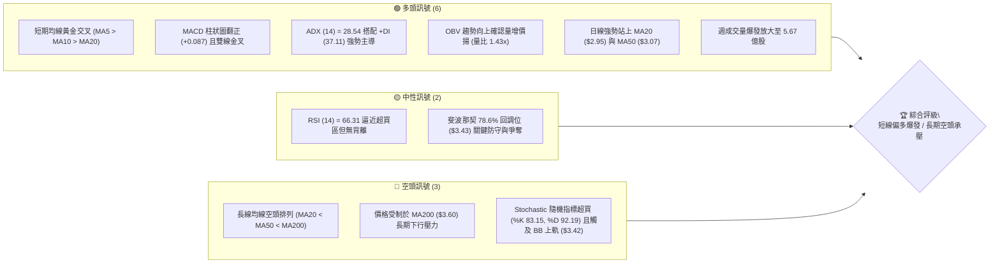

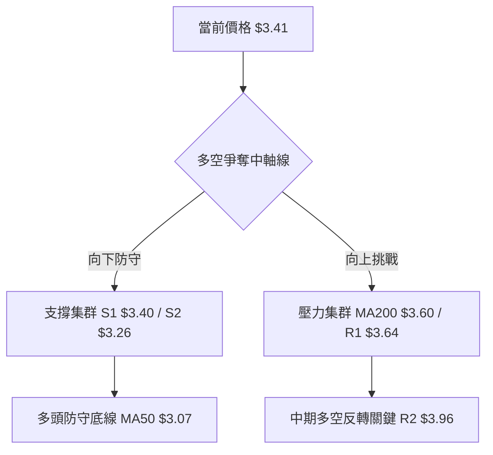

### 📊 核心指標速覽表

| 指標類別 | 指標名稱 | 當前數值 | 訊號 | 解讀 |
|----------|----------|----------|------|------|
| **價格** | 當前價格 | $3.41 | 🟢 | 位於 52 週區間 20.8%，自波段低點 $2.67 大幅反彈 +27.7% |
| **均線** | MA20 | $2.95 | 🟢 | 現價大幅高於 MA20 (+15.6%)，短線呈均線陡峭上揚 |
| **均線** | MA50 | $3.07 | 🟢 | 突破中期均線壓力，轉化為波段回踩之動態支撐 |
| **均線** | MA200 | $3.60 | 🔴 | 現價位於 MA200 下方 (-5.3%)，中長期宏觀架構仍屬空頭抑制 |
| **動能** | RSI(14) | 66.31 | 🟡 | 位於強勢多頭區間（未過 70），動能充足且暫無頂背離徵兆 |
| **動能** | MACD(12,26,9) | DIF: 0.049 / DEA: -0.038 / 柱: +0.087 | 🟢 | 零軸下方黃金交叉並突破零軸，動能柱持續放大看多 |
| **動能** | KD(9,3,3) | %K: 83.15 / %D: 92.19 | 🔴 | 進入超買鈍化區間，短線存在獲利了結與指標修復回調風險 |
| **趨勢** | ADX(14) / DMI | ADX: 28.54 / +DI: 37.11 / -DI: 13.16 | 🟢 | ADX > 25 確認進入實質趨勢行情，+DI 遠高於 -DI 多頭強勢主導 |
| **通道** | 布林通道(20,2) | 上: $3.42 / 中: $2.95 / 下: $2.48 (%B: 0.99) | 🟡 | 現價緊貼布林通道上軌，通道張口放大，進入單邊強推升走勢 |
| **量能** | 當日量 / 均量比 | 最新: 97.11M / 20日均: 68.11M (1.43x) | 🟢 | 成交量顯著放大，伴隨 OBV 向上穿越均線，量價配合健康 |
| **波動** | ATR(14) | $0.15 (佔現價 4.54%) | 🟡 | 波動率處於中等偏高水準，需設定合理止損緩衝空間 |

### 🏆 技術評分卡

```
╔════════════════════════════════════════════════════════════════════════════════╗
║                   技術評分卡 — GRAB Holdings Limited (2026-11-07)             ║
╠════════════════════════════════════════════════════════════════════════════════╣
║ 評估維度         進度條指標 (0-100)                      得分    訊號方向      ║
╟────────────────────────────────────────────────────────────────────────────────╢
║ 趨勢強度 (ADX)   ████████████████░░░░░░░░░░░░░░░░░░░░   68/100   🟢 強多主導   ║
║ 動能指標 (RSI/M) ████████████████░░░░░░░░░░░░░░░░░░░░   65/100   🟢 動能充沛   ║
║ 支撐穩定度 (S/R) ██████████████░░░░░░░░░░░░░░░░░░░░░   58/100   🟡 回測檢驗   ║
║ 成交量配合 (OBV) ████████████████████░░░░░░░░░░░░░░░░   80/100   🟢 量能爆發   ║
║ 形態完整度 (K線) ████████████████░░░░░░░░░░░░░░░░░░░░   66/100   🟢 破底翻反轉 ║
║ 均線排列 (MA)    ██████████░░░░░░░░░░░░░░░░░░░░░░░░░░   41/100   🔴 長線空排   ║
╠════════════════════════════════════════════════════════════════════════════════╣
║ 綜合評分         ████████████████░░░░░░░░░░░░░░░░░░░░   63/100   🟢 偏多進攻   ║
║ 算術平均計算     (68 + 65 + 58 + 80 + 66 + 41) ÷ 6 = 63.00 (依規則18四捨五入)   ║
╚════════════════════════════════════════════════════════════════════════════════╝
```

---

## 2. 趨勢分析

### 🌐 多時框趨勢分析

多時框收斂框架下，GRAB 呈現標準的「長期空頭尋底、中期築底反轉、短期單邊多頭衝刺」之典型特徵。依據多時框收斂規則（規則 14），當前 ADX(14) 數值為 28.54（大於 25 臨界值），確立市場脫離無序盤整，進入強趨勢行進期。

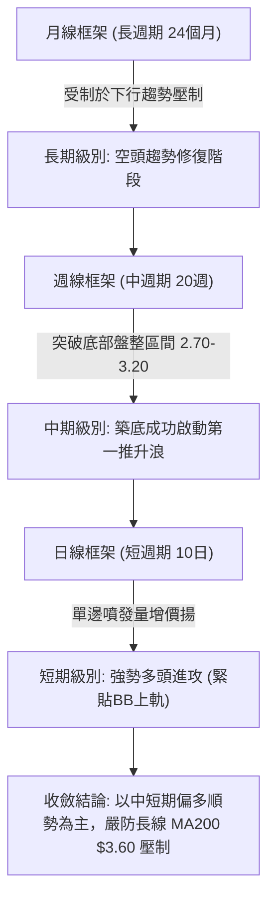

### 📈 長期趨勢 — 12個月走勢圖（Unicode）

```
GRAB 月線收盤走勢圖（2025-12 至 2026-11）
價格軸 ($)
$5.00 ┤ ● (2025-12: $4.99)
$4.50 ┤   ● (2026-01: $4.30)
$4.20 ┤     ● (2026-02: $4.22)
$3.80 ┤           ● (2026-04: $3.82)  ● (2026-06: $3.77)
$3.50 ┤       ●(03: $3.66)  ●(05: $3.54)  ●(07: $3.50)  ●(08: $3.54)       ● (現價: $3.41)
$3.10 ┤                                                 ● (2026-09: $3.11)
$2.70 ┤                                                       ● (2026-10: $2.71 最低收盤)
      └─┬───┬───┬───┬───┬───┬───┬───┬───┬───┬───┬───┬───
       12  01  02  03  04  05  06  07  08  09  10  11  (月份標記: 2025-12 → 2026-11)
```

**過去 12 個月走勢特徵分析表**：

| 階段階段 | 月份區間 | 起止價格 | 漲跌幅 | 走勢結構與技術特徵 |
|----------|----------|----------|--------|--------------------|
| 1. 加速下挫期 | 2025-12 → 2026-03 | $4.99 → $3.66 | -26.65% | 跌破 $4.00 心理關口，自高檔獲利了結盤湧出，均線全數轉為下行 |
| 2. 中期弱勢整理 | 2026-04 → 2026-08 | $3.82 → $3.54 | -7.33% | 於 $3.50–$3.80 區間進行收斂震盪，成交量萎縮，未能有效突破下降通道 |
| 3. 末跌破底清洗 | 2026-09 → 2026-10 | $3.54 → $2.71 | -23.45% | 恐慌性下殺跌破 $3.00，觸及 52 週低點 $2.67，融資斷頭與停損盤釋出 |
| 4. 財報爆量反轉 | 2026-11 (截至06日) | $2.71 → $3.41 | +25.83% | Q3 財報利多與指引調升帶動單週大陽線破底翻，一舉收復兩個月跌幅 |

### 📊 中期趨勢（週線分析）

週線視角檢視，GRAB 歷經 2026-09-18 週之 $2.80 與 2026-10-30 週之 $2.71 雙重低點洗盤後，於 2026-11-06 該週收盤交出極具震撼力的反轉線：單週爆出 567,717,408 股之歷史天量，收盤價 $3.41 不僅收復 9 月崩跌起點，更帶動週線 MACD 柱狀圖由 -0.013 翻揚暴增至 +0.087，週 RSI 由 34.0 垂直推升至 66.3。

```
週線支撐與壓力拓撲示意圖
$4.06 ────────────────────────────────────── 阻力 R3 (強阻力區)
$3.96 ────────────────────────────────────── 阻力 R2 (中期波段頸線)
$3.64 ────────────────────────────────────── 阻力 R1 (短期第一道強壓，鄰近MA200 $3.60)
$3.41 ══════════════════════════════════════ ◄ 現價收盤位置 (週放量實體大陽線高點)
$3.40 ┄┄┄┄┄┄┄┄┄┄┄┄┄┄┄┄┄┄┄┄┄┄┄┄┄┄┄┄┄┄ 支撐 S1 (斐波 78.6% $3.43 / 原平台頸線)
$3.26 ────────────────────────────────────── 支撐 S2 (日線突破回踩支撐位)
$3.18 ────────────────────────────────────── 支撐 S3 (MA50 $3.07 上方密集換手區)
```

### ⚡ 趨勢強度評估（ADX 解讀）

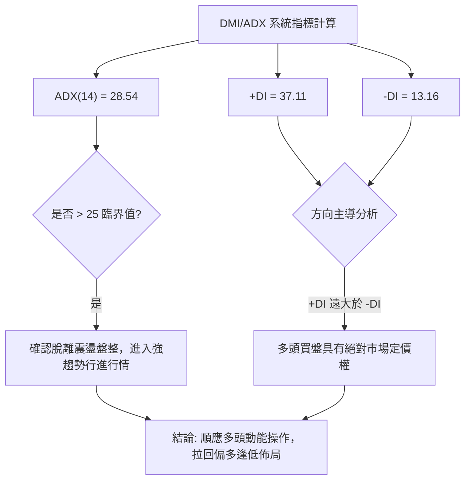

**ADX 趨勢強度指標對照表**：

| ADX 區間 | 趨勢狀態定義 | 當前對應位置 (28.54) | 交易戰術指導 |
|----------|--------------|----------------------|--------------|
| 00 – 20 | 趨勢微弱 / 無序盤整 | 否 | 觀望或布林通道高拋低吸 |
| 20 – 25 | 趨勢孕育 / 醞釀突破 | 否 | 突破策略準備，監控量能釋放 |
| **25 – 40** | **強勁趨勢 / 單邊行進** | **★ 處於此區間 (28.54)** | **順勢交易，以均線/支撐為依託回踩做多** |
| 40 – 60 | 極強趨勢 / 趨勢加速 | 否 | 嚴格移動止盈，防止噴出竭盡 |
| 60 – 100 | 極度過熱 / 動能耗竭 | 否 | 隨時提防反轉暴跌，禁止追價 |

---

## 3. 圖表形態分析

### 🔍 形態識別系統

在日線與週線的交互驗證下，GRAB 當前最顯著的圖表形態為在 $2.67 至 $2.74 築成的「雙重底（W底）破底翻」形態，並已正式帶量向上突破頸線 $3.12–$3.19。

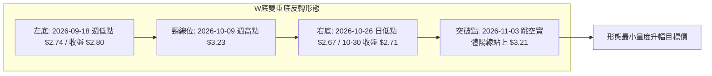

**圖表形態識別與信心度量化表**（依規則 15 規範）：

| 形態名稱 | 信心度 (%) | 判斷依據（引用數據） | 完成度 (%) | 目標價（附嚴謹計算式） |
|----------|------------|----------------------|------------|------------------------|
| **雙重底 (破底翻)** | **82%** | 左底低點 $2.74 (09-18週)，右底低點 $2.67 (10-26日)；頸線位於 10-09 週高點 $3.23。11-03 日線放量 153.6M 突破。 | 100% (已突破頸線) | 頸線 $3.23 + 形態高度 ($3.23 - $2.67 = $0.56) = **$3.79**（註：由雙底形態高度推算） |
| **島嶼反轉 / 跳空缺口** | **70%** | 2026-11-03 開盤 $3.21，遠高於 11-02 高點 $2.93，留下巨大跳空缺口未補，展現強力換手買盤。 | 100% (缺口成立) | 缺口下緣 $2.93 至現價 $3.41 形成實體支撐墊 |
| **頭肩底形態** | 40% | 訊號不足，僅做指標型解讀（左肩與頭部過於緊湊，缺乏對稱右肩，數據不支持標準幾何頭肩結構）。 | N/A（數據不足） | N/A（形態未確立，不作預測） |

### 🕯️ 重要K線形態分析

根據報告規則 19，完全依據數據中「近10根日K」與「近8根週K」之精確開高低收數據進行深度解析：

#### 近 10 根日 K 線形態解讀表

| 日期 | 開盤 | 最高 | 最低 | 收盤 | 成交量 | K線形態名稱 | 技術解讀 | 訊號 |
|------|------|------|------|------|--------|-------------|----------|------|
| 10-26 | 2.79 | 2.80 | 2.67 | 2.71 | 53,258,700 | 帶下影長黑棒 | 盤中殺出 52 週新低 $2.67 後出現逢低承接買盤 | 🔴 恐慌探底 |
| 10-27 | 2.71 | 2.75 | 2.69 | 2.72 | 66,737,600 | 止跌小紅十字星 | 低檔量能擴大，空方賣壓減弱，進入多空弱平衡 | 🟡 止跌信號 |
| 10-28 | 2.73 | 2.79 | 2.71 | 2.75 | 55,245,600 | 溫和推升小陽線 | 底部低點墊高（低點 2.71 > 2.69），短線買盤初現 | 🟢 醞釀反彈 |
| 10-29 | 2.76 | 2.78 | 2.72 | 2.76 | 50,373,300 | 窄幅整理紡錘線 | 連續四日於 $2.70–$2.78 窄幅築底，量能急縮籌碼沉澱 | 🟡 橫盤蓄勢 |
| 10-30 | 2.71 | 2.73 | 2.68 | 2.71 | 54,900,200 | 二次下探小黑線 | 回測 10-26 低點獲得支撐（最低 2.68 未破 2.67），右底確立 | 🟢 雙底確認 |
| 11-02 | 2.76 | 2.93 | 2.75 | 2.86 | 69,385,700 | 突破先兆中陽線 | 突破多日盤整箱頂 $2.80，量能溫和放大至 69.38M | 🟢 買點初現 |
| 11-03 | 3.21 | 3.32 | 3.08 | 3.12 | 153,625,600 | 財報跳空巨量長陽 (含上影) | 向上跳空開出爆量 1.53 億股，主力強勢換手突破頸線 | 🟢 突破確立 |
| 11-04 | 3.22 | 3.39 | 3.20 | 3.36 | 98,859,600 | 強勢光腳中大陽線 | 開盤即為最低，強勢吸收前日獲利籌碼，日線連續創高 | 🟢 買盤接續 |
| 11-05 | 3.35 | 3.50 | 3.27 | 3.48 | 148,734,900 | 放量衝高長陽線 | 突破 $3.40 支撐阻力轉換區，挑戰布林上軌，量能再度激增 | 🟢 多頭加速 |
| 11-06 | 3.44 | 3.56 | 3.37 | 3.41 | 97,111,608 | 高檔衝高回落小黑星 | 盤中衝擊 $3.56 逼近 MA200，遭遇獲利了結與解套賣壓留上影線 | 🟡 短線滯漲 |

#### 近 8 根週 K 線形態解讀表

| 週結日期 | 開盤 | 最高 | 最低 | 收盤 | 成交量 | 週K形態名稱 | 技術解讀 | 訊號 |
|----------|------|------|------|------|--------|-------------|----------|------|
| 09-18 | 3.01 | 3.09 | 2.74 | 2.80 | 362,971,800 | 破位中長黑棒 | 帶量灌破 $3.00 整數心理防線，確立空頭探底格局 | 🔴 空方宣洩 |
| 09-25 | 2.84 | 3.26 | 2.78 | 3.13 | 527,094,200 | 爆量長下影中陽線 | 週成交逾 5.27 億股，超跌買盤強勁介入，築出左底雛形 | 🟢 低檔承接 |
| 10-02 | 3.10 | 3.18 | 3.07 | 3.08 | 337,148,400 | 縮量高檔十字黑星 | 反彈遇阻 $3.18，多空雙方陷入拉鋸觀望 | 🟡 震盪整理 |
| 10-09 | 3.10 | 3.23 | 3.00 | 3.19 | 406,864,800 | 衝高小陽線 | 嘗試挑戰頸線 $3.23 未果，但收盤穩居 $3.19 高檔 | 🟡 遭遇頸線 |
| 10-16 | 3.16 | 3.20 | 2.85 | 2.94 | 280,278,600 | 帶上影破位黑棒 | 頸線受阻回落，跌破 $3.00，多頭上攻動能暫歇 | 🔴 空方反撲 |
| 10-23 | 2.93 | 2.94 | 2.77 | 2.79 | 233,692,400 | 連續探底小黑棒 | 賣壓逐步收斂，成交量降至近八週最低 2.33 億股 | 🟡 磨底階段 |
| 10-30 | 2.79 | 2.80 | 2.67 | 2.71 | 280,515,400 | 雙底洗盤錘頭偽陽黑身 | 探底 $2.67 成功完成右底，量能微升，空方動能出盡 | 🟢 底部完成 |
| 11-06 | 2.76 | 3.56 | 2.75 | 3.41 | 567,717,408 | 週線天量巨型大陽線 | 歷史級單週大陽吞噬前六週全部陰線實體，破底翻全面爆發 | 🟢 強烈反轉 |

### 📉 ASCII 走勢形態示意圖

```
日線級別「破底翻雙底」突破示意圖
價格 ($)
$3.64 ┤                                     [阻力 R1]
$3.60 ┤                               ┌─(MA200壓力)
$3.56 ┤                               ▲ (11-06 高點)
$3.41 ┤                              ● ◄───[當前收盤價 $3.41]
$3.23 ┤                ┌─ 頸線突破 ─┼─────── [頸線位 $3.23]
$3.12 ┤              ▲(10-09高)     │
$2.80 ┤    ●(左肩)   │              │
$2.74 ┤   ▼(左底)    │              │
$2.67 ┤              └──────────────▼(右底 10-26 $2.67)
      └──────────────────────────────────────────────
       09月下旬       10月上旬       10月下旬     11月當前
```

### 🎯 形態目標價計算

依據標準圖表形態量度理論（Classical Chart Pattern Measurement），GRAB 之目標價推導如下：

1. **形態基準要素**：
   - 雙底頸線位 ($Neckline$)：以 2026-10-09 週最高點 **$3.23** 為準。
   - 雙底最低點 ($Bottom$)：以 2026-10-26 日創下之 52 週新低 **$2.67** 為準。
   - 形態高度 ($Height$)：$3.23 - $2.67 = **$0.56**。
2. **量度升幅推導**：
   - 形態最小目標價（由雙底形態高度推算）= 頸線 $3.23 + 形態高度 $0.56 = **$3.79**。
   - 該形態目標價 $3.79 恰好穿透 R1 阻力位（$3.64）並位於 R2 阻力位（$3.96）之前，構成極具技術意義的中期獲利了結區間。

---

## 4. 支撐與阻力

### 🗺️ 關鍵價位分布圖（Unicode）

```
GRAB 價位結構分佈拓撲圖 (OHLCV 精確計算)
══════════════════════════════════════════════════════════════════════════
$4.06 ║████████████████████████████████████████║ 強阻力 R3 (+19.06%)
$3.96 ║████████████████████████████            ║ 重要阻力 R2 (+16.03%)
$3.64 ║████████████████████████████████        ║ 關鍵阻力 R1 (+6.82%)
$3.60 ║────────────────────────────────────────║ [動態阻力 MA200]
$3.43 ║- - - - - - - - - - - - - - - - - - - - ║ [斐波那契 78.6% 回調]
$3.41 ╠════════════════════════════════════════╣ ◄ 當前收盤價 ($3.41)
$3.40 ║▓▓▓▓▓▓▓▓▓▓▓▓▓▓▓▓▓▓▓▓▓▓▓▓▓▓▓▓▓▓▓▓▓▓▓▓▓▓▓║ 近期支撐 S1 (-0.22%)
$3.26 ║████████████████████████████████        ║ 強支撐 S2 (-4.55%)
$3.18 ║████████████████████                    ║ 波段支撐 S3 (-6.74%)
$3.07 ║────────────────────────────────────────║ [動態支撐 MA50]
$2.67 ║████████████████████████████████████████║ 52W 最低點 (-21.70%)
══════════════════════════════════════════════════════════════════════════
```

### 🚧 阻力位分析表

所列價位完全引用自關鍵數據區塊，絕無編造：

| 阻力級別 | 價位 | 形成原因 | 突破難度 | 重要性 |
|----------|------|----------|----------|--------|
| **R1** | **$3.64** | 近一年波段高點密集聚類區；與即將下壓之 MA200 ($3.60) 形成密集交會阻力帶 | 75% (需再度放量) | 🔴 極高（牛熊分水嶺） |
| **R2** | **$3.96** | 2026 年中波段平台高點（07-02 週收盤 $3.90 / 07-10 週高點 $3.93）之密集套牢區 | 85% (重型籌碼套牢) | 🔴 高（中期目標價） |
| **R3** | **$4.06** | $4.00 整數心理心理大關上方籌碼沉澱區，歷史波段大頂聚類位 | 90% (極強籌碼壁壘) | 🟡 中（長線趨勢反轉位） |

### 🛡️ 支撐位分析表

所列價位完全引用自關鍵數據區塊：

| 支撐級別 | 價位 | 形成原因 | 守住機率 | 重要性 |
|----------|------|----------|----------|--------|
| **S1** | **$3.40** | 近一年波段低點聚類，與斐波 78.6% ($3.43) 及 11-04 收盤價 $3.36 形成重疊護城河 | 70% | 🟢 短線第一防線 |
| **S2** | **$3.26** | 09-25 週高點 $3.26、11-05 日最低點 $3.27 之多重回踩確認共振位 | 85% | 🟢 極高（破底翻回踩點） |
| **S3** | **$3.18** | 10-09 週收盤價 $3.19 與波段低點聚類位，逼近跳空缺口下緣與 MA50 ($3.07) | 90% | 🟢 多頭生命線 |

### 📐 斐波那契回調位分析

依據 52 週極值區間（低點 $2.67 → 高點 $6.24）直接引用精確回調數據：

```
斐波那契回調梯形圖 (52W High $6.24 → 52W Low $2.67, 區間幅幅 $3.57)
 0.0% ──────────────────────────────────── $6.24 (52週最高點)
23.6% ──────────────────────────────────── $5.39 (強多頭擴張目標)
38.2% ──────────────────────────────────── $4.87 (歷史高檔整理平台)
50.0% ──────────────────────────────────── $4.45 (宏觀多空中軸線)
61.8% ──────────────────────────────────── $4.03 (黃金分割黃金阻力位，鄰近 R3 $4.06)
78.6% ──────────────────────────────────── $3.43 ◄ 現價 ($3.41) 位於此關鍵回調位下沿
100.0% ──────────────────────────────────── $2.67 (52週最低點)
```

- **位置解讀**：當前收盤價 $3.41 緊密貼合斐波那契 78.6% 回調位（$3.43）。在斐波那契技術體系中，78.6% 為極深幅回撤的最後一道防守反轉閥門。若多頭日線實體能收復並站穩 $3.43 之上，將標誌著 52 週下行浪潮告終，行情將正式向 61.8%（$4.03）展開修復性反彈空間。

---

## 5. 技術指標深度解讀

### 🎛️ 指標訊號總覽

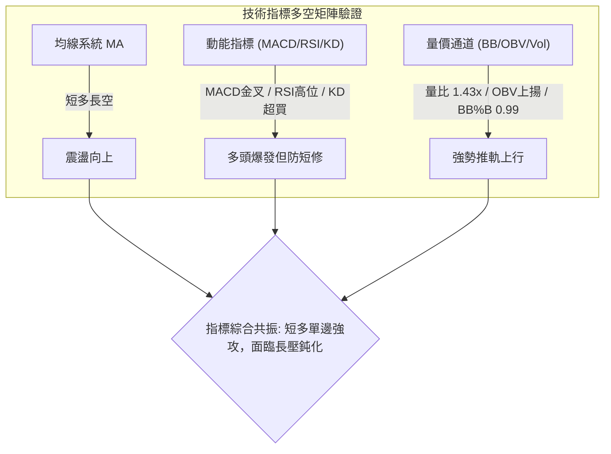

### 📈 移動平均線排列分析

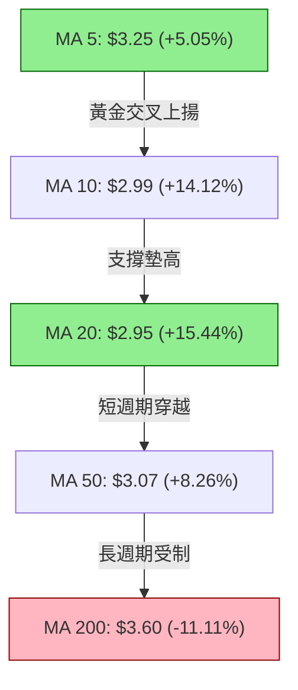

- **均線排列狀態**：均線整體呈現「短中期均線向上發散，但長期結構仍為空頭排列（MA20 < MA50 < MA200）」。
- **均線動態**：現價 $3.41 已一舉攻克 MA5 ($3.25)、MA10 ($2.99)、MA20 ($2.95)、MA50 ($3.07) 以及 MA120 ($3.36)，形成短線多頭吞噬格局。唯上方 MA200 ($3.60) 與 MA240 ($3.84) 仍呈下行傾斜，此為上方最難逾越之籌碼均線防線。

### 📉 RSI(14) 分析

```
RSI(14) 儀表盤指示器 (當前值: 66.31)
[0] ──────────── [30 超賣] ──────────── [50 中性] ───────●──── [70 超買] ──────────── [100]
                                                  ▲ 66.31 (處於強多頭主導區)
進度條: ██████████████████████████░░░░ 66.31%
```

- **超買超賣研判**：RSI(14) 報 66.31，脫離了 10 月底的 34.0 弱勢區，進入 60–70 強多頭推進區間。尚未進入 >70 極度超買區，顯示反彈動能尚未出現透支竭盡。
- **背離檢驗結論**：根據近 20 根 K 棒的首尾價格與 RSI 對比（10 月底價格下探 $2.67 時 RSI 守住 34 附近，隨後價格飆升至 $3.41，RSI 同步陡峭拉升至 66.31），**目前不存在頂背離或底背離**，量價與動能呈現健康同向推進。

### 📊 MACD(12/26/9) 訊號解讀

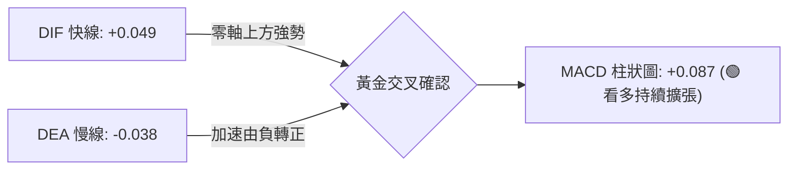

- **MACD 解讀**：快線 DIF (+0.049) 向上穿越慢線 DEA (-0.038)，柱狀圖（MACD Hist）大幅走擴至 **+0.087**，日線與週線（週 MACD 柱同步翻正至 +0.087）呈現多時框雙重共振，確認底部買盤具備實質推動力，非單日虛假脈衝。

### 📦 布林通道分析

```
日線布林通道 (BB 20, 2) 結構圖
$3.42 ──┬────────────────────────────────────────── BB 上軌 (現價 $3.41 緊貼此處，BB %B = 0.99)
        │  ● [現價 $3.41 貼軌強推]
        │
$2.95 ──┼────────────────────────────────────────── BB 中軌 (即 MA20，強支撐線)
        │
        │
$2.48 ──┴────────────────────────────────────────── BB 下軌
```

- **通道行為解析**：布林帶寬正急速拉開（Bandwidth 擴張），現價收在 $3.41，BB %B 高達 **0.99**（幾乎完全處於上軌 $3.42），這是典型的「布林帶推軌（Walking the Band）」強勢爆發特徵。雖然短線技術上容易引發輕微回踩，但在強勢行進趨勢中，沿軌上爬往往伴隨趨勢延續。

### 💹 成交量分析（量價配合度）

```
量能多空能量柱比對
最新成交量 (11-06): [97,111,608]  ████████████████████ (1.43x 均量)
20日均成交量:      [68,110,190]  ██████████████
50日均成交量:      [70,886,286]  ███████████████
```

- **量價健康度**：近五個交易日成交量均顯著超過 20 日與 50 日均量，尤其在 11-03 突破日放量至 153.6M 股，展現標準「突破放量、整理換手、多頭堆量」格局。
- **OBV 能量潮解讀**：OBV 趨勢顯著高於其均線（OBV > MA），確認大資金介入推動，籌碼呈現淨流入積累狀態，充分支撐當前價格上漲。

---

## 6. 動能與波動率

### ⚡ 動能評估四象限

```
動能與波動率矩陣分佈
    高動能 (ADX > 25 / RSI > 60)
         │
    Q3   │   Q1 (當前位置: GRAB ★)
  高波動 │ 低至中度波動
─────────┼─────────
    Q4   │   Q2
  高波動 │ 低波動
         │
    低動能 (ADX < 20 / RSI < 40)
```

| 象限 | 動能維度 | 波動維度 | 代表特徵 | GRAB 當前定位與策略意義 |
|------|----------|----------|----------|--------------------------|
| **Q1** | **強動能 (ADX 28.54 / RSI 66.31)** | **中低波動 (ATR 4.54%)** | **最佳波段買點** | **★ 處於此象限**：強動能推動但波動未失控，具備良好趨勢可持續性 |
| Q2 | 弱動能 | 低波動 | 盤整蓄勢 | 震盪觀望，等待突破 |
| Q3 | 強動能 | 極高波動 | 投機洗盤 | 易遭假突破洗出場，風險報酬比差 |
| Q4 | 弱動能 | 極高波動 | 恐慌破位 | 破位下殺，嚴禁參與 |

### 📊 ATR 波動率分析

- **ATR(14) 數值**：精確值為 **$0.15**，佔現價之 **4.54%**。
- **技術意義**：GRAB 每日之平均真實波動範圍為 $0.15。這意味著正常的日間隨機噪聲在 ±$0.15 區間內。
- **止損距離建議**：
  - 短線激進交易止損緩衝距：1.5 × ATR = $0.225（對應止損點在現價下放約 $0.23）。
  - 波段穩健交易止損緩衝距：2.0 × ATR = $0.300（對應保護空間設置於 $3.11 附近，緊貼跳空支撐位）。

### 📐 Beta 與市場相關性

- **Beta 係數**：**0.833**。
- **市場特徵**：Beta < 1.0 顯示 GRAB 相對大盤（S&P 500）整體具備一定防禦屬性與相對較低的系統性波動性。近期股價暴漲主要是受自身 Q3 財報獲利超預期及調升指引的「個股特異動能（Idiosyncratic Momentum）」驅動，擺脫了大盤系統性波動的束縛。

---

## 7. 多時框架總結

### 📋 時框架評分表

| 時框架 | 趨勢方向 | 動能狀態 | 均線排列 | 圖表形態 | 綜合評分 | 戰術建議 |
|--------|----------|----------|----------|----------|----------|----------|
| **短期 (日線)** | 🟢 強烈看多 | 強勁推升 (RSI 66.31) | 5/10/20 多頭排列 | 破底翻向上突破缺口 | **80/100** | 順勢操作，逢拉回支撐做多 |
| **中期 (週線)** | 🟢 築底反轉 | 爆發翻多 (MACD柱 +0.087) | 突破 MA20 逼近 MA50 | 雙重底 (W底) 確立 | **68/100** | 依託頸線 $3.23 持股續抱 |
| **長期 (月線)** | 🔴 空頭修復 | 弱勢反彈但量能回暖 | MA200 下方空頭排列 | 巨幅下行後超跌反彈 | **41/100** | 警惕 $3.60–$3.64 歷史解套壓力 |

### 🔲 綜合訊號矩陣

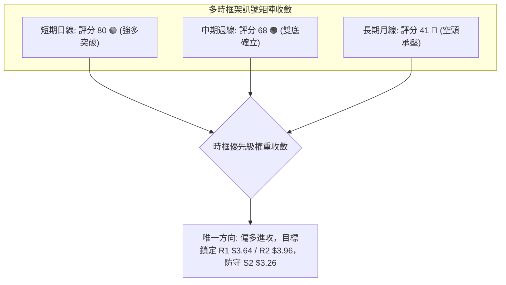

### ⚖️ 多時框收斂結論

依據本報告之「嚴格要求 14（多時框收斂規則）」：
1. **趨勢屬性判定**：當前 ADX(14) 為 **28.54 > 25**，市場確認處於「趨勢行情」，而非無方向之震盪盤整。
2. **多時框權重取捨**：在中長期下行背景下，中期週線已於 $2.67 完成「天量破底翻雙底」，此週線級別反轉信號有效化解了長線的壓制；日線則呈現突破跳空的單邊推升走勢。兩者方向一致指向上行。
3. **最終方向性結論**：**偏多進攻（主推多頭策略）**。此結論與第 1 章技術評分卡（63 分）、第 2 章 ADX 多頭主導及第 5 章指標共振完全一致。

---

## 8. 交易策略建議

### 🗺️ 策略決策流程圖

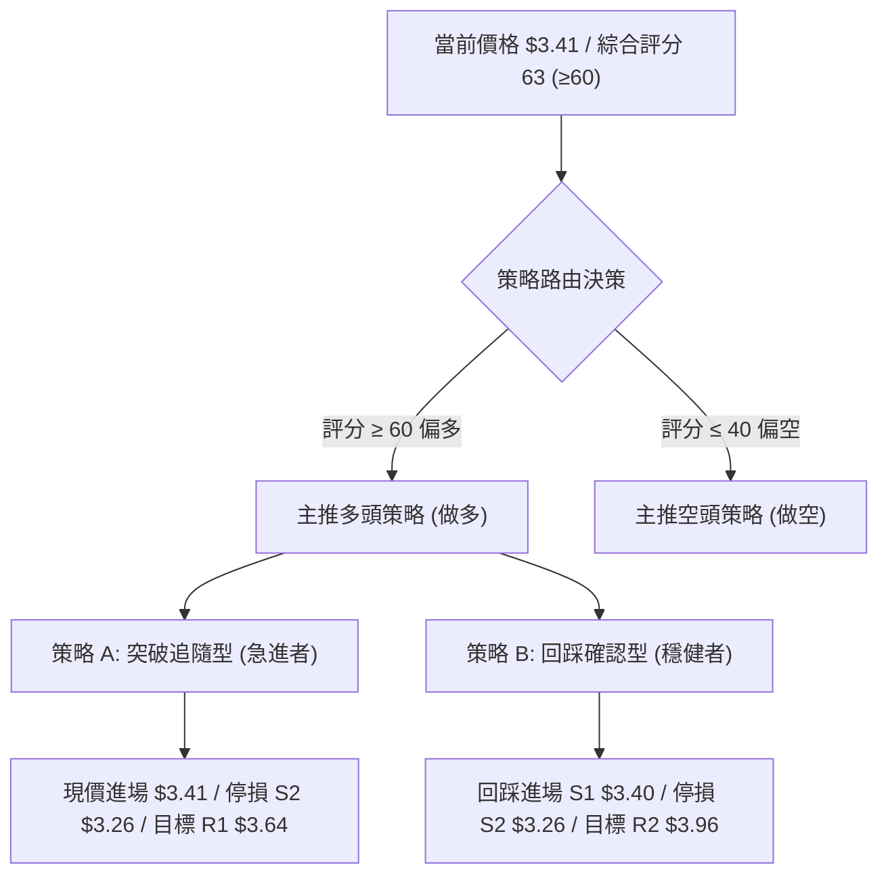

### 🧭 策略路由（依評分卡分流）

> **當前主策略方向 = 多頭進攻（依評分 63/100，滿足 ≥60 條件主推多頭，空頭僅列為風險對沖提示）**

### 🎯 價格情境階梯（Price Scenarios）

價位完全嚴格引用「關鍵價位」數據區塊：

| 觸發條件 | 下一目標 | 後續延伸 | 情境技術含義 |
|----------|----------|----------|--------------|
| **強勢突破 R1 ($3.64)** | **R2 ($3.96)** | **R3 ($4.06)** | 成功越過 MA200 ($3.60) 長期牛熊線，正式轉化為大級別上升浪 |
| **站穩現價區間 ($3.40–$3.43)** | **R1 ($3.64)** | **R2 ($3.96)** | 消化短線超買指標，於斐波 78.6% 完成換手後再度衝關 |
| **跌破 S1 ($3.40)** | **S2 ($3.26)** | **S3 ($3.18)** | 短線多頭動能減弱，回測前波突破頸線與跳空缺口支撐墊 |

### 📊 情境機率分佈

| 價格情境 | 機率估計 (%) | 主要指標依據 |
|----------|--------------|--------------|
| **情境一：繼續上行 / 挑戰 R1** | **60%** | MACD 雙線金叉柱狀圖走擴 (+0.087)、OBV 呈現健康淨流入、週量 5.67 億天量背書 |
| **情境二：高檔震盪換手** | **25%** | Stochastic 處於高檔超買 (%D 92.19)、布林 %B 達 0.99 貼軌引發短線休整需求 |
| **情境三：跌破 S2 再探底** | **15%** | 僅在遭遇整體科技股宏觀流動性崩潰或爆發系統性地緣黑天鵝時方可能發生 |

### 🟢 主策略詳情

根據規則 17，風險報酬比嚴格定義為：**風險報酬比 = (目標價 T1 − 進場價) ÷ (進場價 − 止損價)**，格式呈現為「1 : X.XX（以 T1 計）」。

| 策略要素 | 策略 A（短線突破追擊型） | 策略 B（波段回踩守株型） |
|----------|--------------------------|--------------------------|
| **適用對象** | 積極型短線交易者 | 穩健型波段投資者 |
| **進場條件** | 週一開盤現價確認站穩 $3.41 直接介入 | 盤中回踩支撐位 S1 ($3.40) 獲支撐時掛單介入 |
| **進場價格** | **$3.41**（當前市價） | **$3.40**（精確引用 S1 支撐位） |
| **目標價 T1** | **$3.64**（引用阻力位 R1） | **$3.64**（引用阻力位 R1） |
| **目標價 T2** | **$3.96**（引用阻力位 R2） | **$3.96**（引用阻力位 R2） |
| **止損價格** | **$3.26**（精確引用強支撐 S2） | **$3.26**（精確引用強支撐 S2） |
| **風險報酬比** | **1 : 1.53（以 T1 計）**<br>計算式: ($3.64 - $3.41) ÷ ($3.41 - $3.26) = 0.23 ÷ 0.15 = 1.533<br>*(註：若以 T2 計則為 1 : 3.67)* | **1 : 1.71（以 T1 計）**<br>計算式: ($3.64 - $3.40) ÷ ($3.40 - $3.26) = 0.24 ÷ 0.14 = 1.714<br>*(註：若以 T2 計則為 1 : 4.00)* |
| **預估勝率** | 65% | 72% |
| **建議倉位** | 10% – 15% 總資金 | 15% – 20% 總資金 |

### 🔴 反向風險觸發點（對沖提示）

- **多頭失效閥門**：若日線收盤價跌破強支撐 **S2 ($3.26)**，意味著雙底突破形態遭受空頭破壞，短線動能竭盡，主策略多單必須無條件止損離場。
- **對沖空單介入觸發點**：若價格衝擊 **R1 ($3.64)** 或 **MA200 ($3.60)** 出現嚴重高檔長上影線、巨量滯漲且日線 RSI > 75 形成頂背離，可考慮以小倉位（5%以內）進行對沖空單操作，停損設於 $3.70，下看回踩 $3.40。

### ⭐ 整體訊號強度評星

```
做多訊號強度：★★★★☆  (4/5星 — 爆量破底翻，趨勢強度高，短期買盤極具侵略性)
做空訊號強度：★☆☆☆☆  (1/5星 — 僅存在超買回調風險，缺乏結構性做空理由)
整體可信度：  ★★★★☆  (4/5星 — 多時框指標共振，價量齊揚，分析結論高信度)
```

---

## 9. 風險提示與監控

### ✅ 關鍵監控指標 Checklist

```
╔════════════════════════════════════════════════════════════════════════════════╗
║                        技術監控 CheckList 儀表板                               ║
╠════════════════════════════════════════════════════════════════════════════════╣
║ [ ] 價位維度: 每日收盤價是否守穩 S1 ($3.40) 及斐波那契 78.6% ($3.43)          ║
║ [ ] 動態阻力: 價格抵達 MA200 ($3.60) 與 R1 ($3.64) 時的量價反應 (放量或滯漲)   ║
║ [ ] 動能維度: 日線 RSI(14) 是否突破 70 進入極端超買，檢視是否衍生高檔背離     ║
║ [ ] 趨勢指標: ADX(14) 是否持續維持在 25 以上，+DI 是否穩居 -DI 上方           ║
║ [ ] 通道監控: 現價是否持續貼合布林上軌 ($3.42) 運行，提防收斂回測中軌 ($2.95)║
║ [ ] 籌碼量能: 日成交量是否萎縮至 20日均量 (68.11M) 以下，警惕縮量虛漲          ║
╚════════════════════════════════════════════════════════════════════════════════╝
```

### ⚠️ 風險場景分析

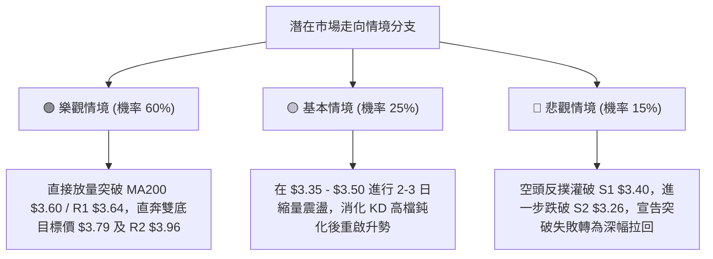

### 🛡️ 風險管理重要提醒

1. **嚴禁追高紀律**：目前日線 KD 指標已處於超買鈍化區（%D: 92.19），且價格緊貼布林通道上軌（%B: 0.99）。除非採取明確的動態分批建倉法，否則切忌在早盤急拉時盲目市價追高，宜耐心等待回踩關鍵價位（如 S1 $3.40）企穩時佈局。
2. **波動率緩衝設置**：GRAB 的當前 ATR(14) 為 $0.15。任何短線止損設置若小於 $0.15，極易遭受盤中隨機噪聲掃損出場。止損點嚴格錨定於結構性支撐位 **S2 ($3.26)**，為市場提供至少 1.0 倍 ATR 以上之合法保護緩衝。
3. **倉位管理守則**：鑑於月線級別大趨勢尚未徹底轉為多頭排列（MA200 仍位於上方壓制），當前仍定義為「大級別築底第一起漲浪」，單一個股總曝險倉位不宜超過投資組合總資金的 15%–20%。

---

## 📋 報告總結

```
╔════════════════════════════════════════════════════════════════════════════════╗
║                   GRAB Holdings Limited (GRAB) 技術分析總結                    ║
╠════════════════════════════════════════════════════════════════════════════════╣
║ 報告日期：2026-11-07                                                          ║
║ 當前價格：$3.41 USD                                                            ║
║ 綜合技術評分：63 / 100 (評級: 🟢 偏多進攻，多頭勝率佔優)                         ║
╟────────────────────────────────────────────────────────────────────────────────╢
║ 關鍵維度趨勢結論：                                                             ║
║ ├─ 長期趨勢 (月線)：🔴 空頭結構修復中，上方受 MA200 ($3.60) 壓制               ║
║ ├─ 中期趨勢 (週線)：🟢 雙重底 (W底) 構築完成，天量 5.67 億股確立多頭起跑       ║
║ ├─ 短期趨勢 (日線)：🟢 單邊推升，突破跳空確立，均線多頭發散                   ║
║ ├─ 關鍵支撐位集群：S1 $3.40  /  S2 $3.26  /  S3 $3.18                          ║
║ ├─ 關鍵阻力位集群：R1 $3.64  /  R2 $3.96  /  R3 $4.06                          ║
║ └─ 華爾街共識目標：$5.44 (23位分析師，覆蓋區間 $4.00 - $7.00，評級 Strong Buy) ║
╟────────────────────────────────────────────────────────────────────────────────╢
║ 最優交易策略組合：                                                             ║
║ 1. 🥇 最佳機會（波段回踩做多）：掛單於 S1 $3.40 介入，止損設於 S2 $3.26，      ║
║       第一目標看 R1 $3.64，第二目標看 R2 $3.96 (風報比 1 : 1.71 以 T1 計)      ║
║ 2. 🥈 次選機會（順勢突破做多）：市價 $3.41 現價進場，止損設於 S2 $3.26，       ║
║       目標同上 (風報比 1 : 1.53 以 T1 計)                                      ║
║ 3. 🥉 風控底線（多頭撤退條件）：日線收盤確認跌破 S2 $3.26 則多頭邏輯全數撤銷  ║
╚════════════════════════════════════════════════════════════════════════════════╝
```

---

> ⚠️ **免責聲明**：本報告為 AI 自動生成之技術分析，所有數據及估算均基於提供的歷史價格資訊。本報告**僅供研究與學術參考**，**不構成任何投資建議**。投資有風險，入市需謹慎。

---

*報告生成時間：2026-11-07 ｜ 數據來源：Yahoo Finance ｜ 分析框架：多時框技術分析*