# GRAB 技術分析報告

> **報告日期**：2026-11-08 ｜ **語言**：繁體中文 ｜ **數據來源**：Yahoo Finance ｜ **當前價格**：$3.41

---

## 目錄

| 章節 | 內容 |
|------|------|
| [1. 技術面概覽](#1-技術面概覽) | 訊號儀表板、核心指標、評分卡 |
| [2. 趨勢分析](#2-趨勢分析) | 多時框趨勢、長中短期走勢 |
| [3. 圖表形態分析](#3-圖表形態分析) | 形態識別、K線組合、目標價 |
| [4. 支撐與阻力](#4-支撐與阻力) | 關鍵價位、斐波那契回調 |
| [5. 技術指標深度解讀](#5-技術指標深度解讀) | MA/RSI/MACD/布林/成交量 |
| [6. 動能與波動率](#6-動能與波動率) | 動能評估、ATR、Beta |
| [7. 多時框架總結](#7-多時框架總結) | 時框架評分矩陣 |
| [8. 交易策略建議](#8-交易策略建議) | 多空策略、風險報酬比 |
| [9. 風險提示與監控](#9-風險提示與監控) | 監控指標、風險場景 |

---

## 1. 技術面概覽

### 🎯 技術訊號儀表板

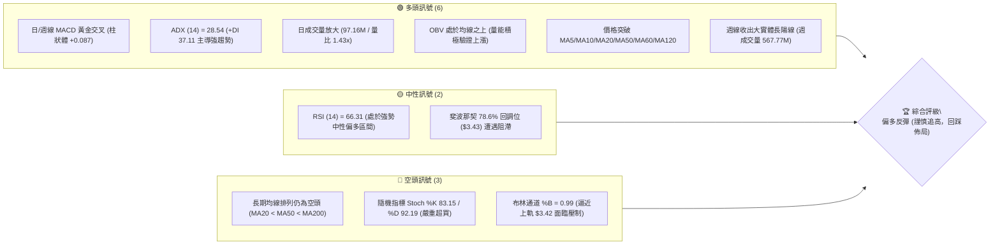

### 📊 核心指標速覽表

| 指標類別 | 指標名稱 | 當前數值 | 訊號 | 解讀 |
|----------|----------|----------|------|------|
| **價格** | 當前收盤價 | $3.41 | 🟢 | 站上多條均線，單週漲幅顯著放大 |
| **均線** | MA20 | $2.95 | 🟢 | 價格在 MA20 之上 +15.44%，短期動能強勁 |
| **均線** | MA50 | $3.07 | 🟢 | 價格在 MA50 之上 +11.07%，中期趨勢反轉向上 |
| **均線** | MA200 | $3.60 | 🔴 | 價格在 MA200 之下 -5.28%，長期結構尚未完全脫離空頭 |
| **動能** | RSI(14) | 66.31 | 🟡 | 進入多頭強勢區間（接近 70 超買警戒線），未見頂背離 |
| **動能** | MACD(12,26,9) | 0.049 / 柱狀 +0.087 | 🟢 | 快慢線金叉且柱狀體正向擴散，買盤動能強烈 |
| **動能** | Stoch %K/%D | 83.15 / 92.19 | 🔴 | 位於超買區（>80），短線具備技術性拉回修正壓力 |
| **趨勢** | ADX(14) | 28.54 | 🟢 | ADX > 25，+DI (37.11) 遠高於 -DI (13.16)，多頭趨勢成立 |
| **通道** | 布林通道 | 上軌 $3.42 / %B 0.99 | 🟡 | 觸碰上軌壓力，存在通道收斂或拉回中軌 ($2.95) 的需求 |
| **成交量** | 20日成交量比 | 1.43x | 🟢 | 最新量 97.16M 高於均量 68.11M，量價配合健康 |
| **波動** | ATR(14) | $0.15 (4.54%) | 🟡 | 每日平均波幅適中，突破波動放大，需嚴控停損距離 |

### 🏆 技術評分卡

```
╔════════════════════════════════════════════════════════════════╗
║                  技術評分卡 — GRAB (2026-11-08)                 ║
╠════════════════════════════════════════════════════════════════╣
║ 趨勢強度 (ADX & DI)     ███████████████░░░░░  75/100  🟢 看多  ║
║ 動能指標 (RSI & MACD)   ██████████████░░░░░░  70/100  🟢 看多  ║
║ 支撐穩定度 (S1/S2/S3)   █████████████░░░░░░░  65/100  🟡 中性  ║
║ 成交量配合 (Volume&OBV) ████████████████░░░░  80/100  🟢 強多  ║
║ 形態完整度 (K線與突破)  █████████████░░░░░░░  65/100  🟡 中性  ║
║ 均線排列 (MA結構與反制) █████████░░░░░░░░░░░  47/100  🔴 偏空  ║
╠════════════════════════════════════════════════════════════════╣
║ 綜合評分 (六項算術平均)  █████████████░░░░░░░  67/100  🟢 偏多  ║
║ 評級結論：技術面突破確立，短線動能飽滿，但逼近超買與強阻力區   ║
╚════════════════════════════════════════════════════════════════╝
```

---

## 2. 趨勢分析

### 🌐 多時框趨勢分析

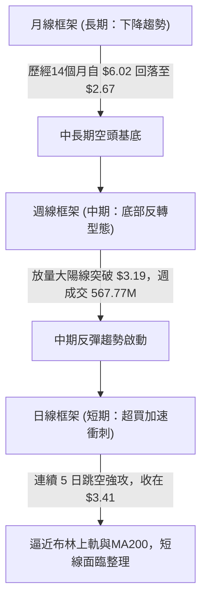

### 📈 長期趨勢 — 12個月走勢圖（Unicode）

```
GRAB 月線走勢圖（過去12個月：2025-11 至 2026-11）
價格軸 ($)
$5.50 ┤● (2025-11: $5.45)
$5.00 ┤    ● (12月: $4.99)
$4.50 ┤        ● (01月: $4.30) ● (02月: $4.22)
$4.00 ┤                            ● (04月: $3.82)
$3.50 ┤            ● (03月: $3.66)     ● (06月: $3.77) ● (08月: $3.54)
$3.41 ┤                                                                ●←【現價: $3.41】
$3.00 ┤                                                    ● (09月: $3.11)
$2.71 ┤                                                        ● (10月: $2.71 低點)
      └───────────────────────────────────────────────────────────────────
       11   12   01   02   03   04   05   06   07   08   09   10   11 (月份)
```

#### 走勢特徵分析表格

| 階段區間 | 起止月份 | 收盤價變化 | 漲跌幅 | 主要走勢特徵 |
|----------|----------|------------|--------|--------------|
| **高檔陰跌期** | 2025-11 至 2026-03 | $5.45 → $3.66 | -32.84% | 獲利回吐盤主導，均線向下發散，成交量持續萎縮 |
| **箱型震盪期** | 2026-04 至 2026-08 | $3.82 → $3.54 | -7.33%  | 於 $3.50–$3.85 區間構築整理平台，多次衝擊 $3.80 未果 |
| **探底出清期** | 2026-09 至 2026-10 | $3.11 → $2.71 | -12.86% | 破位下殺，於 2026-10 創下 52 週新低 $2.67 |
| **放量暴擊反彈** | 2026-10 至 2026-11 | $2.71 → $3.41 | +25.83% | 財報利多發酵，大實體紅K強勢吞噬過去兩個月跌幅 |

### 📊 中期趨勢（週線分析）

中期技術面於 2026-10-30 週（收 $2.71，低點 $2.67）完成築底。隨後在 2026-11-06 當週，伴隨 567,767,100 股的天量，形成從 $2.75 至 $3.56 的巨型陽線，單週收在 $3.41。

```
GRAB 週線阻力與支撐示意圖
══════════════════════════════════════════════════════════════════
$4.06  ──────────────────────────────────────────  關鍵阻力 R3
$3.96  ──────────────────────────────────────────  波段高點 R2
$3.64  ──────────────────────────────────────────  關鍵阻力 R1 (緊鄰 MA200: $3.60)
$3.41  ▲▲▲▲▲▲▲▲▲▲▲▲▲▲▲▲▲▲▲▲▲▲▲▲▲▲▲▲▲▲▲▲▲▲▲▲▲▲▲▲  【現價 $3.41】
$3.40  ──────────────────────────────────────────  動態支撐 S1
$3.26  ──────────────────────────────────────────  波段支撐 S2
$3.18  ──────────────────────────────────────────  結構防守 S3 (前波平台頸線)
$2.67  ──────────────────────────────────────────  52週歷史低點 (底線支撐)
══════════════════════════════════════════════════════════════════
```

### ⚡ 趨勢強度評估（ADX 解讀）

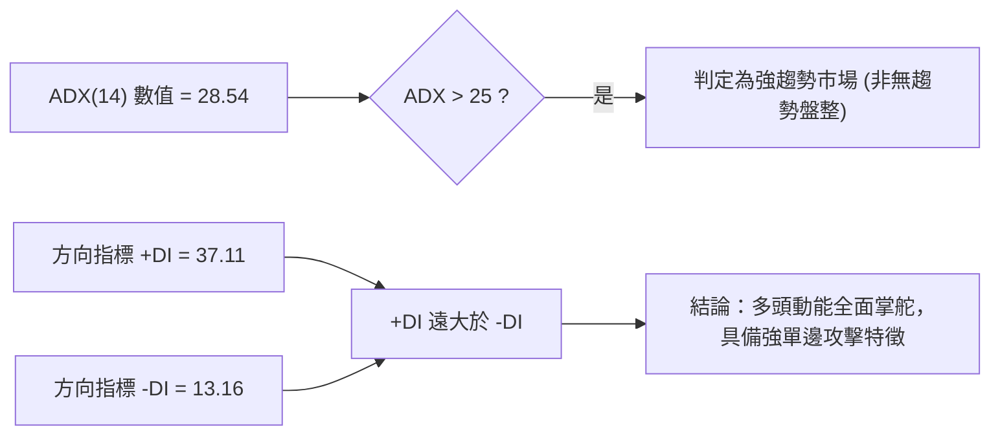

#### ADX 強度對照表

| 指標名稱 | 當前數值 | 門檻區間 | 技術解讀 | 交易指引 |
|----------|----------|----------|----------|----------|
| **ADX (14)** | **28.54** | > 25（強趨勢） | 擺脫了低於 20 的低迷期，進入趨勢推動波 | 順勢操作，禁止於強趨勢中逆勢做空 |
| **+DI** | **37.11** | > 30（極強多頭） | 買盤控制力極強，買方攻擊力量處於主導地位 | 拉回均線皆為順勢作多契機 |
| **-DI** | **13.16** | < 15（空頭衰退） | 賣盤急遽萎縮，未能形成有效殺跌合力 | 空方止損盤湧出，壓制力微弱 |

---

## 3. 圖表形態分析

### 🔍 形態識別系統

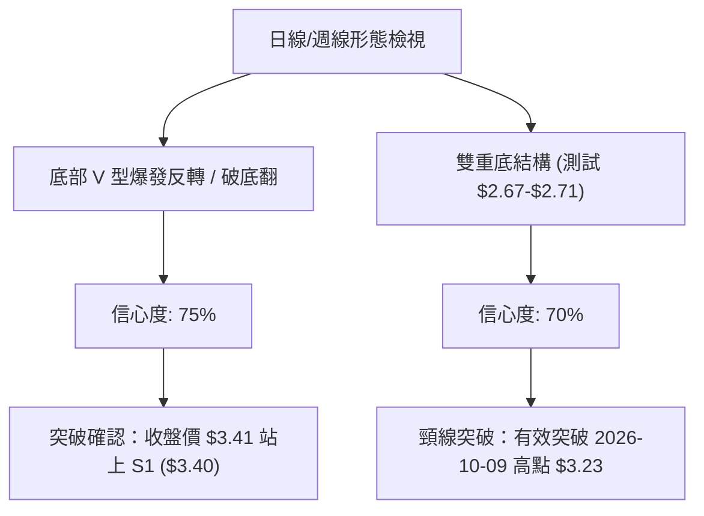

#### 形態識別與信心度評估表

| 形態名稱 | 信心度 | 判斷依據（嚴格引用數據） | 完成度 | 目標價（附嚴格計算式） |
|----------|--------|--------------------------|--------|------------------------|
| **雙重底結構 (W底)** | **70%** | 第一底為 2026-10-26 低點 $2.67，第二底為 2026-10-30 低點 $2.68（收 $2.71），頸線取自 2026-10-09 波段高點 $3.23。已於 2026-11-03 放量突破。 | 90% | 頸線 $3.23 + 形態高度 ($3.23 − $2.67 = $0.56) = **$3.79**（介於阻力位 R1 $3.64 與 R2 $3.96 之間） |
| **布林帶向上破軌** | **85%** | 最新日收盤價 $3.41，布林上軌為 $3.42，%B 達到 0.99，伴隨量比 1.43x 爆量突破中軌 $2.95。 | 100% | 通道擴張動能推算，短期測試 R1 **$3.64** |
| **均線黃金反轉** | **65%** | 5日線 ($3.25)、10日線 ($2.99)、20日線 ($2.95) 快速由下向上穿越，價格全面越過 MA60 ($3.15) 與 MA120 ($3.36)。 | 80% | 均線乖離修復目標指向 MA200 **$3.60** |

### 🕯️ 重要K線形態分析

#### 近10根日K形態精解

| 日期（日K） | 開 | 高 | 低 | 收 | 成交量 | K線形態 | 解讀 | 訊號 |
|-------------|----|----|----|----|--------|---------|------|------|
| 2026-10-26 | 2.79 | 2.80 | 2.67 | 2.71 | 53,258,700 | 創低長下影黑K | 觸及 52W 低點 $2.67，低檔浮現買盤防守 | 🟡 |
| 2026-10-27 | 2.71 | 2.75 | 2.69 | 2.72 | 66,737,600 | 止跌小紅K | 低檔橫向盤整，賣壓逐漸減輕 | 🟡 |
| 2026-10-28 | 2.73 | 2.79 | 2.71 | 2.75 | 55,245,600 | 緩步回升小紅K | 站回 $2.75，打底結構持續成形 | 🟢 |
| 2026-10-29 | 2.76 | 2.78 | 2.72 | 2.76 | 50,373,300 | 窄幅十字星 | 買賣雙方陷入膠著，量能極度萎縮等待催化劑 | 🟡 |
| 2026-10-30 | 2.71 | 2.73 | 2.68 | 2.71 | 54,900,200 | 二次探底小黑K | 回測 $2.68 不破前低 $2.67，構築堅實雙底右腳 | 🟢 |
| 2026-11-02 | 2.76 | 2.93 | 2.75 | 2.86 | 69,385,700 | 啟動放量中陽線 | 突破 $2.80 盤整區，量能擴增至 69.38M，多頭起跑 | 🟢 |
| 2026-11-03 | 3.21 | 3.32 | 3.08 | 3.12 | 153,625,600 | 跳空爆量長上影黑K | 跳空突破頸線，單日爆量 1.53 億股，高檔遇解套賣壓 | 🟡 |
| 2026-11-04 | 3.22 | 3.39 | 3.20 | 3.36 | 98,859,600 | 強勢實體大陽線 | 迅速收復前日上影線失地，確認多頭接盤實力 | 🟢 |
| 2026-11-05 | 3.35 | 3.50 | 3.27 | 3.48 | 148,734,900 | 擴張長陽線 | 再次放大成交量至 1.48 億股，強勢突破多重阻力 | 🟢 |
| 2026-11-06 | 3.44 | 3.56 | 3.37 | 3.41 | 97,161,300 | 衝高回落紡錘黑K | 創本波新高 $3.56 後受制於布林上軌，量能略縮回檔 | 🔴 |

#### 近8根週K形態精解

| 日期（週K） | 開 | 高 | 低 | 收 | 週成交量 | K線形態 | 解讀 | 訊號 |
|-------------|----|----|----|----|----------|---------|------|------|
| 2026-09-18 | 3.01 | 3.09 | 2.74 | 2.80 | 362,971,800 | 破位中長黑K | 跌破 $3.00 整數關卡，賣壓沉重 | 🔴 |
| 2026-09-25 | 2.84 | 3.26 | 2.78 | 3.13 | 527,094,200 | 巨量反彈長陽線 | 5.27 億股大換手，收復 $3.00，空頭回補 | 🟢 |
| 2026-10-02 | 3.10 | 3.18 | 3.07 | 3.08 | 337,148,400 | 高檔窄幅十字星 | 多空在 $3.10 一帶暫停休整 | 🟡 |
| 2026-10-09 | 3.10 | 3.23 | 3.00 | 3.19 | 406,864,800 | 試探性紅K | 衝高 $3.23 遇阻，為後續雙底頸線位置 | 🟡 |
| 2026-10-16 | 3.16 | 3.20 | 2.85 | 2.94 | 280,278,600 | 陰包陽中黑K | 跌破 $3.00，重新測試底部支撐 | 🔴 |
| 2026-10-23 | 2.93 | 2.94 | 2.77 | 2.79 | 233,692,400 | 無力抵抗小陰線 | 量縮盤跌，逼近前低警戒區 | 🔴 |
| 2026-10-30 | 2.79 | 2.80 | 2.67 | 2.71 | 280,515,400 | 探底極限錘頭K | 刷出 52W 最低點 $2.67 後收斂跌幅，終結跌勢 | 🟢 |
| 2026-11-06 | 2.76 | 3.56 | 2.75 | 3.41 | 567,767,100 | 超級爆量突破大長陽 | 5.67 億股創天量，一舉貫穿四週陰霾，確認趨勢反轉 | 🟢 |

### 📉 ASCII 走勢形態示意圖

```
GRAB 雙重底 (W底) 突破結構與當前位置示意圖
價格軸 ($)
$3.64 ┤                                                  [R1 阻力位]
$3.56 ┤                                     ▲ (2026-11-06 高點)
$3.41 ┤───────────────────────────────────●←【現價 $3.41】
$3.23 ┤                ● (10-09 頸線高點)  / 
      ┤               / ＼               /  [突破頸線]
$2.95 ┤              /   ＼             /   [MA20 / 布林中軌]
$2.71 ┤  ● (10-26 底1)    ＼          /    
$2.67 ┤─┴──────────────────● (10-30 底2)─────── [52W 絕對底部 $2.67]
      └──────────────────────────────────────────────────────────
```

### 🎯 形態目標價計算

1. **雙重底形態理論目標價**：
   - 形態底部：$2.67（2026-10-26 最低點）
   - 形態頸線：$3.23（2026-10-09 波段高點）
   - 形態垂直高度 $H = \text{頸線} - \text{底部} = \$3.23 - \$2.67 = \$0.56$
   - 理論最小量度目標價：$\text{頸線} + H = \$3.23 + \$0.56 = \mathbf{\$3.79}$
   - 該目標價成功跨越阻力位 R1（$3.64），並指向阻力位 R2（$3.96）之前哨。
2. **區間突破動能延伸**：
   - 現價 $3.41 已越過頸線 $3.23 達 5.57%，且高於第一支撐 S1 $3.40。
   - 若短線守穩 S1 $3.40，第一波段目標直接指向數據中計算之阻力位 **R1: $3.64**。

---

## 4. 支撐與阻力

### 🗺️ 關鍵價位分布圖（Unicode）

```
GRAB 價位結構分布圖（嚴格依據 OHLCV 歷史數據計算）
══════════════════════════════════════════════════════════════════
$4.06 ║████████████████████████████████████████║ 強阻力 R3 (+19.06%)
$3.96 ║██████████████████████████████          ║ 關鍵阻力 R2 (+16.03%)
$3.64 ║████████████████████                    ║ 第一阻力 R1 (+6.82%)
$3.60 ║┈┈┈┈┈┈┈┈┈┈┈┈┈┈┈┈┈┈┈┈┈┈┈┈┈┈┈┈┈┈┈┈┈┈┈┈┈┈┈┈║ MA200 長期多空分水嶺
$3.43 ║▒▒▒▒▒▒▒▒▒▒▒▒▒▒▒▒▒▒▒▒▒▒▒▒▒▒▒▒▒▒▒▒▒▒▒▒▒▒▒▒║ 斐波那契 78.6% 回調位
$3.41 ╠════════════════════════════════════════╣ ◄ 當前收盤價 $3.41
$3.40 ║▓▓▓▓▓▓▓▓▓▓▓▓▓▓▓▓▓▓▓▓▓▓▓▓▓▓▓▓▓▓▓▓▓▓▓▓▓▓▓▓║ 近期動態支撐 S1 (-0.22%)
$3.26 ║████████████████████████████            ║ 關鍵波段支撐 S2 (-4.55%)
$3.18 ║████████████████████████████████████    ║ 強結構支撐 S3 (-6.74%)
$2.67 ║████████████████████████████████████████║ 52週歷史低點 (年度極限底)
══════════════════════════════════════════════════════════════════
```

### 🚧 阻力位分析表

所有數值均嚴格源自系統數據之波段高點聚類與指標計算：

| 阻力級別 | 價位 | 形成原因 | 突破難度 | 重要性 |
|----------|------|----------|----------|--------|
| **R1** | **$3.64** | 近一年波段高點密集聚類區；與即將下壓之 MA200 ($3.60) 形成雙重高壓共振帶 | 🔴 較高 | ★★★★☆<br>中期多空轉換生死線 |
| **R2** | **$3.96** | 2026年7月波段反彈頂點 ($3.93) 與整數關卡前夕籌碼套牢密集區 | 🔴 高 | ★★★★☆<br>波段擴張目標 |
| **R3** | **$4.06** | 斐波那契 61.8% ($4.03) 延伸重壓區；近一年上方大型整理平台頂部 | 🔴 極高 | ★★★★★<br>長期空頭防禦壁壘 |

### 🛡️ 支撐位分析表

所有數值均嚴格源自系統數據之波段低點聚類與指標計算：

| 支撐級別 | 價位 | 形成原因 | 守住機率 | 重要性 |
|----------|------|----------|----------|--------|
| **S1** | **$3.40** | 近一年波段低點聚類轉化之頂底互換位；距離現價僅 -0.22% | 🟢 70% | ★★★★☆<br>短線強弱分水嶺 |
| **S2** | **$3.26** | 2026-11-05 日K低點 ($3.27) 與前期頸線震盪密集區；MA5 ($3.25) 支撐 | 🟢 80% | ★★★★★<br>波段回踩核心防守位 |
| **S3** | **$3.18** | 前期平台頸線 ($3.19) 與 MA60 ($3.15) 均線匯合處；回調極限位 | 🟢 90% | ★★★★☆<br>中期反彈多頭生命線 |

### 📐 斐波那契回調位分析

依據 52 週完整波動區間（高點 **$6.24** → 低點 **$2.67**，垂直空間 **$3.57**）之精準回調比率解析：

```
斐波那契黃金分割位與現價關係
0.0%  (52W High)  ──────────────────────────────  $6.24
23.6%             ──────────────────────────────  $5.39
38.2%             ──────────────────────────────  $4.87
50.0%             ──────────────────────────────  $4.45
61.8%             ──────────────────────────────  $4.03  (緊鄰 R3 $4.06)
78.6%             ──────────────────────────────  $3.43  ◄ 現價 $3.41 正處於此關鍵分水嶺
100.0% (52W Low)  ──────────────────────────────  $2.67
```

- **位置解讀**：現價 **$3.41** 正好處於 **78.6% ($3.43)** 與 **100.0% ($2.67)** 之間，且距 78.6% 回調位 $3.43 僅差 $0.02。
- **技術意義**：在經典技術分析中，自歷史低位反彈若能實體收復 78.6% 回調位（$3.43），意味著這段由 $6.24 下殺至 $2.67 的大級別空頭單邊跌勢宣告瓦解，行情將由「超跌弱勢反彈」質變為「大級別波段修復」，其後續動能將直指 61.8% 關鍵黃金分割位 **$4.03**（與 R3 $4.06 共振）。

---

## 5. 技術指標深度解讀

### 🎛️ 指標訊號總覽

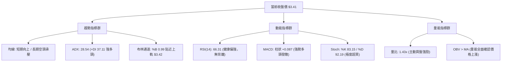

### 📈 移動平均線排列分析

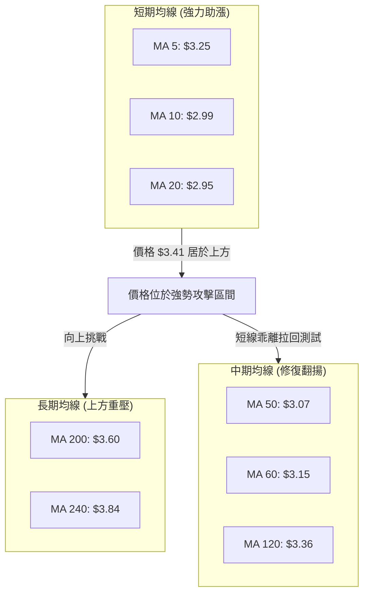

#### 均線數據與偏離度矩陣

| 均線名稱 | 當前價位 | 現價相對偏離 ($) | 偏離百分比 (%) | 方向訊號 | 技術解讀 |
|----------|----------|------------------|----------------|----------|----------|
| **MA 5** | $3.25 | +$0.16 | +5.05% | 🟢 助漲 | 短線極限加速線，回測首要支撐 |
| **MA 10** | $2.99 | +$0.42 | +14.12% | 🟢 助漲 | 陡峭上行，構成次級防守 |
| **MA 20** | $2.95 | +$0.46 | +15.44% | 🟢 翻揚 | 底部轉折向上，確立月線級別反轉 |
| **MA 50** | $3.07 | +$0.34 | +11.07% | 🟢 突破 | 站穩季線，中期反彈趨勢成形 |
| **MA 60** | $3.15 | +$0.26 | +8.26% | 🟢 突破 | 中期下降壓力線被放量粉碎 |
| **MA 120**| $3.36 | +$0.05 | +1.38% | 🟢 突破 | 半年線已收復，多頭空間打開 |
| **MA 200**| $3.60 | -$0.19 | -5.28% | 🔴 壓制 | 牛熊分界線，空頭排列最後防線 |
| **MA 240**| $3.84 | -$0.43 | -11.11%| 🔴 壓制 | 長期年線重壓區 |

- **均線排列結論**：目前雖然整體均線架構仍處於過去大跌形成的長期空頭排列（MA20 < MA50 < MA200），但短期呈現極具爆發力的「下位均線向上金叉穿刺」。現價 $3.41 已一舉攻克 MA5、MA10、MA20、MA50、MA60 及 MA120，技術面正面臨朝向 MA200（$3.60）靠攏的估值修復行情。

### 📉 RSI(14) 分析

- **RSI 當前數值**：**66.31**
- **強度可視化進度條**：
  ```
  0   10   20   30   40   50   60   70   80   90  100
  ├────┼────┼────┼────┼────┼────┼────┼────┼────┼────┤
  ████████████████████████████████░░░░░░░░░░░░░░░░  66.31% (強勢多頭區)
  ```
- **區間與背離判定**：
  - 處於 50–70 之強勢多頭控盤區，尚未突破 70 進入非理性瘋狂超買區。
  - **背離分析**：近 20 根 K 棒價格自 $2.71 漲至 $3.41，RSI 亦由 34.0 同步勁揚至 66.31，高點與指標同步創出波段新高，**無頂背離現象**。底背離則已在 $2.67–$2.71 處成功兌現。

### 📊 MACD(12,26,9) 訊號解讀

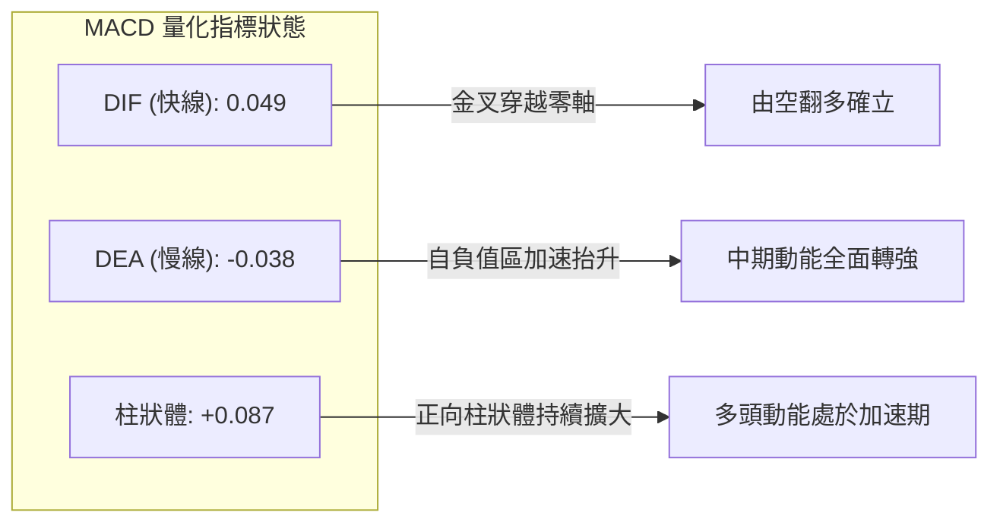

- **技術解讀**：DIF 已經穿過零軸達到 +0.049，而 DEA 仍處於 -0.038，形成了強勢的「零下起飛金叉並衝破零軸」攻擊波。柱狀圖報 +0.087，為近 20 週以來的最大正向爆發值，顯示推升力量具備極高質量的動能支撐。

### 📦 布林通道分析

```
GRAB 布林通道與現價定位圖 (參數: 20, 2)
══════════════════════════════════════════════════════════════════
$3.42 ───┬──────────────────────────────────────────  布林上軌
$3.41 ───┼─● 【現價 $3.41，%B = 0.99】
         │  
$2.95 ───┼──────────────────────────────────────────  布林中軌 (MA20)
         │  
$2.48 ───┴──────────────────────────────────────────  布林下軌
══════════════════════════════════════════════════════════════════
```

- **通道帶寬與形態**：下軌 $2.48、中軌 $2.95、上軌 $3.42。
- **%B 指標深度解讀**：最新 %B 報 **0.99**，意味著現價與上軌（$3.42）僅差 $0.01。
- **指標意義**：當股價觸碰布林上軌且 %B 逼近 1.0 時，若成交量無法維持在 1.5 億股以上的超高換手，走勢通常會出現兩種演化：(1) 沿上軌形成「鈍化逼空」（需 ADX 極強配合），或 (2) 短暫受壓拉回向中軌 $2.95 靠攏。鑑於 2026-11-06 日K出現紡錘星形線，短線受阻機率偏高。

### 💹 成交量分析（量價配合度）

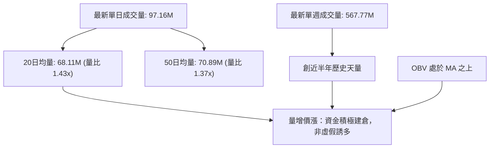

- **量價健康度**：近 5 個交易日內出現兩天超過 1.48 億股的天量（11-03 之 153.62M 及 11-05 之 148.73M），而週五拉回至 $3.41 時，成交量主動萎縮至 97.16M，呈現健康之「上漲放量、回檔量縮」的多頭洗盤特徵。
- **OBV 驗證**：OBV 指標明確運行在其移動平均線之上，未出現「價創新高而量能背離」之空頭現象，確認底層籌碼吸收堅定。

---

## 6. 動能與波動率

### ⚡ 動能評估四象限

| 象限標籤 | 動能狀態 | 波動率狀態 | 市場環境定義 | GRAB 當前定位與評估 |
|----------|----------|------------|--------------|---------------------|
| **Q1 (最佳機會)** | **強動能** | **低/中波動** | 穩定單邊推升波 | ── |
| **Q2 (謹慎觀望)** | 弱動能 | 低波動 | 底部或盤整蓄勢 | ── |
| **Q3 (高風險高收益)** | **強動能** | **高波動** | **趨勢爆發與突破** | **✓ 當前定位 (ADX 28.54，ATR 4.54%，強動能高彈性)** |
| **Q4 (避免進場)** | 弱動能 | 高波動 | 無序震盪洗盤 | ── |

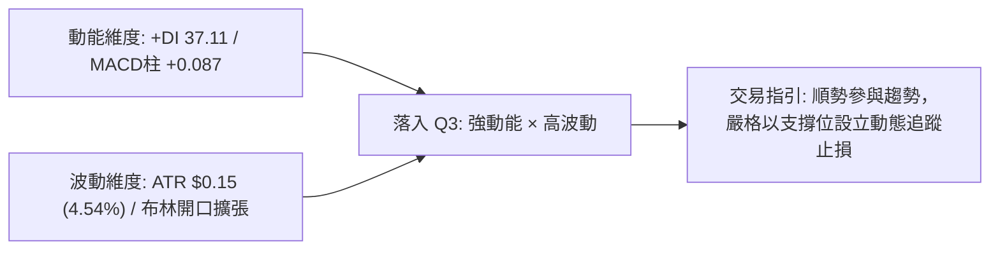

### 📊 ATR 波動率分析

- **ATR(14) 數值**：**$0.15**（佔股價比例為 **4.54%**）。
- **波動特性**：相較於大型藍籌股，GRAB 每日擁有超過 4.5% 的常規價格擺動幅度。這說明單日波幅常可達 $0.15–$0.30。
- **風控止損距離指導**：
  - 順勢交易者若進場，止損距離絕不可小於 1.0 倍 ATR（$0.15），以免被日常市場噪音無謂洗出場。
  - 建議最佳保護性止損間隔為 **1.5 至 2.0 倍 ATR**，即 **$0.22 至 $0.30** 的安全緩衝墊。

### 📐 Beta 與市場相關性

- **Beta 係數**：**0.833**。
- **特性分析**：Beta < 1.0 代表該股對大盤（如標普500指數）的系統性聯動敏感度低於大盤平均水平。近期走勢完全由公司自身財報扭虧、東南亞超應用業務增長及 AI 降本增效等個股獨立催化劑驅動，具備顯著的 Alpha 獨立行情屬性。

---

## 7. 多時框架總結

### 📋 時框架評分表

| 時框架 | 趨勢方向 | 動能表現 | 均線排列 | 形態特徵 | 綜合評分 | 操作建議 |
|--------|----------|----------|----------|----------|----------|----------|
| **短期 (日線)** | 🟢 強烈看多 | RSI 66.31 / Stoch超買 | 站上MA5/10/20/60/120 | 突破雙底頸線，衝擊布林上軌 | **75/100** | 逢回踩分批低吸，切忌盲目追高 |
| **中期 (週線)** | 🟢 轉向看多 | MACD金叉 / 柱狀擴大 | 突破MA5/MA10/MA20 | 爆量長陽吞噬前四週黑K | **70/100** | 持股續抱，以 S2 $3.26 為波段底線 |
| **長期 (月線)** | 🔴 仍處空頭 | 底部初步止跌 | 處於MA200 ($3.60) 下方 | 自 $6.02 下行後首度月線紅K | **56/100** | 視為空頭框架下的強反彈，緊盯R1 |

### 🔲 綜合訊號矩陣

```
時框與指標共振分析矩陣
══════════════════════════════════════════════════════════════════
時框層級       趨勢   均線   動能   量能   形態   指標共振度
──────────────────────────────────────────────────────────────────
短期 (Daily)    🟢     🟢     🟡     🟢     🟢    85% (高共振，多頭主導)
中期 (Weekly)   🟢     🟡     🟢     🟢     🟢    80% (高共振，反轉確認)
長期 (Monthly)  🔴     🔴     🟡     🟡     🟡    40% (低共振，長空格局)
══════════════════════════════════════════════════════════════════
```

### ⚖️ 多時框收斂結論

依據多時框收斂規則（規則 14）：
1. **行情模式判斷**：當前 ADX(14) 報 **28.54 > 25**，市場明確處於**「趨勢行情」**而非盤整市場。
2. **優先級收斂取捨**：依規則，趨勢行情下應以中長期（週線與 MA50/MA200）方向為主要指針，日線則作為尋找精確進場時點的工具。
   - 週線長陽已突破中短期壓制，中期動能全面轉多；
   - 雖然長期月線與 MA200 ($3.60) 仍在上方形成總體格局的壓制，但日線強勁的量價爆發已打開向 MA200 衝刺的通道。
3. **唯一方向性結論**：**【偏多（回調佈局多單）】**。
   - 拒絕在當前布林上軌與超買區間盲目追高；
   - 以日線拉回測試 S1 ($3.40) 或 S2 ($3.26) 尋求支撐確認，順應週線多頭趨勢進場。

---

## 8. 交易策略建議

### 🗺️ 策略決策流程圖

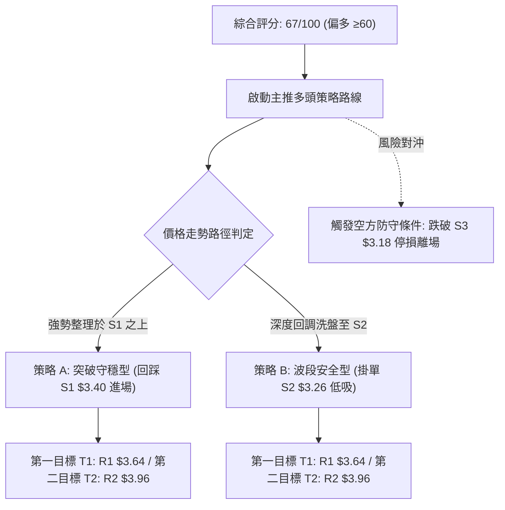

### 🧭 策略路由

**當前主策略方向 = 多頭策略（依技術評分卡綜合評分 67/100，≥60 明確分流至多頭主推路線）。**
空頭不作為主推交易方向，僅作為下文之「反向風險觸發與對沖提示」。

### 🎯 價格情境階梯（Price Scenarios）

嚴格引用數據中計算之關鍵價位（R1/R2/R3 及 S1/S2/S3）：

| 觸發條件 | 下一目標 | 後續延伸 | 情境含義 |
|----------|----------|----------|----------|
| **突破 R1 $3.64** | **R2 $3.96** | **R3 $4.06** | 實體攻克 MA200 ($3.60) 與 R1，多頭大級別反轉全面確立，空間打開 |
| **守穩現價 $3.41 / S1 $3.40** | **R1 $3.64** | **R2 $3.96** | 消化短期布林上軌超買乖離，維持強勢多頭推升結構 |
| **跌破 S1 $3.40** | **S2 $3.26** | **S3 $3.18** | 短線追高浮額被清洗，回踩測試突破之頸線支撐平台 |
| **跌破 S3 $3.18** | **$2.67** | 破底向下 | 宣告本次多頭突破為假突破，走勢重新轉入深淵探底 |

### 📊 情境機率分佈

| 情境劇本 | 機率 | 主要依據 |
|----------|------|----------|
| **強勢震盪後上行挑戰 R1** | **60%** | MACD 柱狀發散 (+0.087)、週成交量創天量 (567.77M)、OBV 居高不下、ADX 28.54 多頭主導 |
| **拉回 S2 區間震盪蓄勢** | **30%** | Stoch %K/%D (83/92) 嚴重超買、布林通道 %B 0.99 上軌承壓、日K線出現紡錘星線 |
| **直接破位回落再探底** | **10%** | 除非突發系統性黑天鵝，否則短期 6 根主要均線已在下方形成交織支撐墊 |

### 🟢 主策略詳情

嚴格依據規則 13、17：所有進出場、停損與目標價均嚴格引用數據，風險報酬比嚴格定義為 $(T1 - \text{進場}) / (\text{進場} - \text{止損})$。

| 策略要素 | 策略 A（強勢回踩 S1 進場） | 策略 B（穩健回調 S2 低吸） |
|----------|----------------------------|----------------------------|
| **策略類型** | 激進型：突破確認後之淺回踩 | 穩健型：回測頸線支撐位之安全吸納 |
| **進場條件** | 盤中回測 S1 獲支撐且不破 | 委託限價於 S2 支撐位附近低吸 |
| **進場價格** | **$3.40**（即 S1 支撐位） | **$3.26**（即 S2 支撐位） |
| **止損價格** | **$3.26**（跌破 S2 支撐止損） | **$3.18**（跌破 S3 結構支撐止損） |
| **目標價 T1** | **$3.64**（引用阻力位 R1） | **$3.64**（引用阻力位 R1） |
| **目標價 T2** | **$3.96**（引用阻力位 R2） | **$3.96**（引用阻力位 R2） |
| **風險報酬比** | **1 : 1.71（以 T1 計）**<br>計算式：$(3.64 - 3.40) / (3.40 - 3.26) = 0.24 / 0.14 = 1.714$<br>*(以 T2 計則為 1 : 4.00)* | **1 : 4.75（以 T1 計）**<br>計算式：$(3.64 - 3.26) / (3.26 - 3.18) = 0.38 / 0.08 = 4.750$<br>*(以 T2 計則為 1 : 8.75)* |
| **成功機率** | 65% | 75% |
| **建議倉位** | 15% 總資金 | 25% 總資金 |

### 🔴 反向風險觸發點（對沖提示）

- **全面停損翻空警戒線**：收盤價有效跌破 **S3: $3.18**。
- **觸發機制**：若股價跌破 $3.18，意味著同時跌穿了 MA60 ($3.15) 與本次雙底翻轉的頸線位，多頭形態全面破壞。此時所有多單必須無條件止損出局，保守投資者可建立對沖空單，目標下看 52 週低點 **$2.67**。

### ⭐ 整體訊號強度評星

```
做多訊號強度：★★★★☆  (4/5星 - 突破爆量，動能充沛，惟受制於超買)
做空訊號強度：★☆☆☆☆  (1/5星 - 逆強趨勢操作，風險極高)
整體可信度：  ★★★★☆  (4/5星 - 週線與日線指標高度共振確認)
```

---

## 9. 風險提示與監控

### ✅ 關鍵監控指標 Checklist

```
╔══════════════════════════════════════════════════════════════════╗
║                    交易風險日常監控清單 (Checklist)               ║
╠══════════════════════════════════════════════════════════════════╣
║ [ ] 價格是否跌破 S1 ($3.40)？  ── 若跌破，短線超買回調展開      ║
║ [ ] 價格是否跌破 S2 ($3.26)？  ── 若跌破，多頭警報拉響          ║
║ [ ] 價格是否有效攻克 R1 ($3.64) 與 MA200 ($3.60)？ ── 確認大牛  ║
║ [ ] 日成交量是否萎縮至 50M 以下？ ── 警惕量能不濟引發流動性衰退 ║
║ [ ] RSI(14) 是否升穿 75 形成極端超買或頂背離？                  ║
║ [ ] Stoch %K 是否自超買區向下跌破 %D 形成死叉？                 ║
║ [ ] ADX(14) 是否跌回 25 以下？ ── 若是，則趨勢終結轉入震盪      ║
╚══════════════════════════════════════════════════════════════════╝
```

### ⚠️ 風險場景分析

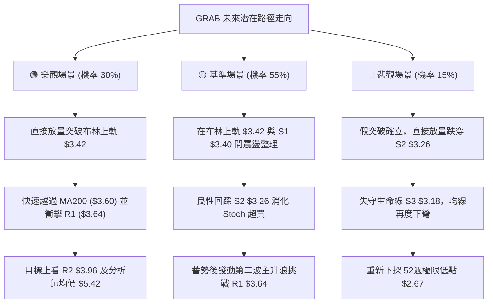

### 🛡️ 風險管理重要提醒

1. **嚴防通道邊界誘多**：目前布林通道 %B 高達 **0.99**，且 Stoch 超買（%K 83.15, %D 92.19），在此位置直接以市價滿倉追多是高風險行為。機構資金極可能利用散戶追漲熱情在 $3.45–$3.56 區間進行日內籌碼高出低進。
2. **波動率緩衝**：依據 ATR(14) = **$0.15**，任何多頭進場均須保留至少 $0.15–$0.22 的止損空間，嚴禁設定小於 $0.05 的超窄幅停損，否則極易被日內正常雜波震出。
3. **倉位管理公理**：單一交易最大虧損不應超過總投資組合淨值的 **1.5%**。若採策略 B（進場 $3.26，止損 $3.18，每股風險 $0.08），總資金 10 萬美元帳戶的單筆可承擔最大虧損為 1,500 美元，則最大持倉上限為 18,750 股（佔資金約 6.1 萬美元，可分 2–3 批次佈局）。

---

## 📋 報告總結

```
╔══════════════════════════════════════════════════════════════════╗
║                   GRAB 技術分析報告總結 (2026-11-08)             ║
╠══════════════════════════════════════════════════════════════════╣
║ 當前價格：$3.41                                                  ║
║ 分析評級：🟢 偏多反彈 (綜合技術評分: 67/100，具備強趨勢攻擊動能)   ║
╠══════════════════════════════════════════════════════════════════╣
║ 關鍵結論：                                                       ║
║ ├─ 長期趨勢：🔴 處於自 $6.02 回落之年線空頭格局，MA200 ($3.60) 承壓 ║
║ ├─ 中期趨勢：🟢 週線 5.67 億股天量大陽吞噬，底部 W底 反轉形態成立   ║
║ ├─ 短期趨勢：🟢 ADX 28.54 確立單邊趨勢，但觸及布林上軌面臨整固     ║
║ ├─ 關鍵支撐：S1: $3.40 ｜ S2: $3.26 ｜ S3: $3.18                 ║
║ ├─ 關鍵阻力：R1: $3.64 ｜ R2: $3.96 ｜ R3: $4.06                 ║
║ └─ 華爾街共識目標：$5.42 (23 位分析師，評級 Strong Buy)         ║
╠══════════════════════════════════════════════════════════════════╣
║ 最優策略組合：                                                   ║
║ 1. 🥇 最佳機會 (策略 B)：耐性等待拉回 S2 ($3.26) 掛單做多，       ║
║    止損設於 S3 ($3.18)，目標看 R1 ($3.64)，風報比高達 1:4.75。    ║
║ 2. 🥈 次選機會 (策略 A)：若開盤強勢守穩 S1 ($3.40)，小倉位進場， ║
║    止損設於 S2 ($3.26)，目標看 R1 ($3.64)，風報比為 1:1.71。     ║
║ 3. 🥉 防禦對策：嚴密盯防 S3 ($3.18)，一旦放量跌破，全線停損空倉。 ║
╚══════════════════════════════════════════════════════════════════╝
```

---

> ⚠️ **免責聲明**：本報告為依據定量技術分析模型與歷史交易數據自動生成之研究報告，所有指標、價位與推算邏輯均嚴格基於所提供之歷史行情數據。本報告**僅供學術研究與投資分析參考**，**絕不構成任何形式的要約、招攬或具體投資買賣建議**。金融市場具有高度波動風險，投資人應獨立評估自身財務狀況與風險承受能力，入市需極度謹慎。

---

*報告生成時間：2026-11-08 ｜ 數據來源：Yahoo Finance ｜ 分析框架：多時框技術分析模型*