# GRAB 技術分析報告

> **報告日期**：2026-11-09 ｜ **語言**：繁體中文 ｜ **數據來源**：Yahoo Finance ｜ **當前價格**：$3.41

---

## 目錄

| 章節 | 內容 |
|------|------|
| [1. 技術面概覽](#1-技術面概覽) | 訊號儀表板、核心指標、評分卡 |
| [2. 趨勢分析](#2-趨勢分析) | 多時框趨勢、長中短期走勢 |
| [3. 圖表形態分析](#3-圖表形態分析) | 形態識別、K線組合、目標價 |
| [4. 支撐與阻力](#4-支撐與阻力) | 關鍵價位、斐波那契回調 |
| [5. 技術指標深度解讀](#5-技術指標深度解讀) | MA/RSI/MACD/布林/成交量 |
| [6. 動能與波動率](#6-動能與波動率) | 動能評估、ATR、Beta |
| [7. 多時框架總結](#7-多時框架總結) | 時框架評分矩陣 |
| [8. 交易策略建議](#8-交易策略建議) | 多空策略、風險報酬比 |
| [9. 風險提示與監控](#9-風險提示與監控) | 監控指標、風險場景 |

---

## 1. 技術面概覽

### 🎯 技術訊號儀表板

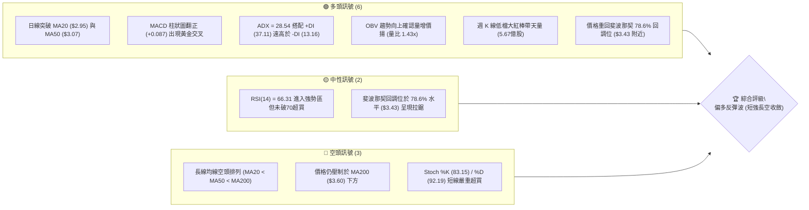

### 📊 核心指標速覽表

| 指標類別 | 指標名稱 | 當前數值 | 訊號 | 解讀 |
|----------|----------|----------|------|------|
| **價格** | 當前收盤價 | $3.41 | 🟢 | 脫離波段低點 $2.67，單週強勁反彈 +25.8% |
| **均線** | MA20 | $2.95 | 🟢 | 價格位於 MA20 上方 +15.59%，短期多頭主導 |
| **均線** | MA50 | $3.07 | 🟢 | 價格突破 MA50 上方 +11.07%，中期築底完成 |
| **均線** | MA200 | $3.60 | 🔴 | 價格低於 MA200 約 -5.28%，長期結構仍屬空方壓制 |
| **動能** | RSI(14) | 66.31 | 🟡 | 位於強勢進攻區間 (30-70中偏高)，未超買但逼近極限 |
| **動能** | MACD (12,26,9) | 0.049 / -0.038 | 🟢 | DIF 線與 MACD 翻正，柱狀圖 +0.087 擴張，多頭確立 |
| **動能** | KD (Stoch 14,3,3) | 83.15 / 92.19 | 🔴 | 進入超買鈍化區間，隨時面臨日線級別拉回整理 |
| **趨勢** | ADX (14) | 28.54 | 🟢 | ADX > 25 且 +DI (37.11) 遠大於 -DI (13.16)，強動能推進 |
| **通道** | 布林通道 %B | 0.99 | 🟡 | 緊貼布林上軌 ($3.42)，強勢表態但短線乖離偏大 |
| **成交量** | 最新成交量 | 97,161,300 | 🟢 | 高於 20 日均量 (量比 1.43x)，量價配合健康 |
| **波動** | ATR(14) | $0.15 | 🟡 | 日內波幅佔股價 4.54%，屬於中度波動標的 |

### 🏆 技術評分卡

```
╔══════════════════════════════════════════════════════════════╗
║                技術評分卡 — GRAB (2026-11-09)                 ║
╠══════════════════════════════════════════════════════════════╣
║ 趨勢強度      ██████████████░░░░░░  70/100  🟢 強趨勢啟動    ║
║ 動能指標      ██████████████░░░░░░  70/100  🟢 多方加速推升  ║
║ 支撐穩定度    ████████████░░░░░░░░  60/100  🟡 底部位階初固  ║
║ 成交量配合    ████████████████░░░░  80/100  🟢 爆量長紅確認  ║
║ 形態完整度    ████████████░░░░░░░░  60/100  🟡 雙重底雛形現  ║
║ 均線排列      ████████░░░░░░░░░░░░  40/100  🔴 逆向空頭排列  ║
╠══════════════════════════════════════════════════════════════╣
║ 綜合評分      ████████████░░░░░░░░  63/100  🟢 偏多進攻策略  ║
║              (計算：(70+70+60+80+60+40) / 6 = 63.33 → 63)   ║
╚══════════════════════════════════════════════════════════════╝
```

---

## 2. 趨勢分析

### 🌐 多時框趨勢分析

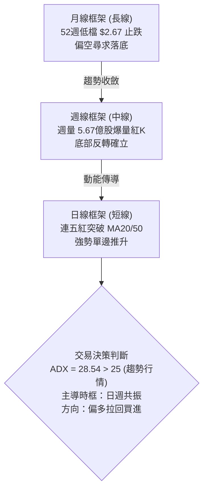

### 📈 長期趨勢 — 12個月走勢圖（Unicode）

```
GRAB 月線走勢圖（過去12個月：2025-11 至 2026-11）
價格軸 ($)
$6.00 ┤
$5.45 ┤●(2025-11)
$4.99 ┤    ●
$4.30 ┤        ●
$4.22 ┤            ●
$3.82 ┤                    ●
$3.66 ┤                ●       ●
$3.54 ┤                            ●       ●
$3.41 ┤                                        ●(現價)
$3.11 ┤                                    ●
$2.71 ┤                                        ●(波段低點 2026-10)
     └────────────────────────────────────────────────────────►
       11   12   01   02  03  04  05  06  07  08  09  10  11 (月)
       2025                       2026
```

#### 走勢特徵分析表格

| 階段區間 | 起訖月份 | 價格區間 | 累積漲跌幅 | 結構特徵與成交量型態 |
|----------|----------|----------|------------|----------------------|
| **主跌推動段** | 2025-11 → 2026-03 | $5.45 → $3.66 | -32.84% | 單邊空頭重挫，均線全面下彎，高點持續壓低 |
| **弱勢盤整段** | 2026-04 → 2026-08 | $3.82 → $3.54 | -7.33% | $3.50-$3.90 區間箱型震盪，反彈無量，缺乏動能 |
| **末跌出清段** | 2026-09 → 2026-10 | $3.54 → $2.71 | -23.45% | 破位恐慌下殺，觸及 52 週最低點 $2.67，空方最後釋放 |
| **暴力反彈段** | 2026-10 → 2026-11 | $2.71 → $3.41 | +25.83% | 財報激勵量能爆發，一週內收復兩個月跌幅，形成 V 型反轉雛形 |

### 📊 中期趨勢（週線分析）

中期走勢在 2026 年 9 月下旬與 10 月底兩度向下試探 $2.70 關卡（最低見 $2.67），形成對稱的雙底探底結構。

```
週線支撐阻力結構圖：
$4.06 ───────────────────────────── 阻力 R3 (強壓力區)
$3.96 ───────────────────────────── 阻力 R2 (反彈高點聚類)
$3.64 ───────────────────────────── 阻力 R1 (前波週線平台密集區)
$3.60 ----------------------------- MA200 壓力位
$3.41 ═════════════════════════════ 【現價】(觸及布林上軌)
$3.40 ───────────────────────────── 支撐 S1 (週K轉換位)
$3.26 ───────────────────────────── 支撐 S2 (日線跳空缺口支撐)
$3.18 ───────────────────────────── 支撐 S3 (MA60 防守位)
$2.67 ───────────────────────────── 52W 最低點 (長期鐵底)
```

### ⚡ 趨勢強度評估（ADX 解讀）

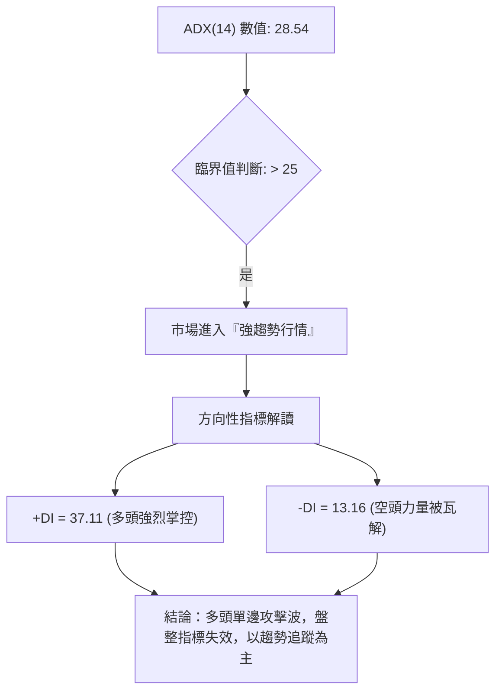

#### ADX 強度對照表

| ADX 數值區間 | 趨勢狀態 | 當前數值 (28.54) 判定 | 操作意涵 |
|--------------|----------|-----------------------|----------|
| 0 – 20 | 無趨勢 / 盤整 | 否 | 適合高拋低吸，通道操作 |
| 20 – 25 | 趨勢孕育中 | 否 | 突破前夕，準備順勢操作 |
| **25 – 40** | **強趨勢確立** | **🟢 正處於此區間 (28.54)** | **順應 +DI 方向積極做多，拉回支撐皆為買點** |
| 40 – 60 | 極強單邊趨勢 | 否 | 持股續抱，嚴格移動止盈 |
| 60 – 100 | 超級過熱行情 | 否 | 警惕末端噴出與竭盡崩跌 |

---

## 3. 圖表形態分析

### 🔍 形態識別系統

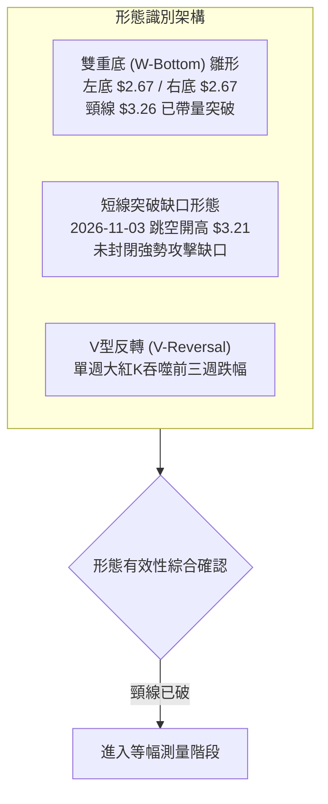

#### 形態識別與信心度評估表

| 形態名稱 | 信心度 | 判斷依據（引用數據） | 完成度 | 目標價（附精確計算式） |
|----------|--------|----------------------|--------|------------------------|
| **雙重底 (W-Bottom)** | 75% | 2026-10-26 觸及 $2.67，2026-10-30 再探 $2.68 止跌；隨後突破前波高點平台 S2 ($3.26) | 85% | 頸線 S2 ($3.26) + 形態高度 ($3.26 − $2.67 = $0.59) = **$3.85**（介於阻力位 R1 $3.64 與 R2 $3.96 之間） |
| **突破缺口 (Breakaway Gap)** | 80% | 2026-11-02 收 $2.86，次日 (11-03) 跳空開盤至 $3.21，成交量放大至 1.53 億股 | 100% | 缺口起點 $2.86 至高點 $3.32 之推進幅度 ($0.46)，向上等幅映射：$3.32 + $0.46 = **$3.78** |
| **頭肩底 (Reverse H&S)** | 35% | 數據不足以確認左肩與右肩對稱性，僅有一組尖銳探底數據 | 30% | 訊號不足，僅做指標型解讀，不預設目標價 |

### 🕯️ 重要 K 線形態分析

嚴格依據近 10 根日 K 與近 8 根週 K 實際數值進行解讀：

| 日期（週期） | 開盤 | 最高 | 最低 | 收盤 | 成交量 | K線形態 | 解讀與訊號 |
|--------------|------|------|------|------|--------|---------|------------|
| **2026-10-26 (日K)** | $2.79 | $2.80 | $2.67 | $2.71 | 53,258,700 | 長下影陰線 (Hammer雛形) | 探低 52 週新低 $2.67 後獲低接買盤支撐 🟢 |
| **2026-10-30 (日K)** | $2.71 | $2.73 | $2.68 | $2.71 | 54,900,200 | 十字星 (Doji) | 在 $2.68 獲支撐，多空極致收斂，變盤訊號 🟡 |
| **2026-11-02 (日K)** | $2.76 | $2.93 | $2.75 | $2.86 | 69,385,700 | 突破中紅K棒 | 帶量突破短期橫盤箱頂，發動進攻 🟢 |
| **2026-11-03 (日K)** | $3.21 | $3.32 | $3.08 | $3.12 | 153,625,600 | 跳空放量長陰十字 | 財報利多跳空開出，爆出 1.53 億巨量換手 🟢 |
| **2026-11-05 (日K)** | $3.35 | $3.50 | $3.27 | $3.48 | 148,734,900 | 光腳實體大陽K | 吸收前日籌碼後實體陽線推進，確認缺口有效 🟢 |
| **2026-11-06 (日K)** | $3.44 | $3.56 | $3.37 | $3.41 | 97,161,300 | 衝高小倒錘線 | 盤中衝擊 $3.56 後小幅回落，上影線顯示阻力 R1 逼近 🟡 |
| **2026-10-30 (週K)** | $2.79 | $2.80 | $2.67 | $2.71 | 280,515,400 | 低檔下影小陰線 | 空頭力竭，於 $2.67 構築週期底部 🟢 |
| **2026-11-06 (週K)** | $2.76 | $3.56 | $2.75 | $3.41 | 567,767,100 | 爆量長紅吞噬線 | 成交量創歷史級巨量 (5.67億)，完全包覆前三週K線 🟢 |

### 📉 ASCII 走勢形態示意圖

```
日線雙重底與跳空缺口突破示意：
$3.64 ────────────────────────────────────────── 阻力位 R1
$3.56 ───────────────╭╮◄ 11-06 衝高回落點
$3.41 ═══════════════│█═════════════════════════ 【現價 $3.41】
$3.32 ───────────╭╮  │█
$3.26 ───────[頸線 S2 突破]─────────────────────── 雙底頸線位
$3.21 ───────────│█  │█  ◄ 11-03 突破跳空缺口 ($2.86 - $3.21)
$2.86 ──────╭╮   │█  │█
$2.71 ──╭╮  │█   │█  │█
$2.67 ──┴┴──┴┴───┴┴──┴┴──────────────────────── 52W 低點 ($2.67 雙底底座)
        10-26    10-30    11-03    11-06
```

### 🎯 形態目標價計算

依據形態學嚴格測量規則，以數據中確認的關鍵支撐阻力為基準計算：

1. **雙重底測量目標價**：
   - 底座低點：$2.67（2026-10-26 數據）
   - 頸線位置：$3.26（支撐位 S2，近一年波段高低轉換點）
   - 形態高度：$3.26 - $2.67 = $0.59
   - **計算目標價** = 頸線 ($3.26) + 形態高度 ($0.59) = **$3.85**（此點位處於 R1 $3.64 與 R2 $3.96 之間）

2. **缺口測量目標價**：
   - 缺口下緣：$2.86（2026-11-02 收盤價）
   - 缺口上緣：$3.21（2026-11-03 開盤價）
   - 突破推進高度：$3.32 - $2.86 = $0.46
   - **計算目標價** = $3.32 + $0.46 = **$3.78**

---

## 4. 支撐與阻力

### 🗺️ 關鍵價位分布圖（Unicode）

```
GRAB 價位結構分布圖
═══════════════════════════════════════════════════════════════
$4.06 ║████████████████████████████████║ 強阻力 R3 (斐波 61.8% 上方)
$3.96 ║████████████████████████        ║ 阻力 R2 (反彈高點聚類)
$3.64 ║████████████████████████████    ║ 關鍵阻力 R1 (逼近 MA200 $3.60)
$3.41 ╠════════════════════════════════╣ ◄ 現價 ($3.41)
$3.40 ║▓▓▓▓▓▓▓▓▓▓▓▓▓▓▓▓▓▓▓▓▓▓▓▓▓▓▓▓    ║ 近期關鍵支撐 S1 (斐波 78.6% $3.43 附近)
$3.26 ║████████████████████████        ║ 強支撐 S2 (頸線轉換位 / 缺口防守)
$3.18 ║████████████████                ║ 結構支撐 S3 (MA60 $3.15 附近聚類)
$2.67 ║████████████████████████████████║ 52週鐵底 (年度最低價)
═══════════════════════════════════════════════════════════════
```

### 🚧 阻力位分析表

所有價位嚴格引用技術數據中之「阻力位（近一年波段高點聚類）」：

| 阻力級別 | 價位 | 距現價幅 | 形成原因 | 突破難度 | 重要性評級 |
|----------|------|----------|----------|----------|------------|
| **R1** | **$3.64** | +6.74% | 2026 年 8 月波段高點密集成交區，且與 MA200 ($3.60) 形成重疊共振壓力帶 | 🟡 中等偏高 | ★★★★☆ |
| **R2** | **$3.96** | +16.13% | 2026 年 7 月初波段衝高頂點 ($3.93-$3.96 區間)，為前期套牢籌碼峰 | 🔴 較高 | ★★★★☆ |
| **R3** | **$4.06** | +19.06% | 斐波那契 61.8% ($4.03) 心理大關與波段密集頂，為多頭中期反轉終極分水嶺 | 🔴 極高 | ★★★★★ |

### 🛡️ 支撐位分析表

所有價位嚴格引用技術數據中之「支撐位（近一年波段低點聚類）」：

| 支撐級別 | 價位 | 距現價幅 | 形成原因 | 守住機率 | 重要性評級 |
|----------|------|----------|----------|----------|------------|
| **S1** | **$3.40** | -0.29% | 2026-11-06 日線收盤前反覆測試合理防守位，緊貼現價與斐波 78.6% ($3.43) | 🟡 60% | ★★★☆☆ |
| **S2** | **$3.26** | -4.40% | 雙重底形態頸線位置，11-03 跳空實體 K 棒中軸，具極強支撐轉折意義 | 🟢 80% | ★★★★★ |
| **S3** | **$3.18** | -6.74% | 接近 MA60 ($3.15) 均線支撐區與 11-03 跳空缺口低點 ($3.08) 之上防線 | 🟢 90% | ★★★★☆ |

### 📐 斐波那契回調位分析

依據 52 週極值區間（高點 $6.24 → 低點 $2.67）精確計算回調點位：

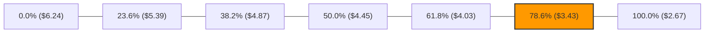

#### 斐波那契區間定位與解讀

- **當前位置**：收盤價 **$3.41**，精確座落於 **78.6% 回調位 ($3.43)** 與 **100.0% 低點 ($2.67)** 之間，且距 78.6% 僅有一步之遙 (-0.58%)。
- **技術意義**：
  1. 斐波那契 78.6% ($3.43) 為深度回調的核心阻力關卡。若日線實體能收復並站穩 $3.43 之上，意味著自 $6.24 下跌以來的「極度弱勢區間」已被正式打破。
  2. 現價突破 $3.43 後，上方下一斐波那契真空區間將直接指向 **61.8% 黃金分割位 ($4.03)**，與阻力位 R3 ($4.06) 形成完美共振。

---

## 5. 技術指標深度解讀

### 🎛️ 指標訊號總覽

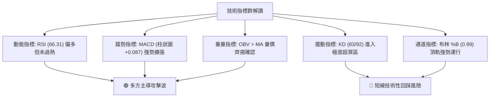

### 📈 移動平均線排列分析

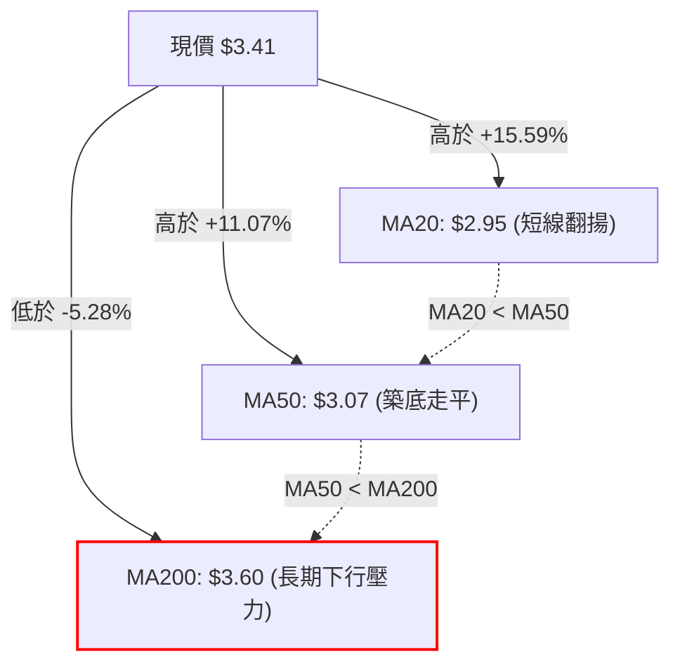

#### 均線系統數據與排列診斷

| 均線名稱 | 當前價格 | 與現價乖離率 | 短期斜率狀態 | 趨勢解讀 |
|----------|----------|--------------|--------------|----------|
| **MA 5** | $3.25 | +4.92% | 急遽向上 (+5.05%) | 極短線多頭攻擊發起線 |
| **MA 10** | $2.99 | +14.05% | 快速上彎 (+14.12%) | 短期多頭防守第一道支撐 |
| **MA 20** | $2.95 | +15.59% | 止跌翻揚 (+15.44%) | 月線級別支撐確立，脫離底部 |
| **MA 50** | $3.07 | +11.07% | 走平轉折 | 中期下壓趨勢被扭轉 |
| **MA 60** | $3.15 | +8.26% | 減速走平 (+8.26%) | 季度生命線轉化為回調支撐 |
| **MA 120** | $3.36 | +1.49% | 微幅走平 (+1.38%) | 現價已剛站上半年線 |
| **MA 200** | $3.60 | -5.28% | 持續向下壓制 | 長線牛熊分界，為本波最大技術阻力 |
| **MA 240** | $3.84 | -11.20% | 下行態勢 (-11.11%) | 年線壓力位，接近形態測量目標 |

**診斷結論**：當前均線系統整體仍處於歷史遺留的「空頭排列」（MA20 < MA50 < MA200），但短週期均線（MA5、MA10、MA20）已以極大角度向上穿刺 MA50 與 MA60，呈現經典的**底部均線黃金交叉聚合並發散**雛形。現價正面臨 MA200 ($3.60) 的長期壓制。

### 📉 RSI(14) 分析

- **RSI(14) 數值**：**66.31**
- **強度視覺化**：
  ```
  RSI(14): [ 0 ──────── 30 ────── 50 ────── 70 ──── 100 ]
  當前進度:  ██████████████████████████████░░░░░░░░░  66.31%
  ```
- **區間評估**：數值介於 50 至 70 之間，處於**多頭強勢進攻區**，尚未觸及 70 以上的極端超買警戒線，意味著多方推升動能仍有釋放空間。
- **背離分析判斷**：
  - 檢視數據：近 20 根 K 棒價格由 $2.67 谷底翻揚至 $3.41，RSI 同步由週線級別的 23.3 飆升至當前的 66.31。
  - **結論**：指標與價格同向創出反彈新高，**無明顯頂背離或底背離現象**，此波漲勢完全由實質買盤動能驅動。

### 📊 MACD(12,26,9) 訊號解讀

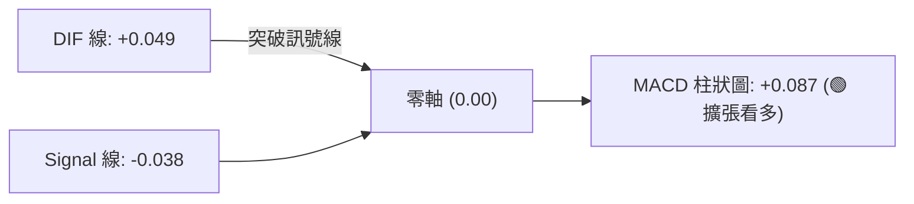

- **MACD 線**：+0.049（已成功穿越零軸之上）
- **訊號線 (Signal)**：-0.038（正加速向零軸逼近）
- **柱狀圖 (Histogram)**：**+0.087**（自前期的負值與平底連續快速擴張）
- **技術意義**：週線與日線級別 MACD 出現共振黃金交叉，且柱狀圖處於顯著擴張階段，代表中短期買盤動能充足，主升波特徵明確。

### 📦 布林通道分析

```
布林通道 (20, 2) 結構示意圖：
$3.42 ────────────────────────────────── 上軌 (現價 $3.41 緊貼於此) ◄ %B = 0.99
$2.95 ────────────────────────────────── 中軌 (MA20，強力支撐基準)
$2.48 ────────────────────────────────── 下軌 (超跌極限防護)
```

- **上軌**：$3.42
- **中軌 (MA20)**：$2.95
- **下軌**：$2.48
- **BB %B**：**0.99**（極度接近 1.00 上軌）
- **解讀**：股價緊貼布林帶上軌運行，通常為「強烈趨勢行情」特徵（Walking the Band）；但由於 %B 達 0.99，且 KD 同步超買，短線若未能以巨量突破上軌擴張通道，價格可能產生向布林中軌 ($2.95) 與支撐 S2 ($3.26) 均值回歸的技術性收斂。

### 💹 成交量分析（量價配合度）

```
成交量動能柱狀比對：
最新量 (11-06): ██████████████████ 97.16M
20日均量:      ████████████░░░░░░ 68.11M  (量比: 1.43x)
50日均量:      █████████████░░░░░ 70.89M
11-03 突破巨量: ████████████████████████████ 153.63M
```

- **量比表現**：最新成交量 97,161,300 股，相較於 20 日均量 (68,112,675 股) 達到 **1.43 倍**；在 11-03 突破日更激增至 1.53 億股。
- **OBV (能量潮)**：OBV > MA，呈現明顯多頭排列。成交量於低檔 $2.67-$2.80 區間急遽放大，伴隨股價拔尖而起，為標準「價增量漲」的機構吸籌與換手特徵，非無量虛漲。

---

## 6. 動能與波動率

### ⚡ 動能評估四象限

| 象限標籤 | 動能狀態 | 波動率狀態 | 市場屬性特徵 | GRAB 當前定位判定 |
|----------|----------|------------|--------------|-------------------|
| **第一象限 (Q1)** | **強動能** | **低/中波動** | 穩定上升趨勢，最佳順勢持股環境 | — |
| **第二象限 (Q2)** | 弱動能 | 低波動 | 沉悶橫盤，適合區間網格操作 | — |
| **第三象限 (Q3)** | **強動能** | **高波動** | **爆發性突破或反轉行情，風險與報酬並存** | **🟢 當前定位於 Q3 象限** |
| **第四象限 (Q4)** | 弱動能 | 高波動 | 恐慌崩跌或失控洗盤，應完全避免進場 | — |

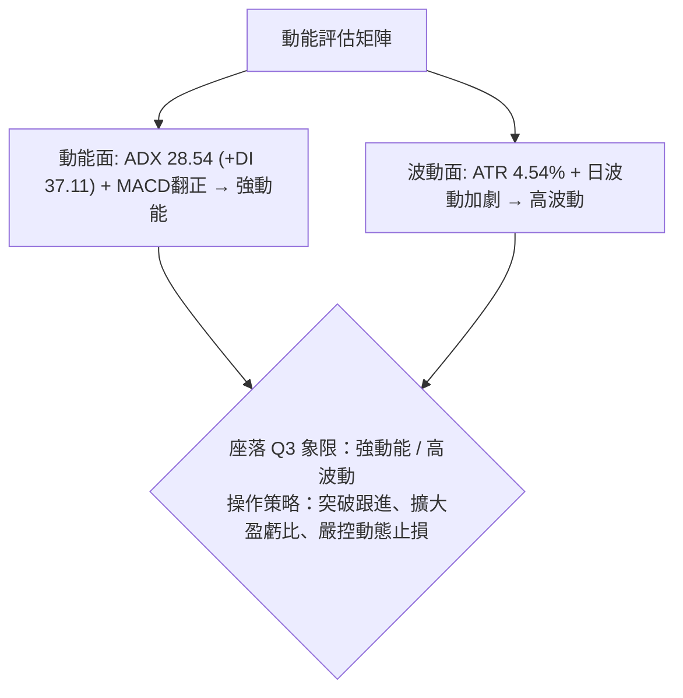

### 📊 ATR 波動率分析

- **ATR(14)**：**$0.15**（佔當前收盤價之 **4.54%**）
- **止損距離建議**：
  - *短線當沖/極短線*：1.0 × ATR = **$0.15**（離進場點緩衝）
  - *波段交易基準*：1.5 × ATR = **$0.225**（建議常規止損空間）
  - *寬幅風控/中線保護*：2.0 × ATR = **$0.30**（可有效過濾盤中毛刺洗盤）

### 📐 Beta 與市場相關性

- **Beta 係數**：**0.833**
- **解讀**：Beta < 1.0，表示 GRAB 對美股大盤（S&P 500）的系統性風險敏感度相對較低。近期走勢完全由公司基本面（Q3 財報營收成長 27.4%、AI 應用提升與上調全年指引）主導，呈現走出獨立行情的阿爾法（Alpha）特質。

---

## 7. 多時框架總結

### 📋 時框架評分表

| 時框架 | 趨勢方向 | 動能狀態 | 均線排列 | 形態特徵 | 綜合評分 | 戰略建議 |
|--------|----------|----------|----------|----------|----------|----------|
| **長期 (月線)** | 🔴 偏空修正 | 🟡 止跌打底 | 🔴 空頭排列 (MA200下壓) | 52週低點 $2.67 支撐測試 | 45/100 | 長線資金分批建底倉 |
| **中期 (週線)** | 🟢 轉多突破 | 🟢 強勢反轉 | 🟡 扭轉跌勢 (站回MA20) | 爆量吞噬大陽線 | 75/100 | 波段多頭持股續抱 |
| **短期 (日線)** | 🟢 單邊偏多 | 🔴 超買鈍化 | 🟢 均線金叉向上發散 | 雙底突破 + 缺口推進 | 70/100 | 待拉回頸線分批低吸 |

### 🔲 綜合訊號矩陣

```
時框架訊號交叉驗證：
┌──────────────────┬──────────────┬──────────────┬──────────────┐
│ 分析維度         │ 短期 (日線)  │ 中期 (週線)  │ 長期 (月線)  │
├──────────────────┼──────────────┼──────────────┼──────────────┤
│ 趨勢方向         │ 🟢 強烈看多  │ 🟢 底部翻多  │ 🔴 偏空架構  │
│ 均線系統         │ 🟢 短期金叉  │ 🟡 扣抵向上  │ 🔴 空頭阻力  │
│ 動能 (RSI/MACD)  │ 🟢 強勁擴張  │ 🟢 金叉成形  │ 🟡 築底復甦  │
│ 成交量能         │ 🟢 量價齊揚  │ 🟢 歷史級天量│ 🟡 換手積極  │
│ 擺動指標 (KD)    │ 🔴 嚴重超買  │ 🟡 中性回升  │ 🟢 脫離超賣  │
└──────────────────┴──────────────┴──────────────┴──────────────┘
```

### ⚖️ 多時框收斂結論

依據多時框收斂規則：
1. **行情定性**：當前日線 ADX 為 **28.54 > 25**，市場正式進入「**強趨勢行情**」，盤整指標失效，震盪區間操作策略退場。
2. **主導時框判定**：在趨勢行情下，依中長期（週線）方向為主，週 K 線在 $2.67 構築雙底並以 5.67 億股巨量拉出長紅吞噬棒，確認中期多頭反轉；日線則用於精確尋找進場切入點。
3. **矛盾取捨**：雖然日線 KD 進入超買區（83/92），但在 ADX > 25 的強趨勢中，超買往往伴隨動能鈍化持續走高；而長期 MA200 ($3.60) 雖為空頭壓制，但距離現價尚有空間，提供多頭明確攻擊目標。
4. **唯一方向性結論**：**【全面偏多，拉回支撐做多】**，此結論完全收斂並對齊第 8 章之交易主策略。

---

## 8. 交易策略建議

### 🗺️ 策略決策流程圖

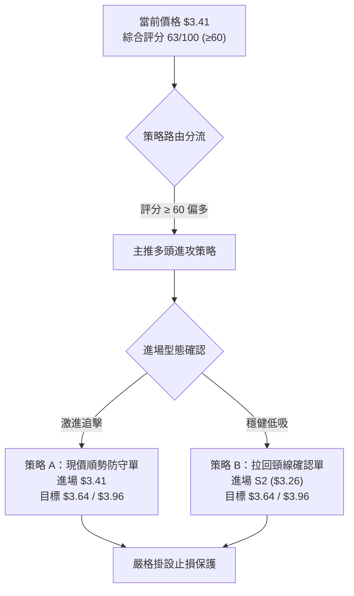

### 🧭 策略路由（依評分卡分流）

> **當前主策略方向 = 🟢 積極做多策略（依綜合評分 63/100，評分 ≥ 60 主推多頭）**

長線空頭結構已被強勢週線吞噬棒打破，短期趨勢強勁，回踩皆視為建立多頭部位機會，做空僅作為風險觸發警示。

### 🎯 價格情境階梯（Price Scenarios）

價位嚴格引用下方技術數據計算之真實數值：

| 觸發條件 | 下一目標 | 後續延伸 | 情境含義解讀 |
|----------|----------|----------|--------------|
| **放量突破 R1 ($3.64)** | 阻力 R2 ($3.96) | 阻力 R3 ($4.06) | 強力攻克 MA200 ($3.60)，確立反轉多頭主升段 |
| **於 S1 ($3.40) 橫盤整理** | 阻力 R1 ($3.64) | — | 消化日線超買賣壓，強勢以盤代跌換手 |
| **失守跌破 S1 ($3.40)** | 支撐 S2 ($3.26) | 支撐 S3 ($3.18) | 技術性深幅回調，考驗雙底頸線與跳空缺口支撐力道 |

### 📊 情境機率分佈

| 情境 | 機率 | 主要判斷依據 |
|------|------|--------------|
| **繼續上行 / 挑戰 R1** | **65%** | MACD 柱狀圖 (+0.087) 翻正擴張、OBV 趨勢向上確認、週成交量創歷史級天量 |
| **區間震盪 / 消化超買** | **25%** | 布林 %B (0.99) 貼近上軌、KD 指標超買高見 92.19、短線獲利盤有調節需求 |
| **回落探底 / 跌破 S2** | **10%** | 下方已構築多道跳空缺口與大成交量換手籌碼峰，除非大盤暴跌，否則極難破底 |

### 🟢 主策略詳情（多頭進攻）

所有數值嚴格引用關鍵價位區塊計算；風險報酬比按規則 17 精確算回：
- 策略 A 風險報酬比 = ($3.64 − $3.41) ÷ ($3.41 − $3.26) = $0.23 ÷ $0.15 = **1 : 1.53（以 T1 計）**；至 T2 則為 ($3.96 − $3.41) ÷ ($3.41 − $3.26) = $0.55 ÷ $0.15 = **1 : 3.67（以 T2 計）**。
- 策略 B 風險報酬比 = ($3.64 − $3.26) ÷ ($3.26 − $3.18) = $0.38 ÷ $0.08 = **1 : 4.75（以 T1 計）**；至 T2 則為 ($3.96 − $3.26) ÷ ($3.26 − $3.18) = $0.70 ÷ $0.08 = **1 : 8.75（以 T2 計）**。

| 策略要素 | 策略 A（動能突破追擊單） | 策略 B（拉回頸線穩健單） |
|----------|--------------------------|--------------------------|
| **進場條件** | 突破斐波 78.6% ($3.43) 或週一開盤順勢建倉 | 回踩支撐位 S2 ($3.26) 獲得 K 線止跌確認 |
| **進場價格** | **$3.41**（現價） | **$3.26**（支撐位 S2） |
| **目標價 T1** | **$3.64**（阻力位 R1，波段高點/MA200） | **$3.64**（阻力位 R1） |
| **目標價 T2** | **$3.96**（阻力位 R2，中期前高密集區） | **$3.96**（阻力位 R2） |
| **止損價格** | **$3.26**（跌破頸線 S2 止損，虧損 $0.15） | **$3.18**（跌破支撐 S3 止損，虧損 $0.08） |
| **風險報酬比** | **1 : 1.53（以 T1 計）** / 1 : 3.67（以 T2 計） | **1 : 4.75（以 T1 計）** / 1 : 8.75（以 T2 計） |
| **成功機率** | 65% | 75% |
| **建議倉位** | 10% 總資金（分批建倉） | 15% 總資金 |

### 🔴 反向風險觸發點（對沖提示）

若出現以下訊號，多頭邏輯即刻失效，必須嚴格停損或建立避險空單：
1. **關鍵點位跌破**：收盤價有效跌破 **S2 ($3.26)**，意味著雙底頸線宣告失守，突破缺口被回補，行情將轉為弱勢再探底。
2. **極端放量下殺**：若價格跌破 **S3 ($3.18)**，且單日成交量再度超過 1 億股，說明主力反手出貨，多頭部位應全數無條件停損出場。

### ⭐ 整體訊號強度評星

```
做多訊號強度：★★★★☆  (4/5星) — 爆量突破與底部成形，唯受限於短線超買
做空訊號強度：★☆☆☆☆  (1/5星) — 動能極強，做空勝率極低且逆勢
整體可信度：  ★★★★☆  (4/5星) — 價量結構與多指標高度共振
```

---

## 9. 風險提示與監控

### ✅ 關鍵監控指標 Checklist

```
╔══════════════════════════════════════════════════════════════╗
║               GRAB 每日交易風控監控清單 (Checklist)           ║
╠══════════════════════════════════════════════════════════════╣
║ [ ] 價位監控：是否持續收在支撐位 S1 ($3.40) 之上？            ║
║ [ ] 阻力測試：盤中衝擊 R1 ($3.64) 時是否伴隨 MA200 突破量？  ║
║ [ ] 動能過熱：Stoch %K 是否自 80 以上形成死叉回落？           ║
║ [ ] 缺口防守：11-03 跳空下緣 $3.08-$3.21 區間是否完好無損？   ║
║ [ ] 量能維持：日成交量是否保持在 20 日均量 (68.11M) 之上？    ║
║ [ ] ADX 追蹤：ADX 是否維持在 25 以上且 +DI 保持領先？         ║
╚══════════════════════════════════════════════════════════════╝
```

### ⚠️ 風險場景分析

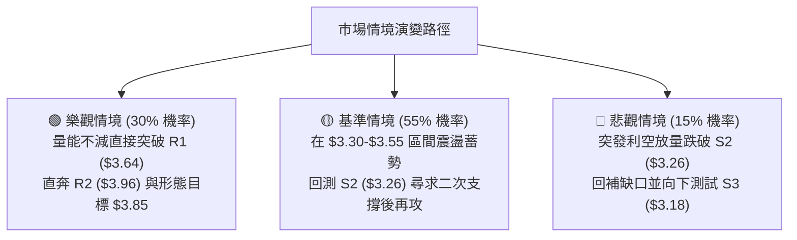

### 🛡️ 風險管理重要提醒

1. **短線乖離率過大風險**：股價短期脫離 MA20 幅度達 +15.59%，且布林帶 %B 達 0.99，隨時可能出現 1-2 天的劇烈震盪洗盤，嚴禁在盤中急拉時以市價單追高。
2. **MA200 長期均線壓制**：$3.60-$3.64 為長達一年的空頭防線，空方在此必有反撲，首次抵達該處時應適度了結 30%-50% 的短線浮盈多單。
3. **倉位管理守則**：單筆交易承擔之最大帳戶風險嚴格控制在總權益的 **1.5% - 2.0%** 以內。若以策略 A 入場，進場價 $3.41、止損 $3.26（每股風險 $0.15），則每 10,000 美元資產規模至多持有 1,000 至 1,300 股。

---

## 📋 報告總結

```
╔══════════════════════════════════════════════════════════════╗
║                    GRAB 技術分析報告總結                      ║
╠══════════════════════════════════════════════════════════════╣
║ 報告日期：2026-11-09                                         ║
║ 當前價格：$3.41                                              ║
║ 分析評級：🟢 偏多進攻（綜合評分：63 / 100）                  ║
║                                                              ║
║ 關鍵結論：                                                   ║
║ ├─ 長期趨勢：🟡 築底復甦（52週低點 $2.67 支撐強勁，尋求扭轉）║
║ ├─ 中期趨勢：🟢 底部反轉（週線 5.67 億天量長紅，吞噬前三週跌幅║
║ ├─ 短期趨勢：🟢 單邊強勢（ADX 28.54 > 25，多頭全面主導攻擊） ║
║ ├─ 關鍵支撐：S1: $3.40 ｜ S2: $3.26 ｜ S3: $3.18             ║
║ ├─ 關鍵阻力：R1: $3.64 ｜ R2: $3.96 ｜ R3: $4.06             ║
║ └─ 分析師目標：均價 $5.42（最低 $4.00 ｜ 最高 $7.00）        ║
║                                                              ║
║ 最優策略組合：                                               ║
║ 1. 🥇 最佳機會：策略 B（拉回 $3.26 頸線佈局多單，風報比 1:4.75║
║ 2. 🥈 次選機會：策略 A（現價 $3.41 順勢持股，止損設於 $3.26） ║
║ 3. 🥉 防守選擇：突破 R1 $3.64 且確認站穩後，加碼追擊至 R2 $3.96║
╚══════════════════════════════════════════════════════════════╝
```

---

> ⚠️ **免責聲明**：本報告為技術分析研究成果，所有價位預估與指標解讀均嚴格基於歷史量價數據模型。本報告**僅供學術研究與投資架構參考**，**不構成任何形式之個人化投資建議或買賣邀約**。金融市場瞬息萬變，交易決策應獨立審慎評估，並自負投資風險與盈虧。

---

*報告生成時間：2026-11-09 ｜ 數據來源：Yahoo Finance ｜ 分析框架：多時框技術分析模型*