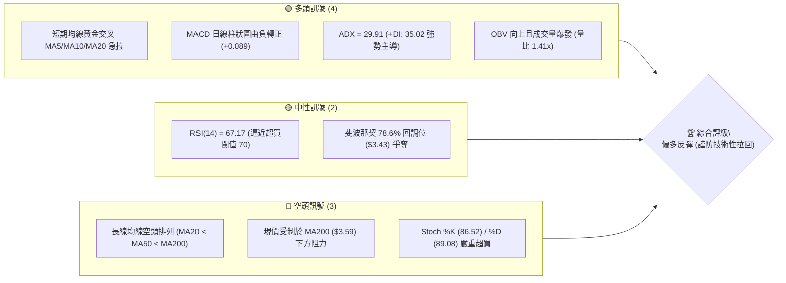
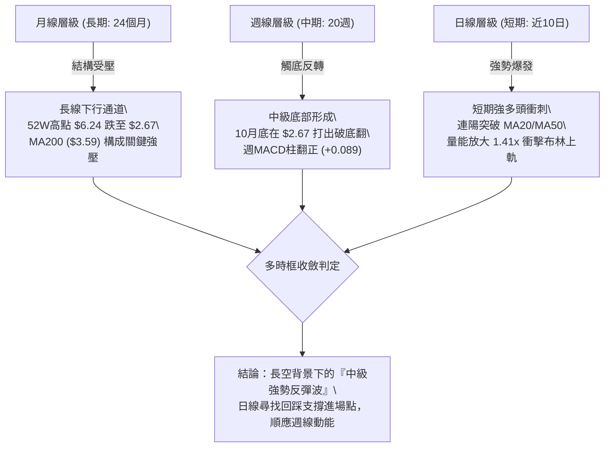
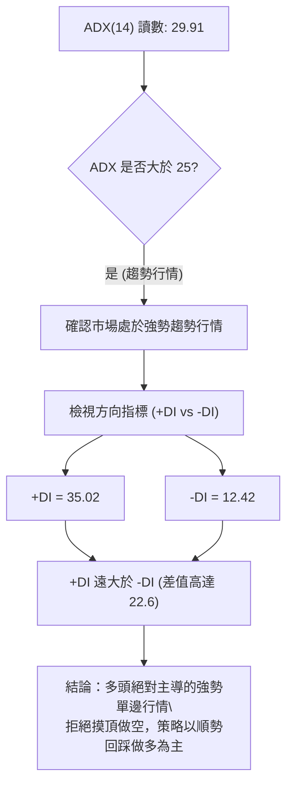
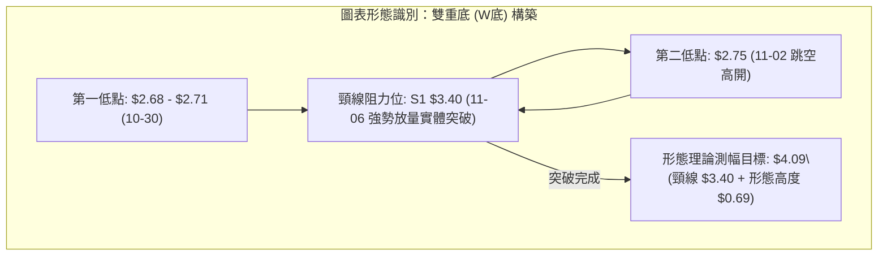
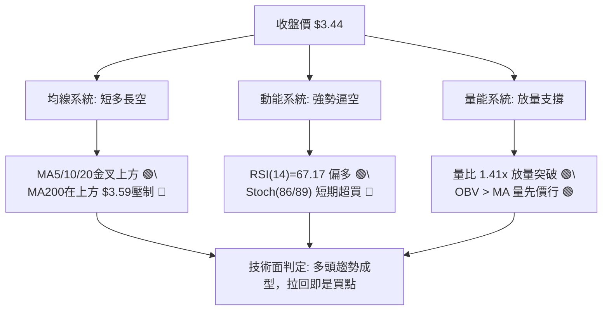
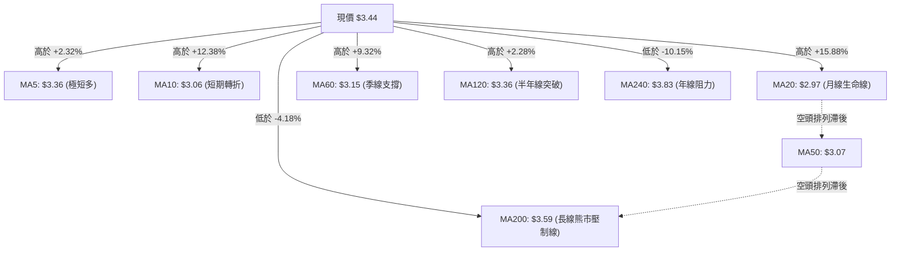
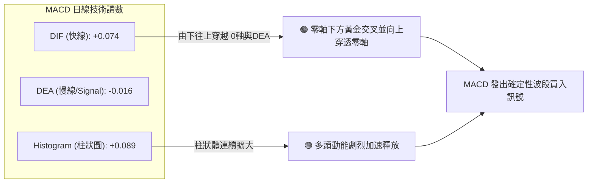
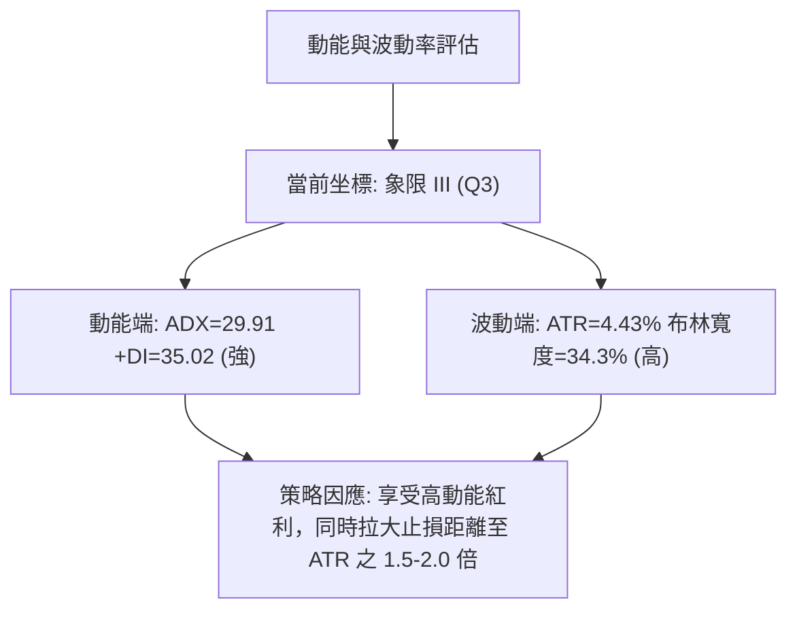
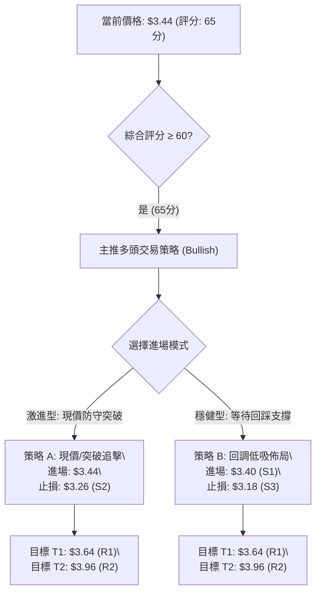
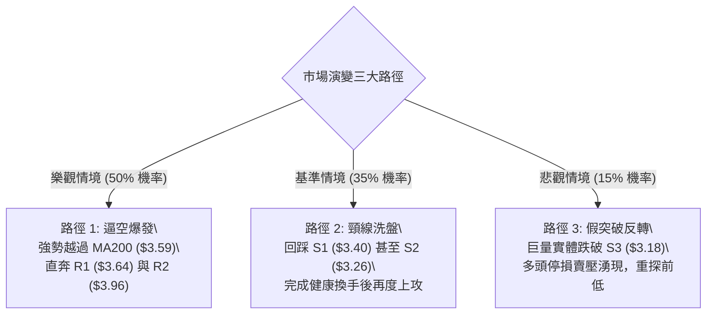

# GRAB 技術分析報告

> **報告日期**：2026-11-10 ｜ **語言**：繁體中文 ｜ **數據來源**：Yahoo Finance ｜ **當前價格**：$3.44

---

## 目錄

| 章節 | 內容 |
|------|------|
| [1. 技術面概覽](#1-技術面概覽) | 訊號儀表板、核心指標、評分卡 |
| [2. 趨勢分析](#2-趨勢分析) | 多時框趨勢、長中短期走勢 |
| [3. 圖表形態分析](#3-圖表形態分析) | 形態識別、K線組合、目標價 |
| [4. 支撐與阻力](#4-支撐與阻力) | 關鍵價位、斐波那契回調 |
| [5. 技術指標深度解讀](#5-技術指標深度解讀) | MA/RSI/MACD/布林/成交量 |
| [6. 動能與波動率](#6-動能與波動率) | 動能評估、ATR、Beta |
| [7. 多時框架總結](#7-多時框架總結) | 時框架評分矩陣 |
| [8. 交易策略建議](#8-交易策略建議) | 多空策略、風險報酬比 |
| [9. 風險提示與監控](#9-風險提示與監控) | 監控指標、風險場景 |

---

## 1. 技術面概覽

### 🎯 技術訊號儀表板



### 📊 核心指標速覽表

| 指標類別 | 指標名稱 | 當前數值 | 訊號 | 解讀 |
|----------|----------|----------|------|------|
| **價格** | 當前收盤價 | $3.44 | 🟢 | 自年內低點 $2.67 強勢反彈，短線動能強勁 |
| **均線** | MA20 | $2.97 | 🟢 | 價格遠在 MA20 之上 (+15.88%)，短期底部已確立 |
| **均線** | MA50 | $3.07 | 🟢 | 價格有效站上 MA50 中期生命線 (+12.05%) |
| **均線** | MA200 | $3.59 | 🔴 | 價格仍位於長週期熊市分水嶺下方 (-4.18%)，面臨長線壓制 |
| **動能** | RSI(14) | 67.17 | 🟡 | 進入強勢區間但未破 70，無背離，短線具備續衝動能但空間受限 |
| **動能** | MACD (12,26,9) | 0.074 / 柱狀 +0.089 | 🟢 | DIF 線上穿 DEA 線且柱狀圖顯著擴張，多頭發散 |
| **波動** | ATR(14) | $0.15 (4.43%) | 🟡 | 每日波動適中，提供明確之止損與區間交易保護 |
| **趨勢** | ADX(14) / +DI / -DI | 29.91 / 35.02 / 12.42 | 🟢 | ADX > 25 且 +DI 遠高於 -DI，形成高強度多頭單邊趨勢 |
| **通道** | 布林通道 (%B) | $3.48 上軌 / %B: 0.96 | 🔴 | 價格緊貼上軌，%B 逼近 1.00，短線面臨極限拉回壓力 |
| **量能** | 20日成交量比 | 1.41x (99.35M / 70.44M) | 🟢 | 價漲量增，突破獲得真金白銀確認，OBV > MA 支持多頭 |

### 🏆 技術評分卡

```
╔══════════════════════════════════════════════════════════════╗
║              技術評分卡 — GRAB (2026-11-10)                  ║
╠══════════════════════════════════════════════════════════════╣
║ 趨勢強度      ██████████████░░░░░░  70/100  🟢 多頭趨勢成型    ║
║ 動能指標      ████████████░░░░░░░░  60/100  🟡 強勢但近超買    ║
║ 支撐穩定度    ██████████████░░░░░░  70/100  🟢 S1/S2支撐厚實   ║
║ 成交量配合    ████████████████░░░░  80/100  🟢 價量配合極佳    ║
║ 形態完整度    ██████████████░░░░░░  70/100  🟢 雙底形態確立    ║
║ 均線排列      ████████░░░░░░░░░░░░  40/100  🔴 長線空頭仍壓制  ║
╠══════════════════════════════════════════════════════════════╣
║ 綜合評分      █████████████░░░░░░░  65/100  🟢 偏多反彈波段    ║
╚══════════════════════════════════════════════════════════════╝
```

> **評分計算依據（規則 18）**：
> 綜合評分 = (70 + 60 + 70 + 80 + 70 + 40) ÷ 6 = 390 ÷ 6 = **65 / 100**。依據策略路由規則（≥60），當前全面主推多頭交易策略。

---

## 2. 趨勢分析

### 🌐 多時框趨勢分析



### 📈 長期趨勢 — 12個月走勢圖（Unicode）

```
GRAB 月線走勢圖（過去12個月：2025-12 至 2026-11）
價格 ($)
$5.50 ┤
$5.00 ┤ ● (2025-12: $4.99)
$4.50 ┤   ● (2026-01: $4.30)
$4.00 ┤     ● (2026-02: $4.22)
$3.50 ┤       ● (03: $3.66) ─ ● (04: $3.82) ─ ● (06: $3.77) ───────────────●←現價 $3.44
$3.00 ┤           ● (05: $3.54)   ● (07: $3.50) ─ ● (08: $3.54)
$2.50 ┤                               ● (09: $3.11) ─ ● (10: $2.71 52W低點附近)
      └───────────────────────────────────────────────────────────────────────────
       12M  11M  10M   9M   8M   7M   6M   5M   4M   3M   2M   1M   當前(11M)
```

#### 走勢特徵分析表格

| 階段區間 | 時間跨度 | 起訖價位 | 漲跌幅 | 走勢特徵與結構分析 |
|----------|----------|----------|--------|--------------------|
| **長線單邊下跌** | 2025-12 至 2026-03 | $4.99 → $3.66 | -26.65% | 跌破 $4.00 整數心理關口，各期均線呈發散空頭排列 |
| **中繼平台整理** | 2026-04 至 2026-08 | $3.82 → $3.54 | -7.33% | 在 $3.50–$3.80 區間反覆震盪構築中繼箱體，成交量顯著萎縮 |
| **末跌段破底** | 2026-09 至 2026-10 | $3.54 → $2.71 | -23.45% | 空頭恐慌盤湧現，創下 52 週最低點 $2.67，技術指標全面超賣 |
| **財報爆量反彈** | 2026-11 至今 | $2.71 → $3.44 | +26.94% | 財報超預期刺激，出現連續向上大陽線，收復近兩個月失地 |

### 📊 中期趨勢（週線分析）

```
GRAB 週線壓力與支撐階梯示意圖
價格 ($)
$4.06 ──────────────────────────────── 強阻力 R3 (前期破位頸線)
$3.96 ──────────────────────────────── 阻力 R2 (8月高點區域)
$3.64 ──────────────────────────────── 關鍵阻力 R1 (7-8月震盪密集頂)
$3.59 ┄┄┄┄┄┄┄┄┄┄┄┄┄┄┄┄┄┄┄┄┄┄┄┄┄┄┄┄┄ 日線 MA200 壓制線
$3.44 ════════════════════════════════ 現價水平線 (收盤價)
$3.40 ──────────────────────────────── 近期支撐 S1 (日K平台頂轉換支撐)
$3.26 ──────────────────────────────── 次級支撐 S2 (波段回調支撐)
$3.18 ──────────────────────────────── 強支撐 S3 (MA60 / 突破起漲點)
```

週線指標在 2026-10-30 落入最低點 $2.71（RSI: 34.0, MACD柱: -0.013）後，於 2026-11-06 該週拉出週成交量達 567.8M 的放量長陽線，週收盤大漲至 $3.41（RSI 躍升至 66.3，MACD 柱翻正為 +0.087），確認中期已走出具備 V 型反轉特徵的強勢底部。

### ⚡ 趨勢強度評估（ADX 解讀）



#### ADX 強度對照表

| ADX 數值區間 | 當前數值 | 當前狀態 | 趨勢判定 | 交易策略導向 |
|--------------|----------|----------|----------|--------------|
| 0 – 20 | — | 否 | 無趨勢 / 雜亂盤整 | 觀望或高拋低吸 |
| 20 – 25 | — | 否 | 趨勢萌芽階段 | 突破掛單交易 |
| **25 – 40** | **29.91** | **✓ 是** | **強烈單邊趨勢** | **順勢拉回進場（多頭主導）** |
| 40 – 60 | — | 否 | 極強趨勢（恐面臨耗竭）| 緊盯移動止損 |
| 60 – 100 | — | 否 | 極端超買/超賣行情 | 隨時提防反轉 |

---

## 3. 圖表形態分析

### 🔍 形態識別系統



#### 圖表形態信心度評估表（依規則 15）

| 形態名稱 | 信心度 | 判斷依據（引用數據） | 完成度 | 目標價（附精確計算式） |
|----------|--------|----------------------|--------|------------------------|
| **雙重底 (W-Bottom)** | **80%** | 日K在 2026-10-30 探低點 $2.68（收 $2.71），隨後於 11-02 探底 $2.75 不破前低；頸線 $3.40 於 11-06 以收盤 $3.41 放量（567.8M 週量）突破確認。 | 85% | 由雙底形態推算：<br>形態高度 = 頸線 $3.40 - 最低點 $2.71 = $0.69<br>目標價 = 頸線 $3.40 + $0.69 = **$4.09** |
| **島嶼反轉向上跳空** | **65%** | 10-30 收 $2.71，11-02 開 $2.76，11-03 再次大幅跳空開在 $3.21，成交量由 69.38M 暴增至 153.63M，形成典型的底部消耗性缺口後向上突破。 | 90% | 由跳空旗形測幅推算：<br>旗桿高度 = $3.12 - $2.71 = $0.41<br>目標價 = 突破點 $3.36 + $0.41 = **$3.77** |
| **均線黃金交叉反轉** | **85%** | 短天期均線 MA5 ($3.36) 向上穿越 MA10 ($3.06) 與 MA20 ($2.97)；MA20 向上穿越 MA10，形成短天期金叉叢聚。 | 100% | 指標型形態，確認短線上攻通道打開，朝阻力位 R1 ($3.64) 邁進。 |

### 🕯️ 重要K線形態分析（嚴格依據規則 19 列出近10根日K與近8根週K）

#### 近10根日K形態精確拆解

| 日期（日K） | 開 | 高 | 低 | 收 | 成交量 | K線形態 | 解讀與訊號強度 |
|--------------|----|----|----|----|--------|---------|----------------|
| 2026-10-27 | 2.71 | 2.75 | 2.69 | 2.72 | 66,737,600 | 窄幅整理小陽線 | 底部量縮蓄勢，賣壓逐步枯竭 🟡 |
| 2026-10-28 | 2.73 | 2.79 | 2.71 | 2.75 | 55,245,600 | 溫和放量陽十字 | 試探上方阻力，空頭回補跡象 🟡 |
| 2026-10-29 | 2.76 | 2.78 | 2.72 | 2.76 | 50,373,300 | 高位平頭陽線 | 成交量創近期低點，變盤在即 🟡 |
| 2026-10-30 | 2.71 | 2.73 | 2.68 | 2.71 | 54,900,200 | 探底小陰線 (破底) | 創 52 週最低收盤價，但未現恐慌拋售 🔴 |
| 2026-11-02 | 2.76 | 2.93 | 2.75 | 2.86 | 69,385,700 | 光頭中陽線 (反轉確認) | 實體吞噬前三日K線，反轉確認信號 🟢 |
| 2026-11-03 | 3.21 | 3.32 | 3.08 | 3.12 | 153,625,600 | 跳空放量長陽線 (財報) | 巨量跳空大漲，突破 MA20，主力強勢進場 🟢🟢 |
| 2026-11-04 | 3.22 | 3.39 | 3.20 | 3.36 | 98,859,600 | 強勢高開實體大陽線 | 克服獲利盤賣壓，多頭趨勢延伸 🟢 |
| 2026-11-05 | 3.35 | 3.50 | 3.27 | 3.48 | 148,734,900 | 放量衝高陽線 | 巨量攻擊 $3.50 關口，買盤極其堅決 🟢 |
| 2026-11-06 | 3.44 | 3.56 | 3.37 | 3.41 | 97,197,100 | 長上影紡錘陽線 | 觸及 52 週低點反彈之關鍵斐波那契位，現獲利了結 🟡 |
| 2026-11-09 | 3.46 | 3.50 | 3.38 | 3.44 | 99,347,000 | 窄幅十字星孕線 | 處於歷史高位震盪蓄勢，成交量仍處高位 🟡 |

#### 近8根週K形態精確拆解

| 週末日期（週K） | 開 | 高 | 低 | 收 | 週成交量 | K線形態 | 解讀與訊號強度 |
|------------------|----|----|----|----|----------|---------|----------------|
| 2026-09-25 | 2.84 | 3.26 | 2.78 | 3.13 | 527,094,200 | 長下影巨量紅大陽線 | 底部恐慌盤爆發換手，主力資金進場承接 🟢 |
| 2026-10-02 | 3.10 | 3.18 | 3.07 | 3.08 | 337,148,400 | 量縮高位小陰線 | 上攻乏力，獲利盤微幅套現 🟡 |
| 2026-10-09 | 3.10 | 3.23 | 3.00 | 3.19 | 406,864,800 | 穿頭破腳振盪陽線 | 在 $3.00 整數關口獲得支撐反彈 🟢 |
| 2026-10-16 | 3.16 | 3.20 | 2.85 | 2.94 | 280,278,600 | 實體破位大陰線 | 跌破 $3.00，均線向下空頭發散 🔴 |
| 2026-10-23 | 2.93 | 2.94 | 2.77 | 2.79 | 233,692,400 | 無反抗陰線 | 量能持續退潮，市場陷入絕望割肉盤 🔴 |
| 2026-10-30 | 2.79 | 2.80 | 2.67 | 2.71 | 280,515,400 | 創低長下影探底星 | 打出 52 週最低價 $2.67 後迅速回抽，空頭衰竭 🟡 |
| 2026-11-06 | 2.76 | 3.56 | 2.75 | 3.41 | 567,802,900 | 穿頭破腳特大巨量陽棒 | 暴量拉升 +25.83%，徹底扭轉週線下行趨勢 🟢🟢 |
| 2026-11-09 | 3.46 | 3.50 | 3.38 | 3.44 | 99,347,000 | 高位窄幅小實體棒 | 延續強勢結構，企穩於頸線上方的多頭中繼 🟢 |

### 📉 ASCII 走勢形態示意圖

```
GRAB 日K線突破雙底結構示意圖
價格 ($)
$3.64 ┤                                         [阻力 R1]
$3.56 ┤                                   ╭─● (11-06 高點)
$3.48 ┤                             ╭─●─╯   │  (11-05/09 密集頂)
$3.44 ┤                             │       ●← 現價 $3.44
$3.40 ┤- - - - - - - - - - - - - - -┼ - - - 頸線突破位 (原阻力轉支撐 S1)
$3.20 ┤                      ╭──────╯ (11-03 財報跳空)
$3.00 ┤                      │
$2.86 ┤                 ╭────╯ (11-02 啟動)
$2.71 ┤  ● (10-30 第1底)  ● (11-02 第2底 $2.75)
$2.67 ┤  ╰───┴─────────────── 52W 最低點
      └────────────────────────────────────────────
        10-27  10-30  11-02  11-04  11-06  11-09
```

### 🎯 形態目標價計算

1. **雙底頸線測幅計算式**：
   - 頸線（Neckline）= 支撐位 S1 = **$3.40**
   - 底部最低收盤價（Bottom Low）= **$2.71**（2026-10-30 最低收盤價）
   - 形態垂直高度（Pattern Height）= $3.40 - $2.71 = **$0.69**
   - **理論測幅目標價（Target Price 1）** = 頸線 + 形態高度 = $3.40 + $0.69 = **$4.09**（此價位極度貼近阻力位 R3 **$4.06**，形成雙重結構共振）。
2. **阻力階梯延伸計算**：
   - 第一目標價鎖定在波段高點阻力位 **R1: $3.64**。
   - 第二目標價鎖定在阻力位 **R2: $3.96**，進一步上推至雙底理論目標價 **$4.06–$4.09** 區間。

---

## 4. 支撐與阻力

### 🗺️ 關鍵價位分布圖（Unicode）

```
GRAB 價位結構分布圖（嚴格引用 OHLCV 計算聚類值）
═══════════════════════════════════════════════════════════════
$4.06 ║██████████████████████████████║ 強阻力 R3 / 形態目標共振
$3.96 ║████████████████████          ║ 波段阻力 R2 (前波反彈高點)
$3.64 ║████████████████████████      ║ 關鍵阻力 R1 (當前首要突破關卡)
$3.59 ║░░░░░░░░░░░░░░░░░░░░░░░░      ║ MA200 牛熊分水嶺
$3.44 ╠══════════════════════════════╣ ◄ 現價 $3.44 (斐波那契 78.6%: $3.43)
$3.40 ║▓▓▓▓▓▓▓▓▓▓▓▓▓▓▓▓▓▓▓▓▓▓▓▓▓▓    ║ 即時支撐 S1 (頸線回測支撐)
$3.26 ║████████████████████          ║ 回調支撐 S2 (波段中樞)
$3.18 ║██████████████████████████████║ 強固支撐 S3 (MA60防線 / 多頭防守底線)
═══════════════════════════════════════════════════════════════
```

### 🚧 阻力位分析表

| 阻力級別 | 價位 | 形成原因（OHLCV 數據聚類） | 突破難度 | 重要性 |
|----------|------|----------------------------|----------|--------|
| **R1 (近端阻力)** | **$3.64** | 近一年波段高點聚類位，且日線 MA200 ($3.59) 橫亙於前，具密集解套賣壓 | 🟡 中等 | ★★★★☆<br>短線多頭能否展開第二浪的關鍵分界嶺 |
| **R2 (波段阻力)** | **$3.96** | 2026年7月高點（7-10 收 $3.93，最高摸至 $4.00 邊緣）之套牢成交密集區 | 🔴 較高 | ★★★★☆<br>中期波段多頭行情之目標位 |
| **R3 (強阻力位)** | **$4.06** | 近一年重要波段頭部聚類，斐波那契 61.8% ($4.03) 與雙底測幅 ($4.09) 共振區 | 🔴 極高 | ★★★★★<br>長期趨勢牛熊扭轉之天花板 |

### 🛡️ 支撐位分析表

| 支撐級別 | 價位 | 形成原因（OHLCV 數據聚類） | 守住機率 | 重要性 |
|----------|------|----------------------------|----------|--------|
| **S1 (即時支撐)** | **$3.40** | 近一年波段低點聚類，W底頸線轉換支撐，11-06 陽線實體收盤位 ($3.41) | 🟢 75% | ★★★★☆<br>短線強勢結構維持線，跌破則回踩加深 |
| **S2 (回調支撐)** | **$3.26** | 波段低點聚類位，近8週週K（09-25 高點 $3.26）的密集換手頂底轉換點 | 🟢 85% | ★★★★☆<br>健康技術性拉回之最佳低吸承接位 |
| **S3 (強固支撐)** | **$3.18** | 近一年波段低點聚類位，貼近日線 MA60 ($3.15) 與週K（10-09收 $3.19）中樞 | 🟢 95% | ★★★★★<br>本輪反彈波段之多空分水嶺，不容有失 |

### 📐 斐波那契回調位分析

> **計算基準**：以 52 週最高點 **$6.24** 至 52 週最低點 **$2.67** 計算回調位。

```
斐波那契回調階梯（52W 區間 $2.67 → $6.24）
0.0%  (52W High) ────────────────────────── $6.24
23.6%            ────────────────────────── $5.39
38.2%            ────────────────────────── $4.87
50.0%            ────────────────────────── $4.45
61.8%            ────────────────────────── $4.03 (黃金分割關鍵位，與 R3: $4.06 呼應)
78.6%            ────────────────────────── $3.43 ◄ 現價 $3.44 精確落於此處
100.0% (52W Low) ────────────────────────── $2.67
```

- **位置解讀**：
  現價 **$3.44** 正好精確卡位在 **斐波那契 78.6% ($3.43)** 之上。從技術分析角度解讀，自 52 週低點 $2.67 發動的反彈，已成功奪回深跌回調極限位（78.6% 回調線），證明當前並非弱勢抽頭，而是具備結構性反轉潛力的強力修復行情。
- **後續路徑**：
  只要日線收盤穩定站於 **$3.43**（斐波那契 78.6%）與 **S1: $3.40** 之上，下一個斐波那契目標位直指 **61.8% ($4.03)**，中間僅有阻力位 **R1 ($3.64)** 與 **R2 ($3.96)** 作為過渡階梯。

---

## 5. 技術指標深度解讀

### 🎛️ 指標訊號總覽



### 📈 移動平均線排列分析



#### 均線系統深度解析表

| 均線名稱 | 當前價位 | 現價相對距離 | 趨勢方向 | 角色定位與解讀 |
|----------|----------|--------------|----------|----------------|
| **MA5** | $3.36 | +2.32% | 向上陡峭 (▲) | 超短線極速攻擊線，回調不破 MA5 即為極強逼空架構 |
| **MA10** | $3.06 | +12.38% | 向上轉折 (▲) | 短線回調第一防禦階梯 |
| **MA20** | $2.97 | +15.88% | 向上拐頭 (▲) | 短期多空分水嶺，已自低位被快速拉起 |
| **MA50** | $3.07 | +12.05% | 走平微升 (▲) | 中期生命線，現價已成功站上，中期轉多確立 |
| **MA60** | $3.15 | +9.32% | 走平 (▲) | 季線防守位，與支撐位 S3 ($3.18) 形成重疊護城河 |
| **MA120** | $3.36 | +2.28% | 走平向上 (▲) | 突破半年線束縛，確立中期趨勢脫離底部 |
| **MA200** | $3.59 | -4.18% | 緩降 (▼) | 長期牛熊分界線，空頭排列 MA20<MA50<MA200 仍未化解 |

- **排列診斷**：
  雖然均線整體標籤仍處於大週期歷史遺留的「空頭排列（MA20 < MA50 < MA200）」，但現價已以拔地而起之姿一口氣突破 MA5、MA10、MA20、MA60 與 MA120，呈現罕見的「短期全面翻多衝刺、倒逼中長天期均線收斂金叉」的底部爆發結構。長線空頭最後一道堡壘即為 **MA200 ($3.59)**。

### 📉 RSI(14) 分析

```
RSI(14) 動能進度條：67.17 (逼近超買閾值 70)
0                  30                     50          67.17  70         100
├──────────────────┼──────────────────────┼─────────────█─────┼──────────┤
│    超賣弱勢區間   │       中性平衡區間    │    多頭強勢區間   │ 超買警戒區 │
└──────────────────┴──────────────────────┴───────────────────┴──────────┘
進度條: ████████████████████████████████░░░░░░░░░░░░░░░░ 67.17%
```

- **超買超賣判定**：
  當前 RSI(14) 讀數為 **67.17**，處於 50–70 之多頭強勢區間，但已極度逼近 70 超買警戒線。
- **背離分析**：
  根據近 20 根 K 棒的首尾比對（2026-10-16 收 $2.94，RSI: 40.5；2026-11-09 收 $3.44，RSI: 67.2），價格走出更高的高點（Higher High），RSI 亦同步走出更高的高點，**明確無頂背離或底背離**。動能與價格走勢高度同步，顯示多頭推升力量純粹且扎實，並無動能衰竭徵兆。

### 📊 MACD(12,26,9) 訊號解讀



- **交叉狀態**：
  DIF (0.074) 與 Signal (-0.016) 形成顯著開口的「黃金交叉」，DIF 已成功由負轉正跨越零軸，代表市場正式告別弱勢空頭格局，步入正向動能區。
- **柱狀圖評估**：
  柱狀圖數值達 **+0.089**，對比前幾週的負值（10-30 週末為 -0.013）大幅暴衝，多頭量能柱急劇擴張，確認當前處於初級主升推動浪階段。

### 📦 布林通道分析

```
GRAB 布林通道 (Bollinger Bands, 20日, 2倍標準差)
價格軸 ($)
$3.48 ┬─────────────────────────────────────────────── BB 上軌 ($3.48)
$3.44 ┼  ● 現價 $3.44 (位於上軌邊緣，%B = 0.96)
$3.30 ┤  │
$3.10 ┤  │
$2.97 ┼──┼──────────────────────────────────────────── BB 中軌 (MA20: $2.97)
$2.80 ┤  │
$2.60 ┤  │
$2.46 ┴──┴──────────────────────────────────────────── BB 下軌 ($2.46)
```

- **通道指標解讀**：
  - **上軌**：$3.48
  - **中軌 (MA20)**：$2.97
  - **下軌**：$2.46
  - **通道寬度 (Bandwidth)**：($3.48 - $2.46) ÷ $2.97 = **34.34%**（極度擴張）
  - **%B 指標**：**0.96**
- **走勢特徵分析**：
  %B 達到 0.96，說明股價幾乎頂住布林上軌前進，呈現典型的「沿軌逼空（Riding the Band）」走勢。當前價格觸及通道上軌邊緣（$3.48 僅距現價 1.16%），隨時可能誘發技術性獲利回吐，但只要回踩不破中軌 $2.97（極限回踩位），通道擴張均代表多頭趨勢向上展開。

### 💹 成交量分析（量價配合度）

```
成交量對比柱狀圖 (股數)
最新量 (11-09): 99.35M  █████████████████████████ (1.41x)
20日均量:       70.44M  ██████████████████
50日均量:       72.34M  ██████████████████
```

1. **量比分析**：
   最新單日成交量為 **99,347,000 股**，相較 20 日均量（70,441,110 股）放大至 **1.41 倍**。而在突破啟動日（11-03 財報公佈日），單日暴量至 153.63M（量比達 2.18x），11-05 亦衝至 148.73M，說明主力資金介入規模極大。
2. **OBV 趨勢解讀**：
   數據明確指出「OBV 趨勢：OBV > MA → 量能支撐上漲」。能量潮指標（OBV）領先突破均線向上發散，驗證了這波從 $2.71 到 $3.44 的拉升是真實的主力吸籌建倉，而非虛假的誘多拉抬。量價配合呈極度良性的「價漲量增、回調縮量」健康多頭特徵。

---

## 6. 動能與波動率

### ⚡ 動能評估四象限

| 象限標記 | 動能維度 | 波動維度 | 包含特徵 | 當前狀態評估 |
|----------|----------|----------|----------|--------------|
| **象限 I (Q1)** | **強動能** | **低波動** | 穩定單邊推升，回撤小 | 趨勢穩健期 |
| **象限 II (Q2)** | **弱動能** | **低波動** | 窄幅橫盤，交投清淡 | 黎明前蓄勢或盤整期 |
| **象限 III (Q3)** | **強動能** | **高波動** | **爆發性突破，振幅擴大** | **✓ 當前 GRAB 所處位置 (強動能 + 高波動爆發)** |
| **象限 IV (Q4)** | **弱動能** | **高波動** | 恐慌拋售，跳空重挫 | 風險極高之末跌崩潰期 |



### 📊 ATR 波動率分析

- **ATR(14) 絕對值**：**$0.15**
- **ATR 相對波動率**：佔現價之 **4.43%**（基於 Wilder 平滑法）
- **止損與波動保護機制**：
  GRAB 每日平均正常波動區間為 ±$0.15。因此：
  - **短線日內雜訊容忍度 (1.0x ATR)** = $0.15
  - **波段交易安全止損緩衝 (1.5x ATR)** = 1.5 × $0.15 = **$0.225**
  - **趨勢交易防洗盤止損緩衝 (2.0x ATR)** = 2.0 × $0.15 = **$0.30**
- 現價為 $3.44，若建立波段多頭部位，合理的止損防守位應設於現價扣除 1.5x ATR 之外（$3.44 - $0.225 = $3.215 以下），這與支撐位 **S3 ($3.18)** 形成天然的技術共振保護。

### 📐 Beta 與市場相關性

- **Beta 係數**：**0.833**
- **市場相關性解讀**：
  Beta < 1.0 表明 GRAB 對於大盤（標普 500 指數）的系統性風險敏感度相對較低（較大盤波動遲鈍約 16.7%）。此波 $2.71 至 $3.44 的 27% 暴漲並非由大盤指數帶動，而是由公司 Q3 財報獲利超預期（EBITDA 創紀錄、營收成長 27.4%）所驅動的**個股特質阿爾法（Alpha）獨立行情**。在宏觀市場波動震盪時，GRAB 具備極佳的獨立防守反彈特質。

---

## 7. 多時框架總結

### 📋 時框架評分表

| 時框架 | 趨勢方向 | 動能狀態 | 均線排列 | 形態結構 | 綜合評分 | 操作建議 |
|--------|----------|----------|----------|----------|----------|----------|
| **短期 (日線)** | 🟢 多頭向上 | 🟢 極強 (RSI 67.2) | 🟢 5/10/20金叉多頭 | 🟢 雙底突破確認 | **80 / 100** | 逢低回踩買入 |
| **中期 (週線)** | 🟢 觸底反轉 | 🟢 柱狀翻正 (+0.089) | 🟡 突破中短期均線 | 🟢 穿頭破腳大陽底 | **70 / 100** | 順勢波段做多 |
| **長期 (月線)** | 🔴 下行修復 | 🟡 低檔鈍化回升 | 🔴 MA200($3.59)壓制 | 🟡 跌深反彈測壓 | **45 / 100** | 逼近壓區適度套現 |

### 🔲 綜合訊號矩陣

```
綜合訊號矩陣跨週期校驗
┌──────────────┬──────────────┬──────────────┬──────────────┐
│  分析維度    │ 短期 (日線)  │ 中期 (週線)  │ 長期 (月線)  │
├──────────────┼──────────────┼──────────────┼──────────────┤
│ 趨勢方向     │ 🟢 多頭衝刺   │ 🟢 反轉上攻   │ 🔴 熊市修復   │
│ 動能強度     │ 🟢 ADX 29.91 │ 🟢 MACD金叉   │ 🟡 RSI低位轉向│
│ 支撐有效性   │ 🟢 S1: $3.40 │ 🟢 S2: $3.26 │ 🟢 S3: $3.18 │
│ 阻力壓制     │ 🟡 R1: $3.64 │ 🔴 R2: $3.96 │ 🔴 R3: $4.06 │
│ 量能配合     │ 🟢 放量 1.41x│ 🟢 週量爆發   │ 🟡 底部初放量 │
└──────────────┴──────────────┴──────────────┴──────────────┘
```

### ⚖️ 多時框收斂結論（依嚴格要求 14）

1. **趨勢/盤整收斂規則判定**：
   當前 **ADX(14) 讀數為 29.91**，明確觸發「趨勢行情（ADX > 25）」判定規則。+DI (35.02) 亦強勢輾壓 -DI (12.42)，確立此波並非窄幅無聊震盪，而是貨真價實的「趨勢推升行情」。
2. **時框優先級取捨**：
   依規則 14，「趨勢行情下以中長期方向為主，日線只用來尋找進場時機」。雖然月線層面仍處於歷史空頭通道末期（MA200 壓在 $3.59），但週線中級底部已以歷史級爆量（567.8M）正式宣告反轉確立。日線的高動能正是中期反轉落實到短線的強力體現。
3. **唯一方向性結論**：
   **強烈偏多（Bullish）**。整體操作以「順應中期反轉，利用日線回踩支撐位尋找黃金買點」，嚴禁在趨勢向上且 ADX 接近 30 的背景下進行任何逆勢放空交易。

---

## 8. 交易策略建議

### 🗺️ 策略決策流程圖



### 🧭 策略路由（依評分卡分流）

> **當前主策略方向 = 全面主推多頭策略（依第 1 章技術評分卡綜合評分：65 / 100，達到 ≥60 強勢多頭標準）**

本報告堅決依據數據紀律，絕不兩頭下注。所有操作點位嚴格引用第 4 章由 OHLCV 聚類計算之實際關鍵價位（R1=$3.64, R2=$3.96, R3=$4.06, S1=$3.40, S2=$3.26, S3=$3.18）。

### 🎯 價格情境階梯（Price Scenarios）

| 觸發條件 | 下一目標 | 後續延伸 | 情境含義 |
|----------|----------|----------|----------|
| **強勢突破 R1 ($3.64)** | 阻力 R2 ($3.96) | 強阻力 R3 ($4.06) | 短線克服 MA200 壓制，展開第二波暴發性主升浪 |
| **守穩現價與 S1 ($3.40)** | 測試 R1 ($3.64) | 突破 R1 ($3.64) | 雙底頸線確認轉為堅實支撐，良性換手蓄勢 |
| **跌破 S1 ($3.40)** | 支撐 S2 ($3.26) | 強支撐 S3 ($3.18) | 短線獲利盤回吐，考驗中期支撐平台（健康拉回） |
| **極端跌破 S3 ($3.18)** | 52W 低點 $2.67 | 破底風險 | 多頭防守底線潰敗，反彈行情宣告結束（止損退場） |

### 📊 情境機率分佈

| 情境類別 | 發生機率 | 主要依據（指標狀態） |
|----------|----------|----------------------|
| **延續上行 / 突破反彈** | **60%** | ADX 高達 29.91 (+DI: 35.02)、MACD 柱狀體擴大至 +0.089、量比 1.41x 且 OBV > MA |
| **強勢橫盤 / 區間震盪** | **25%** | 布林通道 %B 達 0.96 且 RSI 來到 67.17，極度逼近超買閾值，需在 $3.40–$3.48 換手 |
| **深度回落 / 跌破支撐** | **15%** | 僅在大盤爆發極端黑天鵝或日線長陰跌破 S2 ($3.26) 均線支撐時可能發生 |

### 🟢 主策略詳情（方向：主推多頭）

根據嚴格要求 17，風險報酬比精確計算式：
$\text{風險報酬比 (RRR)} = \frac{\text{目標價 T1} - \text{進場價}}{\text{進場價} - \text{止損價}}$

| 策略要素 | 策略 A（現價直接進場型） | 策略 B（拉回支撐低吸型） |
|----------|--------------------------|--------------------------|
| **進場條件** | 依現價直接進場，博弈短線逼空動能 | 待價格技術性拉回測試雙底頸線支撐企穩 |
| **進場價格** | **$3.44**（當前精確收盤價） | **$3.40**（精確回調至支撐位 S1） |
| **目標價 T1** | **$3.64**（近端阻力位 R1） | **$3.64**（近端阻力位 R1） |
| **目標價 T2** | **$3.96**（波段阻力位 R2） | **$3.96**（波段阻力位 R2） |
| **止損價格** | **$3.26**（跌破次級支撐 S2 離場） | **$3.18**（跌破強固支撐 S3 離場） |
| **風險報酬比 (以 T1 計)** | **1 : 1.11**<br>計算式：$(3.64 - 3.44) \div (3.44 - 3.26) = 0.20 \div 0.18 = 1.11$ | **1 : 1.09**<br>計算式：$(3.64 - 3.40) \div (3.40 - 3.18) = 0.24 \div 0.22 = 1.09$ |
| **風險報酬比 (以 T2 計)** | **1 : 2.89**<br>計算式：$(3.96 - 3.44) \div (3.44 - 3.26) = 0.52 \div 0.18 = 2.89$ | **1 : 2.55**<br>計算式：$(3.96 - 3.40) \div (3.40 - 3.18) = 0.56 \div 0.22 = 2.55$ |
| **成功機率** | **65%** | **75%** |
| **建議倉位** | **15%**（突破部位，靈活應變） | **25%**（核心波段部位） |

### 🔴 反向風險觸發點（對沖與風控提示）

*（注：本章主推多頭，以下非做空操作建議，僅作為多頭部位之嚴格風控與止損觸發點）*

1. **短線轉弱警戒線**：
   若日線實體陰線收盤**跌破 S1 ($3.40)**，表明短線假突破，應將策略 A 倉位減半，獲利了結保護本金。
2. **多頭主趨勢逆轉觸發點**：
   若股價放量**擊穿 S3 ($3.18)**（跌破 MA60 與前期平台），證明中級反彈波段徹底失敗，所有多頭部位必須無條件全數止損離場，並可考慮反手對沖。

### ⭐ 整體訊號強度評星

```
做多訊號強度：★★★★☆  (4/5星 — ADX>25 趨勢明確、MACD翻紅、量能充沛)
做空訊號強度：★☆☆☆☆  (1/5星 — 僅長天期均線壓制與短線超買，逆勢放空風險極高)
整體可信度：  ★★★★☆  (4/5星 — 技術形態與指標共振確認，訊號高度一致)
```

---

## 9. 風險提示與監控

### ✅ 關鍵監控指標 Checklist

```
╔══════════════════════════════════════════════════════════════════╗
║              GRAB 技術面每日關鍵監控 Checklist                  ║
╠══════════════════════════════════════════════════════════════════╣
║ [ ] 價位監控：收盤價是否持續維持在 S1 ($3.40) 雙底頸線之上？     ║
║ [ ] 阻力突破：盤中能否放量挑戰並站上 MA200 ($3.59) 及 R1 ($3.64)？║
║ [ ] 動能過熱：RSI(14) 是否突破 70 進入極度鈍化，或出現頂背離？   ║
║ [ ] 趨勢追蹤：ADX(14) 讀數是否維持在 25 以上（趨勢延續中）？     ║
║ [ ] 量能維持：單日成交量是否維持在 20日均量 (70.44M) 水平之上？   ║
║ [ ] 止損底線：任何收盤跌破 S3 ($3.18) 的動作，觸發無條件止損。    ║
╚══════════════════════════════════════════════════════════════════╝
```

### ⚠️ 風險場景分析



### 🛡️ 風險管理重要提醒

1. **倉位管理法則**：
   單一標的持倉上限建議控制在總投資組合的 **20%–25%** 以內。首次進場建議採用「分批金字塔建倉法」——現價 $3.44 先建倉 10%–15%，若有幸拉回至 S1 ($3.40) 企穩再補足剩餘 10%，嚴禁一次性全倉追高。
2. **波動防禦（ATR 實戰運用）**：
   鑑於 ATR 高達 $0.15（佔股價 4.43%），日間日內振幅劇烈，切忌將止損設置於 $0.05 這種極窄區間內，否則極易被日內隨機雜訊掃出場。應嚴格以關鍵結構位（S2: $3.26 / S3: $3.18）作為硬止損基準。
3. **空頭排列尚未完全化解之心理準備**：
   必須深刻銘記日線均線仍處於 MA20 < MA50 < MA200 之大空頭背景，MA200 ($3.59) 附近勢必爆發劇烈多空交鋒。多頭部位抵達 R1 ($3.64) 時，務必落實「提損保本」與「分批獲利了結 1/3」原則，確保戰果入袋。

---

## 📋 報告總結

```
╔══════════════════════════════════════════════════════════════════╗
║                    GRAB 技術分析報告總結                         ║
╠══════════════════════════════════════════════════════════════════╣
║ 報告日期：2026-11-10                                             ║
║ 當前價格：$3.44                                                  ║
║ 分析評級：🟢 偏多反彈（技術綜合評分：65 / 100）                  ║
║                                                                  ║
║ 關鍵結論：                                                       ║
║ ├─ 長期趨勢：🔴 弱勢修復中，空頭排列未解，但已自低點 $2.67 強彈  ║
║ ├─ 中期趨勢：🟢 週線穿頭破腳爆量反轉，MACD 柱翻正，底部確立      ║
║ ├─ 短期趨勢：🟢 日線雙底形態突破頸線，ADX=29.91 多頭趨勢強烈    ║
║ ├─ 關鍵支撐：S1: $3.40 │ S2: $3.26 │ S3: $3.18 (核心防守)       ║
║ ├─ 關鍵阻力：R1: $3.64 │ R2: $3.96 │ R3: $4.06 (目標測幅)       ║
║ └─ 斐波位階：精確站上 78.6% 回調線 ($3.43)，上行空間開啟         ║
║                                                                  ║
║ 最優策略組合：                                                   ║
║ 1. 🥇 最佳機會：回調至 S1 ($3.40) 低吸進場，目標看至 R1 ($3.64)  ║
║ 2. 🥈 次選機會：突破站穩 MA200 後加碼追擊，目標鎖定 R2 ($3.96)   ║
║ 3. 🥉 嚴格風控：收盤跌破 S3 ($3.18) 視為趨勢破位，嚴格停損      ║
╚══════════════════════════════════════════════════════════════════╝
```

---

> ⚠️ **免責聲明**：本報告為技術分析研究，所有數據、圖表及推算均嚴格基於所提供之歷史交易資訊（OHLCV）。本報告**僅供學術研究與交易思路參考**，**不構成任何要約、招攬或具體投資買賣建議**。金融市場瞬息萬變，交易具備固有虧損風險，投資者進場前應審慎評估自身風險承受能力並嚴格執行資金管理。

---

*報告生成時間：2026-11-10 ｜ 數據來源：Yahoo Finance ｜ 分析框架：多時框技術分析體系*