# GRAB 技術分析報告

> **報告日期**：2026-11-11 ｜ **語言**：繁體中文 ｜ **數據來源**：Yahoo Finance ｜ **當前價格**：$3.35

---

## 目錄

| 章節 | 內容 |
|------|------|
| [1. 技術面概覽](#1-技術面概覽) | 訊號儀表板、核心指標、評分卡 |
| [2. 趨勢分析](#2-趨勢分析) | 多時框趨勢、長中短期走勢、12個月走勢圖 |
| [3. 圖表形態分析](#3-圖表形態分析) | 形態識別、K線組合、目標價推算 |
| [4. 支撐與阻力](#4-支撐與阻力) | 關鍵價位結構、斐波那契回調 |
| [5. 技術指標深度解讀](#5-技術指標深度解讀) | MA/RSI/MACD/布林通道/成交量 |
| [6. 動能與波動率](#6-動能與波動率) | 動能評估、ATR 波動率、Beta 市場相關性 |
| [7. 多時框架總結](#7-多時框架總結) | 時框架評分矩陣、多時框收斂結論 |
| [8. 交易策略建議](#8-交易策略建議) | 策略路由、主策略詳情、風險報酬比 |
| [9. 風險提示與監控](#9-風險提示與監控) | 關鍵監控清單、情境分析、風控準則 |

---

## 1. 技術面概覽

### 🎯 技術訊號儀表板

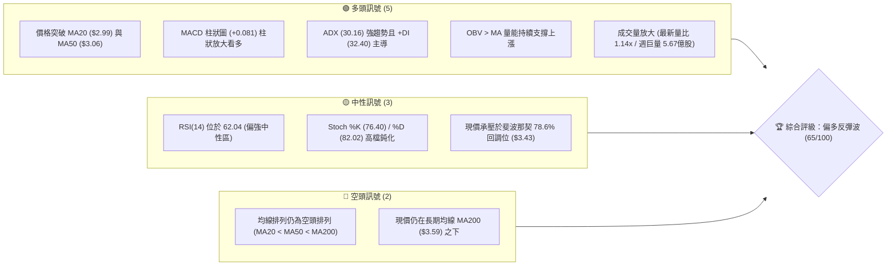

### 📊 核心指標速覽表

| 指標類別 | 指標名稱 | 當前數值 | 訊號 | 解讀 |
|:---|:---|:---|:---:|:---|
| **價格** | 當前收盤價 | $3.35 | 🟢 | 自52週低點 $2.67 強勁反彈 +25.47%，脫離底部超賣區 |
| **均線** | MA20 | $2.99 | 🟢 | 價格在 MA20 上方 +12.04%，短線呈強勢多頭支撐 |
| **均線** | MA50 | $3.06 | 🟢 | 價格在 MA50 上方 +9.48%，成功收復中期生命線 |
| **均線** | MA200 | $3.59 | 🔴 | 價格在 MA200 下方 -6.69%，長期牛熊分界線仍構成上方壓制 |
| **動能** | RSI(14) | 62.04 | 🟢 | 處於 50–70 強勢多頭擴張區，無頂背離訊號 |
| **動能** | MACD (12,26,9) | 0.085 (柱狀 +0.081) | 🟢 | DIF 線上穿訊號線 (0.004)，紅柱顯著擴張，動能充沛 |
| **趨勢** | ADX(14) / DI | 30.16 (+DI 32.40 / -DI 16.17) | 🟢 | ADX > 25 確立強勁單邊趨勢，多方主導力量絕對領先 |
| **通道** | 布林通道 (%B) | %B: 0.84 (軌道 $2.45 - $3.53) | 🟡 | 價格貼近布林上軌 ($3.53) 震盪，面臨軌道邊界技術性整固 |
| **波動** | ATR(14) | $0.15 (4.56%) | 🟡 | 每日平均波動幅度約 $0.15，提供合理的波段止損參考 |
| **量能** | OBV 與量比 | 量比 1.14x (OBV > MA) | 🟢 | 突破過程放量，量能有效確認價格漲勢，非虛假拉升 |

### 🏆 技術評分卡

```
╔══════════════════════════════════════════════════════════════════╗
║                   技術評分卡 — GRAB (2026-11-11)                 ║
╠══════════════════════════════════════════════════════════════════╣
║ 評估維度         進度條指標                   得分   狀態        ║
╟──────────────────────────────────────────────────────────────────╢
║ 趨勢強度 (ADX)   ██████████████░░░░░░         72/100 🟢 強勢趨勢 ║
║ 動能指標 (MACD)  ██████████████░░░░░░         70/100 🟢 多方擴散 ║
║ 支撐穩定度 (S1)  █████████████░░░░░░░         66/100 🟢 底部構築 ║
║ 成交量配合 (OBV) ███████████████░░░░░         74/100 🟢 放量突破 ║
║ 形態完整度 (W底) █████████████░░░░░░░         64/100 🟢 形態頸線 ║
║ 均線排列 (MA)    █████████░░░░░░░░░░░         44/100 🔴 長線空頭 ║
╠══════════════════════════════════════════════════════════════════╣
║ 綜合評分         █████████████░░░░░░░         65/100 🟢 偏多買入 ║
║ 計算說明：(72 + 70 + 66 + 74 + 64 + 44) ÷ 6 = 65.0 (取整數 65)  ║
╚══════════════════════════════════════════════════════════════════╝
```

---

## 2. 趨勢分析

### 🌐 多時框趨勢分析

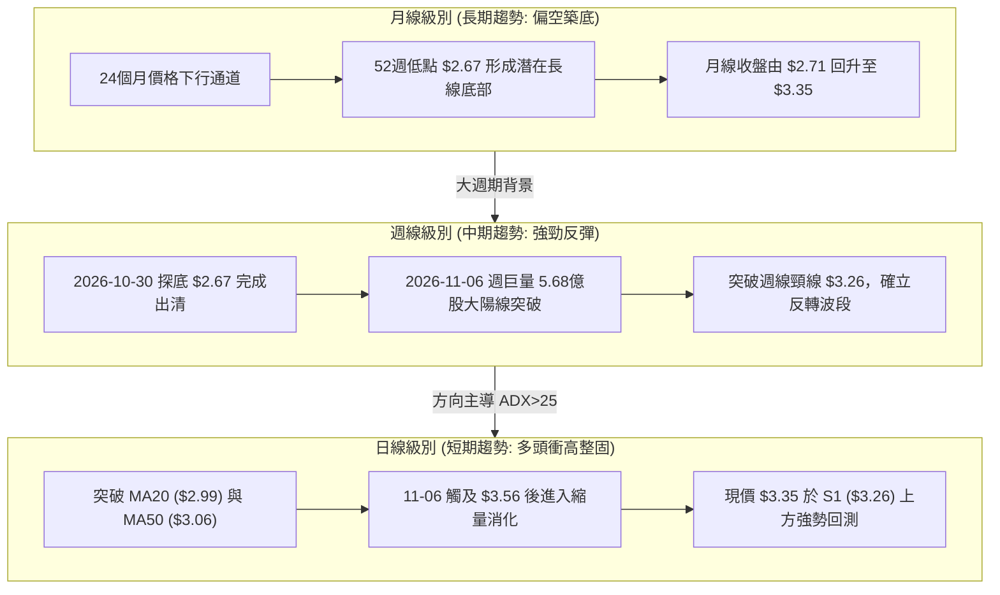

### 📈 長期趨勢 — 12個月走勢圖（Unicode）

依據真實歷史月線數據繪製，GRAB 自 2025 年 11 月至 2026 年 10 月經歷了長達一年的空頭下行，直至 2026 年 10 月在 $2.71 止跌，並於 11 月迎來顯著的放量反彈：

```
GRAB 月線走勢圖（過去12個月：2025-11 至 2026-11）
價格 ($)
$5.50 ┤ ● ($5.45)
$5.00 ┤     ● ($4.99)
$4.50 ┤         ● ($4.30)
$4.00 ┤             ● ($4.22)   ● ($3.82)   ● ($3.77)
$3.50 ┤                     ● ($3.66)   ● ($3.54)   ● ($3.50)  ● ($3.54)         ● ($3.35 現價)
$3.00 ┤                                                                 ● ($3.11)
$2.50 ┤                                                                         ● ($2.71 低點)
      └─┬───┬───┬───┬───┬───┬───┬───┬───┬───┬───┬───┬───
       11M 12M 01M 02M 03M 04M 05M 06M 07M 08M 09M 10M 11M (2026)
```

#### 走勢特徵分析表格

| 階段區間 | 時間跨度 | 起止價格 | 漲跌幅 | 走勢結構與量價特徵 |
|:---|:---|:---|:---:|:---|
| **第一階段：高位破位** | 2025-11 ~ 2026-01 | $5.45 → $4.30 | -21.10% | 跌破 $5.00 整數關卡，均線呈現加速向下發散 |
| **第二階段：震盪下行** | 2026-02 ~ 2026-08 | $4.22 → $3.54 | -16.11% | 於 $3.50–$3.80 區間反覆抵抗，但反彈高點逐級降低 |
| **第三階段：恐慌探底** | 2026-09 ~ 2026-10 | $3.54 → $2.71 | -23.45% | 加速趕底，創下 52 週最低點 $2.67，市場情緒極度悲觀 |
| **第四階段：暴力反彈** | 2026-11 至今 | $2.71 → $3.35 | +23.62% | 財報利多與 AI 基礎設施投資催化，巨量 V 型反轉展開 |

### 📊 中期趨勢（週線分析）

中期走勢圖展示了週線層面的重要壓力阻力轉換。過去 8 週中，2026-10-30 當週收在 $2.71，隨後一週（2026-11-06）爆出 **567,802,900 股** 的歷史級天量，單週實體長陽線直接貫穿 S1（$3.26），一舉將空頭波段扭轉為中期反彈結構。

```
週線支撐阻力結構示意圖
價格 ($)
$3.64 ────────────────────────────────────────── R1 阻力（近一年波段高點）
          ╭───╮ (高點 $3.56)
$3.43 ────│───│───────────────────────────────── 斐波那契 78.6% 回調壓制
          │   │      ╭───╮
$3.35 ────│───│──────│───│────────────────────── 當前價格 ($3.35)
          │   │      ╰───╯
$3.26 ────│───│───────────────────────────────── S1 關鍵支撐（原頸線阻力轉支撐）
          │   │
$3.06 ────│───│───────────────────────────────── MA50 中期生命線
          ╰───╯ (低點 $2.75)
$2.67 ────────────────────────────────────────── 52週低點 / S3 強支撐 ($2.74)
```

### ⚡ 趨勢強度評估（ADX 解讀）

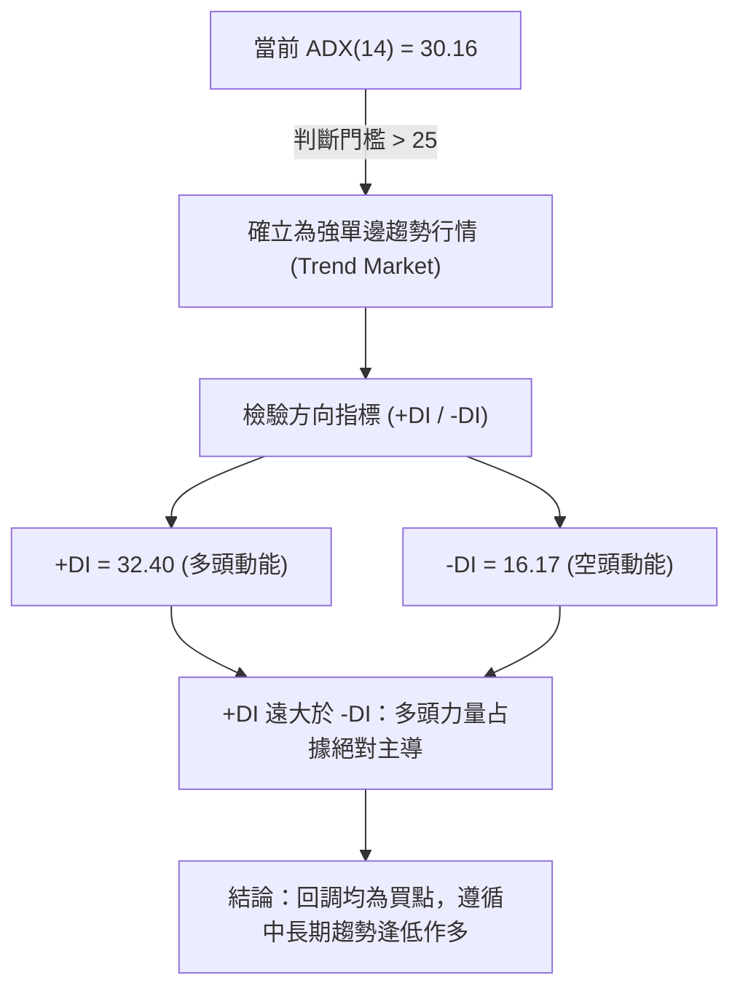

#### ADX 趨勢強度對照矩陣

| ADX 數值區間 | 當前數值 | 趨勢特徵 | 交易策略指導原則 |
|:---:|:---:|:---|:---|
| 0 – 20 | — | 無趨勢 / 震盪雜訊 | 區間震盪操作，高拋低吸 |
| 20 – 25 | — | 趨勢萌芽 / 方向未明 | 觀望或小倉位試單 |
| **25 – 40** | **30.16** | **強勁趨勢 (Strong Trend)** | **順勢交易為主，尋求支撐位拉回進場（當前狀態）** |
| 40 – 60 | — | 極強趨勢 (Very Strong) | 持股續抱，嚴設移動止盈 |
| 60 – 100 | — | 極端超買/超賣行情 | 提防趨勢耗竭與力竭反轉 |

---

## 3. 圖表形態分析

### 🔍 形態識別系統

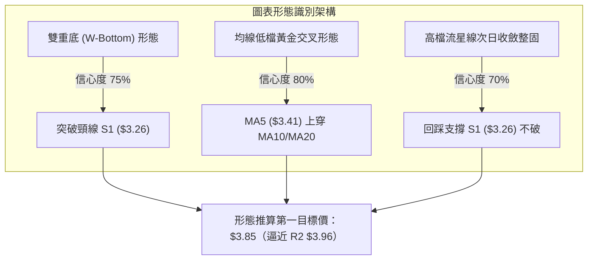

#### 形態識別信心度評估表

| 形態名稱 | 信心度 | 判斷依據（嚴格引用數據） | 完成度 | 目標價（附嚴格計算式） |
|:---|:---:|:---|:---:|:---|
| **雙重底 (W底)** | 75% | 左底 2026-09-18 週低 $2.80，右底 2026-10-30 低點 $2.67。兩度於 $2.67–$2.74（S3）獲得支撐，隨後巨量突破頸線 S1 ($3.26) | 85% | 頸線 $3.26 + 形態高度 ($3.26 − $2.67 = $0.59) = **$3.85**（由雙底形態推算，介於 R1 $3.64 與 R2 $3.96 間） |
| **均線收斂金叉** | 80% | 短期 MA5 ($3.41) 與 MA10 ($3.12) 連續向上穿越 MA20 ($2.99) 與 MA50 ($3.06)，帶動底部均線拐頭向上 | 90% | 均線向上發散牽引，目標測試長週期 MA200 壓制位 **$3.59** |
| **突破後回抽旗形** | 65% | 11-06 日K衝高 $3.56 後，近 3 個交易日窄幅縮量整理（3.44、3.35），維持在支撐位 S1 之上 | 60% | 旗桿底 $2.71 至旗頂 $3.56（高度 $0.85），旗形突破後延伸目標為 $3.35 + $0.85 = **$4.20**（數據中未偵測到該阻力，僅供幾何參考） |

### 🕯️ 重要K線形態分析

嚴格依據提供的「近10根日K」與「近8根週K」之開、高、低、收數據解讀：

| 日期與週期 | 開盤價 | 最高價 | 最低價 | 收盤價 | 成交量 | K線形態名稱 | 專業技術解讀 | 訊號強度 |
|:---|:---:|:---:|:---:|:---:|:---:|:---|:---|:---:|
| **2026-10-30 (週K)** | 2.79 | 2.80 | 2.67 | 2.71 | 280,515,400 | **長下影錘頭破底翻** | 觸及 52 週最低點 $2.67 後空頭力竭，下影線長達 $0.04，確認長線底部出清完畢 | 🟢 強烈 |
| **2026-10-30 (日K)** | 2.71 | 2.73 | 2.68 | 2.71 | 54,900,200 | **低檔十字星** | 開盤與收盤完全一致於 $2.71，多空博弈達到平衡極限，預示即將變盤反轉 | 🟢 強烈 |
| **2026-11-02 (日K)** | 2.76 | 2.93 | 2.75 | 2.86 | 69,385,700 | **底部突破陽線** | 實體高達 $0.10，收盤價突破前兩日高點，量能放大至近 7,000 萬股，確立反轉起步 | 🟢 中等 |
| **2026-11-03 (日K)** | 3.21 | 3.32 | 3.08 | 3.12 | 153,625,600 | **跳空放量假陰線** | 跳空高開於 $3.21，成交量暴增至 1.53 億股，雖收小陰，但收盤仍遠高於前日，確立多頭主升 | 🟢 強烈 |
| **2026-11-06 (週K)** | 2.76 | 3.56 | 2.75 | 3.41 | 567,802,900 | **巨量穿頭破腳大陽線** | 單週大漲 +25.83%，週成交量放大至 5.67 億股，實體覆蓋過去 6 週跌幅，反轉定海神針 | 🟢 極強 |
| **2026-11-06 (日K)** | 3.44 | 3.56 | 3.37 | 3.41 | 97,197,100 | **高檔流星線 (射擊之星)** | 衝高 $3.56 後受制於布林上軌 ($3.53)，留下 $0.15 上影線，預示短期需要消化籌碼浮額 | 🟡 中性偏空 |
| **2026-11-10 (日K)** | 3.34 | 3.39 | 3.28 | 3.35 | 82,323,787 | **縮量紡錘線** | 振幅收斂至 $0.11，成交量降至 8,232 萬股，顯示上方拋壓減弱，在 S1 ($3.26) 之上獲得強支撐 | 🟢 偏多整固 |

### 📉 ASCII 走勢形態示意圖

```
GRAB 底部 W 底與跳空突破幾何走勢
價格 ($)
$3.64 ┤                                      [R1 阻力]
$3.56 ┤                      ▲ (高點 11-06)
$3.43 ┤                     ╱ ╲  ▲ (11-09)
$3.35 ┤                    ╱   ╰─● (現價 11-10 縮量整理)
$3.26 ┤───────▲───────────╱────────────────  [頸線位 / 支撐 S1]
$3.12 ┤      ╱ ╲         ╱ (跳空放量 11-03)
$2.99 ┤     ╱   ╲       ╱                    [MA20]
$2.80 ┤    ●     ╲     ● (11-02 啟動點)
$2.71 ┤   (左底)  ╲   ╱
$2.67 ┤            ▼─● (右底 10-30 探底 52W 低點 $2.67)
      └────────────────────────────────────────
       09月下旬    10月中旬      11月上旬
```

### 🎯 形態目標價計算

依據標準圖表形態量度理論與嚴格幾何推算：
1. **頸線確認**：選取雙底中間反彈高點聚類形成的波段低點反轉壓力，對應支撐阻力轉換位 **S1 = $3.26**。
2. **形態高度**：頸線價位 ($3.26) − 形態底部極值 ($2.67) = **$0.59**。
3. **第一度量目標價**：頸線突破點 $3.26 + 形態高度 $0.59 = **$3.85**。此價位恰好介於關鍵阻力 **R1 ($3.64)** 與 **R2 ($3.96)** 之間，且接近斐波那契 61.8% 回調位 ($4.03)。
4. **回抽確認**：當前現價 $3.35 距離頸線 S1 ($3.26) 僅 +2.76%，屬於突破頸線後的健康回抽測試，若守穩 S1 不破，形態量度目標 $3.85 達成機率顯著提升。

---

## 4. 支撐與阻力

### 🗺️ 關鍵價位分布圖（Unicode）

```
╔══════════════════════════════════════════════════════════════════╗
║                     GRAB 價位結構分布圖                          ║
╠══════════════════════════════════════════════════════════════════╣
║ $4.06 ║██████████████████████████████║ 強阻力 R3 (近一年波段高點) ║
║ $3.96 ║████████████████████          ║ 關鍵阻力 R2 (反彈延伸目標)║
║ $3.64 ║████████████████████████      ║ 第一阻力 R1 (波段重要頸線)║
║ $3.59 ║──────────────────────────────║ 長期均線 MA200 壓制線     ║
║ $3.43 ║- - - - - - - - - - - - - - - ║ 斐波那契 78.6% 回調壓制位  ║
║ $3.35 ╠══════════════════════════════╣ ◄─── 當前現價 ($3.35)     ║
║ $3.26 ║▓▓▓▓▓▓▓▓▓▓▓▓▓▓▓▓▓▓▓▓▓▓▓▓      ║ 第一支撐 S1 (近期波段頂轉底)║
║ $3.18 ║▓▓▓▓▓▓▓▓▓▓▓▓▓▓                ║ 關鍵支撐 S2 (回調防守下限)║
║ $2.99 ║──────────────────────────────║ 生命線 MA20 / 布林中軌    ║
║ $2.74 ║██████████████████████████████║ 強支撐 S3 (52W區間底築底區)║
║ $2.67 ╚══════════════════════════════╝ 52週歷史最低點 (絕對止損) ║
╚══════════════════════════════════════════════════════════════════╝
```

### 🚧 阻力位分析表

所有價位嚴格引用自數據之「關鍵價位（由 OHLCV 計算）」區塊：

| 阻力級別 | 精確價位 | 距離現價漲幅 | 形成原因與籌碼特徵 | 突破難度評估 | 重要性 |
|:---|:---:|:---:|:---|:---:|:---:|
| **第一阻力 (R1)** | **$3.64** | +8.73% | 近一年波段高點密集成交區，該處套牢大量 2026 年夏季換手籌碼，且逼近 MA200 ($3.59) | 🟡 中等偏高 | ★★★★☆ |
| **第二阻力 (R2)** | **$3.96** | +18.11% | 近一年波段次高點聚類，接近 $4.00 整數心理防線與雙底量度推算終極目標位 | 🔴 較高 | ★★★★☆ |
| **第三阻力 (R3)** | **$4.06** | +21.19% | 2026 年波段頂部密集成交峰，斐波那契 61.8% ($4.03) 共振阻力帶 | 🔴 極高 | ★★★★★ |

### 🛡️ 支撐位分析表

所有價位嚴格引用自數據之「關鍵價位（由 OHLCV 計算）」區塊：

| 支撐級別 | 精確價位 | 距離現價跌幅 | 形成原因與籌碼特徵 | 守住機率評估 | 重要性 |
|:---|:---:|:---:|:---|:---:|:---:|
| **第一支撐 (S1)** | **$3.26** | -2.84% | 近一年波段低點聚類轉化之支撐，亦為近期跳空突破的頸線與平台支撐 | 🟢 80% (極高) | ★★★★★ |
| **第二支撐 (S2)** | **$3.18** | -5.07% | 2026-11-03 跳空實體 K 棒內部低點支撐區，跌破將引發回補缺口風險 | 🟢 70% (中高) | ★★★★☆ |
| **第三支撐 (S3)** | **$2.74** | -18.21% | 2026-10-28 至 10-30 築底平台的收盤價支撐聚類，52週底部的最後防線 | 🟢 90% (極固) | ★★★★★ |

### 📐 斐波那契回調位分析

依據 52 週完整波動區間（最低點 $2.67 至 最高點 $6.24）計算之黃金分割水準：

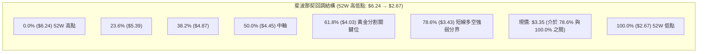

#### 斐波那契深度解讀
- **現價所處區間**：現價 **$3.35** 目前坐落於 **100.0% ($2.67)** 與 **78.6% ($3.43)** 之間。
- **上方首要天花板 ($3.43)**：斐波那契 78.6% 回調位精準壓制在 $3.43。近期高點（11-06 達 $3.56、11-09 達 $3.50）均在突破此位置後遭遇獲利回吐，顯示 $3.43 附近存在演算法與量化模型的強烈技術性平倉。
- **向下回撤緩衝**：現價距離下方 100.0% 底點 ($2.67) 具備足夠安全墊 ($0.68，空間 +25.47%)。只要價格維持在 S1 ($3.26) 上方，短線突破 78.6% ($3.43) 並向 61.8% ($4.03) 挺進的幾何路徑即保持完整。

---

## 5. 技術指標深度解讀

### 🎛️ 指標訊號總覽

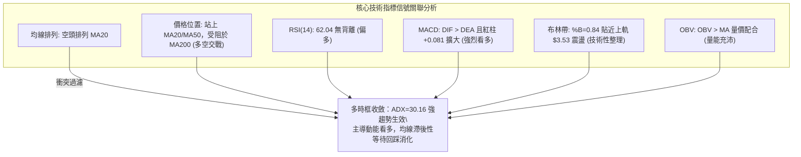

### 📈 移動平均線排列分析

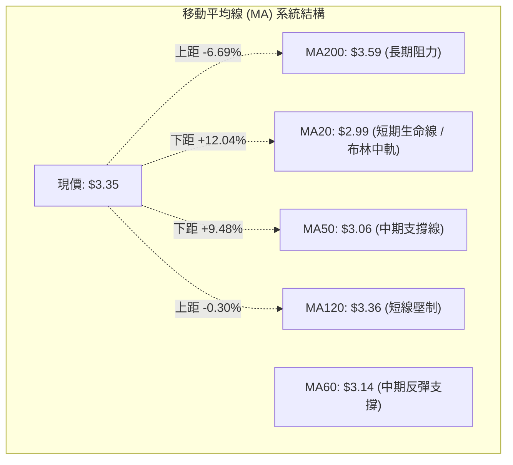

#### 移動平均線數據對比表

| 均線名稱 | 數值 | 現價與均線關係 | 均線斜率與趨勢特徵 | 訊號解讀 |
|:---|:---:|:---:|:---|:---:|
| **MA5** | $3.41 | 現價低於 -1.70% | 走勢短線鈍化，由連漲轉為微幅回調 | 🟡 短線微調 |
| **MA10** | $3.12 | 現價高於 +7.23% | 強勢向上陡峭揚升，構成極短線動能支撐 | 🟢 短線多頭 |
| **MA20** | $2.99 | 現價高於 +12.15% | 向上翻揚，與布林中軌完全重合 | 🟢 強勢多頭 |
| **MA50** | $3.06 | 現價高於 +9.48% | 開始走平並微幅抬頭，中期底部確立 | 🟢 中期轉強 |
| **MA120** | $3.36 | 現價微低 -0.35% | 與現價基本重疊，短期直接技術爭奪點 | 🟡 關鍵爭奪 |
| **MA200** | $3.59 | 現價低於 -6.69% | 緩慢向下運行，中期反彈的終極強壓阻力 | 🔴 壓制存在 |

*均線排列判定*：儘管傳統定義上 MA20 ($2.99) < MA50 ($3.06) < MA200 ($3.59) 仍處於大週期空頭排列範疇，但 MA5/MA10/MA20 已形成實質的由下而上穿透，價格已領先各週期短中均線，屬於典型的**空頭排列末期之右側暴力反彈初段**。

### 📉 RSI(14) 分析

- **當前數值**：**62.04**（採用 Wilder 平滑計算）
- **動能區間進度條**：
  ```
  0 [超賣區 <30] 30 -------- [中性區 30-70] -------- 70 [超買區 >70] 100
  ██████████████████████████████████████████████░░░░░░░░░░░░  62.04
  ```
- **區間診斷**：RSI 處於 60–65 的多頭健康擴張區間，既未進入 >70 的過熱超買危險區，亦遠離 50 多空分水嶺，表明買方動能依然充沛，具備進一步向上挑戰阻力的空間。
- **背離判斷**：比對近 20 根 K 棒價格與 RSI 方向，價格自 10 月底低點 $2.68–$2.71 抬升至 $3.35，RSI 同步自低位（週線 RSI 由 23.3/34.0 回升至 62.04/66.3），**無頂背離現象，亦無底背離失效情況**。動能與價格同向發散，上漲具備真實動能支撐。

### 📊 MACD(12,26,9) 訊號解讀

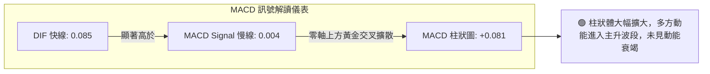

- **具體參數解讀**：DIF 數值為 **0.085**，Signal 慢線為 **0.004**，兩者均已突破零軸轉為正值；MACD 柱狀圖高達 **+0.081**，顯示短期均線相對於長期均線的發散速度極快，多頭攻勢迅猛。

### 📦 布林通道分析

```
GRAB 布林通道與現價相對位置圖（日線）
價格 ($)
$3.53 ────────────────────────────────────────── 上軌 (Upper Band)
      ╭───╮ (高點 $3.56 曾虛破上軌)
$3.35 ┼───┼───────────────────────────────────── 現價 (%B = 0.84，位於強勢通道)
      │   │
$2.99 ┼───┼───────────────────────────────────── 中軌 (Mid Band / MA20)
      │   │
$2.45 ────────────────────────────────────────── 下軌 (Lower Band)
```

- **通道參數**：上軌 **$3.53**，中軌（MA20）**$2.99**，下軌 **$2.45**，帶寬達 $1.08。
- **%B 指標分析**：目前 %B 為 **0.84**。依據布林通道標準理論：%B > 0.80 代表價格進入極端強勢區。11-06 盤中曾衝至 $3.56 突破上軌引發技術性乖離修正，當前於 $3.35 進行軌道內強勢收斂，只要不跌破中軌 $2.99，多頭通道格局不變。

### 💹 成交量分析（量價配合度）

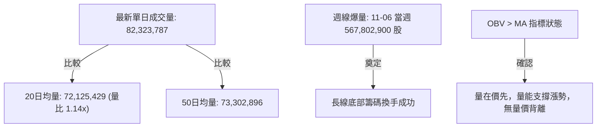

- **量價健康度確認**：
  1. 最新成交量為 82,323,787 股，相較於 20 日均量（72,125,429 股）呈現 **1.14 倍溫和放量**。
  2. 在突破過程（11-03 至 11-05）日成交量連續達到 1.53 億與 1.48 億股，而在回調整理期（11-10）量能主動萎縮至 8,232 萬股，呈現極為標準且健康的「**漲放量、跌縮量**」多頭籌碼特徵。
  3. **OBV 趨勢**：OBV 持續運行於其均線上方，明確給出「OBV > MA → 量能支撐上漲」的定性結論，排除了誘多走勢的嫌疑。

---

## 6. 動能與波動率

### ⚡ 動能評估四象限

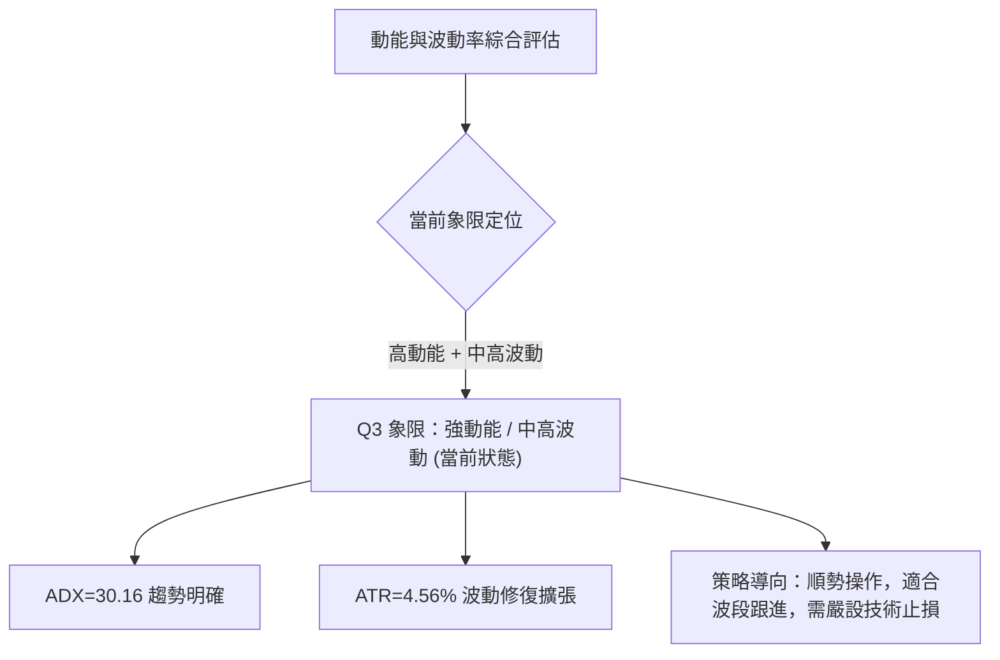

#### 動能與波動四象限對照表

| 象限代號 | 動能強度 (ADX/MACD) | 波動率水準 (ATR/Beta) | 歷史特徵描述 | 當前股票狀態 | 戰術執行建議 |
|:---:|:---:|:---:|:---|:---:|:---|
| **Q1** | 強動能 (趨勢明顯) | 低波動 (溫和爬升) | 穩定單邊牛皮走勢 | — | 最佳無憂持股機會 |
| **Q2** | 弱動能 (無方向) | 低波動 (窄幅收斂) | 底部休眠或盤整待變 | — | 謹慎觀望，等待突破 |
| **Q3** | **強動能 (多方主導)** | **中高波動 (擴張釋放)** | **爆發性反彈，波動放大** | **✓ (GRAB 當前定位)** | **順勢作多，嚴守關鍵位防守** |
| **Q4** | 弱動能 (破位下殺) | 高波動 (恐慌拋售) | 加速趕底恐慌期 | — | 絕對避免進場接飛刀 |

### 📊 ATR 波動率分析

- **ATR(14) 數值**：**$0.15**（佔股價比例為 **4.56%**，採用 Wilder 平滑計算）。
- **日內波動特徵**：每交易日典型震盪區間約在 $0.15 左右。相較於前期的低迷整固，ATR 隨著突破出現了健康放大，顯示市場參與者活躍度驟增。
- **動態止損距離設定建議**：
  - *激進短線交易*：1.0 × ATR = **$0.15**（以現價 $3.35 計算，止損位約在 $3.20，緊貼 S2 $3.18）。
  - *波段順勢交易*：1.5 × ATR = **$0.225**（以現價 $3.35 計算，止損位約在 $3.125，緊貼 MA10 與 S2 支撐）。
  - *寬鬆防守保護*：2.0 × ATR = **$0.30**（以現價 $3.35 計算，保護位在 $3.05，完全覆蓋 MA50 $3.06）。

### 📐 Beta 與市場相關性

- **Beta 係數**：**0.833**。
- **市場敏感度解讀**：Beta < 1.0，表明 GRAB 長期與大盤（S&P 500 / 納斯達克）具備正相關性，但總體系統性波動敏感度略低於市場平均水準（約大盤波動的 83%）。
- **特異性驅動特徵**：近期 GRAB 的暴漲（單週 +25.8%）顯著脫離大盤常態波動，主要受東南亞 AI 數據中心投資（與軟銀合資 18.5 億美元）及 Q3 獲利超預期之個別基本面消息驅動。在 Beta 為 0.833 的保護下，若大盤整體出現系統性拉回，該股受個別利多護航，相對抗跌性較高。

---

## 7. 多時框架總結

### 📋 時框架評分表

| 時框架 | 趨勢方向 | 動能指標 | 均線排列狀態 | 形態結構特徵 | 綜合評分 | 戰術建議 |
|:---|:---:|:---:|:---|:---|:---:|:---|
| **長期 (月線)** | 🔴 偏空築底 | 🟡 跌勢趨緩 | 空頭排列 (跌破多數長均線) | 52週低點 $2.67 顯現出清長底 | **50/100** | 長線底倉建立，不追高 |
| **中期 (週線)** | 🟢 強勢反轉 | 🟢 MACD擴散 | 站上 10週均線，挑戰 200週均線 | 巨量穿頭破腳大陽線破頸線 | **75/100** | 波段買入續抱，上看目標 |
| **短期 (日線)** | 🟢 多頭整固 | 🟢 RSI 62/無背離 | 站上 MA20/MA50，受制 MA120/200 | 突破後回抽旗形整固 | **70/100** | 逢低於支撐 S1 布局 |

### 🔲 綜合訊號矩陣

```
╔══════════════════════════════════════════════════════════════════╗
║                    多時框架技術訊號矩陣                          ║
╠════════════════════════╦══════════╦══════════╦═══════════════════╣
║ 維度項目               ║ 短期日線 ║ 中期週線 ║ 長期月線          ║
╠════════════════════════╬══════════╬══════════╬═══════════════════╣
║ 趨勢方向 (Trend)       ║  🟢 看多 ║  🟢 看多 ║  🟡 中性偏空      ║
║ 動能強度 (Momentum)    ║  🟢 充沛 ║  🟢 轉強 ║  🟡 底部收斂      ║
║ 支撐強度 (Support)     ║  🟢 S1穩 ║  🟢 巨量 ║  🟢 歷史大底      ║
║ 均線系統 (MA System)   ║  🟢 金叉 ║  🟡 轉向 ║  🔴 空頭壓制      ║
║ 成交量配合 (Volume)    ║  🟢 健康 ║  🟢 巨量 ║  🟡 溫和換手      ║
╠════════════════════════╬══════════╬══════════╬═══════════════════╣
║ 時框綜合一致性判定     ║  🟢 80%  ║  🟢 85%  ║  🟡 50%           ║
╚════════════════════════╩══════════╩══════════╩═══════════════════╝
```

### ⚖️ 多時框收斂結論

嚴格遵循本報告**多時框收斂規則（規則 14）**執行裁決：
1. **行情性質判定**：當前 ADX(14) 數值為 **30.16**，明確大於 25 臨界線，且 +DI (32.40) 遠高於 -DI (16.17)，確立當前處於**明確的多頭趨勢行情（Trend Market）**，而非無方向的盤整震盪。
2. **時框主導優先級**：依規則，趨勢行情下以**中長期方向（週線大陽線扭轉與波段底部確立）為主導**，日線級別僅用於尋找精確的進場點與防守時機。
3. **矛盾消解**：日線短期雖受阻於斐波那契 78.6% ($3.43) 與 MA120 ($3.36)，但日線回調完全處於中週期巨量陽線（11-06）的合理上半部。短期回落並非趨勢反轉，而是針對突破頸線 S1 ($3.26) 的**技術性回抽確認**。
4. **唯一方向性結論**：**全週期訊號收斂為【偏多】**。主策略鎖定「**逢回檔依託關鍵支撐 S1 作多**」，全面看好向上衝擊第一目標阻力 R1 ($3.64) 與第二目標阻力 R2 ($3.96)。

---

## 8. 交易策略建議

### 🗺️ 策略決策流程圖

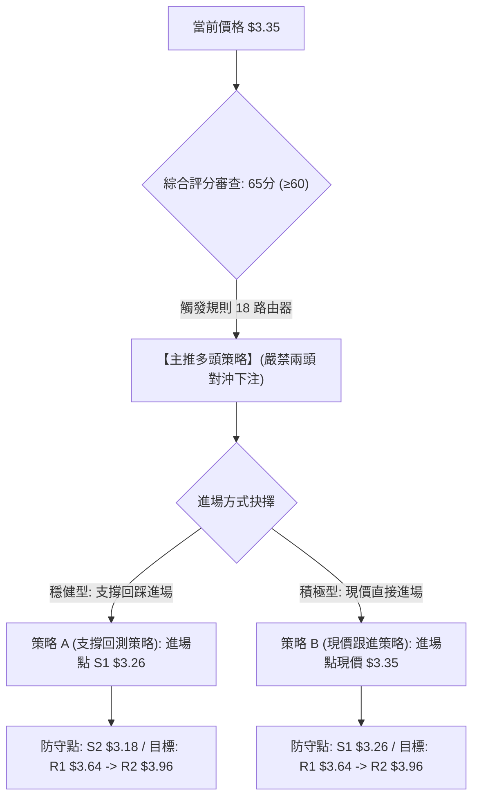

### 🧭 策略路由（依評分卡分流）

> **當前主策略方向 = 【積極做多（偏多）】（依第 1 章綜合評分 65/100，滿足 ≥60 門檻）**
> 
> 依規定，本章全方位主推多頭策略（包含現價與回踩兩套完整戰術），空頭方向僅列出「反轉風險觸發點（對沖提示）」，絕不模稜兩可。

### 🎯 價格情境階梯（Price Scenarios）

價位嚴格引用數據庫之真實數值：

| 觸發條件 | 下一目標 | 後續延伸 | 情境技術含義與市場心理 |
|:---|:---:|:---:|:---|
| **向上突破 R1 $3.64** | **R2 $3.96** | **R3 $4.06** | 徹底突破 MA200 ($3.59) 壓制，長空徹底轉長多，引發空頭踩踏與軋空行情 |
| **突破 78.6% $3.43** | **R1 $3.64** | **R2 $3.96** | 消化短期獲利盤完畢，重啟日線主升浪，直接挑戰近一年波段高點聚類 |
| **站穩現價區間 $3.35** | **$3.43** | **R1 $3.64** | 在 S1 ($3.26) 之上橫盤換手蓄勢，指標完成高檔鈍化修復 |
| **跌破 S1 $3.26** | **S2 $3.18** | **MA20 $2.99** | 短線假突破警訊，回測跳空起漲點尋求二次支撐 |
| **跌破 S2 $3.18** | **S3 $2.74** | **$2.67** | 突破架構完全破壞，反彈行情宣告夭折，重回底部考驗 |

### 📊 情境機率分佈

| 預期情境走向 | 發生機率 | 主要技術與數據依據 |
|:---|:---:|:---|
| **繼續上行 / 突破衝高** | **60%** | MACD 紅柱高達 +0.081 持續擴大；ADX=30.16 強趨勢生效且 +DI (32.40) 主導；OBV 指標明確指示「OBV > MA」量能充沛支持漲勢。 |
| **區間強勢震盪** | **25%** | 布林 %B 目前為 0.84，接近上軌 $3.53；斐波那契 78.6% ($3.43) 與 MA120 ($3.36) 帶來短線獲利盤消化需求。 |
| **轉弱回落 / 再探前底** | **15%** | MA200 ($3.59) 仍維持下行斜率；長週期均線仍處空頭排列，若遭遇黑天鵝可能引發避險賣壓。 |

### 🟢 主策略詳情（方向依上方路由）

所有價位均取自數據庫計算數值，風險報酬比嚴格按公式 $(T1 − 進場價) ÷ (進場價 − 止損價)$ 計算：

| 策略要素 | 策略 A（穩健型：回踩支撐進場） | 策略 B（積極型：現價直接布局） |
|:---|:---|:---|
| **交易邏輯** | 等待價格回抽測試第一支撐 S1，確認支撐有效後介入 | 依託當前整固平台，直接以現價進場卡位主升浪突破 |
| **進場價格** | **$3.26** (回測 S1 支撐位) | **$3.35** (當前市價) |
| **止損價格** | **$3.18** (跌破 S2 關鍵支撐止損) | **$3.26** (跌破 S1 第一支撐止損) |
| **目標價 T1** | **$3.64** (關鍵阻力 R1) | **$3.64** (關鍵阻力 R1) |
| **目標價 T2** | **$3.96** (關鍵阻力 R2) | **$3.96** (關鍵阻力 R2) |
| **每股風險 / 潛在回報 (T1)** | 風險 $0.08 / 回報 $0.38 | 風險 $0.09 / 回報 $0.29 |
| **風險報酬比 (以 T1 計)** | **1 : 4.75（以 T1 計）**<br>計算式：$(3.64 − 3.26) ÷ (3.26 − 3.18) = 0.38 ÷ 0.08$ | **1 : 3.22（以 T1 計）**<br>計算式：$(3.64 − 3.35) ÷ (3.35 − 3.26) = 0.29 ÷ 0.09$ |
| **風險報酬比 (以 T2 計)** | **1 : 8.75（以 T2 計）**<br>計算式：$(3.96 − 3.26) ÷ 0.08 = 0.70 ÷ 0.08$ | **1 : 6.78（以 T2 計）**<br>計算式：$(3.96 − 3.35) ÷ 0.09 = 0.61 ÷ 0.09$ |
| **策略成功機率預估** | 65% | 60% |
| **建議配置倉位** | 總資產之 **15% – 20%** | 總資產之 **10% – 12%** |

### 🔴 反向風險觸發點（對沖提示）

非主動做空策略，僅供持股多頭作為風控止損與避險之參考依據：
- **第一警訊（減倉點）**：日線收盤價跌破 **S1 ($3.26)**，意味著突破頸線失敗，應主動調降 50% 多頭倉位。
- **翻空訊號（清倉點）**：若價格以大陰線跌破 **S2 ($3.18)**，且 MACD 柱狀圖由紅翻綠，代表多頭反轉結構徹底被推翻，多頭部位應全數無條件止損離場，空手觀望。

### ⭐ 整體訊號強度評星

```
做多訊號強度：★★★★☆  (4/5星 — 底部爆量大陽線，MACD與ADX強烈共振看多)
做空訊號強度：★☆☆☆☆  (1/5星 — 空頭動能衰退，僅剩長期均線空頭排列壓制)
整體可信度：  ★★★★☆  (4/5星 — 量價配合極佳，多時框架收斂一致)
```

---

## 9. 風險提示與監控

### ✅ 關鍵監控指標 Checklist

```
╔══════════════════════════════════════════════════════════════════╗
║                   關鍵技術指標每日監控 Checklist                 ║
╠══════════════════════════════════════════════════════════════════╣
║ [ ] 價格防守線：日線收盤價是否嚴格維持在 S1 ($3.26) 之上？       ║
║ [ ] 突破確認線：盤中是否帶量站穩斐波那契 78.6% ($3.43)？         ║
║ [ ] 動能警訊：MACD 柱狀圖是否持續維持在正值區 (+0.081 以上)？   ║
║ [ ] 趨勢指標：ADX(14) 是否持續高於 25 且 +DI 維持在 -DI 之上？  ║
║ [ ] 乖離監控：RSI(14) 是否在未突破 R1 ($3.64) 前急拉至 >75 超買？║
║ [ ] 量能異動：單日成交量是否異常萎縮至 5,000 萬股以下（動能衰竭）║
║ [ ] 均線動態：短線 MA5 ($3.41) 是否能迅速被現價反超修復？       ║
╚══════════════════════════════════════════════════════════════════╝
```

### ⚠️ 風險場景分析

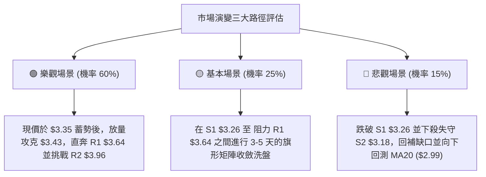

### 🛡️ 風險管理重要提醒

1. **嚴禁於阻力位盲目追高**：現價上方即為斐波那契 78.6% 壓制點 **$3.43** 及 MA120 **$3.36**，切忌在單日急拉長陽線當下進場，應遵循「回抽關鍵支撐 S1 ($3.26) 不破」之右側掛單原則。
2. **單筆交易最大虧損限制**：依據 ATR 為 $0.15 評估，每筆交易的設定止損額度不得超過個人總投資帳戶淨值的 **1.5% – 2.0%**。若採用策略 A（風險 $0.08），倉位配置可適度提高；若採用策略 B（風險 $0.09），則需嚴格控制首單規模。
3. **動態移動止盈鎖定利潤**：當股價順利觸及第一目標 **R1 ($3.64)** 時，應強制執行至少 **50% 倉位獲利了結**，同時將剩餘倉位的止損點上移至進場保本點（策略 A 上移至 $3.26，策略 B 上移至 $3.35），確保該筆交易在最壞情況下實現「零虧損」。

---

## 📋 報告總結

```
╔══════════════════════════════════════════════════════════════════╗
║                   GRAB 技術分析報告總結                          ║
╠══════════════════════════════════════════════════════════════════╣
║ 報告日期：2026-11-11                                             ║
║ 當前價格：$3.35                                                  ║
║ 分析評級：🟢 偏多買入 (綜合技術評分：65 / 100)                    ║
╟──────────────────────────────────────────────────────────────────╢
║ 關鍵結論：                                                       ║
║ ├─ 長期趨勢：🟡 偏空築底已現曙光 (52W 低點 $2.67 形成扎實大底)   ║
║ ├─ 中期趨勢：🟢 週線巨量突破大陽線，確立波段反轉上攻結構         ║
║ ├─ 短期趨勢：🟢 站穩 MA20 與 MA50，於 S1 頸線上方進行強勢整固    ║
║ ├─ 關鍵支撐：S1 $3.26 (極強) ｜ S2 $3.18 (防守) ｜ S3 $2.74 (底) ║
║ ├─ 關鍵阻力：R1 $3.64 (短標) ｜ R2 $3.96 (中標) ｜ R3 $4.06 (強) ║
║ └─ 分析師目標：華爾街平均目標價 $5.42 (最低 $4.00 / 最高 $7.00)  ║
╟──────────────────────────────────────────────────────────────────╢
║ 最優策略組合：                                                   ║
║ 1. 🥇 最佳機會：策略 A (回踩 S1 $3.26 進場，風報比 1 : 4.75)     ║
║ 2. 🥈 次選機會：策略 B (現價 $3.35 布局，風報比 1 : 3.22)        ║
║ 3. 🥉 保守選擇：等待帶量突破 R1 $3.64 並回抽確認後順勢追買       ║
╚══════════════════════════════════════════════════════════════════╝
```

---

> ⚠️ **免責聲明**：本報告為 AI 自動生成之專業技術分析，所有數據及推算均嚴格基於所提供之歷史價格與市場資訊。本報告**僅供研究與學術參考**，**不構成任何形式的要約、招攬或具體投資建議**。金融市場瞬息萬變，投資有風險，入市操作需具備獨立思考與嚴謹的風險控制意識。

---

*報告生成時間：2026-11-11 ｜ 數據來源：Yahoo Finance ｜ 分析框架：多時框架技術分析與量化動能模型*