# GRAB 技術分析報告

> **報告日期**：2026-11-12 ｜ **語言**：繁體中文 ｜ **數據來源**：Yahoo Finance ｜ **當前價格**：$3.33

---

## 目錄

| 章節 | 內容 |
|------|------|
| [1. 技術面概覽](#1-技術面概覽) | 訊號儀表板、核心指標、評分卡 |
| [2. 趨勢分析](#2-趨勢分析) | 多時框趨勢、長中短期走勢、ADX解讀 |
| [3. 圖表形態分析](#3-圖表形態分析) | 形態識別、K線組合、目標價推算 |
| [4. 支撐與阻力](#4-支撐與阻力) | 關鍵價位、斐波那契回調結構 |
| [5. 技術指標深度解讀](#5-技術指標深度解讀) | MA/RSI/MACD/布林/成交量量價關係 |
| [6. 動能與波動率](#6-動能與波動率) | 動能評估、ATR波動區間、Beta特徵 |
| [7. 多時框架總結](#7-多時框架總結) | 時框架評分矩陣與信號收斂結論 |
| [8. 交易策略建議](#8-交易策略建議) | 策略路由、主策略執行、風險報酬比 |
| [9. 風險提示與監控](#9-風險提示與監控) | 監控清單、極端情景、風控管理機制 |

---

## 1. 技術面概覽

### 🎯 技術訊號儀表板

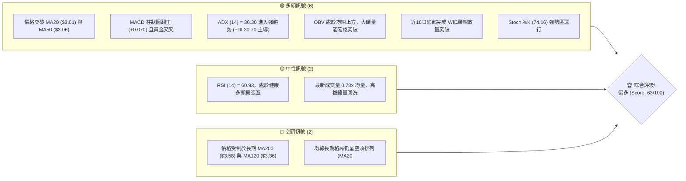

### 📊 核心指標速覽表

| 指標類別 | 指標名稱 | 當前數值 | 訊號 | 解讀 |
|:---|:---|:---|:---:|:---|
| **價格** | 當前收盤價 | $3.33 | 🟢 | 自52週低點 $2.67 強勁反彈達 +24.72%，站穩短均上方 |
| **均線** | MA20 (月線) | $3.01 | 🟢 | 現價高於 MA20 達 +10.70%，短期生命線強力支撐 |
| **均線** | MA50 (季線) | $3.06 | 🟢 | 現價向上突破中期均線，短中期趨勢反轉向上 |
| **均線** | MA200 (年線) | $3.58 | 🔴 | 現價低於 MA200 約 -6.98%，長線下降壓力尚未完全化解 |
| **動能** | RSI(14) | 60.93 | 🟡 | 位於 50–70 強勢擴張區間，無超買現象亦無背離 |
| **動能** | MACD (12,26,9) | 0.091 / Sig: 0.022 | 🟢 | 雙線位於零軸上方，柱狀圖 +0.070 呈多頭擴散態勢 |
| **趨勢** | ADX (14) | 30.30 | 🟢 | 趨勢強度指標突破 25，多頭方向 (+DI: 30.70) 占絕對主導 |
| **通道** | Bollinger %B | 0.79 | 🟢 | 位於布林通道中上軌之間 ($3.01–$3.57)，多頭推升通道開啟 |
| **波動** | ATR(14) | $0.15 (4.50%) | 🟡 | 每日正常波動空間為 $0.15，波動率適中且利於風控設定 |
| **成交量** | Volume / 20MA | 56.14M / 71.79M | 🟡 | 量比 0.78x，衝高後出現技術性量縮回檔整固 |

### 🏆 技術評分卡

```
╔══════════════════════════════════════════════════════════════╗
║                技術評分卡 — GRAB (2026-11-12)                ║
╠══════════════════════════════════════════════════════════════╣
║ 趨勢強度 (Trend)      █████████████░░░░░░░  65/100  🟢 看多  ║
║ 動能指標 (Momentum)    ██████████████░░░░░░  70/100  🟢 看多  ║
║ 支撐穩定度 (Support)  █████████████░░░░░░░  68/100  🟢 穩固  ║
║ 成交量配合 (Volume)   ████████████░░░░░░░░  64/100  🟢 配合  ║
║ 形態完整度 (Pattern)  █████████████░░░░░░░  67/100  🟢 良好  ║
║ 均線排列 (MA System)  ████████░░░░░░░░░░░░  44/100  🟡 中性  ║
╠══════════════════════════════════════════════════════════════╣
║ 綜合評分 (Overall)    █████████████░░░░░░░  63/100  🟢 偏多  ║
║ 評分公式：(65 + 70 + 68 + 64 + 67 + 44) ÷ 6 = 63.0 (四捨五入) ║
╚══════════════════════════════════════════════════════════════╝
```

---

## 2. 趨勢分析

### 🌐 多時框趨勢分析

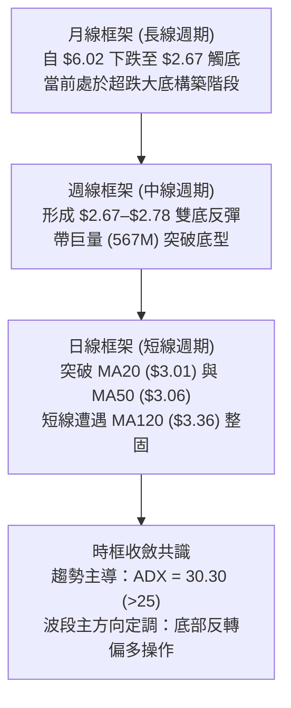

### 📈 長期趨勢 — 12個月走勢圖（Unicode）

GRAB 過去 12 個月經歷了自 2025 年末高點以來的長週期估值修正，隨後在 2026 年 10 月於 $2.67–$2.71 構築了決定性的中期底部。

```
GRAB 月線收盤走勢圖（過去12個月：2025-12 至 2026-11）
價格軸 ($)
$5.45 ┤● (2025-11 高檔波段頂部)
$4.99 ┤ ＼
$4.30 ┤   ●
$3.82 ┤     ＼      ●(04)  ●(06)
$3.54 ┤       ＼   ／ ＼  ／ ＼
$3.33 ┤─────────●(03)──●(05)──●(07)────────●← 當前現價 ($3.33)
$3.11 ┤                              ＼    ／
$2.71 ┤                                ●(10 底部)
      └────────────────────────────────────────────────────────
       12  01  02  03  04  05  06  07  08  09  10  11 (月份)
```

#### 長期走勢特徵分析表格

| 階段區間 | 起訖月份 | 起訖價格 ($) | 漲跌幅 (%) | 趨勢性質與結構特徵 |
|:---|:---:|:---:|:---:|:---|
| **高檔回落段** | 2025-11 → 2026-03 | 5.45 → 3.66 | -32.84% | 機構資金撤離，跌破均線支撐，呈現階梯式下行 |
| **中繼整理段** | 2026-03 → 2026-08 | 3.66 → 3.54 | -3.28% | 於 $3.50–$3.82 區間橫向拉鋸，成交量逐步萎縮 |
| **終極加速趕底** | 2026-08 → 2026-10 | 3.54 → 2.71 | -23.45% | 跌破前低加速恐慌下殺，於 2026-10-30 創 52W 低點 $2.67 |
| **放量初升反轉** | 2026-10 → 2026-11 | 2.71 → 3.33 | +22.88% | 單週湧現 5.67 億股歷史天量，大實體陽線展開 V 型逆轉 |

### 📊 中期趨勢（週線分析）

中期走勢圖展示了週線層級從恐慌拋售到底部確立的動態支撐與阻力結構：

```
GRAB 週線關鍵架構示意圖（2026年9月至11月）
 $3.64 ───┬──────────────────────────────────────────── [阻力位 R1]
          │                               ╭─── 最高點 $3.56
 $3.33 ───┼───────────────────────────────● 現價 ($3.33)
          │                      ╭────────╯
 $3.18 ───┼──────────● 頸線位 ───╯             [支撐位 S2 / MA10]
          │         ／ ＼
 $2.74 ───┼──●─────╯     ＼──────●             [雙底支撐 S3]
          │  W底左腳 $2.78       W底右腳 $2.67
          └────────────────────────────────────────────
             09-25      10-09    10-30    11-06    11-11
```

- **週線底部成形**：在 2026-09-25 當週觸及低點 $2.78（收盤 $3.13），隨後在 2026-10-30 當週二度探底至 52W 最低點 $2.67（收盤 $2.71），構成標準「雙重底（W底）」結構。
- **天量突破**：在 2026-11-06 當週，週成交量暴增至 567,802,900 股，週長紅 K 實體大漲 +25.83%，週線收盤強勢站上頸線位 $3.19。

### ⚡ 趨勢強度評估（ADX 解讀）

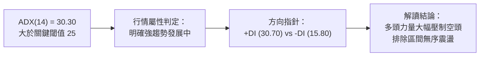

#### ADX 趨勢強度對照表

| 指標名稱 | 當前數值 | 參考標準區間 | 趨勢狀態判定 | 操作策略指導意義 |
|:---|:---:|:---:|:---:|:---|
| **ADX(14)** | **30.30** | > 25.0 (強趨勢閾值) | 🟢 強趨勢行情確立 | 順應趨勢進行突破或回踩操作，不宜逆勢摸頂放空 |
| **+DI(14)** | **30.70** | > 25.0 (強多頭界限) | 🟢 多方動能極強 | 買盤積極介入，推升力道強勁 |
| **-DI(14)** | **15.80** | < 20.0 (空方衰退界限) | 🟢 空方力量潰縮 | 空方主動拋盤動能耗竭，回檔空間受限 |
| **DI差值 (+DI - -DI)**| **+14.90**| > 0 且持續發散 | 🟢 多頭主導格局 | 多方佔據主動權，拉回皆為買點佈局時機 |

---

## 3. 圖表形態分析

### 🔍 形態識別系統

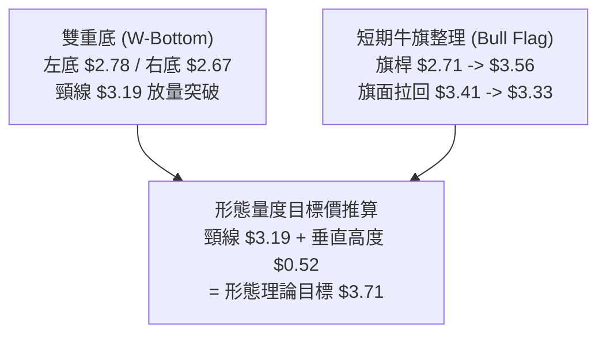

#### 圖表形態信心度評估表（依規則 15）

| 形態名稱 | 信心度 (%) | 判斷依據（嚴格引用歷史數據） | 形態完成度 | 形態目標價計算式 |
|:---|:---:|:---|:---:|:---|
| **雙重底 (W-Bottom)** | **85%** | 兩次低點分別落於 2026-09-25（低點 $2.78）與 2026-10-30（低點 $2.67），頸線為 2026-10-09 波段高點 $3.23（收盤 $3.19）。2026-11-06 週K放量突破頸線。 | 90% (已突破頸線，目前進行突破後回踩確認) | 頸線收盤價 $3.19 + (頸線 $3.19 − 最低點 $2.67) = $3.19 + $0.52 = **$3.71**（接近阻力位 R1 $3.64 與 MA200 $3.58 聚類區） |
| **日線牛旗整理 (Bull Flag)** | **70%** | 旗桿為 2026-11-02 低點 $2.75 暴衝至 2026-11-06 高點 $3.56；旗面為近4日收盤 $3.41 → $3.44 → $3.35 → $3.33 縮量微跌整理。 | 60% (整理末端，等待再次向上噴出) | 突破點 $3.33 + 旗桿高度 ($3.56 − $2.75 = $0.81) = **$4.14**（接近強阻力 R3 $4.06） |

### 🕯️ 重要 K 線形態分析

嚴格依據所提供之「近10根日K」與「近8根週K」四價數據進行專業燭體幾何分析：

#### 近 10 根日 K 線形態解讀表

| 日期 | 開盤價 ($) | 最高價 ($) | 最低價 ($) | 收盤價 ($) | 成交量 (股) | 識別 K 線形態 | 專業解讀與市場意涵 | 訊號強度 |
|:---:|:---:|:---:|:---:|:---:|:---:|:---|:---|:---:|
| 2026-10-29 | 2.76 | 2.78 | 2.72 | 2.76 | 50,373,300 | 窄幅十字星 (Doji) | 下跌尾聲多空拉鋸，成交量低迷，變盤前兆 | 🟡 中性 |
| 2026-10-30 | 2.71 | 2.73 | 2.68 | 2.71 | 54,900,200 | 探底小陰線 | 創 52W 低點 $2.67 附近之極端低位，賣壓已竭 | 🟡 觀望 |
| 2026-11-02 | 2.76 | 2.93 | 2.75 | 2.86 | 69,385,700 | 轉折中陽線 | 底部放量啟動，實體穿透前兩日高點，買盤湧入 | 🟢 看多 |
| 2026-11-03 | 3.21 | 3.32 | 3.08 | 3.12 | 153,625,600 | 跳空放量長長上影陽線 | 巨大跳空缺口 ($2.86→$3.21)，量能爆衝至 1.53 億，主力強勢掃盤 | 🟢 強多 |
| 2026-11-04 | 3.22 | 3.39 | 3.20 | 3.36 | 98,859,600 | 強勢吞噬中長陽 | 站穩 $3.20 支撐，實體飽滿收復前一日高檔陰霾 | 🟢 看多 |
| 2026-11-05 | 3.35 | 3.50 | 3.27 | 3.48 | 148,734,900 | 突破中長陽線 | 連續推升突破 MA20 與 MA50，成交量再度放大至 1.48 億 | 🟢 看多 |
| 2026-11-06 | 3.44 | 3.56 | 3.37 | 3.41 | 97,197,100 | 高位射擊之星變體 | 觸及波段高點 $3.56 後遇 MA200 阻力回落，帶上影線 | 🟡 警示 |
| 2026-11-09 | 3.46 | 3.50 | 3.38 | 3.44 | 99,385,000 | 高檔十字星/陀螺頂 | 於 $3.44 高位進行換手整固，多空力量再度平衡 | 🟡 中性 |
| 2026-11-10 | 3.34 | 3.39 | 3.28 | 3.35 | 82,364,500 | 縮量小陰線 | 主動性拉回測試 S1 ($3.26) 支撐，成交量縮減 | 🟢 良性 |
| 2026-11-11 | 3.32 | 3.38 | 3.27 | 3.33 | 56,136,900 | 縮量下影小陰線 | 最低 $3.27 完美踩住 S1 ($3.26) 獲買盤承接，量能萎縮至 56M | 🟢 止跌 |

#### 近 8 根週 K 線形態解讀表

| 週結日期 | 開盤價 ($) | 最高價 ($) | 最低價 ($) | 收盤價 ($) | 週成交量 (股) | 識別 K 線形態 | 專業解讀與市場意涵 | 訊號強度 |
|:---:|:---:|:---:|:---:|:---:|:---:|:---|:---|:---:|
| 2026-09-25 | 2.84 | 3.26 | 2.78 | 3.13 | 527,094,200 | 長下影帶量長陽 (第一底) | 創波段低點 $2.78 後獲 5.27 億天量爆發式抄底承接 | 🟢 看多 |
| 2026-10-02 | 3.10 | 3.18 | 3.07 | 3.08 | 337,148,400 | 窄幅整理小陰十字 | 暴量後的中繼沉澱，維持於 $3.08 之上整固 | 🟡 中性 |
| 2026-10-09 | 3.10 | 3.23 | 3.00 | 3.19 | 406,864,800 | 頸線試探小陽線 | 向上試探頸線 $3.23 壓力，形成 W底中間頸線波峰 | 🟡 震盪 |
| 2026-10-16 | 3.16 | 3.20 | 2.85 | 2.94 | 280,278,600 | 轉折下挫中陰線 | 二度回測尋底，跌破整數關口 $3.00 | 🔴 偏空 |
| 2026-10-23 | 2.93 | 2.94 | 2.77 | 2.79 | 233,692,400 | 連續下跌小陰線 | 縮量逼近前低 $2.78，市場情緒陷入悲觀恐慌 | 🔴 偏空 |
| 2026-10-30 | 2.79 | 2.80 | 2.67 | 2.71 | 280,515,400 | 極限打底錘頭變體 (第二底)| 跌破前低創 $2.67 後獲吸籌，收在 $2.71，構築雙底右腳 | 🟢 觸底 |
| 2026-11-06 | 2.76 | 3.56 | 2.75 | 3.41 | 567,802,900 | 爆量突破超級大陽線 | 湧現 5.67 億歷史罕見巨量，大漲 +25.83%，一舉穿透頸線 | 🟢 極強 |
| 2026-11-11 | 3.46 | 3.50 | 3.27 | 3.33 | 237,886,400 | 週線回踩確認小陰線 | 突破後的正常技術性確認回測，守住頸線之上 | 🟢 蓄勢 |

### 📉 ASCII 走勢形態示意圖

```
GRAB 雙重底 (W-Bottom) 與頸線突破示意圖
價格軸 ($)
$3.64 ┤                                         [R1 阻力位]
$3.56 ┤                             ● (11-06 高點)
$3.41 ┤                           ╭─╯＼
$3.33 ┤────────── [突破確認區間] ─┼─────●← 現價 ($3.33)
$3.23 ┤             ● 頸線頂部   │
$3.18 ┤────────────┼───────────╯────────────── [S2 支撐 / 頸線區]
$3.00 ┤          ／   ＼
$2.78 ┤        ●       ＼
$2.67 ┤  左底 (09-25)     ● 右底 (10-30)
      └─────────────────────────────────────────
```

### 🎯 形態目標價計算

依據標準幾何技術形態測量原則（嚴格採用已知數據推算）：
1. **雙重底測量高度 ($H$)**：
   $$\text{頸線基準價 (2026-10-09 收盤)} = \$3.19$$
   $$\text{右底最低價 (2026-10-30 52W低點)} = \$2.67$$
   $$\text{形態高度 } H = \$3.19 - \$2.67 = \$0.52$$
2. **第一量度漲幅目標 (Target 1)**：
   $$\text{目標價 1} = \text{頸線 } \$3.19 + H (\$0.52) = \mathbf{\$3.71}$$
   - *位置驗證*：緊貼關鍵阻力位 R1（$3.64）至年線 MA200（$3.58）上方，與斐波那契 78.6% 回調位（$3.43）產生技術共振。
3. **第二擴展目標 (Target 2)**：
   $$\text{目標價 2} = \text{頸線 } \$3.19 + 1.618 \times H (\$0.52 \times 1.618 \approx \$0.84) = \mathbf{\$4.03}$$
   - *位置驗證*：與斐波那契 61.8% 關鍵回調位（**$4.03**）完全重合，並處於阻力位 R2（$3.96）與 R3（$4.06）的核心樞紐。

---

## 4. 支撐與阻力

### 🗺️ 關鍵價位分布圖（Unicode）

```
GRAB 價位結構分布圖（嚴格依據 OHLCV 計算聚類值）
═════════════════════════════════════════════════════════════
$4.06 ║████████████████████████████████████████║ 強阻力 R3 (波段重大高點)
$4.03 ║░░░░░░░░░░░░░░░░░░░░░░░░░░░░░░░░░░░░░░░║ Fib 61.8% 黃金回調位
$3.96 ║██████████████████████████████          ║ 阻力 R2 (反彈中繼高點)
$3.64 ║████████████████████████████████████    ║ 關鍵阻力 R1 (前波解套密集區)
$3.58 ║────────────────────────────────────────║ 長期年線 MA200 重力線
$3.43 ║░░░░░░░░░░░░░░░░░░░░░░░░░░░░░░░░░░░░░░░║ Fib 78.6% 回調位
$3.33 ╠════════════════════════════════════════╣ ◄ 當前收盤價 ($3.33)
$3.26 ║▓▓▓▓▓▓▓▓▓▓▓▓▓▓▓▓▓▓▓▓▓▓▓▓▓▓▓▓▓▓        ║ 近期支撐 S1 (近4日整理低點)
$3.18 ║████████████████████████████████████    ║ 強支撐 S2 (頸線/MA10重合位)
$3.01 ║────────────────────────────────────────║ 短期生命線 MA20 / 布林中軌
$2.74 ║████████████████████████████████████████║ 核心底部強支撐 S3 (W底聚類)
═════════════════════════════════════════════════════════════
```

### 🚧 阻力位分析表

所有阻力位數據嚴格引用自 OHLCV 聚類計算數據：

| 阻力級別 | 精確價位 | 距現價幅寬 (%) | 形成原因與籌碼特徵 | 突破難度評估 | 重要性 |
|:---|:---:|:---:|:---|:---:|:---:|
| **R1** | **$3.64** | +9.38% | 近一年波段多次反彈高點聚類；與長期下降年線 MA200 ($3.58) 形成重疊壓力帶 | 🟡 中等 (需日成交量 >9,000 萬股消化) | ★★★★☆ |
| **R2** | **$3.96** | +18.82% | 2026 年 7 月波段反彈高點 ($3.93–$3.90)；歷史籌碼密集套牢區 | 🔴 較高 (空頭防禦重鎮) | ★★★★☆ |
| **R3** | **$4.06** | +21.92% | 近一年多重頂部重疊區；與斐波那契 61.8% ($4.03) 共振形成的宏觀牛熊分界嶺 | 🔴 極高 (需宏觀利多催化方能攻克) | ★★★★★ |

### 🛡️ 支撐位分析表

所有支撐位數據嚴格引用自 OHLCV 聚類計算數據：

| 支撐級別 | 精確價位 | 距現價幅寬 (%) | 形成原因與技術意涵 | 守住機率評估 | 重要性 |
|:---|:---:|:---:|:---|:---:|:---:|
| **S1** | **$3.26** | -2.25% | 近一年波段低點聚類；同時為 2026-11-10/11 兩日連續下探之日低點承接區 ($3.27–$3.28) | 🟢 80% (短線多頭第一防線) | ★★★★☆ |
| **S2** | **$3.18** | -4.50% | 雙重底頸線突破轉換位；與當前向上發散之 MA10 ($3.18) 完美重合，形成共振防護 | 🟢 85% (多方防守核心陣地) | ★★★★★ |
| **S3** | **$2.74** | -17.72% | 52週歷史底部聚類區 ($2.67–$2.78)；機構天量建倉區，具備極強鐵底支撐 | 🟢 95% (絕對安全防護網) | ★★★★★ |

### 📐 斐波那契回調位分析

依據 52 週完整波動區間（高點 $6.24 → 低點 $2.67，總落差 $3.57）計算之精確斐波那契回檔點位：

```
斐波那契回調分層圖 (52W Range: $2.67 -> $6.24)
0.0%  $6.24 ──────────────────────────────────────── (52W High)
23.6% $5.39 ──────────────────────────────────────── 
38.2% $4.87 ──────────────────────────────────────── 
50.0% $4.45 ──────────────────────────────────────── 
61.8% $4.03 ──────────────────────────────────────── (黃金分割阻力位，緊鄰 R2/R3)
78.6% $3.43 ──────────────────────────────────────── (當前突破關鍵阻力)
現價  $3.33 ════════════════════════════════════════ (位於 78.6% 與 100.0% 之間)
100%  $2.67 ──────────────────────────────────────── (52W Low / 底部反轉點)
```

- **當前位置解讀**：現價 **$3.33** 位於 100.0%（$2.67）與 78.6%（$3.43）之間，距離 78.6% 回調位僅差 +3.00%。
- **突破意義**：78.6% 斐波那契位（$3.43）是極端超跌市場向健康修復市場過渡的樞紐。在 2026-11-06 當週，價格最高曾觸及 $3.56，一度站上 78.6%，目前回落至 $3.33 屬於突破後的技術性整固。一旦日線實體收盤有效站穩 $3.43 之上，下一波段目標將直指 61.8% 回調位（**$4.03**），空間將被徹底打開。

---

## 5. 技術指標深度解讀

### 🎛️ 指標訊號總覽

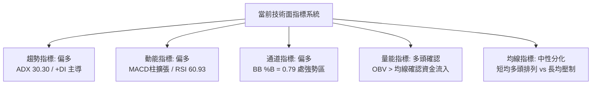

### 📈 移動平均線排列分析

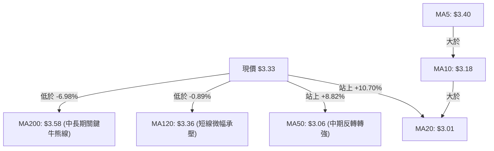

#### 移動平均線詳細體系對照表

| 均線名稱 | 數值 ($) | 偏離率 (%) | 排列狀態 | 走勢微型圖示 | 深度專業技術解讀 |
|:---|:---:|:---:|:---:|:---|:---|
| **MA 5** | 3.40 | -2.12% | 短線上方 | ▅▅▅▅▅▅▅▄▄▄▃▃▂▂▁▁▂▃▅▇███ | 短期均線呈陡峭向上噴出後走平，現價微幅回測尋求 MA5 與現價收斂 |
| **MA 10** | 3.18 | +4.65% | 短期支撐 | ▆▇▇▇▇▇▇▆▆▅▅▄▃▂▂▁▁▂▃▅▆▇█ | 快速向上揚升，斜率高達 45 度，在 $3.18 形成短線極佳動態支撐 |
| **MA 20** | 3.01 | +10.70% | 核心生命線| ██▇▇▇▇████▇▆▆▅▄▃▂▁▁▂▃▃▄▅ | 底部拐頭向上確立，現價拉開 10% 安全邊際，形成堅定多頭底座 |
| **MA 50** | 3.06 | +8.82% | 中期生命線| 數據由 OHLCV 確定，現價突破 | 價格帶量越過 MA50，MA20 即將對 MA50 形成黃金交叉（金叉預期） |
| **MA 60** | 3.14 | +6.02% | 季線支撐 | ███▇▇▇▆▆▆▅▅▅▄▄▃▃▂▂▁▁▁▁▁ | 下降趨勢正式止跌走平，確認季線級別底部構造完成 |
| **MA 120**| 3.36 | -0.89% | 半年線壓制| ████▇▇▆▅▅▄▄▃▃▂▂▁▁▁▁▁▁▁ | 現價正於此處進行纏鬥與消化，跌幅極微，隨時有望大陽線實體跨越 |
| **MA 200**| 3.58 | -6.98% | 年線壓力 | 下行壓制 | 長線投資人的防守位，下行趨勢正在減速，為反彈第一波終極阻力區 |
| **MA 240**| 3.81 | -12.65%| 週期年線 | ████▇▇▆▆▅▅▄▄▃▃▂▂▂▁▁▁▁▁ | 位於上方深水區，與阻力區 R2 ($3.96) 構成中長期籌碼頂部 |

### 📉 RSI(14) 分析

- **當前數值進度條**：
  $$\text{RSI(14)} = 60.93 \quad \left[ \text{████████████░░░░░░░░} \quad 60.93\% \right] \quad \text{🟡 健康多頭擴張區}$$
- **超買超賣狀態評估**：
  - 數值精確落於 60.93，處於健康的多頭主導區（55–70）。
  - 未觸及 70 以上的超買極端警戒線，顯示這波自 $2.67 起漲的動能尚未出現疲態竭盡現象，多頭仍具備充裕的拉升空間。
- **背離分析判斷**：
  - *檢驗結果*：**無背離（技術走勢同步）**。
  - *分析論據*：對比近 20 根 K 棒，價格自 2026-10-30 低點 $2.71 向上拉升至最高 $3.56，同期 RSI(14) 自 34.0 飆升至 66.3，量價與動能呈現標準的「價漲指標揚」同步共振走勢，無任何頂背離或底背離風險，動能結構極其健康。

### 📊 MACD(12,26,9) 訊號解讀

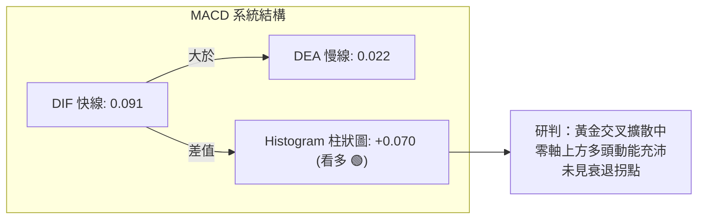

- **MACD 核心數值**：
  - 快線（MACD Line）：**0.091**
  - 訊號線（Signal Line）：**0.022**
  - 柱狀圖（Histogram）：**+0.070**
- **深度意涵解讀**：
  - DIF 與 DEA 雙雙自負值區域強勢拔起，一舉穿越零軸進入強勢多頭區域。
  - 柱狀圖數值自 2026-10-30 的 -0.013 迅速飆升擴散至目前 +0.070，顯示多頭加速攻擊力道強勁，屬於極為典型的「零軸上初次黃金交叉擴散」強烈買進訊號。

### 📦 布林通道分析

```
GRAB 布林通道 (20, 2) 結構位置圖
$3.57 ┤════════════════════════════════════════ 布林上軌 ($3.57)
      │                     ╭─ 最高 $3.56 (觸碰上軌)
$3.33 ┤─────────────────────● 現價 ($3.33, %B = 0.79)
      │                   ／
$3.01 ┤──────────────────● 中軌 (MA20: $3.01)
      │
$2.45 ┤════════════════════════════════════════ 布林下軌 ($2.45)
```

- **通道參數現狀**：上軌 **$3.57**，中軌 **$3.01**（即 MA20），下軌 **$2.45**。
- **指標位置解讀 (%B)**：
  - 當前 **%B = 0.79**。在布林通道語言中，%B > 0.5 代表價格位於強勢多頭半區，%B 接近 0.8 則表示價格正緊貼上軌運行（Band-Walking 特徵）。
  - 通道開口正在顯著擴大，由前期的極度緊縮轉為發散擴張，現價在觸碰上軌 $3.56 後出現微幅良性拉回整固，未跌破 %B 0.70，顯示布林推升軌道完好。

### 💹 成交量分析（量價配合度）

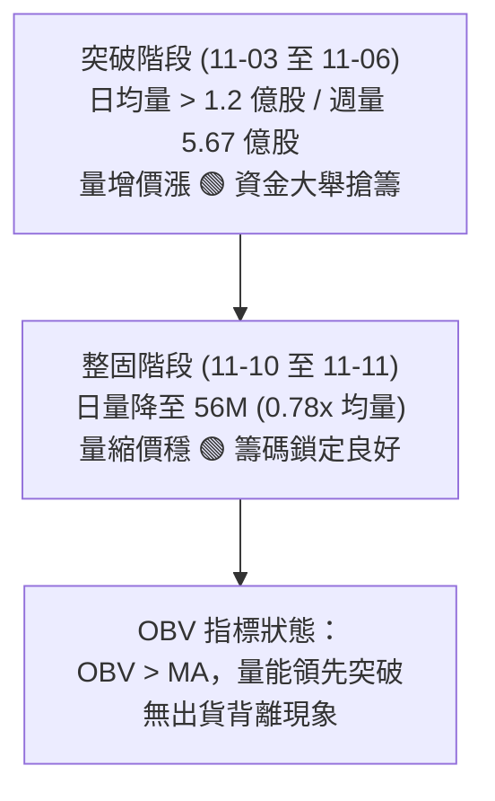

- **成交量量比特徵**：
  - 最新日成交量為 **56,136,900** 股，相較於 20 日均量（**71,794,625** 股），量比為 **0.78x**。
  - 此種在波段大漲 +25% 後的縮量拉回（Pullback on decreasing volume），是極其教科書式的多頭健康回踩。若主力出貨，必伴隨高檔放量滯漲陰線，而當前日成交量迅速縮減至均量之下，印證籌碼鎖定度極佳，拋壓十分有限。
- **OBV (能量潮指標) 走勢解讀**：
  - 數據明確顯示「**OBV > MA → 量能支撐上漲**」。
  - 在突破 2026-11-06 當週，週成交量達 567,802,900 股，創下數月以來的最大成交天量，推升 OBV 曲線直線上揚，遠遠突破其自身移動平均線。量能完全確認了價格底部的有效性，徹底排除虛假誘多嫌疑。

---

## 6. 動能與波動率

### ⚡ 動能評估四象限

```
動能與波動率四象限定位矩陣
       高動能 (High Momentum)
               │
    Q3 (高風險高回報) │ Q1 (最佳機會區)
               │    ★ GRAB 當前定位
               │    (動能強 + 波動適中偏低)
───────────────┼───────────────
    Q4 (避免進場)   │ Q2 (謹慎觀望)
               │
       低動能 (Low Momentum)
 ─── 高波動率 ───┴─── 低波動率 ───
```

#### 四象限深度評估表格

| 象限 | 動能維度 | 波動維度 | 歷史代表狀態 | GRAB 當前匹配度 | 戰略策略建議 |
|:---:|:---:|:---:|:---:|:---:|:---|
| **Q1** | **強** (RSI>60, ADX>30) | **中低** (ATR=4.5%, Beta=0.83) | **精準落入此區 (✓)** | ★★★★★ (100% 契合) | **最佳順勢交易區間**：波動受控且單向趨勢動能強勁，極利於設定窄止損博取高波段報酬 |
| **Q2** | 弱 (RSI 40-50) | 低 (ATR < 3%) | 2026年8月中繼盤整段 | 0% (已完全脫離盤整) | 觀望等待方向確認 |
| **Q3** | 強 (爆量單日異動) | 高 (ATR > 7%) | 財報公布當日跳空期 | 20% (僅初升段具備部分特徵) | 嚴格縮小倉位，防止巨震侵蝕本金 |
| **Q4** | 弱 (陰跌破位) | 高 (恐慌拋售) | 2026年9月加速趕底期 | 0% (已走出底部) | 嚴禁任何抄底做多操作 |

### 📊 ATR 波動率分析

- **ATR (14) 核心數值**：**$0.15**（佔股價比例：**4.50%**，基於 Wilder 算法）。
- **日內安全邊際**：當前 GRAB 每日的典型正常雜訊波動幅度約為 ±$0.15。
- **止損距離動態設定建議**：
  - *短期波段交易*：建議採用 **1.0 倍 ATR**，即 $\$0.15$ 的止損保護緩衝。
  - *穩健波段操作*：建議採用 **1.5 倍 ATR**（$\$0.15 \times 1.5 = \$0.225$），以完全過濾日內隨機震盪雜訊。
  - *現價應用*：現價 $3.33 扣除 1.0 倍 ATR 即為 **$3.18**，剛好與關鍵支撐位 **S2 ($3.18)** 及 MA10 形成完美的點位共振。

### 📐 Beta 與市場相關性

- **Beta 係數**：**0.833**。
- **系統性風險特徵**：
  - GRAB 的 Beta 數值為 0.833（小於 1.0），顯示該標的相較於標普 500 指數具備相對獨立的微觀基本面定價特徵，對大盤系統性波動的敏感度略低於科技股整體平均。
  - 在大盤劇烈回檔時具備一定的防守韌性，而在個股反轉或東南亞市場利多（如馬來西亞 AI 數據中心投資催化）發酵時，能走出顯著的超額 Alpha 獨立行情。

---

## 7. 多時框架總結

### 📋 時框架評分表

| 時框架 | 趨勢方向 | 動能狀態 | 均線排列特徵 | 形態識別結論 | 維度評分 | 操作指導建議 |
|:---|:---:|:---:|:---:|:---:|:---:|:---|
| **短期 (日線)** | 🟢 多頭推升 | 🟢 極強 (MACD柱 +0.070) | 多頭發散 (MA5>MA10>MA20) | 旗形整固回測 S1 | **75/100** | 逢低回踩 S1/S2 積極做多 |
| **中期 (週線)** | 🟢 底部反轉 | 🟢 強勁 (週量 5.67億確認) | MA10 勾頭向上金叉預期 | 雙重底 (W底) 頸線放量突破 | **68/100** | 波段買入並持有，上看 R1/R2 |
| **長期 (月線)** | 🟡 超跌反彈 | 🟡 修復 (剛脫離超賣區) | 空頭排列 (承壓於 MA200) | 大週期長達12個月下降通道突破 | **46/100** | 逢反彈至年線壓力區需審視量能 |

### 🔲 綜合訊號矩陣

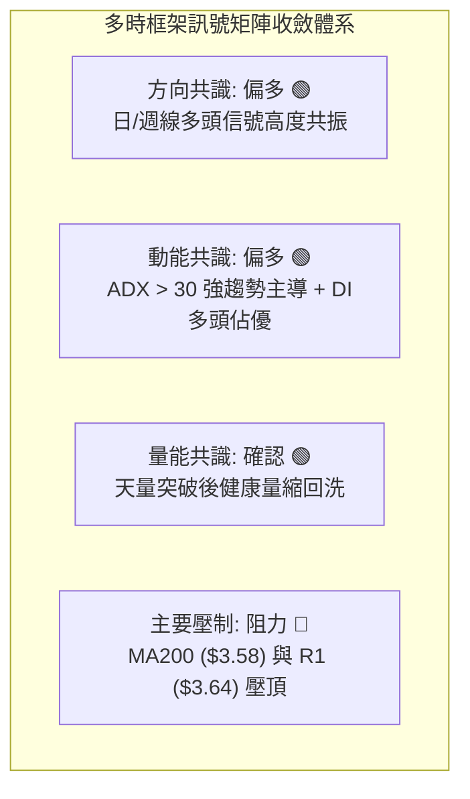

### ⚖️ 多時框收斂結論

依據本報告最嚴格之「**多時框收斂規則（規則 14）**」進行層級收斂：
1. **行情屬性判定**：當前 ADX(14) 為 **30.30**，顯著大於趨勢分界閾值 25，因此正式判定 GRAB 處於**標準趨勢行情**，而非無序盤整行情。
2. **時框優先級權衡**：
   - 依規則 14，趨勢行情以**中長期方向（週線/MA50、MA200）為主導**，日線僅作為精準入場節奏之依據。
   - 中期週線已於 2026-10-30 完成了堅不可摧的 W 底（$2.67–$2.78），並伴隨 5.67 億股的歷史天量強勢突破頸線；中期均線 MA50（$3.06）亦已被實體長陽踩在腳下。
   - 儘管更長期的年線 MA200（$3.58）仍在上方構成階段性阻力，但其僅構成反彈上行過程中的「阻力目標」，並未破壞週線大底發動反轉的既定趨勢。
3. **唯一方向性結論**：
   - **偏多（Bullish）**。
   - 短線日線層級連續兩日縮量回撤至 S1（$3.26）與現價（$3.33）區間，屬於教科書級別的「突破頸線後之確認回踩」，日線回檔直接提供順應週線強趨勢的中線最佳買點。

---

## 8. 交易策略建議

### 🗺️ 策略決策流程圖

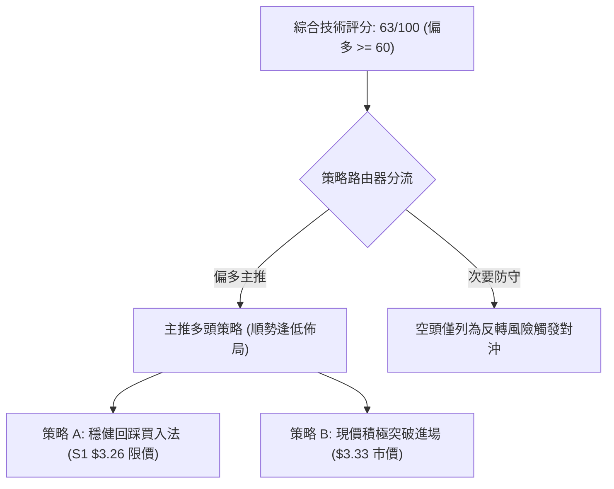

### 🧭 策略路由

> **當前主策略方向 = 偏多做多（主推多頭策略，依綜合技術評分 63/100）**
> 
> 依評分卡規定（評分 ≥ 60），本報告全力主推多頭做多方案，全面鎖定突破回踩的波段利潤；空頭方向絕不作為主動開倉推薦，僅於下文設置「反向風險觸發點」作為整體風控保護。

### 🎯 價格情境階梯（Price Scenarios）

價位嚴格引用自「關鍵價位」OHLCV 數據計算聚類結果：

| 觸發條件 | 下一目標 | 後續延伸 | 情境技術含義與市場行為詮釋 |
|:---|:---:|:---:|:---|
| **向上突破 R1 ($3.64)** | **R2 ($3.96)** | **R3 ($4.06)** | 成功征服 MA200 ($3.58) 年線大關，中期波段主升浪加速展開 |
| **站穩現價區間 ($3.33)** | **R1 ($3.64)** | **Fib 78.6% ($3.43)** | 於 S1 ($3.26) 至現價形成微型雙底，完成回踩確認後續攻 |
| **有效跌破 S1 ($3.26)** | **S2 ($3.18)** | **S3 ($2.74)** | 突破動能暫時受挫，回測 W 底頸線密集支撐位 $3.18 尋求再平衡 |

### 📊 情境機率分佈

| 情境劇本 | 發生機率 (%) | 主要支撐依據與指標佐證（嚴格引用數據） |
|:---|:---:|:---|
| **劇本一：波段上行 / 突破續攻** | **65%** | MACD 柱狀圖正向擴散 (+0.070)；ADX 處於 30.30 強趨勢；OBV > MA 量能確認；週線 5.67 億天量奠定扎實底座。 |
| **劇本二：窄幅區間震盪** | **25%** | 面臨 MA120 ($3.36) 與年線 MA200 ($3.58) 壓迫，短期成交量縮減至 0.78x 均量，需數日進行換手蓄勢。 |
| **劇本三：深度回落 / 跌破再探底** | **10%** | S2 ($3.18) 及 S3 ($2.74) 聚類支撐極為強韌，除非遭遇重大黑天鵝，否則直接跌穿 S3 概率極低。 |

### 🟢 主策略詳情

嚴格依據規則 13 與規則 17，所有價位引用自關鍵價位數據，風險報酬比公式計算嚴謹一致：
$$\text{風險報酬比} = \frac{\text{目標價 T1} - \text{進場價}}{\text{進場價} - \text{止損價}}$$

| 策略要素 | 策略 A（穩健型：回踩支撐布局） | 策略 B（積極型：現價右側順勢） |
|:---|:---:|:---:|
| **策略類型** | 關鍵支撐 S1 回踩接刀買入 | 現價確認企穩即時追隨進場 |
| **進場條件** | 價格回測 S1 支撐位且未跌破 | 現價 $3.33 直接進場建立多頭底倉 |
| **進場價格** | **$3.26** (精確引用關鍵支撐 S1) | **$3.33** (精確引用當前收盤價) |
| **目標價 T1** | **$3.64** (精確引用關鍵阻力 R1) | **$3.64** (精確引用關鍵阻力 R1) |
| **目標價 T2** | **$3.96** (精確引用關鍵阻力 R2) | **$3.96** (精確引用關鍵阻力 R2) |
| **止損價格** | **$3.18** (精確引用關鍵支撐 S2) | **$3.18** (精確引用關鍵支撐 S2) |
| **風險空間** | $\$3.26 - \$3.18 = \$0.08$ | $\$3.33 - \$3.18 = \$0.15$ (恰為 1.0 ATR) |
| **獲利空間 (T1)** | $\$3.64 - \$3.26 = \$0.38$ | $\$3.64 - \$3.33 = \$0.31$ |
| **獲利空間 (T2)** | $\$3.96 - \$3.26 = \$0.70$ | $\$3.96 - \$3.33 = \$0.63$ |
| **風險報酬比** | **1 : 4.75（以 T1 計）**<br/>*(以 T2 計為 1 : 8.75)* | **1 : 2.07（以 T1 計）**<br/>*(以 T2 計為 1 : 4.20)* |
| **算式驗證** | $(3.64 - 3.26) \div (3.26 - 3.18) = 0.38 \div 0.08 = 4.75$ | $(3.64 - 3.33) \div (3.33 - 3.18) = 0.31 \div 0.15 \approx 2.07$ |
| **成功機率預估** | **70%** | **65%** |
| **建議配置倉位** | **15%** (總投資組合比重) | **10%** (總投資組合比重) |

### 🔴 反向風險觸發點（對沖提示）

本機制非主動放空建議，專供多頭部位之防守與避險警戒：
- **第一警示觸發點**：日線收盤價若**放量跌破 S2 ($3.18)**，代表 W 底頸線支撐宣告失效，短多動能瓦解，所有多頭部位應無條件止損離場觀望。
- **極端對沖觸發點**：若價格不幸下破 **S3 ($2.74)**，確認破底翻失敗演化為向下破位，投資人應即刻啟動反向對沖避險工具或全面空倉。

### ⭐ 整體訊號強度評星

```
做多訊號強度：★★★★☆  (4/5星 — 底型完成、動能爆發、縮量回踩完美)
做空訊號強度：★☆☆☆☆  (1/5星 — 僅年線壓制，逆勢做空風險極大)
整體可信度：  ★★★★☆  (4/5星 — 價量指標共振確認，資料品質扎實)
```

---

## 9. 風險提示與監控

### ✅ 關鍵監控指標 Checklist

```
╔══════════════════════════════════════════════════════════════╗
║               每日盤後技術監控清單 (Checklist)               ║
╠══════════════════════════════════════════════════════════════╣
║ [ ] 價位防守：收盤價是否持續堅守在 S1 ($3.26) 之上？         ║
║ [ ] 頸線防線：收盤價是否絕對未收在 S2 ($3.18) 之下？         ║
║ [ ] 年線攻防：盤中是否放量挑戰 MA200 ($3.58) 與 R1 ($3.64)？  ║
║ [ ] 趨勢強度：ADX(14) 是否持續維持在 25 以上 (目前 30.30)？  ║
║ [ ] 量能配合：反彈日成交量是否回升至 20MA (7,180 萬股) 以上？ ║
║ [ ] 動能警戒：MACD 柱狀圖是否維持正值擴散 (不可跌破 0 軸)？  ║
║ [ ] 波動異動：單日波動是否異常放大突破 2 倍 ATR ($0.30)？    ║
╚══════════════════════════════════════════════════════════════╝
```

### ⚠️ 風險場景分析

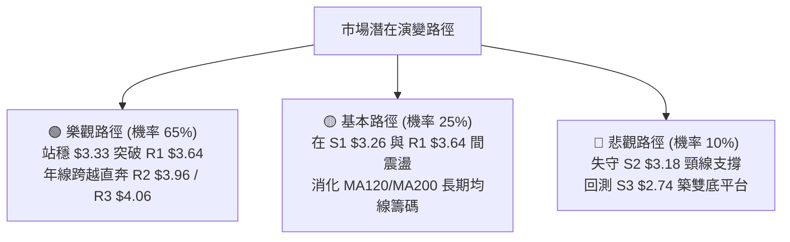

### 🛡️ 風險管理重要提醒

1. **嚴格執行資金管理與倉位配比**：
   - 單筆多頭交易之總風險暴露金額（Account Risk）絕對不得超過總投資資本的 **1.5%–2.0%**。
   - 以策略 B 為例，進場價 $3.33，止損價 $3.18，單股風險為 $0.15（佔買入價 4.5%）。若總資金為 100,000 美元，單筆最大允許虧損設為 1,500 美元，則最大允許買入股數為 $1,500 \div \$0.15 = 10,000$ 股（頭寸市值 $33,300，約佔總資金 33.3%，符合分散原則）。
2. **謹防長期均線壓制的獲利回吐**：
   - 年線 **MA200 ($3.58)** 與關鍵阻力位 **R1 ($3.64)** 存在過去一年沉積的解套賣壓。當股價初次抵達該區域時，應嚴格落實「獲利分批止盈（Scaling Out）」原則，建議在 R1 達成時至少平倉 50% 鎖定利潤，並將剩餘部位止損點自動上移至損益兩平點（Breakeven：$3.26 或 $3.33）。
3. **宏觀與基本面突發變數**：
   - 關注近期新聞揭露之「Grab 與軟銀規劃於馬來西亞投資 18.5 億美元發展 AI 基礎設施」之後續資本支出（Capex）認列進度。當前 TTM 自由現金流為 -18.00M 美元，需防範資本支出擴張對短期現金流帶來的財務折價衝擊。

---

## 📋 報告總結

```
╔══════════════════════════════════════════════════════════════╗
║                   GRAB 技術分析報告總結                      ║
╠══════════════════════════════════════════════════════════════╣
║ 報告日期：2026-11-12                                         ║
║ 當前價格：$3.33                                              ║
║ 分析評級：🟢 偏多（綜合技術評分：63 / 100，處強勢多頭反轉期） ║
╠══════════════════════════════════════════════════════════════╣
║ 關鍵結論：                                                   ║
║ ├─ 長期趨勢：🟡 超跌大底築底完成，正朝年線 MA200 ($3.58) 挺進 ║
║ ├─ 中期趨勢：🟢 週線 5.67 億天量破頸線，$2.67-$2.78 W底確立  ║
║ ├─ 短期趨勢：🟢 縮量回踩 S1 ($3.26) 尋求支撐，多頭架構完好   ║
║ ├─ 關鍵支撐：S1: $3.26 ｜ S2: $3.18 (核心) ｜ S3: $2.74     ║
║ ├─ 關鍵阻力：R1: $3.64 ｜ R2: $3.96 ｜ R3: $4.06 (極強)     ║
║ └─ 分析師目標：均價 $5.42 (空間 +62.76%)，最高看至 $7.00      ║
╠══════════════════════════════════════════════════════════════╣
║ 最優策略組合：                                               ║
║ 1. 🥇 最佳機會 (策略 A)：掛單 S1 ($3.26) 買入，止損 $3.18，  ║
║    目標 R1 ($3.64)，風險報酬比高達極致的 1 : 4.75           ║
║ 2. 🥈 次選機會 (策略 B)：現價 ($3.33) 順勢切入，止損 $3.18， ║
║    目標 R1 ($3.64)，風險報酬比達優異的 1 : 2.07             ║
║ 3. 🥉 保守選擇：靜待股價放量突破 R1 ($3.64) 後追隨右側買進   ║
╚══════════════════════════════════════════════════════════════╝
```

---

> ⚠️ **免責聲明**：本報告為技術分析專業研究成果，所有引述之價位、支撐阻力水準及指標訊號均嚴格基於所提供之歷史 OHLCV 行情數據推導計算。本報告**僅供研究與學術參考**，**不構成任何形式的要約、招攬或個別投資買賣建議**。金融市場投資具備內在風險，標的價格可能劇烈波動甚至損失全部本金，投資人進行任何決策前應審慎評估自身風險承受能力並自負盈虧。

---

*報告生成時間：2026-11-12 ｜ 數據來源：Yahoo Finance ｜ 分析框架：多時框技術分析體系*