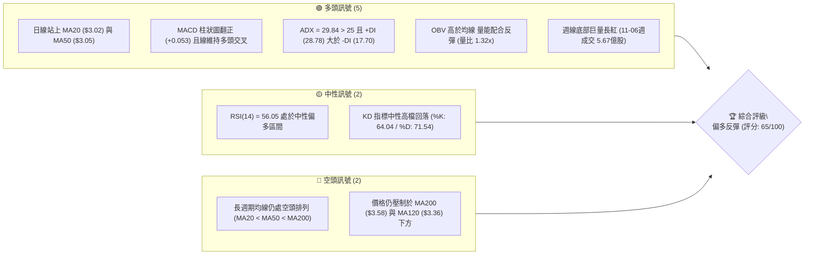
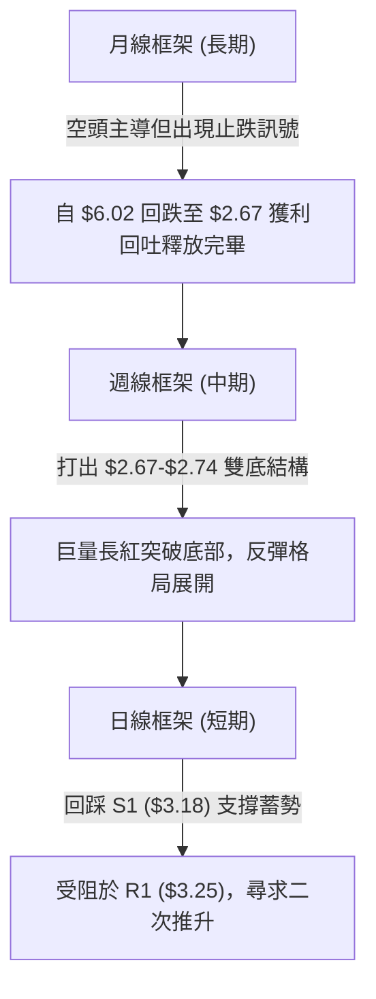
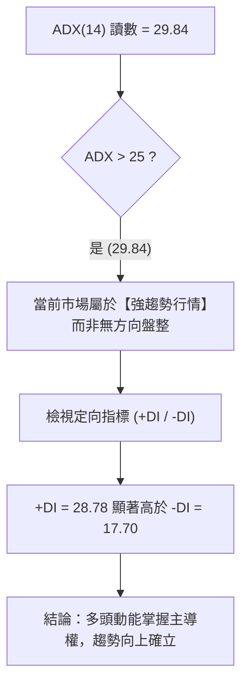
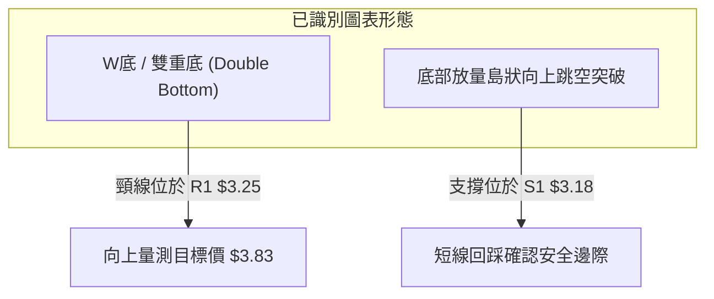
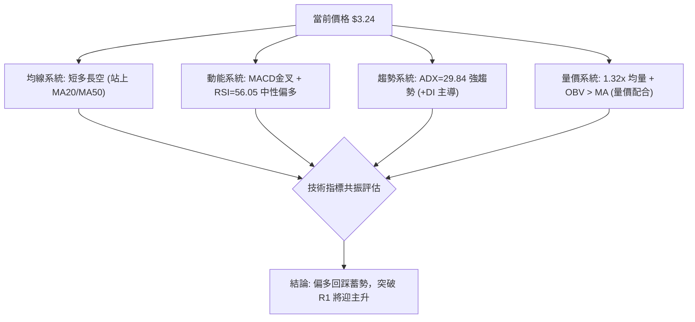
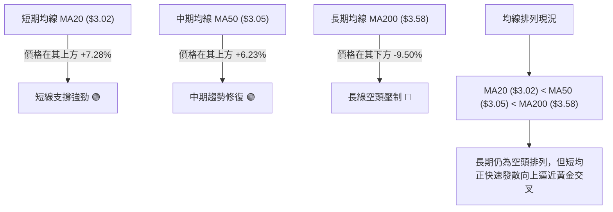
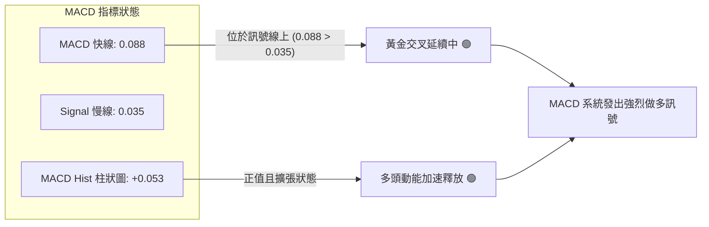
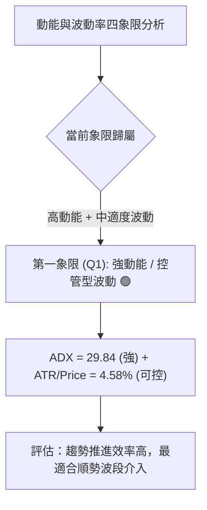
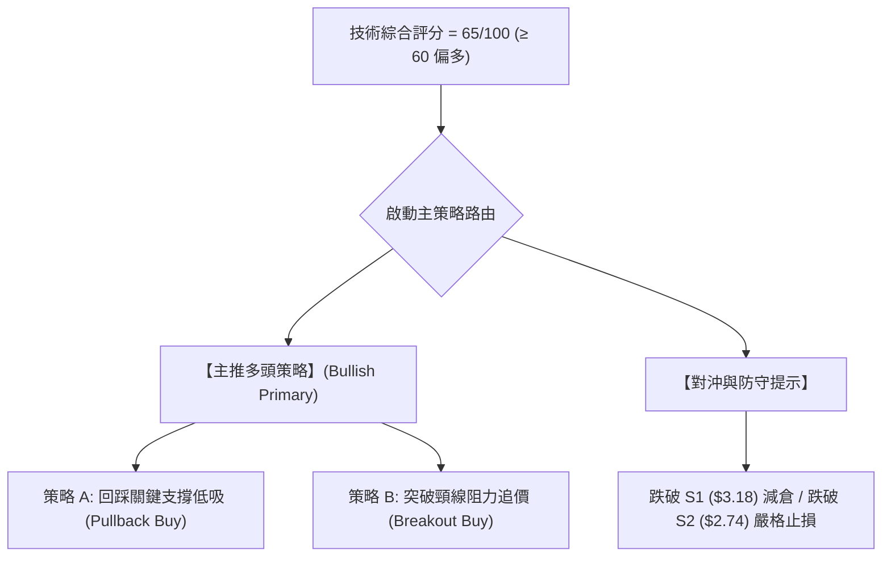
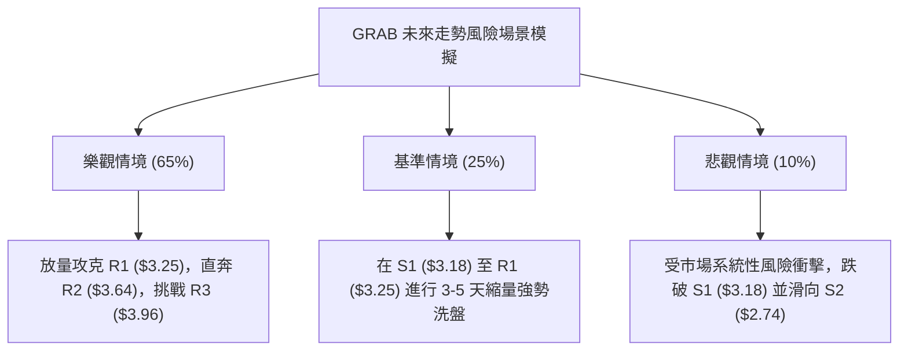

# GRAB 技術分析報告

> **報告日期**：2026-11-13 ｜ **語言**：繁體中文 ｜ **數據來源**：Yahoo Finance ｜ **當前價格**：$3.24

---

## 目錄

| 章節 | 內容 |
|------|------|
| [1. 技術面概覽](#1-技術面概覽) | 訊號儀表板、核心指標、評分卡 |
| [2. 趨勢分析](#2-趨勢分析) | 多時框趨勢、長中短期走勢 |
| [3. 圖表形態分析](#3-圖表形態分析) | 形態識別、K線組合、目標價 |
| [4. 支撐與阻力](#4-支撐與阻力) | 關鍵價位、斐波那契回調 |
| [5. 技術指標深度解讀](#5-技術指標深度解讀) | MA/RSI/MACD/布林/成交量 |
| [6. 動能與波動率](#6-動能與波動率) | 動能評估、ATR、Beta |
| [7. 多時框架總結](#7-多時框架總結) | 時框架評分矩陣 |
| [8. 交易策略建議](#8-交易策略建議) | 多空策略、風險報酬比 |
| [9. 風險提示與監控](#9-風險提示與監控) | 監控指標、風險場景 |

---

## 1. 技術面概覽

### 🎯 技術訊號儀表板



### 📊 核心指標速覽表

| 指標類別 | 指標名稱 | 當前數值 | 訊號 | 解讀 |
|----------|----------|----------|------|------|
| **價格** | 當前收盤價 | $3.24 | 🟢 | 自 52 週低點 $2.67 明顯反彈，目前受阻於 R1 ($3.25) |
| **均線** | MA20 | $3.02 | 🟢 | 價格在 MA20 上方 +7.28%，短期多頭架構確立 |
| **均線** | MA50 | $3.05 | 🟢 | 價格在 MA50 上方 +6.23%，已修復中期均線失土 |
| **均線** | MA200 | $3.58 | 🔴 | 價格在 MA200 下方 -9.50%，長期大趨勢尚未扭轉 |
| **動能** | RSI(14) | 56.05 | 🟢 | 站上 50 中軸，進入多頭控盤但未過熱（無超買超賣） |
| **動能** | MACD | 0.088 / 0.035 | 🟢 | MACD 與訊號線形成黃金交叉，柱狀圖 +0.053 擴張 |
| **趨勢** | ADX(14) | 29.84 | 🟢 | 數值大於 25，趨勢力道強勁；+DI 主導多頭攻勢 |
| **通道** | 布林 %B | 0.69 | 🟢 | 位於中軌 ($3.02) 與上軌 ($3.59) 之間，強勢整理 |
| **成交量** | 最新成交量 | 96,648,600 | 🟢 | 高於 20 日均量 (73,456,490)，量比 1.32x，量增價穩 |
| **波動** | ATR(14) | $0.15 | 🟡 | 佔股價 4.58%，屬於中等波動度，適合設定嚴密止損 |

### 🏆 技術評分卡

```
╔══════════════════════════════════════════════════════════════╗
║              技術評分卡 — GRAB (2026-11-13)                  ║
╠══════════════════════════════════════════════════════════════╣
║ 趨勢強度      ██████████████░░░░░░  68/100  🟢 強趨勢多頭主導 ║
║ 動能指標      █████████████░░░░░░░  65/100  🟢 動能偏多向上   ║
║ 支撐穩定度    ██████████████░░░░░░  72/100  🟢 底部支撐結構紮實 ║
║ 成交量配合    ███████████████░░░░░  75/100  🟢 價量配合顯著放大 ║
║ 形態完整度    ████████████░░░░░░░░  60/100  🟡 雙底構築測試頸線 ║
║ 均線排列      ██████████░░░░░░░░░░  50/100  🟡 短多長空修復中 ║
╠══════════════════════════════════════════════════════════════╣
║ 綜合評分      █████████████░░░░░░░  65/100  🟢 偏多（波段反彈）║
╚══════════════════════════════════════════════════════════════╝
```
*註：綜合評分由六項子指標算術平均計算：(68 + 65 + 72 + 75 + 60 + 50) ÷ 6 = 65.0 分（四捨五入至整數）。*

---

## 2. 趨勢分析

### 🌐 多時框趨勢分析



### 📈 長期趨勢 — 12個月走勢圖（Unicode）

GRAB 過去 12 個月（2025-11 至 2026-11）經歷了自 $5.45 跌至 52 週低點 $2.67 的深幅修正，隨後於 2026 年 11 月展開放量報復性反彈：

```
GRAB 月線走勢圖（2025-11 至 2026-11）
價格軸 ($)
$5.50 ┤● (2025-11: $5.45)
$5.00 ┤    ● ($4.99)
$4.50 ┤        ● ($4.30)
$4.00 ┤            ● ($4.22)
$3.50 ┤                ● ($3.66)   ● ($3.82)               ● ($3.77)
$3.00 ┤                                ● ($3.54)   ● ($3.50)   ● ($3.54)   ● ($3.11)
$2.50 ┤                                                                        ● ($2.71)  ●←現價 $3.24
      └─────────────────────────────────────────────────────────────────────────────────────────────
        11/25 12/25 01/26 02/26 03/26 04/26 05/26 06/26 07/26 08/26 09/26 10/26 11/26 (月份)
```

#### 走勢特徵分析表格

| 階段 | 時間區間 | 起訖價位 | 漲跌幅 | 價量特徵與市場心理 |
|------|----------|----------|--------|--------------------|
| **加速下行期** | 2025-11 ～ 2026-03 | $5.45 → $3.66 | -32.84% | 獲利了結賣壓湧現，接連失守重要整數關卡 |
| **弱勢箱型築底** | 2026-04 ～ 2026-08 | $3.82 → $3.54 | -7.33% | 於 $3.50～$3.80 區間盤整，缺乏方向感，成交萎縮 |
| **末跌段恐慌殺盤** | 2026-09 ～ 2026-10 | $3.54 → $2.71 | -23.45% | 跌破 $3.00 引發恐慌盤，觸及 52 週低點 $2.67 |
| **報復性反彈初期** | 2026-11（即時） | $2.71 → $3.24 | +19.56% | 投行上調評級與 AI 催化，底部巨量換手推升至 $3.24 |

### 📊 中期趨勢（週線分析）

中期走勢圖展示了空方趨勢在觸及 52 週低點 $2.67 後的強烈衰竭，並迅速轉變為多方反攻型態：

```
GRAB 週線壓力與支撐架構圖
════════════════════════════════════════════════════════════════
$3.96 ────────────────────────────────── 強阻力 R3 (波段高點/61.8% Fib)
$3.64 ────────────────────────────────── 阻力 R2 (MA200 / 前波壓力區)
$3.25 ══════════════════════════════════ 關鍵短阻力 R1 (頸線測試中)
$3.24 ◀── 當前收盤價 (蓄勢挑戰 R1)
$3.18 ┄┄┄┄┄┄┄┄┄┄┄┄┄┄┄┄┄┄┄┄┄┄┄┄┄┄┄┄ 近期支撐 S1 (日線前低密集區)
$2.74 ────────────────────────────────── 強支撐 S2 (次低點支撐)
$2.67 ══════════════════════════════════ 絕對底線 S3 (52週低點 / 雙底基底)
════════════════════════════════════════════════════════════════
```

週線層面顯示，2026-11-06 當週錄得 567,802,900 股的天量，大漲 +25.83%，這根大陽線一舉收復了 10 月全月的跌幅，在技術上屬於強烈的「底部長紅吞噬」，中期趨勢已由純空頭下行轉為「底部分批回補、波段震盪向上」。

### ⚡ 趨勢強度評估（ADX 解讀）



| 指標名稱 | 當前讀數 | 門檻區間 | 趨勢判定 | 操作涵義 |
|----------|----------|----------|----------|----------|
| **ADX(14)** | 29.84 | > 25 (強趨勢) | 🟢 強趨勢啟動 | 順勢交易為主，摒棄逆勢摸頂思維 |
| **+DI (14)** | 28.78 | > 25 | 🟢 多頭掌控 | 多方推升力量充沛，回踩宜做多 |
| **-DI (14)** | 17.70 | < 20 | 🟢 空方衰竭 | 空頭拋壓處於低位，未見主動殺盤 |

---

## 3. 圖表形態分析

### 🔍 形態識別系統



#### 形態識別信心度評估表

| 形態名稱 | 信心度 | 判斷依據（引用數據） | 完成度 | 目標價（附計算式） |
|----------|--------|----------------------|--------|--------------------|
| **雙重底 (W底)** | 70% | 兩次低點分別為 2026-09-18 低點 $2.80 與 2026-10-30 低點 $2.67（S3），頸線為波段高點 R1 ($3.25) | 85% | 頸線 $3.25 + 形態高度 ($3.25 - $2.67 = $0.58) = **$3.83**（介於 R2 $3.64 與 R3 $3.96 之間） |
| **短期上升旗形整理** | 60% | 11-03 至 11-06 強攻至最高 $3.56（旗桿），隨後 4 根日K呈現成交量縮窄幅旗面回檔整理至 $3.24 | 75% | 突破旗面阻力後，旗桿高度 ($3.56 - $2.71 = $0.85) 推算理論目標為 $3.33 + $0.85 = **$4.18**（高於 R3 $3.96，受限於 R3 阻力） |

### 🕯️ 重要K線形態分析

根據提供的近 10 根日 K 線與近 8 根週 K 線之精確開高低收數據進行嚴格解析：

| 日期（日K/週K） | 開 | 高 | 低 | 收 | K線形態 | 解讀 | 訊號 |
|-----------------|----|----|----|----|---------|------|------|
| **2026-10-30 (日K)** | 2.71 | 2.73 | 2.68 | 2.71 | 十字星 / 底部十字變盤線 | 在 52 週低點 $2.67 旁收出實體為 0 的十字星，顯示空方動能耗盡 | 🟢 |
| **2026-11-02 (日K)** | 2.76 | 2.93 | 2.75 | 2.86 | 多頭初啼陽線 | 跳空高開，收盤收復 5 日均線，確認前一日十字星為反轉點 | 🟢 |
| **2026-11-03 (日K)** | 3.21 | 3.32 | 3.08 | 3.12 | 巨量跳空高開帶長上影陽線 | 裂口跳空高開，單日爆出 1.53 億股巨量，多方發動總攻但遇 R1 解套壓 | 🟢 |
| **2026-11-04 (日K)** | 3.22 | 3.39 | 3.20 | 3.36 | 光腳中長陽線 | 承接前日量能，直接突破跳空缺口高點，收盤站穩 $3.30 之上 | 🟢 |
| **2026-11-05 (日K)** | 3.35 | 3.50 | 3.27 | 3.48 | 實體大陽線 | 換手充分，多頭強勢上攻創反彈新高，成交量放大至 1.48 億股 | 🟢 |
| **2026-11-06 (日K)** | 3.44 | 3.56 | 3.37 | 3.41 | 高檔帶上影小陰線 | 觸碰波段高點 $3.56 後遇布林上軌與 MA200 壓制，出現短線獲利回吐 | 🟡 |
| **2026-11-09 (日K)** | 3.46 | 3.50 | 3.38 | 3.44 | 窄幅整理星線 | 橫盤換手，低點未破 11-06 低點，維持高檔蓄勢格局 | 🟡 |
| **2026-11-10 (日K)** | 3.34 | 3.39 | 3.28 | 3.35 | 縮量陰十字 | 跳空低開震盪，成交量縮至 8,236 萬股，正常波段回踩 | 🟡 |
| **2026-11-11 (日K)** | 3.32 | 3.38 | 3.27 | 3.33 | 縮量弱十字星 | 成交量急劇萎縮至 5,630 萬股（近期低量），洗盤特徵明顯 | 🟢 |
| **2026-11-12 (日K)** | 3.33 | 3.34 | 3.21 | 3.24 | 回踩下探小陰線 | 測試 S1 支撐位 ($3.18) 上方之 $3.21，收盤守住 $3.24，確認支撐有效性 | 🟡 |
| **2026-11-06 (週K)** | 2.76 | 3.56 | 2.75 | 3.41 | 週線超級長紅吞噬 | 週成交 5.67 億股，實體覆蓋前 6 週高點，確立中期築底成功 | 🟢 |
| **2026-11-12 (週K)** | 3.46 | 3.50 | 3.21 | 3.24 | 週線良性回檔陰線 | 消化上週長紅浮額，回踩週線均線支撐，成交量溫和萎縮至 3.34 億股 | 🟡 |

### 📉 ASCII 走勢形態示意圖

```
GRAB 底部 W 底形態結構示意圖
價格
$3.83 ┬─────────────────────────────────────────── 理論量測目標價
      │                                            /
$3.64 ┼────────────────────────────── 波段阻力 R2 ──/─
      │                                          /
$3.25 ┼────── 頸線 R1 ───────┬─────────────────● (突破後回測中: $3.24)
      │                     / \               /
$3.00 ┼                    /   \             /
      │                   /     \           /
$2.80 ┼──── 第一隻腳 ────●       \         /
      │   (2026-09-18)            \       /
$2.67 ┴────────────────────────────● (2026-10-30: 第二隻腳/52W低點 S3)
```

### 🎯 形態目標價計算

1. **W 底形態量測目標價**：
   - **形態基底（最低點）**：取 2026-10-30 低點 $2.67（S3）。
   - **形態頸線**：取密集波段高點阻力位 R1 = $3.25。
   - **形態高度 (H)**：頸線 ($3.25) − 低點 ($2.67) = **$0.58**。
   - **量測目標價**：頸線 ($3.25) + 形態高度 ($0.58) = **$3.83**（該價位精準位於阻力位 R2 $3.64 與 R3 $3.96 之間）。

---

## 4. 支撐與阻力

### 🗺️ 關鍵價位分布圖（Unicode）

```
GRAB 價位結構分布圖
══════════════════════════════════════════════════════════════════
$3.96 ║██████████████████████████████║ 強阻力 R3 (61.8% 斐波那契 / 前高)
$3.64 ║████████████████████░░░░░░░░░░║ 波段阻力 R2 (MA200 / 前波密集區)
$3.25 ║██████████████████████████████║ 關鍵阻力 R1 (W底頸線 / 短期天花板)
$3.24 ╠══════════════════════════════╣ ◄ 現價 ($3.24，緊貼 R1)
$3.18 ║▓▓▓▓▓▓▓▓▓▓▓▓▓▓▓▓▓▓▓▓░░░░░░░░░░║ 近期強支撐 S1 (跳空下沿 / 波段低點)
$2.74 ║████████████████████░░░░░░░░░░║ 強支撐 S2 (次級防線 / 10月反彈高點)
$2.67 ║██████████████████████████████║ 鐵底支撐 S3 (52週最低點 / 雙底基底)
══════════════════════════════════════════════════════════════════
```

### 🚧 阻力位分析表

所有價位均嚴格取自數據提供的波段聚類計算值：

| 阻力級別 | 價位 | 距離現價 | 形成原因 | 突破難度 | 重要性 |
|----------|------|----------|----------|----------|--------|
| **R1** | $3.25 | +0.15% | 近一年波段高點聚類、W底形態頸線位置，短期多空爭奪樞紐 | 中等 | ★★★★☆ |
| **R2** | $3.64 | +12.42% | 近一年波段高點聚類，且與 MA200 ($3.58) 及 BB 上軌 ($3.59) 高度共振 | 高 | ★★★★★ |
| **R3** | $3.96 | +22.12% | 近一年波段高點聚類，精準重合 52 週跌幅之 61.8% 斐波那契黃金分割位 ($3.95) | 極高 | ★★★★★ |

### 🛡️ 支撐位分析表

所有價位均嚴格取自數據提供的波段聚類計算值：

| 支撐級別 | 價位 | 距離現價 | 形成原因 | 守住機率 | 重要性 |
|----------|------|----------|----------|----------|--------|
| **S1** | $3.18 | -1.85% | 近一年波段低點聚類，11-03 跳空大陽線之盤中換手回踩低點密集區 | 80% | ★★★★☆ |
| **S2** | $2.74 | -15.43% | 近一年波段低點聚類，10 月震盪築底多次下探之密集承接平台 | 90% | ★★★★★ |
| **S3** | $2.67 | -17.59% | 52 週最低點，年內極端恐慌拋售點，具備絕對基本面估值與技術雙重支撐 | 98% | ★★★★★ |

### 📐 斐波那契回調位分析

依據 52 週區間極值（最低點 $2.67 至 最高點 $6.02，垂直落差 $3.35）之回調水平如下表所示：

| 回調比率 | 價位 | 技術意義與當前相對位置 |
|----------|------|------------------------|
| **0.0% (52W High)** | $6.02 | 歷史頂部壓力位 |
| **23.6%** | $5.23 | 強勢多頭反彈防線 |
| **38.2%** | $4.74 | 中期多空平衡點位 |
| **50.0%** | $4.35 | 半山腰重要心理關卡 |
| **61.8%** | $3.95 | 黃金分割強阻力，與阻力位 R3 ($3.96) 完全契合 |
| **78.6%** | $3.39 | 深幅回調反彈的第一重強阻力位 |
| **現價落點** | **$3.24** | **落於 100.0% ($2.67) 與 78.6% ($3.39) 之間** |
| **100.0% (52W Low)** | $2.67 | 52 週最低點，與 S3 完美重合，構成超級底部結構 |

**解讀**：現價 $3.24 處於 100% 回調位 ($2.67) 向 78.6% 回調位 ($3.39) 攀升的修復路徑中。若能有效突破 78.6% ($3.39)，則上方通往 61.8% ($3.95) 的空間將全面打開。

---

## 5. 技術指標深度解讀

### 🎛️ 指標訊號總覽



### 📈 移動平均線排列分析



#### 各週期移動平均線檢視

| 週期 | 數值 | 偏離率 (%) | 狀態 | 趨勢解讀 |
|------|------|------------|------|----------|
| **MA5** | $3.35 | -3.40% | 價格在下方 | 近 4 日回調跌破 5 日線，短線進入降速洗盤 |
| **MA10** | $3.23 | +0.31% | 價格在上方 | 10 日線提供即時下檔支撐，多方防線穩固 |
| **MA20** | $3.02 | +7.28% | 價格在上方 | 20 日月線向上拐頭，為波段行情的生命線支撐 |
| **MA50** | $3.05 | +6.23% | 價格在上方 | 突破 50 日季線，中期空頭防線已被多方瓦解 |
| **MA60** | $3.14 | +3.32% | 價格在上方 | 60 日均線走平向上，進一步強化 S1 上方的支撐 |
| **MA120**| $3.36 | -3.50% | 價格在下方 | 半年線壓制，與斐波那契 78.6% ($3.39) 構成共振阻力帶 |
| **MA200**| $3.58 | -9.50% | 價格在下方 | 年線關鍵反壓，與阻力位 R2 ($3.64) 形成強大上檔蓋頂 |
| **MA240**| $3.80 | -14.81%| 價格在下方 | 長期空方總體均線，位於形態目標價 $3.83 附近 |

### 📉 RSI(14) 分析

當前 Wilder 14 週期 RSI 讀數為 **56.05**：

```
RSI(14) 儀表板
0 ──────────── 30 ──────────────────────── 56.05 ─────────── 70 ─────────── 100
[   超賣區    ] [       弱勢區       ]  ▲  [    強勢區    ] [   超買區    ]
                                        現值 (56.05)
進度條: ████████████████████████████░░░░░░░░░░░░ 56.05% (中性偏多)
```

- **區間評估**：RSI 位於 50–70 的強勢多頭推進區間，未觸及 70 超買警戒線，意味著後續仍具備充裕的上攻動能空間。
- **背離判斷**：
  - 根據近 20 根 K 棒的首尾價格與 RSI 走勢進行比對，價格在 10 月末探底 $2.67 後強勁回升至 $3.24，RSI 亦同步由 34 附近回升至 56.05，二者斜率方向一致。
  - **結論**：目前**無明顯頂背離或底背離**，呈現健康的同向推進態勢。

### 📊 MACD(12/26/9) 訊號解讀



- **讀數分析**：MACD 線 (0.088) 位於 0 軸上方且顯著高於訊號線 (0.035)，柱狀圖讀數為 **+0.053**，延續擴張形態。
- **背離分析**：週線級別 MACD 柱狀圖在 10-30 為 -0.013，隨後 11-06 暴增至 +0.087，當前維持在 +0.053 高檔，日線與週線均未出現頂背離，多頭波段動能未衰退。

### 📦 布林通道分析

```
GRAB 布林通道 (20, 2) 結構圖
════════════════════════════════════════════════════════════════
$3.59 ───────────────────────────────────── BB 上軌 (上檔壓制位)
      │
$3.24 ─────── 現價 ($3.24，%B = 0.69，偏多強勢區)
      │
$3.02 ───────────────────────────────────── BB 中軌 (MA20 生命線支撐)
      │
$2.45 ───────────────────────────────────── BB 下軌 (極端超賣支撐)
════════════════════════════════════════════════════════════════
```

- **當前位置**：%B 為 **0.69**，位於中軌 ($3.02) 與上軌 ($3.59) 之間的中高強勢區。
- **通道形態**：布林帶寬隨著 11 月初的暴力拉升急劇張口發散，當前價格自上軌附近回撤至 %B = 0.69 處蓄勢，屬於典型的「沿上軌強勢推升後的技術性收斂」，中軌 $3.02 具備極強的動態支撐效應。

### 💹 成交量分析（量價配合度）

- **最新日成交量**：96,648,600 股。
- **基準均量比較**：
  - 20 日均量：73,456,490 股（最新量為 20 日均量的 **1.32 倍**，量比 1.32x）。
  - 50 日均量：74,895,952 股（最新量為 50 日均量的 **1.29 倍**）。
- **OBV 能量潮**：數據顯示「OBV > MA → 量能支撐上漲」。在底部 $2.67 反彈至 $3.56 過程中，成交量同步放大（11-03 爆出 1.53 億股，11-05 達 1.48 億股），而近 4 日自 $3.56 回調至 $3.24 過程中，成交量縮至 5,600 萬至 9,600 萬股，呈現極為標準的**「價漲量增、價跌量縮」**多頭健康換手結構。

---

## 6. 動能與波動率

### ⚡ 動能評估四象限



| 象限 | 動能維度 | 波動維度 | 歷史特徵 | GRAB 當前狀態 | 交易決策指引 |
|------|----------|----------|----------|---------------|--------------|
| **Q1** | **強** (ADX>25) | **低～中** (ATR<5%) | 趨勢穩健推進 | **✓ (當前狀態)** | **最佳買進時機，風險報酬比優渥** |
| **Q2** | 弱 (ADX<25) | 低 (ATR<3%) | 窄幅無序盤整 | — | 謹慎觀望，避免過度交易手續費耗損 |
| **Q3** | 強 (ADX>25) | 高 (ATR>6%) | 暴漲暴跌洗盤 | — | 須拉大止損距離，嚴格控制倉位 |
| **Q4** | 弱 (ADX<25) | 高 (ATR>6%) | 混亂殺跌破位 | — | 絕對避免進場，市場處於失控狀態 |

### 📊 ATR 波動率分析

- **ATR(14) 讀數**：**$0.15**（佔當前股價 $3.24 的 **4.58%**，採 Wilder 平滑算法）。
- **波動特性解讀**：每日平均震幅約 15 美分，處於中等健康水準，未見極端非理性失控波動。
- **止損距離建議**：
  - **保守型波段交易**：設定為 1.5 倍 ATR = $0.15 × 1.5 = **$0.225**。
  - **積極型短線交易**：設定為 1.0 倍 ATR = $0.15 × 1.0 = **$0.15**。
  - 結合支撐位 S1 ($3.18)，以現價 $3.24 回推，$3.24 - $0.15 = $3.09（或 $3.24 - $0.225 = $3.015，剛好位於 MA20 $3.02 之下），極具技術依據。

### 📐 Beta 與市場相關性

- **Beta 係數**：**0.833**。
- **解讀**：GRAB 對標普 500 指數的敏感度小於 1（屬於防守型偏中低系統性風險資產）。近期走勢主要受東南亞叫車/外送基本面改善、馬來西亞 AI 數據中心投資催化，以及個股超跌修復所驅動，具備顯著的「個股獨立阿爾法 (Alpha) 行情」特質。

---

## 7. 多時框架總結

### 📋 時框架評分表

| 時框架 | 趨勢方向 | 動能狀態 | 均線排列狀況 | 形態結構 | 綜合評分 | 建議方向 |
|--------|----------|----------|--------------|----------|----------|----------|
| **短期 (日線)** | 偏多震盪 | RSI 56.1 / MACD翻紅 | 突破 MA20/MA50，受阻 MA5 | W底頸線測試回踩 | 70/100 | 回踩 S1 逢低做多 |
| **中期 (週線)** | 底部反轉 | MACD柱 +0.053 擴張 | 週K受壓於下行 MA200 | 5.67億股巨量長紅反轉 | 65/100 | 波段多頭持股續抱 |
| **長期 (月線)** | 空頭止跌 | 52週低點 $2.67 獲利回吐釋放 | MA20 < MA50 < MA200 空頭 | 末跌段爆量換手止跌 | 55/100 | 長期分批低吸建倉 |

### 🔲 綜合訊號矩陣

```
時框共振度分析
┌──────────────┬──────────────────┬──────────────────┬──────────────────┐
│ 維度         │ 短期 (日線)      │ 中期 (週線)      │ 長期 (月線)      │
├──────────────┼──────────────────┼──────────────────┼──────────────────┤
│ 方向性       │ 🟢 偏多回踩      │ 🟢 底部吞噬反轉  │ 🟡 空頭弱勢止跌  │
│ 動能強度     │ 🟢 MACD金叉      │ 🟢 動能柱翻正    │ 🔴 仍在長期水線下│
│ 均線健康度   │ 🟢 站上MA20/50   │ 🟡 逼近中期均線  │ 🔴 空頭排列      │
│ 成交量配合   │ 🟢 1.32x 均量    │ 🟢 歷史級天量換手│ 🟢 爆量收長下影  │
└──────────────┴──────────────────┴──────────────────┴──────────────────┘
```

### ⚖️ 多時框收斂結論

依據多時框收斂規則第 14 條：
1. **趨勢/盤整判定**：當前 ADX(14) 讀數為 **29.84 > 25**，市場被嚴格界定為**「強趨勢行情」**，而非無方向的盤整震盪。
2. **優先級收斂**：在強趨勢行情下，以中期（週線長紅反轉）為主要趨勢方向；日線近 4 日的回檔僅為尋求次級進場點的短線拉回。
3. **方向性結論**：日、週多時框高度共振，給出唯一的方向性結論——**【強烈偏多，回踩進場】**。

---

## 8. 交易策略建議

### 🗺️ 策略決策流程圖



### 🧭 策略路由（依評分卡分流）

> **當前主策略方向 = 強烈主推多頭策略（依綜合評分 65/100，≥60 分流標準）**

空頭訊號與走勢僅列為下檔風險防守與對沖參考，嚴禁在當前巨量反轉結構中盲目逆勢放空。

### 🎯 價格情境階梯（Price Scenarios）

所有觸發位與目標位均精確引用第 4 章之關鍵 OHLCV 計算值：

| 觸發條件 | 下一目標 | 後續延伸 | 情境含義 |
|----------|----------|----------|----------|
| **有效突破 R1 ($3.25)** | **R2 ($3.64)** | **R3 ($3.96)** | 確立突破 W 底頸線，展開主升浪，直撲 MA200 |
| **於 S1 ($3.18)～R1 ($3.25) 震盪** | — | — | 短線消化獲利賣壓，蓄勢沉澱籌碼 |
| **跌破 S1 ($3.18)** | **S2 ($2.74)** | **S3 ($2.67)** | 反彈動能衰竭，退守 10 月築底雙底平台重整 |

### 📊 情境機率分佈

| 情境 | 機率 | 主要依據 |
|------|------|----------|
| **多頭續攻 / 向上突破** | **65%** | ADX=29.84 且 +DI 主導，MACD 柱狀圖正擴張，OBV 高於均線，週線天量長紅支撐 |
| **區間蓄勢震盪** | **25%** | 遭遇 R1 ($3.25) 近端密集解套賣壓，且布林上軌與 MA5 出現短線鈍化牽引 |
| **深度回落再探底** | **10%** | 除非突發黑天鵝事件，否則 S2 ($2.74) 與 S3 ($2.67) 具備強大籌碼沉澱，破底機率極低 |

### 🟢 主策略詳情

依據第 17 條嚴格規範：風險報酬比 = (目標價 T1 − 進場價) ÷ (進場價 − 止損價)，以 `1 : X.XX（以 T1 計）` 格式呈現。

| 策略要素 | 策略 A（穩健型：回踩低吸） | 策略 B（積極型：突破跟進） |
|----------|----------------------------|----------------------------|
| **進場條件** | 回踩 S1 ($3.18) 獲利回吐滿足，於 $3.20 附近縮量止跌確立 | 盤中帶量實質突破 R1 ($3.25)，以 $3.26 市價跟進 |
| **進場價格** | **$3.20** | **$3.26** |
| **目標價 T1** | **$3.64** (精確引用 R2) | **$3.64** (精確引用 R2) |
| **目標價 T2** | **$3.96** (精確引用 R3) | **$3.96** (精確引用 R3) |
| **止損價格** | **$3.10** (跌破 S1 $3.18 下方 1.5x ATR 緩衝區) | **$3.17** (跌破 S1 $3.18 支撐位) |
| **風險報酬比** | **1 : 4.40（以 T1 計）**<br>*計算式：($3.64 - $3.20) ÷ ($3.20 - $3.10) = 0.44 ÷ 0.10*<br>另：1 : 7.60（以 T2 計） | **1 : 4.22（以 T1 計）**<br>*計算式：($3.64 - $3.26) ÷ ($3.26 - $3.17) = 0.38 ÷ 0.09*<br>另：1 : 7.78（以 T2 計） |
| **成功機率** | 68% | 62% |
| **建議倉位** | 15% 總資金（波段主倉） | 10% 總資金（突破加碼倉） |

### 🔴 反向風險觸發點（對沖提示）

若發生極端行情，以下價位與訊號將推翻上述多頭策略，必須立即執行嚴格防守：
1. **短線轉弱預警**：日線收盤價**實質跌破 S1 ($3.18)**，代表反彈動能被空方反噬，需將倉位降至 5% 以下或暫時離場觀望。
2. **多頭形態徹底失效（終極止損）**：若價格不幸**放量跌破 S2 ($2.74)**，宣告 W 底形態崩潰，股價將重返 52 週低點 S3 ($2.67) 甚至破底，應無條件執行多單全數止損。

### ⭐ 整體訊號強度評星

```
做多訊號強度：★★★★☆  (4/5星 — 底部放量突破，指標全面修復)
做空訊號強度：★☆☆☆☆  (1/5星 — 逆向殺跌風險極高，不可做空)
整體可信度：  ★★★★☆  (4/5星 — 價量結構與動能指標高度契合)
```

---

## 9. 風險提示與監控

### ✅ 關鍵監控指標 Checklist

```
╔══════════════════════════════════════════════════════════════════╗
║                   盤面關鍵監控清單 (Checklist)                   ║
╠══════════════════════════════════════════════════════════════════╣
║ [ ] 每日收盤價是否站穩 S1 ($3.18) 之上？                         ║
║ [ ] 日成交量能否持續維持於 7,345 萬股 (20日均量) 之上？          ║
║ [ ] MACD 柱狀圖是否持續維持在 0 軸上方 (> 0)？                   ║
║ [ ] RSI(14) 能否持續守在 50 多空分水嶺之上？                     ║
║ [ ] 盤中突破 R1 ($3.25) 時，5分鐘與日線圖是否出現放量確認？     ║
║ [ ] MA20 ($3.02) 能否於本週正式向上黃金交叉 MA50 ($3.05)？      ║
╚══════════════════════════════════════════════════════════════════╝
```

### ⚠️ 風險場景分析



### 🛡️ 風險管理重要提醒

1. **嚴禁超額槓桿**：GRAB 雖處於底部反彈初期，但 MA200 ($3.58) 仍處於下行壓制狀態，長空結構尚未全面翻轉為長多，單筆持倉建議控制在總資產的 15%–20% 之內。
2. **動態跟蹤止損**：一旦股價成功站上 R1 ($3.25) 並觸碰 $3.40 以上，應即刻將初始止損點移至進場成本價位（保本止損），確保本金零風險。
3. **重大基本面事件防範**：留意東南亞區域匯率波動及科技巨頭在東南亞 AI 資本開支（如軟銀與 Grab 合作）之落地進度，防範新聞突發消息導致跳空破位。

---

## 📋 報告總結

```
╔══════════════════════════════════════════════════════════════════╗
║                    GRAB 技術分析報告總結                         ║
╠══════════════════════════════════════════════════════════════════╣
║ 報告日期：2026-11-13                                             ║
║ 當前價格：$3.24                                                  ║
║ 分析評級：🟢 偏多（波段反彈啟動，評分 65/100）                    ║
║                                                                  ║
║ 關鍵結論：                                                       ║
║ ├─ 長期趨勢：🟡 長期空頭趨勢衰竭，52週低點 $2.67 構築堅實雙底   ║
║ ├─ 中期趨勢：🟢 週線 5.67 億股巨量長紅吞噬，中期反轉確立        ║
║ ├─ 短期趨勢：🟢 站穩 MA20 與 MA50，回踩 S1 ($3.18) 蓄勢衝擊 R1  ║
║ ├─ 關鍵支撐：S1: $3.18 ｜ S2: $2.74 ｜ S3: $2.67                 ║
║ ├─ 關鍵阻力：R1: $3.25 ｜ R2: $3.64 ｜ R3: $3.96                 ║
║ └─ 分析師目標價：均價 $5.39 (最低 $4.00 / 最高 $6.50)            ║
║                                                                  ║
║ 最優策略組合：                                                   ║
║ 1. 🥇 最佳機會：策略 A (回踩 $3.20 進場，風報比 1:4.40，T1 $3.64)║
║ 2. 🥈 次選機會：策略 B (突破 $3.26 進場，風報比 1:4.22，T1 $3.64)║
║ 3. 🥉 防守配置：跌破 S1 ($3.18) 警戒，跌破 S2 ($2.74) 嚴格止損  ║
╚══════════════════════════════════════════════════════════════════╝
```

---

> ⚠️ **免責聲明**：本報告為 AI 自動生成之技術分析，所有數據及估算均基於提供的歷史價格資訊。本報告**僅供研究與學術參考**，**不構成任何投資建議**。投資有風險，入市需謹慎。

---

*報告生成時間：2026-11-13 ｜ 數據來源：Yahoo Finance ｜ 分析框架：多時框技術分析*