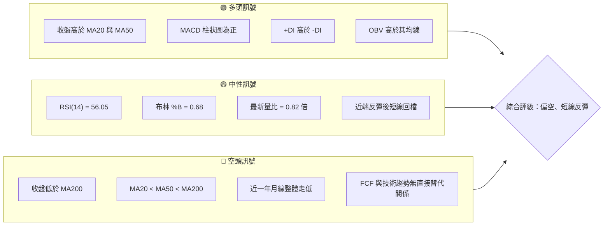
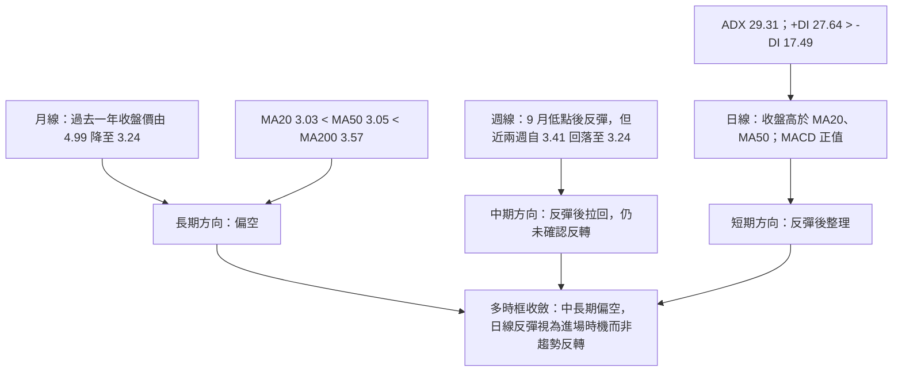
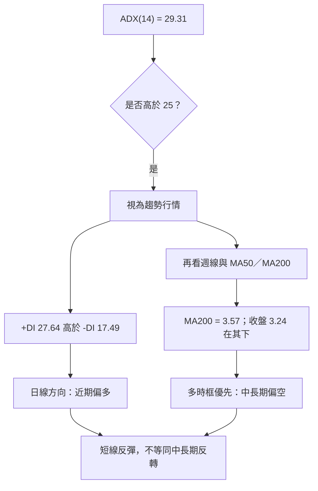
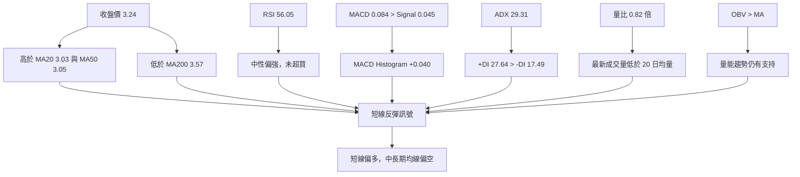
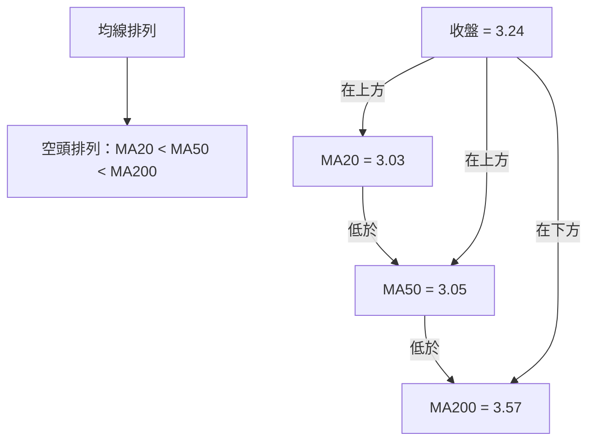
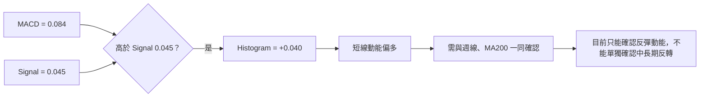
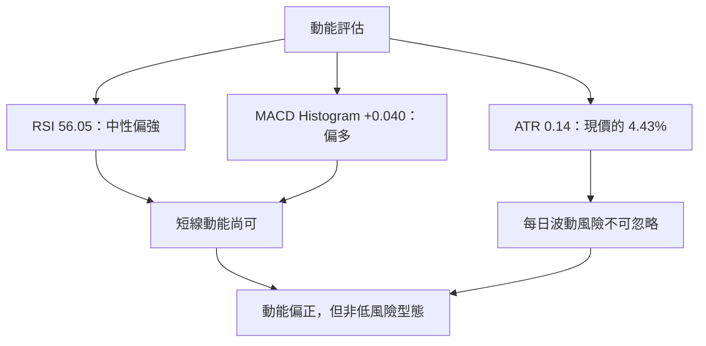
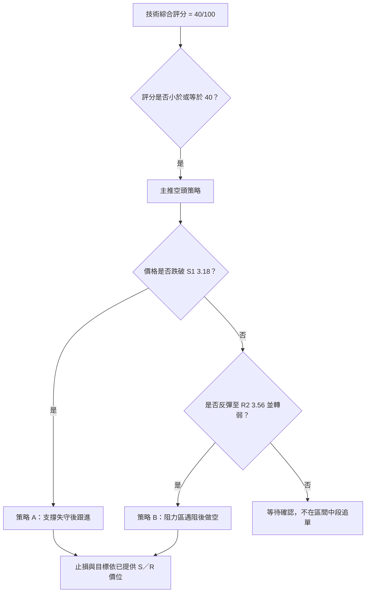
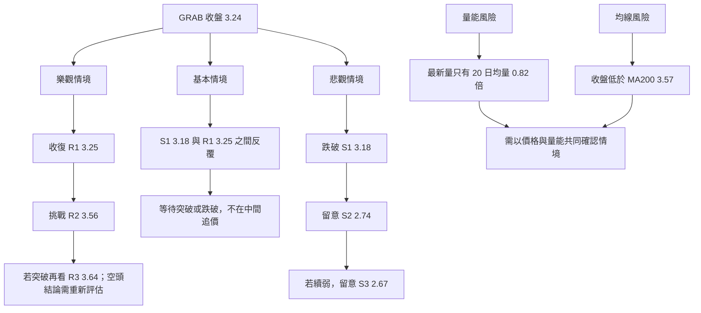

# GRAB 技術分析報告

> **報告日期**：2026-11-14 ｜ **語言**：繁體中文 ｜ **數據來源**：使用者提供之 Yahoo Finance 技術數據  
> **當前價格**：**$3.24**（2026-11-13 收盤價）

---

## 目錄

| 章節 | 內容 |
|------|------|
| 1. 技術面概覽 | 訊號儀表板、核心指標、評分卡 |
| 2. 趨勢分析 | 多時框趨勢、長中短期走勢 |
| 3. 圖表形態分析 | 形態識別、K 線組合、目標價 |
| 4. 支撐與阻力 | 關鍵價位、斐波那契回調 |
| 5. 技術指標深度解讀 | MA／RSI／MACD／布林／成交量 |
| 6. 動能與波動率 | 動能評估、ATR、Beta |
| 7. 多時框架總結 | 時框架評分矩陣 |
| 8. 交易策略建議 | 空頭主策略、風險報酬比 |
| 9. 風險提示與監控 | 監控指標、風險場景 |

---

## 1. 技術面概覽

### 🎯 技術訊號儀表板

GRAB 的訊號並非單邊一致。日線動能與短期趨勢偏多：收盤價高於 MA20、MA50，MACD 柱狀圖為正，且 +DI 高於 -DI。另一方面，價格仍低於 MA200，均線排列為空頭排列，過去一年月收盤價整體下行，且最新成交量低於 20 日均量。

因此，短線反彈訊號不能直接視為中長期反轉已確認。以下將「短線反彈」與「中長期趨勢」分開判斷。



### 📊 核心指標速覽表

| 指標類別 | 指標名稱 | 當前數值 | 訊號 | 解讀 |
|----------|----------|----------:|:---:|------|
| 價格 | 當前價格 | **$3.24** | 🟡 | 本報告唯一採用的當前價格，為 2026-11-13 收盤價 |
| 價格 | 52 週高／低 | $5.72／$2.67 | 🔴 | 現價位於 52 週區間約 18.7% 位置，仍靠近區間低端 |
| 均線 | MA20 | $3.03 | 🟢 | 收盤高於 MA20，短線有反彈延續跡象 |
| 均線 | MA50 | $3.05 | 🟢 | 收盤高於 MA50，但 MA50 本身仍低於 MA200 |
| 均線 | MA200 | $3.57 | 🔴 | 收盤低於 MA200，長期趨勢尚未扭轉 |
| 動能 | RSI(14) | 56.05 | 🟡 | 中性偏強，未進入超買或超賣區 |
| 動能 | MACD／訊號線 | 0.084／0.045 | 🟢 | MACD 高於訊號線，柱狀圖 +0.040 |
| 波動 | ATR(14) | $0.14 | 🟡 | 約為現價 4.43%，每日波動幅度不可忽視 |
| 趨勢 | ADX(14) | 29.31 | 🟡 | 趨勢強度高於 25；方向由 +DI 主導，但長期均線仍偏空 |
| 成交量 | 最新量／20 日均量 | 60.71M／73.88M | 🟡 | 量比 0.82 倍，反彈最新日成交量低於均量 |
| 成交量 | OBV 趨勢 | OBV > MA | 🟢 | 量能結構仍提供一定上漲支持，但需留意最新量不足 |

### 🏆 技術評分卡

評分為 1–10 分，進度條換算為百分比。六項子評分算術平均為  
\((4+6+4+5+3+3) ÷ 6 = 4.17\)，四捨五入為 **4/10，即 40/100**。

| 評分維度 | 分數 | 判斷依據 |
|----------|------:|----------|
| 趨勢強度 | 4/10 | ADX 顯示趨勢強，但長期方向由 MA200 及近一年走勢偏空，日線 +DI 多頭不能消除中長期弱勢 |
| 動能指標 | 6/10 | RSI 56.05、MACD 正值及柱狀圖為正，反彈動能偏正面 |
| 支撐穩定度 | 4/10 | S1 為 $3.18，距離現價很近；更下方支撐為 $2.74、$2.67，支撐層級間距較大 |
| 成交量配合 | 5/10 | OBV 高於均線偏多，但最新日量僅 20 日均量的 0.82 倍 |
| 形態完整度 | 3/10 | 數據未確認雙底、頭肩等成熟幾何形態；目前主要是急跌後反彈與回檔 |
| 均線排列 | 3/10 | 收盤站回 MA20、MA50，但 MA20 < MA50 < MA200，整體仍為空頭排列 |
| **綜合評分** | **4/10＝40/100** | **依六項子評分平均值四捨五入；依策略路由屬偏空區間** |

```text
╔══════════════════════════════════════════════════════════════╗
║                 技術評分卡 — GRAB                           ║
╠══════════════════════════════════════════════════════════════╣
║ 趨勢強度      ████░░░░░░░░░░░░░░░░  4/10   🟡               ║
║ 動能指標      ██████░░░░░░░░░░░░░░  6/10   🟢               ║
║ 支撐穩定度    ████░░░░░░░░░░░░░░░░  4/10   🟡               ║
║ 成交量配合    █████░░░░░░░░░░░░░░░  5/10   🟡               ║
║ 形態完整度    ███░░░░░░░░░░░░░░░░░  3/10   🔴               ║
║ 均線排列      ███░░░░░░░░░░░░░░░░░  3/10   🔴               ║
╠══════════════════════════════════════════════════════════════╣
║ 綜合評分      ████░░░░░░░░░░░░░░░░  4/10 = 40/100           ║
║ 評級：偏空；短線反彈訊號存在，但不足以確認中長期反轉       ║
╚══════════════════════════════════════════════════════════════╝
```

**本章結論：** 技術結構為「短線反彈、中長期偏空」。依規則中的評分路由，40/100 落入偏空策略區間；但空頭操作需要等待支撐失守或反彈至阻力後轉弱，不宜將日線正向動能忽略。

---

## 2. 趨勢分析

### 🌐 多時框趨勢分析



### 📈 長期趨勢 — 12 個月月線收盤走勢圖

以下使用提供的**月收盤價**製作；圖上為視覺化近似位置，右側逐月列出精確收盤價。月線資料不等同於月內高低價。

```text
GRAB 月線收盤走勢圖（2025-12 至 2026-11；每點為月收盤）
價格
$5.0 ┤ ●
$4.5 ┤    ●──●
$4.0 ┤          ●
$3.5 ┤             ●──●──●
$3.0 ┤                         ●
$2.5 ┤                            ●
     └────────────────────────────────────────
       12  01  02  03  04  05  06  07  08  09  10  11
       4.99 4.30 4.22 3.66 3.82 3.54 3.77 3.50 3.54 3.11 2.71 3.24
       2025                                      2026
```

| 月份 | 收盤價 | 月收盤變化 | 走勢特徵 |
|------|-------:|-----------:|----------|
| 2025-12 | $4.99 | — | 12 個月觀察起點 |
| 2026-01 | $4.30 | -13.83% | 月收盤明顯下跌 |
| 2026-02 | $4.22 | -1.86% | 低位延續 |
| 2026-03 | $3.66 | -13.27% | 下行加速 |
| 2026-04 | $3.82 | +4.37% | 月收盤反彈 |
| 2026-05 | $3.54 | -7.33% | 反彈未延續 |
| 2026-06 | $3.77 | +6.50% | 低位回升 |
| 2026-07 | $3.50 | -7.16% | 再度回落 |
| 2026-08 | $3.54 | +1.14% | 低位窄幅 |
| 2026-09 | $3.11 | -12.15% | 下行延續 |
| 2026-10 | $2.71 | -12.86% | 12 個月內月收盤低點 |
| 2026-11 | $3.24 | +19.56% | 反彈月；截至 11 月 13 日收盤 |

- 2025 年 12 月收盤 $4.99 至 2026 年 11 月收盤 $3.24：變化約 **-35.07%**。
- 2025 年 11 月收盤 $5.45 至 2026 年 11 月收盤 $3.24：變化約 **-40.55%**。
- 2026 年 10 月月收盤為 $2.71，2026 年 11 月回升至 $3.24；這是明確的月收盤反彈，但尚不足以改寫長期下降結構。
- 52 週最低價為 $2.67，屬於日內／波段低點數據，不應與 $2.71 的月收盤低點混為一談。

### 📊 中期趨勢（週線分析）

近 20 週數據顯示，7 月初週收盤約 $3.90–$3.93，之後一度跌至 9 月 18 日的 $2.80，接著反彈至 11 月 6 日的 $3.41，最新一週再收於 $3.24。

```text
GRAB 週線收盤與關鍵價位示意（使用提供的週收盤資料）

$3.93 ┤    ●
$3.66 ┤               ●
$3.41 ┤                                              ●──●
$3.19 ┤                              ●
$3.05 ┤                   ●
$2.80 ┤                       ●
$2.71 ┤                                                ●
      └──────────────────────────────────────────────────
        7月       8月       9月       10月       11月
        主要回落   震盪      低位反彈    回測      急彈後回落
```

| 週線階段 | 數據特徵 | 趨勢解讀 |
|----------|----------|----------|
| 2026-07 初至 07 中 | 週收盤 $3.90、$3.93 後回至 $3.57、$3.31 | 高位轉弱，週 RSI 由高位下降 |
| 2026-07 末至 08 月 | 收盤在 $3.48–$3.66 間變動 | 震盪整理，方向不穩 |
| 2026-09 中旬 | 週收盤 $3.05、$2.80；週 RSI 最低列示 23.3 | 急跌及超賣讀數，出現反彈條件但不代表趨勢反轉 |
| 2026-09 末至 10 月 | 週收盤回升至 $3.13、$3.19 後回到 $2.71 | 反彈未能維持，空頭壓力仍在 |
| 2026-11-06 至 11-13 | 週收盤 $3.41 後降至 $3.24 | 急彈後回檔；短週期動能仍正，但價格遭遇上方供給 |

### ⚡ 趨勢強度評估（ADX 解讀）

ADX(14) 為 **29.31**，高於 25 的常用趨勢門檻，因此按提供規則應視為趨勢行情而不是純粹盤整。方向性指標方面，+DI 27.64 高於 -DI 17.49，代表近期日線多頭方向較強；但 ADX 衡量的是趨勢強度，不是單獨判斷長期上漲的指標。

| ADX 數值區間 | 常見解讀 | GRAB 狀態 |
|--------------|----------|-----------|
| < 20 | 趨勢偏弱、可能盤整 | 否 |
| 20–25 | 趨勢發展中 | 否 |
| > 25 | 趨勢較明確 | **是：29.31** |
| +DI > -DI | 多方方向領先 | **是：27.64 > 17.49** |



**趨勢收斂：** ADX 顯示趨勢強度偏高，日線方向指標偏多；然而 MA200、均線排列及月線一年走勢偏空。依多時框優先規則，中長期方向仍以偏空為主，日線訊號用於判斷反彈與進場時機。

---

## 3. 圖表形態分析

### 🔍 形態識別系統

可用數據包含月收盤序列、週收盤序列、近 10 根日 K 及近 8 根週 K。這些資料足以辨識急跌、反彈和回檔，但不足以可靠確認複雜的頭肩、雙頂、雙底或三角形幾何結構。本節不為填充版面而強行命名形態。

| 形態／訊號 | 信心度 | 判斷依據 | 完成度 | 目標價 |
|-------------|-------:|----------|-------:|--------|
| 頭肩頂／頭肩底 | 低於 50% | 數據未提供足夠且可確認的頸線、肩部與頭部幾何結構 | 不適用 | 訊號不足，僅做指標型解讀 |
| 雙底 | 低於 50% | 週線有 $2.80 與後續 $2.71 一帶的低位資料，但兩低點的間隔、頸線突破和量能確認不足；且非同一週線低點的完整形態驗證 | 未確認 | 不以雙底形態高度推算 |
| 下降三角形／對稱三角形 | 低於 50% | 目前提供資料不足以確認足夠的高低點連線與收斂邊界 | 未確認 | 訊號不足 |
| 低位急跌後反彈 | 70% | 週收盤由 2026-10-30 的 $2.71 回升至 2026-11-06 的 $3.41；但 11-13 回落至 $3.24 | 反彈已發生、延續待確認 | 只以已列支撐阻力評估 |
| 均線／動能反彈訊號 | 75% | 收盤高於 MA20、MA50；MACD 高於訊號線、柱狀圖為正 | 已出現 | 非幾何形態，無形態高度目標 |

**本節結論：** 幾何形態訊號不足。較可靠的描述是「低位急跌後出現一波反彈，近期回落整理」，並以 MA、MACD、ADX 及已提供的支撐阻力位確認，而不是據此預設反轉目標價。

### 🕯️ 重要 K 線形態分析

以下形態判斷僅使用資料列出的近 10 根日 K、近 8 根週 K 開高低收。影線與實體的說明也只依據表內 OHLC。

| 日期（日 K） | 開 | 高 | 低 | 收 | K 線形態 | 解讀 | 訊號 |
|------|------:|------:|------:|------:|----------|------|:---:|
| 2026-11-02 | $2.76 | $2.93 | $2.75 | $2.86 | 收紅 K | 收盤高於開盤，當日高點未被突破前不代表趨勢反轉 | 🟢 |
| 2026-11-03 | $3.21 | $3.32 | $3.08 | $3.12 | 收黑 K | 收盤低於開盤，開收差距較大；與前一日收盤位置差異明顯 | 🔴 |
| 2026-11-04 | $3.22 | $3.39 | $3.20 | $3.36 | 收紅 K | 收盤接近高點，買方掌握當日收盤優勢 | 🟢 |
| 2026-11-05 | $3.35 | $3.50 | $3.27 | $3.48 | 收紅 K | 收盤靠近高點，反彈延續 | 🟢 |
| 2026-11-06 | $3.44 | $3.56 | $3.37 | $3.41 | 小實體、上影較長 | 高點明顯高於開收區，顯示上方有賣壓 | 🟡 |
| 2026-11-09 | $3.46 | $3.50 | $3.38 | $3.44 | 小實體 | 開收差距小，雙方暫時拉鋸 | 🟡 |
| 2026-11-10 | $3.34 | $3.39 | $3.28 | $3.35 | 小實體 | 當日收盤略高於開盤，方向性有限 | 🟡 |
| 2026-11-11 | $3.32 | $3.38 | $3.27 | $3.33 | 小實體 | 窄幅整理，未出現明確趨勢型長 K | 🟡 |
| 2026-11-12 | $3.33 | $3.34 | $3.21 | $3.24 | 收黑 K | 收盤低於開盤，低點接近但仍高於週線 $3.20 低點 | 🔴 |
| 2026-11-13 | $3.24 | $3.28 | $3.20 | $3.24 | 十字星／近十字星 | 開收相同，日內高低幅度相對有限；代表猶豫，不單獨構成反轉 | 🟡 |

| 日期（週 K） | 開 | 高 | 低 | 收 | K 線形態 | 解讀 | 訊號 |
|------|------:|------:|------:|------:|----------|------|:---:|
| 2026-09-25 | $2.84 | $3.26 | $2.78 | $3.13 | 長實體收紅 K | 低位回升，收盤顯著高於開盤 | 🟢 |
| 2026-10-02 | $3.10 | $3.18 | $3.07 | $3.08 | 小實體收黑 K | 窄幅且略偏弱，趨勢延續性有限 | 🟡 |
| 2026-10-09 | $3.10 | $3.23 | $3.00 | $3.19 | 收紅 K | 收盤高於開盤，反彈仍在 | 🟢 |
| 2026-10-16 | $3.16 | $3.20 | $2.85 | $2.94 | 長實體收黑 K | 高開後回落，週內賣壓明顯 | 🔴 |
| 2026-10-23 | $2.93 | $2.94 | $2.77 | $2.79 | 收黑 K | 收盤接近週低，弱勢延續 | 🔴 |
| 2026-10-30 | $2.79 | $2.80 | $2.67 | $2.71 | 收黑 K | 週內低點觸及提供的 52 週低點 $2.67，週收仍偏弱 | 🔴 |
| 2026-11-06 | $2.76 | $3.56 | $2.75 | $3.41 | 大幅收紅、長波幅 K | 一週內大幅反彈，但波幅極大；須等待後續週線確認 | 🟢 |
| 2026-11-13 | $3.46 | $3.50 | $3.20 | $3.24 | 收黑 K | 在前週急彈後回落，顯示 $3.50 附近上方供給壓力 | 🔴 |

### 📉 ASCII 走勢形態示意圖

```text
近週走勢示意（依提供週收盤；非另行推算的幾何形態）

$3.50 ┤                                           高點 $3.50
$3.41 ┤                                  ●──────╲  11/06 收 $3.41
$3.24 ┤                                            ● 11/13 收 $3.24
$3.19 ┤                     ●
$3.13 ┤             ●
$2.94 ┤                         ●
$2.79 ┤                             ●
$2.71 ┤                                 ●
$2.67 ┤                                 週低／52 週低
       └─────────────────────────────────────────────
        9/25   10/02   10/09   10/16   10/23  10/30  11/06  11/13
```

### 🎯 形態目標價計算

目前未確認可量度的頭肩、雙底、旗形或三角形，因此**沒有可依形態高度推算的目標價**。避免使用未經 OHLCV 形態確認的頸線或任意價位。

後續價格情境僅引用已提供的關鍵價位：

- 上方參考：R1 **$3.25**、R2 **$3.56**、R3 **$3.64**。
- 下方參考：S1 **$3.18**、S2 **$2.74**、S3 **$2.67**。
- 以上為技術數據包列出的波段聚類價位，不是形態高度推算目標。

---

## 4. 支撐與阻力

### 🗺️ 關鍵價位分布圖

下圖只採用技術數據包列出的 R1–R3、S1–S3 與收盤價；標示「現價」的線為收盤價 $3.24。

```text
GRAB 價位結構分布圖（USD）

$3.64 ║████████████████████████║ R3 阻力
$3.56 ║████████████████████    ║ R2 阻力
$3.25 ║████████████████████████║ R1 阻力
$3.24 ╠════════════════════════╣ ◄ 現價（收盤）
$3.18 ║▓▓▓▓▓▓▓▓▓▓▓▓▓▓▓▓        ║ S1 支撐
$2.74 ║████████████████████    ║ S2 支撐
$2.67 ║████████████████████████║ S3／52 週低
       ╚════════════════════════╝
```

### 🚧 阻力位分析表

| 阻力級別 | 價位 | 與現價距離（資料提供） | 形成原因 | 突破難度 | 重要性 |
|----------|------:|-------------------------:|----------|----------|--------|
| R1 | **$3.25** | +0.15% | 近一年波段高點聚類；距收盤價非常近 | 中 | 高；短線多空分界附近 |
| R2 | **$3.56** | +9.88% | 近一年波段高點聚類；與 MA200 $3.57 價格接近，但不是同一類指標 | 中至高 | 高；突破後才可改善中期結構 |
| R3 | **$3.64** | +12.42% | 近一年波段高點聚類 | 高 | 高；較上方的供給參考區 |

**解讀：**

- R1 $3.25 僅略高於收盤 $3.24，短線若無法重新站上並守穩，反彈容易受阻。
- R2 $3.56 與 MA200 $3.57 價格非常接近；前者是波段高點聚類，後者是移動平均，性質不同，但共同構成上方技術壓力。
- R3 $3.64 是更上層的阻力參考，若價格升至此處，需要觀察量能及週線收盤是否支持突破。

### 🛡️ 支撐位分析表

| 支撐級別 | 價位 | 與現價距離（資料提供） | 形成原因 | 守住機率 | 重要性 |
|----------|------:|-------------------------:|----------|----------|--------|
| S1 | **$3.18** | -1.85% | 近一年波段低點聚類 | 中低 | 高；距離現價近，跌破可觸發短線轉弱 |
| S2 | **$2.74** | -15.43% | 近一年波段低點聚類 | 中 | 高；若 S1 失守，需留意此下一層支撐 |
| S3 | **$2.67** | -17.59% | 近一年波段低點聚類，亦為 52 週低點 | 中 | 高；重要的 52 週低位參考 |

> **守住機率為質化判讀，並非統計模型結果。** 提供的資料未包含支撐位歷史測試次數與成交量分布，故不將機率假裝成精確量化值。

### 📐 斐波那契回調位分析

下表直接引用已提供的 52 週區間回調位，不重新計算。

| 回調位 | 價格 |
|--------|------:|
| 0.0%（52 週高） | $5.72 |
| 23.6% | $5.00 |
| 38.2% | $4.55 |
| 50.0% | $4.19 |
| 61.8% | $3.84 |
| 78.6% | $3.32 |
| 100.0%（52 週低） | $2.67 |

現價 **$3.24** 低於 78.6% 回調位 **$3.32**，且高於 52 週低點 **$2.67**。換言之，現價處於 **78.6% 回調位 $3.32 與 100.0% 回調位 $2.67 之間**，位於較深的回撤區域。

```text
斐波那契價位位置（由高到低）

$5.72 ─ 0.0%（52 週高）
$5.00 ─ 23.6%
$4.55 ─ 38.2%
$4.19 ─ 50.0%
$3.84 ─ 61.8%
$3.32 ─ 78.6%
$3.24 ─ 現價
$2.67 ─ 100.0%（52 週低）
```

---

## 5. 技術指標深度解讀

### 🎛️ 指標訊號總覽



### 📈 移動平均線排列分析

| 均線 | 數值 | 收盤價與均線關係 | 方向／解讀 |
|------|------:|----------------|------------|
| MA5 | $3.32 | 收盤 $3.24 在下方 | 短線動能近端回落 |
| MA10 | $3.28 | 收盤 $3.24 在下方 | 近幾日回檔仍未完全修復 |
| MA20 | $3.03 | 收盤在上方 | 短線反彈結構仍保留 |
| MA50 | $3.05 | 收盤在上方 | 中短期價格暫站回均線上 |
| MA200 | $3.57 | 收盤在下方 | 長期趨勢壓力仍在 |

均線排列為 **MA20 $3.03 < MA50 $3.05 < MA200 $3.57**，屬空頭排列。值得注意的是，現價雖高於 MA20、MA50，卻低於 MA5、MA10 及 MA200，反映近端反彈後略有回落，且長期趨勢並未轉多。



### 📉 RSI(14) 分析

- RSI(14) 為 **56.05**，落在一般中性區間 30–70。
- RSI 由中性區偏上，與 MACD 正值、+DI 高於 -DI 一致，支持短線反彈仍有動能。
- RSI 未達常見超買門檻，因此目前不能單以 RSI 判定短線已過熱。
- 數據包明確給出的 RSI 背離判斷為：**無明顯背離**。此判斷是比較近 20 根 K 棒首尾的價格與 RSI 方向。

```text
RSI(14) 強度尺
超賣區         中性區                         超買區
0 ├────────────30──────────────56.05──────────70────────100
                              ██████░░░░
                              中性偏強
```

| RSI 項目 | 判斷 |
|----------|------|
| 當前值 | 56.05 |
| 超買／超賣 | 未超買，亦未超賣 |
| 方向含義 | 短線動能偏正面，但尚非極強趨勢讀數 |
| 背離 | **無明顯頂背離或底背離** |
| 與其他指標整合 | 與 MACD、+DI 短線偏多訊號一致；與 MA200 以下的長期空頭結構相矛盾 |

### 📊 MACD(12/26/9) 訊號解讀

MACD 為 **0.084**，訊號線為 **0.045**，柱狀圖為 **+0.040**。MACD 線高於訊號線且柱狀圖為正，反映近期動能偏多。



- **日線確認：** MACD 線與柱狀圖均為正，配合 RSI 56.05，短線上行動能尚未完全消失。
- **成交量限制：** 最新日量低於 20 日均量，反彈的最新一日成交量確認不足。
- **多時框限制：** 週收盤由 $3.41 回落至 $3.24，且收盤仍低於 MA200，故 MACD 正值不等於長期趨勢反轉。
- **背離判斷：** RSI 提供的結論為無明顯背離；MACD 缺少足夠歷史轉折點序列供獨立背離檢驗，故不宣稱存在 MACD 頂背離或底背離。

### 📦 布林通道分析

布林上軌 **$3.61**、中軌（MA20）**$3.03**、下軌 **$2.46**；現價 **$3.24**，布林 %B **0.68**。

```text
布林通道（USD）

$3.61 ───────────── 上軌
                  ╲
$3.24 ───────────●── 現價；%B = 0.68
                   ╲
$3.03 ───────────── 中軌（MA20）
                    ╲
$2.46 ───────────── 下軌
```

- 現價位於布林中軌與上軌之間，短線位置偏向通道上半部。
- %B 0.68 表示價格高於中軌，但尚未接近上軌極端位置。
- 上軌 $3.61 與 R2 $3.56 價位接近；這形成技術觀察上的重疊壓力區，但不能將兩個不同計算方法視作同一價位。
- 本報告的 ADX 29.31 高於 25，按多時框規則屬趨勢行情；因此布林通道作為動能與位置輔助，不取代中長期趨勢判斷。

### 💹 成交量分析（量價配合度）

| 成交量觀察 | 數值 | 技術解讀 |
|------------|------:|----------|
| 最新日成交量 | 60,713,986 | 低於 20 日及 50 日均量 |
| 20 日均量 | 73,877,784 | 最新量約 0.82 倍 |
| 50 日均量 | 75,452,000 | 最新量亦低於中期均量 |
| 最新週成交量 | 395,544,986 | 低於 2026-11-06 週的 567,802,900 |
| OBV 趨勢 | OBV > MA | 累積量能趨勢仍支持價格反彈 |

量價訊號屬混合：

1. **支持多方的一面：** OBV 高於其均線，表示量能累積趨勢仍偏正面。
2. **限制反彈品質的一面：** 最新日量為 20 日均量的 0.82 倍，且最新週成交量低於前一週急彈週。
3. **綜合判斷：** 量價尚未形成明確空方背離，但近期價格回檔時量能確認不足以證明買盤持續主導；OBV 偏多、即時成交量偏弱，應同時保留兩種訊號。

---

## 6. 動能與波動率

### ⚡ 動能評估四象限

將動能與波動分開觀察：MACD、RSI、+DI 顯示短期動能偏正面；ATR 為現價的 4.43%，屬不可忽略的日常波動。這使 GRAB 位於「動能尚可、波動偏高」的風險敏感區，而不是低波動的趨勢交易標的。

| 象限 | 動能 | 波動 | 典型狀態 | GRAB 判斷 |
|------|------|------|----------|-----------|
| Q1 | 強 | 低 | 趨勢較平順 | 否 |
| Q2 | 弱 | 低 | 低波動觀望 | 否 |
| Q3 | 強 | 高 | 高風險、高收益 | **部分符合：短線動能偏正，ATR 約 4.43%** |
| Q4 | 弱 | 高 | 波動高但方向不足 | 近中期有此風險；若 MACD 轉負需重新評估 |



### 📊 ATR 波動率分析

| 項目 | 數值 | 解讀 |
|------|------:|------|
| ATR(14) | **$0.14** | Wilder 方法 |
| ATR／現價 | **4.43%** | 每日波動尺度對低價股價格而言具實質影響 |
| 現價 | $3.24 | 以收盤價作為比較基準 |
| 波動性判斷 | 中偏高 | 不應將 ATR 當成精確支撐或阻力位 |

ATR 可用於衡量部位風險，但本報告的支撐、阻力及交易止損價均依規則採用已提供的關鍵價位，不以 ATR 推造新的精確價位。交易者若以部位大小控制風險，應將 $0.14 的 ATR 納入考量，避免倉位過大造成單日波動便超出風險承受能力。

### 📐 Beta 與市場相關性

- GRAB Beta 為 **0.833**。
- 依此 Beta，歷史上 GRAB 對市場整體波動的敏感度低於 Beta=1 的參考值；但 Beta 不是與大盤相關係數，不能由 Beta 單獨推導精確相關性。
- 提供資料未列出 GRAB 與任何指數的相關係數、回歸期間或回歸頻率，因此相關係數為 **N/A（數據未提供）**。
- Beta 不代表個股不會出現更大波動；GRAB 自身 ATR 約為現價 4.43%，仍需獨立管理個股波動風險。

---

## 7. 多時框架總結

### 📋 時框架評分表

以下評分為技術結構的方向性整理，綜合評分卡的整體結果仍為 **40/100**，不因本節另行加權而改變。

| 時框架 | 趨勢方向 | 動能 | 均線排列 | 形態 | 綜合評分 | 建議 |
|--------|----------|------|----------|------|---------:|------|
| 月線／長期 | 🔴 偏空 | 🟡 月線反彈 | 🔴 低於 MA200 | 🟡 尚未確認反轉 | 3/10 | 不因單月反彈判定長期趨勢翻多 |
| 週線／中期 | 🔴 偏空至中性 | 🟡 急彈後回檔 | 🔴 長期均線仍壓制 | 🟡 反彈結構未完成確認 | 4/10 | 觀察支撐與阻力突破／失守 |
| 日線／短期 | 🟢 反彈後整理 | 🟢 RSI、MACD 偏正 | 🟡 高於 MA20／MA50，低於 MA5／MA10／MA200 | 🟡 無明確幾何形態 | 6/10 | 日線反彈用於安排進場，不單獨判斷長期方向 |
| **綜合** | **🔴 偏空** | **🟡 短線偏多** | **🔴 空頭排列** | **🟡 形態未確認** | **40/100** | **主策略偏空；等待觸發確認** |

### 🔲 綜合訊號矩陣

| 觀察維度 | 短期（日線） | 中期（週線） | 長期（月線／MA200） | 一致性 |
|----------|--------------|--------------|----------------------|--------|
| 價格方向 | 反彈後回檔 | 急彈後回落 | 近一年下降 | 不一致 |
| 動能 | MACD 正值、RSI 56.05 | 週 RSI 由低位回升後回落 | 缺少月 RSI／月 MACD | 部分一致 |
| 均線 | 高於 MA20、MA50；低於 MA5、MA10 | 未提供週均線明細 | MA200 高於現價；MA20<MA50<MA200 | 偏空 |
| 成交量 | 最新日量低於 20 日均量 | 急彈週量較高，下一週量回落 | OBV > MA | 混合 |
| 結論 | 短線反彈但暫停 | 回檔風險仍在 | 長期仍偏空 | 中長期偏空為主 |

### ⚖️ 多時框收斂結論

1. **行情類型：** ADX(14) = **29.31 > 25**，按規則屬趨勢行情，不將布林通道上下軌作為主導交易區間。
2. **主導時框：** 趨勢行情下依中長期方向優先。月線近一年月收盤整體走低，MA20 < MA50 < MA200，現價 $3.24 低於 MA200 $3.57。
3. **日線角色：** 日線 RSI、MACD、+DI 目前偏多，視為反彈與進場時機訊號，不能單獨推翻週線及長期均線偏空結構。
4. **唯一方向性結論：****偏空**。這表示中長期趨勢仍偏弱，不代表現價立即做空；應等待支撐跌破，或反彈至阻力後出現轉弱確認。
5. **與第 8 章一致性：** 第 8 章依綜合評分 40/100 採偏空主策略；進場條件以阻力轉弱或支撐失守確認，與本章結論一致。

---

## 8. 交易策略建議

### 🗺️ 策略決策流程圖



**當前主策略方向 = 偏空（依評分 40/100）。**  
這不是無條件立即做空的指示；現價高於 MA20、MA50，短線 MACD 為正，因此策略必須等待觸發，不宜在支撐附近盲目追空。

### 🧭 價格情境階梯（Price Scenarios）

| 觸發條件 | 下一目標 | 後續延伸 | 情境含義 |
|----------|----------|----------|----------|
| 反彈站上 R1 $3.25，並進一步突破 R2 $3.56 | R2 $3.56 | R3 $3.64 | 短線轉強；若能站穩，偏空判斷需要重新評估 |
| 現價附近維持於 S1 $3.18 與 R1 $3.25 間 | — | — | 短線觀望區；若無突破或失守，不追價 |
| 跌破 S1 $3.18 | S2 $2.74 | S3 $2.67 | 支撐失守，符合偏空延續情境 |
| 上行未能突破 R2 $3.56，並轉弱 | S1 $3.18 | S2 $2.74 | 阻力區遇阻後回落；需有價格轉弱訊號確認 |

### 📊 情境機率分佈

以下為依目前技術結構作出的**主觀情境估計**，不是歷史回測所得概率；三項合計 100%。

| 情境 | 機率 | 主要依據 |
|------|-----:|----------|
| 繼續上行／反彈 | 30% | RSI 56.05、MACD Histogram +0.040、+DI 高於 -DI、OBV > MA；但最新成交量低於 20 日均量，且 MA200 在上方 |
| 區間震盪 | 25% | 現價 $3.24 接近 R1 $3.25 與 S1 $3.18；短期訊號混合，暫無明確幾何形態 |
| 回落／再探底 | 45% | 綜合評分 40/100、MA20<MA50<MA200、價格低於 MA200，且近期週線急彈後回落 |

### 🟢 主策略詳情（偏空）

以下兩種為**擇一等待觸發**的空頭執行方式，並非同時建立兩筆空頭部位。價格均使用現有關鍵價位或當前收盤價；風險報酬比依指定公式計算。

| 策略要素 | 策略 A：跌破支撐後跟進 | 策略 B：阻力區轉弱後做空 |
|----------|-------------------------|-------------------------|
| 進場條件 | 日線確認跌破 S1，按 S1 價位作策略計算基準 | 價格升至 R2，並出現受阻或轉弱確認後進場 |
| 進場價格 | **$3.18** | **$3.56** |
| 目標價 T1 | **$2.74（S2）** | **$3.18（S1）** |
| 目標價 T2 | **$2.67（S3）** | **$2.74（S2）** |
| 止損價格 | **$3.24（當前收盤價）** | **$3.64（R3）** |
| 風險報酬比（T1） | **1 : 7.33** | **1 : 4.75** |
| 風險報酬比（T2） | **1 : 8.50** | **1 : 10.25** |
| 成功機率估計 | 45% | 50% |
| 建議倉位 | 風險承受額度內的小倉位；不因高 R 倍數放大名目風險 | 風險承受額度內的小倉位；等待轉弱確認後才評估 |

**風險報酬比計算：**

- **策略 A，空頭：**  
  T1 報酬 = $3.18 − $2.74 = $0.44；風險 = $3.24 − $3.18 = $0.06。  
  風險報酬比 = $0.44 ÷ $0.06 = **1 : 7.33（以 T1 計）**。  
  T2 報酬 = $3.18 − $2.67 = $0.51；$0.51 ÷ $0.06 = **1 : 8.50（以 T2 計）**。
- **策略 B，空頭：**  
  T1 報酬 = $3.56 − $3.18 = $0.38；風險 = $3.64 − $3.56 = $0.08。  
  $0.38 ÷ $0.08 = **1 : 4.75（以 T1 計）**。  
  T2 報酬 = $3.56 − $2.74 = $0.82；$0.82 ÷ $0.08 = **1 : 10.25（以 T2 計）**。

> 風險報酬比是以指定價位作數學計算，不代表價格必然到達目標，也未包含滑價、借券成本、交易費用或跳空風險。策略 A 的止損在此用當前收盤價 $3.24 作為規則允許的已提供價位；實際執行應確認成交價與下單方式，不能假設止損一定按此價格成交。

### 🔴 反向風險觸發點（對沖提示）

以下訊號會削弱偏空主策略，不構成獨立多頭策略：

- 收盤突破並守住 **R2 $3.56**，進一步挑戰 **R3 $3.64**。
- 價格重新站回 **MA200 $3.57** 上方，並有成交量配合。
- MACD 柱狀圖由正值轉負，或 +DI 反轉低於 -DI，則日線反彈動能可能衰退；相反，若動能持續改善，空頭策略應降低執行積極度。
- S1 **$3.18** 未跌破、且價格反而持續站在 R1 **$3.25** 上方，則支撐失守型策略尚未觸發。

### ⭐ 整體訊號強度評星

```text
做多訊號強度：★★★☆☆  (3/5 星；日線動能偏多，但低於 MA200)
做空訊號強度：★★★☆☆  (3/5 星；中長期偏空，但短線反彈訊號仍在)
整體可信度：  ★★★☆☆  (3/5 星；方向偏空，進場需等價位確認)
```

---

## 9. 風險提示與監控

### ✅ 關鍵監控指標 Checklist

```text
╔══════════════════════════════════════════════════════════════╗
║                    GRAB 技術監控清單                         ║
╠══════════════════════════════════════════════════════════════╣
║ □ 現價與 S1 $3.18：確認是否有效失守或成功守住                ║
║ □ R1 $3.25：收盤能否站回並延續                                ║
║ □ R2 $3.56：中期反彈是否有能力突破                            ║
║ □ R3 $3.64：更上方阻力是否遭遇賣壓                            ║
║ □ MA200 $3.57：收盤是否收復長期均線                            ║
║ □ RSI(14) 56.05：觀察是否持續上升或跌回中性偏弱               ║
║ □ MACD Histogram +0.040：觀察正柱是否擴大或轉負               ║
║ □ +DI 27.64／-DI 17.49：多方方向優勢是否延續                  ║
║ □ 最新成交量 60.71M：比較 20 日均量 73.88M                   ║
║ □ OBV > MA：觀察量能支持是否轉弱                              ║
║ □ ATR $0.14：估算個股日常波動與總倉位風險                    ║
╚══════════════════════════════════════════════════════════════╝
```

### ⚠️ 風險場景分析



| 風險項目 | 可能影響 | 監控方式 |
|----------|----------|----------|
| 支撐失守 | S1 $3.18 跌破後，技術結構可能轉弱並下看 S2、S3 | 觀察日線收盤是否跌破，而非只看盤中短暫穿越 |
| 反彈延續 | MACD 正值與 RSI 中性偏強，可能帶動短線反彈，空頭部位承受逆向波動 | 觀察 R1、R2 及 MA200 的突破與成交量 |
| 成交量不足 | 最新日量低於 20 日均量，可能削弱反彈確認度 | 比較價格走勢、OBV 與 20 日均量 |
| ATR 波動 | ATR 約為現價 4.43%，價格可能在短期內有明顯波動 | 部位大小應以可承受損失反推，而非固定持股數 |
| 跳空／滑價 | 價格跳過止損位時，實際成交可能不等於設定價 | 避免將預設止損視為保證成交價格 |
| 多時框反向 | 日線反彈方向與長期均線方向相反 | 依 ADX 趨勢規則，以中長期方向作主，日線只作進場參考 |
| 形態誤判 | 尚未確認雙底、頭肩等形態，過早假定反轉會提高交易失誤風險 | 以已提供指標與關鍵價位為主，不預設形態目標 |

### 🛡️ 風險管理重要提醒

1. **先定最大可承受損失，再決定倉位。** 交易風險應按進場價至止損價的距離與可承受損失計算，而不是因表面風險報酬比高就放大部位。
2. **短線反彈可能讓空頭策略出現逆勢波動。** 現價高於 MA20、MA50，且 MACD 與 +DI 偏多，空頭進場應等候指定觸發條件。
3. **止損可能出現滑價。** ATR $0.14 代表波動並不低，市場急速變動時，實際成交價可能偏離預設止損價。
4. **避免在支撐附近追空。** 若 S1 $3.18 未失守，價格仍可能反彈至 R1 $3.25 或更上方；確認失守後再評估，避免在短線支撐處過早建立空頭部位。
5. **避免把技術目標視為保證價位。** S2 $2.74、S3 $2.67 是資料提供的支撐位，不代表市場一定會到達。
6. **本報告不含即時盤中資料。** 分析依 2026-11-13 收盤及所提供指標快照，若後續價格或成交量有變化，應重新評估。

---

## 📋 報告總結

```text
╔══════════════════════════════════════════════════════════════╗
║                 GRAB 技術分析報告總結                       ║
╠══════════════════════════════════════════════════════════════╣
║ 報告日期：2026-11-14                                         ║
║ 當前價格：$3.24（2026-11-13 收盤）                           ║
║ 綜合評分：40/100；六項子評分平均後四捨五入                   ║
║ 分析評級：偏空；日線有反彈動能，中長期趨勢仍偏弱             ║
╠══════════════════════════════════════════════════════════════╣
║ 長期趨勢：🔴 月線近一年走低，價格低於 MA200 $3.57            ║
║ 中期趨勢：🔴 週線急彈後回檔，尚未確認反轉                   ║
║ 短期趨勢：🟡 高於 MA20／MA50，但低於 MA5／MA10              ║
║ 關鍵支撐：$3.18；下方參考 $2.74、$2.67                      ║
║ 關鍵阻力：$3.25；上方參考 $3.56、$3.64                      ║
║ 分析師目標：均值 $5.39（分析師共識，不是本報告技術目標）     ║
╠══════════════════════════════════════════════════════════════╣
║ 最優策略組合：                                                 ║
║ 1. 🥇 等待 S1 $3.18 確認失守後，再評估空頭跟進                ║
║ 2. 🥈 若反彈至 R2 $3.56 並轉弱，再評估阻力轉弱型空頭策略      ║
║ 3. 🥉 若價格留在 S1 $3.18 與 R1 $3.25 間，優先等待確認       ║
╚══════════════════════════════════════════════════════════════╝
```

> ⚠️ **免責聲明**：本報告為依據使用者提供之技術數據製作的分析內容，僅供研究與學術參考，不構成投資、交易或金融建議。技術指標及歷史價格無法保證未來走勢；交易可能造成本金損失，請依個人風險承受能力審慎決策。

---

*報告生成時間：2026-11-14 ｜ 數據來源：使用者提供之 Yahoo Finance 數據 ｜ 分析框架：多時框技術分析*