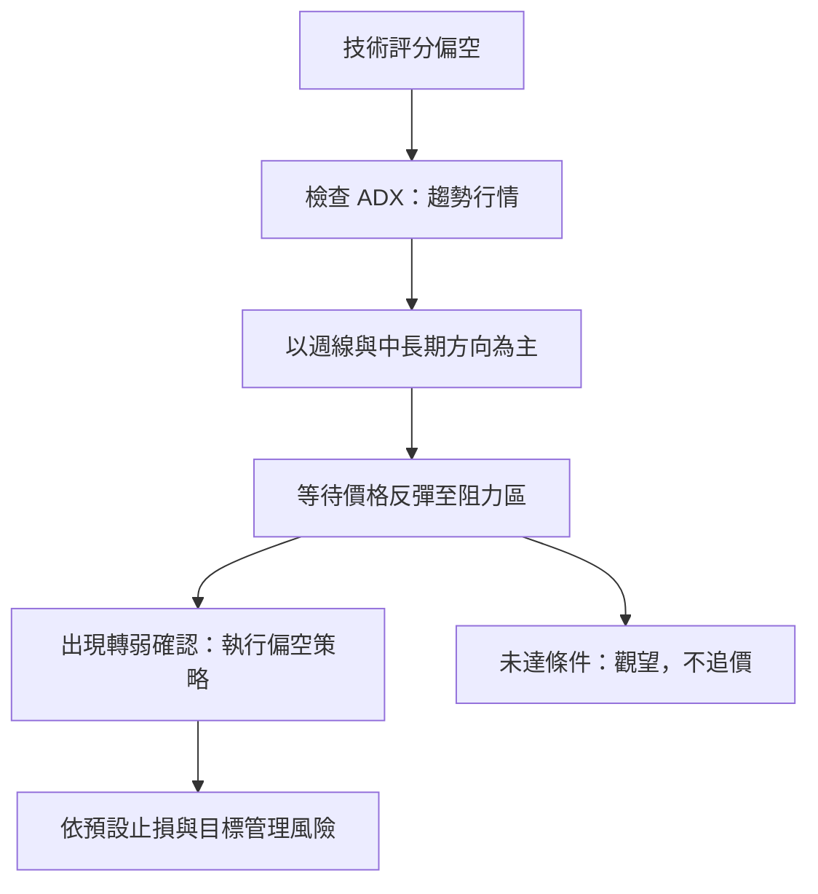

# GRAB 技術分析報告

> **報告日期**：2026-11-18 ｜ **語言**：繁體中文 ｜ **數據來源**：Yahoo Finance ｜ **當前價格**：$3.18 USD（2026-11-17 收盤）

---

## 目錄

| 章節 | 內容 |
|------|------|
| [1. 技術面概覽](#1-技術面概覽) | 核心指標速覽、評分卡 |
| [2. 趨勢分析](#2-趨勢分析) | 長中短期走勢、ADX |
| [3. 圖表形態分析](#3-圖表形態分析) | 形態、K 線、缺口 |
| [4. 支撐與阻力](#4-支撐與阻力) | 關鍵價位、斐波那契 |
| [5. 技術指標深度解讀](#5-技術指標深度解讀) | MA、RSI、MACD、布林、成交量、進階指標 |
| [6. 動能與波動率](#6-動能與波動率) | ATR、Beta、相對強度 |
| [7. 多時框架總結](#7-多時框架總結) | 時框架方向與收斂 |
| [8. 交易策略建議](#8-交易策略建議) | 歷史基準、情境、策略 |
| [9. 風險提示與監控](#9-風險提示與監控) | 監控指標、風險場景 |

---

## 1. 技術面概覽

GRAB 短線動能有所修復，但中長期方向仍偏弱：月線與週線都在各自趨勢均線下方，且多時框方向以偏空為主。日線動能、價格相對強弱與短均線提供反彈訊號，但 OBV 與 A/D 線未能確認價格反彈，量價配合仍是主要疑慮。最大反向風險是日線反彈延續並有效突破上方阻力，迫使偏空策略撤退。

### 📊 核心指標速覽表

| 指標類別 | 指標名稱 | 當前數值 | 訊號 | 解讀 |
|----------|----------|----------|------|------|
| **價格** | 當前價格 | $3.18 | 🟡 | 位於一年價格區間偏低區域，短線已由低點反彈。 |
| **均線** | MA20 / MA50 / MA200 | 見第 5 章 | 🔴 | 價格高於短期均線，但低於長期均線，排列混合。 |
| **動能** | RSI(14)（日線） | 見第 5 章 | 🟡 | 中性區，未顯示極端超買或超賣。 |
| **動能** | MACD 柱（日線） | 見第 5 章 | 🟢 | 日線柱值為正，短線動能偏多，與中長期方向相抵。 |
| **趨勢** | ADX(14) | 見第 2 章 | 🟡 | 趨勢強度達趨勢行情門檻，但方向須由週線及長期均線收斂。 |
| **波動** | ATR(14) | 見第 6 章 | 🟡 | 日常波動相對價格不低，部位與止損需留足風險空間。 |
| **多時框** | 一致性 | 見第 7 章 | 🔴 | 三個時框中兩個偏空，日線偏多，方向分歧。 |

### 🏆 技術評分卡

綜合評分採六項子評分算術平均，並四捨五入至整數。評分衡量技術面對多頭方向的支持程度；較低分數並不代表短線必然下跌，而代表多頭訊號不足以推翻中長期偏弱結構。

| 維度 | 評分（0–100） | 訊號 | 主要依據（引用數值所在章節） |
|------|---------------|------|------------------------------|
| 趨勢強度 | 42 | 🔴 | 趨勢強度已達趨勢行情門檻，但週線與月線均偏空，見第 2、7 章。 |
| 動能指標 | 45 | 🟡 | 日線動能偏多但仍在中性區，且沒有背離確認，見第 5 章。 |
| 支撐穩定度 | 40 | 🔴 | 現價附近支撐需重新確認，較下方支撐間距偏大，見第 4 章。 |
| 成交量配合 | 30 | 🔴 | OBV 與 A/D 未確認近期反彈，見第 5 章。 |
| 形態完整度 | 40 | 🔴 | 尚無足夠幾何證據確認反轉形態，缺口仍可能成為價格磁吸區，見第 3 章。 |
| 均線排列 | 32 | 🔴 | 價格仍在長期均線下方，均線排列混合，見第 5 章。 |
| **綜合評分** | **38** | **偏空** | 六項平均：\((42+45+40+30+40+32)÷6=38.17\)，四捨五入為 38。 |

---

## 2. 趨勢分析

**結論：長期下行結構尚未扭轉，中期雖有反彈修復，仍未完成趨勢反轉確認。**月收盤在最近一段期間顯著下移；週線曾出現快速反彈，但其後回落，且週線趨勢方向仍偏空。日線 ADX 顯示趨勢強度達門檻，因此依多時框規則，由週線與長期均線方向主導，日線只用於尋找進場時機。

### 📈 長期趨勢（近 12 個月）

下表以已完成月份的收盤資料整理趨勢階段。最新未完結月份不在此重列，以免將月內收盤誤作完整月收盤。

| 期間 | 起訖月收盤 | 漲跌幅 | 特徵 |
|------|------------|--------|------|
| 2025-12 至 2026-03 | $4.99 → $3.66 | -26.7% | 持續下行，月收盤逐步走低，長期賣壓明顯。 |
| 2026-03 至 2026-06 | $3.66 → $3.77 | +3.0% | 低位震盪後小幅回升，尚不足以確認趨勢反轉。 |
| 2026-06 至 2026-10 | $3.77 → $2.71 | -28.1% | 再度走弱，並持續壓低月收盤，長期趨勢偏空。 |
| 2025-12 至 2026-10 | $4.99 → $2.71 | -45.7% | 約十一個月內長期跌勢占主導；期間反彈未改變主要方向。 |

**長期判讀：**月線資料顯示價格一路下移，最新月線方向仍偏空。月 RSI 從低檔回升，但月 MACD 柱為 N/A（數據未提供），不能以未提供的月 MACD 訊號宣稱趨勢已反轉。

### 📊 中期趨勢（週線）

週線收盤由七月初的 $3.93 走低至十月底的 $2.71；十一月初出現快速反彈，之後兩週回吐部分漲幅，最新週線收盤為 $3.18。這段走勢呈現「急跌後反彈、反彈後回落」，週 RSI 從低位回升，但週趨勢均線方向仍未轉多。

| 觀察階段 | 週線價格表現 | 週線動能與量能觀察 | 趨勢解讀 |
|----------|--------------|---------------------|----------|
| 七月至九月初 | 收盤由 $3.93 下行至 $3.42，期間多次反彈但未形成持續上升序列。 | 週 RSI 多在 50 以下，週 MACD 柱仍為正值但逐步減弱。 | 價格走弱，動能訊號未完全同步，顯示趨勢仍有反覆。 |
| 九月至十月底 | 收盤由 $3.42 下滑至 $2.71，跌勢加速。 | 週 RSI 下探至 32.9；週 MACD 柱轉負，週成交量在下跌階段放大。 | 賣壓加重，屬中期下行的主要確認段。 |
| 十月底至十一月初 | 週收盤由低位快速拉升至 $3.41。 | 週成交量升至該序列高點，週 RSI 回升並且週 MACD 柱翻正。 | 有強力反彈與動能修復，但單一急升週不足以確認反轉。 |
| 十一月初至最新週 | 收盤自反彈高位回落至 $3.18。 | 週 RSI 回落至 46.3；週 MACD 柱仍為正，但週線方向欄仍為偏空。 | 反彈動能尚存，然而價格仍低於週趨勢均線。 |

### ⚡ 趨勢強度（ADX）

| 指標 | 數值 | 解讀 |
|------|------:|------|
| ADX(14) | 27.67 | 高於趨勢行情門檻，表示趨勢強度較盤整狀態更明顯；ADX 本身不判斷多空方向。 |
| +DI | 25.12 | 高於 −DI，代表日線方向性指標短線由買方主導。 |
| −DI | 18.44 | 低於 +DI，但不改變週線與月線趨勢偏空的收斂結論。 |

ADX 高於 25，依規則採用**趨勢行情優先級**：由週線、MA50 與 MA200 所代表的中長期方向主導，日線只負責安排進場時機。日線 +DI 高於 −DI 是反彈訊號，不足以單獨取代中長期偏空判斷。

---

## 3. 圖表形態分析

**結論：目前可確認的是急跌後反彈與未回補缺口，不足以宣稱已完成雙底、頭肩底或旗形等幾何形態。**週線反彈棒具有明顯長實體，但後續週線回落，故把它視為反彈訊號而非反轉確認。

### 🔍 形態識別

| 形態 | 信心度 | 判斷依據（引用數據） | 完成度 | 目標價（附計算式） |
|------|--------|----------------------|--------|--------------------|
| 急跌後反彈、其後回吐 | 中 | 週收盤先由低位急升，隨後兩週回落；反彈後未站回週趨勢均線上方。 | 反彈已發生，但趨勢反轉未完成。 | 無符合規則的形態高度與頸線，目標價 N/A（數據未提供）。 |
| 多重底或雙底 | 低 | 雖有低位回升，但可用的波段低點不足以確認兩次低點及相應頸線結構。 | 訊號不足，僅做指標型解讀。 | N/A（數據未提供）。 |
| 下降旗形／反轉旗形 | 低 | 現有週線資料不足以確認旗桿、整理通道與有效突破的幾何關係。 | 不確認形態。 | N/A（數據未提供）。 |
| 均線與布林通道訊號 | 中 | 日線價格高於短期均線、布林 %B 位於中軌以上；但長期均線與多時框方向偏空。 | 短線反彈訊號成立，中長期趨勢未翻多。 | 不屬形態高度目標；使用第 4 章已列支撐與阻力作為觀察位。 |

### 🕯️ 重要 K 線形態與缺口

以下 K 線僅使用 Yahoo Finance 近十根日 K 與近八根週 K 的開高低收資料。沒有足夠的相鄰 K 棒與型態背景時，不將單根 K 棒過度解讀為反轉訊號。

| 日期（日K/週K） | 開 | 高 | 低 | 收 | K 線形態 | 解讀 | 訊號 |
|------|----:|----:|----:|----:|---------|------|------|
| 2026-11-06（日K） | $3.44 | $3.56 | $3.37 | $3.41 | 上影較長的陰線 | 高位有賣壓，收盤低於開盤；但低點未跌破開盤附近，單獨不足以確認反轉。 | 🟡 |
| 2026-11-17（日K） | $3.21 | $3.24 | $3.15 | $3.18 | 小實體、上下影線相近 | 多空暫時拉鋸，收盤略低於開盤；須搭配後續價格與量能確認。 | 🟡 |
| 2026-10-30（週K） | $2.79 | $2.80 | $2.67 | $2.71 | 偏弱週 K | 收盤靠近週內低位，反映該週賣壓仍占優勢。 | 🔴 |
| 2026-11-06（週K） | $2.76 | $3.56 | $2.75 | $3.41 | 長實體陽線，實體包覆前週實體 | 從低位大幅拉升，形成週線反彈確認；但後續回落使反轉訊號未完成。 | 🟢 |
| 2026-11-13（週K） | $3.46 | $3.50 | $3.20 | $3.24 | 偏弱週 K，帶上下影線 | 前一週急升後回吐，顯示上方供給仍在；與未確認的長期偏空趨勢一致。 | 🔴 |

### 跳空缺口

缺口資料由程式依近六十個交易日計算。未回補缺口可作為價格觀察區，不代表價格必然回補。

| 日期 | 方向 | 缺口區間 | 幅度 | 是否回補 | 技術解讀 |
|------|------|----------|------|----------|----------|
| 2026-11-03 | 向上跳空 | $2.93–$3.08 | 5.1% | 未回補 | 近期反彈形成的缺口尚未回補；若價格回落，該區間可能成為支撐觀察帶，也可能成為價格回測區。 |
| 2026-09-22 | 向上跳空 | $2.91–$3.04 | 4.3% | 已回補 | 缺口已回補，現階段不再視為未回補缺口支撐。 |

---

## 4. 支撐與阻力

**結論：上方阻力集中於短期波段阻力及長期成本區；下方則有較明確的低點支撐，但現價下方支撐間距較大。**下表波段價位採用程式由 OHLCV 計算的近一年波段高低點聚類；未回補缺口另列為參考價位，不取代波段支撐阻力。

### 🚧 阻力位分析表

| 阻力級別 | 價位 | 形成原因 | 突破難度（高／中／低） | 重要性 |
|----------|------:|----------|------------------------|--------|
| R1 | $3.25 | 近一年波段高點聚類，亦是短線反彈首先需要處理的阻力。 | 中 | 短線轉折觀察位；有效突破後，才有機會測試更高阻力。 |
| R2 | $3.56 | 近一年波段高點聚類，與中期均線及成交量分布控制點形成附近壓力帶。 | 高 | 中期重要阻力；若突破並站穩，將削弱偏空結構。 |
| R3 | $3.64 | 近一年波段高點聚類，並接近布林通道上緣。 | 高 | 重要上方關卡；突破需有量能與週線確認。 |

### 🛡️ 支撐位分析表

| 支撐級別 | 價位 | 形成原因 | 守住可能性（高／中／低） | 重要性 |
|----------|------:|----------|--------------------------|--------|
| S1 | $3.18 | 近一年波段低點聚類；與最新收盤同價，需觀察後續是否有效守住。 | 中 | 短線樞紐區，失守將增加下探較低支撐的風險。 |
| S2 | $2.74 | 近一年波段低點聚類，位於低位支撐帶。 | 中 | 主要下方支撐；若回測時賣壓減弱，可能提供反彈交易機會。 |
| S3 | $2.67 | 近一年波段低點聚類，亦為一年區間低位。 | 中 | 關鍵結構性支撐；有效跌破將進一步確認中長期偏空。 |

### 未回補缺口參考位

| 類型 | 價位 | 來源與用途 |
|------|------:|------------|
| 缺口 | $2.93–$3.08 | 2026-11-03 向上跳空且尚未回補的區間；作為回測觀察帶，不替代 S1–S3。 |

波段支撐與阻力數量均足夠，故不以樞軸點補充為波段價位。經典樞軸點為公式值，僅在波段價位不足時使用；本次不將其改列為支撐或阻力級別。

### 📐 斐波那契回調位分析

斐波那契區間依 52 週高低點計算，以下直接引用程式結果。現價落在 **61.8% 與 78.6% 回調位之間**，表示價格已回吐大部分前一輪區間升幅；此區域是否能形成支撐，須結合波段低點及量價訊號確認。

| 回調比例 | 價位 | 解讀 |
|----------|------:|------|
| 23.6% | $4.85 | 較高位反彈參考；距現價較遠。 |
| 38.2% | $4.43 | 中期反彈阻力參考。 |
| 50.0% | $4.10 | 區間中位回調參考。 |
| 61.8% | $3.76 | 深度回調區的上緣參考，與目前價位仍有距離。 |
| 78.6% | $3.28 | 深度回調區的下緣參考，與短期阻力區相鄰。 |

---

## 5. 技術指標深度解讀

**結論：日線均線、RSI、MACD 與布林位置支持短線反彈，但不支持中長期趨勢已翻多。**長均線仍壓在價格上方；量能指標又未確認反彈，故技術訊號是「短線改善、中長期偏弱、量價確認不足」。

### 📈 均線、RSI、MACD、布林通道

| 指標 | 數值 | 訊號 | 解讀 |
|------|------|------|------|
| MA20 / MA50 / MA200 與排列 | MA20 $3.07；MA50 $3.04；MA200 $3.56；混合排列 | 🟡 | 收盤高於 MA20 與 MA50，但低於 MA200。短線均線支撐反彈，長期均線仍構成上方壓力。 |
| RSI(14)（日線）與背離 | RSI 52.67；資料標示近二十根 K 棒首尾比較無明顯背離 | 🟡 | RSI 位於中性區，未達超買或超賣。按提供的近二十根價格與 RSI 方向比較，**未見明顯頂背離或底背離**；不足以據此判斷趨勢反轉。 |
| MACD 線 / Signal / 柱 | MACD 0.070；Signal 0.055；Histogram +0.015 | 🟢 | MACD 線高於 Signal，柱值為正，確認日線短線動能偏多；但此訊號與週線、月線偏空方向不同。 |
| 布林上軌 / 中軌 / 下軌 / %B | 上軌 $3.64；中軌 $3.07；下軌 $2.49；%B 0.60 | 🟡 | 價格位於中軌上方但未接近上軌，短線較偏向區間中上部；仍須觀察是否能突破上方阻力。 |

**指標整合：**日線價格高於 MA20、MA50，RSI 位於中性區，MACD 柱為正，布林 %B 高於中軌位置，這些訊號互相確認「短線反彈」。然而，MA200 仍在價格上方，週線及月線方向偏空；因此日線訊號與中長期趨勢相矛盾，依趨勢行情優先級，不能把短線反彈直接解讀為長期多頭反轉。

### 💹 成交量（量價配合度）

| 指標 | 數值／狀態 | 解讀 |
|------|------------|------|
| 最新成交量 | 103,069,500 股 | 高於短期平均成交量，但單日放量本身不代表趨勢確認。 |
| 20 日均量 | 77,668,655 股 | 最新量比為 1.33 倍，表示當日交易活躍度高於近期平均。 |
| 50 日均量 | 77,225,314 股 | 提供中期量能比較基準；最新量高於此均值。 |
| OBV 趨勢 | OBV 低於其均線，量能疲弱 | 資金累積未能確認價格反彈，量價背離風險仍在。 |
| A/D 線 | 近二十根低於其均值；A/D 下降、價格上漲 | 顯示價漲而 A/D 下降，屬派發跡象。 |

**量價結論：**價格反彈伴隨較高成交活躍度，但 OBV 低於均線、A/D 下降，表示累積買盤不夠可靠。整體而言，成交量尚未形成足以確認中期反轉的同步證據，對多頭訊號構成折扣。

### 🧭 進階指標

| 指標 | 數值 | 收盤相對位置 | 解讀 |
|------|------|--------------|------|
| 一目均衡表（轉換線／基準線／雲層） | 轉換線 $3.36；基準線 $3.12；當前雲層先行帶 A $3.11、B $3.36；前方雲層先行帶 A $3.24、B $3.12 | 收盤位於當前雲層內 | 轉換線高於基準線，短線偏多；但價格仍在雲層內，未確認突破。前方雲層 A 高於 B，前方雲層偏多，與中長期偏空訊號部分矛盾。 |
| 成交量分布（POC／價值區） | POC $3.56；價值區 $2.67–$3.98，含 72% 成交量 | 收盤位於價值區內 | POC 高於現價，反映主要成交集中價位位於上方；價值區內的價格位置代表仍處於歷史大量成交區間。 |
| 錨定 VWAP（自 52 週高點／低點） | 自 2025-11-17 高點起 $3.77；自 2026-10-26 低點起 $3.17 | 低於前者、高於後者 | 長期錨定 VWAP 仍在上方，對應中長期壓力；自低點起的 VWAP 略低於收盤，確認近期反彈的短線優勢。 |
| A/D 線 | 近二十根低於其均值；下降而價格上升 | — | 派發跡象，未確認反彈的資金累積品質。 |

**進階指標綜合：**短期一目轉換線高於基準線、自低點錨定 VWAP 位於價格下方，與日線 RSI、MACD 的短線偏多相互確認。另一方面，價格仍在一目雲層內、低於長期錨定 VWAP，且 POC 位於上方；加上均線與量能訊號，整體仍偏向「反彈中的中長期弱勢」，而不是已確認的多頭趨勢。

---

## 6. 動能與波動率

**結論：日線波動足以使止損距離與部位大小成為重要風控變數；Beta 顯示市場敏感度低於一，但個股自身走勢仍可能顯著偏離大盤。**相對強度在近期一個月轉強，但較長期間仍落後，對中長期偏空主策略形成短期抵銷，而非全面確認。

### 📊 ATR 波動率分析

| 指標 | 數值 | 解讀 |
|------|------:|------|
| ATR(14) | $0.14 | 以 Wilder 方法計算的日線平均真實波幅參考。 |
| ATR 佔價格比例 | 4.28% | 單日正常波動相對價格並不低，過窄止損容易被一般波動觸及。 |
| 1.5 倍 ATR 距離 | $0.21 | 可作為較緊的波動風險參考，不是額外支撐或阻力價位。 |
| 2 倍 ATR 距離 | $0.28 | 可作為較寬的波動風險參考；使用時須相應縮小倉位。 |

策略止損仍以已列出的支撐／阻力價位為準，ATR 金額用來評估止損與正常波動的相對距離，不另創未提供的精確價位。若結構止損距離小於常態波幅，應降低部位，而非擅自移動止損。

### 📐 Beta 與相對強度

Beta 為 **0.833**。相較市場整體，這代表 GRAB 的歷史市場敏感度較低於一；Beta 並不等同於個股風險低，也不能替代對公司事件、缺口與量能的監控。

下表價格報酬不含股息；相對強度以程式計算的 VTI 為市場基準。

| 期間 | GRAB 本股 | VTI 基準 | 超額報酬 | 比值趨勢 |
|------|----------:|---------:|---------:|----------|
| 1 個月 | +9.2% | -2.6% | +11.8% | 比值高於其 50 日均值，近期相對走強。 |
| 3 個月 | -7.0% | -3.9% | -3.1% | 相對落後大盤。 |
| 6 個月 | -9.3% | +0.5% | -9.9% | 中期明顯落後大盤。 |

**對主策略的含義：**相對強度近期一個月轉強，與中長期偏空主策略相抵；但三個月與六個月均落後 VTI，較長期間仍支持保守看待反彈。現有相對強度資料只列出 VTI，不提供產業 ETF 的對照，因此產業 ETF 相對強度為 N/A（數據未提供）。

---

## 7. 多時框架總結

**結論：週線與月線偏空，日線偏多；多時框架一致性為 2/3 偏空。**由於 ADX 顯示目前屬趨勢行情，依規則以週線與中長期均線方向為主，日線只用於安排入場時機。

### 📋 時框架方向表

| 時框架 | 趨勢方向 | RSI(14) | MACD 柱 | 收盤 vs 趨勢均線 | 形態 | 建議 |
|--------|----------|---------|---------|------------------|------|------|
| 日線 | 偏多 | 52.67 | +0.015 | MA50 $3.04，上方 | 短線反彈；未見明顯 RSI 背離 | 可觀察日線反彈，但不以此單獨逆轉中長期方向。 |
| 週線 | 偏空 | 46.33 | +0.037 | MA20 $3.28，下方 | 急跌後反彈，隨後回吐；反轉未確認 | 以週線趨勢作主導，等待反彈至阻力區的價格反應。 |
| 月線 | 偏空 | 30.22 | N/A（數據未提供） | MA10 $3.50，下方 | 長期收盤走弱後有月內反彈，未確認月線反轉 | 中長期仍採偏空風險管理，留意月線是否能扭轉均線壓力。 |

**多時框一致性：2/3 偏空。**週線、月線為偏空，日線為偏多；表中各時框方向、RSI、MACD 柱與趨勢均線均依多時框指標區塊列示。

### ⚖️ 多時框收斂結論

1. 日線 ADX 高於趨勢行情門檻，因此採趨勢行情規則，不以日線布林區間取代中長期方向。
2. 週線、月線與 MA200 所代表的中長期方向偏空；日線價格與 MACD 改善，只作為反彈與進場時機參考。
3. **唯一方向性結論：偏空。**此結論與第 8 章偏空主策略一致；若價格有效突破上方阻力並由週線確認，才重新評估方向。

---

## 8. 交易策略建議

**當前主策略方向 = 偏空（依評分 38/100）。**採順中長期趨勢的反彈做空思路，不在支撐附近追空；若未反彈至設定進場區並出現轉弱確認，則不交易。

### 📊 歷史基準機率

今日狀態定義為 **RSI(14) 50–70 且收盤在 MA200 下方**。計算樣本期間為 **2020-12-01 至 2026-11-17**，共 **1,498 個交易日**；相同狀態的持有期觀察值會連續出現並互相重疊，段數較接近獨立事件數。

| 持有期 | 相同狀態樣本（段數） | 上漲比例 | 中位數報酬 | 25%–75% 分位 | 全部交易日上漲比例／中位數 |
|--------|----------------------|----------|------------|--------------|----------------------------|
| 5 日 | 159（57 段） | 48% | +0.0% | -5.1% 至 +3.4% | 46%／-0.3% |
| 20 日 | 154（55 段） | 44% | -1.6% | -9.7% 至 +6.9% | 44%／-1.6% |
| 60 日 | 149（53 段） | 50% | +0.3% | -17.6% 至 +8.7% | 46%／-2.2% |

**歷史基準解讀：**短期與中期持有期的相同狀態上漲比例僅略高於或等於全部交易日對照，較長持有期也只略高於全部交易日；中位數方面，較長持有期較全部交易日好，但分位範圍仍寬。這些是**歷史頻率而非預測**；樣本存在持有期重疊，雖有數十段事件，仍不能視為完全獨立樣本。整體沒有顯示今日狀態具明顯方向優勢，故對偏空主策略屬中性至略相抵，不可單靠此表加大倉位。

### 🎯 價格情境階梯（Price Scenarios）

| 觸發條件 | 下一目標 | 後續延伸 | 可能性（高／中／低） | 依據 |
|----------|----------|----------|----------------------|------|
| 突破 R1 並能站穩 | R2 | R3 | 中 | 日線反彈與正 MACD 柱支持上行測試；但週線及月線仍偏空，量能未完全確認。 |
| 反彈至阻力區後轉弱 | S1 | S2 | 中 | 與偏空主策略一致；若阻力處出現賣壓並伴隨量能偏弱，可能回測下方支撐。 |
| 跌破 S1 並延續走弱 | S2 | S3 | 中 | 多時框偏空支持下探情境；須以有效跌破及後續價格行為確認，不把單日穿越視為必然延伸。 |

### 🟢 主策略詳情（方向依上方路由）

策略 A 為唯一可執行方向；不另建立方向相反的第二套交易，以免形成雙向押注。策略須等待價格到達已列阻力並出現轉弱確認，並非在現價無條件進場。

| 策略要素 | 策略 A：反彈遇阻做空 |
|----------|----------------------|
| 策略基準收盤 | $3.18（2026-11-17 收盤） |
| 進場條件 | 價格反彈至 R1，並出現日線轉弱確認；若沒有確認，不進場。 |
| 進場價格 | $3.25（R1） |
| 目標價 T1 | $2.74（S2） |
| 目標價 T2 | $2.67（S3） |
| 止損價格 | $3.56（R2） |
| 風險報酬比 | **1 : 1.65（以 T1 計）**；計算：\((3.25-2.74)÷(3.56-3.25)=0.51÷0.31=1.65\)。以 T2 計為 **1 : 1.87**。 |
| 把握度 | 中；週線與月線方向支持，但日線反彈、近期相對強度及正 MACD 柱可能使價格先突破進場區。 |
| 建議倉位 | 小倉位；單筆可承受損失宜限制於投資組合淨值的 0.25%–0.50%，依個人風險承受度調整。 |

此策略以 T1 計的風險報酬比達到最低要求；但風險報酬比不等同於勝率或預期報酬。若價格未到進場位，或到達後未出現轉弱訊號，策略狀態為觀望。

### 🔴 反向風險觸發點（對沖提示）

| 觸發訊號 | 對主策略的影響 | 風控動作 |
|----------|----------------|----------|
| 價格有效突破 R2，並由成交量支持 | 偏空進場假設受損，可能延伸至更高阻力。 | 依預設止損離場，不因短線反彈而擴大空單。 |
| 週線重新站回其趨勢均線上方，且週線方向轉多 | 中長期偏空收斂結論需重新評估。 | 暫停新增空單，等待多時框重新收斂。 |
| OBV 與 A/D 同步轉強、且價格突破阻力 | 目前量價背離風險可能消失，短線反彈質量改善。 | 取消尚未成交的偏空掛單，重新檢查主策略。 |

---

## 9. 風險提示與監控

**結論：策略風險主要來自反彈延續、上方缺口與阻力被突破，以及支撐失守後波動擴大。**財報日期未提供，不能推定事件日期；持倉期間若後續確認財報事件，須重新評估隔夜跳空風險。

### ✅ 關鍵監控指標

| 監控項目 | 觸發條件 | 建議動作 |
|----------|----------|----------|
| R1 阻力 | 價格到達 R1，並出現日線轉弱確認 | 才考慮執行第 8 章偏空策略；未確認則不進場。 |
| R2 阻力 | 價格有效突破並站穩 R2 | 檢視止損與偏空假設；不可將止損下移以擴大風險。 |
| S1 支撐 | 日線有效跌破 S1 | 評估下方 S2、S3 路徑；避免在急跌後追價加空。 |
| 未回補缺口 | 價格回測第 3 章列示缺口區間 | 觀察缺口支撐反應與成交量；缺口不保證守住或回補。 |
| 成交量指標 | OBV、A/D 由弱轉強，或價格反彈但量能持續不確認 | 若量能確認反彈，降低偏空策略信心或撤銷未成交訂單。 |
| 多時框指標 | 週線、月線趨勢方向改變 | 重新執行多時框收斂，不以日線單一訊號替代。 |
| 下次財報日 | N/A（數據未提供）；距最新收盤日：N/A（數據未提供） | 不假定財報日期；建立交易前須自行核實事件日。若財報落在持倉期間，需考慮跳空，止損不保證成交。 |

### ⚠️ 風險場景

| 情境 | 觸發條件 | 觀察價位 | 應對 | 可能性 |
|------|----------|----------|------|--------|
| 樂觀 | 日線反彈延續，突破近端阻力，週線方向開始改善 | R1、R2、R3 | 偏空策略不追單；若已進場，按既定止損管理，等待週線確認。 | 中 |
| 基本 | 價格在上方阻力與下方支撐間反覆，日線偏多與週月線偏空延續分歧 | R1、S1、S2 | 僅在策略條件完整時交易，其他時候觀望。 | 中 |
| 悲觀 | 支撐有效失守，週線賣壓延續 | S1、S2、S3 | 避免支撐下方追空；按策略目標與風險上限處理。 | 中 |

以上情境可能性為高／中／低等級判斷，不是統計機率；歷史上漲比例僅見第 8 章歷史基準表。

### 🛡️ 風險管理提醒

- 嚴格以策略表所列止損為風險上限；若價格觸及止損，不因主觀判斷延後執行。
- 進場前先按止損距離計算部位大小；若止損距離相對 ATR 過窄，應降低部位，不宜忽略日常波動。
- 不在支撐失守後因恐慌追空；也不在阻力未確認轉弱前預先放大空單。
- 未回補缺口、財報事件與隔夜市場變化都可能造成跳空，停損單不保證按設定價格成交。
- 週線與月線方向未改變前，將日線多頭訊號視為短線反彈；若多時框轉向，須重做策略而不是沿用原結論。

---

## 📋 報告總結

| 項目 | 結論 |
|------|------|
| 報告日期 | 2026-11-18 |
| 當前價格 | 2026-11-17 收盤；價格見標題列、第 1 章及第 8 章策略表。 |
| 綜合評分／方向 | 38/100，偏空。 |
| 長期／中期／短期趨勢 | 🔴 長期偏空；🔴 中期偏空；🟡 短線反彈但未確認反轉。 |
| 關鍵支撐／關鍵阻力 | 支撐參考 S1–S3；阻力參考 R1–R3，精確價位見第 4 章。 |
| 🥇 最佳機會 | 等待反彈至 R1 並出現轉弱確認後，採第 8 章偏空策略；不符合條件則觀望。 |
| 最大風險 | 日線反彈與近期相對強度延續，若配合放量突破上方阻力，偏空假設可能失效。 |

> ⚠️ **免責聲明**：本報告為 AI 自動生成之技術分析，所有數據及估算均基於歷史價格資訊。本報告僅供研究與學術參考，不構成任何投資建議。投資有風險，入市需謹慎。

---

## 資料與來源

| 項目 | 內容 |
|------|------|
| 價格 | 3.18 USD，2026-11-17 收盤（Yahoo Finance 日線） |
| K 棒 | 501 根日線，2024-11-18 至 2026-11-17（Yahoo Finance）；較長期間的價位與基準機率取自價格資料庫 |
| 關鍵價位回溯期間 | 阻力 近一年、支撐 近一年 |
| 有回應的資料來源 | Yahoo Finance、Finviz、StockAnalysis、Roic.ai |
| 由程式計算 | 所有指標、R1–S3 與斐波那契價位、多時框方向、相對強度、缺口、歷史基準機率、綜合評分 |
| 撰寫模型 | openai / gpt-6-luna |

> 本區塊由產生報告的程式依實際取得的資料填寫，非模型撰寫。「由程式計算」的數字不是模型的估計；其餘判斷（評分、情境、策略）是模型的分析。
