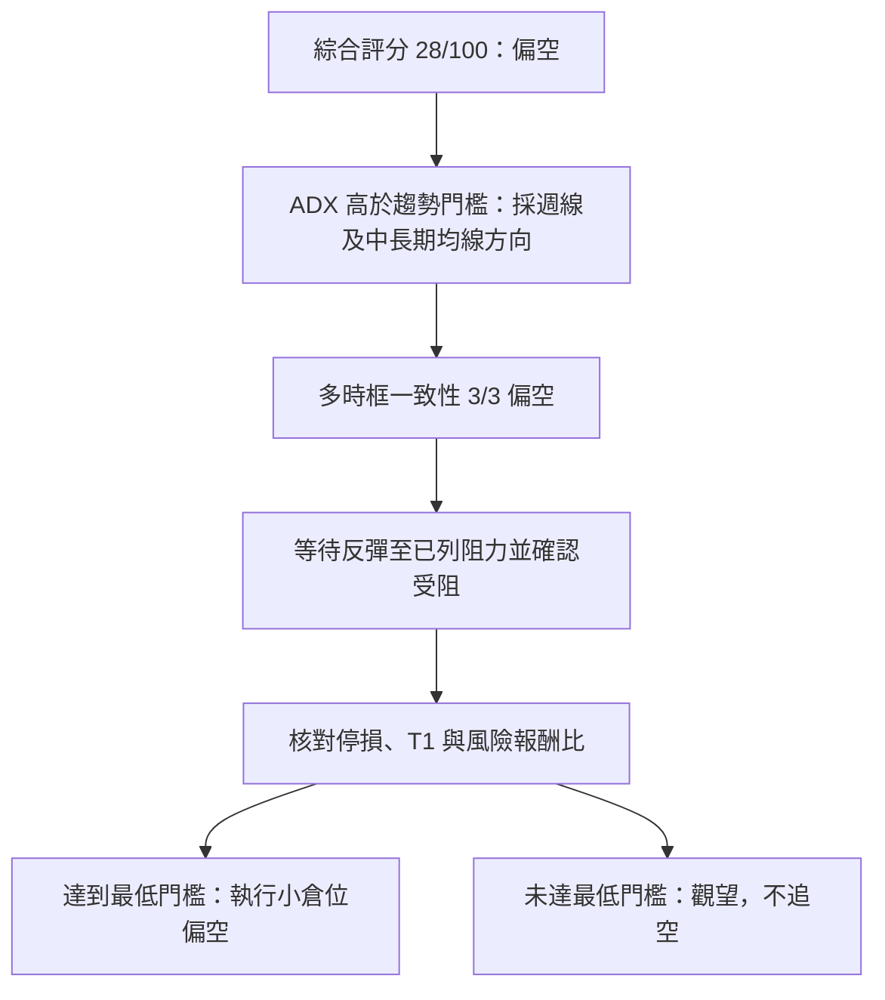

# GRAB 技術分析報告

> **報告日期**：2026-11-21 ｜ **語言**：繁體中文 ｜ **數據來源**：Yahoo Finance ｜ **當前價格**：$2.75 USD（收盤日：2026-11-20）

---

## 目錄

| 章節 | 內容 |
|------|------|
| [1. 技術面概覽](#1-技術面概覽) | 核心指標速覽、評分卡 |
| [2. 趨勢分析](#2-趨勢分析) | 長中短期走勢、ADX |
| [3. 圖表形態分析](#3-圖表形態分析) | 形態、K 線、缺口 |
| [4. 支撐與阻力](#4-支撐與阻力) | 關鍵價位、斐波那契 |
| [5. 技術指標深度解讀](#5-技術指標深度解讀) | MA、RSI、MACD、布林、成交量、進階指標 |
| [6. 動能與波動率](#6-動能與波動率) | ATR、Beta、相對強度 |
| [7. 多時框架總結](#7-多時框架總結) | 時框架評分矩陣 |
| [8. 交易策略建議](#8-交易策略建議) | 歷史基準、策略、風險報酬比 |
| [9. 風險提示與監控](#9-風險提示與監控) | 監控指標、風險場景 |

---

## 1. 技術面概覽

GRAB 目前的技術面方向為**偏空**：日、週、月三個時框的方向均偏空，且股價位於主要趨勢均線下方。趨勢指標確認目前並非單純盤整，空頭方向較有主導性；同時，成交量與 A/D 線偏向確認價格走弱。最大的反向風險是股價已接近近一年低位區，日線隨機指標處於超賣區，短線可能出現反彈，但這尚不足以扭轉中長期偏空結構。

### 📊 核心指標速覽表

| 指標類別 | 指標名稱 | 當前數值 | 訊號 | 解讀 |
|----------|----------|----------|------|------|
| **價格** | 當前價格 | **$2.75** | 🔴 | 收盤位於近一年區間低端，短線仍承受下行壓力。 |
| **均線** | MA20 / MA50 / MA200 | 見第 5 章 | 🔴 | 收盤低於三條主要均線，反彈尚未收復趨勢阻力。 |
| **動能** | RSI(14)（日線） | 見第 5 章 | 🟡 | 動能偏弱但未達傳統 RSI 超賣區；短線 Stoch 已超賣。 |
| **動能** | MACD 柱（日線） | 見第 5 章 | 🔴 | MACD 柱為負，與價格及均線結構互相確認偏空。 |
| **趨勢** | ADX(14) | 見第 2 章 | 🔴 | 趨勢強度略高於趨勢行情門檻，且空方 DI 主導。 |
| **波動** | ATR(14) | 見第 6 章 | 🟡 | 日波動相對股價偏大，停損及部位規模需留有空間。 |
| **多時框** | 一致性 | 見第 7 章 | 🔴 | 日、週、月方向一致偏空，並非單一時框的短線訊號。 |

### 🏆 技術評分卡

本報告唯一評分卡採六項子評分的算術平均。趨勢及均線項目因多時框偏空而較低；支撐穩定度略高於其他項目，是因股價鄰近近期低位支撐區，但支撐仍未經有效反覆確認。

| 維度 | 評分（0–100） | 訊號 | 主要依據（引用數值所在章節） |
|------|---------------|------|------------------------------|
| 趨勢強度 | 25 | 🔴 | ADX 顯示趨勢成立，方向由空方 DI 主導，見第 2 章。 |
| 動能指標 | 30 | 🔴 | RSI 未轉強、MACD 柱偏空；超賣僅代表反彈風險，見第 5 章。 |
| 支撐穩定度 | 35 | 🟡 | 近一年波段低點聚集在現價下方附近，但支撐承接尚待確認，見第 4 章。 |
| 成交量配合 | 25 | 🔴 | OBV 低於其均線，A/D 線與價格同向下行，見第 5 章。 |
| 形態完整度 | 30 | 🔴 | 近期反彈未能延續，未形成可確認的反轉形態，見第 3 章。 |
| 均線排列 | 25 | 🔴 | 價格位於主要均線下方，均線長期變化偏下，見第 5 章。 |
| **綜合評分** | **28** | **偏空** | 六項算術平均為 28.33，四捨五入至整數。 |

---

## 2. 趨勢分析

**結論：長期與中期走勢仍偏空，短期反彈未能建立延續性。**  
近一年月收盤呈現階段性下移；週線曾出現顯著反彈週，但其後回落，近期收盤重新靠近前低區。由於 ADX 已高於趨勢行情門檻，本報告依多時框收斂規則，以週線及 MA50、MA200 的中長期方向為主，日線只用於尋找交易進場時機。

### 📈 長期趨勢（近 12 個月）

價格取自「近 12 個月收盤走勢」區塊。階段漲跌幅以該階段起訖月收盤計算，四捨五入至小數點後兩位；分段是為了呈現趨勢轉折，不代表每個月均沿同一方向移動。

| 階段 | 起訖月收盤 | 漲跌幅 | 特徵 |
|------|------------|--------|------|
| 2025-12 至 2026-02 | $4.99 → $4.22 | -15.43% | 年初下行延續，月收盤逐步走低。 |
| 2026-02 至 2026-05 | $4.22 → $3.54 | -16.11% | 中期跌勢延續，未見月收盤結構性反轉。 |
| 2026-05 至 2026-08 | $3.54 → $3.54 | 0.00% | 月收盤區間震盪，尚未扭轉此前跌勢。 |
| 2026-08 至 2026-11 | $3.54 → $2.75 | -22.32% | 再度下移並測試近一年低位區。 |
| 全期間 | $4.99 → $2.75 | -44.89% | 長期趨勢偏空，反彈高點未能改變整體下行結構。 |

### 📊 中期趨勢（週線）

週線收盤序列呈現明顯的下行階段，期間雖有反彈，但反彈未能穩定守住較高收盤區，最新週收盤再度回落。週線 RSI 低於中性門檻，週線收盤亦低於其趨勢均線；方向欄依既定規則判為偏空。週 MACD 柱仍為正值，但不能單獨推翻週線偏空方向，因價格相對趨勢均線與 RSI 均未給出偏多確認。

近期週線成交量在反彈週與回落週均偏高，代表價格變動伴隨顯著交易活動；但單看放量不能視為買方吸籌，仍須觀察後續週收盤能否收復週趨勢均線，以及週線動能能否持續改善。

### ⚡ 趨勢強度（ADX）

| 指標 | 數值 | 解讀 |
|------|------:|------|
| ADX(14) | 25.65 | 高於 25，符合趨勢行情判準；趨勢存在，但 ADX 本身不判定方向。 |
| +DI | 18.93 | 多方方向指標弱於空方方向指標。 |
| −DI | 33.22 | 空方方向指標領先，方向確認偏空。 |
| 趨勢分類 | 趨勢行情 | 依 ADX 高於門檻，適用「週線／MA50、MA200 優先，日線尋找進場時機」的收斂規則。 |

ADX 與 DI 的組合表示目前不宜把價格僅視為布林通道內的普通區間震盪。雖然短線超賣可能帶來反彈，趨勢方向仍需以中長期偏空框架處理。

---

## 3. 圖表形態分析

**結論：目前沒有足夠價格結構證據確認雙底、頭肩或旗形等幾何形態；以指標型判讀為主。**  
週線曾有大幅反彈後回落，但單一急彈週及其後回吐不足以確認反轉形態。近期日線連續走低，尚未顯示足以確認底部的高低點抬升結構。

### 🔍 形態識別

| 形態 | 信心度 | 判斷依據 | 完成度 | 目標價（附計算式） |
|------|--------|----------|--------|--------------------|
| 雙底／底部反轉 | 低 | 僅觀察到近期低位區，沒有足夠且可核實的兩次低點、頸線及突破確認。 | 未確認；訊號不足，僅做指標型解讀。 | N/A（未確認形態，無可稽核的形態高度）。 |
| 旗形／延續形態 | 低 | 可見快速下行與短暫反彈，但近端 K 線未提供明確平行通道或旗形整理結構。 | 未確認；不以旗形推算目標。 | N/A（未確認形態，無可稽核的形態高度）。 |
| 均線及動能型偏空 | 中 | 股價低於主要趨勢均線，日線 MACD 柱為負，且空方 DI 主導。 | 現有指標方向仍偏空；需以價格是否收復均線確認變化。 | 不適用；非幾何形態，不推算形態高度。 |

**形態解讀：**  
目前以趨勢延續的風險管理為主，不把近端低位直接視為已確認底部。若股價反彈，必須觀察反彈是否伴隨均線收復、動能改善與成交量結構改善；僅靠單一超賣訊號不足以確認反轉。

### 🕯️ 重要 K 線形態與缺口

下表中的 K 線解讀僅使用近十根日 K 與近八根週 K 的開、高、低、收資料。只挑選具代表性的 K 棒列示；不對區塊以外日期作 K 線形態描述。

| 日期（日 K／週 K） | 開 | 高 | 低 | 收 | K 線形態 | 解讀 | 訊號 |
|------|----:|----:|----:|----:|---------|------|------|
| 2026-11-06（週 K） | $2.76 | $3.56 | $2.75 | $3.41 | 大實體長紅，收盤接近高位但仍留有上影 | 反映該週曾有強烈買盤推升；後續週收盤未延續，故不能單獨視為反轉確認。 | 🟡 |
| 2026-11-19（日 K） | $3.15 | $3.15 | $2.91 | $2.93 | 長實體黑 K，收盤接近低位 | 賣壓明顯，且收盤靠近當日低點，偏空。 | 🔴 |
| 2026-11-20（日 K） | $2.88 | $2.89 | $2.74 | $2.75 | 黑 K，實體占主導、上下影線短 | 賣方延續前一交易日壓力，沒有明顯下影線反映的強力承接。 | 🔴 |
| 2026-11-20（週 K） | $3.19 | $3.27 | $2.74 | $2.75 | 大實體黑 K，收盤接近週內低點 | 週線反彈後再度下跌，週收盤位置不利於多方。 | 🔴 |

**跳空缺口清單：**  
缺口資訊取自市場脈絡區塊。下列缺口雖已回補，仍可用來理解近期價格曾快速跨越的區域；不將其視為仍未回補的支撐或阻力。

| 日期 | 方向 | 缺口區間 | 回補狀態 | 解讀 |
|------|------|----------|----------|------|
| 2026-11-03 | 向上跳空 | $2.93–$3.08 | 已回補 | 跳空未能維持，現階段不構成未回補缺口支撐。 |
| 2026-09-22 | 向上跳空 | $2.91–$3.04 | 已回補 | 已完成回補；僅作歷史價格行為記錄。 |

---

## 4. 支撐與阻力

**結論：上方有多層波段阻力，價格仍在下方支撐區附近。**  
阻力與支撐以程式由 OHLCV 計算的近一年波段高低點聚類為主。現價距離第一支撐很近，若該區失守，下一個波段支撐將是重要觀察位；若反彈，必須逐級面對上方阻力。

### 🚧 阻力位分析表

阻力聚類回溯期間為**近一年**。

| 阻力級別 | 價位 | 形成原因 | 突破難度 | 重要性 |
|----------|------:|----------|----------|--------|
| R1 | $3.25 | 近一年波段高點聚類，屬第一個主要反彈測試位。 | 中 | 短線反彈是否能轉成較穩定修復的第一道檢驗。 |
| R2 | $3.56 | 近一年波段高點聚類，位置高於第一阻力，且與上方技術供給區相近。 | 高 | 突破需要價格與動能同步改善。 |
| R3 | $3.64 | 近一年波段高點聚類，與布林上軌價位重合。 | 高 | 需有明確趨勢改善才可視為突破；否則易成為反彈供給區。 |

### 🛡️ 支撐位分析表

支撐聚類回溯期間為**近一年**。

| 支撐級別 | 價位 | 形成原因 | 守住可能性 | 重要性 |
|----------|------:|----------|--------------|--------|
| S1 | $2.74 | 近一年波段低點聚類，與近期價格低位區相接近。 | 中 | 近端第一支撐；若收盤有效跌破，短線偏空訊號將加強。 |
| S2 | $2.67 | 近一年波段低點聚類，亦為所列 52 週區間低點。 | 中 | 若 S1 失守，此區為下一個主要波段支撐。 |
| S3 | 數據中未偵測到 | 關鍵價位區塊未列出第三個波段支撐。 | N/A（數據未提供） | 不自行補估。 |

波段支撐已列出兩個層級，故依規則不以樞軸公式值取代波段支撐；樞軸數值另於第 5 章進階指標表列示。

### 📐 斐波那契回調位分析

斐波那契數值直接引用 52 週區間回調計算結果。現價位於 **78.6% 回調位與 100.0% 回調位之間**，表示價格已回落至該年度區間下緣；這是弱勢位置，不等同於底部確認。

| 回調位 | 價位 | 技術含義 |
|--------|-----:|----------|
| 23.6% | $4.83 | 較高位置的回調參考，與現價距離較遠。 |
| 38.2% | $4.42 | 中期反彈的較高階參考位。 |
| 50.0% | $4.09 | 區間中點回調位。 |
| 61.8% | $3.75 | 深度回調參考位，亦可作為反彈阻力觀察。 |
| 78.6% | $3.28 | 深回調區域；現價已低於此位。 |
| 100.0%（52 週低點） | $2.67 | 區間低點，與波段支撐 S2 重合。 |

---

## 5. 技術指標深度解讀

**結論：均線、MACD、ADX 與量能資料多數互相確認偏空；RSI 與 Stoch 顯示短線超賣／弱勢區，增加反彈風險，但尚無足夠訊號證明趨勢反轉。**

### 📈 均線、RSI、MACD、布林通道

| 指標 | 數值 | 訊號 | 解讀 |
|------|------|------|------|
| MA20 / MA50 / MA200 與排列 | MA20：$3.08；MA50：$3.04；MA200：$3.54；均線排列：混合排列 | 🔴 | 收盤低於三條均線；不同期間均線不是完整空頭排列，但價格低於全部主要均線，反彈需先收復近端均線區。 |
| RSI(14)（日線）與背離 | RSI：34.34；背離欄：無明顯背離 | 🟡 | RSI 接近弱勢區但未進入低於 30 的傳統超賣區。依近二十根 K 棒首尾比較結果，**RSI 無明顯頂背離或底背離**。 |
| MACD 線／Signal／柱 | MACD：-0.000；Signal：0.041；Histogram：-0.042 | 🔴 | MACD 線低於 Signal，柱值為負，與價格低於均線及空方趨勢互相確認。**MACD 背離：N/A（數據未提供）**，因現有資料沒有足以核對轉折高低點的 MACD 歷史序列。 |
| Stoch | %K：1.22；%D：25.24 | 🟡 | 處於超賣狀態；表示短線下跌可能已較急，不構成獨立買入訊號。 |
| 布林通道 | 上軌：$3.64；中軌：$3.08；下軌：$2.52；%B：0.20 | 🔴 | 價格位於通道偏下部，但尚未觸及下軌；在 ADX 顯示趨勢行情時，布林下軌不應被機械地當成必然反彈位。 |

**指標整合：**  
股價低於 MA20、MA50 與 MA200，MACD 柱為負，空方 DI 領先，這些訊號共同支持偏空判斷。RSI 尚未跌入傳統超賣區，而 Stoch 已超賣，兩者強弱程度並不完全一致；應解讀為「趨勢偏空、短線可能反彈」，而不是「指標全線超賣、可直接抄底」。RSI 背離欄未顯示明顯背離；MACD 歷史背離則因數據不足而不作推斷。

### 💹 成交量（量價配合度）

| 指標 | 數值或狀態 | 解讀 |
|------|------------|------|
| 最新成交量 | 124,371,500 股 | 高於近期平均量，顯示最新下跌伴隨較活躍交易。 |
| 20 日均量 | 86,659,900 股 | 作為近端比較基準；最新成交量約為其 1.44 倍。 |
| 50 日均量 | 77,624,964 股 | 最新成交量亦高於較長的短中期均量基準。 |
| OBV 趨勢 | OBV < MA；量能疲弱 | OBV 未確認價格上漲或買方累積，偏向量能疲弱。 |
| A/D 線 | 近二十根不高於其均值；A/D 下降、價格下跌 | A/D 與價格同向，屬於對下跌走勢的確認，而非背離。 |
| 綜合量價判讀 | 偏空確認 | 最新成交量較均量高，但 OBV 與 A/D 沒有提供有效的多方吸籌確認。 |

**量價結論：**  
成交量偏高本身不等於賣壓耗盡。OBV 低於均線、A/D 線下降且與價格同步走低，與價格弱勢相符；除非後續出現價格止跌、OBV/A/D 改善及收復阻力的組合，否則量能尚未支持多方反轉。

### 🧭 進階指標

| 指標 | 數值 | 收盤相對位置 | 解讀 |
|------|------|--------------|------|
| 一目均衡表（轉換線／基準線／雲層） | 轉換線：$3.07；基準線：$3.12；先行帶 A：$3.02；先行帶 B：$3.36。前方雲：A $3.09／B $3.12，A 在 B 下方。 | 收盤位於雲層下方；轉換線低於基準線。 | 雲層下方及轉換線低於基準線均偏空；與均線及 MACD 判讀一致。 |
| 成交量分布（POC／價值區） | POC：$3.55；價值區：$2.67–$3.97，含 73% 成交量。 | 收盤位於價值區內。 | 價格仍在歷史成交量集中區內，但處於價值區偏低位置；POC 高於現價，可能構成上方成交量供給參考。 |
| 錨定 VWAP（自 52 週高點／低點） | 自 52 週高點（2025-11-28）起：$3.69；自 52 週低點（2026-10-26）起：$3.13。 | 收盤均低於兩條錨定 VWAP。 | 從兩個重要錨定點計算的成交量加權成本均高於現價，價格尚未收復相關成本線；偏空且與均線、MACD 方向一致。 |
| A/D 線 | 近二十根不高於其二十日均值；A/D 下降、價格下跌。 | — | A/D 與價格同向下行，確認賣壓，沒有顯示明顯底背離。 |
| 樞軸點（上一完整月公式值） | 樞軸 PR2：$3.43；樞軸 PR1：$3.07；樞軸 P：$2.87；樞軸 PS1：$2.51；樞軸 PS2：$2.31。 | 收盤低於樞軸 P。 | 公式型參考值，不等同於波段聚類支撐／阻力。其方向與現有偏空指標相符；由於波段支撐及阻力均已提供足夠層級，不用樞軸值替代第 4 章的波段價位。 |

---

## 6. 動能與波動率

**結論：單日波動相對股價不低，停損距離與部位規模應同時考慮；相對強度近一個月改善，但中期相對大盤仍弱，未足以推翻偏空主策略。**

### 📊 ATR 波動率分析

| 指標 | 數值 | 解讀 |
|------|------:|------|
| ATR(14) | $0.14 | Wilder 計算的日線平均真實波幅，可作為近期日波動參考。 |
| ATR／價格 | 5.26% | 相對股價而言屬較大的短期波動，止損過窄容易被一般波動觸發。 |
| 1.5 倍 ATR 參考距離 | $0.21 | 可作停損空間的較保守起點，但實際止損仍應尊重策略結構價位。 |
| 2 倍 ATR 參考距離 | $0.28 | 較寬的波動緩衝；若採用較寬停損，部位必須相應縮小。 |

ATR 是風險距離參考，不是支撐／阻力位，也不取代第 8 章按風險報酬比計算的策略停損。高波動環境下，若按固定股數建倉，單筆潛在損失可能過大；應先確定可承受風險，再反推股數。

### 📐 Beta 與相對強度

Beta 取自市場資料；相對強度報酬取自市場脈絡區塊，為價格報酬、不含股息。

| 期間 | GRAB 本股 | VTI 基準 | 超額報酬 | 比值趨勢 |
|------|----------:|---------:|---------:|----------|
| 一個月 | +3.9% | -7.1% | +11.0% | 相對比值高於其 50 日均值，短期相對走強。 |
| 三個月 | -15.8% | -6.8% | -9.0% | 相對大盤落後，對偏空主策略有支持。 |
| 六個月 | -17.7% | -3.5% | -14.2% | 中期相對弱勢明顯，對偏空主策略有支持。 |

| 指標 | 數值 | 解讀 |
|------|------:|------|
| Beta | 0.833 | 歷史敏感度低於市場基準一，但不代表個股不會出現大幅波動，也不能取代 ATR 所反映的近期實際波動。 |

**相對強度結論：**  
短期相對比值改善，對立即追空略有相抵，意味著若股價反彈，不宜在低位無條件追空；但三個月及六個月超額報酬為負，仍支持以反彈遇阻後的偏空策略為主。這與週、月線方向一致，並不構成多頭反轉確認。

---

## 7. 多時框架總結

**結論：日線、週線、月線方向均偏空，多時框一致性為 3/3。**  
日線動能偏弱；週線 MACD 柱為正但方向欄仍偏空；月線 RSI 處於低位且月線 MACD 柱資料不足。依既定方向規則，不能只因週 MACD 柱為正或日線出現超賣，就將週線或月線方向改判為偏多。

### 📋 時框架評分表

下表方向、趨勢均線、RSI、MACD 柱均照抄多時框指標區塊。K 線形態欄只描述其所屬時框的近期價格結構，不以日線指標替代週線或月線指標。

| 時框架 | 趨勢方向 | RSI(14) | MACD 柱 | 收盤 vs 趨勢均線 | 形態 | 建議 |
|--------|----------|---------|---------|------------------|------|------|
| 日線 | 偏空 | 34.34 | -0.042 | 收盤 2.75；MA50 3.04；收盤低於均線 | 近期日 K 連續偏弱，未確認底部形態。 | 僅尋找反彈遇阻的進場，不宜因超賣訊號直接抄底。 |
| 週線 | 偏空 | 40.23 | +0.010 | 收盤 2.75；MA20 3.26；收盤低於均線 | 大幅反彈後回落，最近週 K 偏弱。 | 以週線方向為主；MACD 柱為正不改變方向欄的偏空結論。 |
| 月線 | 偏空 | 22.74 | N/A（數據未提供） | 收盤 2.75；MA10 3.46；收盤低於均線 | 月收盤整體下移，月線 MACD 柱資料不足。 | 不以短線反彈假設抵銷月線弱勢。 |

**多時框一致性：3/3 偏空。**

### ⚖️ 多時框收斂結論

- **行情分類：**趨勢行情，因 ADX 高於趨勢行情門檻。
- **主導時框：**依規則由週線及 MA50、MA200 的中長期方向主導；日線只負責進場時機。
- **日線與週、月線是否衝突：**方向欄沒有衝突；週線 MACD 柱為正，屬單一動能讀數與趨勢方向不完全一致，但週收盤仍低於趨勢均線，且週線方向依既定規則為偏空。
- **唯一方向性結論：偏空。**

因此，第 8 章以反彈遇阻後的偏空策略為主，並將當前低位直接追空列為不划算的交易情境。

---

## 8. 交易策略建議

**當前主策略方向 = 偏空（依評分 28/100）。**  
主策略不是在低位追空，而是等待價格反彈至已列出的阻力位，並觀察是否遭遇拒絕；若價格沒有提供符合最低風險報酬比的進場位置，則維持觀望。

### 📊 歷史基準機率

歷史基準定義的今日狀態為：**RSI(14) 落在 30–50，且收盤低於 MA200**。樣本期間為 **2020-12-01 至 2026-11-20**，共 **1,501 個交易日**；數據為價格報酬、不含股息。

| 持有期 | 相同狀態樣本（段數） | 上漲比例 | 中位數報酬 | 25%–75% 分位 | 全部交易日上漲比例／中位數 |
|--------|----------------------|----------|------------|--------------|----------------------------|
| 5 日 | 475 個交易日（67 段） | 47% | -0.3% | -4.4% 至 +4.5% | 46%／-0.3% |
| 20 日 | 469 個交易日（67 段） | 49% | +0.0% | -10.5% 至 +8.3% | 45%／-1.5% |
| 60 日 | 438 個交易日（63 段） | 51% | +0.5% | -17.9% 至 +15.3% | 46%／-2.3% |

歷史上，與今日相同狀態的上漲比例在各持有期均只比全部交易日略高；中位數報酬也未呈現一致的大幅優勢。相同狀態日數雖多，但交易日連續重疊，較接近獨立事件的段數只有 63 至 67 段，解讀需保守。這些是歷史頻率而非預測，對「低位不追空、等待反彈遇阻」的進場方式屬中性至略相抵，而非足以改變偏空趨勢判斷的證據。

### 🎯 價格情境階梯（Price Scenarios）

下表以第 4 章的 R1–R3、S1–S2 作為價位代碼，不重複列示其數值。可能性以高／中／低描述，不代表可量化的成功機率。

| 觸發條件 | 下一目標 | 後續延伸 | 可能性 | 依據 |
|----------|----------|----------|--------|------|
| 收盤有效突破並站穩 R1 | R2 | R3 | 低 | 需同時看到動能改善及成交量結構轉強；目前多時框偏空，反彈尚無確認。 |
| 在現價低位區止跌但尚未收復 R1 | — | — | 中 | 支撐鄰近且 Stoch 超賣，短線反彈具備條件，但 RSI 背離未確認、OBV 偏弱。 |
| 收盤有效跌破 S1 | S2 | 樞軸 PS1（見第 5 章） | 中 | 若支撐失守，會與空方趨勢及弱勢成交量結構一致；但低位不宜無條件追空。 |

### 🟢 主策略詳情（方向依上方路由）

| 策略要素 | 策略 A：反彈遇阻後偏空 | 策略 B：現價直接追空（不執行） |
|----------|-------------------------|-------------------------------|
| 進場條件 | 價格反彈至 R1，出現受阻訊號，且日線仍未收復主要均線。 | 參考當前收盤價直接進場；僅供檢驗風險報酬比，不構成可執行策略。 |
| 進場價格 | R1：$3.25 | **此價位不交易**；試算進場價 $2.75，風險報酬比不足。 |
| 目標價 T1 | S1：$2.74 | S2：$2.67 |
| 目標價 T2 | S2：$2.67 | 樞軸 PS1：$2.51 |
| 止損價格 | R2：$3.56 | R1：$3.25 |
| 風險報酬比 | **1 : 1.65（以 T1 計）** | **1 : 0.16（以 T1 計；未達最低門檻）** |
| 把握度 | 中；趨勢與多時框支持偏空，但須等待反彈至阻力並確認受阻。 | 低；在低位追空，距離 T1 過近而上方停損風險較大。 |
| 建議倉位 | 建議以小倉位執行；總資金配置可控制於 1%–2%，並以單筆帳戶風險上限反推股數。 | 0%；不執行。 |
| 執行說明 | 以 R1 作為區間進場價、R2 為止損、S1 為 T1；計算為（3.25−2.74）÷（3.56−3.25）＝1.645，四捨五入為 1.65。 | 試算為（2.75−2.67）÷（3.25−2.75）＝0.16；未達 1 : 1.50，故不列為可執行交易。若價格回升至策略 A 所列阻力並符合其止損與目標條件，再重新評估。 |

**策略門檻核對：**  
策略 A 以 T1 計的風險報酬比達最低要求；因此它是本報告唯一可列為可執行的策略。策略 B 的風險報酬比未達門檻，明確標示不交易。策略 A 的進場、停損與目標均來自已列出的波段價位，不使用未經資料計算的精確價位。

### 🔴 反向風險觸發點（對沖提示）

- 若股價收復並站穩 R1，原本的反彈遇阻假設開始失效；不應繼續把未確認的弱勢視為必然延續。
- 若價格進一步突破 R2，且週線收盤同時改善，應重新檢視偏空策略；R3 是更高一層的反向風險參考。
- 若日線 RSI 出現確認底背離、MACD 柱轉強且 OBV／A/D 同步改善，代表空方訊號可能減弱；目前資料尚未確認這種組合。
- 即使價格觸及支撐，也不預設支撐一定守住；需以收盤及量價反應確認。

---

## 9. 風險提示與監控

**結論：主要風險在於支撐失守後的延伸下跌，以及超賣條件引發的急速反彈。**  
目前下次財報日期未提供，因此無法量化財報事件的時間風險；執行任何策略前，應自行核對最新公司行事曆與即時公告。

### ✅ 關鍵監控指標

| 監控項目 | 數值／狀態 | 觸發後的動作 |
|----------|------------|--------------|
| S1 支撐 | 見第 4 章 | 若收盤有效跌破，不追價加空；先檢查 S2 及策略風險報酬比是否仍成立。 |
| S2 支撐 | 見第 4 章 | 若價格下探，依原策略分段管理；不得因接近目標而擴大既定風險。 |
| R1 阻力 | 見第 4 章 | 偏空策略的第一個反彈觀察區；等待受阻訊號，而非只以觸價下單。 |
| R2／R3 阻力 | 見第 4 章 | 若突破並站穩，檢討空頭假設與止損執行，不以主觀理由延後停損。 |
| 日線 RSI、MACD | RSI、MACD 數值見第 5 章 | 觀察動能是否由弱轉強；單一指標翻轉不等於趨勢反轉。 |
| OBV 與 A/D | 見第 5 章 | 若價格回升而量能指標仍未改善，對反彈持保守態度；若同步改善，重新評估偏空把握度。 |
| 多時框方向 | 3/3 偏空，見第 7 章 | 若週、月方向或其趨勢均線狀態改變，重新進行多時框收斂。 |
| 下次財報日 | N/A（數據未提供） | 財報日及距最新收盤日的日曆天數均為 N/A（數據未提供）；下單前須核對公司公告。 |

### ⚠️ 風險場景

| 情境 | 觸發條件 | 價位參考 | 應對 | 可能性 |
|------|----------|----------|------|--------|
| 樂觀情境（對多方） | 反彈後收復 R1，並進一步改善日線動能與量能。 | R1、R2、R3，見第 4 章。 | 暫停新增空頭部位；若策略 A 尚未進場，不追空，待週線確認後重評。 | 低 |
| 基本情境 | 低位區震盪，反彈遇阻但尚未確認有效跌破支撐。 | S1 與 R1，見第 4 章。 | 依策略 A 等待反彈確認；若無符合風險報酬比的機會，維持觀望。 | 中 |
| 悲觀情境（對空方） | 收盤跌破 S1，且後續價格延續下行。 | S2 及樞軸 PS1，見第 4、5 章。 | 避免低位追空；按既定目標及停損執行，確認是否出現放量承接或反轉訊號。 | 中 |

### 🛡️ 風險管理提醒

1. **先定停損，再決定股數。** 以可承受的單筆帳戶損失除以進場至停損距離，反推合理股數；不可因看空而擴大風險額度。
2. **避免在支撐附近追空。** 若價格已接近策略目標，剩餘獲利空間可能不足；策略 B 已示範此類進場未達最低風險報酬比。
3. **遵守策略 A 的取消條件。** 若價格突破並站穩相應阻力，應重新評估空頭假設，不延後或取消原定停損。
4. **高波動時縮小倉位。** ATR 顯示單日波動相對股價不低；停損加寬時，持倉股數應同步下降。
5. **留意跳空與流動性風險。** 下次財報日為 N/A（數據未提供）；事件日附近的跳空可能使停損無法按預定價格成交。

---

## 📋 報告總結

| 項目 | 結論 |
|------|------|
| 報告日期 | 2026-11-21 |
| 當前價格 | 見標題列與第 1 章速覽表（收盤日：2026-11-20） |
| 綜合評分／方向 | **28/100，偏空** |
| 長期／中期／短期趨勢 | 🔴 長期下行；🔴 中期週線偏空；🔴 短期走弱但有超賣反彈風險。 |
| 關鍵支撐／關鍵阻力 | 支撐 S1、S2；阻力 R1、R2、R3，數值見第 4 章。 |
| 🥇 最佳機會 | **策略 A：等待反彈至 R1 並確認受阻後偏空；若條件未出現則觀望。** |
| 最大風險 | 低位超賣反彈或突然的跳空可能令空頭停損以不利價格成交；且財報日期未提供。 |

> ⚠️ **免責聲明**：本報告為 AI 自動生成之技術分析，所有數據及估算均基於歷史價格資訊。本報告**僅供研究與學術參考**，**不構成任何投資建議**。投資有風險，入市需謹慎。

---

## 資料與來源

| 項目 | 內容 |
|------|------|
| 價格 | 2.75 USD，2026-11-20 收盤（Yahoo Finance 日線） |
| K 棒 | 501 根日線，2024-11-21 至 2026-11-20（Yahoo Finance）；較長期間的價位與基準機率取自價格資料庫 |
| 關鍵價位回溯期間 | 阻力 近一年、支撐 近一年 |
| 有回應的資料來源 | Yahoo Finance、Finviz、StockAnalysis、Roic.ai |
| 由程式計算 | 所有指標、R1–S3 與斐波那契價位、多時框方向、相對強度、缺口、歷史基準機率、綜合評分 |
| 撰寫模型 | openai / gpt-6-luna |

> 本區塊由產生報告的程式依實際取得的資料填寫，非模型撰寫。「由程式計算」的數字不是模型的估計；其餘判斷（評分、情境、策略）是模型的分析。
