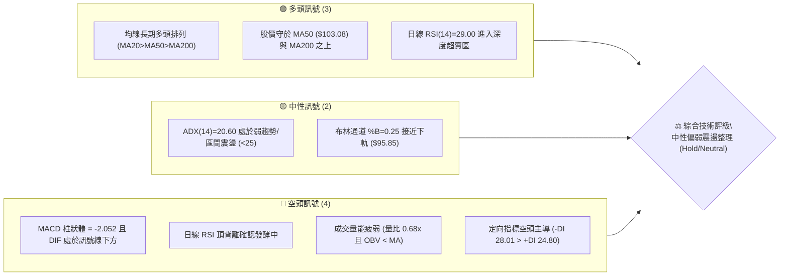
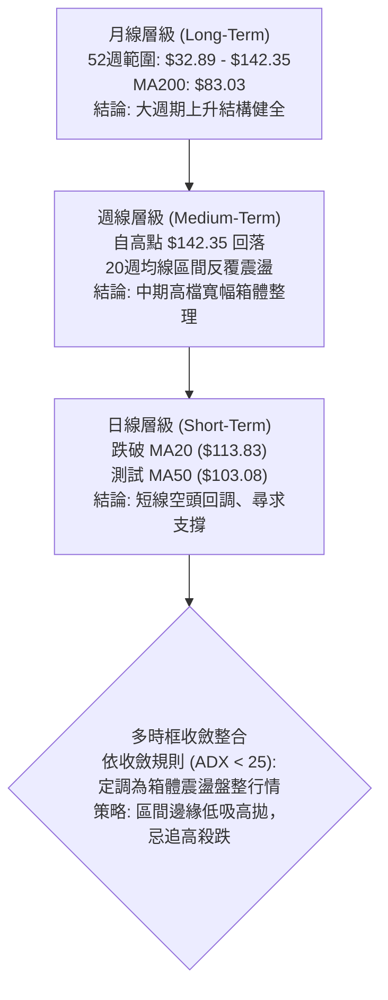
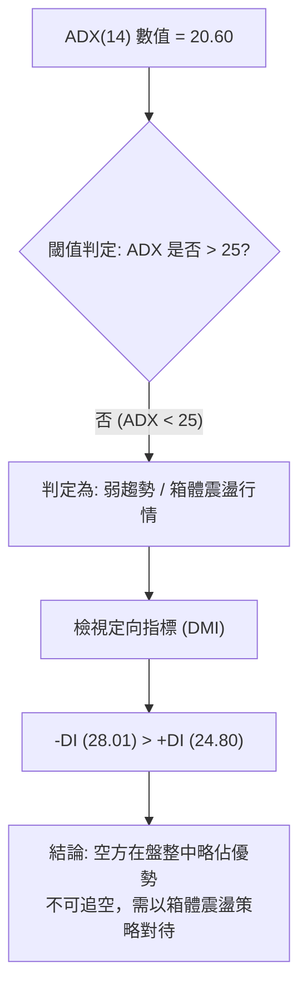
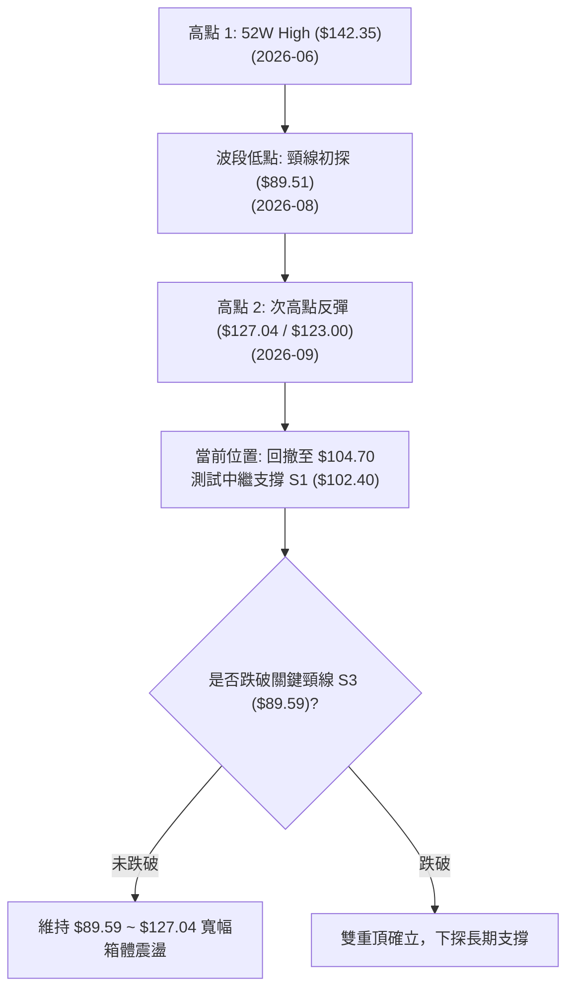
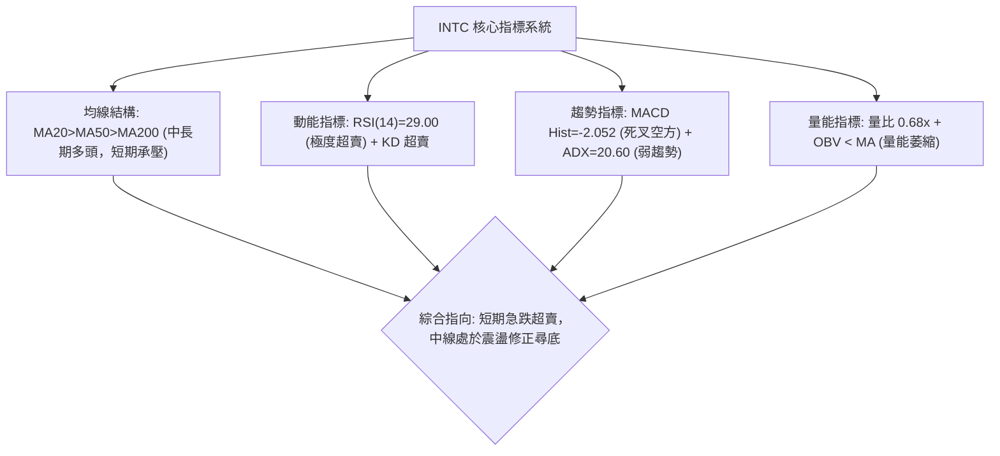
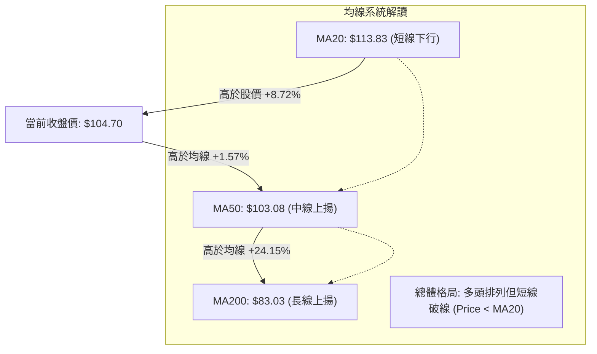
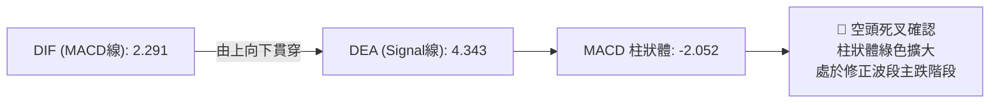
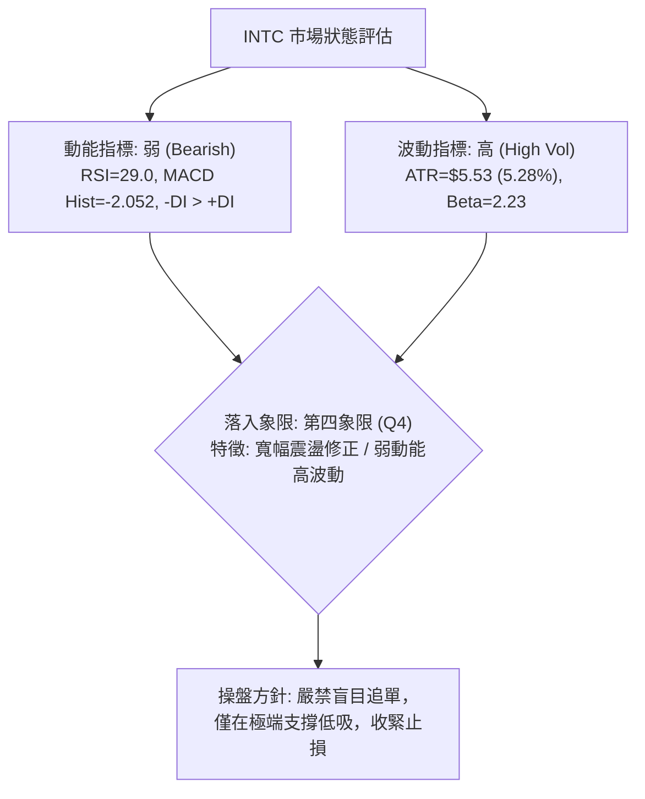
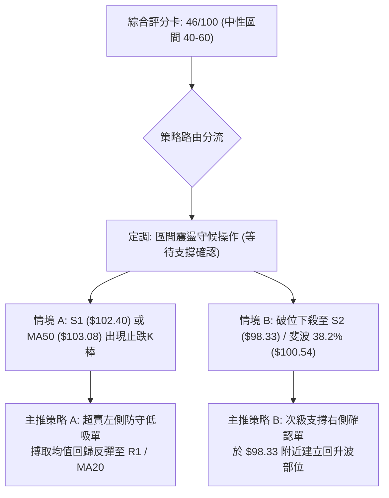
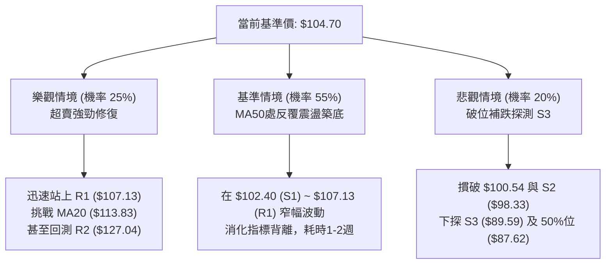

# INTC 基本面與技術面深度分析報告

> **報告日期**：2026-10-11 ｜ **語言**：繁體中文 ｜ **數據來源**：Yahoo Finance / SEC Filings ｜ **當前價格**：$104.70

---

## 目錄

| 章節 | 內容 |
|------|------|
| [1. 技術面概覽](#1-技術面概覽) | 訊號儀表板、核心指標、評分卡 |
| [2. 趨勢分析](#2-趨勢分析) | 多時框趨勢、長中短期走勢、ADX強弱判讀 |
| [3. 圖表形態分析](#3-圖表形態分析) | 形態識別信心度、K線組合、目標價推算 |
| [4. 支撐與阻力](#4-支撐與阻力) | 關鍵價位結構、斐波那契回調位分析 |
| [5. 技術指標深度解讀](#5-技術指標深度解讀) | MA/RSI/MACD/布林通道/量價配合分析 |
| [6. 動能與波動率](#6-動能與波動率) | 動能四象限、ATR波動度、Beta與市場相關性 |
| [7. 多時框架總結](#7-多時框架總結) | 時框架評分矩陣、多時框收斂定調 |
| [8. 交易策略建議](#8-交易策略建議) | 策略路由、價格情境階梯、主操作策略 |
| [9. 風險提示與監控](#9-風險提示與監控) | 監控清單、情境模擬、風險管理與報告總結 |

---

## 1. 技術面概覽

### 🎯 技術訊號儀表板



### 📊 核心指標速覽表

| 指標類別 | 指標名稱 | 當前數值 | 訊號 | 專業解讀 |
|----------|----------|----------|------|----------|
| **價格** | 當前收盤價 | $104.70 | 🟡 | 位於52週區間 65.6% 位置，處於中期修正波中 |
| **均線** | MA20 | $113.83 | 🔴 | 股價位於 MA20 下方 (-8.02%)，短線承壓 |
| **均線** | MA50 | $103.08 | 🟢 | 股價站於 MA50 之上 (+1.57%)，中線動能支撐尚存 |
| **均線** | MA200 | $83.03 | 🟢 | 股價大幅高於年線 (+26.09%)，長期上升多頭未破 |
| **動能** | RSI(14) | 29.00 | 🟢 | 進入極端超賣區 (<30)，具短線均值回歸技術反彈契機 |
| **動能** | MACD (12,26,9) | 2.291 / 4.343 | 🔴 | MACD Hist 為 -2.052，空方動能處於釋放階段 |
| **動能** | KD (%K/%D) | 2.99 / 14.40 | 🟢 | 嚴重超賣，鈍化後容易形成極短線黃金交叉 |
| **趨勢** | ADX / DMI | 20.60 | 🟡 | 趨勢動能減弱 (ADX < 25)，-DI (28.01) > +DI (24.80) 空方暫控 |
| **通道** | Bollinger Bands | $95.85 / $131.80 | 🟡 | %B = 0.25，價格向中下軌滑落，空間收窄 |
| **量能** | 量比 / OBV | 0.68x / OBV<MA | 🔴 | 成交量 74.72M 低於 20MA，量能萎縮難以支撐連續上攻 |
| **波動** | ATR(14) | $5.53 | 🟡 | 每日平均波動幅度達 5.28%，短線震盪劇烈 |

### 🏆 技術評分卡

```
╔══════════════════════════════════════════════════════════════════╗
║                   技術評分卡 — INTC (2026-10-11)                 ║
╠══════════════════════════════════════════════════════════════════╣
║ 趨勢強度 (ADX=20.60)   ████████░░░░░░░░░░░░  40/100  🟡 弱趨勢/區間 ║
║ 動能指標 (RSI/MACD)    ██████░░░░░░░░░░░░░░  30/100  🔴 空方動能主導 ║
║ 支撐穩定度 (S1/MA50)   ████████████░░░░░░░░  60/100  🟡 支撐面臨測試 ║
║ 成交量配合 (OBV<MA)    ██████░░░░░░░░░░░░░░  30/100  🔴 量能顯著萎縮 ║
║ 形態完整度 (雙頂修正)  ████████░░░░░░░░░░░░  45/100  🟡 形態處回踩期 ║
║ 均線排列 (多頭架構)    ██████████████░░░░░░  70/100  🟢 中長線仍多頭 ║
╠══════════════════════════════════════════════════════════════════╣
║ 綜合技術評分           █████████░░░░░░░░░░░  46/100  中性偏弱震盪   ║
╚══════════════════════════════════════════════════════════════════╝
```

---

## 2. 趨勢分析

### 🌐 多時框趨勢分析



### 📈 長期趨勢 — 12個月走勢圖（Unicode）

以下為 INTC 過去 12 個月（2025-11 至 2026-10）收盤價走勢對照圖：

```
INTC 月線走勢圖（過去12個月：2025-11 至 2026-10）
價格軸 ($)
$140 ┤                                     ●(2026-06: 139.63)
$130 ┤                                    / \
$120 ┤                                   /   \     ●(2026-09: 120.23)
$110 ┤                             ●    /     \   / \
$100 ┤                            (05) /       \ /   ●(2026-10: 104.70 現價)
$90  ┤                       ●        /         ●(07) ●(08: 89.51 低點)
$80  ┤                      (04)     /
$70  ┤                              /
$60  ┤                             /
$50  ┤               ●     ●      /
$40  ┤ ●(11: 40.56) (01)  (02) ●(03: 44.13)
$30  ┤    \    /
$20  ┤     ●(12: 36.90)
     └─┬────┬────┬────┬────┬────┬────┬────┬────┬────┬────┬────┬────
     11月  12月  1月  2月  3月  4月  5月  6月  7月  8月  9月  10月
     2025 ────────────────────────── 2026 ────────────────────────
```

#### 走勢特徵分析表格

| 階段區間 | 時間段 | 價格起迄 | 漲跌幅 (%) | 量價特徵與結構意涵 |
|----------|--------|----------|------------|--------------------|
| **打底蓄勢期** | 2025-11 ~ 2026-03 | $40.56 → $44.13 | +8.80% | 於 $36.90 至 $46.47 間築底，均線逐步糾纏收斂 |
| **主升爆發期** | 2026-03 ~ 2026-06 | $44.13 → $139.63 | **+216.41%** | 帶量突破歷史結構阻力，月線連四紅，創 52 週新高 $142.35 |
| **首輪回踩期** | 2026-06 ~ 2026-08 | $139.63 → $89.51 | **-35.89%** | 短線獲利了結賣壓湧現，連續回測 50% 斐波那契回調位與前波平台 |
| **次級反彈期** | 2026-08 ~ 2026-09 | $89.51 → $120.23 | +34.32% | 超跌反彈至 R2 ($127.04) 附近受阻，成交量未能超越主升段 |
| **二次探底期** | 2026-09 ~ 2026-10 | $120.23 → $104.70 | -12.92% | 動能指標衰退，頂背離發酵，目前正在尋求 S1 ($102.40) 支撐 |

### 📊 中期趨勢（週線分析）

中期走勢顯示，INTC 在 2026 年 6 月創下高點後，進入對稱性寬幅區間震盪。近 20 週收盤走勢中，價格在 2026-08-30 見底 $89.47（對應月線低點 $89.51），隨後於 2026-09-27 衝高至 $123.00，週線 RSI 曾高達 72.2，但本週急速下滑至 29.0，顯示空方動能瞬間釋放。目前中線核心觀察點為 MA50 ($103.08) 與波段支撐 S1 ($102.40)。

```
週線關鍵架構阻力與支撐示意：
阻力位 R3: $132.75  ───────────────────────────────── (次高點壓力帶)
阻力位 R2: $127.04  ───────────────────────────────── (前波反彈高點聚類)
阻力位 R1: $107.13  ───────────────────────────────── (短線反彈首道頸線)
現  價   : $104.70  ◄─── 股價正測試 MA50 ($103.08) 防線
支撐位 S1: $102.40  ┄┄┄┄┄┄┄┄┄┄┄┄┄┄┄┄┄┄┄┄┄┄┄┄┄┄┄┄┄┄┄ (波段回調第 1 支撐)
支撐位 S2: $ 98.33  ═════════════════════════════════ (布林下軌上緣密集區)
支撐位 S3: $ 89.59  ═════════════════════════════════ (8月前波底部強支撐)
```

### ⚡ 趨勢強度評估（ADX 解讀）



#### ADX 趨勢強度等級對照表

| ADX 區間 | 趨勢狀態 | 當前數值 | 當前適用策略 |
|----------|----------|----------|--------------|
| **0 ~ 20** | 無趨勢 / 極度盤整 | — | 觀望或超短線高拋低吸 |
| **20 ~ 25** | **弱趨勢 / 轉向過渡期** | **20.60 (INTC 當前)** | **箱體交易、布林通道高拋低吸、關注支撐阻力** |
| **25 ~ 50** | 強趨勢 (單邊行情) | — | 順勢交易、均線跟蹤突破 |
| **50 ~ 75** | 極強趨勢 (加速噴出/暴跌) | — | 緊盯反轉訊號、移動止損保護 |
| **75 ~ 100** | 極度極端超買/超賣 | — | 隨時準備反手逆向交易 |

---

## 3. 圖表形態分析

### 🔍 形態識別系統

在日線與週線結構中，INTC 自 2026 年 6 月創下 $142.35 峰值後，歷經一波下殺、反彈至 9 月高點 $123.00，再回落至當前 $104.70。圖表呈現寬幅的「雙重頂部（M頭）雛形修正」與「日線回踩均線箱體」。



#### 圖表形態信心度評估表

| 形態名稱 | 信心度 | 判斷依據（嚴格引用數據） | 完成度 | 目標價（附嚴謹計算式） |
|----------|--------|--------------------------|--------|------------------------|
| **寬幅雙頂 (Double Top) 修正** | **65%** | 高點 1 ($142.35) 與高點 2 (R2 聚類 $127.04) 形成次低高點；中間波段低點位於 S3 ($89.59)。日線 RSI 出現頂背離。 | 70% | 若跌破頸線 $89.59：<br>形態高度 = $127.04 - $89.59 = $37.45<br>理論推算目標價 = $89.59 - $37.45 = **$52.14**（接近 78.6% 回調位 $56.31） |
| **日線布林通道下軌收斂反彈** | **75%** | 價格進入 BB %B=0.25，RSI(14)=29.00 極度超賣，MA50 ($103.08) 與 S1 ($102.40) 共振。 | 85% | 由形態反彈至布林中軌 MA20：<br>推算短期目標價 = **$113.83**（或阻力位 R1 **$107.13**） |
| **頭肩頂形態 (Head & Shoulders)** | **30%** | 左肩約 $114.68 (2026-05)，頭部 $142.35 (2026-06)，右肩 $123.00 (2026-09)。 | 35% | **訊號不足，僅做指標型解讀**（頸線不規則且 ADX<25 顯示單邊動能不足，不具備完整頭肩頂結構）。 |

### 🕯️ 重要K線形態分析

| 週/月份 | 收盤價 ($) | K線形態特徵 | 市場心理與多空解讀 | 訊號方向 |
|---------|------------|-------------|--------------------|----------|
| **2026-06** | 139.63 | 長上影流星線 (Shooting Star) | 多頭衝刺 52W 高點 $142.35 後遭遇巨量獲利了結賣壓，高檔強烈拒絕 | 🔴 看空 |
| **2026-08** | 89.51 | 錘頭線 (Hammer) / 下影十字星 | 價格探底至 $89.47 後獲得逢低買盤強力承接，形成波段重要底部 | 🟢 看多 |
| **2026-09** | 120.23 | 帶上影大陽線 | 多頭反撲觸及 R2 ($127.04) 附近，但高檔量能未放大，追高意願減退 | 🟡 中性 |
| **2026-10-11** | 104.70 | 週線長陰吞沒棒 | 單週自 $119.33 重挫至 $104.70，空方全面摜壓，短線直測 MA50 支撐 | 🔴 看空 |

### 📉 ASCII 走勢形態示意圖

```
INTC 中期波段形態結構圖（2026年6月至10月）
$142.35 ┼─────────● (52W High / 頂部1)
        │        / \
$127.04 ┼───────/───\─────────────● (R2 聚類 / 次高頂部2)
        │      /     \           / \
$113.83 ┼─────/───────\─────────/───\─── (MA20 頸線阻力)
        │    /         \       /     \
$104.70 ┼───/───────────\─────/───────● ◄── 現價測試 MA50 ($103.08)
$102.40 ┼──/─────────────\───/─────────┄┄┄┄ S1 支撐
        │ /               \ /
$89.59  ┼●─────────────────●───────────── S3 強頸線支撐 (2026-08 低點聚類)
        └───────────────────────────────────────────────
         6月              8月         9月     10月
```

### 🎯 形態目標價計算

若以當前最顯著之「布林通道下軌超賣均值回歸」與「次級下降旗形通道」計算：
1. **反彈第 1 目標價 (R1)**：阻力位聚類 **$107.13**（距離現價 +2.32%）。
2. **反彈第 2 目標價 (BB中軌 / MA20)**：均線反壓位 **$113.83**（距離現價 +8.72%）。
3. **破位下行測算目標價**：若有效跌破 S1 ($102.40) 及 38.2% 回調位 ($100.54)，價格將直測 S2 **$98.33**；若最終失守 S3 **$89.59**，則推算深層下行目標為斐波那契 61.8% 回調位 **$74.70**。

---

## 4. 支撐與阻力

### 🗺️ 關鍵價位分布圖（Unicode）

```
INTC 價位結構分布圖（嚴格引用 OHLCV 計算聚類與斐波那契點位）
══════════════════════════════════════════════════════════════════════
$142.35 ║████████████████████████████████║ 52W High / 歷史極值壓力
$132.75 ║████████████████████████        ║ 強阻力 R3 (+26.79%)
$127.04 ║████████████████████            ║ 重要波段阻力 R2 (+21.34%)
$116.52 ║▓▓▓▓▓▓▓▓▓▓▓▓▓▓▓▓▓▓▓▓▓▓          ║ 斐波那契 23.6% 回調位
$113.83 ║████████████                    ║ 均線動態反壓 MA20
$107.13 ║████████████████████████        ║ 近期首道阻力 R1 (+2.32%)
────────╫────────────────────────────────╫──────────────────────────
$104.70 ╠════════════════════════════════╣ ◄── 當前收盤價 ($104.70)
────────╫────────────────────────────────╫──────────────────────────
$103.08 ║▓▓▓▓▓▓▓▓▓▓▓▓▓▓▓▓▓▓▓▓            ║ 動態均線支撐 MA50
$102.40 ║████████████████                ║ 近期關鍵支撐 S1 (-2.20%)
$100.54 ║▓▓▓▓▓▓▓▓▓▓▓▓▓▓▓▓▓▓▓▓▓▓▓▓        ║ 斐波那契 38.2% 回調位
$ 98.33 ║████████████████████            ║ 關鍵波段支撐 S2 (-6.08%)
$ 95.85 ║▓▓▓▓▓▓▓▓▓▓▓▓                    ║ 布林通道下軌
$ 89.59 ║████████████████████████████    ║ 近一年波段強支撐 S3 (-14.43%)
$ 87.62 ║▓▓▓▓▓▓▓▓▓▓▓▓▓▓▓▓▓▓▓▓▓▓▓▓▓▓▓▓    ║ 斐波那契 50.0% 回調位
══════════════════════════════════════════════════════════════════════
```

### 🚧 阻力位分析表

本報告阻力位嚴格引用技術數據中「近一年波段高點聚類」計算之數值：

| 阻力級別 | 精確價位 | 形成原因與結構意義 | 突破難度 | 重要性評級 |
|----------|----------|--------------------|----------|------------|
| **R1** | **$107.13** | 近期跌破之密集成交平台下沿，與 MA120 ($106.74) 形成反壓共振 | 中等 (需補量) | ★★★☆☆ |
| **R2** | **$127.04** | 2026 年 9 月次高波段高點聚類，前波套牢籌碼峰區 | 極高 (強套牢區) | ★★★★☆ |
| **R3** | **$132.75** | 主升浪頂部次級分配區，接近 52W 高點之最後防線 | 極高 (中期天花板)| ★★★★★ |

### 🛡️ 支撐位分析表

本報告支撐位嚴格引用技術數據中「近一年波段低點聚類」計算之數值：

| 支撐級別 | 精確價位 | 形成原因與結構意義 | 守住機率 | 重要性評級 |
|----------|----------|--------------------|----------|------------|
| **S1** | **$102.40** | 近期波段回調低點聚類，緊鄰 MA50 ($103.08)，短線生命線 | 65% (超賣共振) | ★★★★☆ |
| **S2** | **$98.33** | 整數關卡防禦帶，布林通道下軌 ($95.85) 上方緩衝區 | 75% (買盤聚落) | ★★★★☆ |
| **S3** | **$89.59** | 2026 年 8 月波段極端低點 ($89.47 ~ $89.51) 聚類，牛熊分水嶺 | 85% (中期鋼鐵底) | ★★★★★ |

### 📐 斐波那契回調位分析

依據 52 週絕對極值區間（低點 **$32.89** 至 高點 **$142.35**，總垂直價差 $109.46）嚴格計算：

```
斐波那契回調層級結構：
 0.0% (52W High) ─── $142.35
23.6% ───────────── $116.52 ─── [已跌破，轉化為強阻力]
                     ▲
當前價格 ($104.70) ── ┼── 處於 23.6% ($116.52) 與 38.2% ($100.54) 之間
                     ▼
38.2% ───────────── $100.54 ─── [關鍵第一防禦階梯，距離現價 -3.97%]
50.0% ───────────── $ 87.62 ─── [半數回撤中樞，緊鄰 S3 $89.59]
61.8% ───────────── $ 74.70 ─── [黃金分割強支撐，接近 MA240 $75.56]
78.6% ───────────── $ 56.31 ─── [深度調整極限防線]
100.0% (52W Low) ─── $ 32.89
```

- **位置解讀**：現價 $104.70 正處於 **23.6% ($116.52)** 與 **38.2% ($100.54)** 的回調區間內。
- **技術意義**：在經典技術分析理論中，強勢多頭回檔通常不破 38.2% ($100.54)。若 INTC 能在 $100.54 至 S1 ($102.40) 區間止跌，則 2026 年初以來的長期多頭主升結構依然完好；反之，若日線實體陰線失守 38.2%，市場將進一步回測 50.0% ($87.62) 中樞。

---

## 5. 技術指標深度解讀

### 🎛️ 指標訊號總覽



### 📈 移動平均線排列分析



#### 各週期移動平均線詳細數據表

| 均線名稱 | 當前價格 | 與股價差額 ($) | 偏離幅度 (%) | 走勢斜率 | 技術意涵 |
|----------|----------|----------------|--------------|----------|----------|
| **MA 5** | $110.72 | -$6.02 | -5.44% | 急跌向下 | 超短線極度承壓，乖離過大 |
| **MA 10** | $114.51 | -$9.81 | -8.57% | 向下發散 | 短線追殺動能，壓制反彈 |
| **MA 20** | $113.83 | -$9.13 | -8.02% | 走平轉下 | 短期多空分水嶺，轉為強阻力 |
| **MA 50** | $103.08 | +$1.62 | +1.57% | 緩步上揚 | **中線多頭防禦核心，正在受測** |
| **MA 60** | $101.63 | +$3.07 | +3.02% | 平緩上行 | 季線防守區，加固 S1 支撐帶 |
| **MA120** | $106.74 | -$2.04 | -1.91% | 微幅下彎 | 半年線壓制，與 R1 ($107.13) 重疊 |
| **MA200** | $83.03 | +$21.67 | +26.09% | 強勁上揚 | 長期牛市底線，多頭終極屏障 |
| **MA240** | $75.56 | +$29.14 | +38.56% | 穩步上行 | 年線堅實支撐 |

### 📉 RSI(14) 分析

當前 RSI(14) 數值為 **29.00**，進入技術性極端超賣區間。

```
RSI(14) 數值進度條：
0 ────────── 20 ────────── 30 ───────────────────── 70 ────────── 100
[ 超賣警報區 ]    29.00     [      中性震盪區      ]    [ 超買警戒區 ]
███████████░░░░░░░░░░░░░░░░░░░░░░░░░░░░░░░░░░░░░░░░░░░░░░░ 29.00%
```

- **背離判斷**：日線數據顯示，INTC 存在前期「**頂背離 (Bearish Divergence)**」確認後的補跌發酵。價格在 2026-09 衝高至 $123.00 時，週線 RSI 達 71.8~72.2，但未能突破 6 月高點動能，引發近兩週斷崖式回落。
- **當前訊號**：RSI 觸及 29.00，且隨機指標 Stoch %K 跌至 **2.99**（極度超賣）。此種極低數值通常意味著短線空頭拋壓接近枯竭，極易在 MA50 ($103.08) 或 S1 ($102.40) 觸發均值回歸技術性反彈。

### 📊 MACD(12,26,9) 訊號解讀



- **數值狀態**：DIF (2.291) 處於零軸上方，但已跌破 Signal 線 (4.343)，MACD 柱狀體收在 **-2.052**。
- **解讀**：MACD 線位於零軸之上，證明大週期長期多頭架構尚未完全破壞；但高檔死叉且柱體放大，顯示日線修正動能仍在釋放，多方尚未形成有效金叉反轉信號，進場做多僅能視為超賣搶反彈，而非趨勢重啟。

### 📦 布林通道分析

當前布林通道（20日參數）數值：
- **BB 上軌**：$131.80
- **BB 中軌 (MA20)**：$113.83
- **BB 下軌**：$95.85
- **帶寬 (Bandwidth)**：($131.80 - $95.85) / $113.83 = 31.58%（呈現寬幅擴張後走平）
- **BB %B**：0.25

```
INTC 布林通道相對位置示意圖：
$131.80 ┼──────────────────────────────── 上軌 (Upper Band)
        │
        │
$113.83 ┼──────────────────────────────── 中軌 (MA20 Baseline)
        │
$104.70 ┼─────────● (現價, %B = 0.25)
        │
$95.85  ┼──────────────────────────────── 下軌 (Lower Band)
```

**通道解讀**：價格滑落至 %B = 0.25，顯示價格受到下軌吸引。由於下軌位置在 **$95.85**，與波段支撐 S2 (**$98.33**) 構成強大的下檔防禦夾層。若股價進一步探底，布林通道下軌將提供實質技術性買盤支撐。

### 💹 成交量分析（量價配合度）

- **最新成交量**：74,726,800 股
- **20日均量**：109,244,260 股（**量比 0.68x**）
- **50日均量**：102,675,670 股
- **OBV 趨勢**：**OBV < MA**，量能疲弱
- **量價診斷**：價格自 9 月底回調以來，成交量並未出現恐慌性放量（量比僅 0.68x），此現象具備雙重涵義：
  1. *正面意義*：高檔並無機構大規模奪路出逃的巨量拋售，屬於「縮量陰跌/縮量回踩」。
  2. *負面意義*：買盤承接意願低落，OBV 持續運行於其均線下方，證明主力資金處於觀望狀態，缺乏推動大級別 V 型反轉所需的增量資金。

---

## 6. 動能與波動率

### ⚡ 動能評估四象限

| 象限 | 動能強度 | 波動率水準 | INTC 當前狀態標註 | 戰術應對與特徵評估 |
|------|----------|------------|-------------------|--------------------|
| **第一象限 (Q1)** | 強動能 (Bullish) | 低波動 (Low Vol) | — | 最佳趨勢加碼期，單邊平穩上行 |
| **第二象限 (Q2)** | 弱動能 (Bearish) | 低波動 (Low Vol) | — | 沉悶築底期，流動性收縮 |
| **第三象限 (Q3)** | 強動能 (Bullish) | 高波動 (High Vol) | — | 爆發突破期，高風險高回報 |
| **第四象限 (Q4)** | **弱動能 (Bearish)** | **高波動 (High Vol)** | **✓ (當前 INTC 歸屬)** | **急跌修正期，波動放大但空方佔優，宜嚴控倉位** |



### 📊 ATR 波動率分析

- **ATR(14)**：**$5.53**（佔當前股價之 **5.28%**）。
- **波動度解讀**：日均振幅高達 $5.53，顯示半導體族群與 INTC 具有高度短期彈性與資金博弈特徵。
- **止損距離建議**：
  - *短線當沖 / 超短交易*：設定 1.0 × ATR = **$5.53** 安全緩衝。
  - *波段擺盪交易 (Swing Trade)*：設定 1.5 × ATR = **$8.30**，以避免被正常市場噪音掃出場。
  - *支撐防守設置*：在 S1 ($102.40) 建立部位時，若以 1.0 × ATR 下方作保護，極限止損位應設於 **$96.87** 附近（緊貼 S2 $98.33 與布林下軌 $95.85）。

### 📐 Beta 與市場相關性

- **Beta 係數**：**2.23**。
- **解讀**：INTC 之系統性風險敞口極高，其波動彈性為標普500指數（S&P 500）的 **2.23 倍**。當大盤指數上漲或下跌 1% 時，理論上 INTC 呈現 2.23% 的同向波動。
- **機構結構背景**：機構持股佔比 62.6%，內部人持股 14.0%，做空比率（Short % of Float）僅 3.2%，空頭回補天數 1.58 天。這意味著目前下跌並非由空頭惡意借券軋空或大規模做空所推動，而是長線機構在獲利豐厚後的籌碼再平衡與高檔調倉。

---

## 7. 多時框架總結

### 📋 時框架評分表

| 時框架 | 趨勢方向 | 動能指標 | 均線排列 | 圖表形態 | 綜合評分 | 戰術建議 |
|--------|----------|----------|----------|----------|----------|----------|
| **月線 (長期)** | 🟢 多頭向上 | 🟡 中性降溫 | 🟢 多頭發散 (MA200=$83) | 長期大型上升通道 | **78/100** | 長線多頭未損，底倉續抱 |
| **週線 (中期)** | 🟡 箱體震盪 | 🔴 空方釋放 | 🟢 守在 MA50 之上 | 寬幅雙頂回撤中繼 | **52/100** | 區間震盪操作，不追漲 |
| **日線 (短期)** | 🔴 短線下行 | 🟢 嚴重超賣 | 🔴 跌破短期 MA5/20 | 測試 S1 尋底反彈 | **38/100** | 逢低短打超賣反彈，嚴設停損 |

### 🔲 綜合訊號矩陣

```
時框與指標交叉檢驗矩陣：
┌─────────────┬───────────┬───────────┬───────────┬───────────┐
│ 指標 / 時框 │  日線級別 │  週線級別 │  月線級別 │  權重判定 │
├─────────────┼───────────┼───────────┼───────────┼───────────┤
│ 趨勢方向    │  🔴 看空  │  🟡 震盪  │  🟢 看多  │  長多短空 │
│ 均線系統    │  🔴 跌破  │  🟢 守穩  │  🟢 多頭  │  中線防守 │
│ 動能 (RSI)  │  🟢 超賣  │  🟡 中性  │  🟢 強勢  │  短線醞釀 │
│ MACD 方向   │  🔴 死叉  │  🔴 轉弱  │  🟢 金叉  │  修正延續 │
│ 量能結構    │  🔴 萎縮  │  🟡 平穩  │  🟢 放大  │  缺乏買盤 │
└─────────────┴───────────┴───────────┴───────────┴───────────┘
```

### ⚖️ 多時框收斂結論

> **依「嚴格要求 14」之多時框收斂規則**：
> 1. 當前趨勢強度 **ADX(14) = 20.60 (< 25)**，嚴格判定為**「盤整/箱體震盪行情」**。
> 2. 依規則，盤整行情中應**以日線布林通道上下軌 ($95.85 ~ $131.80) 與波段高低點聚類 ($89.59 ~ $127.04) 作為主要交易區間**，中長期均線（MA50 $103.08 / MA200 $83.03）則作為下檔極限邊界。
> 3. **唯一方向性結論**：**【中性觀望偏短線防守反彈 (Neutral / Range-Bound)】**。
> 4. 市場不存在單邊破位暴跌或單邊暴漲噴出的條件，當前日線下跌屬於長期牛市途中的「高波動箱體回調」，第 8 章之主策略將以此結論嚴格展開。

---

## 8. 交易策略建議

### 🗺️ 策略決策流程圖



### 🧭 策略路由（依評分卡分流）

**當前主策略方向 = 【中性區間操作 / 超賣支撐防禦型低吸】（依綜合評分 46/100）**
- 由於評分落在 40–60 中性區間，且 ADX = 20.60 確立盤整特徵，策略核心為**「拒絕追高，依托 S1/S2 關鍵支撐分批佈局超賣修復波，上行受阻於 R1/MA20 即獲利了結」**。空頭僅列為關鍵支撐跌破後的對沖避險觸發點。

### 🎯 價格情境階梯（Price Scenarios）

所有價位嚴格引用第 4 章及數據庫計算數值：

| 觸發條件 | 下一目標 | 後續延伸 | 情境技術含義與操作指引 |
|----------|----------|----------|------------------------|
| **強勢突破 R1 ($107.13)** | R2 ($127.04) | R3 ($132.75) | 短線修正結束，重啟箱體上軌衝擊波；可順勢加碼 |
| **站穩現價區間 ($103 ~ $105)** | R1 ($107.13) | MA20 ($113.83) | 超賣引發均值回歸，在 MA50 處獲支撐展開小幅反彈 |
| **有效跌破 S1 ($102.40)** | S2 ($98.33) | S3 ($89.59) | 中期回調擴大，跌向斐波那契 38.2%~50% 核心防區 |

### 📊 情境機率分佈

| 情境劇本 | 機率估計 (%) | 主要指標依據與量化支持 |
|----------|--------------|------------------------|
| **支撐止跌 / 技術反彈** | **55%** | 日線 RSI=29.00 極端超賣、KD 超賣鈍化、MA50 ($103.08) 具強大動態支撐效應 |
| **區間狹幅震盪打底** | **30%** | ADX=20.60 (<25) 弱趨勢、量能縮減 (量比 0.68x)，多空暫無意願發動大決戰 |
| **深跌回落再探底 (破S2)** | **15%** | MACD 柱狀體尚在負值 (-2.052)、-DI (28.01) 主導，但遭遇長期多頭均線托底 |

### 🟢 主策略詳情（區間防守低吸雙策略）

所有價位均來自已列出之關鍵價位與均線：

| 策略要素 | 策略 A（現價激進超賣搶反彈） | 策略 B（穩健回踩掛單低吸） |
|----------|------------------------------|----------------------------|
| **進場條件** | 現價緊鄰 MA50，5分/15分線見底分型 | 價格下測 S1 與 38.2% 回調位密集帶 |
| **進場價格** | **$104.70** (現價市價進場) | **$102.40** (限價掛單於 S1) |
| **目標價 T1** | **$107.13** (阻力位 R1) | **$107.13** (阻力位 R1) |
| **目標價 T2** | **$113.83** (布林中軌 / MA20) | **$113.83** (布林中軌 / MA20) |
| **止損價格** | **$100.54** (嚴格設於 38.2% 回調位下方)| **$98.33** (設於波段支撐 S2 處) |
| **止損距離** | -$4.16 (-3.97%) | -$4.07 (-3.97%) |
| **潛在獲利 (至T2)** | +$9.13 (+8.72%) | +$11.43 (+11.16%) |
| **風險報酬比 (至T2)** | **2.20 : 1** | **2.81 : 1** |
| **模型成功機率** | **58%** | **65%** |
| **建議配置倉位** | **10% ~ 15%** (輕倉試單) | **15% ~ 20%** (標準波段倉位) |

### 🔴 反向風險觸發點（風控對沖提示）

- **多頭全面棄守點**：若日線收盤價**實體跌破 S2 ($98.33)**，代表 38.2% 斐波那契回調位徹底失守，箱體震盪有演變為深層雙頂破位之風險。
- **對沖應對指引**：多頭部位應無條件停損出場，中長線投資人應買入等量 Put 選擇權或減碼 50% 底倉，防範股價下測 S3 (**$89.59**) 甚至 50% 回撤位 **$87.62**。

### ⭐ 整體訊號強度評星

```
做多訊號強度：★★★☆☆  (3.0/5星 — 超賣嚴重具反彈動能，但受均線反壓)
做空訊號強度：★★☆☆☆  (2.0/5星 — 趨勢強度 ADX 偏弱，追空盈虧比極差)
整體模型可信度：★★★★☆ (4.0/5星 — 多時框指標收斂度高，價位邊界清晰)
```

---

## 9. 風險提示與監控

### ✅ 關鍵監控指標 Checklist

```
╔══════════════════════════════════════════════════════════════════╗
║                   INTC 交易風控監控清單 (Checklist)               ║
╠══════════════════════════════════════════════════════════════════╣
║ [ ] 價位維度: 每日收盤價是否守穩 MA50 ($103.08) 與 S1 ($102.40)  ║
║ [ ] 價位維度: 反彈觸及 R1 ($107.13) 時之分時量能是否放大 (>1.2x) ║
║ [ ] 動能維度: RSI(14) 能否自 29.00 向上脫離 30 形成超賣鈍化解除  ║
║ [ ] 動能維度: MACD Hist (-2.052) 負值柱狀體是否出現連續兩日收斂 ║
║ [ ] 波動維度: ATR(14) ($5.53) 是否出現異常放大至 >$7.00 之異動    ║
║ [ ] 量能維度: 單日成交量是否回升至 20日均量 (109.24M) 水準之上   ║
║ [ ] 市場維度: Beta=2.23 下，SOX 半導體指數與大盤是否同步止跌      ║
╚══════════════════════════════════════════════════════════════════╝
```

### ⚠️ 風險場景分析



### 🛡️ 風險管理重要提醒

1. **高 Beta 波動防禦**：INTC Beta 達 2.23，個股波動幅度為標普 500 的兩倍以上。任何整體市場的流動性收緊或科技股拋售潮，均會導致 INTC 產生超額下挫。單筆部位虧損上限應嚴格限制在總投資組合淨值的 **1.0% ~ 1.5%** 以內。
2. **基本面催化劑風險**：雖然分析師共識目標價均值達 **$118.05**（最高達 $200.00，最低 $80.00），近期 Tigress Financial 等給予 Buy 評級，但 Mizuho、TD Cowen 等近期多維持 Neutral/Hold。在財報或晶圓代工（Intel Foundry）重大技術節點消息出爐前，避免重倉單向押注。
3. **無追空價值**：當前 RSI 處於 29.00 的超賣極值，且 ADX 僅為 20.60，此時建立空頭部位極易遭遇強烈軋空反彈，切勿在 S1 ($102.40) 支撐附近殺跌做空。

---

## 📋 報告總結

```
╔══════════════════════════════════════════════════════════════════╗
║                   INTC 技術分析報告總結摘要                      ║
╠══════════════════════════════════════════════════════════════════╣
║ 報告日期：2026-10-11                                             ║
║ 當前價格：$104.70                                                ║
║ 綜合技術評分：46 / 100                                           ║
║ 分析評級：⚖️ 中性觀望 / 區間防守反彈 (Neutral / Range-Bound)    ║
╠══════════════════════════════════════════════════════════════════╣
║ 關鍵結構結論：                                                   ║
║ ├─ 長期趨勢：🟢 強多頭架構未變 (股價遠高於 MA200 $83.03)          ║
║ ├─ 中期趨勢：🟡 寬幅箱體震盪 (ADX=20.60 確立弱趨勢整理)           ║
║ ├─ 短期趨勢：🔴 修正波探底，但 RSI=29.00 與 KD 步入極端超賣區     ║
║ ├─ 核心支撐：第一支撐 S1 $102.40 / 防守中樞 S2 $98.33 / S3 $89.59 ║
║ ├─ 核心阻力：第一阻力 R1 $107.13 / 均線反壓 MA20 $113.83          ║
║ └─ 華爾街共識：買入 (Buy, 43位分析師)，目標價均值 $118.05        ║
╠══════════════════════════════════════════════════════════════════╣
║ 最優交易策略組合：                                               ║
║ 1. 🥇 最佳機會（策略 B）：在 S1 ($102.40) 附近掛單低吸，          ║
║    止損設於 S2 ($98.33)，目標上看 MA20 ($113.83)，風報比 2.81:1   ║
║ 2. 🥈 次選機會（策略 A）：現價 $104.70 輕倉進場博短線超賣修復，  ║
║    止損設於 38.2% 回調位 ($100.54)，目標 R1 ($107.13)            ║
║ 3. 🥉 保守選擇：完全空倉觀望，等待日線實體站穩 R1 ($107.13) 或     ║
║    MACD 柱狀體翻紅後再行順勢進場                                ║
╚══════════════════════════════════════════════════════════════════╝
```

---

> ⚠️ **免責聲明**：本報告由資深技術分析模型生成，所有技術點位、支撐阻力及估算均嚴格基於歷史量價數據與量化指標。本報告**僅供研究與學術參考**，**不構成任何形式的要約、招攬或投資建議**。半導體產業個股波動劇烈，投資人應依個人風險承受能力獨立做出決策並自負盈虧。

---

*報告完成時間：2026-10-11 ｜ 數據校驗：Yahoo Finance OHLCV Engine ｜ 分析框架：多時框架量化技術分析*