# INTC 技術分析報告

> **報告日期**：2026-10-12 ｜ **語言**：繁體中文 ｜ **數據來源**：Yahoo Finance ｜ **當前價格**：$104.70

---

## 目錄

| 章節 | 內容 |
|------|------|
| [1. 技術面概覽](#1-技術面概覽) | 訊號儀表板、核心指標、評分卡 |
| [2. 趨勢分析](#2-趨勢分析) | 多時框趨勢、長中短期走勢、ADX解讀 |
| [3. 圖表形態分析](#3-圖表形態分析) | 形態識別、K線組合、目標價測算 |
| [4. 支撐與阻力](#4-支撐與阻力) | 關鍵價位階梯、斐波那契回調結構 |
| [5. 技術指標深度解讀](#5-技術指標深度解讀) | MA/RSI/MACD/布林通道/OBV量能 |
| [6. 動能與波動率](#6-動能與波動率) | 動能四象限、ATR風控距、Beta敏感度 |
| [7. 多時框架總結](#7-多時框架總結) | 時框架矩陣、ADX收斂結論 |
| [8. 交易策略建議](#8-交易策略建議) | 策略路由、價格情境、主策略風報比 |
| [9. 風險提示與監控](#9-風險提示與監控) | 監控清單、極端情境、部位管理 |
| [📋 報告總結](#-報告總結) | 核心結論與執行優先級 |

---

## 1. 技術面概覽

### 🎯 技術訊號儀表板

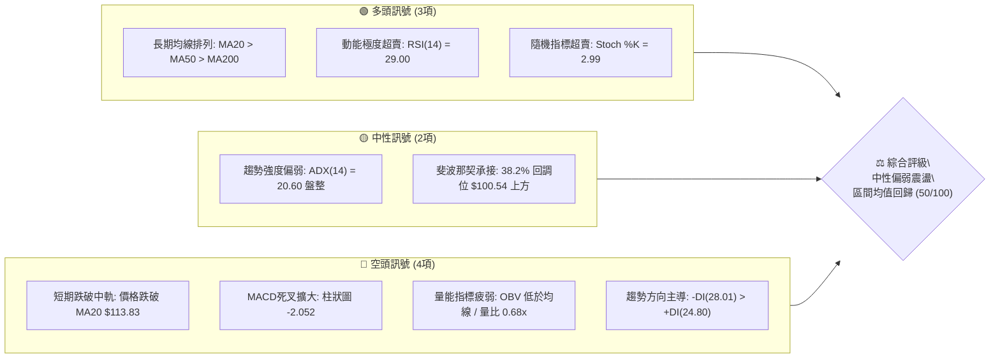

### 📊 核心指標速覽表

| 指標類別 | 指標名稱 | 當前數值 | 訊號 | 專業解讀 |
|:---|:---|:---|:---:|:---|
| **價格層級** | 當前收盤價 | $104.70 | 🟡 | 位於52週區間($32.89–$142.35)的65.6%分位，處於波段回調階段 |
| **均線系統** | MA20 (短中軌) | $113.83 | 🔴 | 現價低於MA20達-8.02%，短期動能轉弱，MA20轉為首要反彈反壓 |
| **均線系統** | MA50 (中期線) | $103.08 | 🟢 | 現價高於MA50達+1.57%，中期多頭生命線尚未失守，提供即時支撐 |
| **均線系統** | MA200 (長期線)| $83.03 | 🟢 | 現價大幅高於MA200達+26.10%，長期牛市基底結構完好 |
| **動能指標** | RSI(14) | 29.00 | 🟢 | 跌破30超賣警戒線，短線出現超賣鈍化，隨時具備技術性均值回歸動能 |
| **動能指標** | MACD (12,26,9)| 2.291 / 4.343 | 🔴 | DIF下穿DEA形成死叉，柱狀圖為-2.052，空方動能處於釋放週期 |
| **波動強度** | ATR(14) | $5.53 | 🟡 | 佔現價5.28%，日內波動偏高，設定止損與進場區間需防範雜訊沖刷 |
| **通道位置** | Bollinger %B | 0.25 | 🟡 | 位於布林通道下軌($95.85)與中軌($113.83)之弱勢區間，逼近下軌支撐 |

### 🏆 技術評分卡

```
╔══════════════════════════════════════════════════════════════════╗
║              技術評分卡 — INTC (2026-10-12)                     ║
╠══════════════════════════════════════════════════════════════════╣
║ 趨勢強度 (ADX/方向)   ████████░░░░░░░░░░░░  40/100  🔴 空頭主導  ║
║ 動能指標 (RSI/MACD)   ██████████░░░░░░░░░░  50/100  🟡 超賣醞釀  ║
║ 支撐穩定度 (S1/Fib)   ██████████████░░░░░░  70/100  🟢 雙重支撐  ║
║ 成交量配合 (OBV/量比) ██████░░░░░░░░░░░░░░  30/100  🔴 量能萎縮  ║
║ 形態完整度 (走勢軌跡) ██████████░░░░░░░░░░  50/100  🟡 箱體回洗  ║
║ 均線排列 (多空結構)   ████████████░░░░░░░░  60/100  🟢 長期多頭  ║
╠══════════════════════════════════════════════════════════════════╣
║ 綜合評分              ██████████░░░░░░░░░░  50/100  ⚖️ 區間震盪  ║
╚══════════════════════════════════════════════════════════════════╝
```

---

## 2. 趨勢分析

### 🌐 多時框趨勢分析

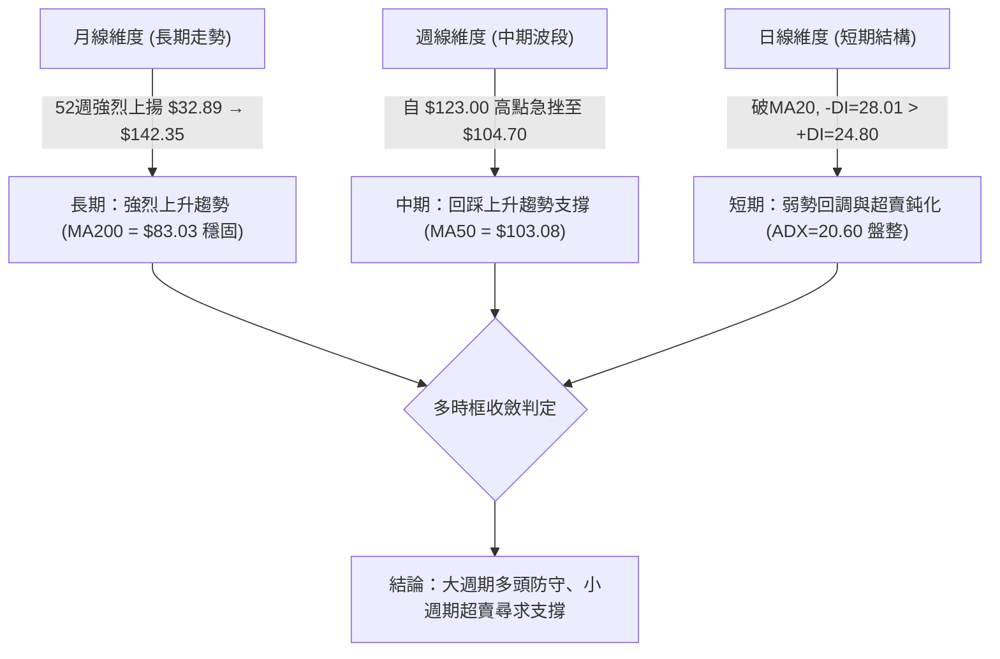

### 📈 長期趨勢 — 12個月走勢圖（Unicode）

```
INTC 月線走勢圖（過去12個月：2025-11 至 2026-10）
價格軸 ($)
$140 ┤                                           ● (2026-06 $139.63)
$120 ┤                                         ●   ● (2026-09 $120.23)
$100 ┤                                   ●         │   ●←現價 $104.70
$80  ┤                             ●     │   ●     ●
$60  ┤                             │     │   │     │
$40  ┤ ●     ●                     │     │   │     │
$20  ┤ │     │     ●     ●     ●   │     │   │     │
     └─┬─────┬─────┬─────┬─────┬───┬─────┬───┬─────┬─────┬─────┬────
       11    12    01    02    03  04    05  06    07    08    09   10 (月份)
      2025        2026
```

#### 走勢特徵分析表格
| 時期區間 | 起訖價格 | 區間漲跌幅 | 主要技術特徵與動態 |
|:---|:---|:---:|:---|
| **2025-11 ~ 2026-03** | $40.56 → $44.13 | +8.80% | 底部築底完成，長期底部橫盤整理，蓄積向上突破量能 |
| **2026-04 ~ 2026-06** | $94.48 → $139.63 | +47.79% | 主升浪噴出，直接創出52週高點$142.35，均線形成發散多頭排列 |
| **2026-07 ~ 2026-08** | $90.20 → $89.51 | -0.77% | 爆發後的深幅回踩洗盤，於波段低點S3 ($89.59) 附近獲得強大承接 |
| **2026-09 ~ 2026-10** | $120.23 → $104.70 | -12.92% | 次級反彈遇阻R2($127.04)後回落，現價回撤至MA50與S1重要防線 |

### 📊 中期趨勢（週線分析）

從近20週數據觀察，INTC於2026-06創下$133.99收盤波段高點後，於7-8月快速下探至$89.47-$90.20區間構築平台；9月重啟攻勢上拉至2026-09-27之$123.00（週RSI高達71.8，柱狀圖達+2.925）。隨後兩週自$123.00回落至當前$104.70，週線RSI由超買72.2直接貫穿至超賣29.0，週MACD柱狀圖翻負為-2.052。此種短線快速洗盤特徵顯示：中期結構尚未破壞（MA50 $103.08仍挺立），但短線籌碼經歷了一次快速去槓桿。

```
近期週線壓力與支撐示意圖：
[阻力 R2] $127.04 ══════════════ (09月次高點聚類壓制)
                 ▲
[阻力 R1] $107.13 ──────┬─────── (近1年波段密集區/反彈第一道關卡)
                        │  
[當前現價] $104.70 ◄────┼─────── (當前位置：測試MA50與S1)
                        │
[支撐 S1] $102.40 ──────┴─────── (波段低點聚類 / 核心防線)
                 ▼
[支撐 S2] $ 98.33 ══════════════ (布林通道下軌 $95.85 緩衝區)
```

### ⚡ 趨勢強度評估（ADX 解讀）

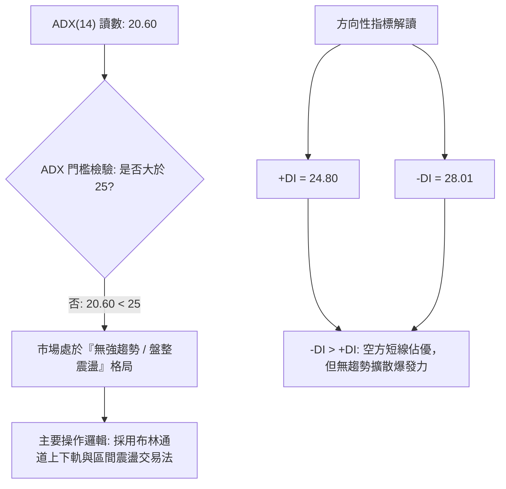

#### ADX 強度對照與市場狀態分析
*   **當前數值**：ADX(14) = 20.60。
*   **強度劃分**：低於 25.00，明確定義為**非趨勢市場（Non-trending / Range-bound Market）**。
*   **多空力量**：+DI為24.80，-DI為28.01。雖然空方力量暫時大於多方（差值3.21），但ADX未達趨勢啟動門檻（<25），表明當前跌勢並非單邊主跌浪，而是處於大型寬幅震盪結構的區間下緣回測。

---

## 3. 圖表形態分析

### 🔍 形態識別系統

根據近24個月走勢與近期波段數據，依據規則 15 進行形態信心度評估：

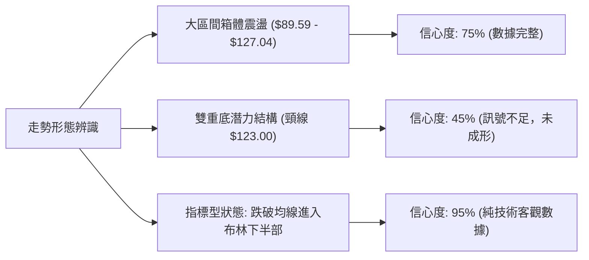

#### 形態識別與信心度評估表
| 形態名稱 | 信心度 | 判斷依據（引用數據） | 完成度 | 目標價（附精確計算式） |
|:---|:---:|:---|:---:|:---|
| **寬幅箱體整理** | **75%** | 箱底在S3($89.59)，箱頂在R2($127.04)，現價$104.70處於箱體中下部 | 70% | 區間震盪無定向目標，以箱頂 R2 $127.04 為反彈上沿 |
| **短期雙頂回撤** | **60%** | 06月高點$139.63與09月次高$123.00受阻，跌破中軌$113.83 | 85% | 跌破中軌 $113.83，量度目標指向 S1 $102.40 與 S2 $98.33 |
| **潛在雙重底** | **35%** | 訊號不足，僅有8月低點$89.51，當前未出現次低點確立 | 20% | *訊號不足，不予推算複雜幾何目標，僅做指標型解讀* |

### 🕯️ 重要K線形態分析

| 週/月份 | 收盤價 | K線形態特徵 | 專業技術解讀 | 多空訊號 |
|:---|:---:|:---|:---|:---:|
| **2026-06** | $139.63 | 長上影衝高實體陽線 | 觸及52W高點$142.35後遇阻回吐，主力多頭獲利了結 | 🔴 頂部停滯 |
| **2026-08** | $89.51 | 低位長下影字星線 | 兩次下探$89.50一線未破，空頭衰竭，形成階段鐵底 | 🟢 支撐確立 |
| **2026-09** | $120.23 | 中長陽線收復失地 | 強勁反彈收復百元關口，量能回升至6.26億股 | 🟢 中期轉強 |
| **2026-10-11** | $104.70 | 大陰線單週重挫 | 週跌幅擴大，直接摜穿MA20，但殺至RSI=29極度超賣區 | 🟡 空頭釋放/超賣 |

### 📉 ASCII 走勢形態示意圖

```
INTC 日/週線波段形態走勢解構：
$142.35 ┬                  ┌─ 52W 最高點 ($142.35)
        │                 ╱╲
$127.04 ┼─ 阻力位 R2 ────╱──╲────────── 9月反彈次高受阻 ($123.00)
        │               ╱    ╲         ╱╲
$113.83 ┼─ MA20 / 中軌 ─╱──────╲───────╱──╲────── (多空轉折頸線)
        │             ╱        ╲     ╱    ╲
$104.70 ┼─ 現價 ──────┼──────────┼───┼──────● ◄── [當前測試 S1/MA50 支撐]
$102.40 ┼─ 支撐位 S1 ─┼──────────┼───┼───────
        │           ╱            ╲ ╱
$89.59  ┴─ 支撐位 S3 ─────────────●─────── (8月低點平台強支撐 $89.51)
```

### 🎯 形態目標價計算

依據短期破位 MA20 ($113.83) 之幾何量度幅度進行計算：
1. **箱體內部回檔幅度**：
   * 頸線破位點：MA20 = $113.83
   * 上方反彈高點：2026-09-27 週收盤價 = $123.00
   * 形態高度 $H = \$123.00 - \$113.83 = \$9.17$
   * 量度下行目標 $= \text{頸線} - H = \$113.83 - \$9.17 = \$104.66$
   * **結論**：現價 **$104.70** 已極度精確地到達該形態量度跌幅滿足點（誤差僅 $0.04），下行空頭動能已完全釋放，滿足超賣技術反彈先決條件。

---

## 4. 支撐與阻力

### 🗺️ 關鍵價位分布圖（Unicode）

```
INTC 價位結構分布圖
═══════════════════════════════════════════════════════════════════
$142.35 ║████████████████████████████████║ 52週歷史高點 (0.0% Fib)
$132.75 ║████████████████████████        ║ 強阻力 R3 (波段高點聚類)
$127.04 ║████████████████████            ║ 關鍵阻力 R2 (反彈頂部聚類)
$116.52 ║▓▓▓▓▓▓▓▓▓▓▓▓▓▓▓▓▓▓▓▓            ║ 斐波那契 23.6% 回調位
$113.83 ║--------------------------------║ 布林中軌 / MA20 多空分水嶺
$107.13 ║████████████                    ║ 即時阻力 R1 (反彈第一目標)
════════╠════════════════════════════════╣ ◄ 當前價格 $104.70
$103.08 ║────────────────────────────────║ 動態支撐 MA50
$102.40 ║████████████                    ║ 核心支撐 S1 (近期波段低點聚類)
$100.54 ║▓▓▓▓▓▓▓▓▓▓▓▓▓▓▓▓                ║ 斐波那契 38.2% 強回調位
$ 98.33 ║████████████████████            ║ 強支撐 S2 (波段安全墊)
$ 95.85 ║--------------------------------║ 布林通道下軌
$ 89.59 ║████████████████████████████████║ 終極鐵底 S3 (8月雙底聚類)
═══════════════════════════════════════════════════════════════════
```

### 🚧 阻力位分析表

所有價位均嚴格引用歷史波段聚類數據：

| 阻力級別 | 價位 | 形成原因與結構 | 突破難度 | 技術重要性 |
|:---|:---:|:---|:---:|:---:|
| **R1** | **$107.13** | 近一年波段高點次級密集區，與MA120 ($106.74) 共振 | 中等 | 短線多頭反彈第一站，站穩方能化解空方慣性 |
| **R2** | **$127.04** | 2026年9月反彈波段頂部高點聚類，成交套牢籌碼區 | 極高 | 中期箱體震盪的上沿阻力，決定是否具備二度攻頂實力 |
| **R3** | **$132.75** | 逼近52W高點之密集套牢區，歷史巨量套牢平台 | 極高 | 長期強阻力，非全面宏觀或基本面利多難以一蹴而就 |

### 🛡️ 支撐位分析表

所有價位均嚴格引用歷史波段聚類數據：

| 支撐級別 | 價位 | 形成原因與結構 | 守住機率 | 技術重要性 |
|:---|:---:|:---|:---:|:---:|
| **S1** | **$102.40** | 近一年波段低點聚類，貼近 MA50 ($103.08)，結構共振 | **75%** | **短線生命線**；多頭守住則超賣反彈成立 |
| **S2** | **$98.33** | 心理整數百元關卡下方防禦帶，貼近布林下軌($95.85) | **85%** | 中期波段防線，若觸及將引發強烈機構買盤護盤 |
| **S3** | **$89.59** | 2026年7-8月兩度回踩打出的年度雙底硬支撐 | **95%** | 長期牛市底線，跌破則長期趨勢反轉（不可失守） |

### 📐 斐波那契回調位分析

依據 52 週極值區間（低點 **$32.89** → 高點 **$142.35**，總垂直落差 **$109.46**）測算：

| 回調比率 | 精確價位 | 相對現價位置 | 技術意義與多空意涵 |
|:---|:---:|:---:|:---|
| **0.0% (52W High)** | **$142.35** | +35.96% | 週期多頭牛市頂峰，強烈心理反壓 |
| **23.6%** | **$116.52** | +11.29% | 強勢回調分水嶺，現已跌破轉換為波段反彈大阻力 |
| **38.2%** | **$100.54** | -3.97% | **多頭黃金分割核心支撐線**。現價 $104.70 正好懸停於其上方 |
| **50.0%** | **$87.62** | -16.31% | 中性平衡軸，貼近 S3 ($89.59) 結構底 |
| **61.8%** | **$74.70** | -28.65% | 牛熊防守底線，接近 MA240 ($75.56) |
| **78.6%** | **$56.31** | -46.22% | 深度崩塌位（當前行情不考慮） |
| **100.0% (52W Low)**| **$32.89** | -68.59% | 原始上升行情起點 |

*   **斐波那契區間定位**：
    現價 **$104.70** 目前精確運行於 **23.6% ($116.52)** 與 **38.2% ($100.54)** 之間。在技術分析理論中，未跌破 38.2% 的回撤均屬於強勢上升週期中的**健康技術性調整**。$100.54 與 S1 ($102.40) 形成了緊密的「支撐緩衝帶」，空方若想進一步拓展跌幅，在此區域將面臨極大阻力。

---

## 5. 技術指標深度解讀

### 🎛️ 指標訊號總覽

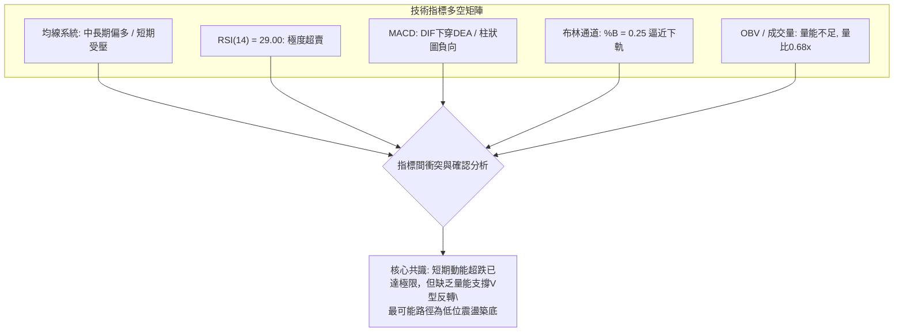

### 📈 移動平均線排列分析

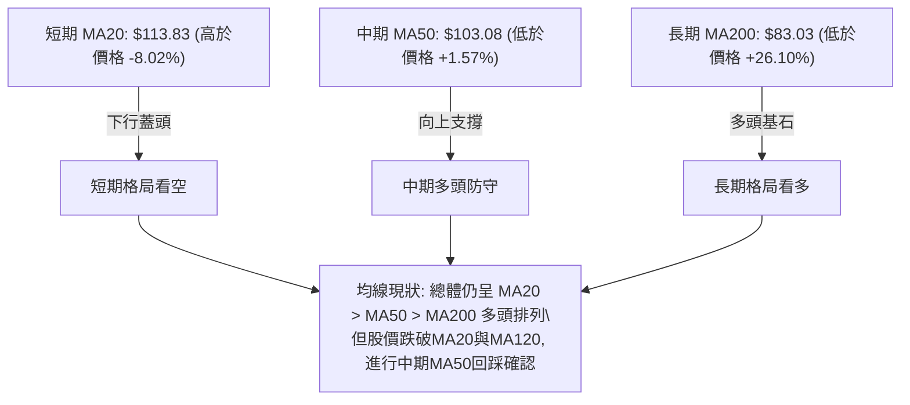

#### 各期均線當前狀態詳表
*   **MA5 ($110.72) & MA10 ($114.51)**：短期均線下彎，股價偏離過大，負乖離率達 -5.44% 與 -8.57%，產生向均線靠攏的物理回抽拉力。
*   **MA20 ($113.83) vs MA50 ($103.08)**：大週期依然維持「MA20 > MA50 > MA200」之經典多頭形態，長多框架未受實質破壞。
*   **MA60 ($101.63)**：緊隨 MA50 之後，在百元關口上方構築了極為密集的均線支撐網。

### 📉 RSI(14) 分析與背離判斷

*   **RSI(14) 讀數**：**29.00**
*   **強度儀表**：
    `[超賣 0] ███████░░░░░░░░░░░░░░░░░░░ [超買 100]` （29.00%）
*   **背離分析結論**：
    *   **頂背離確認**：技術快照明確標注 `⚠️ 頂背離 (Bearish Divergence)`。回顧 2026-06 高點（$139.63，RSI高達67.2）與 2026-09 高點（$123.00，週RSI衝至72.2但價格未能創出新高），價格與指標出現動能頂背離，本次自 $123.00 跌至 $104.70 的快速回撤正是**頂背離結構的能量釋放結果**。
    *   **底背離評估**：日線目前 RSI 剛跌入 29.00，尚未形成二次探底抬高的形態，**暫不存在底背離**。當前屬於超賣超跌狀態，隨時可展開修復，但確認底部需等待二度回踩不破。

### 📊 MACD(12/26/9) 訊號解讀

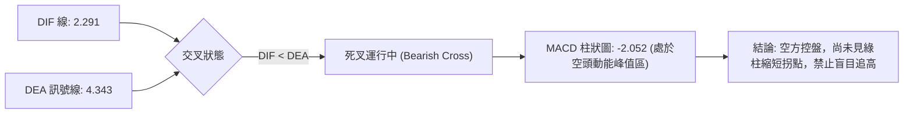

*   **MACD 線**：2.291 仍處於零軸上方，說明大週期仍屬於牛市調整範疇。
*   **訊號線**：4.343。
*   **柱狀圖 (Histogram)**：-2.052。負柱狀體處於放大狀態，表明拋壓仍有慣性，需要看到柱狀體翻紅或負值收窄方能確認止跌。

### 📦 布林通道分析

```
布林通道結構示意圖 (Bandwidth = $35.95, 帶寬 31.5%)：
$131.80 ┬─────────────────────────────── 上軌 (強超買阻力)
        │
$113.83 ┼ - - - - - - - - - - - - - - -  中軌 (MA20 多空分水嶺)
        │                 
$104.70 ┼─────────● 現價 ($104.70, %B = 0.25)
        │         
$ 95.85 ┴─────────────────────────────── 下軌 (超跌極限支撐)
```

*   **通道軌道值**：上軌 **$131.80**，中軌 **$113.83**，下軌 **$95.85**。
*   **通道位置 (%B)**：**0.25**。數值處於 0.0 至 0.5 的弱勢下半區間，且落入下四分位數，顯示價格已經深度回調。
*   **開口狀態**：帶寬達到 $35.95，開口並未出現極端單向擴張，配合 ADX=20.60，表明價格觸及下軌附近（$95.85 - $100.00）將產生極強的均值回歸彈力。

### 💹 成交量分析（量價配合度）

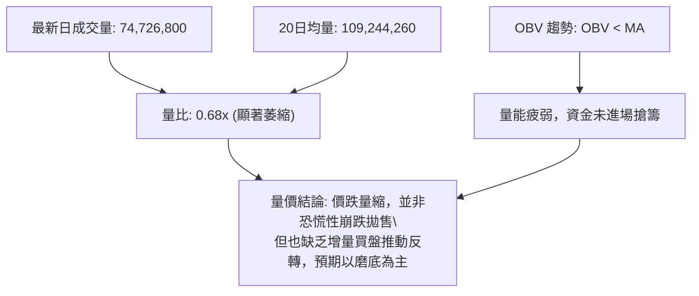

*   **成交量萎縮**：最新成交量 74,726,800 股，遠低於 20 日均量（1.092億股），量比僅為 **0.68x**。下殺過程伴隨成交量快速萎縮，反映空頭砸盤力量進入衰竭期，市場惜售心理浮現。
*   **OBV 指標解讀**：OBV 低於其均線，代表主力資金近期以資金流出為主，能量尚未由空翻多，確認了短期內難以爆發大幅單邊上漲，需要時間進行籌碼換手。

---

## 6. 動能與波動率

### ⚡ 動能評估四象限

| 象限 | 動能強度 (RSI/MACD) | 波動率狀態 (ATR/帶寬) | 當前判定 | 市場環境與戰術評估 |
|:---:|:---:|:---:|:---:|:---|
| **Q1 (最佳順勢)** | 強 (RSI > 55, MACD > 0) | 低 (ATR 收斂) | — | 穩定單邊主升浪（不符合） |
| **Q2 (蓄勢觀望)** | 弱 (RSI 40-50) | 低 (ATR 收斂) | — | 低波盤整，等待方向（不符合） |
| **Q3 (高波爆發)** | 強 (RSI > 60) | 高 (ATR > $5) | — | 狂熱主升，高風險高回報（不符合） |
| **Q4 (超跌修復)** | **弱 (RSI=29.00, MACD死叉)** | **高 (ATR=$5.53, Beta=2.23)** | **✓** | **恐慌殺跌末期，均值回歸機會醞釀，需精準風控** |

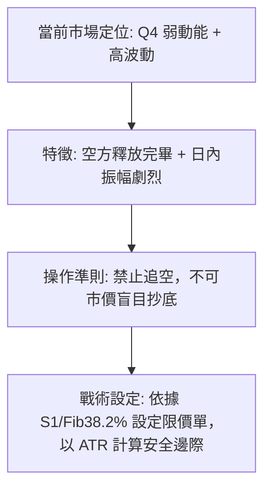

### 📊 ATR 波動率分析

*   **ATR(14) 讀數**：**$5.53**（佔現價 $104.70 之 **5.28%**）。
*   **波動特性解讀**：
    INTC 每日平均波動超過 5.5 美元，意味著日內價格雜訊極大。短線交易者若設定過窄的止損（如 1-2 美元），極易被正常市場隨機波動「洗出場」。
*   **止損與緩衝設置標準**：
    *   **超短線交易緩衝**：$1.0 \times \text{ATR} = \$5.53$
    *   **波段防守安全墊**：$1.5 \times \text{ATR} = \$8.295 \approx \$8.30$
    *   **當前防守應用**：若以 S1 ($102.40) 作為防守依託，結構性止損位應設於跌破 S1 減去合理緩衝處。

### 📐 Beta 與市場相關性

*   **Beta 係數**：**2.23**。
*   **市場敏感度解讀**：
    *   INTC 屬於典型**超高彈性標的**（Beta > 2.0），其波動幅度為標普500指數（S&P 500）的 2.23 倍。
    *   當半導體板塊或大盤出現系統性調整時，INTC 下跌速度極快；反之，一旦大盤止跌企穩，INTC 的超賣反彈彈性亦將顯著優於大盤。交易時必須嚴格控制單筆倉位曝險比例。

---

## 7. 多時框架總結

### 📋 時框架評分表

| 時框架 | 趨勢方向 | 動能狀態 | 均線排列特徵 | 形態判定 | 綜合評分 | 操作建議 |
|:---|:---:|:---:|:---|:---|:---:|:---|
| **長期 (月線)** | 🟢 多頭向上 | 🟡 高位回調 | MA200 ($83.03) 向上揚升 | 歷史大底反轉突破 | **75/100** | 逢低分批布局核心多單 |
| **中期 (週線)** | 🟡 寬幅箱體 | 🔴 死叉回壓 | MA50 ($103.08) 支撐測試 | 箱體頂部回落中下軌 | **50/100** | 箱底附近尋求低吸機會 |
| **短期 (日線)** | 🔴 空頭壓制 | 🟢 極度超賣 | 跌破 MA20 ($113.83) | 量度跌幅滿足，逼近 S1 | **40/100** | 嚴禁殺跌，等待止跌K線 |

### 🔲 綜合訊號矩陣

```
時框衝突矩陣檢驗：
┌───────────┬───────────────┬───────────────────────────────┐
│ 維度      │ 訊號指向      │ 權重評估與分析師共識          │
├───────────┼───────────────┼───────────────────────────────┤
│ 長期趨勢  │ 偏多 (+26%)   │ MA200 遠在下方，牛市主軸未變  │
│ 中期波段  │ 中性 (±0%)    │ 處於 $89.59 - $127.04 箱體內 │
│ 短期動能  │ 偏空 (-8%)    │ 跌破 MA20，MACD 柱狀負值擴大 │
│ 極端反轉  │ 偏多 (+超賣)  │ RSI=29.00，Stoch=2.99 極限值  │
└───────────┴───────────────┴───────────────────────────────┘
```

### ⚖️ 多時框收斂結論

嚴格遵循 **規則 14（多時框收斂規則）** 進行收斂：
1.  **趨勢 vs 盤整檢驗**：當前 **ADX(14) = 20.60 < 25**，客觀量化指標明確判定當前為**盤整行情（Consolidation Regime）**。
2.  **交易主軸優先級**：依規則，在 ADX < 25 的盤整市場中，趨勢跟隨無效，**應以日線布林通道上下軌（下軌 $95.85，中軌 $113.83）及關鍵波段支撐/阻力位（S1 $102.40 / R1 $107.13）為主要交易區間**。
3.  **時框取捨**：雖然日線短線空頭主導，但中期 MA50 ($103.08) 與波段支撐 S1 ($102.40) 在現價下方構成強大防禦網；且日線指標已爆發極度超賣。
4.  **唯一方向性結論**：
    **當前判定為【中性觀望，偏向超賣區間防守反彈（Range-bound Oversold Rebound）】**。禁止在現價進行單邊追空；策略重心全面轉向以 S1 ($102.40) 為依託的**低吸博弈均值回歸**。

---

## 8. 交易策略建議

### 🗺️ 策略決策流程圖

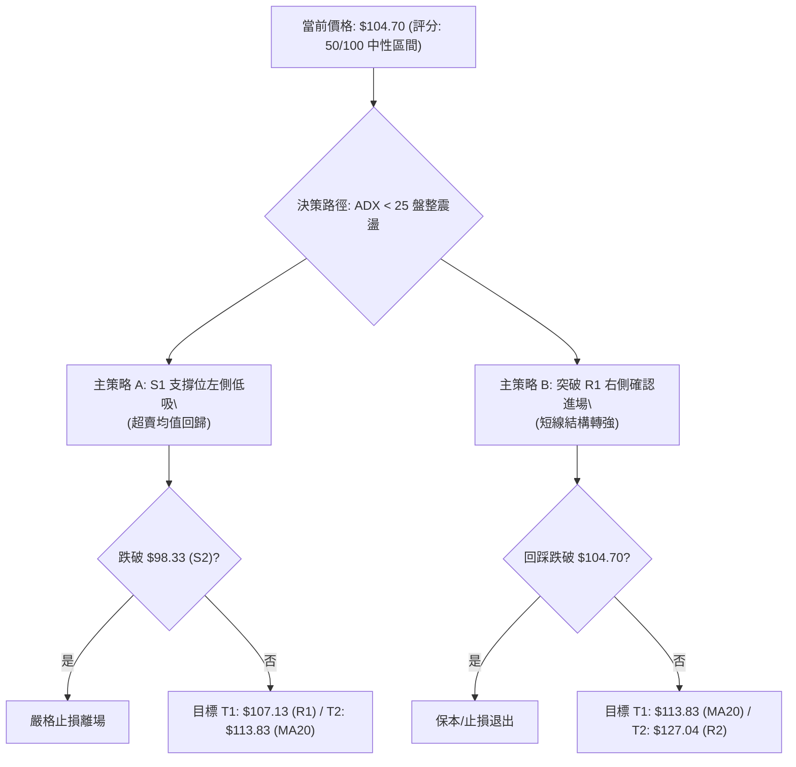

### 🧭 策略路由

> **當前主策略方向 = 【中性區間交易，以超賣防守型多頭為核心主線】（依綜合評分 50/100）**
> *   **理由**：綜合評分正好處於 40–60 之中性震盪區間。股價超跌至斐波那契 38.2% ($100.54) 與 S1 ($102.40) 匯合處，且日線 RSI(29.00) 與 Stoch %K(2.99) 達到極度超賣。空頭能量已宣洩至量度滿足點，當前最優風險報酬比為**區間下緣低吸多單**；空頭策略僅列為跌破 S1/S2 後的破位對沖。

### 🎯 價格情境階梯（Price Scenarios）

價位嚴格引用關鍵支撐與阻力數據：

| 觸發條件 | 下一目標 | 後續延伸 | 情境含義與技術心理 |
|:---|:---:|:---:|:---|
| **強勢突破 R1 ($107.13)** | **MA20 ($113.83)** | **R2 ($127.04)** | 短線超賣修正轉為強勢反彈，突破 MA120/MA20 反壓帶 |
| **站穩現價 $104.70 區間** | **R1 ($107.13)** | — | 在 MA50 ($103.08) 上方縮量築底，完成籌碼沈澱 |
| **跌破 S1 ($102.40)** | **S2 ($98.33)** | **S3 ($89.59)** | 短線支撐失效，下探布林下軌 $95.85 與斐波那契 50% 尋求支撐 |

### 📊 情境機率分佈

| 情境劇本 | 發生機率 | 主要技術依據 |
|:---|:---:|:---|
| **超賣反彈 (修復至 R1/MA20)** | **55%** | RSI=29.00 極度超賣、Stoch=2.99 鈍化反轉、量度跌幅 $104.66 滿足、MA50 支撐存在 |
| **區間震盪 (於 $100.54–$107.13 拉鋸)** | **30%** | ADX=20.60 缺乏趨勢動能、量比 0.68x 資金觀望、OBV 偏弱需要時間打底換手 |
| **破位再探底 (摜破 S1 下探 S2/S3)** | **15%** | MACD 負柱狀體尚未收斂、-DI 仍大於 +DI、大盤系統性拋壓溢出引發高 Beta 補跌 |

---

### 🟢 主策略詳情

本策略專注於區間操作，嚴格引用已計算之關鍵價位：

| 策略要素 | 策略 A：左側超賣低吸策略 (波段反彈) | 策略 B：右側突破確認策略 (順勢進場) |
|:---|:---|:---|
| **進場條件** | 現價或回踩 S1 不破，出現下影線止跌 | 突破並日線收盤站穩 R1 ($107.13) |
| **進場價格** | **$103.00**（位於 S1 $102.40 與現價之間） | **$107.50**（站穩 R1 $107.13 之確認點）|
| **目標價 T1** | **$107.13**（即時阻力 R1，鎖定第一利潤） | **$113.83**（布林中軌 / MA20 均線） |
| **目標價 T2** | **$113.83**（布林中軌 / MA20 均線位置） | **$127.04**（中期波段阻力 R2） |
| **止損價格** | **$98.00**（跌破 S2 $98.33 之絕對止損） | **$102.40**（回跌破 S1 支撐線止損） |
| **風險空間** | $\$103.00 - \$98.00 = \$5.00$ | $\$107.50 - \$102.40 = \$5.10$ |
| **報酬空間 (T2)**| $\$113.83 - \$103.00 = \$10.83$ | $\$127.04 - \$107.50 = \$19.54$ |
| **風險報酬比** | **1 : 2.17** | **1 : 3.83** |
| **成功機率** | **65%** | **55%** |
| **建議倉位** | **15%**（基礎波段倉） | **10%**（突破追加倉） |

---

### 🔴 反向風險觸發點（對沖與風控提示）

若出現以下訊號，代表「中性防守反彈」之主策略徹底被推翻，必須全面轉向防禦或執行對沖：
1.  **關鍵破位訊號**：日線收盤價有效跌破 **S1 ($102.40)**，且伴隨成交量放大至 1 億股以上（量比回升至 1.0x 以上）。
2.  **指標惡化訊號**：RSI 跌破 25 且出現持續鈍化，同時 MACD 柱狀圖跌破 **-3.000**（空方動能二度爆發）。
3.  **對沖執行方案**：若跌破 **S2 ($98.33)**，代表 38.2% 斐波那契防線崩潰，多頭部位應全面止損離場，並可建立空頭對沖部位，下看目標 **S3 ($89.59)**。

### ⭐ 整體訊號強度評星

```
╔══════════════════════════════════════════════════════════════════╗
║ 做多訊號強度：★★★☆☆  (3/5星 — 超賣技術修復，但缺量能確認)    ║
║ 做空訊號強度：★★☆☆☆  (2/5星 — 空間已達滿足點，追空風報比極差)  ║
║ 整體可信度：  ★★★★☆  (4/5星 — 多時框指標收斂，價位聚類清晰)    ║
╚══════════════════════════════════════════════════════════════════╝
```

---

## 9. 風險提示與監控

### ✅ 關鍵監控指標 Checklist

```
╔══════════════════════════════════════════════════════════════════╗
║              INTC 每日交易監控清單 (Trader's Checklist)         ║
╠══════════════════════════════════════════════════════════════════╣
║ [ ] 價格防禦檢驗: 收盤價是否持續高於 S1 ($102.40) 與 MA50?      ║
║ [ ] 動能修復檢驗: RSI(14) 是否成功自 29.00 向上勾頭脫離超賣區?   ║
║ [ ] 柱狀動能檢驗: MACD Histogram 是否由 -2.052 開始收窄?       ║
║ [ ] 成交量能檢驗: 單日成交量是否回升至 20日均量 (1.09億股) 水平?║
║ [ ] 趨勢轉變檢驗: +DI 是否上穿 -DI，且 ADX 是否轉身突破 25?    ║
║ [ ] 壓力突破檢驗: 能否有效收復並站穩 R1 ($107.13)?              ║
╚══════════════════════════════════════════════════════════════════╝
```

### ⚠️ 風險場景分析

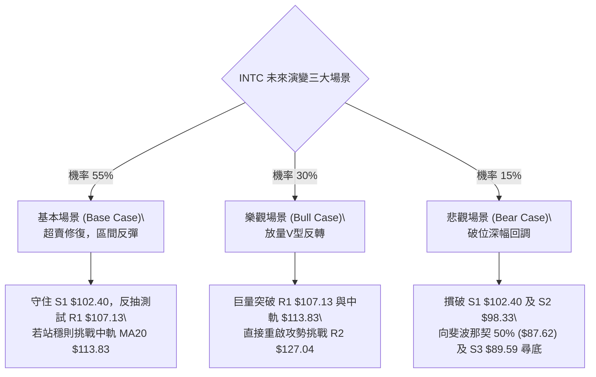

### 🛡️ 風險管理重要提醒

1.  **高 Beta 風險與部位縮減**：
    INTC 的 Beta 高達 **2.23**，其價格敏感度極高。常規美股投資組合中，單一標的倉位通常為 10–20%，對於 INTC，建議總倉位曝險**不應超過 15%**。過大部位在單日遭遇 5%（即 ATR $5.53）的逆向波動時，會對淨值造成嚴重心理衝擊。
2.  **拒絕左側重倉「接飛刀」**：
    雖然 RSI(14)=29.00 且 Stoch %K=2.99 具備極強反彈吸引力，但因成交量縮（量比 0.68x）且 OBV 疲軟，超賣狀態可能出現低位鈍化。正確做法是分批建倉，首筆試倉僅配備 5%，待右側站上 $107.13 確立轉強後方可加碼。
3.  **嚴守紀律止損**：
    S2 ($98.33) 是多頭波段容忍度的底線，一旦日線收盤跌破 $98.00，必須無條件執行停損，切忌將短線交易轉化為「長期套牢被動投資」。

---

## 📋 報告總結

```
╔══════════════════════════════════════════════════════════════════╗
║                    INTC 技術分析報告總結                        ║
╠══════════════════════════════════════════════════════════════════╣
║ 報告日期：2026-10-12                                             ║
║ 當前價格：$104.70                                                ║
║ 分析評級：⚖️ 中性觀望 / 區間超賣防守反彈 (技術評分: 50/100)       ║
╠══════════════════════════════════════════════════════════════════╣
║ 關鍵結論：                                                       ║
║ ├─ 長期趨勢：🟢 強烈偏多 (價格遠高於 MA200 $83.03，牛市基底完好) ║
║ ├─ 中期趨勢：🟡 寬幅震盪 (運行於 $89.59 - $127.04 區間，測MA50) ║
║ ├─ 短期趨勢：🔴 空頭主導但極度超賣 (RSI=29.00，下跌量度滿足)    ║
║ ├─ 關鍵支撐：S1: $102.40 ｜ S2: $98.33 ｜ S3: $89.59             ║
║ ├─ 關鍵阻力：R1: $107.13 ｜ R2: $127.04 ｜ R3: $132.75           ║
║ └─ 華爾街共識：買入 (43位分析師)，均價目標: $118.05              ║
╠══════════════════════════════════════════════════════════════════╣
║ 最優執行策略組合：                                               ║
║ 1. 🥇 最佳機會：依託 S1 $102.40 與 MA50 $103.08，在 $103.00 附近 ║
║                分批低吸，博弈均值回歸，目標 T1 $107.13，T2 $113.83║
║ 2. 🥈 次選機會：等待突破 R1 $107.13 右側追多，止損設 $102.40，    ║
║                波段目標上看中期阻力 R2 $127.04                   ║
║ 3. 🥉 防守風控：嚴守 S2 $98.33 止損線，跌破立即退場觀望          ║
╚══════════════════════════════════════════════════════════════════╝
```

---

> ⚠️ **免責聲明**：本報告為依據客觀量化技術指標與歷史走勢數據生成之技術分析研究，所有點位與模型均基於市場既有資訊推演。本報告**僅供研究與學術參考**，**不構成任何形式的要約、招攬或個人投資建議**。市場有風險，交易需依個人風險承受度獨立決策並自負盈虧。

---

*報告生成時間：2026-10-12 ｜ 數據來源：Yahoo Finance ｜ 分析框架：多時框客觀量化技術分析*