# INTC 基本面深度分析報告

> **報告日期**：2026-10-14 ｜ **語言**：繁體中文 ｜ **數據來源**：Yahoo Finance ｜ **當前價格**：$102.81

---

## 目錄

| 章節 | 內容 |
|------|------|
| [1. 技術面概覽](#1-技術面概覽) | 訊號儀表板、核心指標、評分卡 |
| [2. 趨勢分析](#2-趨勢分析) | 多時框趨勢、長中短期走勢 |
| [3. 圖表形態分析](#3-圖表形態分析) | 形態識別、K線組合、目標價 |
| [4. 支撐與阻力](#4-支撐與阻力) | 關鍵價位、斐波那契回調 |
| [5. 技術指標深度解讀](#5-技術指標深度解讀) | MA/RSI/MACD/布林/成交量 |
| [6. 動能與波動率](#6-動能與波動率) | 動能評估、ATR、Beta |
| [7. 多時框架總結](#7-多時框架總結) | 時框架評分矩陣 |
| [8. 交易策略建議](#8-交易策略建議) | 多空策略、風險報酬比 |
| [9. 風險提示與監控](#9-風險提示與監控) | 監控指標、風險場景 |

---

## 1. 技術面概覽

### 🎯 技術訊號儀表板

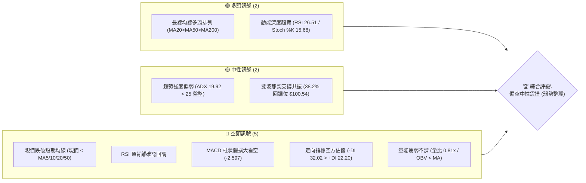

### 📊 核心指標速覽表

| 指標類別 | 指標名稱 | 當前數值 | 訊號 | 解讀 |
|----------|----------|----------|------|------|
| **價格** | 當前收盤價 | $102.81 | 🔴 | 跌破 MA50（$103.54）與 MA20（$114.32），短線由空方主導控盤 |
| **均線** | MA20 | $114.32 | 🔴 | 現價低於 MA20 達 -10.07%，形成極具壓迫感之短中期第一道下彎阻力 |
| **均線** | MA50 | $103.54 | 🔴 | 跌破中期生命線，短線多頭防線失守，轉化為上方即時蓋頂壓力 |
| **均線** | MA200 | $83.69 | 🟢 | 現價高於長期年線 +22.85%，大級別長期多頭架構尚未破壞 |
| **動能** | RSI(14) | 26.51 | 🟢 | 進入極度超賣區（<30），技術性隨時存在超跌修復反彈需求 |
| **動能** | MACD | 0.471 / 3.068 | 🔴 | DIF 跌破 DEA，Histogram 為 -2.597，空頭動能仍處於加速釋放階段 |
| **波動** | ATR(14) | $5.52 | 🟡 | 佔現價 5.37%，日內波動區間顯著放大，多空博弈極其劇烈 |
| **趨勢** | ADX(14) | 19.92 | 🟡 | 讀數小於 25，單邊動能趨緩，進入寬幅高位震盪箱體架構 |
| **量能** | 20日成交量比 | 0.81x | 🔴 | 當前成交量 87.72M 縮量下行，OBV 低於均線，缺乏逢低買盤主力介入 |

### 🏆 技術評分卡

```
╔══════════════════════════════════════════════════════════════════╗
║                   技術評分卡 — INTC (2026-10-14)                 ║
╠══════════════════════════════════════════════════════════════════╣
║ 趨勢強度 (Trend)       ██████░░░░░░░░░░░░░░  30/100  🔴 弱勢空方 ║
║ 動能指標 (Momentum)    ████████░░░░░░░░░░░░  40/100  🔴 超賣背離 ║
║ 支撐穩定度 (Support)   ████████████░░░░░░░░  60/100  🟡 臨近S1關卡║
║ 成交量配合 (Volume)    ██████░░░░░░░░░░░░░░  30/100  🔴 量價背離 ║
║ 形態完整度 (Pattern)   ████████░░░░░░░░░░░░  40/100  🟡 雙頂回踩 ║
║ 均線排列 (Moving Avg)  ██████████░░░░░░░░░░  50/100  🟡 長多短空 ║
╠══════════════════════════════════════════════════════════════════╣
║ 綜合技術評分           ████████░░░░░░░░░░░░  41/100  ⚖️ 偏空震盪 ║
╚══════════════════════════════════════════════════════════════════╝
```

---

## 2. 趨勢分析

### 🌐 多時框趨勢分析

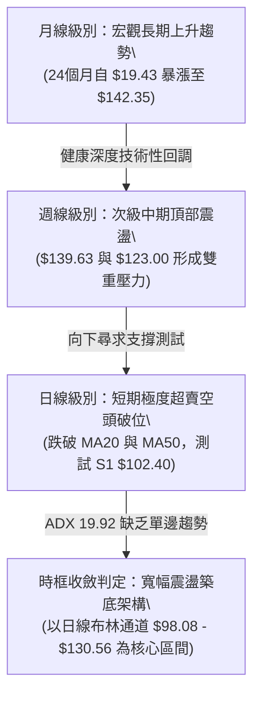

### 📈 長期趨勢 — 12個月走勢圖（Unicode）

```
INTC 月線走勢圖（過去12個月：2025-11 至 2026-10）
價格軸 ($)
$140 ┤                                           ●(2026-06 $139.63 歷史高位)
$130 ┤                                         ╭─╯ ╰╮
$120 ┤                                        ╭╯     ╰╮    ●(2026-09 $120.23 次高)
$110 ┤                                 ●(05) ╭╯       ╰╮  ╭╯╰╮
$100 ┤                               ╭─╯     ╭╯         ╰╮╭╯   ●(2026-10 $102.81 ◄現價)
$90  ┤                         ●(04)╭╯       │           ●●(07-08 雙底測試 $89.51)
$80  ┤                        ╭╯    │        │
$70  ┤                       ╭╯     │        │
$60  ┤                      ╭╯      │        │
$50  ┤               ●  ●  ╭╯       │        │
$40  ┤   ●(11) ●(12) ╰──╯─●(03)     │        │
$30  ┤───┴─────┴─────┴─────┴────────┴────────┴───────────────────────
       11/25 12/25 01/26 02/26 03/26 04/26 05/26 06/26 07/26 08/26 09/26 10/26
```

#### 走勢特徵分析表格

| 階段週期 | 月份區間 | 價格區間 | 漲跌幅 | 核心特徵與成交量結構 |
|----------|----------|----------|--------|----------------------|
| **底部築基期** | 2024-10 ~ 2025-08 | $19.43 - $24.35 | +22.98% | 長達11個月的橫盤吸籌區間，籌碼充分沉澱換手 |
| **初期突破期** | 2025-09 ~ 2026-03 | $33.55 - $46.47 | +38.51% | 脫離長期成本中樞，成交量逐月溫和放大，走勢健康 |
| **主升加速浪** | 2026-04 ~ 2026-06 | $44.13 - $139.63 | +216.41% | 史詩級爆發噴出，連續大陽線拔高，於6月觸及 52W 高點 $142.35 |
| **中期回調洗盤**| 2026-07 ~ 2026-08 | $139.63 - $89.51 | -35.89% | 快速急殺釋放獲利盤，連續測試 S3 關鍵支撐 $89.59 獲得支撐 |
| **次高點誘多反彈**| 2026-09 | $89.51 - $120.23 | +34.32% | 強勁反抽觸及 R2 阻力區間，未能創出新高形成次頂 |
| **當前二次探底**| 2026-10 (當前) | $120.23 - $102.81 | -14.49% | 短線空方加速下墜，現正回測 S1 關鍵價位 $102.40 |

### 📊 中期趨勢（週線分析）

```
INTC 週線近期波段壓力與支撐示意圖
══════════════════════════════════════════════════════════════════════
 阻力區：波段次高點聚類 (2026-09-27 收盤 $123.00) ───► $127.04 (R2)
──────────────────────────────────────────────────────────────────
 回彈壓力：近兩週破位反壓點 (2026-10-11 收盤 $104.70) ──► $107.13 (R1)
──────────────────────────────────────────────────────────────────
 當前市價：2026-10-18 週線即時報價 ────────────────────► $102.81
──────────────────────────────────────────────────────────────────
 即時支撐：日線波段低點聚類 (極短線防守核心) ──────────► $102.40 (S1)
──────────────────────────────────────────────────────────────────
 強固防線：布林下軌共振支撐 (2026-07-26 收盤 $92.32) ──►  $98.33 (S2)
══════════════════════════════════════════════════════════════════════
```

近20週數據顯示，INTC 於 2026-09-27 當週衝刺至收盤 $123.00（RSI 71.8、MACD柱 +2.925），隨後連續三週重挫：
- 2026-10-04：收盤 $119.33，MACD 柱收斂至 +0.435，高位滯漲；
- 2026-10-11：收盤 $104.70，週跌幅 -12.26%，RSI 由超買直接摜壓至 29.0，MACD 柱翻負至 -2.052；
- 2026-10-18：收盤 $102.81，RSI 進一步滑落至 26.5，MACD 柱惡化至 -2.597，週成交量驟降至 161.89M，呈現量能極度萎縮的真空殺跌。

### ⚡ 趨勢強度評估（ADX 解讀）

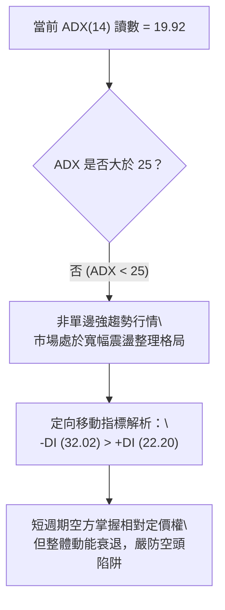

#### ADX 強度對照表

| ADX 讀數區間 | 趨勢強度判定 | 當前數值 | 當前市場狀態解讀 | 操作指導原則 |
|--------------|--------------|----------|------------------|--------------|
| 0 - 20 | 極弱 / 無趨勢 | **19.92** | **當前所處狀態**：方向不明，單邊動能潰散，處於大區間震盪整理 | 忌追漲殺跌，嚴格採用區間邊界操作 |
| 20 - 25 | 弱趨勢 / 醞釀中 | - | 動能初現但未確立主升或主跌 | 減少倉位，等待突破放量確認 |
| 25 - 50 | 強趨勢形成 | - | 明確單邊牛市或熊市行情 | 順勢持有，依均線動態移動止盈 |
| 50 - 75 | 極強 / 過度加速 | - | 動能達到頂峰，隨時引發力竭反轉 | 逢高或逢低獲利了結部分部位 |

---

## 3. 圖表形態分析

### 🔍 形態識別系統

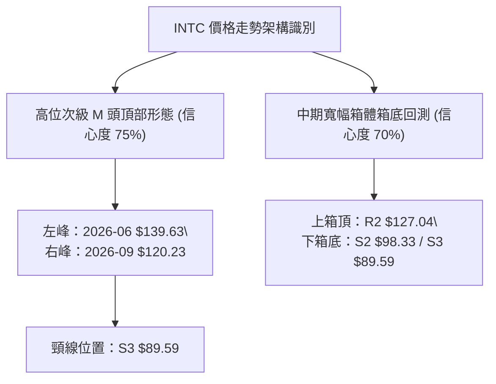

#### 形態識別信心度評估表

| 識別形態名稱 | 信心度 | 判斷依據（嚴格引用數據） | 當前完成度 | 形態目標價（附計算式） |
|--------------|--------|--------------------------|------------|------------------------|
| **高位不對稱雙頂 (M頭)** | 75% | 2026-06 月收盤 $139.63（最高 $142.35）為左頂；2026-09 收盤 $120.23 為右頂，高點顯著下移；頸線為波段低點 S3 **$89.59** | 60% (尚未向下跌破頸線) | 若跌破頸線 $89.59：<br/>形態高度 = $120.23 - $89.59 = $30.64<br/>理論下行目標 = $89.59 - $30.64 = **$58.95** (數據中未破位前僅供推算) |
| **寬幅箱體整理** | 70% | 頂部受阻於 R2 **$127.04**，底部兩次下探獲撐於 2026-07/08 收盤 $90.20/$89.51（即 S3 **$89.59**） | 85% (現正自中軌向箱底回落) | 當前回撤下軌支撐目標：**S2 $98.33** 及 **S3 $89.59**；回彈目標：**R1 $107.13** |
| **頭肩底形態** | <30% | 數據中未偵測到此形態的右肩構建結構 | 0% | **訊號不足，僅做指標型解讀** |

### 🕯️ 重要K線形態分析

| 月份 | 收盤價 | 實體K線形態 | 量價關係與形態解讀 | 多空訊號 |
|------|--------|-------------|--------------------|----------|
| **2026-06** | $139.63 | 巨幅長上影高位十字大陽 | 月度暴漲後於 52W 高點 $142.35 承壓回落，多頭動能消耗殆盡，力竭警訊 | 🔴 見頂回落 |
| **2026-07** | $90.20 | 長陰崩跌吞沒線 | 單月自 $139.63 垂直重挫至 $90.20（跌幅 -35.40%），恐慌拋盤全面宣洩 | 🔴 空方完勝 |
| **2026-08** | $89.51 | 低位長下影縮量錘子線 | 再次下探 $89.51 但未創實質新低，下方 S3（$89.59）多頭主力頑強抵抗 | 🟢 築底企穩 |
| **2026-09** | $120.23 | 報復性反彈長陽線 | 由 $89.51 猛烈拉升至 $120.23，但未能攻克 R2（$127.04），留下次高頂部 | 🟡 誘多反抽 |
| **2026-10** | $102.81 | 連續縮量回調陰線 | 自 $120.23 連續兩週跳空下殺，目前正測試 S1（$102.40）整數關卡防線 | 🔴 短線超跌 |

### 📉 ASCII 走勢形態示意圖

```
INTC 關鍵形態示意圖：高位雙頂回踩與箱體邊界測試
══════════════════════════════════════════════════════════════════
$142.35 ┤              ▲ [左頂: 2026-06]
$130.00 ┤             / \
$120.23 ┤            /   \               ▲ [右頂: 2026-09]
$114.32 ┤           /     \             / \  (MA20 蓋頂阻力)
$107.13 ┤          /       \           /   \ ◄─── R1 關鍵反彈壓力
$102.81 ┤─────────/─────────\─────────/─────▼─── ◄── 現價 ($102.81)
$102.40 ┤        /           \       /      │ ◄─── S1 波段低點支撐
$98.33  ┤       /             \     /       │ ◄─── S2 布林下軌重疊
$89.59  ┤──────/───────────────▼───/────────│──── ◄─── 頸線 / S3 核心底
        └─────────────────────┬─────────────┴─────────────────
                          [2026-08 低點]  [當前正在測試]
══════════════════════════════════════════════════════════════════
```

### 🎯 形態目標價計算

根據高位震盪箱體及波段反彈高度測算：
1. **反彈第 1 阻力目標（R1: $107.13）**：由近一年波段高點聚類計算，亦為本輪自 2026-10-11 破位陰線的實體開盤反壓區，當前潛在上行修復空間 +4.20%。
2. **反彈第 2 阻力目標（R2: $127.04）**：由 2026-09-27 當週反彈波段頂部區域聚類計算，距離現價空間 +23.57%。
3. **回調第 1 支撐目標（S1: $102.40）**：近一年波段低點聚類，距離現價僅 -0.40%，為當前超賣狀態下第一道多頭必須守護的生死線。
4. **回調第 2 支撐目標（S2: $98.33）**：波段次低點聚類，與布林通道下軌（$98.08）高度重疊共振，具備強支撐效應。

---

## 4. 支撐與阻力

### 🗺️ 關鍵價位分布圖（Unicode）

```
INTC 價位結構分布圖（嚴格依據 OHLCV 聚類與斐波那契點位計算）
══════════════════════════════════════════════════════════════════════
$142.35 ║████████████████████████████████████████║ 52W 歷史最高點 / 0.0% Fib
$132.75 ║████████████████████████████████        ║ 極強波段高點阻力 R3
$127.04 ║██████████████████████████              ║ 中期箱頂波段阻力 R2
$116.52 ║▓▓▓▓▓▓▓▓▓▓▓▓▓▓▓▓▓▓▓▓                    ║ 斐波那契 23.6% 回調位
$114.32 ║████████████████████                    ║ 20日均線 MA20 蓋頂反壓
$107.13 ║████████████████                        ║ 短線反抽第一阻力 R1
────────╫────────────────────────────────────────╢
$102.81 ╠════════════════════════════════════════╣ ◄── 當前市價 (2026-10-14)
────────╫────────────────────────────────────────╢
$102.40 ║▓▓▓▓▓▓▓▓▓▓▓▓                            ║ 近期波段低點支撐 S1
$100.54 ║████████████████                        ║ 斐波那契 38.2% 回調支撐
$98.33  ║████████████████████                    ║ 日線強共振支撐 S2 (下軌)
$89.59  ║████████████████████████████████        ║ 中期波段底線強支撐 S3
$87.62  ║████████████████████████████████████    ║ 斐波那契 50.0% 回調中樞
══════════════════════════════════════════════════════════════════════
```

### 🚧 阻力位分析表

所有價位均直接取自系統計算之波段高點聚類：

| 阻力級別 | 精確價位 | 距現價幅 | 阻力形成原因與技術共振分析 | 突破難度評估 | 重要性等級 |
|----------|----------|----------|----------------------------|--------------|------------|
| **R1** | **$107.13** | +4.20% | 近一年波段高點聚類；與 120日均線（MA120: $107.35）形成精準重疊共振，為短線空翻多必經之路 | 🟡 中等 (需日成交量突破 1.0x 均量) | ★★★☆☆ |
| **R2** | **$127.04** | +23.57% | 2026-09 月反彈頂部聚類密集套牢區；上方臨近布林通道上軌（$130.56） | 🔴 極高 (需宏觀利多或巨量推進) | ★★★★☆ |
| **R3** | **$132.75** | +29.12% | 2026-06 月衝頂高位換手平台，臨近 52W 極值區間（$142.35），積累歷史天量套牢籌碼 | 🔴 難以逾越 (屬於長期牛市終極關卡) | ★★★★★ |

### 🛡️ 支撐位分析表

所有價位均直接取自系統計算之波段低點聚類：

| 支撐級別 | 精確價位 | 距現價幅 | 支撐形成原因與技術共振分析 | 守住機率評估 | 重要性等級 |
|----------|----------|----------|----------------------------|--------------|------------|
| **S1** | **$102.40** | -0.40% | 近一年波段低點聚類，僅微幅低於現價，下方緊扣 60日均線（MA60: $101.83），為極短線多頭第一道壁壘 | 🟡 55% (現正經受空方直接衝擊) | ★★★☆☆ |
| **S2** | **$98.33** | -4.36% | 波段次低點聚類；與布林通道下軌（$98.08）及斐波那契 38.2%（$100.54）構成密集買盤緩衝帶 | 🟢 75% (具備高勝率技術反彈動能) | ★★★★☆ |
| **S3** | **$89.59** | -12.86% | 2026-07/08 連續兩月築底波段低點聚類；中期大箱體底邊界，跌破則長期多頭結構瓦解 | 🟢 90% (屬於機構大主力成本防守線) | ★★★★★ |

### 📐 斐波那契回調位分析

依據 52 週絕對極值區間（最低點 **$32.89** → 最高點 **$142.35**，波段總垂直空間 **$109.46**）測算：

| 斐波那契回調級別 | 嚴格精確價位 | 相對現價位置與技術含義深度解讀 |
|------------------|--------------|---------------------------------|
| **0.0% (52W High)** | **$142.35** | 歷史頂部壓力極限，2026-06 衝高力竭點 |
| **23.6% 回調位** | **$116.52** | 強勢回調分水嶺，當前現價已失守此位置，表明行情已由強勢單邊轉向中級調整 |
| **38.2% 回調位** | **$100.54** | **黃金分割第一關鍵防守線**：現價（$102.81）目前正緊貼於此位置上方運行。技術上，38.2% 回調位是多頭強勢整理的底線，若能於 $100.54 至 S2（$98.33）區間企穩，中長期上行結構依然完好 |
| **50.0% 回調位** | **$87.62** | 均衡多空中樞：與 S3（$89.59）高度接近，為中長期牛熊轉折的最後防線 |
| **61.8% 回調位** | **$74.70** | 黃金分割極限防守位：接近 240日均線（MA240: $76.07），跌破則宣告長期升勢終結 |
| **78.6% 回調位** | **$56.31** | 深度回撤衰退區間 |
| **100.0% (52W Low)**| **$32.89** | 52 週起漲原始底點 |

> **回調狀態總結**：現價 **$102.81** 正處於 **23.6%（$116.52）** 與 **38.2%（$100.54）** 回調區間下緣，且無限逼近 **38.2%（$100.54）**。該處匯聚了整數心理關卡、斐波那契強支撐與 S1（$102.40），技術共振效應極為強烈。

---

## 5. 技術指標深度解讀

### 🎛️ 指標訊號總覽

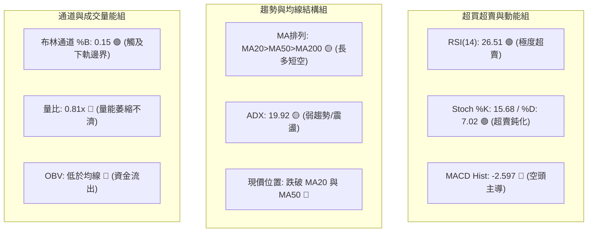

### 📈 移動平均線排列分析

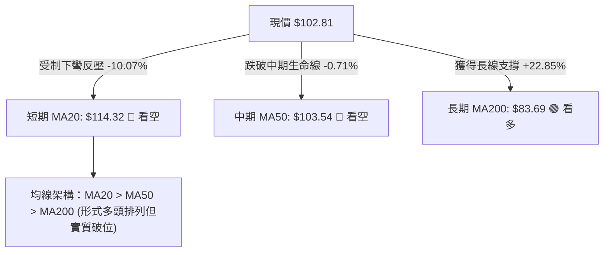

#### 完整均線系統追蹤表

| 均線名稱 | 數值 | 距現價幅度 | 形態走勢與斜率評估 | 訊號解讀 |
|----------|------|------------|--------------------|----------|
| **MA 5** | $105.81 | -2.84% | 急劇陡峭下行，短線超跌下引線顯現 | 🔴 極短線空頭反壓 |
| **MA 10** | $111.73 | -7.98% | 加速向下發散，形成連環壓制條帶 | 🔴 空方加速殺跌 |
| **MA 20** | $114.32 | -10.07% | 下彎走平後轉向下行，月線主力防線已破 | 🔴 短中期轉弱 |
| **MA 50** | $103.54 | -0.71% | 走勢趨平，現價正於此處進行多空生死搏殺 | 🟡 多空爭奪焦點 |
| **MA 60** | $101.83 | +0.96% | 保持微幅微升，對現價構成即時下檔托底 | 🟢 即刻動態支撐 |
| **MA 120** | $107.35 | -4.23% | 中長期走平微降，與 R1（$107.13）形成交叉阻力 | 🔴 中期反彈壓力 |
| **MA 200** | $83.69 | +22.85% | 穩健向上發散，年線多頭基底非常牢固 | 🟢 長期牛市底色 |
| **MA 240** | $76.07 | +35.14% | 持續向上攀升，奠定過去一年估值重塑基礎 | 🟢 超長期安全邊界 |

### 📉 RSI(14) 分析

```
RSI(14) 動能強度表：當前讀數 26.51 (極度超賣)
0            20       30                   50                   70       80          100
├────────────┼────────┼────────────────────┼────────────────────┼────────┼───────────┤
│  極度超賣  │  超賣  │      中性偏弱      │      中性偏強      │  超買  │ 極度超買  │
└────────────┴────────┴────────────────────┴────────────────────┴────────┴───────────┘
 [█████████░░░░░░░░░░░░░░░░░░░░░░░░░░░░░░░] 26.51%
```

- **超賣狀態評估**：RSI(14) 跌至 **26.51**，低於 30 嚴格超賣界限，同時隨機指標 Stoch %K 錄得 **15.68**，%D 錄得 **7.02**，屬於典型的雙重超賣共振。短線空頭下行動能已接近力竭，隨時可能觸發空頭回補引發的均值回歸彈升。
- **背離形態確認（頂背離成立，底背離尚早）**：
  - **頂背離判定**：日線及週線已完美確認先前的**頂背離**（Bearish Divergence）—— 價格在 2026-06 創下最高 $142.35 時 RSI 處於高位，而在 2026-09 股價強烈反抽至 $120.23 時，動能未能再刷新高，直接引發了 10 月份自 $120.23 跌至當前 $102.81 的瀑布式下殺。
  - **底背離判定**：當前 RSI 創出波段新低（26.51），與價格走勢同步下行，**未出現底背離特徵**。表明市場目前處於順勢超賣而非反轉底背離，左側摸底需提防慣性下探。

### 📊 MACD(12/26/9) 訊號解讀

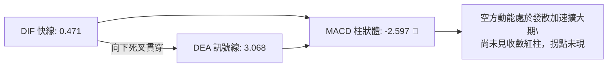

MACD 數值解析：
- **DIF 線**：0.471
- **DEA 信號線**：3.068
- **MACD 柱狀體 (Histogram)**：-2.597
- **解讀**：DIF 與 DEA 雖仍在零軸上方，但已呈現極為陡峭的高位死叉下行形態。柱狀體數值為 **-2.597**，負向絕對值較上週顯著擴張，表明短線空方動能佔據壓倒性主導地位。在 MACD 負柱狀體未出現縮短之前，不可盲目判定跌勢結束。

### 📦 布林通道分析

```
INTC 日線布林通道結構示意圖 (帶寬帶動能萎縮)
══════════════════════════════════════════════════════════════════
$130.56 ┬────────────────────────────────────────── BB 上軌
        │
$114.32 ┼────────────────────────────────────────── BB 中軌 (MA20)
        │
$102.81 ┼───────────────● 現價 (位處極低分位 %B: 0.15)
        │
$98.08  ┴────────────────────────────────────────── BB 下軌
══════════════════════════════════════════════════════════════════
```

- **布林上軌**：**$130.56**
- **布林中軌 (MA20)**：**$114.32**
- **布林下軌**：**$98.08**
- **極限指標 %B**：**0.15**（0 代表下軌，$102.81 距離下軌 $98.08 僅有不足 4.8% 緩衝空間）
- **形態分析**：現價已高度逼近下軌，歷史走勢表明 %B < 0.20 時常伴隨下軌支撐抵抗。若價格在下軌 $98.08 附近獲得支撐，布林軌道將收口並醞釀向中軌 $114.32 靠攏的反彈走勢。

### 💹 成交量分析（量價配合度）

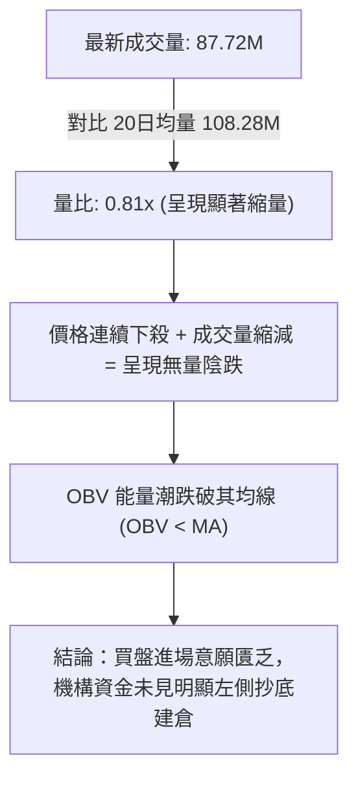

- **成交量數據詳解**：
  - 最新日成交量：**87,718,300 股**
  - 20日均量：**108,280,370 股**
  - 50日均量：**101,805,832 股**
  - 量比：**0.81x**（量能相對 20 日均值萎縮近兩成）
- **量價背離診斷**：週線數據顯示，2026-09-20 當週成交量達 626.11M，隨後在 09-27 當週價格拉高至 $123.00 時成交量縮至 602.66M，形成了典型的**量價頂背離**；當前下殺至 $102.81，本週成交量萎縮至 161.89M，說明殺跌並非由全面恐慌性巨量踩踏引發，而是缺乏承接盤導致的失重下墜，一旦多頭買盤點火，極易觸發快速反彈。

---

## 6. 動能與波動率

### ⚡ 動能評估四象限

| 象限 | 動能維度 | 波動率維度 | INTC 當前對標狀態 | 專業戰略評估 |
|------|----------|------------|-------------------|--------------|
| **Q1 (最佳擴張)** | 強動能 (Bullish) | 低波動 (Low Vol) | - | 最佳追隨主升浪階段（如 2026-04） |
| **Q2 (盤整醞釀)** | 弱動能 (Weak/Neutral) | 低波動 (Low Vol) | - | 籌碼沉澱，長線佈局區間 |
| **Q3 (極限博弈)** | 強動能 (Strong Bear) | 高波動 (High Vol) | - | 劇烈單邊主跌浪 |
| **Q4 (超跌修復)** | **弱動能 (ADX 19.92)** | **高波動 (ATR 5.37%)**| **✓ INTC 當前位置 (Q4)** | **謹慎觀望，避免追空，伺機抓取超賣修正** |

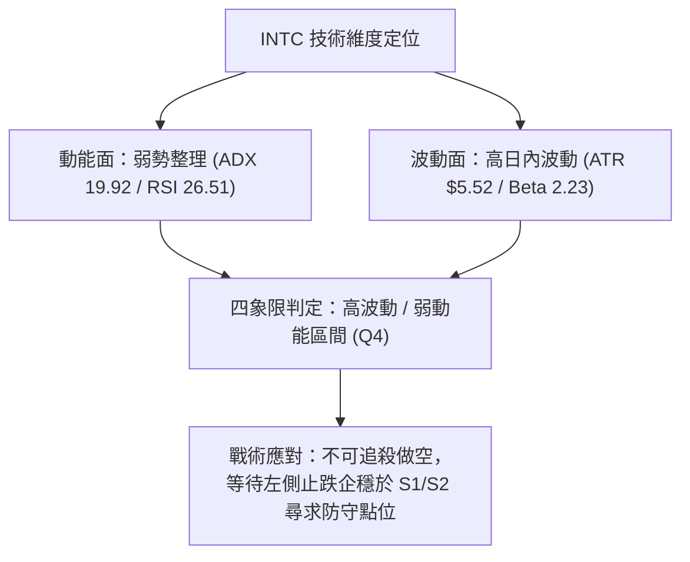

### 📊 ATR 波動率分析

- **當前 ATR(14)**：**$5.52**
- **波動率佔比**：佔當前股價 $102.81 的 **5.37%**
- **風控止損測算依據**：
  - 股票單日自然噪音波動幅度即達 $5.52。任何交易策略的保護性止損區間必須給予足夠的呼吸空間，建議日內策略止損緩衝不小於 **1.0x ATR ($5.52)**，波段策略止損應設置在 **1.5x - 2.0x ATR ($8.28 - $11.04)** 之外，以防被正常市場隨機噪聲洗盤震盪出局。

### 📐 Beta 與市場相關性

- **Beta 係數**：**2.23**
- **機構持股比例**：**62.6%**
- **空頭佔浮存股比 (Short % Float)**：**3.2%** (Short Ratio: 1.58)
- **大盤相關性解讀**：
  - Beta 高達 **2.23**，表明 INTC 具有超高系統性彈性（大盤標普500波動 1%，INTC 理論波動 2.23%）。當前高 Beta 屬性在科技半導體族群受壓時會放大個股下墜深度，但同樣在大盤企穩修復時，能提供極具爆發力的反彈動能。當前空頭佔浮存股比僅 3.2%，空頭補庫存壓力較低，難以指望大規模軋空行情（Short Squeeze），行情的反轉必須依賴真實現貨買盤入場。

---

## 7. 多時框架總結

### 📋 時框架評分表

| 時框架 | 趨勢方向 | 動能狀態 | 均線排列狀況 | 形態學位置 | 綜合評分 | 戰略建議 |
|--------|----------|----------|--------------|------------|----------|----------|
| **月線級別 (長期)** | 🟢 多頭上行 | 🟡 頂部回撤 | MA200 遠在下方，長多排列未改 | 主升浪後的大級別二浪回調 | 75/100 | 長線底倉保持耐心持有 |
| **週線級別 (中期)** | 🟡 寬幅箱體 | 🔴 死叉延續 | 均線高位糾纏走平 | 高位次頂受阻，測試中箱底 | 45/100 | 箱體邊界低吸高拋 |
| **日線級別 (短期)** | 🔴 空頭下殺 | 🟢 極度超賣 | 現價全線失守 MA20/MA50 短期均線 | 空方旗形破位向下尋底 | 35/100 | 嚴禁盲目追空，防範暴力反彈 |

### 🔲 綜合訊號矩陣

```
時框架訊號一致性交叉分析矩陣
══════════════════════════════════════════════════════════════════
維度       短期 (日線)          中期 (週線)          長期 (月線)
──────────────────────────────────────────────────────────────────
趨勢：     🔴 空頭主導          🟡 箱體震盪          🟢 強勢多頭
均線：     🔴 現價破線          🔴 中期下彎          🟢 穩健多頭
動能：     🟢 超賣背離          🔴 MACD擴大          🟡 高位修復
量價：     🔴 縮量無承接        🔴 量價頂背離        🟢 長期資金沉澱
形態：     🔴 尋底未成          🟡 次頂回調          🟢 歷史底部反轉
──────────────────────────────────────────────────────────────────
結論：     短空長多矛盾碰撞，核心取決於中期箱底支撐 S2 ($98.33) 守護強度
══════════════════════════════════════════════════════════════════
```

### ⚖️ 多時框收斂結論

> **依據「嚴格要求 14」之收斂裁決**：
> 1. **趨勢強度定性**：當前日線 ADX(14) 讀數為 **19.92 (< 25)**，明確定義當前市場**並非處於單邊趨勢主導行情，而是處於大型寬幅震盪整理階段**。
> 2. **主導規則收斂**：在 ADX < 25 的盤整結構中，必須以**日線布林通道上下軌（$98.08 - $130.56）作為核心震盪交易區間**，不可依照日線短期的連續殺跌陰線盲目給出單邊順勢做空結論。
> 3. **唯一方向性結論**：**中性偏空觀望，區間底部防守反彈（等待 S1/S2 企穩確認）**。日線雖呈現嚴重的均線破位空頭排列，但動能指標（RSI 26.51、布林 %B 0.15）已全面觸發超賣閾值。空頭殺跌空間已嚴重受限於下方密集支撐帶。

---

## 8. 交易策略建議

### 🗺️ 策略決策流程圖

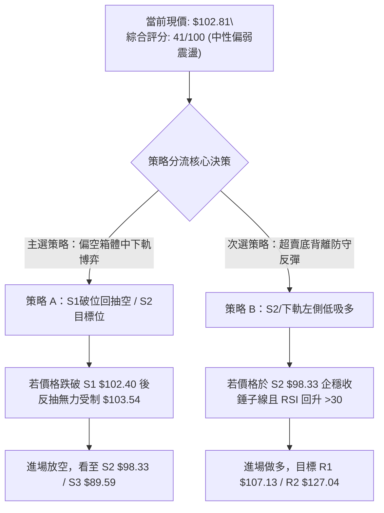

### 🧭 策略路由（依評分卡分流，不得兩頭下注）

> **當前主策略方向 = 中性偏空震盪操作（偏向短線順勢空與逢高放空，依技術評分 41/100）**
> 
> 由於綜合評分錄得 **41/100**，處於 40–60 中性邊界偏弱處，市場受制於下彎的 MA20（$114.32）與空頭發散的 MACD（-2.597），因此**主策略採用順應短期空頭走勢的「破位回抽做空／高拋策略」，多頭僅作為極限超賣區間的「防守性反彈交易」**。

### 🎯 價格情境階梯（Price Scenarios）

價位嚴格引用第四章與關鍵價位聚類數據：

| 觸發條件 | 下一目標 | 後續延伸 | 情境技術含義與應對要點 |
|----------|----------|----------|------------------------|
| **強勢向上突破 R1 $107.13** | **R2 $127.04** | **R3 $132.75** | 短線空頭陷阱確立，動能強烈反轉，挑戰前高波段密集套牢區 |
| **反抽受阻於 MA50 $103.54** | **S1 $102.40** | **S2 $98.33** | 弱勢反彈無力，空方繼續下壓測試布林通道下軌強支撐 |
| **有效放量跌破 S1 $102.40** | **S2 $98.33** | **S3 $89.59** | 下破短線支撐，引發技術性止損盤，考驗 50% 斐波那契及箱底防禦 |

### 📊 情境機率分佈

| 情境劇本 | 機率預估 | 主要技術依據（嚴格引用指標狀態） |
|----------|----------|----------------------------------|
| **劇本一：下探觸及 S2 後展開反彈** | **50%** | ADX 19.92 顯示趨勢疲弱不支持單邊暴跌，RSI 26.51 極度超賣，布林下軌 $98.08 與 S2 $98.33 共振形成強大吸引買盤 |
| **劇本二：跌破 S1/S2 向 S3 尋求支撐** | **35%** | MACD 柱狀體擴大看空（-2.597），量比僅 0.81x 缺乏多頭護盤承接，-DI (32.02) 依然全面壓制 +DI (22.20) |
| **劇本三：直接自當前位置強勢 V 轉突破 R1** | **15%** | 均線系統 MA5/10/20 呈現空頭排列壓頂，上方 R1 $107.13 匯聚 120日均線，短期難以無量直接修復 |

### 🟢 主策略詳情（方向依上方路由）

以下所有點位嚴格引用自計算之支撐/阻力及斐波那契點位：

| 策略要素 | 策略 A（主推：順勢反抽受阻空） | 策略 B（輔助：超賣極限左側博弈多） |
|----------|--------------------------------|-------------------------------------|
| **交易邏輯** | 跌破 MA50 後回抽確認無力，順勢空 | 觸及 S2 / 布林下軌共振區，博弈超跌回歸 |
| **進場條件** | 反彈觸碰 MA50 / R1 遇阻回落，或破位 S1 | 價格下探 S2 $98.33 企穩收陽，RSI 脫離超賣 |
| **精確進場價格** | **$103.54**（MA50反壓位，或現價破位 $102.40） | **$98.33**（S2 波段低點聚類處） |
| **目標價 T1** | **$98.33**（S2 強支撐位，獲利空間 5.03%） | **$102.40**（S1 轉化為的阻力位，空間 4.14%）|
| **目標價 T2** | **$89.59**（S3 中期箱底，獲利空間 13.47%）| **$107.13**（R1 關鍵阻力，空間 8.95%） |
| **嚴格止損價格** | **$107.13**（R1 關鍵阻力位上方，風險 3.47%）| **$95.00**（由 ATR 推算：$98.33 - 0.6x ATR）|
| **風險報酬比** | **1 : 2.50** (以 T2 計算) | **1 : 2.65** (以 T2 計算) |
| **評估成功機率** | **55%** | **45%** |
| **建議倉位配置** | **15% - 20%** | **10% (輕倉防守試探)** |

### 🔴 反向風險觸發點（對沖提示）

- **做空主策略反轉推翻訊號**：
  - 日線收盤價強勢站上 **R1 $107.13**。
  - MACD 柱狀體收斂翻正且出現底背離拐點。
  - 成交量顯著放大突破 120M（量比 > 1.2x）。
  - 若觸發上述條件，必須**無條件平倉所有空頭頭寸**，轉為觀望或跟進右側反彈。

### ⭐ 整體訊號強度評星

```
╔══════════════════════════════════════════════════════════════════╗
║ 做多訊號強度：  ★★☆☆☆  (2.0/5星) — 僅依賴超賣，缺乏買盤確認    ║
║ 做空訊號強度：  ★★★☆☆  (3.5/5星) — 短期空頭佔優但下檔空間收斂  ║
║ 整體訊號可信度：★★★☆☆  (3.0/5星) — 處於 ADX < 25 震盪雜訊區    ║
╚══════════════════════════════════════════════════════════════════╝
```

---

## 9. 風險提示與監控

### ✅ 關鍵監控指標 Checklist

```
╔══════════════════════════════════════════════════════════════════╗
║                   INTC 交易風控實時監控清單                      ║
╠══════════════════════════════════════════════════════════════════╣
║ [ ] 價格能否有效防守 S1: $102.40 與 38.2% 斐波那契 $100.54       ║
║ [ ] RSI(14) 能否自 26.51 脫離 30 以下之極端超賣區域               ║
║ [ ] MACD 柱狀體（當前 -2.597）何時出現實質性縮短收斂             ║
║ [ ] 日成交量能否放大超越 20日均量（108.28M）擺脫量能枯竭困境      ║
║ [ ] 價格反彈時，MA20（$114.32）與 R1（$107.13）是否形成強烈反壓  ║
║ [ ] 下行風險中，布林通道下軌（$98.08）與 S2（$98.33）是否被擊穿   ║
╚══════════════════════════════════════════════════════════════════╝
```

### ⚠️ 風險場景分析

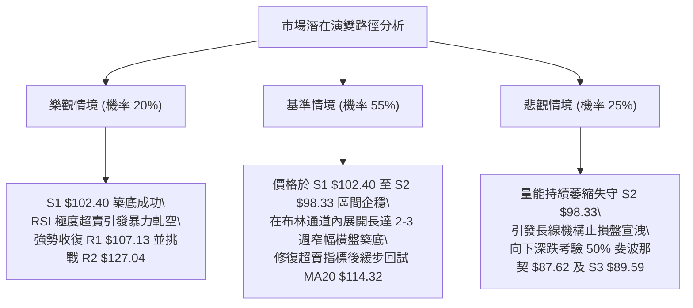

### 🛡️ 風險管理重要提醒

1. **高 Beta 波動懲罰機制**：
   INTC Beta 高達 **2.23**，每日波幅高達 **ATR $5.52 (5.37%)**。嚴格禁止在現價使用高槓桿工具，持倉規模不得超過投資組合總資金的 **15% - 20%**，避免單一標的過度波動引發淨值非線性回撤。
2. **切勿陷入左側盲目摸底泥潭**：
   雖然 RSI 來到 **26.51** 深度超賣區，但目前成交量（87.72M）相較於 20 日均量大幅縮水，且 OBV 仍處於均線下方。在主力資金尚未出現明確放量長陽吞沒之前，左側摸底只可採取極輕倉試探，嚴格執行以 **S2 $98.33** 破位為底線的止損機制。
3. **斐波那契與均線共振共識破裂風險**：
   若未來數個交易日收盤價實質跌破 38.2% 斐波那契回調位（**$100.54**），意味著 2026 年以來的強勢多頭週期被降級為大級別寬幅震盪週期，投資者必須全面調低預期目標價位，優先防守資本安全。

---

## 📋 報告總結

```
╔══════════════════════════════════════════════════════════════════╗
║                     INTC 技術分析報告總結                        ║
╠══════════════════════════════════════════════════════════════════╣
║ 報告日期：2026-10-14                                             ║
║ 當前價格：$102.81                                                ║
║ 分析評級：⚖️ 偏空中性震盪（短線極度超賣，測試核心支撐）           ║
╠══════════════════════════════════════════════════════════════════╣
║ 關鍵結論：                                                       ║
║ ├─ 長期趨勢：🟢 偏多（MA200 位於 $83.69，長期上行軌道未破壞）   ║
║ ├─ 中期趨勢：🟡 震盪（高位雙頂回調，運行於 $98.33 - $127.04 箱體）║
║ ├─ 短期趨勢：🔴 偏空（跌破 MA20/MA50，MACD 負向柱狀體放大中）    ║
║ ├─ 關鍵支撐：S1: $102.40 ｜ S2: $98.33 ｜ S3: $89.59              ║
║ ├─ 關鍵阻力：R1: $107.13 ｜ R2: $127.04 ｜ R3: $132.75            ║
║ └─ 分析師共識目標：$118.05（高低區間：$80.00 - $200.00）         ║
╠══════════════════════════════════════════════════════════════════╣
║ 最優策略組合：                                                   ║
║ 1. 🥇 最佳機會（順勢防守）：等待反抽受阻於 $103.54 - $107.13 區間║
║      輕倉建立空單，目標下看 S2 $98.33，止損設於 $107.13 上方。  ║
║ 2. 🥈 次選機會（反彈博弈）：若價格快速摜壓至 S2 $98.33 與布林下軌║
║      獲得確認企穩，左側輕倉小額搶反彈，目標看回 $102.40/$107.13。║
║ 3. 🥉 保守選擇（右側觀望）：暫停任何新開倉操作，等待日線 ADX   ║
║      突破 25 且價格重新站上 MA20（$114.32）確認反轉後再行介入。  ║
╚══════════════════════════════════════════════════════════════════╝
```

---

> ⚠️ **免責聲明**：本報告為技術分析研究，所有數據、價位及模型估算均嚴格基於所提供的歷史交易資訊與量化演算法推導。本報告**僅供研究與學術參考**，**不構成任何形式的投資建議、要約或承諾**。金融市場瞬息萬變，投資具有高度風險，交易者需自行承擔本金損失風險並審慎決策。

---

*報告生成時間：2026-10-14 ｜ 數據來源：Yahoo Finance ｜ 分析框架：多時框技術分析體系*