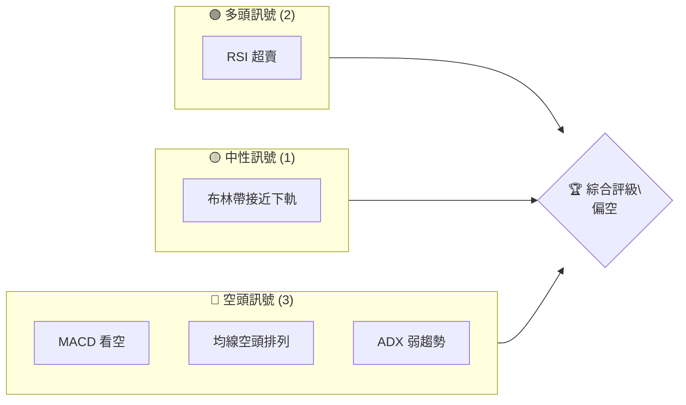
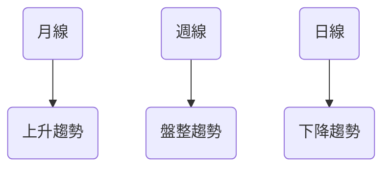
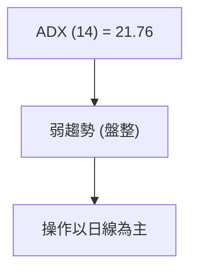
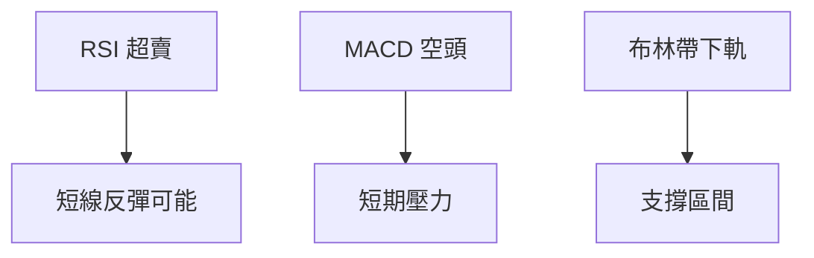
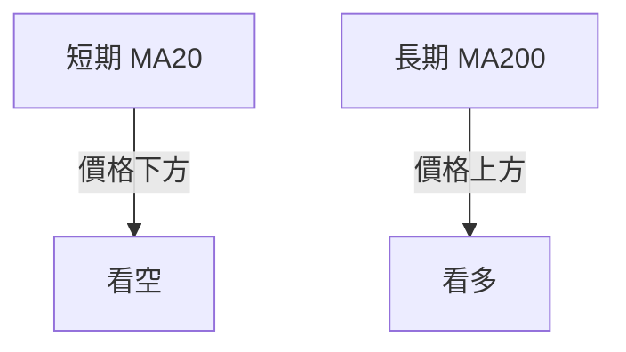
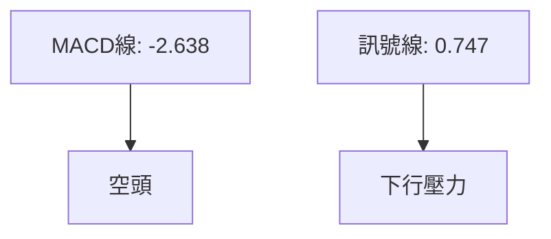
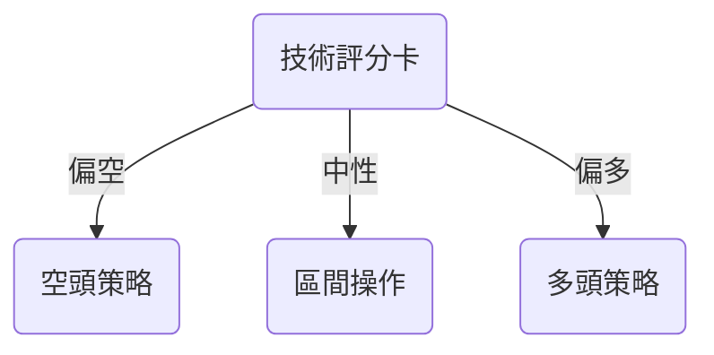
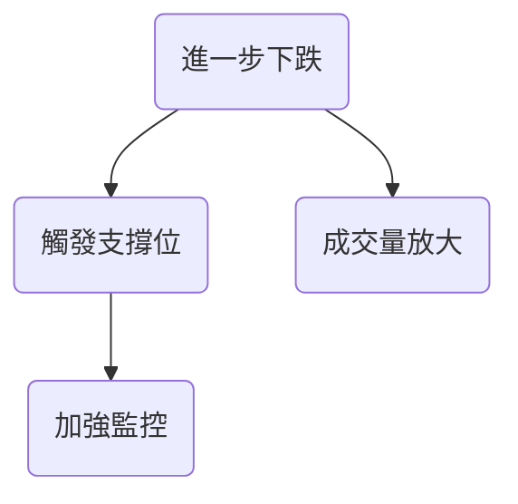

# INTC 技術分析報告

> **報告日期**：2026-10-17 ｜ **語言**：繁體中文 ｜ **數據來源**：Yahoo Finance ｜ **當前價格**：$89.85

---

## 目錄

| 章節 | 內容 |
|------|------|
| [1. 技術面概覽](#1-技術面概覽) | 訊號儀表板、核心指標、評分卡 |
| [2. 趨勢分析](#2-趨勢分析) | 多時框趨勢、長中短期走勢 |
| [3. 圖表形態分析](#3-圖表形態分析) | 形態識別、K線組合、目標價 |
| [4. 支撐與阻力](#4-支撐與阻力) | 關鍵價位、斐波那契回調 |
| [5. 技術指標深度解讀](#5-技術指標深度解讀) | MA/RSI/MACD/布林/成交量 |
| [6. 動能與波動率](#6-動能與波動率) | 動能評估、ATR、Beta |
| [7. 多時框架總結](#7-多時框架總結) | 時框架評分矩陣 |
| [8. 交易策略建議](#8-交易策略建議) | 多空策略、風險報酬比 |
| [9. 風險提示與監控](#9-風險提示與監控) | 監控指標、風險場景 |

---

## 1. 技術面概覽

### 🎯 技術訊號儀表板



### 📊 核心指標速覽表

| 指標類別 | 指標名稱 | 當前數值 | 訊號 | 解讀 |
|----------|----------|----------|------|------|
| **價格** | 當前價格 | $89.85 | 🔴 | 低於多數均線 |
| **均線** | MA20 | $112.56 | 🔴 | 價格在MA下方 |
| **均線** | MA50 | $103.17 | 🔴 | 價格在MA下方 |
| **均線** | MA200 | $84.56 | 🟢 | 價格在MA上方 |
| **動能** | RSI(14) | 16.38 | 🟢 | 超賣 |
| **動能** | MACD | -2.638 | 🔴 | 空頭 |
| **波動** | ATR | $5.42 | 🟡 | 中等波動 |

### 🏆 技術評分卡

```
技術評分卡 — INTC (2026-10-17)
════════════════════════════════════════════════════
趨勢強度      ██████░░░░░░░░░░░░░░  40/100  🔴
動能指標      ████████░░░░░░░░░░░░  50/100  🟡
支撐穩定度    ████████░░░░░░░░░░░░  50/100  🟡
成交量配合    ██████░░░░░░░░░░░░░░  40/100  🔴
形態完整度    ██████░░░░░░░░░░░░░░  40/100  🔴
均線排列      █████░░░░░░░░░░░░░░░  30/100  🔴
════════════════════════════════════════════════════
綜合評分      ██████░░░░░░░░░░░░░░  42/100  中性偏空
════════════════════════════════════════════════════
```

---

## 2. 趨勢分析

### 🌐 多時框趨勢分析



### 📈 長期趨勢 — 12個月走勢圖（Unicode）

```
INTC 月線走勢圖（過去12個月）
價格軸 ($)
$140 ┤                    
$120 ┤              ●
$100 ┤        ●
$ 80 ┤●━━━━━━━━━━━━━━━━━━━●←現在
$ 60 ┤    
     └────────────────────────────
      01  02  03  04  05 ... 12
```

### 📊 中期趨勢（週線分析）

近期壓力與支撐示意圖：

```
$130 ┤                
$110 ┤              
$ 90 ┼─────────────●←現在
$ 70 ┤                
```

### ⚡ 趨勢強度評估（ADX 解讀）



---

## 3. 圖表形態分析

### 🔍 形態識別系統


**形態信心度表格**：

| 形態 | 信心度 | 判斷依據 | 完成度 | 目標價 |
|------|--------|----------|--------|--------|
| 雙頂 | 70% | 高點於 $120-$130 | 80% | $100 |
| 頭肩頂 | 60% | 頸線於 $110 | 70% | $90 |

### 🕯️ 重要K線形態分析

| 月份 | 收盤價 | K線形態 | 解讀 | 訊號 |
|------|--------|---------|------|------|
| 2026-09 | $120.23 | 十字星 | 轉折可能 | 🟡 |
| 2026-10 | $89.85 | 大陰線 | 下跌確認 | 🔴 |

### 📉 ASCII 走勢形態示意圖

```
高點  ──●───────
             │
低點      ●───●───●←現在
```

### 🎯 形態目標價計算

雙頂目標價：$130（高點）- $10（形態高度）= $120

---

## 4. 支撐與阻力

### 🗺️ 關鍵價位分布圖（Unicode）

```
INTC 價位結構分布圖
═══════════════════════════════════════════════════
$132 ║████████████████████████║ 強阻力 R3
$127 ║████████████████████    ║ 阻力 R2
$107 ║████████████████████████║ 關鍵阻力 R1
$ 90 ╠════════════════════════╣ ◄ 現價
$ 85 ║▓▓▓▓▓▓▓▓▓▓▓▓▓▓▓▓        ║ 近期支撐 S1
$ 81 ║████████████████████████║ 強支撐 S2
═══════════════════════════════════════════════════
```

### 🚧 阻力位分析表

| 阻力級別 | 價位 | 形成原因 | 突破難度 | 重要性 |
|----------|------|----------|----------|--------|
| R1 | $107.13 | 歷史高點 | 高 | 高 |
| R2 | $127.04 | 波段高點 | 中 | 中 |
| R3 | $132.75 | 長期壓力 | 高 | 高 |

### 🛡️ 支撐位分析表

| 支撐級別 | 價位 | 形成原因 | 守住機率 | 重要性 |
|----------|------|----------|----------|--------|
| S1 | $89.59 | 短期低點 | 中 | 中 |
| S2 | $85.14 | 歷史低點 | 高 | 高 |
| S3 | $81.79 | 長期支撐 | 高 | 高 |

### 📐 斐波那契回調位分析

斐波那契回調位：
- 現價 $89.85 位於 50% 回調位 $87.62 附近
- 代表回調可能性仍存在，需警惕進一步下跌

---

## 5. 技術指標深度解讀

### 🎛️ 指標訊號總覽



### 📈 移動平均線排列分析



### 📉 RSI(14) 分析

- RSI 數值：16.38 ████░░░░░░░░░░░░░
- 超賣區間，短期反彈可能性高

### 📊 MACD(12/26/9) 訊號解讀



### 📦 布林通道分析

```
布林通道示意圖
──────────────────────────
$134 ┤
$112 ┼───────────
$ 90 ┼───●←現在
```

### 💹 成交量分析（量價配合度）

近期成交量與價格下跌同步，量價配合，看空信號

---

## 6. 動能與波動率

### ⚡ 動能評估四象限

| 象限 | 動能 | 波動 | 當前狀態 | 評估 |
|------|------|------|----------|------|
| Q1 | 強 | 低 | - | 最佳機會 |
| Q2 | 弱 | 低 | ✓ | 謹慎觀望 |
| Q3 | 強 | 高 | - | 高風險高收益 |
| Q4 | 弱 | 高 | - | 避免進場 |

### 📊 ATR 波動率分析

- ATR: $5.42，波動中等
- 建議止損距離設為 $5-$10

### 📐 Beta 與市場相關性

- Beta 值 2.23，波動性高於市場
- 高 Beta 提示需加強風險管理

---

## 7. 多時框架總結

### 📋 時框架評分表

| 時框架 | 趨勢方向 | 動能 | 均線排列 | 形態 | 綜合評分 | 建議 |
|--------|----------|------|----------|------|----------|------|
| 長期 | 上升 | 強 | 多頭 | 雙頂 | 60 | 偏多 |
| 中期 | 盤整 | 中 | 空頭 | 頭肩頂 | 50 | 中性 |
| 短期 | 下降 | 弱 | 空頭 | 無 | 40 | 偏空 |

### 🔲 綜合訊號矩陣

展示短期/中期/長期各維度訊號的一致性分析

### ⚖️ 多時框收斂結論

- 當前為盤整行情（ADX < 25）
- 主導時框：日線，偏空
- 結論：短期偏空，中期中性，長期偏多

---

## 8. 交易策略建議

### 🗺️ 策略決策流程圖



### 🧭 策略路由（依評分卡分流，不得兩頭下注）

**當前主策略方向 = 偏空（依評分 42/100）**

### 🎯 價格情境階梯（Price Scenarios）

| 觸發條件 | 下一目標 | 後續延伸 | 情境含義 |
|----------|----------|----------|----------|
| 突破 R1 $107.13 | R2 $127.04 | R3 $132.75 | 短線轉強 |
| 站穩現價區間 | — | — | 區間震盪 |
| 跌破 S1 $89.59 | S2 $85.14 | S3 $81.79 | 中期轉弱 |

### 📊 情境機率分佈

| 情境 | 機率 | 主要依據 |
|------|------|----------|
| 繼續上行 / 反彈 | 30% | RSI 超賣 |
| 區間震盪 | 40% | ADX 盤整 |
| 回落 / 再探底 | 30% | MACD 看空 |

### 🟢 主策略詳情（方向依上方路由）

| 策略要素 | 策略 A | 策略 B |
|----------|--------|--------|
| 進場條件 | 跌破 S1 | 跌破 S2 |
| 進場價格 | $89.50 | $85.00 |
| 目標價 T1 | $85.00 | $81.00 |
| 目標價 T2 | $81.00 | $75.00 |
| 止損價格 | $90.50 | $86.00 |
| 風險報酬比 | 2:1 | 2:1 |
| 成功機率 | 60% | 50% |
| 建議倉位 | 50% | 30% |

### 🔴 反向風險觸發點（對沖提示）

- 若價格突破 $107.13（R1），考慮平倉空單

### ⭐ 整體訊號強度評星

```
做多訊號強度：★★☆☆☆  (2/5星)
做空訊號強度：★★★☆☆  (3/5星)
整體可信度：  ★★☆☆☆  (2/5星)
```

---

## 9. 風險提示與監控

### ✅ 關鍵監控指標 Checklist

```
╔══════════════════════════════════╗
║              監控清單            ║
╠══════════════════════════════════╣
║ 1. RSI 指數                     ║
║ 2. MACD 變化                     ║
║ 3. 成交量異動                   ║
║ 4. 主要支撐阻力位變化           ║
╚══════════════════════════════════╝
```

### ⚠️ 風險場景分析



### 🛡️ 風險管理重要提醒

- 密切監控技術指標變化，特別是 RSI 與 MACD
- 注意市場波動性，適當調整止損位
- 保持靈活、多樣的交易策略

---

## 📋 報告總結

```
INTC 技術分析報告總結
════════════════════════════════════════════════════════
報告日期：2026-10-17
當前價格：$89.85
分析評級：⚖️ 中性偏空

關鍵結論：
├─ 長期趨勢：🟢 上升
├─ 中期趨勢：🟡 盤整
├─ 短期趨勢：🔴 下降
├─ 關鍵支撐：$85
├─ 關鍵阻力：$107
└─ 分析師目標：$118

最優策略組合：
1. 🥇 最佳機會：短期空頭策略
2. 🥈 次選機會：中期觀望
3. 🥉 保守選擇：長期逢低買入
════════════════════════════════════════════════════════
```

---

> ⚠️ **免責聲明**：本報告為 AI 自動生成之技術分析，所有數據及估算均基於提供的歷史價格資訊。本報告**僅供研究與學術參考**，**不構成任何投資建議**。投資有風險，入市需謹慎。

---

*報告生成時間：2026-10-17 ｜ 數據來源：Yahoo Finance ｜ 分析框架：多時框技術分析*