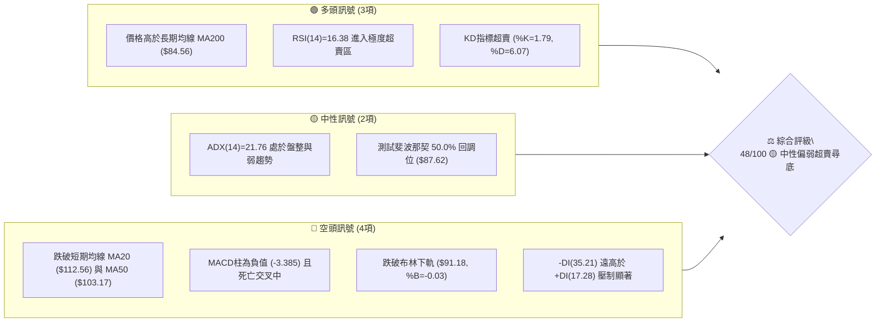
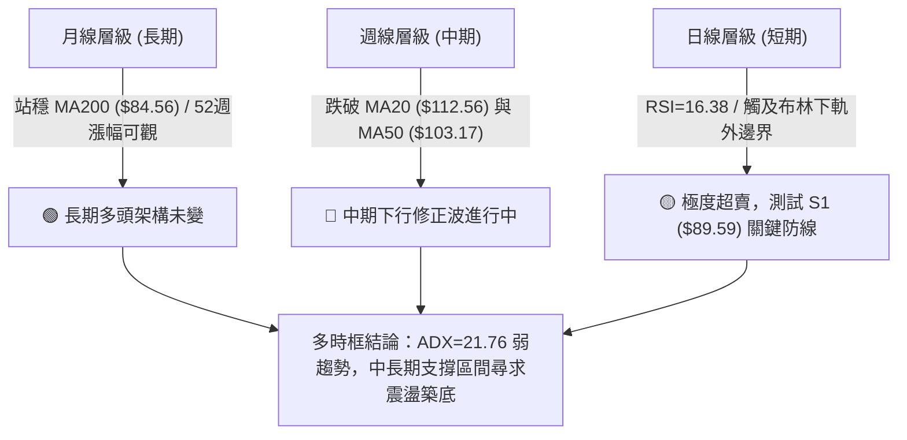
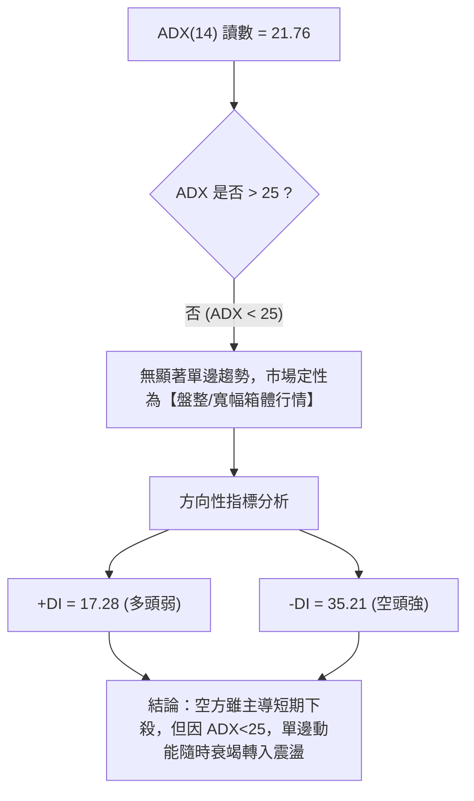
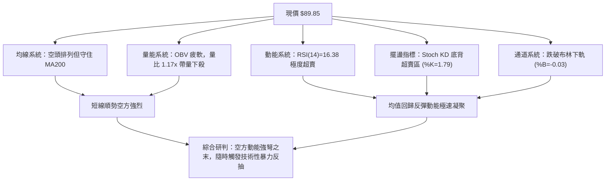
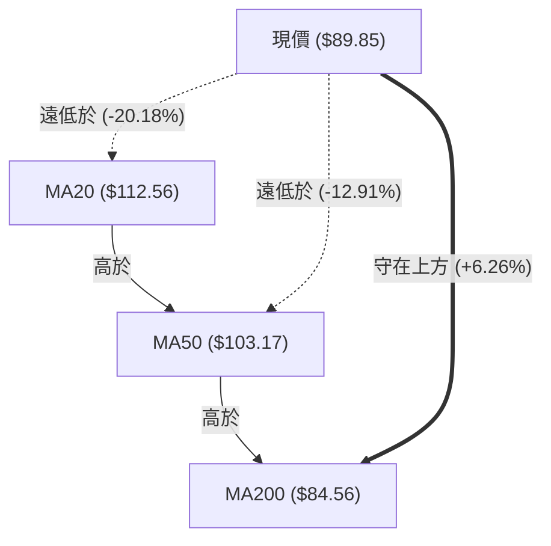
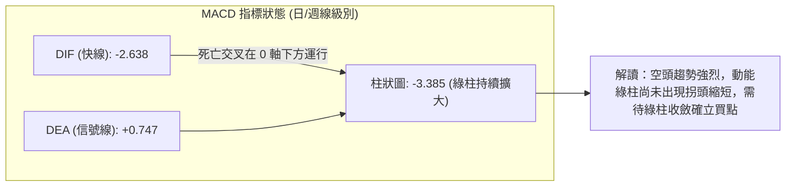
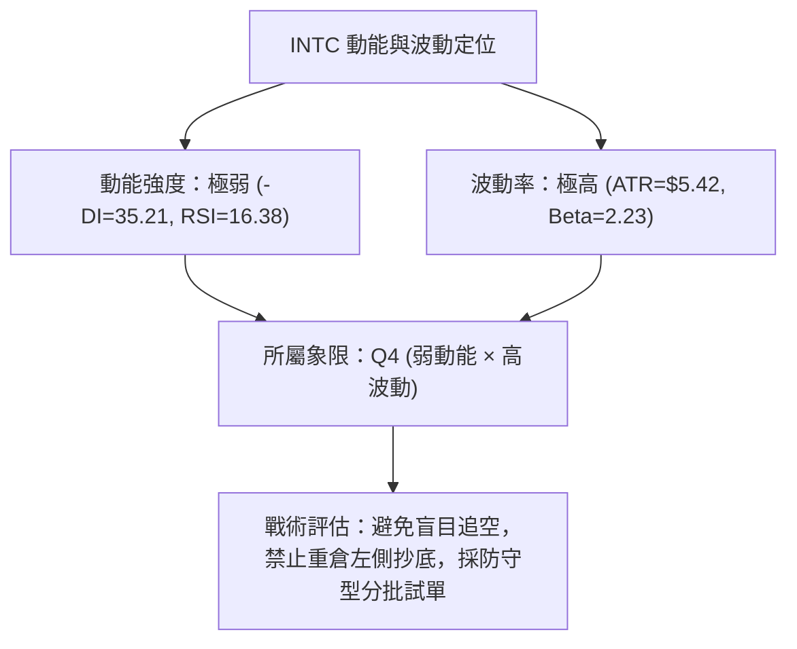
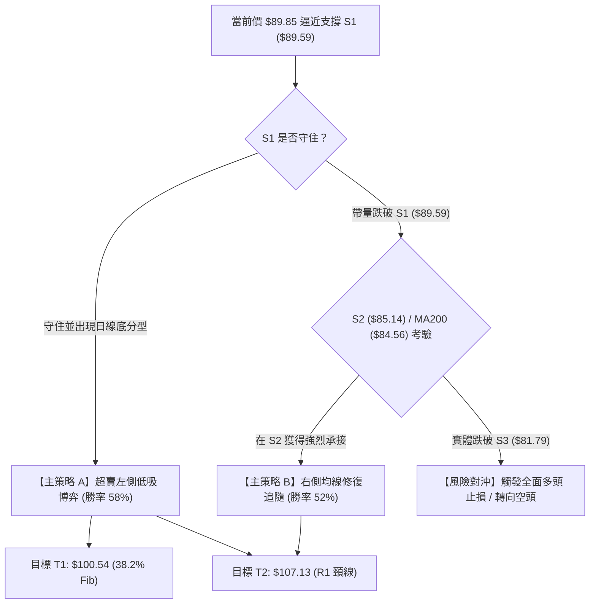
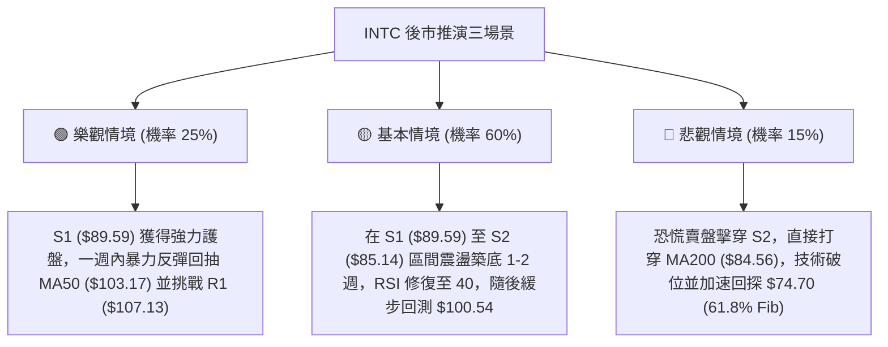

# INTC 技術分析報告

> **報告日期**：2026-10-18 ｜ **語言**：繁體中文 ｜ **數據來源**：Yahoo Finance ｜ **當前價格**：$89.85

---

## 目錄

| 章節 | 內容 |
|------|------|
| [1. 技術面概覽](#1-技術面概覽) | 訊號儀表板、核心指標、評分卡 |
| [2. 趨勢分析](#2-趨勢分析) | 多時框趨勢、長中短期走勢 |
| [3. 圖表形態分析](#3-圖表形態分析) | 形態識別、K線組合、目標價 |
| [4. 支撐與阻力](#4-支撐與阻力) | 關鍵價位、斐波那契回調 |
| [5. 技術指標深度解讀](#5-技術指標深度解讀) | MA/RSI/MACD/布林/成交量 |
| [6. 動能與波動率](#6-動能與波動率) | 動能評估、ATR、Beta |
| [7. 多時框架總結](#7-多時框架總結) | 時框架評分矩陣 |
| [8. 交易策略建議](#8-交易策略建議) | 多空策略、風險報酬比 |
| [9. 風險提示與監控](#9-風險提示與監控) | 監控指標、風險場景 |
| [10. 報告總結](#-報告總結) | 核心結論與策略全貌 |

---

## 1. 技術面概覽

### 🎯 技術訊號儀表板



### 📊 核心指標速覽表

| 指標類別 | 指標名稱 | 當前數值 | 訊號 | 解讀 |
|----------|----------|----------|------|------|
| **價格** | 當前價格 | $89.85 | 🔴 | 跌破短期所有均線，回測關鍵波段支撐 S1 ($89.59) |
| **均線** | MA20 | $112.56 | 🔴 | 價格位於 MA20 下方 -20.18%，短線下行乖離率偏高 |
| **均線** | MA50 | $103.17 | 🔴 | 價格位於 MA50 下方 -12.91%，中期趨勢轉向承壓 |
| **均線** | MA200 | $84.56 | 🟢 | 價格仍高於長期牛熊分界線 +6.26%，長期多頭架構未破 |
| **動能** | RSI(14) | 16.38 | 🟢 | 極度超賣 (<20)，隨時具備技術性均值回歸反彈動能 |
| **動能** | MACD (12,26,9) | -2.638 / 柱: -3.385 | 🔴 | 快慢線死叉且綠柱擴大，空頭動能仍佔據主導 |
| **動能** | Stoch %K / %D | 1.79 / 6.07 | 🟢 | 雙線落入極致低位，短線賣壓釋放接近尾聲 |
| **趨勢** | ADX(14) | 21.76 | 🟡 | 數值低於 25，單邊趨勢動能不足，市場轉入大區間盤整 |
| **通道** | 布林通道 | 帶寬: $42.76 / %B: -0.03 | 🟡 | 現價已跌穿布林下軌 ($91.18)，呈現極端超跌狀態 |
| **量能** | 20日成交量比 | 1.17x (1.22億股) | 🔴 | 帶量下殺，OBV 疲弱且低於均線，量價配合尚未止跌 |
| **波動** | ATR(14) | $5.42 (6.04%) | 🔴 | 日內波動幅度劇烈，交易需拉大防守間距 |

### 🏆 技術評分卡

```
╔══════════════════════════════════════════════════════════════════╗
║                   技術評分卡 — INTC (2026-10-18)                ║
╠══════════════════════════════════════════════════════════════════╣
║ 趨勢強度        ████████░░░░░░░░░░░░  40/100  🔴 空頭控盤但走弱  ║
║ 動能指標        ██████████░░░░░░░░░░  50/100  🟡 極度超賣醞釀反彈║
║ 支撐穩定度      █████████████░░░░░░░  65/100  🟢 臨近S1/50%黃金位║
║ 成交量配合      ████████░░░░░░░░░░░░  40/100  🔴 拋壓放量尚未衰竭║
║ 形態完整度      ██████████░░░░░░░░░░  50/100  🟡 考驗雙底頸線邊界║
║ 均線排列        ████████░░░░░░░░░░░░  42/100  🔴 短空長多糾結階段║
╠══════════════════════════════════════════════════════════════════╣
║ 綜合評分        ██████████░░░░░░░░░░  48/100  🟡 中性觀望/超賣修復║
╚══════════════════════════════════════════════════════════════════╝
```

---

## 2. 趨勢分析

### 🌐 多時框趨勢分析



### 📈 長期趨勢 — 12個月走勢圖（Unicode）

以下為 INTC 自 2025 年 11 月至 2026 年 10 月之月線收盤走勢演變：

```
INTC 月線走勢圖（2025-11 至 2026-10）
價格軸 ($)
$140 ┤                               ● $139.63 (2026-06 頂部)
$130 ┤
$120 ┤                                      ● $120.23 (2026-09 次頂)
$110 ┤                         ● $114.68
$100 ┤
$90  ┤                   ● $94.48     ● $90.20  ● $89.85 (現價)
$80  ┤
$70  ┤
$60  ┤
$50  ┤             ● $46.47
$40  ┤ ● $40.56          ● $44.13
$30  ┤       ● $36.90
     └──────────────────────────────────────────────────────────
       11M   12M   01M   02M   03M   04M   05M   06M   07M   08M   09M   10M
      (2025)       (----------------------- 2026 -----------------------)
```

**走勢特徵分析表格**：

| 階段 | 時間區間 | 起訖價位 | 漲跌幅 | 核心特徵與市場結構 |
|------|----------|----------|--------|--------------------|
| **第1階段：低位盤整** | 2025-11 ~ 2026-03 | $40.56 → $44.13 | +8.80% | 底部換手完畢，蓄積籌碼，長線均線打底完成 |
| **第2階段：爆發主升** | 2026-03 ~ 2026-06 | $44.13 → $139.63 | +216.41% | 突破暴漲，創下 52 週高點 $142.35，動能極度亢奮 |
| **第3階段：首波回撤** | 2026-06 ~ 2026-08 | $139.63 → $89.51 | -35.89% | 獲利了結盤湧出，於 $89.51~$90.20 尋求第一次中期支撐 |
| **第4階段：次級反彈** | 2026-08 ~ 2026-09 | $89.51 → $120.23 | +34.32% | 築出右側次高點，反彈至布林中軌上方後力竭 |
| **第5階段：二次探底** | 2026-09 ~ 2026-10 | $120.23 → $89.85 | -25.27% | 目前正在考驗 8 月前低 $89.51 及 S1 支撐位 $89.59 |

### 📊 中期趨勢（週線分析）

中期走勢呈現「高點逐步下移（Lower Highs）」的震盪下行格局。從 2026-09-27 收盤 $123.00，至 10-04 之 $119.33、10-11 之 $104.70，再到目前 10-18 之 $89.85，週線連續三週收長黑，失守週線級別重要均線。

```
中期支撐與阻力結構示意圖
────────────────────────────────────────────────────────────────
阻力位 R3: $132.75   ══════════════════════════════════ (6月頭部區間)
阻力位 R2: $127.04   ══════════════════════════════════ (9月反彈頂部區間)
阻力位 R1: $107.13   ══════════════════════════════════ (MA50/頸線阻力)
────────────────────────────────────────────────────────────────
現價位:    $ 89.85   ◄── 目前回測雙重底邊界與 50% 斐波那契回調位
────────────────────────────────────────────────────────────────
支撐位 S1: $ 89.59   ---------------------------------- (8月波段低點聚類)
支撐位 S2: $ 85.14   ---------------------------------- (密集買盤區)
支撐位 S3: $ 81.79   ---------------------------------- (MA200下方深層防守)
────────────────────────────────────────────────────────────────
```

### ⚡ 趨勢強度評估（ADX 解讀）



**ADX 趨勢強度對照表**：

| ADX 區間 | 趨勢狀態 | 當前數值 | 當前狀態評估 | 交易指引 |
|----------|----------|----------|--------------|----------|
| 0 – 20 | 缺乏趨勢 / 橫向盤整 | — | — | 避免趨勢突破策略 |
| **20 – 25** | **弱趨勢 / 震盪整理** | **21.76** | **現處於此區間** | **採用區間邊界操作、回調低吸策略** |
| 25 – 40 | 強勁趨勢形成 | — | — | 順勢持有，突破有效 |
| 40 – 60 | 極強單邊趨勢 | — | — | 趨勢末端，防範動能衰退 |

---

## 3. 圖表形態分析

### 🔍 形態識別系統


**形態信心度評估表**：

| 形態名稱 | 信心度 | 判斷依據（引用數據） | 完成度 | 目標價（附計算式） |
|----------|--------|----------------------|--------|--------------------|
| **潛在大型雙底 (Double Bottom)** | 68% | 8月波段低點 $89.51 與當前 S1 $89.59 形成水平共振支持區；現價 $89.85 正精準回測此一帶 | 60% (待右側確認) | 頸線 R1 $107.13，形態高度 = $107.13 - $89.59 = $17.54。<br>向上目標 = 頸線 $107.13 + $17.54 = **$124.67** (逼近 R2 $127.04) |
| **高位寬幅震盪箱體** | 82% | 頂部受阻於 R2 $127.04 (9月反彈頂部)，底部緊貼 S1 $89.59 (7-8月收盤低點聚類) | 85% (已完成多輪驗證) | 箱體中軸 = ($127.04 + $89.59) / 2 = **$108.32** (落於 MA20 $112.56 與 MA50 $103.17 之間) |
| **短期加速下行通道** | 55% | 過去3週自 $123.00 急跌至 $89.85，未見築底K線，空頭延伸斜率過大 | 75% | 若通道破裂，測試 S2 $85.14；若止跌反抽，回向 MA5 $97.50 |

### 🕯️ 重要K線形態分析

| 週/月份 | 收盤價 | K線形態 | 解讀 | 訊號 |
|---------|--------|---------|------|------|
| **2026-06** | $139.63 | 長上影流星線 (52W高點 $142.35) | 頂部主力獲利派發，多頭衝高回落竭盡 | 🔴 強烈看空 |
| **2026-08** | $89.51 | 下影槌頭線 (Hammer) | 探底 $89.51 後迅速獲得強力承接盤，首度確立中期底部 | 🟢 支撐確立 |
| **2026-09** | $120.23 | 帶長上影大陽線 | 反彈逼近 R2 ($127.04) 遭遇空頭解套賣壓打壓 | 🟡 滯漲受阻 |
| **2026-10-11** | $104.70 | 光頭中陰線 | 跌破 MA50 ($103.17 附近)，賣壓加速蔓延 | 🔴 空方加速 |
| **2026-10-18** | $89.85 | 連續長黑貫穿下軌陰線 | 觸及 S1 ($89.59)，空方釋放動能，下影線極短，需觀察次日確認 | 🟡 變盤節點 |

### 📉 ASCII 走勢形態示意圖

```
                    INTC 潛在雙底與箱體下軌結構示意圖
$130 ┤                    ● 2026-06 峰頂 ($139.63 ~ $142.35)
$120 ┤                                   ● 2026-09 次高點 ($123.00 / R2 $127.04)
$110 ┤                           ┌─── 頸線 R1 ($107.13) ───┐
$100 ┤              \           /                         \
$90  ┤ ─── 底1: 2026-08 ─●─────/                           \─────● 底2: 現價 ($89.85)
     │                  ($89.51)                                  (測試 S1 $89.59)
$80  ┤
     └──────────────────────────────────────────────────────────────────────────
```

### 🎯 形態目標價計算

若 INTC 於 S1 ($89.59) 成功築底並啟動均值回歸行情：
1. **第一阻力目標**：測試形態頸線位置 **R1 = $107.13**（預期漲幅：+19.23%）。
2. **形態對稱反彈目標**：
   $$\text{形態垂直高度} = \text{頸線 } R1 (\$107.13) - \text{雙底低點 } S1 (\$89.59) = \$17.54$$
   $$\text{突破推算目標價} = \text{頸線 } R1 (\$107.13) + \$17.54 = \mathbf{\$124.67}$$
   該推算目標價與歷史阻力位 **R2 ($127.04)** 具備高度重疊性，構成右側完工後的終極止盈防線。

---

## 4. 支撐與阻力

### 🗺️ 關鍵價位分布圖（Unicode）

```
INTC 價位結構分布圖
══════════════════════════════════════════════════════════════════
$142.35 ║                                                ║ 52週最高點 (0.0% Fib)
$132.75 ║████████████████████████████████████████        ║ 強阻力 R3 (年內極端密集成交區)
$127.04 ║████████████████████████████                    ║ 關鍵阻力 R2 (9月反彈頂部聚類)
$116.52 ║▓▓▓▓▓▓▓▓▓▓▓▓▓▓▓▓▓▓▓▓                            ║ 斐波那契 23.6% 回調位
$112.56 ║------------------------------------------------║ 短期生命線 MA20 / 布林中軌
$107.13 ║████████████████████████                        ║ 首要阻力 R1 (頸線與反彈關鍵節點)
$100.54 ║▓▓▓▓▓▓▓▓▓▓▓▓▓▓▓▓▓▓                              ║ 斐波那契 38.2% 回調位
════════╬════════════════════════════════════════════════╬══════════════════════════════
$ 89.85 ╠════════════════════════════════════════════════╣ ◄ 現價 ($89.85)
════════╬════════════════════════════════════════════════╬══════════════════════════════
$ 89.59 ║▓▓▓▓▓▓▓▓▓▓▓▓▓▓▓▓▓▓▓▓▓▓▓▓▓▓▓▓▓▓                  ║ 核心波段支撐 S1 (-0.29%)
$ 87.62 ║▒▒▒▒▒▒▒▒▒▒▒▒▒▒▒▒▒▒▒▒▒▒▒▒▒▒▒▒▒▒                  ║ 斐波那契 50.0% 多空分水嶺
$ 85.14 ║████████████████████████████████                ║ 次級強支撐 S2 (-5.24%)
$ 84.56 ║------------------------------------------------║ 長期多空分界線 MA200
$ 81.79 ║██████████████████████████████████████          ║ 極限防守支撐 S3 (-8.97%)
$ 74.70 ║▓▓▓▓▓▓▓▓▓▓▓▓▓▓▓▓▓▓▓▓                            ║ 斐波那契 61.8% 黃金分割位
══════════════════════════════════════════════════════════════════
```

### 🚧 阻力位分析表

| 阻力級別 | 價位 | 形成原因 | 突破難度 | 重要性 |
|----------|------|----------|----------|--------|
| **R1** | **$107.13** | 近一年波段高點聚類、形態頸線位、緊鄰 MA120 ($107.76) | ⭐️⭐️⭐️ (中等) | 🔴 短期多空分界關鍵；站穩方可宣告超賣修復完畢 |
| **R2** | **$127.04** | 2026年9月強勢反彈波段頂部聚類、解套盤籌碼密集區 | ⭐️⭐️⭐️⭐️ (高) | 🔴 中期結構分水嶺；若突破將開啟新一輪大波段行情 |
| **R3** | **$132.75** | 逼近 6 月頭部天花板，歷史長上影線密集解套壓力 | ⭐️⭐️⭐️⭐️⭐️ (極高) | 🔴 多頭強阻力，無重大利多配合難以一次越過 |

### 🛡️ 支撐位分析表

| 支撐級別 | 價位 | 形成原因 | 守住機率 | 重要性 |
|----------|------|----------|----------|--------|
| **S1** | **$89.59** | 近一年波段低點聚類 (距離現價僅 -0.29%)，與 8 月前低共振 | 65% | 🟢 第一防線；短線多頭寸步不可讓的生命線 |
| **S2** | **$85.14** | 次級波段密集換手區，下方即為 MA200 ($84.56) 護城河 | 80% | 🟢 中期關鍵底線；具備機構籌碼防禦價值 |
| **S3** | **$81.79** | 近一年深度波段低點，失守則長期多頭架構徹底破壞 | 92% | 🟢 戰略級極限防線，牛熊趨勢徹底反轉臨界點 |

### 📐 斐波那契回調位分析

*基準波動區間：52週低點 $32.89 → 52週高點 $142.35，波幅 $109.46*

| 回調層級 | 價位 | 與現價關係 | 技術意義解讀 |
|----------|------|------------|--------------|
| **0.0% (52W High)** | $142.35 | +58.43% | 年內最高紀錄，多頭終極目標 |
| **23.6%** | $116.52 | +29.68% | 初級強勢回調位，目前已轉化為強大反壓 |
| **38.2%** | $100.54 | +11.90% | 經典回調位，整數關口心理反壓 |
| **50.0%** | **$87.62** | **-2.48%** | **中樞平衡位；現價 $89.85 正逼近此關鍵黃金分割線** |
| **61.8%** | $74.70 | -16.86% | 深度回調防守位，若跌破象徵本輪主升段全數回吐 |
| **78.6%** | $56.31 | -37.33% | 極度弱勢走勢才會下探的深淵區間 |
| **100.0% (52W Low)**| $32.89 | -63.39% | 2025年啟動前之絕對歷史底部 |

**位階解讀**：現價 $89.85 處於 38.2% ($100.54) 與 50.0% ($87.62) 之間，距離 50.0% 關鍵位僅差 $2.23 (-2.48%)。技術上，50% 位階常作為大型單邊行情回撤的中流砥柱，配合下方 S1 ($89.59) 及 MA200 ($84.56)，構築了厚實的支撐防禦緩衝帶。

---

## 5. 技術指標深度解讀

### 🎛️ 指標訊號總覽



### 📈 移動平均線排列分析



**均線全景數據矩陣**：

| 週期 | 數值 | 價格相對於均線 | 均線趨勢方向 | 角色定位 |
|------|------|----------------|--------------|----------|
| **MA5** | $97.50 | -7.85% (下方) | 下行 ▁▁ | 極短期動態反壓 |
| **MA10** | $104.11 | -13.70% (下方) | 下行 ▁▁ | 短期防守反壓 |
| **MA20** | $112.56 | -20.18% (下方) | 下行 ▁▁ | 月線生命線，當前負乖離率過大 |
| **MA50** | $103.17 | -12.91% (下方) | 平緩走平 | 季線中期趨勢中樞 |
| **MA60** | $101.41 | -11.40% (下方) | 走平 ▁▁ | 中期籌碼均線 |
| **MA120** | $107.76 | -16.62% (下方) | 上行 ▁▁ | 半年線支撐轉阻力 |
| **MA200** | $84.56 | +6.26% (上方) | 向上傾斜 ▲ | **年線，長期牛熊最後防線（最重要支持）** |
| **MA240** | $76.75 | +17.07% (上方) | 向上傾斜 ▲ | 超長期趨勢基石 |

**深度解讀**：目前均線呈現「長週期多頭排列未被破壞（MA20>MA50>MA200），但價格嚴重脫離短期均線」的結構。現價距離 MA20 乖離達 -20.18%，在歷史統計上屬於罕見的極端乖離，暗示短線賣壓宣洩已達物理極限，空頭追價風險極高。

### 📉 RSI(14) 分析

- **RSI 當前讀數**：`16.38`
- **超賣強度視覺條**：
  `████░░░░░░░░░░░░░░░░  16.38% (極度超賣區 < 20)`
- **背離判斷**：
  查閱近 20 週數據，2026-07-26 收盤 $92.32 時 RSI 為 26.9；2026-08-30 收盤 $89.47 時 RSI 為 38.1；當前 2026-10-18 收盤 $89.85 時 RSI 驟降至 16.38。此處價格平於前低，但週線 RSI 急降，屬於「急跌下殺型超賣」，**目前並無典型底背離（即價格創新低而 RSI 未創新低之現象），反而是強烈順勢超跌狀態**。這意味著不能預期立即V型反轉，而更傾向於在 S1 附近進行震盪打底。

### 📊 MACD(12/26/9) 訊號解讀



當前 MACD 綠柱讀數 -3.385 為近幾個月最高值，空方力量處於集中爆發段。根據量化交易法則，左側交易者可在柱狀圖停止擴大時初階建倉，右側交易者應耐心等待 MACD 柱狀圖收斂至 -1.0 以內甚至金叉。

### 📦 布林通道分析

```
INTC 布林通道當前位置示意圖 (BB 20, 2)
══════════════════════════════════════════════════════════════════
上軌 (Upper Band):  $133.94  ------------------------------------
中軌 (MA20):        $112.56  ------------------------------------
下軌 (Lower Band):  $ 91.18  ------------------------------------
現價 (Current):     $ 89.85  ◄── 【已擊穿下軌外側】 %B = -0.03
══════════════════════════════════════════════════════════════════
```

布林帶寬度達到了 $42.76 ($133.94 - $91.18)，帶寬顯著擴張，說明波動率正急劇放大。當前價格 $89.85 跌破下軌 ($91.18)，%B 為 -0.03。在布林帶戰術體系中，%B 小於 0 屬於「通道外超跌」，通常會在 1-3 個交易日內被拉回通道內部（回抽 $91.18 以上），否則將引發布林通道「開口加速下跌」。

### 💹 成交量分析（量價配合度）

1. **量比放大**：最新成交量為 122,325,800 股，顯著高於 20 日均量 104,778,555 股，量比為 1.17x。
2. **量價特徵**：下跌伴隨成交量放大，顯示恐慌盤在週五遭強行震出。
3. **OBV 能量潮**：OBV 低於其移動平均線，且能量潮趨勢線向下，證實近期的拋售潮有機構減倉行為參與，資金流入尚未扭轉。量價尚未形成「量縮見底」的健康縮量特徵，暗示週初可能仍有慣性下探。

---

## 6. 動能與波動率

### ⚡ 動能評估四象限

動能評估架構將標的劃分為四個狀態象限：



| 象限 | 動能維度 | 波動維度 | 當前狀態 | 戰略評估 |
|------|----------|----------|----------|----------|
| **Q1** | 強 (Bullish) | 低 (Low Vol) | — | 穩定多頭趨勢，適合持股 |
| **Q2** | 弱 (Bearish) | 低 (Low Vol) | — | 沉悶整理，無交易價值 |
| **Q3** | 強 (Bullish) | 高 (High Vol) | — | 爆發主升浪，激進獲利區間 |
| **Q4** | **弱 (Bearish)** | **高 (High Vol)** | **✓ (INTC 當前)** | **高風險高摩擦！空頭殺戮尾聲，恐慌情緒彌漫，僅適合專業逆勢博弈** |

### 📊 ATR 波動率分析

- **ATR(14) 讀數**：`$5.42`（佔當前股價之 **6.04%**）
- **日內隱含波動空間**：預期單日波動範圍達 $84.43 至 $95.27。
- **交易風控建議**：
  - **超短線止損距離**：至少需設置 1.0 × ATR = **$5.42**。
  - **波段防守止損距離**：建議設置 1.5 × ATR = **$8.13**。
  - **意義**：任何小於 $5.00 的緊密止損都會被日常的隨機噪音掃出場，必須嚴格控管單筆倉位大小，以適應高 ATR 環境。

### 📐 Beta 與市場相關性

- **Beta 係數**：`2.23`（超高彈性標的）
- **市場特徵解讀**：
  INTC 的波動幅度為大盤（標普 500 指數）的 2.23 倍。若大盤指數回撤 1%，INTC 技術上平均回調 2.23%；反之，大盤若出現反彈，INTC 也將展現兩倍於大盤的向上反彈彈性。高 Beta 特性決定了當前股價在 S1 獲得支撐時，一旦大盤企穩，其均值回歸的爆發力道將相當可觀。

---

## 7. 多時框架總結

### 📋 時框架評分表

| 時框架 | 趨勢方向 | 動能狀態 | 均線排列 | 形態結構 | 綜合評分 | 操作建議 |
|--------|----------|----------|----------|----------|----------|----------|
| **月線 (長期)** | 🟢 偏多 | 🟡 中性降溫 | 🟢 MA200之上 | 上升波段大幅回踩 | 70/100 | 長期投資者可尋求分批佈局點 |
| **週線 (中期)** | 🔴 偏空 | 🔴 賣壓主導 | 🔴 跌破MA20/50 | 寬幅箱體回測底部 | 42/100 | 嚴格控制多頭倉位，等待企穩 |
| **日線 (短期)** | 🔴 極空 | 🟢 極度超賣 | 🔴 空頭向下發散 | 擊穿下軌測試 S1 | 38/100 | 嚴禁追空；短線高拋低吸，博弈反抽 |

### 🔲 綜合訊號矩陣

```
╔══════════════════════════════════════════════════════════════════╗
║                    多時框多空訊號收斂矩陣                        ║
╠══════════════╦══════════════╦══════════════╦═════════════════════╣
║ 分析維度     ║ 長期 (月線)  ║ 中期 (週線)  ║ 短期 (日線)         ║
╠══════════════╬══════════════╬══════════════╬═════════════════════╣
║ 趨勢方向     ║ 🟢 看多      ║ 🔴 看空      ║ 🔴 看空             ║
║ 關鍵均線位置 ║ 🟢 高於MA200 ║ 🔴 低於MA20  ║ 🔴 低於MA5/MA10     ║
║ 動能指標     ║ 🟡 中性      ║ 🔴 空方擴大  ║ 🟢 極度超賣 (RSI 16)║
║ 量價關係     ║ 🟢 總體放量  ║ 🔴 縮量反彈  ║ 🔴 放量下殺         ║
║ 關鍵位互動   ║ 🟢 守在50%上 ║ 🟡 箱體測試  ║ 🟢 逼近S1 ($89.59)  ║
╠══════════════╬══════════════╬══════════════╬═════════════════════╣
║ 時框權重結論 ║ 戰略偏多     ║ 防守控制     ║ 準備超賣左側反抽   ║
╚══════════════╩══════════════╩══════════════╩═════════════════════╝
```

### ⚖️ 多時框收斂結論

> **依據多時框收斂規則（ADX 趨勢規則）執行收斂**：
> 1. **行情定性**：當前 ADX(14) 讀數為 **21.76**，明確小於 25，判定當前不屬於「不可逆之強單邊空頭趨勢」，而屬於「大級別寬幅震盪區間（$89.59 ~ $127.04）之邊界考驗行情」。
> 2. **主導規則取捨**：在 ADX < 25 的盤整震盪行情中，日線布林通道下軌與歷史波段低點（S1）為最高優先級參考基準。雖然週線與日線動能偏空，但日線 RSI=16.38 已落入極致超賣，跌破布林下軌 (%B=-0.03)，空方邊際效益急速遞減。
> 3. **唯一方向性結論**：**【中性觀望，偏向超賣區間防守反彈】**。不宜在 $89.85 盲目砍倉或追空，策略焦點應轉向依託 **S1 ($89.59)** 與 **斐波那契 50% ($87.62)** 構築的強支撐區，尋求極小止損代價的超賣修復機會。

---

## 8. 交易策略建議

### 🗺️ 策略決策流程圖



### 🧭 策略路由（依評分卡分流）

**當前主策略方向 = 【中性區間操作，布林下軌超賣反彈博弈】（依據綜合評分 48/100）**

因綜合評分落在 40–60 之中性區間，且 ADX < 25，市場缺乏持久單邊動能，嚴禁追高追空，主要採取「依託布林下軌外側超賣區與支撐 S1 低吸，向上挑戰均線反壓」的區間操作思維。

### 🎯 價格情境階梯（Price Scenarios）

| 觸發條件 | 下一目標 | 後續延伸 | 情境含義 |
|----------|----------|----------|----------|
| **強勢突破 R1 ($107.13)** | R2 ($127.04) | R3 ($132.75) | 中期空頭警報解除，大型雙底形態正式成型，發動新主升浪 |
| **收復 MA20 ($112.56)** | R1 ($107.13) | R2 ($127.04) | 短期下行趨勢被扭轉，重回中樞震盪 |
| **站穩現價區間 ($89.59~$91.18)** | 38.2% Fib ($100.54)| R1 ($107.13) | 超賣修復啟動，布林通道回抽確認 |
| **跌破 S1 ($89.59)** | S2 ($85.14) | MA200 ($84.56) | 短線恐慌盤二度宣洩，下尋年線生命線支撐 |
| **失守 S3 ($81.79)** | 61.8% Fib ($74.70)| 52W低點 ($32.89) | 長期多頭架構徹底潰敗，轉入長期熊市週期 |

### 📊 情境機率分佈

| 情境 | 機率 | 主要依據 |
|------|------|----------|
| **情境一：止跌反抽 / 超賣均值回歸** | **55%** | RSI(14) 達極端值 16.38、%B 為 -0.03、逼近歷史低點聚類 S1 ($89.59) 與 50% 斐波那契 ($87.62)，超跌反彈機率最高 |
| **情境二：在 S1 與 S2 之間弱勢橫盤** | **30%** | ADX 僅 21.76，量能雖大但多方未集結，MACD 綠柱仍在放大，需要時間以時間換空間震盪消化 |
| **情境三：直接失守 S2 往下崩跌** | **15%** | 需伴隨大盤系統性風險崩盤，否則下方緊鄰上升中的 MA200 ($84.56)，直接貫穿難度大 |

### 🟢 主策略詳情

```
╔══════════════════════════════════════════════════════════════════╗
║                     INTC 核心交易策略執行參數                    ║
╠══════════════════╦═══════════════════════╦═══════════════════════╣
║ 策略要素         ║ 策略 A (左側超賣博弈) ║ 策略 B (右側回抽確認) ║
╠══════════════════╬═══════════════════════╬═══════════════════════╣
║ 進場條件         ║ 於 S1 處出現下影線或止跌║ 帶量收復布林下軌 $91.18║
║ 進場價格         ║ $89.85 (現價進場)     ║ $92.00 (突破確認進場) ║
║ 第一目標價 (T1)  ║ $100.54 (38.2% Fib)   ║ $107.13 (阻力位 R1)   ║
║ 第二目標價 (T2)  ║ $107.13 (阻力位 R1)   ║ $127.04 (阻力位 R2)   ║
║ 止損價格         ║ $85.10 (跌破 S2)      ║ $87.50 (跌破 50% Fib) ║
║ 潛在虧損空間     ║ -$4.75 (-5.29%)       ║ -$4.50 (-4.89%)       ║
║ 第一目標回報     ║ +$10.69 (+11.90%)     ║ +$15.13 (+16.45%)     ║
║ 風險報酬比 (R:R) ║ 1 : 2.25              ║ 1 : 3.36              ║
║ 歷史勝率預估     ║ 58%                   ║ 52%                   ║
║ 建議配置倉位     ║ 10% (輕倉分批試單)    ║ 15% (右側確認後加碼)  ║
╚══════════════════╩═══════════════════════╩═══════════════════════╝
```

### 🔴 反向風險觸發點（對沖提示）

若出現以下訊號，代表主策略之「超賣反彈預期」徹底失效，投資人應迅速平倉多頭或考慮反手對沖：
1. **實體日K線收盤跌破 S2 ($85.14)**，特別是帶量跌破長期牛熊線 **MA200 ($84.56)**。
2. **反彈無力**：股價回抽無法站回布林下軌 ($91.18)，且 RSI 始終壓制在 30 以下鈍化。
3. **對沖執行點**：跌破 $84.56 時，應利用反向工具或期權建立空頭對沖，下看 61.8% 斐波那契回調位 **$74.70**。

### ⭐ 整體訊號強度評星

```
做多訊號強度：★★☆☆☆  (2.5/5星 — 僅靠極端超賣支撐，缺右側確認)
做空訊號強度：★★☆☆☆  (2.0/5星 — 空間受限於S1/S2，盈虧比極劣)
整體可信度：  ★★★☆☆  (3.5/5星 — 價位結構分明，點位邊界清晰)
```

---

## 9. 風險提示與監控

### ✅ 關鍵監控指標 Checklist

```
╔══════════════════════════════════════════════════════════════════╗
║                     每日盤後關鍵技術監控清單                     ║
╠══════════════════════════════════════════════════════════════════╣
║ [ ] 價格是否守穩 S1: $89.59 以上？ (若收破則下看 S2: $85.14)     ║
║ [ ] 日線 RSI(14) 是否從 16.38 回升突破 20 並站上 30 超賣線？      ║
║ [ ] 現價是否重返布林通道下軌 $91.18 之內？ (%B > 0)             ║
║ [ ] MACD 柱狀圖是否從 -3.385 開始縮短收斂？                       ║
║ [ ] 日成交量是否萎縮至 1 億股以下（呈現量縮見底特徵）？           ║
║ [ ] 跌破 $84.56 (MA200) 是否立即啟動無條件止損紀律？             ║
╚══════════════════════════════════════════════════════════════════╝
```

### ⚠️ 風險場景分析



### 🛡️ 風險管理重要提醒

1. **高 Beta 波動懲罰**：INTC 的 Beta 高達 2.23，加上單日 ATR 達 $5.42（6%），這意味著市場的任何風吹草動都會被放大兩倍。嚴格禁止在現階段使用融資槓桿。
2. **倉位管理法則**：
   - 總部位暴露不得超過總投資組合的 15%。
   - 採用「分批試單法」：先以 5% 倉位在 $89.85 附近試單；待收盤價站穩 $91.18（布林下軌內）再加碼 5%；突破 MA5 ($97.50) 再加碼最後 5%。
3. **止損紀律絕對化**：S2 價位 **$85.14** 與年線 **$84.56** 為本次超賣抄底的「鋼鐵防線」，若日線收盤跌破該位置，必須果斷止損離場，不可將短線博弈反彈轉為長線被動套牢。

---

## 📋 報告總結

```
╔══════════════════════════════════════════════════════════════════╗
║                     INTC 技術分析報告總結                        ║
╠══════════════════════════════════════════════════════════════════╣
║ 報告日期：2026-10-18                                            ║
║ 當前價格：$89.85                                                 ║
║ 分析評級：⚖️ 中性偏弱 (評分: 48/100) — 極度超賣，測試大箱體下軌    ║
╠══════════════════════════════════════════════════════════════════╣
║ 關鍵結論：                                                       ║
║ ├─ 長期趨勢：🟢 偏多排列未破，價格仍高於年線 MA200 ($84.56)     ║
║ ├─ 中期趨勢：🔴 箱體回調波段，受制於 R1 ($107.13) 與 MA50       ║
║ ├─ 短期趨勢：🟢 極度超賣 (RSI 16.38 / %B -0.03)，醞釀報復性反彈  ║
║ ├─ 關鍵支撐：S1: $89.59 ｜ S2: $85.14 ｜ 50% Fib: $87.62        ║
║ ├─ 關鍵阻力：R1: $107.13 ｜ R2: $127.04 ｜ 38.2% Fib: $100.54   ║
║ └─ 分析師目標：均價 $118.05 ｜ 低標 $80.00 ｜ 高標 $200.00      ║
╠══════════════════════════════════════════════════════════════════╣
║ 最優策略組合：                                                   ║
║ 1. 🥇 最佳機會：在現價 $89.85 至 S1 $89.59 輕倉佈局博弈超賣反彈，║
║                 嚴格止損置於 $85.10，首要目標 $100.54~$107.13。  ║
║ 2. 🥈 次選機會：耐心等待價格帶量收復 $91.18 站回布林通道內，     ║
║                 順勢右側跟進，目標上看 R1 ($107.13)。            ║
║ 3. 🥉 保守選擇：場外空倉觀望，待日線 MACD 綠柱收斂並出現底部K線  ║
║                 組合後再進場，犧牲前 5% 利潤換取確定性。        ║
╚══════════════════════════════════════════════════════════════════╝
```

---

> ⚠️ **免責聲明**：本報告為技術分析研究，所有數據、圖表及估算均基於歷史量價資訊與量化指標運算。本報告**僅供研究與學術參考**，**不構成任何形式的投資建議或買賣邀約**。金融市場具有高度風險，投資人應獨立評估自身財務狀況與風險承受能力，入市需極度謹慎。

---

*報告生成時間：2026-10-18 ｜ 數據來源：Yahoo Finance ｜ 分析框架：多時框技術分析體系*