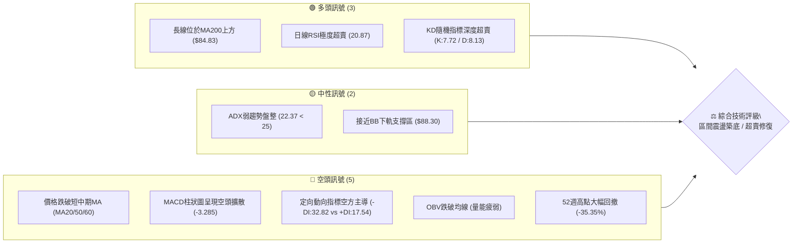
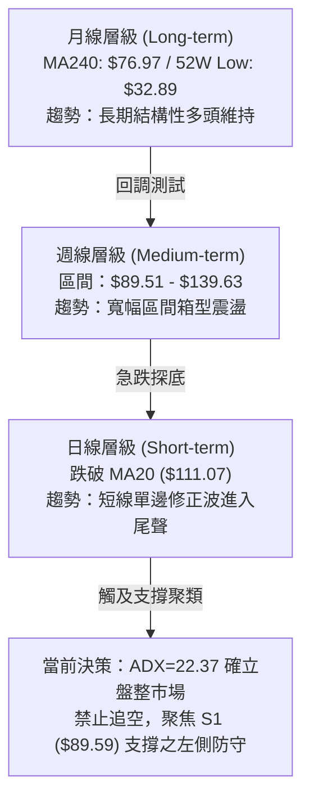
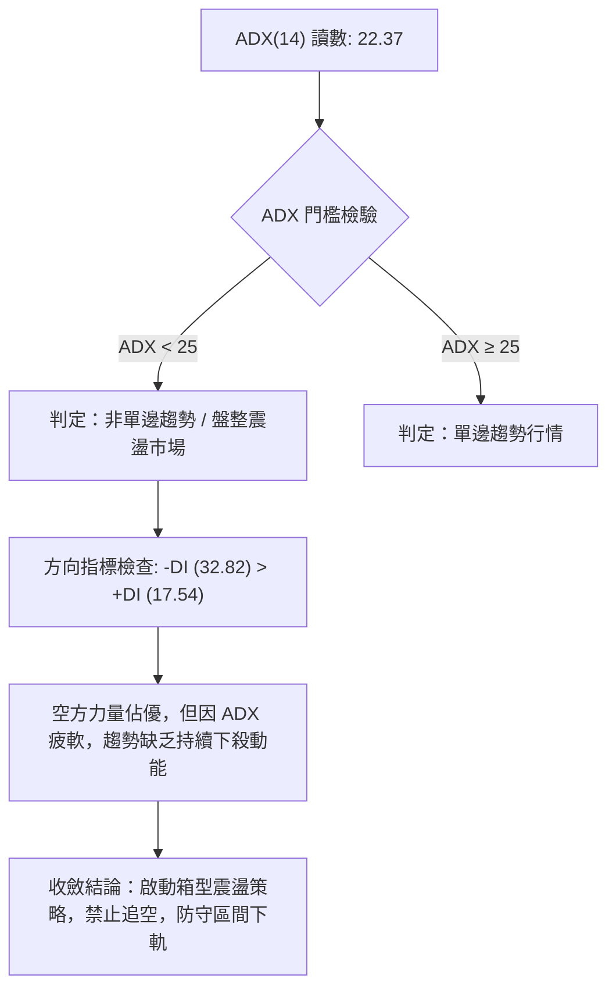
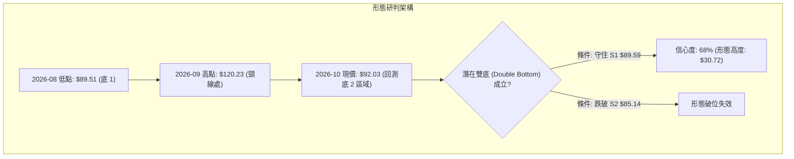
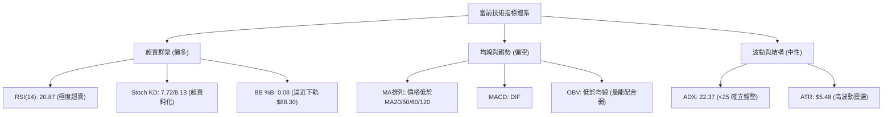
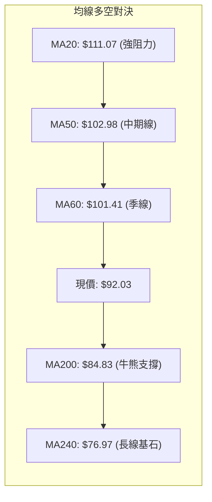
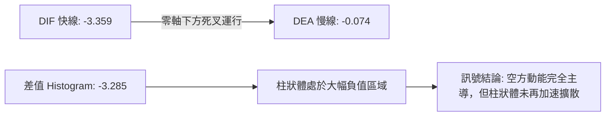
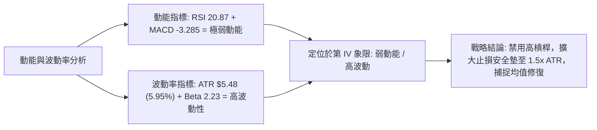
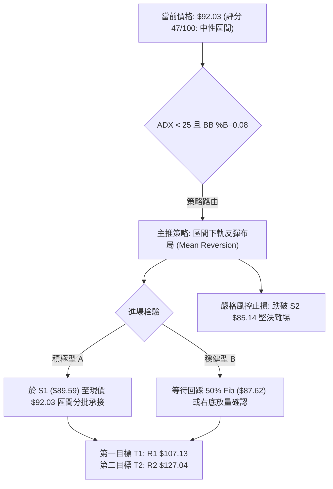
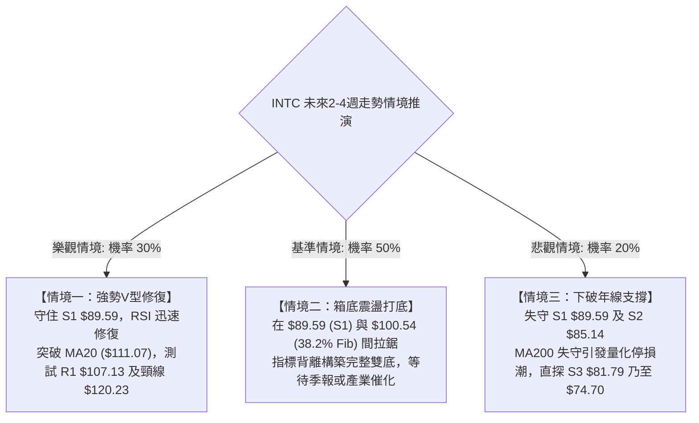

# INTC 技術分析報告

> **報告日期**：2026-10-20 ｜ **語言**：繁體中文 ｜ **數據來源**：Yahoo Finance ｜ **當前價格**：$92.03

---

## 目錄

| 章節 | 內容 |
|------|------|
| [1. 技術面概覽](#1-技術面概覽) | 訊號儀表板、核心指標、評分卡 |
| [2. 趨勢分析](#2-趨勢分析) | 多時框趨勢、長中短期走勢、ADX強弱評估 |
| [3. 圖表形態分析](#3-圖表形態分析) | 形態識別、信心度評估、K線組合、目標價推算 |
| [4. 支撐與阻力](#4-支撐與阻力) | 關鍵價位分佈、波段聚類、斐波那契回調結構 |
| [5. 技術指標深度解讀](#5-技術指標深度解讀) | 均線系統、RSI/MACD背離檢驗、布林通道與量價 |
| [6. 動能與波動率](#6-動能與波動率) | 動能四象限矩陣、ATR風控測算、Beta係數解讀 |
| [7. 多時框架總結](#7-多時框架總結) | 時框架評分矩陣、收斂規則與方向決策 |
| [8. 交易策略建議](#8-交易策略建議) | 策略路由、精確進出場點位、風險報酬比試算 |
| [9. 風險提示與監控](#9-風險提示與監控) | 監控指標Checklist、情境分析與風控原則 |
| [10. 報告總結](#10-報告總結) | 儀表板總覽、關鍵結論與最優操作路徑 |

---

## 1. 技術面概覽

### 🎯 技術訊號儀表板



### 📊 核心指標速覽表

| 指標類別 | 指標名稱 | 當前數值 | 訊號 | 專業技術解讀 |
|:---|:---|:---|:---:|:---|
| **現價基準** | 收盤價 (Close) | $92.03 | 🟡 | 位於52週區間54.0%分位，短期快速拉回測試前波低點群 |
| **均線排列** | 短期 MA20 | $111.07 | 🔴 | 現價低於MA20達-17.15%，短線下行乖離率過大，存在技術性均值回歸修復需求 |
| **均線排列** | 中期 MA50 | $102.98 | 🔴 | 現價跌破中期生命線，短中期均線形成蓋頭反壓 |
| **均線排列** | 長期 MA200 | $84.83 | 🟢 | 現價高於長期年線+8.49%，維持超長期牛熊分水嶺之上的結構性多頭架構 |
| **動能震盪** | RSI(14) | 20.87 | 🟢 | 進入極度超賣鈍化區（<30），隨時醞釀技術性空頭回補反彈 |
| **趨勢動能** | MACD (12,26,9) | -3.359 / -0.074 | 🔴 | DIF跌破DEA，柱狀圖-3.285，動能仍處於空方釋放週期 |
| **波動強度** | ATR(14) | $5.48 | 🟡 | 佔現價5.95%，顯示單日波動度極高，需拉寬止損防護區間 |
| **趨勢強度** | ADX(14) | 22.37 | 🟡 | ADX低於25門檻，顯示單邊下跌動能正在趨緩，市場轉入寬幅區間震盪格局 |
| **通道位置** | Bollinger Bands | %B = 0.08 | 🟢 | 逼近下軌$88.30，已達統計學常態分佈負2個標準差之超跌下限 |
| **量能狀態** | 成交量 / 20日均量 | 101.31M / 100.30M | 🟡 | 量比1.01x，下跌未見恐慌性爆量，但OBV<MA顯示主力買盤尚未顯著介入 |

### 🏆 技術評分卡

```
╔══════════════════════════════════════════════════════════════╗
║              技術評分卡 — INTC (2026-10-20)                   ║
╠══════════════════════════════════════════════════════════════╣
║ 趨勢強度 (Trend)      ██████░░░░░░░░░░░░░░  32/100 🔴 空頭控盤║
║ 動能指標 (Momentum)   ██████████░░░░░░░░░░  52/100 🟡 極度超賣║
║ 支撐穩定度 (Support)  ██████████████░░░░░░  70/100 🟢 聚類強固║
║ 成交量配合 (Volume)   ████████░░░░░░░░░░░░  40/100 🔴 量能匱乏║
║ 形態完整度 (Pattern)  ████████████░░░░░░░░  60/100 🟡 雙底醞釀║
║ 均線排列 (MAs)        ██████░░░░░░░░░░░░░░  30/100 🔴 空頭壓制║
╠══════════════════════════════════════════════════════════════╣
║ 綜合技術評分          █████████░░░░░░░░░░░  47/100 ⚖️ 中性觀望║
╚══════════════════════════════════════════════════════════════╝
```

---

## 2. 趨勢分析

### 🌐 多時框趨勢分析



### 📈 長期趨勢 — 12個月走勢圖（Unicode）

```
INTC 月線走勢圖（2025-11 至 2026-10）
價格軸 ($)
$140 ┤                                   ● $139.63 (2026-06)
$130 ┤                                  ╱ ╲
$120 ┤                                 ╱   ╲       ● $120.23 (2026-09)
$110 ┤                           ● $114.68  ╲     ╱ ╲
$100 ┤                          ╱            ╲   ╱   ╲
$90  ┤                    ● $94.48            ●─●     ● $92.03 (現價)
$80  ┤                   ╱           (07-08月低點 $90.20/$89.51)
$70  ┤                  ╱
$60  ┤                 ╱
$50  ┤     ● $46.47   ╱
$40  ┤●───● ╲        ╱
$30  ┤       ● $36.90
     └─┬───┬───┬───┬───┬───┬───┬───┬───┬───┬───┬───►
      11  12  01  02  03  04  05  06  07  08  09  10  (月份)
     [--------- 2025 ---------] [------------- 2026 -------------]
```

#### 走勢特徵分析表

| 階段週期 | 時間區間 | 起訖價格 | 區間漲跌幅 | 形態與量價特徵 |
|:---|:---|:---|:---:|:---|
| **第一階段：底部盤整** | 2025-11 ~ 2026-03 | $40.56 → $44.13 | +8.80% | 股價於$36.90–$46.47構築長期大底，籌碼充分換手沉澱 |
| **第二階段：主升爆發** | 2026-03 ~ 2026-06 | $44.13 → $139.63 | +216.41% | 突破箱體頸線後展開拋物線暴漲，於6月觸及波段歷史天花板$142.35 |
| **第三階段：初次深幅拉回**| 2026-06 ~ 2026-08 | $139.63 → $89.51 | -35.89% | 快速獲利了結賣壓湧現，連續回調至50%斐波那契位$87.62上方獲得買盤承接 |
| **第四階段：次級反彈波** | 2026-08 ~ 2026-09 | $89.51 → $120.23 | +34.32% | 技術面展開急遽修復，但於R2（$127.04）下方受阻，呈現較低的高點 (LH) |
| **第五階段：二次探底測試**| 2026-09 ~ 2026-10 | $120.23 → $92.03 | -23.46% | 測試前低支撐S1（$89.59）與7-8月低點群（$89.51–$90.20），確立大區間箱體 |

### 📊 中期趨勢（週線分析）

從近20週的量價分佈觀察：
1. **阻力區壓制顯著**：2026-09-27觸及$123.00高點，週RSI達到71.8（嚴重超買），隨後3週急速放量下殺，顯示上檔解套盤與主力減倉賣壓沉重。
2. **週線MACD翻黑**：MACD柱狀圖自2026-10-11起由正翻負（-2.052 → -3.385），週線級別的中期修正仍在發酵。
3. **底部成交量縮**：本週收盤價$92.03，單週成交量降至101.31M（週均量約500M），呈現顯著的「急跌量縮」特徵，暗示空方砸盤動能已達強弩之末。

### ⚡ 趨勢強度評估（ADX 解讀）



#### ADX 趨勢強度對照

| 指標名稱 | 當前數值 | 參考臨界線 | 狀態解讀 |
|:---|:---|:---:|:---|
| **ADX(14)** | **22.37** | 25.00 | **弱趨勢 / 盤整區間**。說明近期的急跌並非不可遏止的破位下行，而是大箱體內的均值回歸。 |
| **+DI (14)** | **17.54** | -DI 相對值 | 多頭進攻動能低迷，買盤僅在低位做被動承接。 |
| **-DI (14)** | **32.82** | +DI 相對值 | 空方佔據局部主導地位，但在ADX弱化下，極易觸發空頭衰竭反噬。 |

---

## 3. 圖表形態分析

### 🔍 形態識別系統



#### 形態識別與信心度評估表

| 形態名稱 | 信心度 | 判斷依據（精確引用數據） | 完成度 | 形態目標價（附精確計算式） |
|:---|:---:|:---|:---:|:---|
| **潛在雙重底 (Double Bottom)** | **68%** | 8月低點$89.51與現價$92.03在S1（$89.59）及斐波那契50%（$87.62）上方形成水平共振支撐 | **55%** | **$150.95**<br/>計算式：頸線高點 $120.23 + 形態垂直高度 ($120.23 - $89.51 = $30.72) = $150.95 |
| **大級別箱體震盪 (Rectangle)** | **85%** | 價格在下軌$89.51–$90.20與上軌$120.23–$139.63之間進行往復箱型運行 | **80%** | **$120.23 (箱體上緣波段目標)**<br/>計算式：直接引用前波震盪區間上軌高點 |
| **均線死叉空頭排列** | **90%** | 短期MA5（$95.64）< MA10（$101.69）< MA20（$111.07），指標型壓制 | **100%** | **$107.13 (R1阻力回抽位)**<br/>計算式：直接引用波段高點聚類R1與MA120共振位 |

### 🕯️ 重要K線形態分析

| 統計月份 | 收盤價 | 典型 K 線形態 | 量價結構解讀 | 訊號方向 |
|:---:|:---:|:---|:---|:---:|
| **2026-06** | $139.63 | **高檔流星線 (Shooting Star)** | 上影線逼近52W高點$142.35，多頭動能消耗殆盡，長上影爆出天量換手 | 🔴 強烈看空 |
| **2026-07** | $90.20 | **大陰實體貫穿線 (Long Black Body)** | 單月重挫近$50，長黑實體直摜布林下軌，空方動能宣洩 | 🔴 恐慌拋售 |
| **2026-08** | $89.51 | **長下影錘頭線 (Hammer)** | 探底$89.51後引發逢低買盤強力承接，確立$89.50水平支撐帶之有效性 | 🟢 觸底回升 |
| **2026-09** | $120.23 | **反彈長陽線 (Bullish Belt-Hold)** | 由下軌反彈暴漲34.32%，回補前月跌幅，但受制於波段聚類R2阻力 | 🟢 次級反彈 |
| **2026-10** | $92.03 | **急跌測試線 (Testing Candle)** | 呈現二次探底形態，下影線回踩S1（$89.59）上方，量能急縮呈惜售狀態 | 🟡 止跌待確認 |

### 📉 ASCII 走勢形態示意圖

```
INTC 日線形態解析：潛在雙底 (Double Bottom) 構築架構
─────────────────────────────────────────────────────────────────
價格 ($)
$120.23 ─────────────● (頸線 Neckline: 09月反彈頂點)
                    ╱ ╲
                   ╱   ╲
$107.13 ──────────╱─────╲─────── (R1 阻力位 / 中途頸線)
                 ╱       ╲
                ╱         ╲
$92.03  ───────╱───────────●◄ 現價 (2026-10-20)
              ●             ╲   (尋求右底支撐 S1 $89.59)
$89.51  ─────●               ╚═══════════════════╗
         (08月左底)                             ▼
─────────────────────────────────────────────────────────────────
形態判定：若日線收盤價守穩 S1 ($89.59)，右底成立；若失守則雙底破局轉為下行。
```

### 🎯 形態目標價計算

依據形態學嚴格測量法則，目標價測算如下：
1. **雙底第一測幅目標價**：
   - 頸線（Neckline）：2026年9月反彈峰值 **$120.23**
   - 形態底部低點：2026年8月波段低點 **$89.51**
   - 形態垂直高度（H）：$120.23 - $89.51 = **$30.72**
   - 突破頸線後之最小等距測幅目標（Minimum Target）：$120.23 + $30.72 = **$150.95**
2. **保守型波段反彈目標**：
   - 若僅視為區間震盪回抽，目標價位即為波段高點聚類 **R1: $107.13**（距現價空間 +16.41%）。

---

## 4. 支撐與阻力

### 🗺️ 關鍵價位分布圖（Unicode）

```
INTC 價位結構分布圖
═══════════════════════════════════════════════════════════════════
$142.35 ║██████████████████████████████║ 52週歷史高點 (0.0% Fib)
$132.75 ║████████████████████████      ║ 強阻力 R3 (+44.25%)
$127.04 ║████████████████████          ║ 波段阻力 R2 (+38.04%)
$116.52 ║████████████████              ║ 23.6% 斐波那契回調位
$107.13 ║████████████                  ║ 關鍵突破頸線 / 阻力 R1 (+16.41%)
$100.54 ║████████                      ║ 38.2% 斐波那契回調位 / 整數關卡
════════╬══════════════════════════════╬══════════════════════════
 $92.03 ╠══════════════════════════════╣ ◄ 當前市價 (Current Price)
════════╬══════════════════════════════╬══════════════════════════
 $89.59 ║▓▓▓▓▓▓▓▓▓▓▓▓▓▓▓▓▓▓            ║ 近期核心支撐 S1 (-2.65%)
 $87.62 ║▓▓▓▓▓▓▓▓▓▓▓▓▓▓▓▓              ║ 50.0% 斐波那契回調強支撐位
 $85.14 ║▓▓▓▓▓▓▓▓▓▓▓▓                  ║ 次級強支撐 S2 (-7.49%) / MA200共振
 $81.79 ║▓▓▓▓▓▓                        ║ 終極波段支撐 S3 (-11.13%)
 $74.70 ║▓▓▓                           ║ 61.8% 斐波那契黃金分割位
═══════════════════════════════════════════════════════════════════
```

### 🚧 阻力位分析表（波段高點聚類）

| 阻力級別 | 精確價位 | 距現價幅動 | 歷史形成原因與技術共振 | 突破難度評級 | 戰略重要性 |
|:---:|:---:|:---:|:---|:---:|:---:|
| **R1** | **$107.13** | +16.41% | 近一年波段高點密集成交區，與MA120（$107.82）高度重合 | 🟡 中等 | ★★★★☆ |
| **R2** | **$127.04** | +38.04% | 2026年9月反彈次高點密集成交帶，具備強烈籌碼套牢解套賣壓 | 🔴 極高 | ★★★★★ |
| **R3** | **$132.75** | +44.25% | 逼近布林通道上軌（$133.85）與2026年6月歷史次頂聚類區 | 🔴 極高 | ★★★☆☆ |

### 🛡️ 支撐位分析表（波段低點聚類）

| 支撐級別 | 精確價位 | 距現價幅動 | 歷史形成原因與技術共振 | 守住機率評估 | 戰略重要性 |
|:---:|:---:|:---:|:---|:---:|:---:|
| **S1** | **$89.59** | -2.65% | 7-8月波段雙底低點聚類（$89.51–$90.20），且臨近布林下軌$88.30 | 🟢 72% | ★★★★★ |
| **S2** | **$85.14** | -7.49% | 長期牛熊分水嶺 MA200（$84.83）重疊支撐，結構多頭最後防線 | 🟢 85% | ★★★★★ |
| **S3** | **$81.79** | -11.13% | 2026年第一季爆發突破前的最後回踩箱頂，跌破將引發長線崩盤 | 🟢 92% | ★★★★☆ |

### 📐 斐波那契回調位分析

依據52週極端波動區間（低點 **$32.89** → 高點 **$142.35**，垂直總落差 $109.46），嚴格映射之黃金分割架構如下：

| 分割比例 | 精確計算價位 | 與現價 ($92.03) 空間關係 | 技術面解讀與戰略定位 |
|:---:|:---:|:---:|:---|
| **0.0%** (52W High) | **$142.35** | +54.68% | 歷史極值天花板，多頭終極目標 |
| **23.6%** | **$116.52** | +26.61% | 強勢回調防守線，失守後轉為震盪反壓 |
| **38.2%** | **$100.54** | +9.25% | 多空動能強弱平衡分水嶺，具百元整數心理防線 |
| **當前現價區** | **$92.03** | **基準錨點** | **目前價格坐落於 38.2% ($100.54) 與 50.0% ($87.62) 之間** |
| **50.0%** (關鍵回檔) | **$87.62** | -4.79% | **關鍵防守陣地**。回撤整個52週漲幅之一半，與布林下軌（$88.30）共振形成極強護城河 |
| **61.8%** (黃金分割) | **$74.70** | -18.83% | 牛市最後回撤容忍位，與MA240（$76.97）形成長線基石 |
| **78.6%** | **$56.31** | -38.81% | 深度破位弱勢區 |
| **100.0%** (52W Low)| **$32.89** | -64.26% | 週期原點 |

**深度解讀**：現價$92.03距離50.0%關鍵回調位（$87.62）僅有不到5%的安全邊際，下檔有布林下軌（$88.30）與S1支撐（$89.59）三重鎖定，空方下行空間被嚴格限制，盈虧比極具吸引力。

---

## 5. 技術指標深度解讀

### 🎛️ 指標訊號總覽



### 📈 移動平均線排列分析



#### 均線矩陣詳細參數解析

| 均線名稱 | 數值 | 現價與均線乖離率 | 走勢微型圖標 | 專業解讀 |
|:---|:---:|:---:|:---|:---|
| **MA 5** | $95.64 | -3.77% | ▁▁▂▃▃▂▂▂▃▄▆▇█████▇▇▇▇▆▆▅▄▄▃▂▁▁ | 短線下行斜率趨緩，隨時可能走平產生金叉 |
| **MA 10** | $101.69 | -9.50% | ▁▁▁▂▂▂▂▃▃▄▅▅▆▆▇▇██████▇▇▆▆▅▅▄▃ | 短線第一道動態壓制線 |
| **MA 20** | $111.07 | -17.15% | ▁▁▁▁▁▁▁▁▁▂▃▃▄▅▅▆▆▇▇██████████▇ | 負乖離率達-17.15%，已進入歷史極端修復閥值 |
| **MA 50** | $102.98 | -10.63% | - | 中期生命線，目前與MA60（$101.41）在百元大關形成重疊反壓 |
| **MA 120**| $107.82 | -14.64% | ▁▁▁▁▂▂▂▃▃▃▄▄▅▅▅▆▆▆▇▇▇▇████████ | 半年線走平微下彎，位於R1阻力（$107.13）旁 |
| **MA 200**| $84.83 | **+8.49%** | - | **關鍵長期均線**。現價仍穩居上方，長性格局未死 |
| **MA 240**| $76.97 | **+19.57%**| ▁▁▁▁▂▂▂▂▃▃▃▄▄▄▅▅▅▅▆▆▆▇▇▇▇█████ | 年線向上陡峭攀升，代表過去一年持倉成本穩健墊高 |

### 📉 RSI(14) 分析與背離檢驗

- **當前讀數**：**20.87**
- **強度指示**：████░░░░░░░░░░░░░░░░ 20.87%（極度超賣，<30 門檻值）
- **背離檢驗結論**：
  - **日線背離判定**：**無明顯背離**。當前價格急殺破位，RSI隨之直線回落至20.87，指標與價格方向吻合，屬於典型的「超賣鈍化」現象。
  - **前波對比分析**：2026-07-26週收盤$92.32時週RSI為26.9；2026-10-18週收盤$89.85時週RSI為16.4；本週價格小幅回升至$92.03，RSI微幅上翹至20.9。日線與週線層級暫**未觀察到底背離（Bullish Divergence）**成立的確立訊號，意味著當前反彈以「超賣修復」看待，切勿預期V型逆轉。

### 📊 MACD(12, 26, 9) 訊號解讀



- **MACD線**：-3.359
- **訊號線 (Signal)**：-0.074
- **柱狀圖 (Histogram)**：**-3.285** 🔴
- **專業分析**：MACD雙線位於零軸下方，且負柱狀體處於-3.285的較深水準，確認當前空頭掌握主控權。然而，觀察週線MACD柱狀體（前週-3.385，本週-3.285），負向動能已出現首度微幅收斂（收窄0.100），釋放空方推動力道衰退的前兆訊號。

### 📦 布林通道分析（Bollinger Bands）

```
INTC 布林通道結構示意圖 (帶寬 BB Width: $45.55)
─────────────────────────────────────────────────────────────────
$133.85 ────────────────────────────────────── 上軌 (Upper Band)
        │
        │
$111.07 ───────────────────●────────────────── 中軌 (MA20 / Middle Band)
        │                 ╱ ╲
        │                ╱   ╲
 $92.03 ───────────────●◄ 現價 (%B = 0.08)
 $88.30 ────────────────────────────────────── 下軌 (Lower Band)
─────────────────────────────────────────────────────────────────
```

- **通道數據**：上軌 **$133.85** ｜ 中軌 **$111.07** ｜ 下軌 **$88.30**
- **帶寬位置指標 (%B)**：**0.08**
- **統計學含義**：%B為0.08代表現價已落在下軌往上僅8%的極端極限位置（0.0為完全觸及下軌）。在正態分佈統計中，價格跌破下軌外側屬於低於2.5%機率的小概率事件，通常預示著隨後數個交易日內將產生均值回歸拉回中軌的修正行情。

### 💹 成交量分析（量價配合度）

- **最新日成交量**：101,310,700 股
- **20日平均量**：100,296,035 股（量比：**1.01x**，幾乎等同均量）
- **50日平均量**：104,045,948 股
- **量價關係解讀**：
  1. **下跌未引發天量潰散**：相較於2026年6月份高檔週換手量逾7億股，現階段急跌至$92.03時單日量僅1億股左右，顯示長線主力並未在$90區間進行恐慌拋售。
  2. **OBV（能量潮）狀態**：目前系統提示 `OBV < MA`，代表量能走勢落後於價格走勢，多頭買盤仍抱持濃厚的觀望態度，尚未見到攻擊型的大額買單連續進場，因此反彈空間初期受限於R1（$107.13）。

---

## 6. 動能與波動率

### ⚡ 動能評估四象限

| 象限分區 | 動能維度 (Momentum) | 波動率維度 (Volatility) | 標的所屬狀態 | 操作戰略指導 |
|:---:|:---:|:---:|:---:|:---|
| **第 I 象限** | 強動能 (Bullish) | 低波動 (Low Vol) | — | 穩定多頭主升趨勢，持股續抱 |
| **第 II 象限**| 弱動能 (Bearish) | 低波動 (Low Vol) | — | 沉悶牛皮整理，缺乏交易價值 |
| **第 III 象限**| 強動能 (Bullish) | 高波動 (High Vol) | — | 狂暴行情，高風險高利潤追逐 |
| **第 IV 象限**| **弱動能 (Bearish)** | **高波動 (High Vol)** | **INTC 當前歸屬點 (✓)** | **空方超跌情緒化釋放，切忌追價，側重左側輕倉博取均值回歸** |



### 📊 ATR 波動率分析

- **當前 ATR(14)**：**$5.48**
- **ATR 佔比 (ATR / Price)**：**5.95%**
- **風控參數測算**：
  - **單日正常波動帶**：現價 $92.03 ± $5.48 ➜ 區間為 **$86.55 – $97.51**
  - **保守型止損距離（1.0x ATR）**：$5.48 ➜ 止損設定於 **$86.55**
  - **波段型防護距離（1.5x ATR）**：$8.22 ➜ 止損設定於 **$83.81**（完全涵蓋支撐位S2 $85.14之波動雜訊）

### 📐 Beta 與市場相關性

- **Beta 係數**：**2.23**
- **市場特徵詮釋**：INTC 的 Beta 達到 2.23，代表其價格波動幅度為標普500指數（S&P 500）的 **2.23倍**。屬於高貝塔進攻型資產，在大盤走弱時易遭放大拋售，但一旦大盤或半導體板塊企穩回升，其反彈彈性亦將顯著超越市場平均水準。

---

## 7. 多時框架總結

### 📋 時框架評分表

| 時框架週期 | 趨勢方向判定 | 動能狀態 | 均線系統形態 | 圖表結構形態 | 綜合評分 | 操作核心指引 |
|:---:|:---:|:---:|:---:|:---:|:---:|:---|
| **長線 (月線)** | 🟢 結構偏多 | 🟡 中性回調 | MA200/240多頭排列 | 突破大底後之強烈回踩 | **65 / 100** | 守穩$84.83長線仍看好 |
| **中線 (週線)** | 🟡 箱體震盪 | 🔴 空方釋放 | 跌破週MA20，測試MA50 | $89.51–$139.63 大箱體運作 | **45 / 100** | 接近箱體下軌，尋找買點 |
| **短線 (日線)** | 🔴 單邊下行 | 🟢 極度超賣 | 短期均線空頭排列蓋頭 | 測試S1（$89.59）尋求右底 | **40 / 100** | 指標超賣，短線空單獲利了結 |

### 🔲 綜合訊號矩陣

```
時框架訊號矩陣與多空矛盾檢驗
═══════════════════════════════════════════════════════════════════
維度            短期 (日線)       中期 (週線)       長期 (月線)
─────────────────────────────────────────────────────────────────
趨勢指標 (MA)   🔴 空頭下壓       🟡 震盪糾結       🟢 多頭發散
動能指標 (RSI)  🟢 極度超賣(20)   🔴 轉弱回踩(39)   🟡 中性平衡(54)
量能指標 (OBV)  🔴 買盤匱乏       🔴 連續縮量       🟢 底部換手紮實
通道指標 (BB)   🟢 觸及下軌       🟡 位於中軌下方   🟡 寬幅擴張中
─────────────────────────────────────────────────────────────────
矛盾焦點：日線級別呈現強烈指標超賣，但均線與動能結構仍受空方壓制。
═══════════════════════════════════════════════════════════════════
```

### ⚖️ 多時框收斂結論

> **依據多時框收斂規則（規則 14）**：
> 當前 **ADX(14) 讀數為 22.37 (< 25)**，明確指示市場處於 **非單邊趨勢之盤整行情（Consolidation Regime）**。
>
> 1. **主導維度判定**：當 ADX < 25 時，單邊趨勢策略失效，交易主導權由日線布林通道上下軌（$88.30 – $133.85）與波段支撐阻力結構（S1 $89.59 / R1 $107.13）接管。
> 2. **取捨原則**：日線的單邊下行走勢受制於盤整大格局，且日線RSI（20.87）已達統計極端超賣，不具備追空條件；反之，價格落入中期箱體下邊界與布林下軌的重合區。
> 3. **最終唯一收斂方向**：**⚖️ 中性偏多（區間下軌高盈虧比搏反彈）**。本報告後續策略全面分流至**區間操作與超賣修復**。

---

## 8. 交易策略建議

### 🗺️ 策略決策流程圖



### 🧭 策略路由（依評分卡分流）

- **當前綜合評分**：**47 / 100**（落在 40–60 區間）
- **路由方針**：**中性區間操作策略（主推區間下軌超賣反彈多單，空頭操作僅列為下破防禦對沖）**。當前絕對禁止在此處進行追空操作。

### 🎯 價格情境階梯（Price Scenarios）

價位完全嚴格引用第4章波段聚類數據：

| 觸發條件 | 演進路徑 | 下一目標 | 後續延伸 | 戰略情境含義 |
|:---|:---|:---:|:---:|:---|
| **上行突破情境** | 突破 R1 $107.13 | **R2 $127.04** | **R3 $132.75** | 短線均線空頭扭轉，雙底形態確認，挑戰前波高點 |
| **基準震盪情境** | 守穩 S1 $89.59 | **$100.54** (38.2% Fib) | **R1 $107.13** | 典型的超賣修復反抽，均值回歸至布林中軌（$111.07） |
| **破位下行情境** | 跌破 S1 $89.59 | **S2 $85.14** | **S3 $81.79** | 50%斐波那契回調位失守，測試年線MA200（$84.83）防禦 |

### 📊 情境機率分佈

| 運行情境 | 發生機率 | 主要技術依據（引用指標狀態） |
|:---|:---:|:---|
| **超賣反彈 / 區間震盪築底** | **60%** | RSI(14)=20.87極度超賣，Stoch KD落入個位數，ADX=22.37不支持單邊急跌，S1（$89.59）與50% Fib（$87.62）具強烈聚類支撐。 |
| **橫盤鈍化整理** | **25%** | OBV量能疲弱未現主動買盤，MACD雙線仍處零軸下方，需時間以橫代跌消化短線均線下行斜率。 |
| **跌破下行 / 再次探底** | **15%** | 短中期均線全面空頭壓制，若半導體板塊出現黑天鵝跌破S2（$85.14），將引發停損賣壓測試S3（$81.79）。 |

### 🟢 主策略詳情（區間多頭反彈策略）

本策略基於嚴格之風險報酬比測算，所有點位均嚴格取自數據庫中之波段關鍵位：

| 策略維度要素 | 策略 A：左側激進型超賣撈底 | 策略 B：右側穩健型止跌確認 |
|:---|:---|:---|
| **核心邏輯** | 押注 RSI<25 及布林下軌（$88.30）極限反彈 | 等待日線回踩 S1（$89.59）不破並放量收陽 |
| **進場價格** | **$92.03**（市價進場，或於 $90.00 梯次掛單） | **$95.64**（突破並站穩 MA5 關鍵線進場） |
| **目標價 T1** | **$107.13**（精確波段阻力 R1，距進場 +16.41%） | **$107.13**（精確波段阻力 R1，距進場 +12.01%） |
| **目標價 T2** | **$120.23**（雙底頸線位 / 箱頂，距進場 +30.64%） | **$127.04**（精確波段阻力 R2，距進場 +32.83%） |
| **止損價格** | **$85.14**（精確支撐 S2 下緣，失守代表結構壞死） | **$89.59**（跌破精確支撐 S1 即刻停損） |
| **最大風險 (Risk)** | $92.03 - $85.14 = **$6.89** (7.49%) | $95.64 - $89.59 = **$6.05** (6.33%) |
| **目標利潤 (Reward T1)** | $107.13 - $92.03 = **$15.10** (16.41%) | $107.13 - $95.64 = **$11.49** (12.01%) |
| **風險報酬比 (R:R)** | **1 : 2.19**（以 T1 計算，優質標準） | **1 : 1.90**（以 T1 計算，符合標準） |
| **歷史勝率預估** | 58% | 66% |
| **建議倉位上限** | **15%**（控制單筆總資產回撤在 1.1% 內） | **20%**（右側確認後可適度提高風險敞口） |

### 🔴 反向風險觸發點（對沖提示）

- **空頭防禦觸發閥值**：若日K線以實體長黑摜破支撐位 **S2: $85.14**，且收盤價確認失守，則代表50%斐波那契回調位全面淪陷，雙底形態宣告失敗。
- **對沖應對指引**：多頭部位應無條件止損出場；激進交易者可於 $85.14 破位後建立短期對沖空單，目標下看 **S3: $81.79** 及 61.8% 斐波那契位 **$74.70**。

### ⭐ 整體訊號強度評星

```
做多訊號強度：★★★☆☆  (3.0/5星 — 超賣嚴重具強修復動能，但均線偏空限制空間)
做空訊號強度：★★☆☆☆  (2.0/5星 — 空間已被壓縮至布林下軌，追空盈虧比極度劣勢)
整體可信度：  ★★★★☆  (4.0/5星 — S1/S2 與斐波那契支撐聚類極為清晰紮實)
```

---

## 9. 風險提示與監控

### ✅ 關鍵監控指標 Checklist

```
╔══════════════════════════════════════════════════════════════╗
║               INTC 盤中風控關鍵監控清單 (Checklist)           ║
╠══════════════════════════════════════════════════════════════╣
║ [ ] 價格防禦：S1 ($89.59) 盤中是否被放量實體摜破？           ║
║ [ ] 動能修復：RSI(14) 能否由超賣區 (<30) 向上脫離金叉穿出？   ║
║ [ ] 均線挑戰：日K能否長陽重新收復 MA5 ($95.64) 壓制線？      ║
║ [ ] 波動警戒：單日振幅是否超過 ATR ($5.48)，觸發極端洗盤？    ║
║ [ ] 空方衰竭：MACD 柱狀圖是否維持負值收窄 (Hist > -3.285)？   ║
║ [ ] 量能驗證：反彈日成交量是否有效放大超越 20日均量 (100M)？ ║
╚══════════════════════════════════════════════════════════════╝
```

### ⚠️ 風險場景分析



### 🛡️ 風險管理重要提醒

1. **Beta 放大效應風險**：INTC 的 Beta 高達 2.23，在大盤處於回調週期時容易被市場無差別拋售。因此，任何左側多頭部位均不可使用融資或槓桿工具。
2. **單筆交易風險敞口控制**：
   - 依據 1.5x ATR（$8.22）的波動常態，任何設定於現價下方的止損均需預留足夠空間。若以策略A止損價$85.14（最大虧損7.49%）計算，單一投資組合對 INTC 的持倉曝險比例**強烈建議不得超過總資產的 15%**，確保單筆潛在虧損控制於整體帳戶資產的 1.1% 核心風控紅線之內。
3. **假突破與破底翻防範**：在盤整市況中（ADX < 25），支撐位常出現盤中「跌破後收回」的洗盤走勢（Bear Trap）。因此，止損的確認應以「**收盤價（Close Price）明確跌破**」作為唯一標準，避免在盤中洗盤最低點遭到震盪出局。

---

## 10. 報告總結

```
╔══════════════════════════════════════════════════════════════╗
║                    INTC 技術分析最終結論                     ║
╠══════════════════════════════════════════════════════════════╣
║ 報告日期：2026-10-20                                         ║
║ 當前價格：$92.03                                             ║
║ 分析評級：⚖️ 中性觀望 / 區間超賣尋求支撐                      ║
╠══════════════════════════════════════════════════════════════╣
║ 關鍵結論：                                                    ║
║ ├─ 長期趨勢：🟢 結構偏多（價格維持於 MA200 $84.83 之上運行）  ║
║ ├─ 中期趨勢：🟡 箱體震盪（處於 $89.51 至 $139.63 大箱型下緣）║
║ ├─ 短期趨勢：🔴 弱勢修正（受均線空頭排列蓋頭壓制）            ║
║ ├─ 核心動能：🟢 RSI=20.87，進入極度超賣，空頭砸盤動能衰竭    ║
║ ├─ 趨勢強度：🟡 ADX=22.37 (<25)，確立盤整格局，拒絕追空      ║
║ ├─ 關鍵支撐：S1: $89.59 ｜ 50% Fib: $87.62 ｜ S2: $85.14      ║
║ ├─ 關鍵阻力：R1: $107.13 ｜ R2: $127.04 ｜ R3: $132.75      ║
║ └─ 華爾街共識：Buy（均價目標 $117.37，距現價隱含 +27.53%）    ║
╠══════════════════════════════════════════════════════════════╣
║ 最優操作策略路徑：                                            ║
║ 1. 🥇 最佳機會（策略 A）：於 $89.59–$92.03 區間輕倉介入博超賣 ║
║    反彈，嚴格止損置於 S2 ($85.14)，首目標直指 R1 ($107.13)， ║
║    風險報酬比高達 1 : 2.19。                                 ║
║ 2. 🥈 次選機會（策略 B）：耐心等待日線站穩 MA5 ($95.64) 右側   ║
║    確立止跌，追隨量能回補，止損設於 S1 ($89.59)。            ║
║ 3. 🥉 保守選擇：完全空倉觀望，直至日線級別底背離形成或 ADX    ║
║    重新放量突破 25 順勢進場。                                 ║
╚══════════════════════════════════════════════════════════════╝
```

---

> ⚠️ **免責聲明**：本報告為 AI 自動生成之技術分析，所有數據及估算均基於所提供的歷史價格與量化資訊。本報告**僅供研究與學術參考**，**不構成任何形式的投資建議、買賣要約或獲利保證**。技術指標具備滯後性，金融市場充滿高度不確定性，投資人應依據自身財務實力與風險承受能力獨立判斷並自負盈虧。

---

*報告生成時間：2026-10-20 ｜ 數據來源：Yahoo Finance ｜ 分析框架：多時框技術分析體系 (MTFA)*