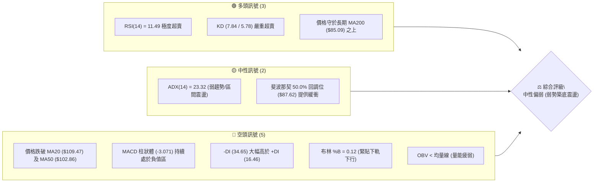
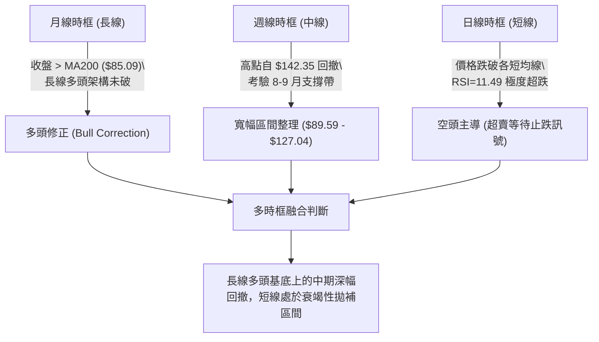
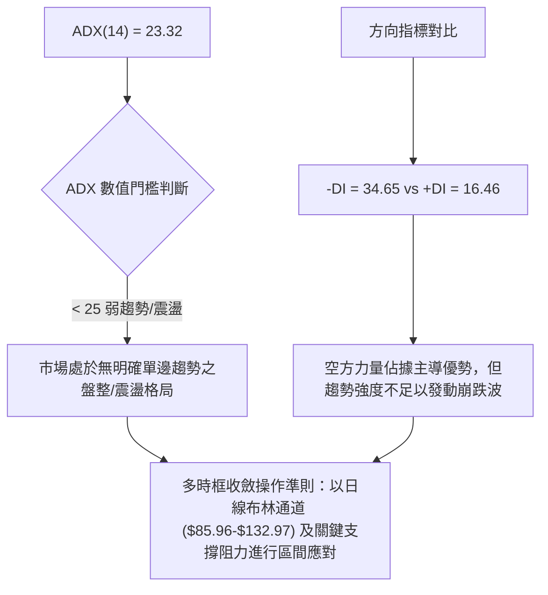
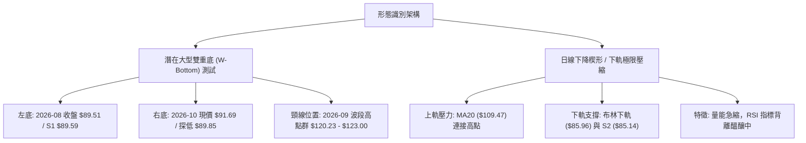
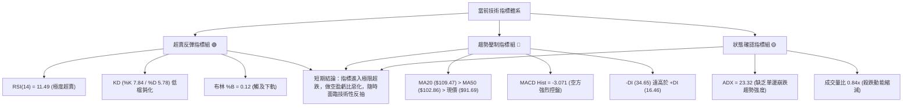
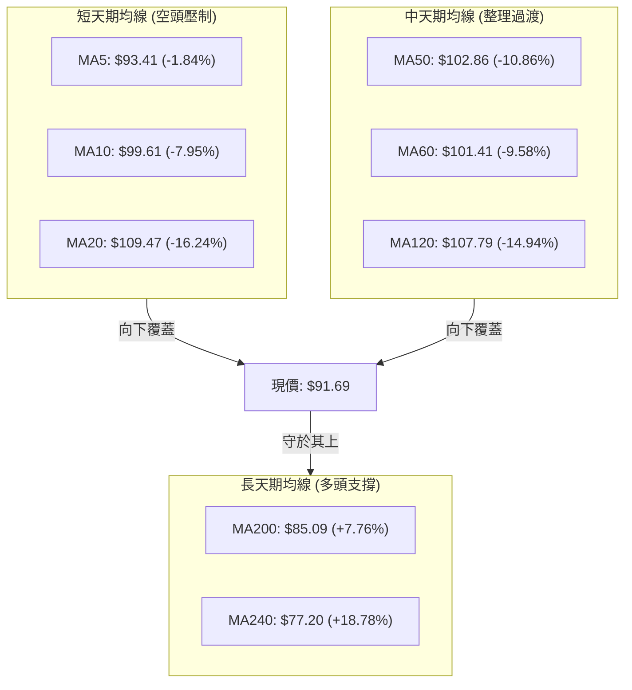
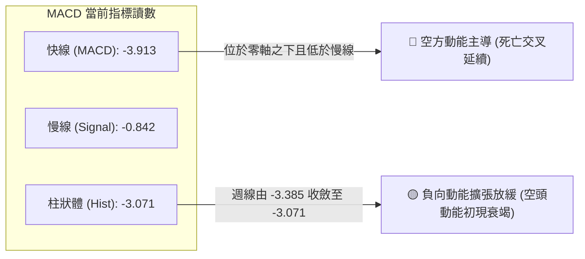
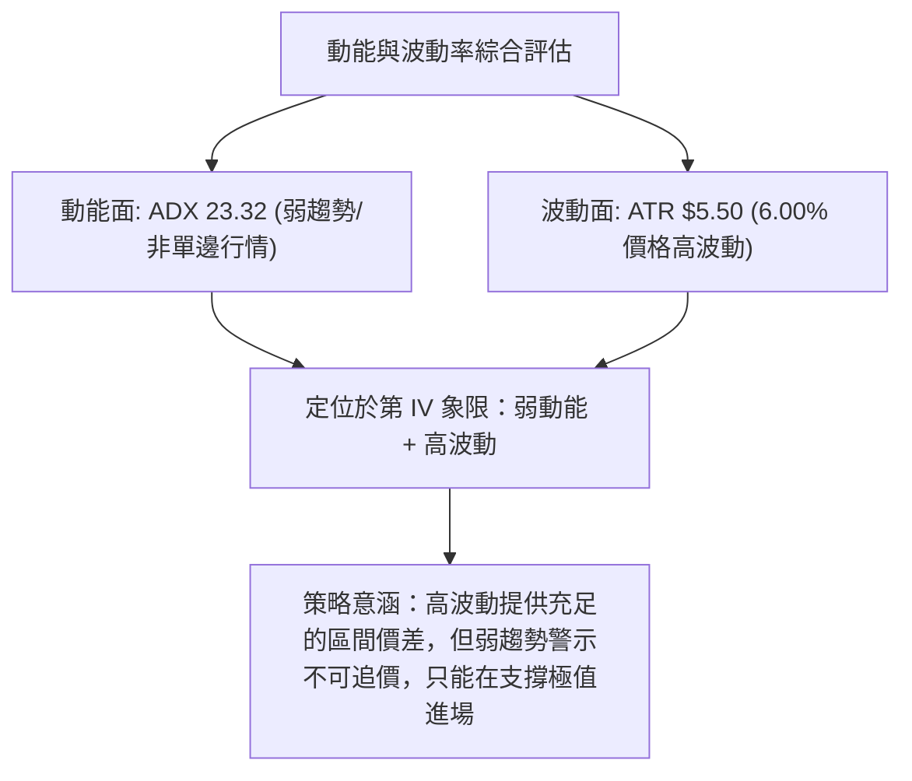
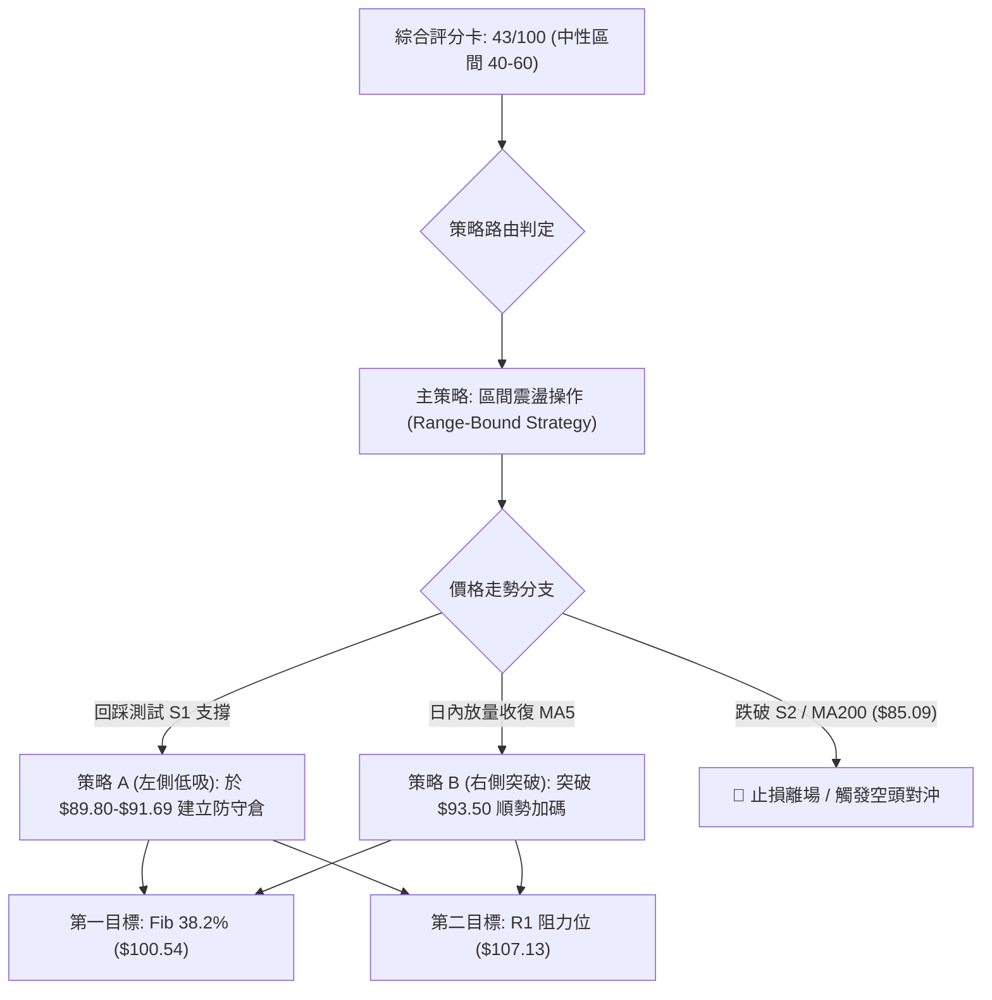
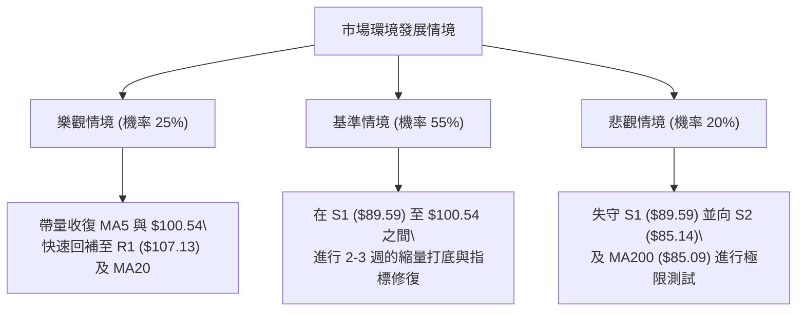

# INTC 技術分析報告

> **報告日期**：2026-10-21 ｜ **語言**：繁體中文 ｜ **數據來源**：Yahoo Finance ｜ **當前價格**：$91.69

---

## 目錄

| 章節 | 內容 |
|------|------|
| [1. 技術面概覽](#1-技術面概覽) | 訊號儀表板、核心指標、評分卡 |
| [2. 趨勢分析](#2-趨勢分析) | 多時框趨勢、長中短期走勢、ADX強度 |
| [3. 圖表形態分析](#3-圖表形態分析) | 形態識別、K線組合、目標價推算 |
| [4. 支撐與阻力](#4-支撐與阻力) | 關鍵價位、斐波那契回調結構 |
| [5. 技術指標深度解讀](#5-技術指標深度解讀) | MA/RSI/MACD/布林/成交量量價關係 |
| [6. 動能與波動率](#6-動能與波動率) | 動能評估、ATR波動區間、Beta相關性 |
| [7. 多時框架總結](#7-多時框架總結) | 時框架矩陣與多時框收斂結論 |
| [8. 交易策略建議](#8-交易策略建議) | 策略路由、價格情境、多空交易計劃 |
| [9. 風險提示與監控](#9-風險提示與監控) | 監控清單、情境分析與風控措施 |

---

## 1. 技術面概覽

### 🎯 技術訊號儀表板



### 📊 核心指標速覽表

| 指標類別 | 指標名稱 | 當前數值 | 訊號 | 專業解讀 |
|----------|----------|----------|------|----------|
| **價格** | 當前收盤價 | $91.69 | 🟡 | 位於52週區間53.7%，短線自高點回調幅度深 |
| **均線** | 短期 MA20 | $109.47 | 🔴 | 股價位於 MA20 下方 -16.24%，短線呈空頭排列 |
| **均線** | 中期 MA50 | $102.86 | 🔴 | 股價位於 MA50 下方，中期承壓，失守百元關卡 |
| **均線** | 長期 MA200 | $85.09 | 🟢 | 股價仍高於 MA200 (+7.76%)，長線牛熊分水嶺未破 |
| **動能** | RSI(14) | 11.49 | 🟢 | 極度超賣區間 (<20)，技術面短線隨時醞釀超跌反彈 |
| **動能** | MACD 柱狀體 | -3.071 | 🔴 | MACD線 (-3.913) 低於訊號線 (-0.842)，空方動能主導 |
| **擺動** | KD 隨機指標 | %K:7.84 / %D:5.78 | 🟢 | 處於個位數超賣極值，短線下行動能出現鈍化跡象 |
| **趨勢** | ADX(14) | 23.32 | 🟡 | 讀數小於 25，顯示當前為弱趨勢或盤整/修正行情 |
| **波動** | ATR(14) | $5.50 (6.00%) | 🔴 | 單日波動幅度大，需預留足夠止損緩衝空間 |
| **通道** | 布林通道 %B | 0.12 | 🟡 | 逼近布林下軌 ($85.96)，跌勢放緩進入壓縮區 |

### 🏆 技術評分卡

```
╔══════════════════════════════════════════════════════════════╗
║              技術評分卡 — INTC (2026-10-21)                  ║
╠══════════════════════════════════════════════════════════════╣
║ 趨勢強度      ████████░░░░░░░░░░░░  42/100  🔴 空頭壓制中    ║
║ 動能指標      █████░░░░░░░░░░░░░░░  28/100  🟢 極度超賣醞釀  ║
║ 支撐穩定度    ███████████░░░░░░░░░  56/100  🟡 S1/S2支撐考驗 ║
║ 成交量配合    ████████░░░░░░░░░░░░  40/100  🔴 量能疲弱量縮  ║
║ 形態完整度    ██████████░░░░░░░░░░  50/100  🟡 區間箱體築底  ║
║ 均線排列      ████████░░░░░░░░░░░░  42/100  🟡 長多短空背離  ║
╠══════════════════════════════════════════════════════════════╣
║ 綜合評分      ████████░░░░░░░░░░░░  43/100  ⚖️ 區間弱勢震盪  ║
╚══════════════════════════════════════════════════════════════╝
```

---

## 2. 趨勢分析

### 🌐 多時框趨勢分析



### 📈 長期趨勢 — 12個月走勢圖（Unicode）

INTC 過去 12 個月經歷了從築底、爆發性主升段到高檔劇烈震盪修正的完整週期。股價自 2025 年末的 $39.99 起步，於 2026 年 6 月創下 52 週高點 $142.35（月收盤 $139.63），隨後在 7-8 月回撤至 $89.51，9 月反彈至 $120.23 後於 10 月再度回踩至現價 $91.69。

```
INTC 月線收盤走勢圖（2025-11 至 2026-10）
價格軸 ($)
$140.00 ┤                                 ● (2026-06: $139.63, 52W高點 $142.35)
$130.00 ┤                                ╱ ╲
$120.00 ┤                               ╱   ╲       ● (2026-09: $120.23)
$110.00 ┤                        ●      ╱     ╲     ╱ ╲
$100.00 ┤                       ╱      ╱       ╲   ╱   ╲
 $90.00 ┤                      ●      ╱         ●─●     ●← 當前現價 $91.69
 $80.00 ┤                     ╱                               (測試 $89.59 前低)
 $70.00 ┤                    ╱
 $60.00 ┤                   ╱
 $50.00 ┤            ●     ╱
 $40.00 ┤●─────●    ╱ ╲   ╱
 $30.00 ┤       ╲  ╱   ╲ ╱
        └─────────────────────────────────────────────────────────────
         11    12   01  02 03  04     05     06  07 08  09  10 (月份)
         2025                       2026
```

#### 走勢特徵分析表格

| 週期階段 | 時間區間 | 起始/結束價 | 漲跌幅 | 結構特徵與技術解讀 |
|----------|----------|-------------|--------|--------------------|
| **突破爆發期** | 2025-12 ~ 2026-06 | $36.90 → $139.63 | +278.4% | 放量脫離底部，各均線全面多頭排列，創下 52 週高點 $142.35 |
| **首波獲利了結** | 2026-06 ~ 2026-08 | $139.63 → $89.51 | -35.9% | 高檔急速回吐，首度回踩支撐位 S1 ($89.59) 附近築底 |
| **次級反彈波** | 2026-08 ~ 2026-09 | $89.51 → $120.23 | +34.3% | 技術性抽腳反彈，受制於阻力位 R2 ($127.04) 前緣壓制 |
| **二次探底波** | 2026-09 ~ 2026-10 | $120.23 → $91.69 | -23.7% | 再次回測前波支撐區域，目前正考驗 S1 ($89.59) 與斐波那契 50% |

### 📊 中期趨勢（週線分析）

從近 20 週的收盤價與動能變化觀察：
1. **壓力區域確立**：2026 年 6 月的高點群（$128.32 ~ $133.99）與 9 月底的反彈高點（$123.00）確認了上檔由 R1 ($107.13)、R2 ($127.04) 與 R3 ($132.75) 構築的稠密阻力帶。
2. **支撐平台測試**：2026 年 8 月初與 8 月底兩次探底分別為 $90.20 與 $89.47。當前 10 月中下旬收盤來到 $89.85 與 $91.69，顯示股價正在進行近 3 個月內的「第三次關鍵下軌測試」。
3. **週線成交量特徵**：最新一週（2026-10-25）週成交量降至 184,622,500，相較於前週的 537,177,500 呈現大幅度縮量，量能萎縮暗示拋盤力道在 $90.00 大關前出現耗竭傾向。

### ⚡ 趨勢強度評估（ADX 解讀）



#### ADX 與方向指標強度對照表

| 指標名稱 | 數值 | 參考門檻 | 狀態評估 | 交易指引 |
|----------|------|----------|----------|----------|
| **ADX(14)** | 23.32 | 25.00 | 弱趨勢 / 盤整區間 | 不宜追高殺跌，以邊界反轉與箱體交易為主 |
| **+DI (多方)** | 16.46 | 20.00 | 處於受壓狀態 | 多頭尚未發起有效攻勢，缺乏主動推升力道 |
| **-DI (空方)** | 34.65 | 25.00 | 強烈主導空方 | 空方佔優，但若無 ADX > 25 配合，易出現動能衰竭 |

---

## 3. 圖表形態分析

### 🔍 形態識別系統



#### 圖表形態信心度與目標價評估表

| 形態名稱 | 信心度 | 判斷依據（引用技術數據） | 完成度 | 目標價（附嚴格計算式） |
|----------|--------|--------------------------|--------|------------------------|
| **中期雙重底 (W底)** | 58% | 左底 2026-08 收盤 $89.51；右底當前於 S1 ($89.59) 處尋求支撐；成交量顯著萎縮 | 45% (右底形成中) | 頸線取 2026-09 收盤高點 $120.23。形態高度 = $120.23 - $89.51 = $30.72。突破頸線後等幅理論目標 = $120.23 + $30.72 = **$150.95**（需先克服 R1 $107.13 / R2 $127.04） |
| **布林極限下軌回歸** | 72% | 布林帶寬 %B 僅 0.12，價格 $91.69 逼近下軌 $85.96；RSI(14)=11.49 達到統計極值 | 85% (觸底中) | 中軌回歸目標價 = BB 中軌 (MA20) = **$109.47** |
| **下降通道修正** | 65% | 自 9 月高點 $123.00 下滑，受制於 MA5 ($93.41) 與 MA10 ($99.61) 斜率壓制 | 70% | 通道下緣支撐區間為 S1 ($89.59) 至 S2 ($85.14) |

### 🕯️ 重要K線形態分析

| 週期/日期 | 收盤價 | K線形態名稱 | 技術解讀 | 訊號強度 |
|-----------|--------|-------------|----------|----------|
| **2026-06** | $139.63 | 衝高回落長上影線 | 觸及 52 週高點 $142.35 後多頭衰竭，形成高檔主力出貨特徵 | 🔴 強空 |
| **2026-08** | $89.51 | 低檔錘頭線/下影十字 | 探低至 $89.47 後迅速回抽，確認 S1 ($89.59) 具備強力買盤 | 🟢 強多 |
| **2026-09** | $120.23 | 中陽線遭遇反壓 | 挑戰 R2 ($127.04) 未果，受制於解套賣壓，未能封閉上方缺口 | 🟡 轉弱 |
| **2026-10 (當前)** | $91.69 | 連續下挫之長下影測試線 | 連跌數週後於 $89.85 尋獲初步承接，最新週成交量急縮至 1.84 億股 | 🟡 止跌醞釀 |

### 📉 ASCII 走勢形態示意圖

```
INTC 中期潛在雙重底與通道震盪示意圖
價格 ($)
$130 ┤                      [頂部: $128-$133 / R3 $132.75]
     │                      ╭─────╮
$120 ┤                      │     ╰──────╮ [頸線位置: $120.23]
     │                     ╭╯            ╰──────╮
$110 ┤   [阻力 R1 $107.13]─┼────────────────────┼───────╮
     │                     │                    │       ╰─── [MA20: $109.47]
$100 ┤                     │                    │
     │                     │                    │
 $90 ┤   [左底: $89.51]────┴───●                ╰────●← [右底測試中: $91.69]
     │                         (2026-08)             (2026-10，現價近 S1 $89.59)
 $85 ┤─────────────────────────────────────────────── [強支撐 S2: $85.14 / MA200: $85.09]
```

### 🎯 形態目標價計算

根據雙重底幾何推算標準：
1. **基底支撐點**：取波段雙底低點集合 $89.51 ~ $89.59（平均值 $89.55）。
2. **第一階段反彈目標（指標修復）**：
   * 目標一：斐波那契 38.2% 回調位 = **$100.54**。
   * 目標二：MA20 (布林中軌) / R1 阻力帶 = **$107.13 ~ $109.47**。
3. **第二階段形態突破目標（若右底確認並放量上破頸線）**：
   * 突破確認點：週線收盤站穩 $120.23。
   * 等幅測量：$120.23 + ($120.23 - $89.55) = **$150.91**（受上方歷史阻力 R3 $132.75 限制，需分段實現）。

---

## 4. 支撐與阻力

### 🗺️ 關鍵價位分布圖（Unicode）

```
INTC 價位結構分布圖（OHLCV 實際計算）
══════════════════════════════════════════════════════════════
$142.35 ║██████████████████████████████║ 52週歷史高點 (0.0% Fib)
$132.75 ║████████████████████████      ║ 強阻力 R3 (高檔籌碼密集區)
$127.04 ║██████████████████            ║ 阻力 R2 (9月反彈失敗反壓)
$116.52 ║▓▓▓▓▓▓▓▓▓▓▓▓▓▓▓▓▓▓            ║ 斐波那契 23.6% 回調位
$107.13 ║██████████████                ║ 關鍵阻力 R1 (MA20 / 前波跌破點)
$100.54 ║▓▓▓▓▓▓▓▓▓▓                    ║ 斐波那契 38.2% 回調位 (整數心理關卡)
──────────────────────────────────────────────────────────────
 $91.69 ╠══════════════════════════════╣ ◄ 當前市價 ($91.69)
──────────────────────────────────────────────────────────────
 $89.59 ║▓▓▓▓▓▓▓▓▓▓▓▓▓▓▓▓              ║ 近期支撐 S1 (8月低點聚類 / 雙底頸線底)
 $87.62 ║▒▒▒▒▒▒▒▒▒▒▒▒                  ║ 斐波那契 50.0% 關鍵平衡位
 $85.14 ║████████████████████████      ║ 強支撐 S2 (波段低點聚類 / MA200: $85.09)
 $81.79 ║████████████████████████████  ║ 極限防守支撐 S3
 $74.70 ║░░░░░░░░░░░░░░░░░░            ║ 斐波那契 61.8% 黃金分割位
══════════════════════════════════════════════════════════════
```

### 🚧 阻力位分析表

阻力位嚴格引用自近一年波段高點聚類計算所得：

| 阻力級別 | 精確價位 | 距現價空間 | 形成技術原因 | 突破難度 | 重要性權重 |
|----------|----------|------------|--------------|----------|------------|
| **R1** | $107.13 | +16.84% | 波段高點聚類區，與日線 MA20 ($109.47) 及 MA120 ($107.79) 形成共振壓制 | 中等偏高 | ★★★★☆ |
| **R2** | $127.04 | +38.55% | 2026 年 9 月次級反彈高點聚類，大量套牢套頭區間 | 極高 | ★★★★★ |
| **R3** | $132.75 | +44.78% | 歷史天價高檔換手區，接近 52 週高點 $142.35 之下強阻力區 | 極高 | ★★★★★ |

### 🛡️ 支撐位分析表

支撐位嚴格引用自近一年波段低點聚類計算所得：

| 支撐級別 | 精確價位 | 距現價空間 | 形成技術原因 | 守住機率 | 重要性權重 |
|----------|----------|------------|--------------|----------|------------|
| **S1** | $89.59 | -2.29% | 2026 年 7-8 月兩度探底低點聚類，前次反彈發動點 | 68% | ★★★★☆ |
| **S2** | $85.14 | -7.14% | 長線上升趨勢線與 MA200 ($85.09)、布林下軌 ($85.96) 三重共振區 | 82% | ★★★★★ |
| **S3** | $81.79 | -10.80% | 去年突破上升主升段之跳空起漲換手平台，長線多頭底線 | 90% | ★★★★★ |

### 📐 斐波那契回調位分析

依據 52 週完整波動區間（低點 $32.89 至 高點 $142.35，垂直振幅 $109.46）嚴格計算：

| 回調比率 | 價位 | 當前相對位置 | 結構意義與實戰應對 |
|----------|------|--------------|--------------------|
| **0.0% (52W High)** | $142.35 | 現價上方 +55.25% | 本輪牛市極限高點，中期天花板 |
| **23.6%** | $116.52 | 現價上方 +27.08% | 強勢回調分水嶺，已被跌破轉化為強壓力 |
| **38.2%** | $100.54 | 現價上方 +9.65% | 弱勢反彈首要考驗位，整數關卡心理心理障礙 |
| **50.0%** | $87.62 | 現價下方 -4.44% | **多空強弱分界線**：位於現價與 S1/S2 之間，為關鍵緩衝區 |
| **61.8%** | $74.70 | 現價下方 -18.53% | 黃金分割回撤位，跌破此位則宣告牛市主升段徹底終結 |
| **78.6%** | $56.31 | 現價下方 -38.59% | 深幅回撤防線 |
| **100.0% (52W Low)**| $32.89 | 現價下方 -64.13% | 原始牛市發動起點 |

**解讀結論**：當前股價 $91.69 精確運行於 **38.2% ($100.54)** 與 **50.0% ($87.62)** 兩大核心回調位之間。50% 回調位 ($87.62) 緊密貼近波段支撐 S2 ($85.14) 與長期均線 MA200 ($85.09)，構建出堅固的「多頭階梯防禦帶」。

---

## 5. 技術指標深度解讀

### 🎛️ 指標訊號總覽



### 📈 移動平均線排列分析



#### 移動平均線數據對比解讀表

| 均線名稱 | 當前價位 | 乖離率 (%) | 狀態評估 | 技術意義與影響 |
|----------|----------|------------|----------|----------------|
| **MA 5** | $93.41 | -1.84% | 壓制 | 超短線動態壓力，需日內收復方能止跌 |
| **MA 10** | $99.61 | -7.95% | 壓制 | 貼近百元整數關卡，短線反彈首道強障礙 |
| **MA 20** | $109.47 | -16.24% | 嚴重負乖離 | 布林中軌所在，負乖離超過 15% 往往引發均線回抽效應 |
| **MA 50** | $102.86 | -10.86% | 走平偏弱 | 跌破中期均線，宣告中期漲勢告一段落 |
| **MA 60** | $101.41 | -9.58% | 走平 | 與 MA50 形成雙重阻力平台 |
| **MA 120** | $107.79 | -14.94% | 走平 | 半年線與 MA20 形成雙重阻力聚類（接近 R1 $107.13） |
| **MA 200** | $85.09 | +7.76% | 向上發散 | **年線多頭生命線**，股價維持其上確立長期牛市架構未死 |
| **MA 240** | $77.20 | +18.78% | 強烈向上 | 原始多頭防禦基石，提供強大結構性托底力道 |

### 📉 RSI(14) 分析

* **當前數值**：**11.49**
* **進度條展示**：
  ```
  極度超賣 (11.49)                        中性 (50)                       超買 (70+)
  ██░░░░░░░░░░░░░░░░░░░░░░░░░░░░░░░░░░░░░░░░░░░░░░░░░░░░░░░░░░░░░░░░░░░░░░░░░░░░░░
  ```
* **超買超賣狀態**：低於 20 屬於「罕見極度超賣」等級，歷史數據顯示當 INTC 日線 RSI 跌入 15 以下時，隨後 1-2 週內通常伴隨猛烈的空頭回補。
* **背離研判**：
  * **價格走勢**：日線自 $123.00 急跌至 $89.85-$91.69，創出 9 月以來新低。
  * **RSI 軌跡**：週線 RSI 自 71.8 暴跌至 11.5，指標同步創低。
  * **結論**：目前技術面**尚未形成標準底背離（No Divergence）**，屬於強烈情緒性殺跌引發的動能宣洩，但指標數值已跌入嚴重非理性恐慌區。

### 📊 MACD(12/26/9) 訊號解讀



* **數值分析**：快線 DIFF (-3.913) 深居零軸之下，且大幅偏離訊號線 DEA (-0.842)，顯示空方完全掌握盤面節奏。
* **柱狀圖動態**：值得注意的是，週線 MACD 柱狀體在 2026-10-18 週達到極值 -3.385 後，最新一週（10-25）微幅收斂至 -3.071。這表明空方打壓加速度開始出現遞減徵兆，若後續柱狀體持續縮短，將形成空頭衰竭的第一道確認訊號。

### 📦 布林通道分析

```
INTC 日線布林通道結構圖 ($)
$132.97 ┤==================================================== BB 上軌 (極度擴張)
        │
$120.00 ┤
        │
$109.47 ┤---------------------------------------------------- BB 中軌 (MA20)
        │
$100.00 ┤
        │
 $91.69 ┤               ●← 現價 ($91.69, %B = 0.12)
 $85.96 ┤==================================================== BB 下軌 (支撐測試)
```

* **通道寬度**：上軌 $132.97，下軌 $85.96，帶寬達 $47.01，顯示短期波動劇烈展開。
* **%B 指標**：數值為 **0.12**（0 代表接觸下軌，0.5 為中軌，1.0 為上軌）。現價 $91.69 距離下軌僅 $5.73（約 1 個 ATR 距離），極度貼近下軌，表明股價正處於統計學上的 2 個標準差外側下邊界，進一步殺跌將遭遇強烈的均值回歸拉力。

### 💹 成交量分析（量價配合度）

* **最新單日成交量**：83,013,700 股。
* **20日均量**：99,042,655 股 ｜ **量比**：**0.84x**。
* **50日均量**：103,689,116 股。
* **OBV（能量潮）狀態**：**OBV < MA**，指標持續下行，顯示中長線資金在跌破百元關卡時有籌碼釋出，量能整體偏向弱勢。
* **量價配合度解讀**：股價回測 S1 ($89.59) 附近時，成交量並未放大至恐慌性拋售（量比 0.84x 低於均量），最新週線成交量更驟降至 1.84 億股。這種「縮量探底」的特徵，說明空方拋壓實質上已進入尾聲，而非機構主力不計成本的出逃。

---

## 6. 動能與波動率

### ⚡ 動能評估四象限

| 象限分佈 | 動能維度 | 波動維度 | INTC 當前坐標 | 專業操作策略與市場環境評估 |
|----------|----------|----------|---------------|----------------------------|
| **第 I 象限** | 強動能 (趨勢向上) | 低波動 (有序推升) | — | 最佳波段做多時機，強烈順勢持有 |
| **第 II 象限**| 弱動能 (無明確趨勢) | 低波動 (盤整收斂) | — | 突破前夕，適合佈局突破或窄幅套利 |
| **第 III 象限**| 強動能 (單邊破位) | 高波動 (恐慌釋放) | — | 單邊崩跌走勢，順勢放空或嚴格空倉 |
| **第 IV 象限**| **弱動能 (ADX=23.32)** | **高波動 (ATR=6.00%)** | **✓ INTC 坐標** | **非單邊弱勢震盪區間：多空分歧巨大，恐慌超賣，適合左側輕倉防守或等待右側企穩** |



### 📊 ATR 波動率分析

* **ATR(14) 絕對值**：**$5.50**。
* **ATR 佔比 (波動百分比)**：**6.00%**。
* **單日理論波動區間**：現價 $91.69 ± $5.50 → [$86.19, $97.19]。
* **止損與風控距離建議**：
  * **保守止損距離 (1.5 × ATR)**：1.5 × $5.50 = **$8.25**（對應下檔保護價約 $83.44，可完整覆蓋 S2 $85.14 與 MA200 $85.09）。
  * **激進緊湊止損 (1.0 × ATR)**：1.0 × $5.50 = **$5.50**（對應防守價 $86.19，剛好覆蓋布林下軌 $85.96 與 S1 $89.59）。

### 📐 Beta 與市場相關性

* **Beta 係數**：**2.23**。
* **市場相關性分析**：INTC 展現出極高的市場敏感度（Beta > 2.0），代表其對標普500指數與半導體板塊（SOX）的波動具備超過 2 倍的放大效應。
* **實戰應用**：在高 Beta 背景下，一旦大盤止跌回穩，INTC 的超跌反彈力道將極為迅猛；反之，若大盤持續走弱，個股將承擔顯著的系統性殺跌風險，因此倉位管理必須嚴格控制在正常水準的 50% 以內。

---

## 7. 多時框架總結

### 📋 時框架評分表

| 時框架 | 趨勢方向 | 動能狀態 | 均線排列狀況 | 形態特徵 | 綜合評分 | 操作指引 |
|--------|----------|----------|--------------|----------|----------|----------|
| **月線 (長線)** | 🟢 偏多修正 | 中性回落 | 價格高於 MA200 ($85.09) 與 MA240 | 自 $142.35 回撤的長線多頭中繼 | **65/100** | 長線牛市根基未毀，逢低分批建倉 |
| **週線 (中線)** | 🟡 區間震盪 | 柱狀體負值 | 跌破 MA20 ($109.47)，逼近年線 | 雙重底形態測試 ($89.59 支撐) | **45/100** | 箱體操作，以 S1-S2 區間為防守依據 |
| **日線 (短線)** | 🔴 空頭壓制 | RSI=11.49 超賣 | 均線空頭排列，負乖離過大 | 貼近布林下軌 ($85.96)，短線急跌 | **35/100** | 禁止追空，密切關注右側放量反轉K線 |

### 🔲 綜合訊號矩陣

```
時框 / 維度      趨勢方向       動能訊號       成交量確認       均線支撐/壓力
─────────────────────────────────────────────────────────────────
日線 (短期)      🔴 空頭        🟢 極度超賣    🟡 縮量不跌      🔴 各短均全面壓制
週線 (中期)      🟡 震盪        🔴 空方主導    🟡 量能萎縮      🟡 測試前期平台
月線 (長期)      🟢 多頭        🟡 動能修正    🟢 長多架構      🟢 MA200/MA240 托底
─────────────────────────────────────────────────────────────────
多時框融合      ⚖️ 長多中盤短超跌 — 進入高勝率的左側左底/右底防守區間
```

### ⚖️ 多時框收斂結論

嚴格遵循本報告多時框收斂規則第 14 條：
1. **行情性質判定**：當前 ADX(14) = **23.32 < 25**，確立市場**並非單邊趨勢行情，而是處於「寬幅區間震盪整理」**。
2. **主導時框與邊界**：在盤整行情中，日線布林通道上下軌與週線波段支撐阻力構成主導交易區間：
   * **區間下軌（強力支撐帶）**：S1 ($89.59) 至 S2 ($85.14) / 布林下軌 ($85.96) / MA200 ($85.09)。
   * **區間上軌（反彈目標帶）**：斐波那契 38.2% ($100.54) 至 R1 ($107.13) / 布林中軌 MA20 ($109.47)。
3. **最終方向性結論**：**中性偏多（區間下軌超跌反彈防守格局）**。日線的短線極度超跌（RSI 11.49）與週線、月線在年線（MA200 $85.09）之上的長多防禦發生共振，短線空頭下行空間已被壓縮至極限。

---

## 8. 交易策略建議

### 🗺️ 策略決策流程圖



### 🧭 策略路由

* **當前主策略方向 = 區間震盪操作（以布林下軌至中軌之超跌反彈為主，依評分 43/100 路由）**
* **策略架構**：鑑於日線指標已達罕見超賣（RSI 11.49、KD < 8），但 ADX < 25 表明缺乏向下單邊貫穿動能，策略核心鎖定在 **S1 ($89.59) 至 S2 ($85.14) 區間構築防禦陣地，博取均值回歸至 MA20 ($109.47) 與 R1 ($107.13)** 的反彈波段。

### 🎯 價格情境階梯（Price Scenarios）

價位嚴格引用自第 4 章計算之波段聚類點位：

| 觸發條件 | 下一目標 | 後續延伸 | 情境技術含義 |
|----------|----------|----------|--------------|
| **強勢突破 R1 $107.13** | R2 $127.04 | R3 $132.75 | 成功收復 MA20 與中期均線，正式展開向 52 週高點的挑戰波 |
| **突破斐波 38.2% $100.54** | R1 $107.13 | R2 $127.04 | 短線空頭排列瓦解，確認自 $89.59 之雙底結構成立 |
| **維持現價 $91.69 震盪** | $100.54 | $89.59 | 處於 S1 支撐與百元關卡間築底，消化短線套牢籌碼 |
| **跌破 S1 $89.59** | S2 $85.14 | $81.79 | 短線支撐失守，向下尋求年線 MA200 ($85.09) 終極多頭支撐 |
| **跌破 S2 $85.14** | S3 $81.79 | Fib 61.8% $74.70 | 長期牛市架構遭到嚴重破壞，需立即啟動風控對沖 |

### 📊 情境機率分佈

| 情境劇本 | 機率 | 主要技術依據 |
|----------|------|--------------|
| **情境 A：超跌修復反彈** | **50%** | RSI(14) 達 11.49 極限超賣；KD < 8；布林 %B = 0.12 緊貼下軌；週線成交量銳減至 1.84 億股，賣盤力竭。 |
| **情境 B：箱體下限磨底** | **35%** | ADX = 23.32 呈現弱勢盤整；上方 MA10 ($99.61) 壓制顯著；需在 $89.59 - $100.54 區間反覆震盪打底。 |
| **情境 C：破位下探 S2/S3**| **15%** | MACD 柱狀體仍為負值 (-3.071)；-DI (34.65) 高於 +DI；若大盤劇烈補跌可能引發下殺測試 MA200 ($85.09)。 |

### 🟢 主策略詳情（區間操作與超跌反彈）

| 策略要素 | 策略 A：左側低吸佈局（支撐防守型） | 策略 B：右側突破加碼（確認型） |
|----------|-----------------------------------|---------------------------------|
| **交易邏輯** | 依託 S1 支撐與 RSI 極端超賣低吸 | 突破日內短期均線 MA5 確認止跌後順勢切入 |
| **進場價格** | **$90.50 ~ $91.69** (現價附近分批) | **$93.50** (放量站穩 MA5 $93.41 之上) |
| **目標價 T1** | **$100.54** (斐波那契 38.2% 回調位) | **$100.54** (斐波那契 38.2% 回調位) |
| **目標價 T2** | **$107.13** (阻力位 R1 / 貼近 MA20) | **$107.13** (阻力位 R1 / 貼近 MA20) |
| **止損價格** | **$85.00** (嚴格設於 S2 $85.14 與 MA200 之下) | **$89.50** (跌破支撐位 S1 $89.59 止損) |
| **風險空間** | $91.69 - $85.00 = $6.69 | $93.50 - $89.50 = $4.00 |
| **報酬空間 (T1)**| $100.54 - $91.69 = $8.85 (R:R = 1.32 : 1) | $100.54 - $93.50 = $7.04 (R:R = 1.76 : 1) |
| **報酬空間 (T2)**| $107.13 - $91.69 = $15.44 (R:R = 2.31 : 1) | $107.13 - $93.50 = $13.63 (R:R = 3.41 : 1) |
| **預估勝率** | **55%** | **62%** |
| **建議總倉位** | 10% ~ 15% (分批建立底倉) | 15% ~ 20% (右側確認後執行) |

### 🔴 反向風險觸發點（對沖提示）

* **系統性翻空觸發點**：若日線收盤價**實體跌破 S2 ($85.14)** 且同時跌破 **MA200 ($85.09)**。
* **應對行動**：
  1. 所有多頭策略立即無條件止損出場。
  2. 轉為防守性做空或買入看跌期權對沖，下檔目標直接看向 S3 ($81.79) 及斐波那契 61.8% ($74.70)。

### ⭐ 整體訊號強度評星

```
做多訊號強度：★★☆☆☆  (2/5星 — 動能受壓，僅具超賣反彈機會)
做空訊號強度：★★★☆☆  (3/5星 — 趨勢偏空但空間受制於下軌與超賣)
整體可信度：  ★★★☆☆  (3/5星 — 處於箱體下沿，信號待進一步確認)
```

---

## 9. 風險提示與監控

### ✅ 關鍵監控指標 Checklist

```
╔══════════════════════════════════════════════════════════════╗
║               INTC 關鍵技術監控指標清單                      ║
╠══════════════════════════════════════════════════════════════╣
║ [ ] 支撐 S1 ($89.59)：日線收盤價是否連續兩日守穩？           ║
║ [ ] RSI(14) 回升狀況：指標能否有效向上突破 20-30 臨界區？    ║
║ [ ] 短期均線壓制：日內是否突破並站穩 MA5 ($93.41)？          ║
║ [ ] MACD 柱狀體收斂：週線柱狀體能否由 -3.071 持續縮小？     ║
║ [ ] 年線 MA200 ($85.09)：長期牛熊生命線是否保持向上傾斜？    ║
║ [ ] 量能變化：上攻時單日成交量能否放大超越 20日均量 (99M)？  ║
╚══════════════════════════════════════════════════════════════╝
```

### ⚠️ 風險場景分析



### 🛡️ 風險管理重要提醒

1. **高 Beta 波動懲罰機制**：
   INTC 當前 Beta 為 **2.23**，每日平均波動（ATR）高達 **$5.50 (6.00%)**。這意味著正常的日內噪聲可能輕易侵蝕 3%~5% 的帳面浮盈。嚴格禁止使用過高財務槓桿，個股單筆持倉佔總投資組合比重建議控制在 **5% 至 8%** 以內。
2. **左側交易嚴禁一次性重壓**：
   當前 RSI(14) 雖處於 11.49 的極度超賣狀態，但技術面尚未出現標準多頭底背離結構。左側交易者必須採取「金字塔式分批建倉」，於 $91.69 處建立 1/3 倉位，唯有當價格放量站穩 MA5 ($93.41) 且日線收紅時，方可進行 1/3 的右側加碼。
3. **重大基本面事件風險隔離**：
   技術指標在重大財報發布或產業重大政策事件面前可能出現瞬間失真。若持有部位面臨財報週，必須嚴格依據 ATR 設定保護性止損（不低於 $85.00），以防範單日跳空風險。

---

## 📋 報告總結

```
╔══════════════════════════════════════════════════════════════╗
║               INTC 技術分析報告總結                          ║
╠══════════════════════════════════════════════════════════════╣
║ 報告日期：2026-10-21                                         ║
║ 當前價格：$91.69                                             ║
║ 分析評級：⚖️ 中性偏弱（極限超賣醞釀技術性築底）              ║
╠══════════════════════════════════════════════════════════════╣
║ 關鍵結論：                                                   ║
║ ├─ 長期趨勢：🟢 偏多格局（股價仍穩居 MA200 $85.09 牛熊線之上）║
║ ├─ 中期趨勢：🟡 寬幅箱體震盪（正測試 8月前低 $89.51 之雙底）║
║ ├─ 短期趨勢：🔴 空頭主導但達極限（RSI=11.49，殺跌動能萎縮）  ║
║ ├─ 關鍵支撐：S1: $89.59 ｜ S2: $85.14 ｜ S3: $81.79          ║
║ ├─ 關鍵阻力：R1: $107.13 ｜ R2: $127.04 ｜ R3: $132.75        ║
║ └─ 華爾街目標：平均 $117.37 (高 $200.00 / 低 $80.00)         ║
╠══════════════════════════════════════════════════════════════╣
║ 最優策略組合：                                               ║
║ 1. 🥇 最佳機會：依託 S1 ($89.59) 輕倉試多，博取均值回歸反抽  ║
║    目標 Fib 38.2% ($100.54)，止損設於 $85.00 (R:R = 1.32:1)  ║
║ 2. 🥈 次選機會：等待放量站穩 MA5 ($93.41) 右側進場追蹤反彈   ║
║    目標 R1 ($107.13)，止損設於 $89.50 (R:R = 3.41:1)         ║
║ 3. 🥉 保守選擇：完全空倉觀望，直至週線 MACD 出現黃金交叉或    ║
║    股價有效站穩 MA20 ($109.47) 再行介入中線波段             ║
╚══════════════════════════════════════════════════════════════╝
```

---

> ⚠️ **免責聲明**：本報告為依據客觀量化指標與圖表幾何結構自動生成之技術分析研究，所有數據、支撐阻力位及技術模型均基於歷史價格行情。本報告**僅供研究與學術參考，不構成任何要約、招攬或具體投資建議**。金融市場瞬息萬變，高 Beta 股票波動劇烈，投資人應獨立評估市場風險並自負盈虧。

---

*報告生成時間：2026-10-21 ｜ 數據來源：Yahoo Finance ｜ 分析框架：多時框架量化技術體系*