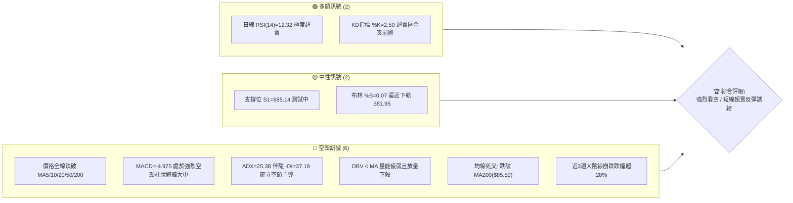
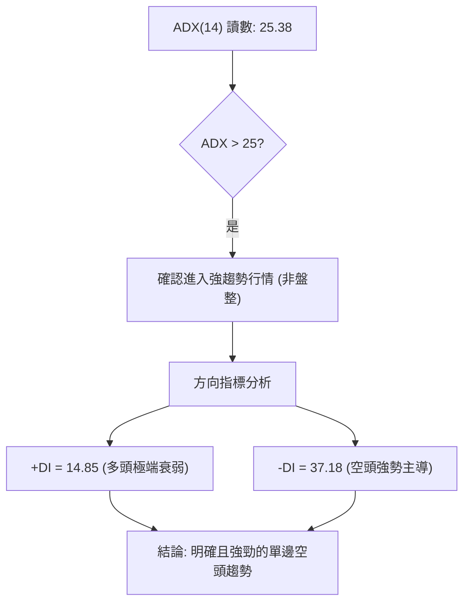
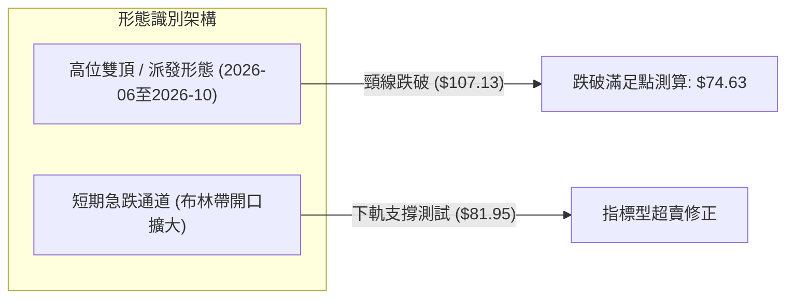
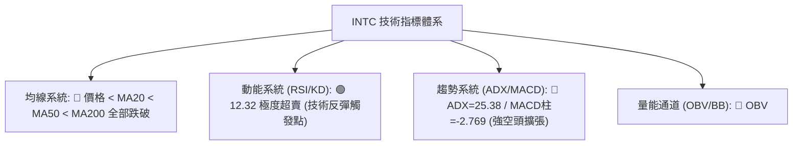
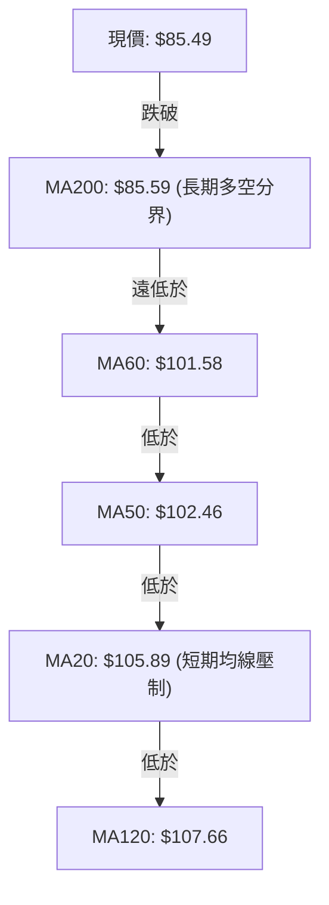
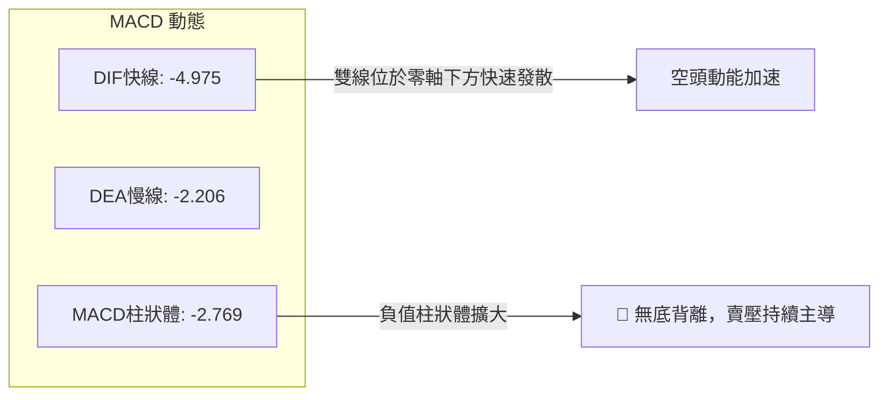
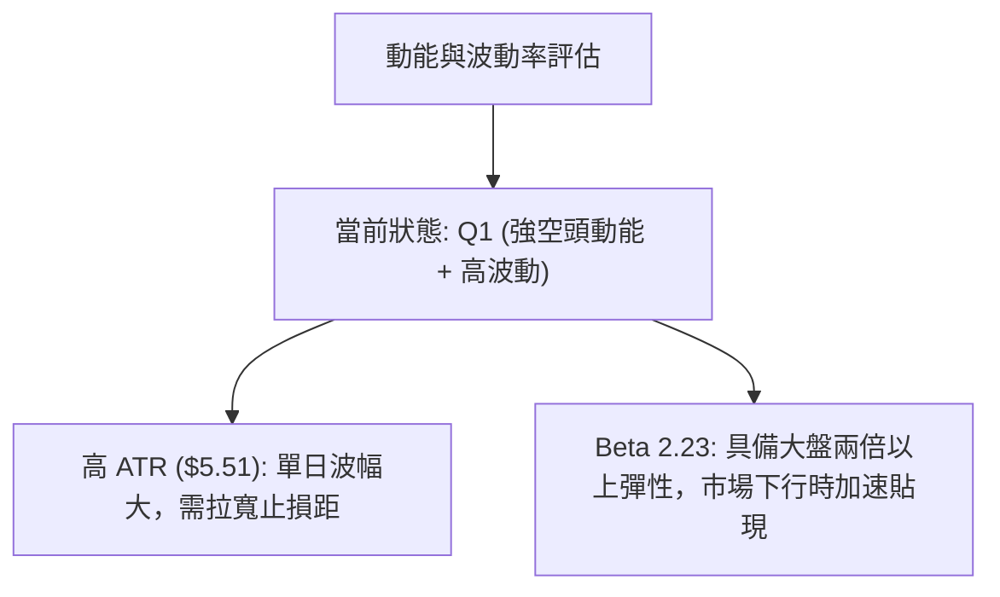
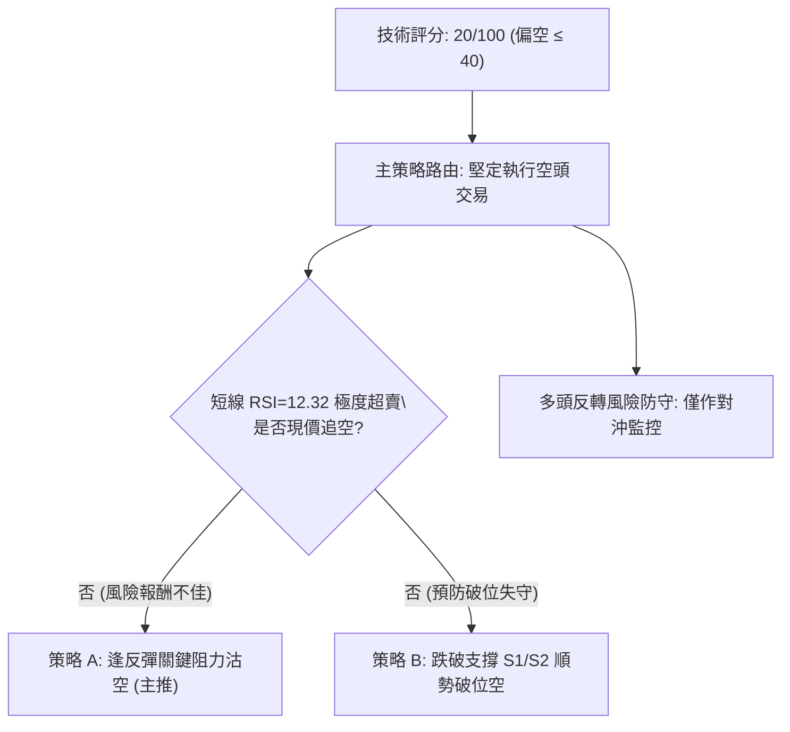
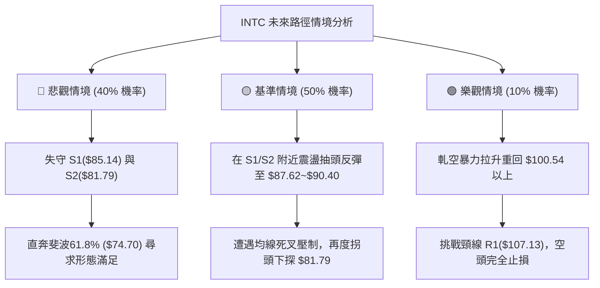

# INTC 技術分析報告

> **報告日期**：2026-10-23 ｜ **語言**：繁體中文 ｜ **數據來源**：Yahoo Finance ｜ **當前價格**：$85.49

---

## 目錄

| 章節 | 內容 |
|------|------|
| [1. 技術面概覽](#1-技術面概覽) | 訊號儀表板、核心指標、評分卡 |
| [2. 趨勢分析](#2-趨勢分析) | 多時框趨勢、長中短期走勢 |
| [3. 圖表形態分析](#3-圖表形態分析) | 形態識別、K線組合、目標價 |
| [4. 支撐與阻力](#4-支撐與阻力) | 關鍵價位、斐波那契回調 |
| [5. 技術指標深度解讀](#5-技術指標深度解讀) | MA/RSI/MACD/布林/成交量 |
| [6. 動能與波動率](#6-動能與波動率) | 動能評估、ATR、Beta |
| [7. 多時框架總結](#7-多時框架總結) | 時框架評分矩陣 |
| [8. 交易策略建議](#8-交易策略建議) | 多空策略、風險報酬比 |
| [9. 風險提示與監控](#9-風險提示與監控) | 監控指標、風險場景 |

---

## 1. 技術面概覽

### 🎯 技術訊號儀表板



### 📊 核心指標速覽表

| 指標類別 | 指標名稱 | 當前數值 | 訊號 | 解讀 |
|----------|----------|----------|------|------|
| **價格** | 當前價格 | $85.49 | 🔴 | 跌破年線MA200($85.59)，空頭完全掌控市場 |
| **均線** | MA20 | $105.89 | 🔴 | 現價低於MA20達-19.26%，乖離率極大但短期均線加速下彎 |
| **均線** | MA50 | $102.46 | 🔴 | 現價低於MA50，中期上升結構遭到暴力破壞 |
| **均線** | MA200 | $85.59 | 🔴 | 今日正式跌破長期生命線MA200，形成多轉空重大節點 |
| **動能** | RSI(14) | 12.32 | 🟢 | 極度超賣區間(<20)，存在強烈均值回歸修復需求 |
| **動能** | MACD | -4.975 (Hist: -2.769) | 🔴 | MACD線深度跌破信號線(-2.206)，空頭柱狀持續擴散無背離 |
| **波動** | ATR(14) | $5.51 (6.45%) | 🔴 | 每日波動高達6.45%，呈現崩跌過程中的高波動性 |

### 🏆 技術評分卡

```
╔══════════════════════════════════════════════════════════════╗
║              技術評分卡 — INTC (2026-10-23)                  ║
╠══════════════════════════════════════════════════════════════╣
║ 趨勢強度 (Trend)     ██████████████░░░░░░  70/100 🔴 空頭強勢║
║ 動能指標 (Momentum)  ███░░░░░░░░░░░░░░░░░  15/100 🔴 嚴重下墜║
║ 支撐穩定度 (Support) ████░░░░░░░░░░░░░░░░  20/100 🔴 瀕臨擊穿║
║ 成交量配合 (Volume)  ██████░░░░░░░░░░░░░░  30/100 🔴 放量下行║
║ 形態完整度 (Pattern) ██████████░░░░░░░░░░  50/100 🟡 破位下殺║
║ 均線排列 (MovingAvg) ██░░░░░░░░░░░░░░░░░░  10/100 🔴 全面空頭║
╠══════════════════════════════════════════════════════════════╣
║ 綜合技術評分         ████░░░░░░░░░░░░░░░░  20/100 🔴 強烈看空║
╚══════════════════════════════════════════════════════════════╝
```

---

## 2. 趨勢分析

### 🌐 多時框趨勢分析

```mermaid
graph TD
    A["月線層級 (長期: 24個月)"] -->|"2026-06 觸頂 $139.63 後雙頭回落，跌破50%回調位"| B["🔴 長期趨勢: 轉入下行修復"]
    B --> C["週線層級 (中期: 20週)"]
    C -->|"從 2026-09-27 $123.00 連續4週重挫至 $85.49"| D["🔴 中期趨勢: 主跌浪加速段"]
    D --> E["日線層級 (短期: 近日)"]
    E -->|"ADX=25.38, -DI=37.18, 跌破MA200("$85.59")"| F["🔴 短期趨勢: 極端空頭但超賣"]
```

### 📈 長期趨勢 — 12個月走勢圖（Unicode）

```
INTC 月線走勢圖（2025-11 至 2026-10）
價格軸 ($)
$140 ┤                                  ● 2026-06 ($139.63)
$130 ┤                                 ╱ ╲
$120 ┤                                ╱   ╲               ● 2026-09 ($120.23)
$110 ┤                           ●───╱     ╲             ╱ ╲
$100 ┤                          ╱ 2026-05   ╲           ╱   ╲
 $90 ┤                         ● 2026-04     ●─────────●     ●← 當前現價 ($85.49)
 $80 ┤                        ╱               2026-07   2026-08
 $70 ┤                       ╱
 $60 ┤                      ╱
 $50 ┤        ●─────●──────●
 $40 ┤  ●────● 2026-01~03 ($44~$46)
 $30 ┤ 2025-11 ($40.56)
     └─────────────────────────────────────────────────────────────
       M1   M2   M3   M4   M5   M6   M7   M8   M9  M10  M11  M12
       11月 12月 01月 02月 03月 04月 05月 06月 07月 08月 09月 10月
```

**走勢特徵分析表格**：

| 階段 | 涵蓋月份 | 起始價 → 結束價 | 區間漲跌幅 | 走勢核心特徵 |
|------|----------|-----------------|------------|--------------|
| **底部築底期** | 2025-11 ~ 2026-03 | $40.56 → $44.13 | +8.80% | 狹幅橫盤震盪，均線聚攏蓄勢 |
| **主升浪噴發期** | 2026-03 ~ 2026-06 | $44.13 → $139.63 | +216.40% | 暴力垂直拉升，突破所有歷史阻力 |
| **高位派發與震盪** | 2026-06 ~ 2026-09 | $139.63 → $120.23 | -13.89% | 劇烈震盪，築造次高點 $120.23 形成高位雙頂結構 |
| **破位主跌期** | 2026-09 ~ 2026-10 | $120.23 → $85.49 | -28.89% | 單邊瀑布式崩跌，連續破壞 MA20/50/200 |

### 📊 中期趨勢（週線分析）

中期走勢圖示：近期週線呈現連續4週的大陰線下殺，從 2026-10-04 的 $119.33 直墜至 $85.49，跌破了斐波那契 50.0% 回調位 ($87.62)。

```
週線支撐阻力結構示意：
[阻力 R2] $127.04 ══════════════════════════════════ (歷史籌碼成交密集峰)
[阻力 R1] $107.13 ────────────────────────────────── (前波頸線 / MA20重合位 $105.89)
[現價位置]  $85.49  ◄◄◄ (正測試年線與S1)
[關鍵支撐]  $85.14 ┄┄┄┄┄┄┄┄┄┄┄┄┄┄┄┄┄┄┄┄┄┄┄┄┄┄┄┄┄┄ (S1 波段低點支撐)
[次級支撐]  $81.79 ══════════════════════════════════ (S2 / 布林下軌 $81.95 匯聚帶)
```

### ⚡ 趨勢強度評估（ADX 解讀）



| 指標名稱 | 當前數值 | 臨界門檻 | 趨勢解讀 |
|----------|----------|----------|----------|
| **ADX(14)** | 25.38 | > 25.00 | 行情脫離無方向震盪，正式確立為具備動能的單邊強趨勢 |
| **+DI** | 14.85 | < 20.00 | 多頭進攻動能潰退，買盤缺乏承接主動性 |
| **-DI** | 37.18 | > 30.00 | 空方壓制力極強，當前仍由賣方單向掌控盤面節奏 |

---

## 3. 圖表形態分析

### 🔍 形態識別系統



**形態信心度表格**：

| 形態 | 信心度 | 判斷依據（引用數據） | 完成度 | 目標價（附計算式） |
|------|--------|----------------------|--------|--------------------|
| **不對稱高位雙頂** | 85% | 頂1為 2026-06 收盤 $139.63，頂2為 2026-09 收盤 $120.23；頸線落於阻力 R1 $107.13 聚類區，現價 $85.49 已徹底跌破 | 100% (已破位) | 由形態高度推算：頸線 $107.13 - (第二頂 $120.23 - 頸線 $107.13 = $13.10) = $94.03（已達成）；若按絕對頂部計算：$107.13 - ($139.63 - $107.13 = $32.50) = **$74.63** (接近斐波那契61.8%的 $74.70) |
| **指標型布林下軌超賣超跌** | 90% | BB %B 達 0.07，收盤價逼近下軌 $81.95，RSI=12.32，無幾何形態支撐，純粹極端指標破軌 | 95% | 由布林通道下軌與S2推算目標支撐：**$81.79 ~ $81.95** |

### 🕯️ 重要K線形態分析

| 月份 | 收盤價 | K線形態 | 解讀 | 訊號 |
|------|--------|---------|------|------|
| **2026-06** | $139.63 | 長上影大陽線 (頂部巨量) | 月成交量爆發，高點見 $142.35，多頭力竭形成長影線出貨 | 🔴 反轉預警 |
| **2026-07~08** | $90.20 / $89.51 | 雙針探底下影線 | 連續兩個月在 $89-$90 築底反彈，確立 S1 $85.14 上方支撐帶 | 🟢 短線止跌 |
| **2026-09** | $120.23 | 次高大陽吞噬 | 虛假反彈突破，未過 $142.35 高點，形成次級高點確認頂部結構 | 🟡 誘多反彈 |
| **2026-10** | $85.49 | 破位光腳大陰線 | 吞沒前月陽線，摜破所有中期均線，直接下探前期低點區間 | 🔴 強烈看空 |

### 📉 ASCII 走勢形態示意圖

```
        雙頂形態與破位示意圖
       頂1: $139.63 (2026-06)
         ▲
        ╱ ╲                     頂2: $120.23 (2026-09)
       ╱   ╲                             ▲
      ╱     ╲                           ╱ ╲
     ╱       ╲                         ╱   ╲
    ╱         ╲                       ╱     ╲
───┼───────────▼─────────────────────┼───────▼──────── 頸線位: R1 $107.13
  波段低點: $89.51 (2026-08)          │       │
                                      │       ▼ 破位下殺主跌段
                                      │       │
──────────────────────────────────────┼───────┼──────── 斐波那契 50%: $87.62
                                      │       ● 現價: $85.49 (測試S1 $85.14)
                                      │       │
──────────────────────────────────────┴───────▼──────── 形態量度目標/斐波那契61.8%: $74.70
```

### 🎯 形態目標價計算

1. **雙頂量度跌幅計算**：
   - 形態頸線確認價位：$107.13 (R1)
   - 頂部中樞高點：$139.63
   - 垂直形態高度 = $139.63 - $107.13 = $32.50
   - 理論極限下行滿足點 = 頸線 $107.13 - 形態高度 $32.50 = **$74.63**
   - 該計算值與系統斐波那契 61.8% 回調位 **$74.70** 高度吻合（差距僅 $0.07），確認為中線關鍵磁吸支撐區。

---

## 4. 支撐與阻力

### 🗺️ 關鍵價位分布圖（Unicode）

```
INTC 價位結構分布圖 (由 OHLCV 與歷史數據計算)
══════════════════════════════════════════════════════════════
$132.75 ║██████████████████████████████║ 強阻力 R3 (+55.28%)
$127.04 ║████████████████████          ║ 波段阻力 R2 (+48.60%)
$116.52 ║──────────────────────────────║ 斐波那契 23.6% 回調位
$107.13 ║████████████████████████      ║ 關鍵阻力 R1 / 頸線 (+25.31%)
$100.54 ║──────────────────────────────║ 斐波那契 38.2% 回調位
 $87.62 ║┄┄┄┄┄┄┄┄┄┄┄┄┄┄┄┄┄┄┄┄┄┄┄┄┄┄┄┄║ 斐波那契 50.0% 回調位
 $85.59 ║══════════════════════════════║ 200日均線 (MA200 生命線)
 $85.49 ╠══════════════════════════════╣ ◄ 現價位置 ($85.49)
 $85.14 ║▓▓▓▓▓▓▓▓▓▓▓▓▓▓▓▓▓▓▓▓▓▓        ║ 近期波段關鍵支撐 S1 (-0.41%)
 $81.79 ║████████████████████████████  ║ 強支撐 S2 / 布林下軌重合區 (-4.33%)
 $74.70 ║──────────────────────────────║ 斐波那契 61.8% 黃金分割支撐
 $42.58 ║██████████████████████████████║ 長期歷史防線 S3 (-50.19%)
══════════════════════════════════════════════════════════════
```

### 🚧 阻力位分析表

| 阻力級別 | 價位 | 形成原因 | 突破難度 | 重要性 |
|----------|------|----------|----------|--------|
| **R1** | $107.13 | 近一年波段高點聚類、跌破的前期頸線，且與 MA20 ($105.89) 高度重疊 | 極高 | ★★★★★ 關鍵多空分水嶺 |
| **R2** | $127.04 | 2026年9月反彈頂部區域下方次高籌碼解套峰 | 極高 | ★★★★☆ 中期多頭反撲極限 |
| **R3** | $132.75 | 52週高點 $142.35 下方的歷史密集成交密集套牢區 | 難以逾越 | ★★★☆☆ 長期強阻力區 |

### 🛡️ 支撐位分析表

| 支撐級別 | 價位 | 形成原因 | 守住機率 | 重要性 |
|----------|------|----------|----------|--------|
| **S1** | $85.14 | 近一年波段低點聚類，與當前價格相距僅 -0.41% | 40% (即將受測) | ★★★★☆ 短線多頭唯一屏障 |
| **S2** | $81.79 | 波段防線聚類，與當前日線布林下軌 $81.95 高度契合 | 65% (超賣緩衝) | ★★★★★ 空頭短線目標區 |
| **S3** | $42.58 | 2026年初啟動暴漲前的平台歷史中樞密集支撐點 | 90% (極端情況) | ★★★☆☆ 長週期結構底 |

### 📐 斐波那契回調位分析

依據 52 週完整區間（低點 $32.89 → 高點 $142.35，波動全幅 $109.46）計算：

| 比例回調 | 價位 | 當前相對位置與市場意義 |
|----------|------|------------------------|
| **0.0% (52W High)** | $142.35 | 週期頂部，已確認短期內無法重返 |
| **23.6%** | $116.52 | 前期高位整理區間，現已轉化為強大長期阻力 |
| **38.2%** | $100.54 | 心理整數關口，已被放量擊穿，宣告中線轉弱 |
| **50.0%** | $87.62 | **現價剛好失守此位 ($85.49 < $87.62)**，行情由平衡轉向弱勢 |
| **61.8%** | $74.70 | **黃金分割關鍵防線**，下方若失守 S2 則直指此目標位 |
| **78.6%** | $56.31 | 深度回調線，若基本面進一步惡化之極端回撤位 |
| **100.0% (52W Low)**| $32.89 | 週期循環起點 |

**解讀**：現價 $85.49 跌破了重要心理平衡位 50.0% ($87.62)，目前正處於 50.0% 與 61.8% ($74.70) 之間的中空地帶。若多頭無法在 S1 ($85.14) 發動有效反擊，回調位 61.8% ($74.70) 將是中期空頭的必然量度目標。

---

## 5. 技術指標深度解讀

### 🎛️ 指標訊號總覽



### 📈 移動平均線排列分析



**排列狀態詳解**：
- 儘管歷史長期均線仍呈現數值上的 MA20 > MA50 > MA200，但價格本體已經呈現**懸崖式下墜**，跌破所有均線。
- MA5 ($90.40) 及 MA10 ($95.44) 呈現極度陡峭的向下傾角，MA20 負乖離率達 -19.26%，表明短期賣壓極度集中。
- 年線 MA200 ($85.59) 剛好在今日被擊穿（現價 $85.49），若連續3日無法收復，將觸發中長線機構程式化止損賣盤。

### 📉 RSI(14) 分析

- **RSI 數值進度條**：
  `RSI(14): 12.32 █░░░░░░░░░░░░░░░░░░░ [12.32%] 🟢 極度超賣`
- **超買超賣狀態**：
  RSI 讀數 12.32 處於歷史極端超賣區間（通常低於 20 即進入隨時引發技術抽頭反彈的臨界點）。
- **背離分析判斷**：
  比對近期週線走勢：
  - 2026-10-11 收盤 $104.70，週線 RSI 為 29.0
  - 2026-10-18 收盤 $89.85，週線 RSI 為 16.4
  - 2026-10-25 收盤 $85.49，週線 RSI 為 12.3
  **明確結論**：日線與週線層面價格創新低，RSI 亦同步創出新低，**完全不存在日線或週線級別的底背離**。此超賣屬於「空頭強勢推動型超賣」，並非見底訊號，切忌盲目摸底。

### 📊 MACD(12/26/9) 訊號解讀



- DIF 與 DEA 在零軸下方深度向下發散，柱狀體讀數為 -2.769，顯示空方下殺動能仍在釋放，未見動能衰竭轉向的收斂特徵。

### 📦 布林通道分析

```
布林通道現狀示意圖 (帶寬: $81.95 ~ $129.83)
$129.83 ┬────────────────────────────────────────── 布林上軌
        │
$105.89 ┼────────────────────────────────────────── 布林中軌 (MA20)
        │
        │                                          
 $85.49 ┼──────────────────────────────● (現價, %B=0.07)
 $81.79 ┼┈┈┈┈┈┈┈┈┈┈┈┈┈┈┈┈┈┈┈┈┈┈┈┈┈┈┈┈┈┈┈┈┈┈┈┈┈┈┈┈┈┈ S2 支撐
 $81.95 ┴────────────────────────────────────────── 布林下軌
```

- 當前價格 %B 僅為 **0.07**，極度逼近下軌 $81.95。布林通道帶寬因急跌而快速張開，K 線沿著下軌運行，符合典型「貼軌下行」的強空頭走勢。

### 💹 成交量分析（量價配合度）

- **量價特徵**：最新單日成交量為 133,435,400 股，相較於 20 日均量 (99,299,120 股) 的量比達到 **1.34x**，呈現「放量跌破」的惡性走勢。
- **OBV 能量潮解讀**：OBV 趨勢明確處於 OBV < MA 狀態，確認主力資金處於淨流出派發狀態，量能無法支持價格構築有效支撐。

---

## 6. 動能與波動率

### ⚡ 動能評估四象限

| 象限 | 動能維度 | 波動維度 | 代表特徵 | 當前狀態評估 |
|------|----------|----------|----------|--------------|
| **Q1** | 強下行動能 | 高波動 | 恐慌拋售 / 主跌段 | **INTC 位於此象限 (ATR 6.45%, -DI 37.18)** 🔴 |
| **Q2** | 弱動能 | 低波動 | 底部橫盤 / 蓄勢築底 | 不符合 |
| **Q3** | 強上行動能 | 高波動 | 主升浪 / 軋空噴發 | 不符合 |
| **Q4** | 弱動能 | 高波動 | 劇烈洗盤 / 方向未明 | 不符合 |



### 📊 ATR 波動率分析

- **ATR(14) 數值**：**$5.51**，佔當前股價比例高達 **6.45%**。
- **交易風控意涵**：在每日正常波動即達 $5.51 的背景下，任何短線止損區間若小於 1.5 倍 ATR ($8.26)，極易被市場雜訊無效洗出場。多頭抄底面臨極高震盪被穿透風險。

### 📐 Beta 與市場相關性

- **Beta 係數**：**2.23**。
- **市場解讀**：INTC 展現出極高的系統性風險暴露，對半導體週期及整體科技板塊情緒高度敏感。在整體市場走弱時，其下跌動能將被放大 2.23 倍。

---

## 7. 多時框架總結

### 📋 時框架評分表

| 時框架 | 趨勢方向 | 動能狀態 | 均線排列 | 形態結構 | 綜合評分 | 建議 |
|--------|----------|----------|----------|----------|----------|------|
| **月線 (長期)** | 🔴 下行修復 | 弱化中 | 多轉空過渡 | 高位雙頂派發完成 | 30/100 | 減碼觀望 |
| **週線 (中期)** | 🔴 單邊下殺 | 極弱 (RSI 12.3) | 跌破所有中短期MA | 大陰破位下跌浪 | 15/100 | 順勢逢高沽空 |
| **日線 (短期)** | 🔴 極端超跌 | 超賣 (KD %K=2.5) | 空頭向下發散 | 貼下軌急墜 | 20/100 | 禁止追空，尋高點反彈沽空 |

### 🔲 綜合訊號矩陣

```
時框架訊號矩陣
時框       趨勢   均線   動能   量能   形態   指標收斂
長期(月)   🔴     🟡     🔴     🔴     🔴     偏空
中期(週)   🔴     🔴     🔴     🔴     🔴     強烈偏空
短期(日)   🔴     🔴     🟢     🔴     🔴     超賣修復但主趨勢極空
一致性檢驗：中長線全數偏空，短期僅有動能超賣產生技術反彈雜訊。
```

### ⚖️ 多時框收斂結論

依據多時框收斂規則：
1. **行情屬性確認**：當前 ADX(14) = **25.38 > 25.00**，且伴隨 -DI (37.18) 居高不下，技術面已明確鎖定為**「趨勢行情」**，絕非區間盤整。
2. **時框優先級**：趨勢行情必須以中長期（週線 / MA200）方向為主導，日線的 RSI 超賣與 KD 低位僅能作為尋找次級折返進場的時機，**絕對不可逆大勢抄底**。
3. **最終唯一方向性結論**：**強烈偏空（主策略堅決採逢反彈做空架構）**。

---

## 8. 交易策略建議

### 🗺️ 策略決策流程圖



### 🧭 策略路由（依評分卡分流）

- **當前主策略方向 = 逢高沽空／破位順勢空（依技術評分 20/100，全面空頭分流）**
- **策略邏輯**：當前綜合評分僅 20 分，趨勢完全被空方鎖死。雖然 RSI=12.32 預示隨時可能出現 1-2 天的超跌抽頭，但那是空頭絕佳的加碼點，而非多頭反轉買點。

### 🎯 價格情境階梯（Price Scenarios）

以當前價格 **$85.49** 為基準，向上與向下情境階梯如下（價位嚴格引用系統計算值）：

| 觸發條件 | 下一目標 | 後續延伸 | 情境含義 |
|----------|----------|----------|----------|
| **強勢反彈突破 R1 $107.13** | R2 $127.04 | R3 $132.75 | 雙頂形態被徹底證偽，中長線多頭復甦（極低機率） |
| **超跌技術抽頭至 MA200 / 斐波50%** | S1 $85.14 | S2 $81.79 | 正常技術性回抽年線確認阻力，空頭二次上車機會 |
| **收盤跌破 S1 $85.14** | S2 $81.79 | 斐波61.8% $74.70 | 空頭加速主跌浪推進，探測布林通道下軌 |
| **進一步擊穿 S2 $81.79** | 斐波61.8% $74.70 | S3 $42.58 | 形態完全滿足位測試，尋找中期歷史底部 |

### 📊 情境機率分佈

| 情境 | 機率 | 主要依據 |
|------|------|----------|
| **反彈修復後再下挫 (主情境)** | **60%** | RSI=12.32 及 KD %K=2.50 支持技術抽頭，但 ADX>25 且 MACD 深度負值將在均線處引來二次痛擊 |
| **直接破位加速探底** | **30%** | 成交量 1.34x 放量下殺，OBV 疲軟，年線 $85.59 今日失守直接引發止損潮 |
| **強勢反轉收復 R1** | **10%** | 均線全線下彎，上檔阻力重重，分析師近期頻繁下調評級，缺乏基本面配合 |

### 🟢 主策略詳情（空頭主推架構）

| 策略要素 | 策略 A（反彈沽空 — 最優推薦） | 策略 B（破位追空 — 順勢突破） |
|----------|--------------------------------|--------------------------------|
| **進場條件** | 股價受超賣帶動反彈，觸及年線或斐波50%承壓受阻回落 | 日線實體放量擊穿 S1，並跌破布林下軌及 S2 |
| **進場價格** | **$87.62** (斐波那契 50.0% 回調位) | **$81.50** (確認跌破 S2 $81.79 後順勢進場) |
| **目標價 T1** | **$81.79** (支撐位 S2) | **$74.70** (斐波那契 61.8% 回調位) |
| **目標價 T2** | **$74.70** (斐波那契 61.8% 兼雙頂滿足點) | **$42.58** (長期極限支撐 S3) |
| **止損價格** | **$90.40** (MA5 阻力位上方 / 距進場 +$2.78) | **$85.14** (轉跌為漲之原支撐 S1 上方) |
| **風險報酬比** | **1 : 4.64** (以 T2 計算：(87.62-74.70)/(90.40-87.62)) | **1 : 1.86** (以 T1 計算：(81.50-74.70)/(85.14-81.50)) |
| **成功機率** | **65%** | **55%** |
| **建議倉位** | **15% ~ 20%** | **10%** |

### 🔴 反向風險觸發點（對沖提示）

若出現以下極端訊號，必須立即無條件平倉所有空頭頭寸並進行風控對沖：
1. **價位突破**：日線強勢陽線實體收復 **$100.54** (斐波那契 38.2%)，甚至進一步突破 **$107.13** (R1 頸線)。
2. **指標反轉**：MACD 柱狀體在零軸下方出現連續 3 日縮短且 DIF 與 DEA 形成低位金叉；ADX 跌破 20 表明空頭趨勢衰竭進入震盪。

### ⭐ 整體訊號強度評星

```
╔══════════════════════════════════════════════════════════╗
║ 做多訊號強度：★☆☆☆☆  (1/5星 - 僅存超賣指標，無支撐確認)║
║ 做空訊號強度：★★★★☆  (4/5星 - 趨勢、均線、形態共振看空)║
║ 整體可信度：  ★★★★☆  (4/5星 - 成交量放大，破位信號明確)║
╚══════════════════════════════════════════════════════════╝
```

---

## 9. 風險提示與監控

### ✅ 關鍵監控指標 Checklist

```
╔══════════════════════════════════════════════════════════════╗
║               交易監控風控清單 (Checklist)                  ║
╠══════════════════════════════════════════════════════════════╣
║ [ ] 每日收盤價是否持續位於 MA200 ($85.59) 下方              ║
║ [ ] RSI(14) 是否脫離 20 以下極端區並向上突破 30 (反彈訊號)   ║
║ [ ] 支撐位 S1 ($85.14) 與 S2 ($81.79) 是否被放量擊穿         ║
║ [ ] 成交量是否異常萎縮（預示下殺動能暫竭）或持續 >1.3x 均量  ║
║ [ ] 斐波那契 50.0% ($87.62) 是否轉化為強大反壓              ║
║ [ ] 華爾街評級機構是否出現大面積進一步降級至 Underweight   ║
╚══════════════════════════════════════════════════════════════╝
```

### ⚠️ 風險場景分析



### 🛡️ 風險管理重要提醒

1. **嚴禁在急跌主跌浪中猜底**：RSI=12.32 固然極低，但在單邊趨勢行情（ADX=25.38 且 -DI=37.18）中，指標可能在超賣區「鈍化」長達數週，股價仍可持續下挫 15%~20%。
2. **ATR 波動管理與倉位控制**：鑑於單日 ATR 達 $5.51 (6.45%)，單筆交易虧損曝險嚴格限制於總資金的 1.5% 以內。以 $2.78 止損空間計算，最大持倉不得超過總投資組合的 20%。
3. **重大基本面利空疊加風險**：INTC 近期面臨財務虧損壓力（Net Profit Margin 為 -19.8%）與評級機構接連下調評級（如 Susquehanna、TD Cowen 維持 Neutral/Hold），技術破位易引發基本面與籌碼面的多殺多戴維斯雙殺。

---

## 📋 報告總結

```
╔════════════════════════════════════════════════════════════════╗
║                   INTC 技術分析報告總結                        ║
╠════════════════════════════════════════════════════════════════╣
║ 報告日期：2026-10-23                                           ║
║ 當前價格：$85.49                                               ║
║ 分析評級：🔴 強烈偏空 (反彈沽空為主)                           ║
║ 綜合評分：20 / 100                                             ║
╠════════════════════════════════════════════════════════════════╣
║ 關鍵結論：                                                     ║
║ ├─ 長期趨勢：🔴 雙頂結構完成派發，中長線步入回調週期           ║
║ ├─ 中期趨勢：🔴 週線四連陰跌破斐波那契50%($87.62)，確立主跌浪   ║
║ ├─ 短期趨勢：🔴 跌破MA200($85.59)，唯RSI=12.32蘊釀技術性抽頭   ║
║ ├─ 關鍵支撐：S1: $85.14  ｜  S2: $81.79  ｜  斐波61.8%: $74.70 ║
║ ├─ 關鍵阻力：MA200: $85.59 ｜ 斐波50%: $87.62 ｜ R1: $107.13   ║
║ └─ 形態滿足目標：$74.63 ~ $74.70                               ║
╠════════════════════════════════════════════════════════════════╣
║ 最優策略組合：                                                 ║
║ 1. 🥇 最佳機會：等待超跌反彈至 $87.62 承壓時建立空單，看至 $74.70║
║ 2. 🥈 次選機會：實體大陰線跌破 S2 ($81.79) 順勢破位加空         ║
║ 3. 🥉 保守選擇：完全空倉觀望，等待日線構築有效底部形態再行進場 ║
╚════════════════════════════════════════════════════════════════╝
```

---

> ⚠️ **免責聲明**：本報告為技術分析研究，所有數據、圖表及估算均嚴格基於所提供之歷史價格與指標資訊計算得出。本報告**僅供研究與學術參考**，**不構成任何要約、招攬或投資建議**。市場具有高度不確定性，交易決策應依個人風險承受能力審慎為之。

---

*報告生成時間：2026-10-23 ｜ 數據來源：Yahoo Finance ｜ 分析框架：多時框技術分析體系*