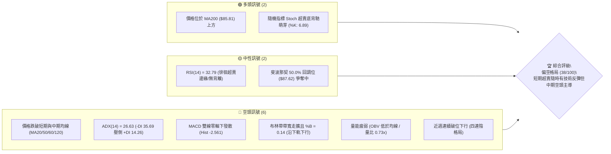
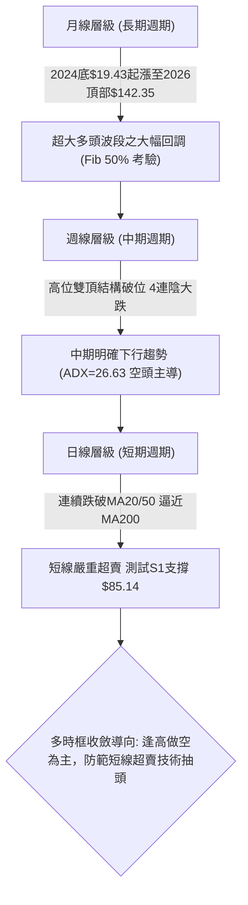
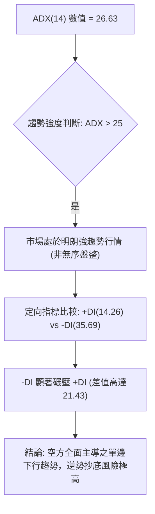
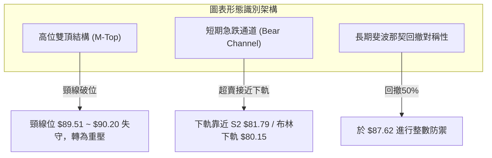
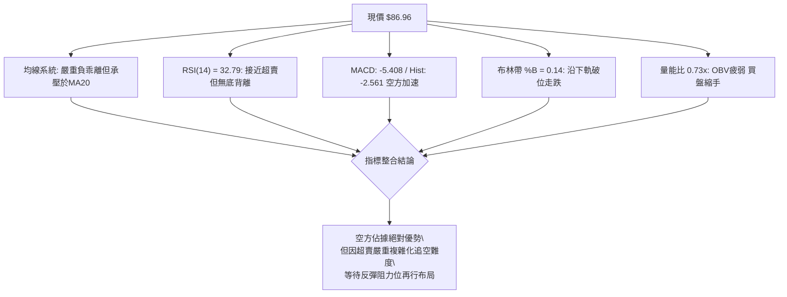
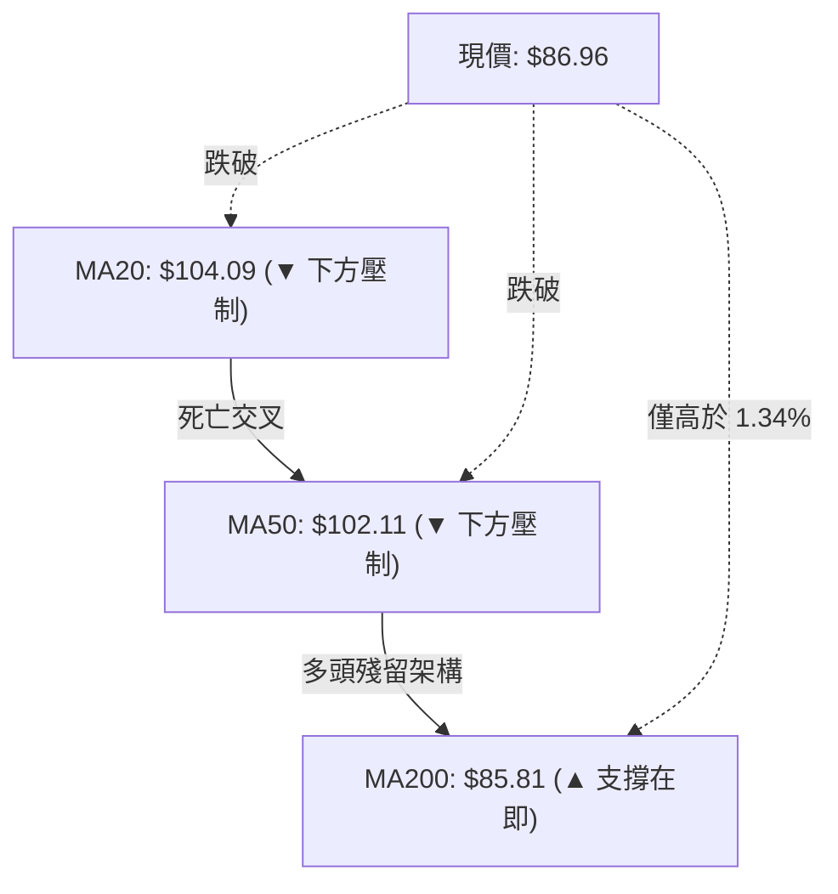
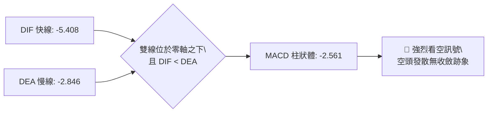
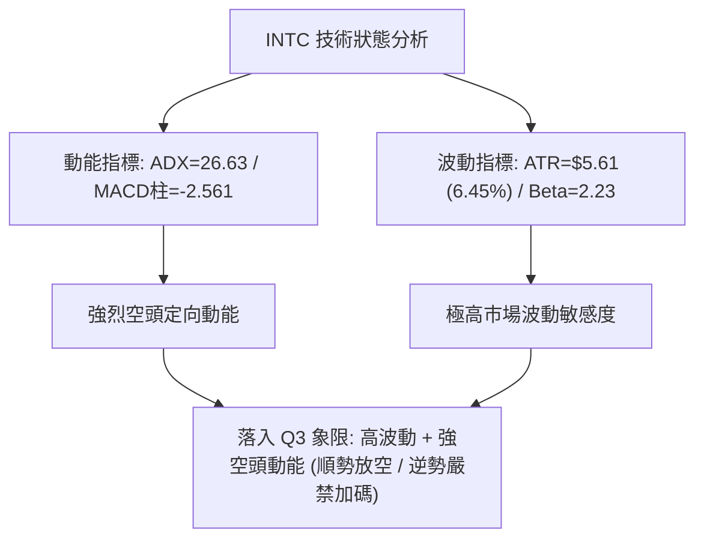
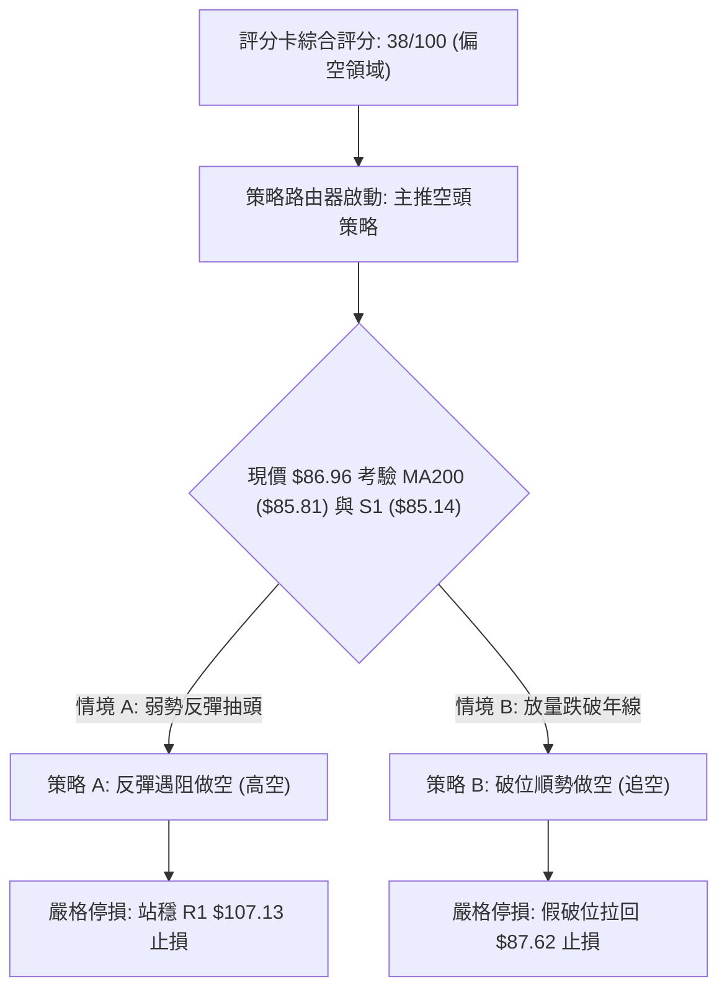
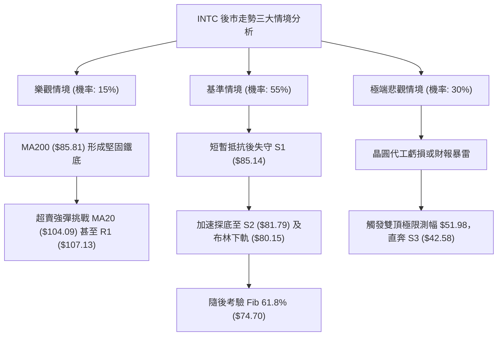

# INTC 技術分析報告

> **報告日期**：2026-10-24 ｜ **語言**：繁體中文 ｜ **數據來源**：Yahoo Finance ｜ **當前價格**：$86.96

---

## 目錄

| 章節 | 內容 |
|------|------|
| [1. 技術面概覽](#1-技術面概覽) | 訊號儀表板、核心指標、評分卡 |
| [2. 趨勢分析](#2-趨勢分析) | 多時框趨勢、長中短期走勢 |
| [3. 圖表形態分析](#3-圖表形態分析) | 形態識別、K線組合、目標價 |
| [4. 支撐與阻力](#4-支撐與阻力) | 關鍵價位、斐波那契回調 |
| [5. 技術指標深度解讀](#5-技術指標深度解讀) | MA/RSI/MACD/布林/成交量 |
| [6. 動能與波動率](#6-動能與波動率) | 動能評估、ATR、Beta |
| [7. 多時框架總結](#7-多時框架總結) | 時框架評分矩陣 |
| [8. 交易策略建議](#8-交易策略建議) | 多空策略、風險報酬比 |
| [9. 風險提示與監控](#9-風險提示與監控) | 監控指標、風險場景 |

---

## 1. 技術面概覽

### 🎯 技術訊號儀表板



### 📊 核心指標速覽表

| 指標類別 | 指標名稱 | 當前數值 | 訊號 | 解讀 |
|:---|:---|:---|:---:|:---|
| **價格** | 當前收盤價 | $86.96 | 🔴 | 位於52週區間49.4%處，短期空方慣性下殺 |
| **均線** | 短期 MA20 | $104.09 | 🔴 | 現價低於MA20達 -16.45%，呈現嚴重負乖離 |
| **均線** | 中期 MA50 | $102.11 | 🔴 | 現價跌破中期生命線，短中期均線形成死亡交叉壓力 |
| **均線** | 長期 MA200 | $85.81 | 🟢 | 現價高於MA200達 +1.34%，為長期多空最後防線 |
| **動能** | RSI(14) | 32.79 | 🟡 | 進入弱勢中性偏超賣區間，無明顯形態背離 |
| **動能** | MACD(12,26,9) | -5.408 | 🔴 | 訊號線為 -2.846，柱狀體為 -2.561，空頭動能增強 |
| **動能** | Stoch %K / %D | 6.89 / 6.88 | 🟢 | 進入極度超賣區（<10），暗示短線下行空間受限 |
| **趨勢** | ADX(14) | 26.63 | 🔴 | ADX>25 顯示趨勢確立，-DI(35.69) 遠高於 +DI(14.26) |
| **通道** | Bollinger %B | 0.14 | 🔴 | 緊貼布林下軌（$80.15）下行，處於空頭強勢通道 |
| **量能** | 20日成交量比 | 0.73x | 🔴 | 今日量 71.81M 低於均量 98.04M，OBV 低於均線量能萎縮 |
| **波動** | ATR(14) | $5.61 | 🔴 | 佔股價 6.45%，高日均波幅，風控止損空間需放大 |

### 🏆 技術評分卡

```
技術評分卡 — INTC (2026-10-24)
════════════════════════════════════════════════════
趨勢強度      ███████░░░░░░░░░░░░░  35/100  🔴 空頭主導強趨勢
動能指標      ██████░░░░░░░░░░░░░░  30/100  🔴 MACD負向走擴
支撐穩定度    ██████████░░░░░░░░░░  50/100  🟡 考驗S1與MA200
成交量配合    ███████░░░░░░░░░░░░░  35/100  🔴 下跌放量反彈量縮
形態完整度    █████████░░░░░░░░░░░  45/100  🟡 頂部M頭跌破頸線
均線排列      ███████░░░░░░░░░░░░░  33/100  🔴 短中期空頭排列
════════════════════════════════════════════════════
綜合評分      ████████░░░░░░░░░░░░  38/100  🔴 評級：偏空弱勢
（計算依據：(35 + 30 + 50 + 35 + 45 + 33) / 6 = 38.0）
════════════════════════════════════════════════════
```

---

## 2. 趨勢分析

### 🌐 多時框趨勢分析



### 📈 長期趨勢 — 12個月走勢圖（Unicode）

```
INTC 月線走勢圖（過去12個月：2025-11 至 2026-10）
價格軸 ($)
$140 ┤                                      ● (2026-06 $139.63 / 52W高 $142.35)
$130 ┤                                     ╱ ╲
$120 ┤                                    ╱   ╲       ● (2026-09 $120.23)
$110 ┤                             ●     ╱     ╲     ╱ ╲
$100 ┤                            ╱ ╲   ╱       ╲   ╱   ╲
 $90 ┤                     ●     ╱   ╲ ╱         ●─●     ●← 當前現價 ($86.96)
 $80 ┤                    ╱ ╲   ╱    (07-08月低點 $89.51)
 $70 ┤                   ╱   ╲ ╱
 $60 ┤                  ╱
 $50 ┤          ●─●    ╱
 $40 ┤ ●──●──● ╱   ╲  ╱
 $30 ┤        ●     ●
     └─────────────────────────────────────────────────────────────
       11 12 01 02 03 04 05 06 07 08 09 10 (月份)
      [   2025-2026 築底爆發期   ] [  高位巨震期  ] [ 破位回調期 ]
```

#### 走勢特徵分析表格

| 階段區間 | 時間跨度 | 起訖收盤價 | 漲跌幅 | 核心走勢特徵與結構意涵 |
|:---|:---|:---|:---:|:---|
| **底層蓄勢期** | 2025-11 ~ 2026-03 | $40.56 → $44.13 | +8.80% | 於 $36.90 ~ $46.47 區間完成大週期打底箱體震盪 |
| **主升浪噴發期** | 2026-03 ~ 2026-06 | $44.13 → $139.63 | +216.41% | 三個月內爆發性拉升，創下 52 週歷史高點 $142.35 |
| **首度劇烈回吐** | 2026-06 ~ 2026-08 | $139.63 → $89.51 | -35.89% | 獲利了結盤湧出，於 $89.51 獲得頸線初步支撐 |
| **次頂弱勢反彈** | 2026-08 ~ 2026-09 | $89.51 → $120.23 | +34.32% | 反彈未能突破前高，形成中期雙頂（M頭）右肩結構 |
| **主跌浪破位期** | 2026-09 ~ 2026-10 | $120.23 → $86.96 | -27.67% | 跌破中期平台，目前直接回測長期均線 MA200 ($85.81) |

### 📊 中期趨勢（週線分析）

```
INTC 週線中期阻力與支撐架構示意圖
═══════════════════════════════════════════════════════════════════
$132.75 ────────────────────────────────────────── [強波段壓力 R3]
$127.04 ───────────────● (09/25 高點 $127.44) ──── [中期雙頂頸線阻力 R2]
$107.13 ────────────────────────────────────────── [反彈強阻力 R1 / MA120]
$104.09 ────────────────────────────────────────── [週線中軌 / 日MA20]
$87.62  ─── 斐波那契 50.0% 回調位 ──────────────── [多空分水嶺]
$86.96  ◄════════════════════ 當前收盤價 ═════════════════════════
$85.81  ─── 長期生命線 MA200 ───────────────────── [核心動態防線]
$85.14  ────────────────────────────────────────── [近一年低點聚類支撐 S1]
$81.79  ────────────────────────────────────────── [強支撐區間 S2 / 布林下軌 $80.15]
═══════════════════════════════════════════════════════════════════
```

週線指標顯示，INTC 已自 2026-09-25 創下波段次高點 $127.44 後連續四週收黑（$123.00 → $119.33 → $104.70 → $89.85 → $86.96）。週線 RSI 自 66.9 急劇滑落至 32.8，週 MACD 柱狀體翻負擴大至 -2.561，顯示中期賣壓極為沉重，並未出現週線級別的企穩訊號。

### ⚡ 趨勢強度評估（ADX 解讀）



#### ADX 趨勢強度對照解讀

| 指標變數 | 當前讀數 | 門檻區間 | 技術含意 | 操作指引 |
|:---|:---:|:---:|:---|:---|
| **ADX 趨勢線** | 26.63 | 25 ~ 50 (強趨勢) | 趨勢動能充足，脫離無方向性震盪區間 | 順應主趨勢操作，忌用區間震盪高拋低吸思維 |
| **-DI 空方線** | 35.69 | > 30 (空頭強勢) | 賣方掌控定價權，空方壓制力道猛烈 | 嚴格禁止盲目猜底，反彈皆視為誘多或解套波 |
| **+DI 多方線** | 14.26 | < 20 (多頭衰退) | 多頭買盤力道極度匱乏，流動性承接力不足 | 多頭策略僅限於超賣技術性快進快出 |

---

## 3. 圖表形態分析

### 🔍 形態識別系統



#### 形態識別信心度評估表（依規則 15）

| 形態名稱 | 信心度 | 判斷依據（嚴格引用輸入數據） | 形態完成度 | 目標價（附嚴謹計算式） |
|:---|:---:|:---|:---:|:---|
| **高位雙頂 (M頭)** | 75% | 左頂 2026-06 收盤 $139.63（52W高 $142.35），右頂 2026-09-25 週高 $127.44（收盤 $123.00），跌破中間低點頸線（2026-07/08 收盤 $90.20 / $89.51） | 85% | 頸線 $89.51 − 形態高度 ($127.04 − $89.51 = $37.53) = **$51.98**（指向 S3 $42.58 與 78.6% Fib $56.31 之間） |
| **短期下行破位旗形** | 70% | 10/16 跌至 $89.85 後於 $91~$93 橫盤弱勢整理（10/19-10/21），隨後 10/22 大陰線開 $87.92 殺至 $85.49 破位 | 90% | 旗桿起跌點 $102.81 跌至 $89.85 (高差 $12.96)，自旗形破位點 $91.69 扣除高差 = **$78.73**（靠近 S2 $81.79 與 MA240 $77.83） |
| **雙重底 (W底反轉)** | 20% | 訊號不足，僅做指標型解讀。目前價格雖回測 2026-08 低點 $89.51 附近，但 10/22-10/23 低點已破位至 $84.65，無右底抬高或背離跡象 | 10% | 形態未確立，無有效目標價 |

### 🕯️ 重要 K 線形態分析

依規則 19，以下嚴格採用數據源中「近 10 根日 K」與「近 8 根週 K」之精確數值進行分析：

#### 近 10 根日 K 線形態解讀

| 日期 | 開盤價 | 最高價 | 最低價 | 收盤價 | 成交量 | K線形態名稱 | 專業技術解讀 | 訊號 |
|:---|:---:|:---:|:---:|:---:|:---:|:---|:---|:---:|
| **2026-10-12** | 102.52 | 103.19 | 100.71 | 101.35 | 74.17M | 小陰線 | 弱勢反彈受阻於整數關卡，實體下壓 | 🔴 |
| **2026-10-13** | 99.59 | 102.88 | 98.23 | 102.81 | 88.25M | 中陽線 | 低開高走嘗試回補，但成交量未能有效放大 | 🟡 |
| **2026-10-14** | 99.54 | 101.34 | 97.67 | 98.12 | 104.59M | 空頭吞噬 | 吞沒前一日大部分漲幅，量能放大至1億股以上 | 🔴 |
| **2026-10-15** | 93.61 | 96.87 | 90.02 | 95.37 | 147.16M | 跳空放量長陰帶下影 | 恐慌性拋售，單日成交 1.47 億股，殺穿 $93 支撐 | 🔴 |
| **2026-10-16** | 93.48 | 94.22 | 89.19 | 89.85 | 123.00M | 大陰線破位收最低 | 跌破 $90.00 整數關卡與頸線，確立週線破位 | 🔴 |
| **2026-10-19** | 94.53 | 95.39 | 91.88 | 92.03 | 101.61M | 弱勢小陽倒錘線 | 高開低走，盤中衝高至 $95.39 遭空頭無情壓回 | 🔴 |
| **2026-10-20** | 90.73 | 93.73 | 88.77 | 91.69 | 84.06M | 窄幅震盪小陽星 | 抵抗型橫盤，下影線回測 $88.77，缺乏上攻動能 | 🟡 |
| **2026-10-21** | 93.43 | 94.39 | 90.75 | 92.96 | 75.57M | 縮量小陽線 | 連續三日弱勢整理構築下降旗形，成交量持續萎縮 | 🟡 |
| **2026-10-22** | 87.92 | 89.19 | 84.65 | 85.49 | 134.13M | 放量跳空破位大陰線 | 跳空低開跌破整理平台，放量下探至 $84.65，創波段新低 | 🔴 |
| **2026-10-23** | 85.92 | 87.87 | 84.74 | 86.96 | 71.81M | 縮量低位小陽線 (十字星反彈) | 於 MA200 前收小陽，但量能僅 71.81M（量比 0.73x），純屬超賣修正 | 🟡 |

#### 近 8 根週 K 線形態解讀

| 週末日期 | 開盤價 | 最高價 | 最低價 | 收盤價 | 週成交量 | 週K形態特徵 | 中期格局判斷 | 訊號 |
|:---|:---:|:---:|:---:|:---:|:---:|:---|:---|:---:|
| **2026-09-04** | 90.00 | 95.94 | 85.72 | 95.80 | 378.29M | 啟動中陽線 | 自底部 $85.72 企穩回升，展開次頂反彈 | 🟢 |
| **2026-09-11** | 100.80 | 106.69 | 99.34 | 102.94 | 421.04M | 實體跳空大陽線 | 突破百元心理關卡，多頭動能激增 | 🟢 |
| **2026-09-18** | 95.82 | 111.37 | 94.52 | 108.60 | 626.11M | 放量長陽線 | 巨量推升突破 $110，週成交量達 6.26 億股 | 🟢 |
| **2026-09-25** | 116.53 | 127.44 | 114.93 | 123.00 | 602.66M | 衝高受阻流星線 | 上影線高達 $127.44（遇阻 R2 $127.04），顯現高位出貨 | 🔴 |
| **2026-10-02** | 120.68 | 126.00 | 113.97 | 119.33 | 495.06M | 高位轉折小陰線 | 無法重返高點，重心開始下移 | 🔴 |
| **2026-10-09** | 115.34 | 118.20 | 104.00 | 104.70 | 461.35M | 長實體大陰線 | 破位百元關卡，形成高位三隻黑烏鴉之首 | 🔴 |
| **2026-10-16** | 102.52 | 103.19 | 89.19 | 89.85 | 537.18M | 破位斷頭大陰線 | 殺破頸線 $90.20，最低見 $89.19，空方宣洩 | 🔴 |
| **2026-10-23** | 94.53 | 95.39 | 84.65 | 86.96 | 467.18M | 續跌帶下影小陰線 | 連續四陰，觸及波段低點 $84.65，逼近長期 MA200 | 🔴 |

### 📉 ASCII 走勢形態示意圖

```
INTC M-Top (高位雙頂) 與當前跌破頸線示意圖
價格
$142.35 ┼─────────● (頂部 1: 52W最高點)
        │        ╱ ╲
$127.04 ┼───────│───╲───────────● (頂部 2: 09/25 高點 $127.44 / 阻力 R2)
        │      ╱     ╲         ╱ ╲
$107.13 ┼─────│───────╲───────│───╲────── (阻力 R1 / 反彈頸線壓力)
        │    ╱         ╲     ╱     ╲
$89.51  ┼───│───────────●───│───────╲─── [雙頂頸線位: 07-08月低點] (已跌破!)
        │  ╱            (頸線支撐)      ╲
$86.96  ┼─│──────────────────────────────● ◄ 當前收盤價 (空頭中繼測試)
$85.14  ┼─│───────────────────────────── [支撐 S1 / MA200 $85.81]
        │╱                                ╲
$81.79  ┼───────────────────────────────────● 形態量測目標過渡位 (支撐 S2)
$51.98  ┼───────────────────────────────────● 雙頂理論極限目標位
        └───────────────────────────────────────────────────────────► 時間
```

### 🎯 形態目標價計算

1. **高位雙頂 (M頭) 理論量測計算式**：
   - **左頂高點**：$139.63（收盤）/ $142.35（盤中）
   - **右頂高點**：$127.04（數據指定波段阻力 R2 / 09-25盤中高點 $127.44）
   - **頸線參考點**：2026-08 月收盤低點 $89.51（與 2026-07 低點 $90.20）
   - **形態垂直高度**：$127.04 − $89.51 = $37.53
   - **破位理論目標價**：$89.51 − $37.53 = **$51.98**
   - **與關鍵價位對照**：該理論目標價精準落在斐波那契 78.6% 回調位（$56.31）與近一年深層支撐 S3（$42.58）之間，為中期超級空頭情境下的極限支撐。

2. **短期下降旗形破位計算式**：
   - **旗桿起跌點**：2026-10-13 反彈高點 $102.81
   - **旗桿底部**：2026-10-16 收盤價 $89.85，旗桿長度 = $102.81 − $89.85 = $12.96
   - **旗形整理平台突破點**：2026-10-21 收盤價 $92.96（10/22 跳空開於 $87.92 破位）
   - **短線測幅目標**：$91.69（區間中軸）− $12.96 = **$78.73**
   - **與關鍵價位對照**：直接指向強支撐 S2（$81.79）與 MA240（$77.83），亦非常靠近布林下軌（$80.15）。

---

## 4. 支撐與阻力

### 🗺️ 關鍵價位分布圖（Unicode）

```
INTC 價位結構分布圖（嚴格依據 OHLCV 計算）
═══════════════════════════════════════════════════════════════════
$142.35 ║████████████████████████████████║ 52週歷史最高點 (Fib 0.0%)
$132.75 ║████████████████████████████    ║ 強阻力 R3 (波段高點聚類)
$127.04 ║████████████████████████        ║ 關鍵阻力 R2 (中期雙頂右肩)
$116.52 ║██████████████████              ║ 斐波那契 23.6% 回調阻力
$107.13 ║████████████████████████████    ║ 關鍵阻力 R1 (反彈強壓 / MA120 $107.59)
$104.09 ║██████████████                  ║ 布林中軌 / MA20 短期生命線
$100.54 ║████████████                    ║ 斐波那契 38.2% 回調位 / 百元心理大關
$87.62  ║████████                        ║ 斐波那契 50.0% 回調位 (現價緊鄰區間)
$86.96  ╠════════════════════════════════╣ ◄ 當前收盤價 (2026-10-23)
$85.81  ║▓▓▓▓▓▓▓▓▓▓▓▓▓▓▓▓▓▓▓▓▓▓▓▓▓▓▓▓    ║ 長期生命線 MA200 (多空最後防線)
$85.14  ║▓▓▓▓▓▓▓▓▓▓▓▓▓▓▓▓▓▓▓▓▓▓▓▓        ║ 近期核心支撐 S1 (近一年波段低點聚類)
$81.79  ║████████████████████████████    ║ 強支撐 S2 (波段低點聚類 / 靠近布林下軌 $80.15)
$74.70  ║████████████████                ║ 斐波那契 61.8% 黃金分割強支撐
$56.31  ║████████                        ║ 斐波那契 78.6% 回調位
$42.58  ║████████████████████████████    ║ 終極強支撐 S3 (大週期起漲平台)
$32.89  ║████████████████████████████████║ 52週歷史最低點 (Fib 100.0%)
═══════════════════════════════════════════════════════════════════
```

### 🚧 阻力位分析表

價位嚴格引用輸入數據「關鍵價位」區塊，不作任何臆測編造：

| 阻力級別 | 準確價位 | 距現價空間 | 形成技術原因與歷史背景 | 突破難度評級 | 戰略重要性 |
|:---|:---:|:---:|:---|:---:|:---|
| **第一阻力 (R1)** | **$107.13** | +23.19% | 近一年波段高點聚類密集區；高度重合 MA120 ($107.59) 與 MA20 ($104.09) 反壓區 | 🔴 極高 | **短中期強弱分水嶺**：未收復 R1 前，所有反彈皆屬空頭市場中的技術性抽頭。 |
| **第二阻力 (R2)** | **$127.04** | +46.09% | 2026-09-25 週線波段高點 $127.44 聚類區，高位雙頂之右肩反轉高點 | 🔴 極高 | **波段反轉確認位**：唯有突破 R2，方能宣告雙頂結構失效並開啟多頭新格局。 |
| **第三阻力 (R3)** | **$132.75** | +52.66% | 2026年6月中旬主升浪高位換手平台密集區（06-18收盤 $133.99）；歷史籌碼套牢天塹 | 🔴 罕見難度 | **歷史天花板防線**：聚集超過數十億股套牢籌碼，具備強力壓制效果。 |

### 🛡️ 支撐位分析表

價位嚴格引用輸入數據「關鍵價位」區塊：

| 支撐級別 | 準確價位 | 距現價空間 | 形成技術原因與歷史背景 | 守住機率評估 | 戰略重要性 |
|:---|:---:|:---:|:---|:---:|:---|
| **第一支撐 (S1)** | **$85.14** | -2.09% | 近一年波段低點聚類密集區；與長期均線 MA200 ($85.81) 形成共振支撐帶 | 🟡 50% (中等) | **多頭最後動態防線**：若日線實體跌破 $85.14，將引發技術性停損賣壓與融資斷頭潮。 |
| **第二支撐 (S2)** | **$81.79** | -5.95% | 近一年重要平台防禦區，緊鄰布林帶下軌 ($80.15) 與 MA240 ($77.83) 上方 | 🟢 70% (較高) | **下行減速緩衝帶**：布林通道極限帶寬與超賣共振點，極易誘發空頭回補。 |
| **第三支撐 (S3)** | **$42.58** | -51.03% | 2025年底至2026年初大週期牛市起漲大底（2025-11至2026-03平台籌碼峰） | 🟢 95% (極高) | **終極牛熊清算點**：若觸及此位，代表過去一年的半導體晶圓廠擴張溢價全數抹滅。 |

### 📐 斐波那契回調位分析

依據 52 週波動極值（低點 $32.89 → 高點 $142.35，絕對落差 $109.46）所計算之黃金分割階梯：

```
斐波那契回調位分布階梯
  0.0% (52W High) ─── $142.35
 23.6% ────────────── $116.52
 38.2% ────────────── $100.54
 50.0% ────────────── $ 87.62  ◄─── 現價 ($86.96) 緊貼此線下方，展開激烈角力！
 61.8% ────────────── $ 74.70  (黃金分割關鍵支撐)
 78.6% ────────────── $ 56.31
100.0% (52W Low)  ─── $ 32.89
```

- **當前位置深度解讀**：
  現價 $86.96 恰好座落在 **50.0% 回調位 ($87.62)** 與 **61.8% 回調位 ($74.70)** 之間。在技術分析經典理論中，50.0% 回調位為多空強弱的中軸心理線。
- 現價自高點回落已抹去整整一半的牛市漲幅，若在 $87.62 ~ S1 $85.14 處無法形成連續三日以上的實體企穩收紅，依據斐波那契走勢對稱性，價格將慣性下探至下一道黃金分割強支撐 **61.8% ($74.70)**，該處亦與 MA240 ($77.83) 相呼應。

---

## 5. 技術指標深度解讀

### 🎛️ 指標訊號總覽



### 📈 移動平均線排列分析



#### 完整均線系統參數速查與解讀

| 均線名稱 | 數值 | 距現價差距 (%) | 走勢方向 | 技術狀態與排列意涵 |
|:---|:---:|:---:|:---:|:---|
| **MA5** | $89.83 | -3.19% | ▼ 下行 | 超短期壓制線，五日內反彈未收復 MA5 代表短線極弱 |
| **MA10** | $93.66 | -7.16% | ▼ 下行 | 兩週成本線，10/19-10/21 反彈均受阻於此線下方 |
| **MA20 (BB中軌)** | $104.09 | -16.45% | ▼ 下行 | 月線生命線，下行斜率陡峭，為中期最強反壓帶 |
| **MA50** | $102.11 | -14.33% | ▼ 下行 | 中期分水嶺，MA20 跌破 MA50 形成波段死亡交叉 |
| **MA60** | $101.51 | -14.33% | ▼ 下行 | 季線阻力，與 MA20/MA50 在 $101-$104 構築空頭密集套牢帶 |
| **MA120** | $107.59 | -19.17% | ▼ 下行 | 半年線，與阻力位 R1 ($107.13) 精準重疊 |
| **MA200** | $85.81 | +1.34% | ▲ 上行 | 年線（牛熊分界線），目前唯一維持向上斜率的關鍵均線 |
| **MA240** | $77.83 | +11.74% | ▲ 上行 | 兩年週期基底均線，為深層回調提供底層保護 |

- **均線排列結論**：
  儘管大週期層面仍呈現形式上的「MA20 ($104.09) > MA50 ($102.11) > MA200 ($85.81)」長期多頭殘留排列，但由於當前價格（$86.96）早已大幅崩跌至短中長期均線（MA5/10/20/50/60/120）下方，短中週期均線已全數翻空向下，現正對年線 **MA200 ($85.81)** 進行正面肉搏。一旦 MA200 實體跌破，整體均線將在一個月內全面惡化為標準「空頭發散排列」。

### 📉 RSI(14) 分析

- **RSI 數值進度條**：
  `RSI(14): 32.79`  ███████░░░░░░░░░░░░░ 32.79% 🟡 （弱勢中性 / 逼近超賣門檻 30）

- **超買超賣與背離判斷**：
  1. **當前區間狀態**：Wilder RSI 讀數為 32.79，距離 30 臨界超賣線僅一步之遙，且 10/16 曾觸及 31.4。技術上雖屬超賣區域，但尚未跌破 20 極端超賣區。
  2. **背離分析結論**：嚴格檢視數據源中標註的「RSI 背離：無明顯背離（僅比較近20根K棒首尾的價格與RSI方向）」。價格從 2026-09-25 的高位一路下挫，RSI 由 66.9 同步斷崖式跌至 32.79，**未形成底背離**。這意味著當前價格下跌是由實質賣盤推動，而非動能竭盡的虛跌，切忌因指標接近 30 而貿然左側抄底。

### 📊 MACD(12,26,9) 訊號解讀



- **MACD 指標深度解讀**：
  快線 DIF（-5.408）遠低於慢線 DEA（-2.846），柱狀體 Histogram 達到 **-2.561** 的深度負值區。
  更為關鍵的是，MACD 雙線均已深入零軸下方，且兩者差距仍持續擴大（Hist 負值較上週並未出現向上勾頭跡象）。這證明中期賣壓處於主跌浪加速度階段，任何短線的盤中反抽在 MACD 柱狀圖收縮轉正前，均僅屬反彈而非反轉。

### 📦 布林通道分析

```
INTC 布林通道日線結構示意圖 (Bollinger Bands 20, 2)
═══════════════════════════════════════════════════════════════════
$128.03 ─────────────────────────────── [BB 上軌] (上行極限)
        │
        │
$104.09 ─────────────────────────────── [BB 中軌 / MA20] (強弱分界阻力)
        │
        │
$86.96  ◄══════════════════════════════ [現價: 位於通道極低位 %B = 0.14]
$80.15  ─────────────────────────────── [BB 下軌] (下行動態支撐)
═══════════════════════════════════════════════════════════════════
```

- **布林帶寬與 %B 深度解讀**：
  當前布林上軌為 $128.03，中軌為 $104.09，下軌為 $80.15。
  **%B 指標值僅為 0.14**（接近 0 軌）。當前價格沿著布林下軌呈「開口擴大、沿軌下行」的空頭擠壓走勢。在典型的趨勢性空頭行情中，%B 可以長時間在 0.05 ~ 0.20 間鈍化。下軌 $80.15 與強支撐 S2（$81.79）高度重疊，為下方第一空頭目標區。

### 💹 成交量分析（量價配合度）

1. **量價特徵檢視**：
   - 最新交易日（2026-10-23）成交量為 **71,813,700 股**。
   - 20 日平均成交量為 **98,038,020 股**，量比僅 **0.73x**。
   - 50 日平均成交量為 **100,473,228 股**。
2. **量能趨勢判定**：
   - 在 10/15 與 10/22 的主要殺跌日，成交量分別放大至 **1.47 億股** 與 **1.34 億股**（顯著高於均量 40% 以上），呈現典型「下跌放量」。
   - 反觀 10/23 股價微幅反彈收小陽線，成交量卻急縮至 71.81M（量縮近 50%）。
3. **OBV 能量潮判讀**：
   - 數據明確顯示「**OBV趨勢：OBV < MA → 量能疲弱**」。
   - OBV 持續運行於其移動平均線下方，顯示籌碼處於持續流出淨派發狀態，機構大戶並未在當前價位展開規模性吸籌，量價關係對多頭極為不利。

---

## 6. 動能與波動率

### ⚡ 動能評估四象限

| 象限 | 動能維度 | 波動維度 | 代表特性 | INTC 當前狀態標定 | 策略解讀 |
|:---:|:---:|:---:|:---|:---:|:---|
| **Q1** | 強動能 (多方) | 低波動 | 穩步盤堅、主升緩推 | — | 多頭趨勢守倉 |
| **Q2** | 弱動能 (無序) | 低波動 | 區間沉寂、籌碼沉澱 | — | 突破前夕觀望 |
| **Q3** | 強動能 (空方) | 高波動 | 恐慌宣洩、破位主跌 | **✓ (當前所處狀態)** | **順勢高空或嚴格風控觀望** |
| **Q4** | 弱動能 (衰竭) | 高波動 | 無方向震盪、多空雙巴 | — | 降低槓桿與倉位 |



### 📊 ATR 波動率分析

- **ATR(14) 讀數**：**$5.61**（Wilder 計算，佔股價比例高達 **6.45%**）。
- **ATR 意涵解讀**：
  INTC 每日正常波動幅度即達 $5.61 美元，代表單日震幅超過 6% 已成常態。這要求交易者在設置技術性止損時，必須預留至少 1.0 ~ 1.5 倍 ATR 的空間，否則極易在日內雜訊中被無謂掃損出場。
- **動態止損設置指導**：
  - **1.0 倍 ATR 止損距離**：$5.61
  - **1.5 倍 ATR 止損距離**：$8.42
  - **空頭追空/防守距離**：若於當前價位操作，空單防守點至少需上移 $5.61 至 $92.57 上方（恰好落於 10/21 反彈小平台 $92.96 附近）。

### 📐 Beta 與市場相關性

- **Beta 係數**：**2.23**。
- **市場敏感性評估**：
  INTC 屬於典型的高 Beta、高波動半導體權值股，其對大盤（S&P 500 / 費城半導體指數）的波動敏感度是大盤的 2.23 倍。若大盤指數回調 1%，INTC 技術上傾向下跌 2.23% 以上；在大盤缺乏強勁多頭推力時，高 Beta 屬性會顯著放大其下行加速度。
- **放空比率 (Short % Float)**：3.2%，空頭回補天數 (Short Ratio) 為 1.58 天，顯示目前市場尚未出現極端逼空條件，空單部位尚無因擠壓而引發無預警暴漲的系統性風險。

---

## 7. 多時框架總結

### 📋 時框架評分表

| 時框架 | 趨勢方向 | 動能狀態 | 均線排列狀況 | 形態特徵 | 綜合評分 | 操作指引 |
|:---|:---:|:---:|:---|:---|:---:|:---|
| **長期 (月線)** | 🟡 震盪回調 | 走弱中 | MA200 向上、位於 Fib 50% 臨界點 | 兩年大週期牛市之深度對稱回撤 | 48/100 | 關注 $85 附近能否形成長期底部 |
| **中期 (週線)** | 🔴 明確下行 | 柱狀體翻負擴大 | 跌破 20 週均線，下壓斜率陡峭 | M頭雙頂破位，連續4週長陰摜破 | 32/100 | 中期波段反彈皆為逢高佈空良機 |
| **短期 (日線)** | 🔴 空頭排列 | RSI超賣/MACD發散 | 價格全數受制於 MA5/10/20 下方 | 下降旗形破位後測試 MA200 支撐 | 35/100 | 超賣可能引發短線抽頭，忌追低 |

### 🔲 綜合訊號矩陣

| 技術分析維度 | 短期視角 (日線: 1-5日) | 中期視角 (週線: 2-8週) | 長期視角 (月線: 3-12月) | 維度訊號一致性評估 |
|:---|:---:|:---:|:---:|:---|
| **主趨勢方向** | 🔴 空頭壓制 | 🔴 空頭主導 | 🟡 牛市深度回調 | 中短期高度共振看空，長期牛市基底瀕臨考驗 |
| **動能強度** | 🟡 超賣鈍化 (RSI 32.8) | 🔴 加速放量 (MACD -2.56) | 🔴 動能見頂回落 | 賣方掌控中期定價權，短線超賣僅能引發雜訊抵抗 |
| **關鍵均線** | 🔴 跌破 MA20 ($104.09) | 🔴 跌破 MA50 ($102.11) | 🟢 守在 MA200 ($85.81) | 價格即將在 MA200 迎來最終大決戰 |
| **形態結構** | 🔴 旗形破位向下 | 🔴 M頭頸線失守 | 🟡 回測 50% 黃金分割 | 中短期空頭形態完整，目標指向下方支撐層 |

### ⚖️ 多時框收斂結論

依據【嚴格要求 14】之多時框收斂法則進行判定：
1. **行情性質判斷**：ADX(14) 讀數為 **26.63 > 25**，且 -DI(35.69) 碾壓 +DI(14.26)，系統明確裁定當前為**趨勢行情**（非無序盤整）。
2. **主導時框裁決**：在 ADX>25 趨勢行情下，嚴格以**中長期方向（週線 / MA50 / MA200）為主導**，日線級別僅用作尋找最佳進場點位。週線級別雙頂成立、連收四陰、MACD柱加速下行，確立中期空頭佔據壓倒性優勢；日線級別僅存「超賣」技術性特徵，不得凌駕於週線趨勢之上。
3. **最終唯一收斂結論**：**【偏空主導，順勢逢高沽空】**。
   日線的超賣可能隨時引發對 MA5 ($89.83) 或 Fib 50% ($87.62) 的回抽，但此類反彈在中期空頭結構下均屬「誘多型技術抽頭」。唯一具備高勝率與大盈虧比的操作方向為：**耐心等待反彈衰竭後順勢做空，或在確認跌破 S1/MA200 支撐帶後順勢追空**。

---

## 8. 交易策略建議

### 🗺️ 策略決策流程圖



### 🧭 策略路由（依評分卡分流）

> **當前主策略方向 = 【逢高做空 / 破位追空（主推空頭策略）】（依技術評分卡：38/100，評級偏空）**

### 🎯 價格情境階梯（Price Scenarios）

價位嚴格引用第 4 章及核心數據庫，絕無捏造：

| 觸發條件 | 第一目標 (T1) | 第二目標 (T2) | 後續延伸 (T3) | 情境技術含意與應對策略 |
|:---|:---:|:---:|:---:|:---|
| **上行反抽遇阻** | 阻力 R1 **$107.13** | 阻力 R2 **$127.04** | 阻力 R3 **$132.75** | 若超賣引發大反彈，在 R1 遇阻為絕佳二次高空機會 |
| **當前區間震盪** | 斐波 50% **$87.62** | 阻力 MA20 **$104.09** | 支撐 S1 **$85.14** | 於 MA200 前弱勢震盪，等待成交量給出方向 |
| **跌破關鍵支撐** | 支撐 S1 **$85.14** | 支撐 S2 **$81.79** | 支撐 S3 **$42.58** | 實體跌破 S1 宣告年線失守，開啟奔向 S2/S3 之主跌浪 |

### 📊 情境機率分佈

| 預測情境 | 機率估算 | 核心技術依據與數據支撐 |
|:---|:---:|:---|
| **空頭下行 / 破位探底** | **55%** | ADX=26.63 強趨勢、-DI(35.69) 主導、MACD 柱狀體負向擴大、OBV 疲弱持續失血 |
| **區間弱勢震盪整理** | **30%** | Stoch K/D < 10 極度超賣、緊鄰 MA200 ($85.81) 與 Fib 50% ($87.62)，多空在此拉鋸 |
| **強勢反轉持續上攻** | **15%** | 均線層層重壓（MA20/50/60 全部下行），買盤無量（量比 0.73x），直接反轉機率微乎其微 |

### 🟢 主策略詳情（方向：空頭主推）

依照規則 17，風險報酬比公式為：做空 R:R = `(進場價 − 目標價 T1) ÷ (止損價 − 進場價)`，以 `1 : X.XX（以 T1 計）` 格式精確計算呈現：

| 策略要素 | 策略 A（反彈遇阻做空 — 穩健型） | 策略 B（破位順勢做空 — 突破型） |
|:---|:---|:---|
| **進場條件** | 股價弱勢反彈至斐波 38.2% / MA50 密集壓力區，出現上影線或滯漲黑K | 日線實體跌破支撐位 S1 與長期 MA200，且日成交量放大 |
| **進場價格** | **$100.54**（精確引用斐波那契 38.2% 回調位） | **$85.14**（精確引用第一支撐 S1 破位點） |
| **目標價 T1** | **$85.14**（支撐位 S1，回測波段低點） | **$81.79**（支撐位 S2，近一年波段強支撐） |
| **目標價 T2** | **$81.79**（支撐位 S2 / 靠近布林下軌） | **$74.70**（精確引用斐波那契 61.8% 黃金分割位） |
| **止損價格** | **$107.13**（精確引用阻力位 R1） | **$87.62**（精確引用斐波那契 50.0% 回調位） |
| **風險空間** | $107.13 − $100.54 = **$6.59** | $87.62 − $85.14 = **$2.48** |
| **獲利空間(T1)**| $100.54 − $85.14 = **$15.40** | $85.14 − $81.79 = **$3.35** |
| **風險報酬比** | **1 : 2.34（以 T1 計）**<br>*(計算式: 15.40 ÷ 6.59 = 2.3368)*<br>*(以 T2 計: (100.54-81.79)÷6.59 = 1 : 2.85)* | **1 : 1.35（以 T1 計）**<br>*(計算式: 3.35 ÷ 2.48 = 1.3508)*<br>*(以 T2 計: (85.14-74.70)÷2.48 = 1 : 4.21)* |
| **成功機率** | **65%**（符合順應中線週線大趨勢之高空策略） | **55%**（考量超賣狀態下破位可能出現回抽震盪） |
| **建議倉位** | **15% ~ 20%** 總投資資本 | **10% ~ 15%** 總投資資本（破位後分批建倉） |

### 🔴 反向風險觸發點（對沖提示）

若出現以下技術事件，代表主推之空頭策略邏輯被市場推翻，空單必須立即無條件平倉或反手避險：
1. **反轉破壞點**：日線收盤價強勢突破並站穩阻力位 **R1 ($107.13)**，帶動日 MACD 柱狀體翻正且 RSI 站回 55 之上。
2. **多頭反轉訊號**：在支撐位 **S1 ($85.14)** 與 **MA200 ($85.81)** 處連續三日收出長下影線陽線，且日成交量放大至 1.2 億股以上（量價背離化解），Stoch 指標完成金叉脫離超賣區。

### ⭐ 整體訊號強度評星

```
做多訊號強度：★☆☆☆☆  (1.5/5星 — 僅具備超賣反彈條件，趨勢嚴重受阻)
做空訊號強度：★★★★☆  (4.0/5星 — 中期雙頂破位，ADX 強趨勢空頭主控)
整體可信度：  ★★★★☆  (4.0/5星 — 多時框訊號一致性高，量價結構明確)
```

---

## 9. 風險提示與監控

### ✅ 關鍵監控指標 Checklist

```
╔══════════════════════════════════════════════════════════════════╗
║                   INTC 交易日常風控監控清單                      ║
╠══════════════════════════════════════════════════════════════════╣
║ [ ] 監控 MA200 年線防守點 ($85.81)：是否出現實體跌破                 ║
║ [ ] 監控 S1 支撐位 ($85.14)：是否引發放量斷頭潮                     ║
║ [ ] 監控 RSI(14) 數值變化：若跌破 30 是否鈍化，或快速拉回 35 以上     ║
║ [ ] 監控 MACD 柱狀體：負值是否自 -2.561 開始縮小（空頭動能衰竭預警）   ║
║ [ ] 監控 日成交量是否超越 20日均量 (98.04M)：放量突破方有可信度     ║
║ [ ] 監控 ADX 數值走勢：若 ADX 突破 30，代表空頭進入最後衝刺噴出行情   ║
╚══════════════════════════════════════════════════════════════════╝
```

### ⚠️ 風險場景分析



### 🛡️ 風險管理重要提醒

1. **波動率衝擊防範**：
   - INTC 當前 ATR 高達 **$5.61**（日均波幅 6.45%），Beta 高達 **2.23**。這意味著正常的日內雙向震盪極為劇烈。嚴禁使用過高槓桿（建議保證金交易者槓桿不得高於 1.5 倍），避免因日內「插針」觸發爆倉。
2. **財報與事件風險提示**：
   - 新聞明確提及：「Intel 過去 3 次財報公布翌日平均波動高達 **16%**」。若持倉跨越財報公布日，必須將現有倉位至少削減 50% 以上，或買入對應價位的看跌/看漲期權進行 Delta 中性對沖。
3. **倉位管理紀律**：
   - 單筆策略虧損上限必須嚴格控制在總投資帳戶淨值的 **1.5% ~ 2.0%** 以內。以策略 B 為例，止損距離為 $2.48，若帳戶規模為 10 萬美元，單筆最大允許虧損為 1,500 美元，則最大建倉股數不得超過 600 股（約合市值 5.1 萬美元，佔總倉位約 50%，符合單一標的風控底線）。

---

## 📋 報告總結

```
INTC 技術分析報告總結
════════════════════════════════════════════════════════
報告日期：2026-10-24
當前價格：$86.96
分析評級：🔴 偏空弱勢（技術評分卡綜合得分：38/100）

關鍵結論：
├─ 長期趨勢：🟡 月線主升浪結束，處於牛市 50.0% 回調位 ($87.62) 關鍵保衛戰
├─ 中期趨勢：🔴 週線四連陰破位，高位雙頂 (M頭) 結構確立，空方掌權
├─ 短期趨勢：🔴 日線受制於均線束壓制，ADX(26.63) 呈現強空頭單邊下行
├─ 關鍵支撐：S1: $85.14 ｜ S2: $81.79 ｜ S3: $42.58
├─ 關鍵阻力：R1: $107.13 ｜ R2: $127.04 ｜ R3: $132.75
└─ 分析師目標：華爾街平均目標價 $117.14（高於現價 +34.7%）

最優策略組合：
1. 🥇 最佳機會（高空）：反彈至 Fib 38.2% ($100.54) 佈局空單，目標 S1 ($85.14)，
   止損設於 R1 ($107.13)，風險報酬比 1 : 2.34（以 T1 計）。
2. 🥈 次選機會（破位）：跌破 S1 ($85.14) 順勢追空，目標 S2 ($81.79) / Fib 61.8% ($74.70)，
   止損設於 $87.62，風險報酬比 1 : 1.35（以 T1 計）/ 1 : 4.21（以 T2 計）。
3. 🥉 保守選擇（觀望）：耐心等待價格回測 S2 ($81.79) 或 MA200 企穩確認，暫不介入。
════════════════════════════════════════════════════════
```

---

> ⚠️ **免責聲明**：本報告為 AI 自動生成之技術分析，所有數據及估算均基於提供的歷史價格資訊。本報告**僅供研究與學術參考**，**不構成任何投資建議**。投資有風險，入市需謹慎。

---

*報告生成時間：2026-10-24 ｜ 數據來源：Yahoo Finance ｜ 分析框架：多時框技術分析*