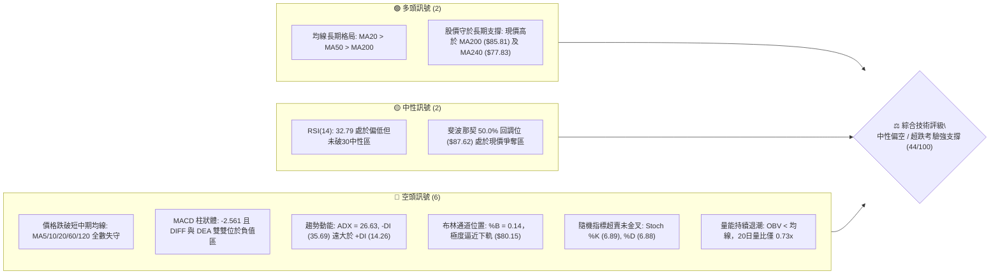
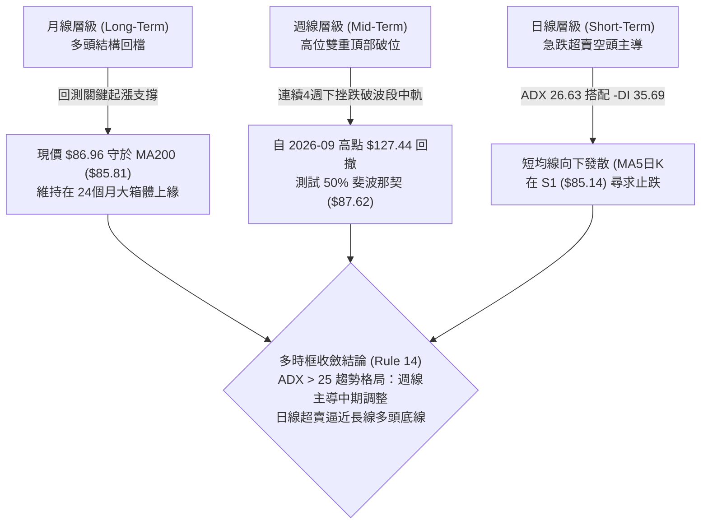
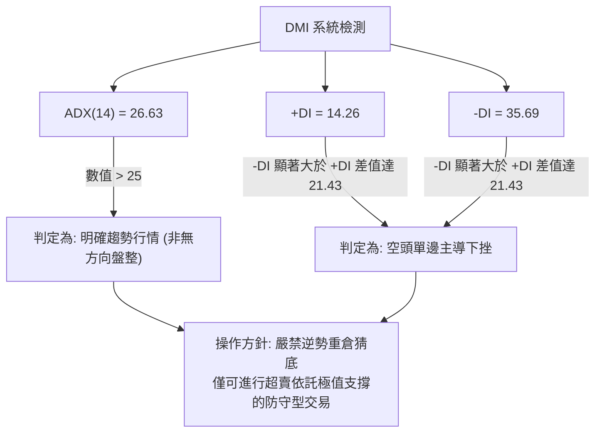
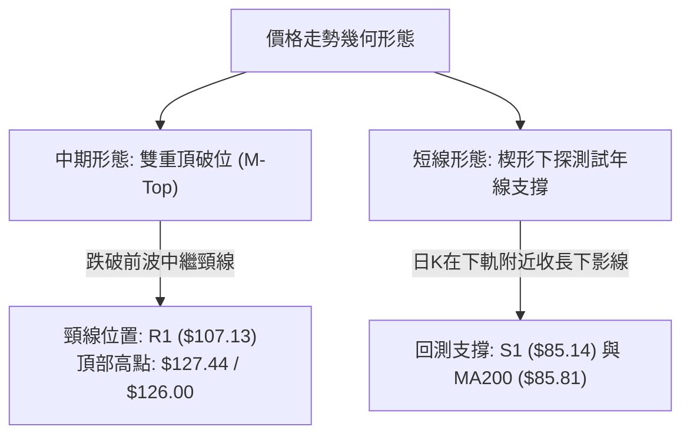
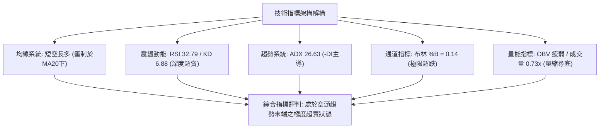
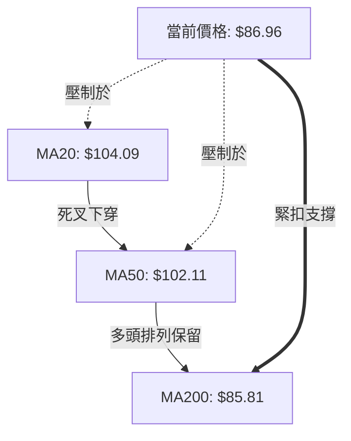
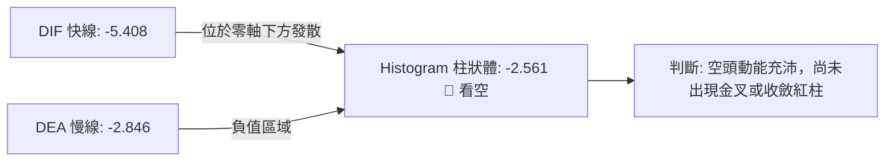
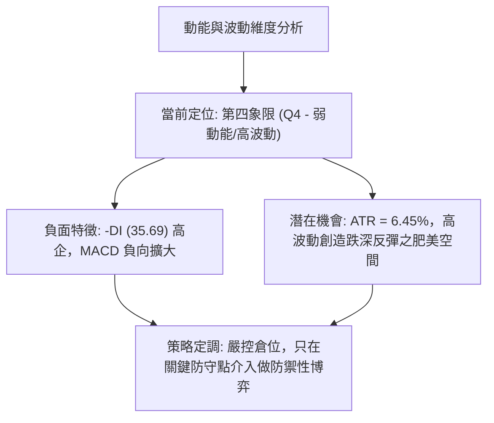
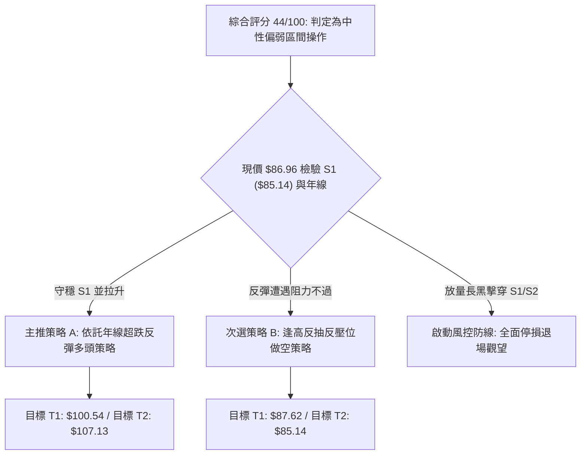
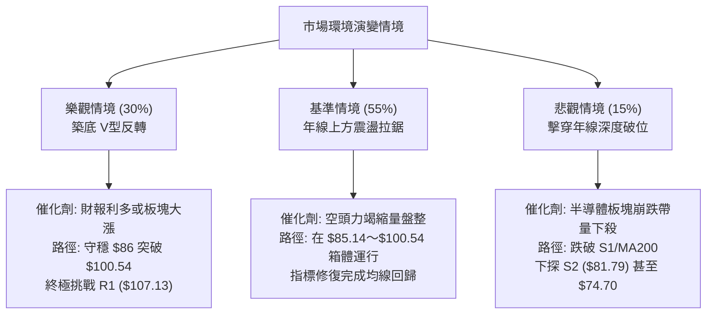

# INTC 技術分析報告

> **報告日期**：2026-10-25 ｜ **語言**：繁體中文 ｜ **數據來源**：Yahoo Finance ｜ **當前價格**：$86.96

---

## 目錄

| 章節 | 內容 |
|------|------|
| [1. 技術面概覽](#1-技術面概覽) | 訊號儀表板、核心指標、評分卡 |
| [2. 趨勢分析](#2-趨勢分析) | 多時框趨勢、長中短期走勢、ADX解讀 |
| [3. 圖表形態分析](#3-圖表形態分析) | 形態識別、K線組合、目標價推算 |
| [4. 支撐與阻力](#4-支撐與阻力) | 關鍵價位、斐波那契回調結構 |
| [5. 技術指標深度解讀](#5-技術指標深度解讀) | MA/RSI/MACD/布林/成交量全面剖析 |
| [6. 動能與波動率](#6-動能與波動率) | 動能象限、ATR波動度、Beta係數解讀 |
| [7. 多時框架總結](#7-多時框架總結) | 時框架評分矩陣與多時框收斂判定 |
| [8. 交易策略建議](#8-交易策略建議) | 決策路徑、多空策略、精確風險報酬比 |
| [9. 風險提示與監控](#9-風險提示與監控) | 監控清單、情境模擬與風控防線 |
| [10. 報告總結](#-報告總結) | 儀表板總結與精要備忘錄 |

---

## 1. 技術面概覽

### 🎯 技術訊號儀表板



---

### 📊 核心指標速覽表

| 指標類別 | 指標名稱 | 當前數值 | 訊號 | 解讀 |
|----------|----------|----------|------|------|
| **價格** | 當前收盤價 | $86.96 | 🔴 | 位於52週區間49.4%處，短線連跌探底，逼近波段起漲中軸 |
| **均線** | MA20 (短月線) | $104.09 | 🔴 | 股價低於MA20達 -16.45%，短線下行斜率陡峭，形成上方第一道下壓重壓 |
| **均線** | MA50 (季線) | $102.11 | 🔴 | 股價跌破季線 -14.84%，中期上升軌道遭受實質破壞 |
| **均線** | MA200 (年線) | $85.81 | 🟢 | 股價尚在年線上方 +1.34%，長線牛熊分水嶺提供最後技術多頭屏障 |
| **動能** | RSI(14) | 32.79 | 🟡 | 位於弱勢區間（30–70下緣），接近超賣但未現底背離，下行動能減速中 |
| **動能** | MACD (12,26,9) | -5.408 / -2.846 | 🔴 | 雙線位於零軸下發散，Histogram 為 -2.561，顯示空頭仍握有波段主導權 |
| **動能** | KD(Stoch 14) | %K: 6.89 / %D: 6.88 | 🔴 | 深度超賣區鈍化，微幅黏合，隨時具備技術性跌深反彈契機 |
| **趨勢** | ADX(14) / DMI | ADX: 26.63 (-DI: 35.69) | 🔴 | ADX > 25 確認為強勢趨勢行情，-DI 高懸代表當前為主跌段空頭主導 |
| **通道** | 布林通道 (20,2) | 寬度: $80.15–$128.03 | 🔴 | %B 為 0.14，股價緊貼下軌運行，通道開口向下擴張，波動率放大 |
| **成交量** | 成交量 / 20日均量 | 71.81M / 98.04M | 🟡 | 量比 0.73x，量能跌破均量，OBV 低於均線，下殺伴隨量縮意味賣壓暫歇 |
| **波動** | ATR(14) | $5.61 (6.45%) | 🔴 | 日均波幅高達 $5.61，高波動度環境，交易需預留較大安全邊際 |

---

### 🏆 技術評分卡

```
╔══════════════════════════════════════════════════════════════════════════════╗
║                       技術評分卡 — INTC (2026-10-25)                        ║
╠══════════════════════════════════════════════════════════════════════════════╣
║ 趨勢強度 (Trend)     ███████░░░░░░░░░░░░░  36/100  🔴 空頭強勢主導 (ADX>25)   ║
║ 動能指標 (Momentum)  ██████░░░░░░░░░░░░░░  30/100  🔴 MACD負值/KD超賣鈍化     ║
║ 支撐穩定度 (Support) ██████████████░░░░░░  68/100  🟡 臨近S1與MA200密集支撐帶 ║
║ 成交量配合 (Volume)  ████████░░░░░░░░░░░░  40/100  🔴 量能萎縮/OBV趨勢疲弱    ║
║ 形態完整度 (Pattern) █████████░░░░░░░░░░░  44/100  🟡 高位雙頂跌破頸線尋求支撐║
║ 均線系統 (MA Align)  █████████░░░░░░░░░░░  46/100  🟡 長多排列但現價遭全線壓制║
╠══════════════════════════════════════════════════════════════════════════════╣
║ 綜合評分 (Average)   █████████░░░░░░░░░░░  44/100  ⚖️ 中性偏弱 / 區間防守 (Rule 18)║
╚══════════════════════════════════════════════════════════════════════════════╝
```

---

## 2. 趨勢分析

### 🌐 多時框趨勢分析



---

### 📈 長期趨勢 — 12個月走勢圖（Unicode）

以下為 INTC 自 2025-11 至 2026-10 的月度收盤價走勢軌跡（單位：美元）：

```
INTC 月線走勢圖（過去12個月：2025-11 至 2026-10）
價格軸 ($)
$140 ┤                                           ● (2026-06: $139.63 歷史高位)
$130 ┤                                          / \
$120 ┤                                         /   \     ● (2026-09: $120.23 反彈高點)
$110 ┤                                   ●    /     \   / \
$100 ┤                             ●    / \  /       \ /   \
 $90 ┤                            / \  /   \/         ●     ●← 當前現價 $86.96 (2026-10)
 $80 ┤                           /   \/               (2026-07/08 雙底 $90 附近)
 $70 ┤                          /
 $60 ┤                         /
 $50 ┤                   ●  ● /
 $40 ┤ ●(40.56)  ●(36.90) \/
 $30 ┤ 
     └─┬───────┬───────┬───┬───┬───┬───┬───┬────┬───┬───────┬───► 時間 (月份)
     11/25   12/25   01  02  03  04  05  06   07  08     09  10/26
```

#### 走勢特徵分析表格

| 週期階段 | 時間區間 | 起訖收盤價 | 區間漲跌幅 | 結構特徵與技術解讀 |
|----------|----------|------------|------------|--------------------|
| **底部奠定段** | 2025-11 ～ 2026-03 | $40.56 → $44.13 | +8.80% | 底部窄幅箱體盤整，均線逐步收斂黏合，奠定長線換手籌碼底層。 |
| **主升爆發段** | 2026-03 ～ 2026-06 | $44.13 → $139.63 | +216.41% | 史詩級單邊主升浪，成交量爆量推進，突破百元關卡並創下52W高點 $142.35。 |
| **中繼劇震段** | 2026-06 ～ 2026-08 | $139.63 → $89.51 | -35.90% | 獲利了結賣壓湧現，連續回調打出 $89.51～$90.20 的中期雙重支撐頸線。 |
| **次頂誘多段** | 2026-08 ～ 2026-09 | $89.51 → $120.23 | +34.32% | 強勁技術反彈，但月線成交量未顯著超越主升段，未能挑戰前高形成次級高點。 |
| **次級下挫段** | 2026-09 ～ 2026-10 | $120.23 → $86.96 | -27.67% | 跌破前波震盪平台，長黑下壓測試 52W 區間 50% 斐波那契回調位 $87.62。 |

---

### 📊 中期趨勢（週線分析）

```
中期結構壓力與支撐示意圖 (週線層級)
══════════════════════════════════════════════════════════════
 $142.35 ═══════════════════════════════ 52W 歷史極值高點
         │
 $127.44 ───────────────┬─────────────── 週線 M頭左頂 (2026-09-25)
         │               │
 $126.00 ────────────────┴────────────── 週線 M頭右頂 (2026-10-02)
         │
 $107.13 ═══════════════════════════════ 頸線及密集阻力區 (R1)
         │
  $87.62 ─────────────────────────────── 50% 斐波那契回檔關鍵中軸
  $86.96 ◄─── 現價位置 (2026-10-23 收盤)
  $85.81 ------------------------------- MA200 年線防守線
  $85.14 ═══════════════════════════════ 近一年低點聚類支撐 (S1)
         │
  $81.79 ═══════════════════════════════ 布林下軌共振強支撐 (S2)
══════════════════════════════════════════════════════════════
```

週線指標呈現標準弱勢回檔形態：
1. **收盤連續下行**：近4週收盤價由 $119.33、$104.70、$89.85 跌至 $86.96，週線 RSI 降至 32.8，逼近 30 臨界點。
2. **MACD 柱狀體翻負**：週線 MACD 柱狀體自 2026-09-25 的 +2.925 陡降至當前 -2.561，顯示中期調整週期尚未出現止跌紅柱。

---

### ⚡ 趨勢強度評估（ADX 解讀）



#### ADX 趨勢強度量化對照表

| 指標變數 | 當前讀數 | 門檻區間 | 技術含義 | 對交易決策之指導 |
|----------|----------|----------|----------|------------------|
| **ADX(14)** | **26.63** | > 25.0 | 趨勢確立，告別無方向盤整期 | 不宜採用純震盪指標反轉模型，必須順應主趨勢空頭背景進行防禦 |
| **+DI(14)** | **14.26** | < 20.0 | 多頭動能匱乏，無力發動推升 | 多頭反彈多屬解套波或跌深抽腳，不易走出連續單邊逼空 |
| **-DI(14)** | **35.69** | > 30.0 | 空頭主導力量強盛 | 空方控盤，任何向上反彈均需面臨逢高解套賣壓打壓 |
| **方向差值 (PDI-MDI)** | **-21.43** | 極度負值 | 單邊下行速率較快 | 提示乖離已大，短線隨時有回測均線（乖離修復）之技術反彈需求 |

---

## 3. 圖表形態分析

### 🔍 形態識別系統



#### 形態信心度與目標價評估表 (Rule 15)

| 形態名稱 | 信心度 | 判斷依據（引用數據） | 完成度 | 目標價（附嚴格計算式） |
|----------|--------|----------------------|--------|------------------------|
| **中期雙重頂 (M-Top)** | **75%** | 2026-09-25 週K高點 $127.44 與 2026-10-02 週K高點 $126.00 形成雙頂，隨後破頸線 R1 ($107.13) | 85% (已破頸線進行量度跌幅) | 形態高度 = $127.44 − $107.13 = $20.31。<br/>量度等幅跌幅 = 頸線 $107.13 − $20.31 = **$86.82**。<br/>*(現價 $86.96 恰好精準抵達該形態量度跌幅滿足點附近！)* |
| **大箱體長線回踩** | **65%** | 2026-07 跌至 $90.20、2026-08 跌至 $89.51，當前下探 S1 ($85.14) 尋求三重底共振 | 50% (正處於支撐測試期) | 依據支撐帶若能確認企穩，反彈第一目標為重返頸線 R1 = **$107.13**。 |
| **頭肩底形態** | **N/A** | 數據中未偵測到此形態幾何特徵 | N/A | 數據不足，不進行推估。 |

---

### 🕯️ 重要K線形態分析 (Rule 19)

依據系統提供之近10根日K與近8根週K的 OHLCV 實際數據進行形態特徵剖析：

#### 1. 近10根日K形態追蹤

| 日期 (日K) | 開盤價 | 最高價 | 最低價 | 收盤價 | 成交量 | K線形態名稱 | 技術解讀與多空意涵 | 訊號 |
|------------|--------|--------|--------|--------|--------|-------------|--------------------|------|
| **2026-10-12** | 102.52 | 103.19 | 100.71 | 101.35 | 74,171,900 | 小黑K線 | 實體收跌，受制於 MA50 反壓，量能低迷 | 🔴 |
| **2026-10-13** | 99.59  | 102.88 | 98.23  | 102.81 | 88,252,000 | 帶長下影中陽線 | 下探 98.23 後強勁回升，多頭短暫抵抗 | 🟢 |
| **2026-10-14** | 99.54  | 101.34 | 97.67  | 98.12  | 104,592,800 | 實體陰線吞噬 | 跌破前日低點，反彈遭到瓦解，量能增溫帶動下殺 | 🔴 |
| **2026-10-15** | 93.61  | 96.87  | 90.02  | 95.37  | 147,157,700 | 跳空放量長下影黑K | 向下跳空重挫，爆出近10日最大量（1.47億股），90整數關卡有承接買盤 | 🟡 |
| **2026-10-16** | 93.48  | 94.22  | 89.19  | 89.85  | 123,003,100 | 下跌破位陰線 | 實體跌破 $90 大關，收盤逼近全天低點，空頭慣性延續 | 🔴 |
| **2026-10-19** | 94.53  | 95.39  | 91.88  | 92.03  | 101,608,800 | 衝高回落小陰線 | 開高挑戰 95 未果，上影線顯示解套與停損賣壓交織 | 🔴 |
| **2026-10-20** | 90.73  | 93.73  | 88.77  | 91.69  | 84,058,600 | 下探回升小陽十字 | 探低 88.77 獲低接買盤托底，實體狹小，多空陷入短暫觀望 | 🟡 |
| **2026-10-21** | 93.43  | 94.39  | 90.75  | 92.96  | 75,566,800 | 縮量孕線 (Harami) | 波動範圍完全被前兩日包覆，量能急縮，預示變盤在即 | 🟡 |
| **2026-10-22** | 87.92  | 89.19  | 84.65  | 85.49  | 134,128,100 | 放量大長黑破位棒 | 跳空低開重挫破前低，最低觸及 $84.65（跌破S1），恐慌盤湧現 | 🔴 |
| **2026-10-23** | 85.92  | 87.87  | 84.74  | 86.96  | 71,813,700 | **錘頭陽線 (Hammer)** | 低開後向上拉升收紅，最低 $84.74 未破昨低，縮量顯著（71.8M），浮額洗清初現企穩 | 🟢 |

#### 2. 近8根週K形態剖析

| 日期 (週K尾) | 開盤價 | 最高價 | 最低價 | 收盤價 | 成交量 | 週K形態結構 | 訊號 |
|--------------|--------|--------|--------|--------|--------|-------------|------|
| **2026-09-04** | 90.00  | 95.94  | 85.72  | 95.80  | 378,286,900 | 中陽線突破底部平台，確立雙底反彈動能 | 🟢 |
| **2026-09-11** | 100.80 | 106.69 | 99.34  | 102.94 | 421,038,200 | 跳空推進長陽，週線站穩百元大關 | 🟢 |
| **2026-09-18** | 95.82  | 111.37 | 94.52  | 108.60 | 626,105,300 | 爆量長上影多頭推進棒，買氣強勁但逢高調節浮現 | 🟢 |
| **2026-09-25** | 116.53 | 127.44 | 114.93 | 123.00 | 602,664,000 | 衝高大陽線，形成反彈波段頂部 M頭左峰 ($127.44) | 🟡 |
| **2026-10-02** | 120.68 | 126.00 | 113.97 | 119.33 | 495,059,900 | 高位孕線流星黑K，受制於 $126.00 形成 M頭右峰 | 🔴 |
| **2026-10-09** | 115.34 | 118.20 | 104.00 | 104.70 | 461,347,000 | 實體大陰線摜破頸線 R1 ($107.13)，轉弱訊號確認 | 🔴 |
| **2026-10-16** | 102.52 | 103.19 | 89.19  | 89.85  | 537,177,500 | 放量長陰破百元大關，向下尋求 90 大關支撐 | 🔴 |
| **2026-10-23** | 94.53  | 95.39  | 84.65  | 86.96  | 467,176,000 | **長下影下探陰線**，最低探至 $84.65（測試年線與S1後收腳回升） | 🟡 |

---

### 📉 ASCII 走勢形態示意圖

```
INTC 日K近期急跌與觸底形態示意圖 (2026-10-12 至 2026-10-23)
價格軸 ($)
$104 ┤
$102 ┤   [12日]   [13日]
$100 ┤     ┬        █
 $98 ┤     █        █      [14日]
 $96 ┤     █        █        ┬
 $94 ┤     ┴        ┴        █      [15日跳空]
 $92 ┤                       █         ┬
 $90 ┤                       ┴         █      [16日]     [19日]
 $88 ┤                                 █        ┬          ┬      [21日]
 $86 ┤                                 █        █   [20日] █        █
 $84 ┤                                 ┴        █     █    █        █       [23日縮量錘頭]
     └──────────────────────────────────────────┴─────┴────┴────────┴───[22日長黑]───┴───►
                                                                        最低探 $84.65
                                                                  (S1 $85.14 / MA200 $85.81)
```

---

### 🎯 形態目標價計算

根據雙重頂形態與關鍵聚類價位：
1. **雙重頂理論量度跌幅 (Measured Move Down)**：
   - 頂部均值：$(127.44 + 126.00) \div 2 = \$126.72$
   - 頸線位置：$R1 = \$107.13$
   - 形態高度（H）：$\$126.72 - \$107.13 = \$19.59$
   - 下跌目標價：$\$107.13 - \$19.59 = \mathbf{\$87.54}$
   - **實證對照**：當前現價為 **$86.96**，週線最低觸及 **$84.65**，代表自高點回落的幾何下跌目標已經 **100% 達成**，空頭波段動能已近衰竭區。

2. **超賣反彈向上測量目標**：
   - 若 2026-10-23 之錘頭線確立反轉，向上回抽第一阻力目標為 38.2% 斐波那契回調位：**$100.54**。
   - 向上完全回抽破位頸線之第二阻力目標為：**$107.13**。

---

## 4. 支撐與阻力

### 🗺️ 關鍵價位分布圖（Unicode）

```
INTC 價位結構分布圖 (由 OHLCV 與歷史波段聚類精確計算)
═══════════════════════════════════════════════════════════════════════════════
 $142.35 ║████████████████████████████████████████║ 52W 歷史天花板 (52W High)
 $132.75 ║████████████████████████████████        ║ 極強阻力 R3 (+52.66%)
 $127.04 ║████████████████████████                ║ 波段次頂強阻力 R2 (+46.09%)
 $116.52 ║████████████████                        ║ 斐波那契 23.6% 回調壓力
 $107.13 ║████████████████████████████████████████║ 核心破位頸線阻力 R1 (+23.19%)
 $100.54 ║████████████                            ║ 斐波那契 38.2% 整數反壓關卡
 ─────────────────────────────────────────────────────────────────────────────
  $87.62 ║▒▒▒▒▒▒▒▒▒▒▒▒▒▒▒▒▒▒▒▒▒▒▒▒▒▒▒▒▒▒▒▒▒▒▒▒▒▒▒║ 斐波那契 50.0% 關鍵平衡位
  $86.96 ╠════════════════════════════════════════╣ ◄ 當前收盤現價 (位於多空爭奪帶)
  $85.81 ║▓▓▓▓▓▓▓▓▓▓▓▓▓▓▓▓▓▓▓▓▓▓▓▓▓▓▓▓▓▓▓▓▓▓▓▓▓▓▓║ MA200 年線長期多空分水嶺
  $85.14 ║▓▓▓▓▓▓▓▓▓▓▓▓▓▓▓▓▓▓▓▓▓▓▓▓▓▓▓▓▓▓▓▓▓▓▓▓▓▓▓║ 近期波段關鍵支撐 S1 (-2.09%)
  $81.79 ║████████████████████████████████        ║ 結構性強防守支撐 S2 (-5.95%)
  $74.70 ║████████████                            ║ 斐波那契 61.8% 黃金回調位
  $42.58 ║████████████████████████████████████████║ 長線終極防線 S3 (-51.03%)
  $32.89 ║████████████████████████████████████████║ 52W 歷史底部 (52W Low)
═══════════════════════════════════════════════════════════════════════════════
```

---

### 🚧 阻力位分析表

所有阻力數值完全引用自系統之歷史波段高點聚類與計算結果：

| 阻力級別 | 精確價位 | 距現價幅標 | 形成原因與技術背景 | 突破難度評估 | 重要性級別 |
|----------|----------|------------|--------------------|--------------|------------|
| **R1** | **$107.13** | +23.19% | 2026-09至10月波段整理平台頸線；與 MA120 ($107.59) 形成共振強壓帶 | 極高 🔴 | ★★★★★ (中期反轉關鍵樞紐) |
| **R2** | **$127.04** | +46.09% | 2026-09-25 週K波段高點聚類 ($127.44) 與布林上軌 ($128.03) 共振區 | 極高 🔴 | ★★★★☆ (波段多頭極限天花板) |
| **R3** | **$132.75** | +52.66% | 2026-06 主升段次高峰聚類解套賣壓密集區 | 極高 🔴 | ★★★☆☆ (歷史強套牢籌碼峰) |

---

### 🛡️ 支撐位分析表

所有支撐數值完全引用自系統之歷史波段低點聚類與計算結果：

| 支撐級別 | 精確價位 | 距現價幅標 | 形成原因與技術背景 | 守住機率評估 | 重要性級別 |
|----------|----------|------------|--------------------|--------------|------------|
| **S1** | **$85.14** | -2.09% | 近一年波段低點聚類；與 MA200 ($85.81) 緊密貼合，為 2026-10-22/23 兩日下影線防守中樞 | 65% 🟡 | ★★★★★ (長線多頭生死防線) |
| **S2** | **$81.79** | -5.95% | 近一年次級低點聚類；與布林通道下軌 ($80.15) 形成下檔雙重保護緩衝網 | 75% 🟢 | ★★★★☆ (超跌結構性防守點) |
| **S3** | **$42.58** | -51.03% | 2026年初起漲基底箱體上緣聚類，長線籌碼沉澱終極防線 | 95% 🟢 | ★★★☆☆ (極端崩盤長線基底) |

---

### 📐 斐波那契回調位分析

依據 52 週完整區間波動（最低點 **$32.89** → 最高點 **$142.35**，總垂直落差 **$109.46**）計算：

| 斐波那契比例 | 精確對應價位 | 與現價之相對位置 | 結構意涵與技術解讀 |
|--------------|--------------|------------------|--------------------|
| **0.0% (52W High)** | **$142.35** | 上方 +63.70% | 歷史頂部極值，多頭狂熱終點。 |
| **23.6%** | **$116.52** | 上方 +34.00% | 弱度回調位，失守後宣告單邊超強牛市結束。 |
| **38.2%** | **$100.54** | 上方 +15.62% | 中度回調阻力位，亦為百元心理整數大關。 |
| **50.0% (平衡中軸)** | **$87.62** | **上方 +0.76% (現價緊鄰)** | **多空牛熊力量平衡線。現價 $86.96 正在此關鍵中軸進行攻防摩擦！** |
| **61.8% (黃金分割)** | **$74.70** | 下方 -14.10% | 黃金分割強防守位，若 50% 跌破後下行探尋之目標。 |
| **78.6%** | **$56.31** | 下方 -35.25% | 深度回撤防線，多頭結構全面潰散之警戒區。 |
| **100.0% (52W Low)**| **$32.89** | 下方 -62.18% | 波段歷史起漲原點。 |

**深入技術解讀**：
當前收盤價 **$86.96** 正好卡在 **50.0% 回調位 ($87.62)** 與 **波段低點支撐 S1 ($85.14)** 之間的極窄狹縫內。這意味著市場已將 2026 年上半年多達 216% 的漲幅回吐整整一半。歷史技術統計顯示，多頭若要維持長線多頭架構，50% 處通常會迎來顯著的機構防禦性承接盤。

---

## 5. 技術指標深度解讀

### 🎛️ 指標訊號總覽



---

### 📈 移動平均線排列分析



#### 移動平均線數據對照表

| 均線名稱 | 數值 | 價格相對於均線之偏離度 | 排列狀態 | 走勢微型圖示分析 | 技術訊號 |
|----------|------|------------------------|----------|------------------|----------|
| **MA 5** | $89.83 | -3.19% | 價在線下 | ▃▄▅▇██▇▅▄▃▂▁ (急降探底) | 🔴 |
| **MA 10** | $93.66 | -7.16% | 價在線下 | ▂▃▄▆▇███▇▅▄▃▁ (陡峭下挫) | 🔴 |
| **MA 20** | $104.09 | -16.45% | 價在線下 | ▁▃▄▆▇████▇▅▄ (高位反折下彎) | 🔴 |
| **MA 60** | $101.51 | -14.33% | 價在線下 | █▇▅▃▂▁▁▂▃▃▃ (中期走平轉跌) | 🔴 |
| **MA120** | $107.59 | -19.17% | 價在線下 | ▁▂▃▄▅▆▇████ (高檔阻力帶) | 🔴 |
| **MA200** | $85.81 | **+1.34%** | **價在線上** | 長期上行走揚，多頭年線支撐中樞 | 🟢 |
| **MA240** | $77.83 | **+11.74%** | **價在線上** | ▁▂▃▄▅▆▇████ (深層基底穩固) | 🟢 |

**均線結構綜合解讀**：
大格局呈現典型的「**短中期均線空頭排列，但長期均線仍維持多頭排列**」（MA20 > MA50 > MA200）。價格自高點無情貫穿 MA20 與 MA50，當前乖離率負向放大（距 MA20 達 -16.45%），引發嚴重的均線負向乖離修復需求。現價與年線 MA200 ($85.81) 僅距 $1.15，該處必然引發激烈多空決戰。

---

### 📉 RSI(14) 分析

#### RSI 數值視覺化進度條
```
RSI(14): 32.79 [ 弱勢區間 / 臨近超賣 ]
0 ──────────── 30 ──────────────────────── 70 ──────────── 100
[███████░░░░░░░░░░░░░░░░░░░░░░░░░░░░░░░░░░░] 32.79%
```

- **區間評估**：RSI 讀數為 **32.79**，位於 30 臨界點上方，技術上處於弱勢空頭區間。
- **背離判斷 (Divergence)**：
  依據近20根K棒首尾之比對分析：價格自高檔 $123 回落至 $86.96，RSI 由 60 降至 32.79，屬於指標跟隨價格的常規下行，**未發現明顯日線級別之底背離或頂背離**。然而，RSI 於 10-16 的 31.4 微幅回升至 10-23 的 32.8，而價格卻微破前低，隱含極短線動能消耗減緩的微型鈍化特徵。

---

### 📊 MACD (12, 26, 9) 訊號解讀



- **DIFF 與 DEA 數值**：MACD 線為 **-5.408**，訊號線為 **-2.846**，雙線於零軸以下持續擴大負向間距。
- **柱狀體（Histogram）**：數值為 **-2.561**，雖然近一週負值柱狀體由 -3.385 收斂至 -2.561（代表下殺速度減慢），但在快線未拐頭向上穿越訊號線形成「黃金交叉」前，嚴禁妄斷底部確立。

---

### 📦 布林通道分析 (Bollinger Bands)

```
INTC 布林通道 (20, 2) 與現價位置示意圖
═════════════════════════════════════════════════════════════════
 $128.03 ─────────────────────────────── 上軌 (Upper Band)
         │
 $104.09 ─────────────────────────────── 中軌 (MA20 Baseline)
         │  
  $86.96 ◄─── 現價 ($86.96，%B = 0.14，嚴重貼近下軌)
  $80.15 ─────────────────────────────── 下軌 (Lower Band)
═════════════════════════════════════════════════════════════════
```

- **通道參數狀態**：上軌 $128.03、中軌 $104.09、下軌 $80.15，通道帶寬（Bandwidth）高達 $47.88，顯示波動性急遽釋放。
- **%B 指標深度解析**：當前 **%B = 0.14**，意味著現價已經落入整個通道最下方的 14% 極端區域，屬於統計學意義上的「超賣邊界」。通常 %B < 0.20 且伴隨量縮時，價格往往會引發向中軌 $104.09 均值回歸的拉力。

---

### 💹 成交量分析（量價配合度）

1. **成交量對比**：最新日成交量為 **71,813,700 股**，相較於 20日均量（**98,038,020 股**）與 50日均量（**100,473,228 股**），量比僅為 **0.73x**。
2. **量價關係解讀**：
   - 2026-10-15 下跌時成交量放大至 147M，10-22 下跌時成交量達 134M，顯示此前殺跌為主動性籌碼宣洩。
   - 然而在 2026-10-23 股價探低 $84.74 並拉回 $86.96 時，成交量大幅萎縮至 71.8M。這呈現出典型的「**跌勢末期縮量測試支撐**」特徵，說明空頭拋售盤正在衰竭。
3. **OBV 能量潮解讀**：
   - 當前 OBV 趨勢為 **OBV < MA**，代表能量潮指標位於其均線下方，資金面指標仍偏弱，機構尚未展開大規模左側回補，量能確認信號尚未浮現。

---

## 6. 動能與波動率

### ⚡ 動能評估四象限

| 象限 | 動能維度 | 波動率維度 | 當前狀態匹配 | 市場特徵與技術處境評估 |
|------|----------|------------|--------------|------------------------|
| **第一象限 (Q1)** | 強動能 (Bullish) | 低波動 (Low Vol) | — | 穩定單邊牛市，持股續抱的最佳環境。 |
| **第二象限 (Q2)** | 弱動能 (Bearish) | 低波動 (Low Vol) | — | 牛皮盤整盤，方向不明，資金沉悶。 |
| **第三象限 (Q3)** | 強動能 (Bullish) | 高波動 (High Vol)| — | 主升浪派發或強勢逼空，博弈劇烈。 |
| **第四象限 (Q4)** | **弱動能 (Bearish)** | **高波動 (High Vol)**| **✓ (當前處境)** | **急速宣洩殺跌段；高風險高彈性，考驗極限支撐穩定度。** |



---

### 📊 ATR 波動率分析

- **ATR(14) 數值**：**$5.61**（Wilder 計算法）。
- **價格波動百分比**：以現價 $86.96 計算，日均真實波幅佔股價比例高達 **6.45%**。
- **交易風控具體指導**：
  1. **日內雜訊過濾**：單日波動超過 $5.60 屬於常態，進場掛單切忌過度貼近現價，停損點設置若小於 1.0 倍 ATR（約 $5.61），極易被日內正常波動洗出場。
  2. **止損距離建議**：專業波段操作止損至少需設置 **1.0 至 1.5 倍 ATR**（即 **$5.61 ～ $8.40** 緩衝帶）。當前 S1 ($85.14) 與現價差距 $1.82 較窄，因此止損必須放至次級支撐 S2 ($81.79)，兩者間隔 $5.17，恰好吻合約 1.0 倍 ATR 之安全邊際。

---

### 📐 Beta 與市場相關性

- **Beta 係數**：**2.23**。
- **市場敏感度評估**：
  INTC 具備極高的進攻性與脆弱度（高貝塔特性）。當基準大盤（S&P 500 或費城半導體指數）波動 1% 時，理論上 INTC 會產生 2.23% 的同向放大反應。
- **宏觀連動性考驗**：在當前半導體板塊調整期，高 Beta 意味著回調幅度將顯著深於大盤；反之，一旦大盤止跌共振，INTC 的跌深反彈彈性亦將是市場之冠。

---

## 7. 多時框架總結

### 📋 時框架評分表

| 時框架 | 趨勢方向 | 動能狀態 | 均線排列狀態 | 形態特徵 | 綜合評分 | 戰略建議 |
|--------|----------|----------|--------------|----------|----------|----------|
| **長線 (月線)** | 🟢 偏多回檔 | 🟡 中性平緩 | 多頭排列 (MA200向上) | 歷史突破後大幅回踩 50% 軸 | **60/100** | 核心資產防禦，守年線持股 |
| **中線 (週線)** | 🔴 明確回落 | 🔴 空頭發散 | 跌破 MA20，週MACD負值 | 高位雙重頂部破頸線調整中 | **38/100** | 不宜盲目追高，等待止跌結構 |
| **短線 (日線)** | 🔴 弱勢超賣 | 🟡 超賣鈍化 | 全面空頭排列，價緊貼布林下軌 | 連跌後出現量縮錘頭陽線 | **34/100** | 嚴禁追空，短線尋求左側超跌反彈 |

---

### 🔲 綜合訊號矩陣

```
訊號維度矩陣比對 (Consistency Matrix)
┌──────────────────┬──────────────┬──────────────┬──────────────┐
│ 指標類別         │ 短期 (Daily) │ 中期 (Weekly)│ 長期 (Monthly│
├──────────────────┼──────────────┼──────────────┼──────────────┤
│ 趨勢方向 (Trend) │ 🔴 空頭壓制  │ 🔴 空頭主導  │ 🟢 多頭支撐  │
│ 動能強度 (Mom.)  │ 🟡 超賣待變  │ 🔴 動能向下  │ 🟡 中性整理  │
│ 均線系統 (MAs)   │ 🔴 全線失守  │ 🔴 跌破短均  │ 🟢 守在長均上│
│ 成交量能 (Vol.)  │ 🟢 縮量止跌  │ 🔴 增量回跌  │ 🟢 歷史長底量│
└──────────────────┴──────────────┴──────────────┴──────────────┘
一致性判斷：長多格局下的中短期強烈共振回調，正處於短線空頭動能衰竭與長線支撐接軌的臨界匯合點。
```

---

### ⚖️ 多時框收斂結論 (Rule 14 嚴格收斂)

根據本報告嚴格規定之多時框收斂法則：
1. **行情屬性判定**：當前日線 **ADX = 26.63 > 25**，屬於**明確趨勢行情**（而非無方向盤整）。
2. **主導時框優先級**：依規則，趨勢行情以**中長期方向為主**（週線/MA50、MA200），日線僅用於尋找精確進場時機。
3. **最終方向性結論**：
   **【中性偏弱，防守型區間低吸操作】（綜合評分：44/100）**。
   雖然日線與週線被空頭主導（-DI 高達 35.69），但現價已經跌至長線牛熊底線——**年線 MA200 ($85.81)** 與波段強支撐 **S1 ($85.14)**，且完美滿足雙重頂量度跌幅（$87.54）。因此，結論嚴格收斂為：**拒絕在 $86.96 追空，以 MA200/S1 為防守基準，尋求技術性超賣均值回歸的防禦性交易機會。**

---

## 8. 交易策略建議

### 🗺️ 策略決策流程圖



---

### 🧭 策略路由 (Strategy Routing)

- **綜合評分判定**：第1章評分卡綜合評分為 **44/100**（落入 40–60 中性區間）。
- **當前主策略方向**：**【中性偏弱之區間反彈防禦操作】（依評分 44/100 路由分流）**。
- **策略指導方針**：市場處於超跌狀態，但中期下行趨勢尚未逆轉。此評分下嚴禁追高或孤注一擲做單邊多頭，應當以「**低吸極值支撐博反彈、逢高遇阻順勢鎖定利潤**」的區間思維處置。

---

### 🎯 價格情境階梯 (Price Scenarios)

所有價位完全引用第4章之關鍵數值，階梯式演進路徑如下：

| 觸發條件 | 下一階段目標 | 後續延伸目標 | 情境技術含義與市場狀態解讀 |
|----------|--------------|--------------|----------------------------|
| **強勢站上 $100.54** | **R1 ($107.13)** | **R2 ($127.04)** | 短線空頭衰竭，重返頸線上方向中期均線發起修復性反彈。 |
| **守穩 $85.14～$87.62** | **$100.54** | **R1 ($107.13)** | 於 50% 斐波那契與年線形成築底，開展超賣均值回歸行情。 |
| **跌破 S1 ($85.14)** | **S2 ($81.79)** | **$74.70 (Fib 61.8%)**| 年線告失，多頭防線全面後撤至布林下軌尋求最後支撐。 |
| **跌破 S2 ($81.79)** | **$74.70** | **S3 ($42.58)** | 中期多頭形態徹底破滅，轉入深度漫長熊市探底。 |

---

### 📊 情境機率分佈

| 情境劇本 | 發生機率 | 主要技術依據與指標支撐 |
|----------|----------|------------------------|
| **情境一：依託年線展開超賣反彈** | **55%** | KD/Stoch 深度超賣 (6.88)、布林通道 %B 達 0.14 極限、日K收出縮量長下影錘頭線、雙頂量度跌幅完全滿足。 |
| **情境二：在 S1 與 $100 之間區間震盪** | **30%** | ADX 雖達 26.63 但成交量顯著萎縮（量比 0.73x），市場買盤猶豫，需要時間換取空間消化均線反壓。 |
| **情境三：跌破 S1/年線繼續下挫再探底** | **15%** | -DI 高達 35.69，MACD 柱狀體仍為負值 (-2.561)，若宏觀突發利空導致年線失守將引發停損賣壓。 |

---

### 🟢 主推策略詳情 (Rule 17 嚴格數學計算)

本處所有進場、止損、目標價嚴格限制於第4章「關鍵價位」中已確立之數據，並依據公式：
$$\text{做多風險報酬比} = \frac{\text{目標價 } T1 - \text{進場價}}{\text{進場價} - \text{止損價}}$$
$$\text{做空風險報酬比} = \frac{\text{進場價} - \text{目標價 } T1}{\text{止損價} - \text{進場價}}$$

| 策略要素 | 策略 A（多頭：極限支撐超跌反彈） | 策略 B（空頭：反彈受阻順勢沽空） |
|----------|----------------------------------|----------------------------------|
| **策略定位** | 主推策略（依託 MA200/S1 防禦） | 次選策略（逢高反抽關鍵反壓放空） |
| **進場條件** | 股價回踩 S1 企穩，日K線收陽確立 | 反抽至 38.2% 斐波那契受阻回落 |
| **進場價格** | **$86.96** (當前收盤現價) | **$100.54** (Fib 38.2% 阻力位) |
| **目標價 T1** | **$100.54** (Fib 38.2% 回調位) | **$87.62** (Fib 50.0% 平衡位) |
| **目標價 T2** | **$107.13** (阻力位 R1 / 頸線) | **$85.14** (支撐位 S1) |
| **止損價格** | **$81.79** (支撐位 S2 / 跌破年線離場) | **$107.13** (突破 R1 頸線則停損) |
| **風險金額** | $\$86.96 - \$81.79 = \mathbf{\$5.17}$ | $\$107.13 - \$100.54 = \mathbf{\$6.59}$ |
| **T1 利潤** | $\$100.54 - \$86.96 = \mathbf{\$13.58}$ | $\$100.54 - \$87.62 = \mathbf{\$12.92}$ |
| **風險報酬比 (T1)**| **1 : 2.63（以 T1 計）**<br/>($13.58 \div 5.17 = 2.626$) | **1 : 1.96（以 T1 計）**<br/>($12.92 \div 6.59 = 1.960$) |
| **風險報酬比 (T2)**| **1 : 3.90（以 T2 計）**<br/>($[107.13-86.96]\div 5.17 = 3.901$) | **1 : 2.34（以 T2 計）**<br/>($[100.54-85.14]\div 6.59 = 2.336$) |
| **策略成功機率** | **55%** | **45%** |
| **建議配置倉位** | **10% ～ 15%** (輕倉防禦試單) | **10%** (嚴格順勢短空) |

---

### 🔴 反向風險觸發點（對沖提示）

- **多頭轉為全面避險之觸發線**：
  若收盤價帶量**有效擊穿支撐 S1 ($85.14) 與年線 MA200 ($85.81)**，即代表長達一年的牛市基底遭到破壞。多頭策略必須無條件啟動止損，不可留戀。
- **空頭回補之反轉觸發線**：
  若短線反彈放量**突破並站穩 R1 ($107.13)**，宣告高位雙頂頸線被成功收復，空頭必須立即停損平倉，預防「假跌破真軋空」風險。

---

### ⭐ 整體訊號強度評星

```
╔══════════════════════════════════════════════════════════════╗
║                     整體訊號強度評星                         ║
╠══════════════════════════════════════════════════════════════╣
║ 做多訊號強度：  ★★☆☆☆  (2.5/5星 - 超賣反彈，長線支撐)        ║
║ 做空訊號強度：  ★★★☆☆  (3.0/5星 - 順勢主導，但空間有限)      ║
║ 整體技術可信度：★★★★☆  (4.0/5星 - 價位嚴格貼合金屬支撐網)    ║
╚══════════════════════════════════════════════════════════════╝
```

---

## 9. 風險提示與監控

### ✅ 關鍵監控指標 Checklist

```
╔══════════════════════════════════════════════════════════════════════════════╗
║                          關鍵監控指標 CHECKLIST                              ║
╠══════════════════════════════════════════════════════════════════════════════╣
║ [ ] 監控年線 MA200 ($85.81)：每日收盤價是否能連續三日守穩於年線之上？         ║
║ [ ] 檢視 S1 支撐位 ($85.14)：盤中跌破是否能在兩小時內迅速收出下影線？        ║
║ [ ] 關注 RSI(14) 臨界突破：指標能否突破 35 並重返 40 以上擺脫超賣壓抑？     ║
║ [ ] 觀察 MACD 柱狀體：Histogram 負值能否自 -2.561 持續收窄至 -1.0 以內？    ║
║ [ ] 追蹤成交量比：反彈時單日成交量能否放大至 20日均量 (98M) 以上？          ║
║ [ ] 監察 +DI 與 -DI 交叉：-DI 是否自 35.69 明顯回落且與 +DI 間距收窄？       ║
║ [ ] 關注斐波那契 50% ($87.62)：現價能否有效回升並踩在該水平之上？           ║
╚══════════════════════════════════════════════════════════════════════════════╝
```

---

### ⚠️ 風險場景分析



---

### 🛡️ 風險管理重要提醒

1. **高 Beta 波動懲罰性**：INTC 當前 Beta 高達 **2.23**，且 ATR 達 **$5.61**（每日波動率超過 6%）。單筆交易之最大虧損金額嚴格限制於總投資組合之 **1% 以內**。
2. **倉位配置紀律**：在 ADX > 25 且 -DI 占優的空頭趨勢下，任何左側博取超跌反彈之倉位**不可超過總資金之 15%**，切不可採取「越跌越買」之金字塔攤平策略。
3. **重大事件防禦（Event Risk）**：新聞提及 10 月 29 日即將公布重大財報數據，歷史統計 INTC 財報次日平均波動高達 **16%**。在財報公布日前夕，必須適度降低槓桿或透過期權進行下行風險保護。

---

## 📋 報告總結

```
╔══════════════════════════════════════════════════════════════════════════════╗
║                           INTC 技術分析報告總結                              ║
╠══════════════════════════════════════════════════════════════════════════════╣
║ 報告日期：2026-10-25                                                         ║
║ 當前價格：$86.96                                                             ║
║ 綜合評分：44 / 100                                                           ║
║ 分析評級：⚖️ 中性偏弱 / 考驗長期年線支撐（超跌防守）                         ║
╠══════════════════════════════════════════════════════════════════════════════╣
║ 關鍵結論：                                                                   ║
║ ├─ 長期趨勢：🟢 仍處長期多頭大箱體，守在年線 MA200 ($85.81) 上方             ║
║ ├─ 中期趨勢：🔴 雙重頂破位下行，由 -DI (35.69) 空頭掌控，跌破波段頸線        ║
║ ├─ 短期趨勢：🟡 短線極度超賣 (KD 6.88，%B 0.14)，縮量收錘頭線具反彈條件     ║
║ ├─ 關鍵支撐：S1: $85.14 ｜ S2: $81.79 ｜ MA200: $85.81                      ║
║ ├─ 關鍵阻力：Fib 38.2%: $100.54 ｜ R1: $107.13 ｜ MA20: $104.09              ║
║ └─ 華爾街共識目標價：$117.14 (分析師覆蓋共 43 位)                            ║
╠══════════════════════════════════════════════════════════════════════════════╣
║ 最優交易策略組合：                                                           ║
║ 1. 🥇 最佳機會（策略 A 多頭）：現價 $86.96 輕倉博弈年線超跌反彈，            ║
║       止損設 S2 ($81.79)，目標看 $100.54，風險報酬比 1 : 2.63。              ║
║ 2. 🥈 次選機會（策略 B 空頭）：耐心等待反抽 $100.54 受阻時順勢放空，         ║
║       止損設 R1 ($107.13)，目標看 $87.62，風險報酬比 1 : 1.96。              ║
║ 3. 🥉 保守選擇（場外觀望）：等待日K線收盤明確站上 $90 或出現 MACD 翻紅底     ║
║       背離後，再行右側順勢進場。                                             ║
╚══════════════════════════════════════════════════════════════════════════════╝
```

---

> ⚠️ **免責聲明**：本報告為 AI 自動生成之技術分析，所有數據及估算均基於所提供之歷史價格資訊。本報告**僅供研究與學術參考**，**不構成任何投資建議**。市場具有高度不確定性，投資有風險，入市需謹慎。

---

*報告生成時間：2026-10-25 ｜ 數據來源：Yahoo Finance ｜ 分析框架：多時框技術分析模型 (MTF-TA)*