# INTC 技術分析報告

> **報告日期**：2026-10-26 ｜ **語言**：繁體中文 ｜ **數據來源**：Yahoo Finance ｜ **當前價格**：$86.96

---

## 目錄

| 章節 | 內容 |
|------|------|
| [1. 技術面概覽](#1-技術面概覽) | 訊號儀表板、核心指標、評分卡 |
| [2. 趨勢分析](#2-趨勢分析) | 多時框趨勢、長中短期走勢 |
| [3. 圖表形態分析](#3-圖表形態分析) | 形態識別、K線組合、目標價 |
| [4. 支撐與阻力](#4-支撐與阻力) | 關鍵價位、斐波那契回調 |
| [5. 技術指標深度解讀](#5-技術指標深度解讀) | MA/RSI/MACD/布林/成交量 |
| [6. 動能與波動率](#6-動能與波動率) | 動能評估、ATR、Beta |
| [7. 多時框架總結](#7-多時框架總結) | 時框架評分矩陣 |
| [8. 交易策略建議](#8-交易策略建議) | 多空策略、風險報酬比 |
| [9. 風險提示與監控](#9-風險提示與監控) | 監控指標、風險場景 |

---

## 1. 技術面概覽

### 🎯 技術訊號儀表板

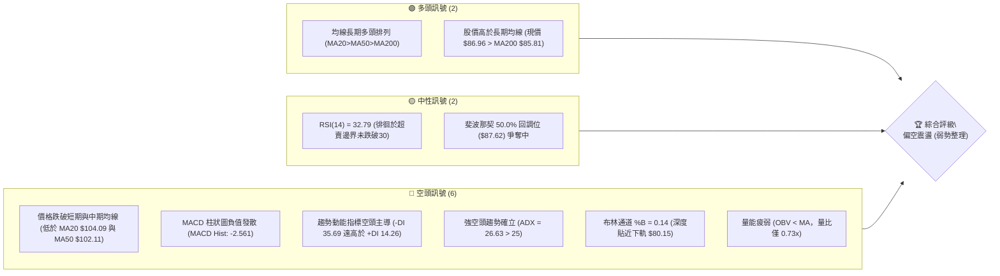

### 📊 核心指標速覽表

| 指標類別 | 指標名稱 | 當前數值 | 訊號 | 解讀 |
|----------|----------|----------|------|------|
| **價格** | 當前收盤價 | $86.96 | 🔴 | 位於52週區間 49.4%，短線自高點持續大幅回撤 |
| **均線** | MA20 | $104.09 | 🔴 | 價格低於 MA20 達 -16.45%，短線下行斜率陡峭 |
| **均線** | MA50 | $102.11 | 🔴 | 價格跌破 MA50 中期生命線，承壓於其下方 -14.84% |
| **均線** | MA200 | $85.81 | 🟢 | 價格仍維持在長期年線 MA200 之上 +1.34%，長期多頭基底尚存 |
| **動能** | RSI(14) | 32.79 | 🟡 | 位於中性偏弱邊緣（接近 30 超賣門檻），短線具備技術反彈條件 |
| **動能** | MACD (12/26/9) | 柱狀: -2.561 | 🔴 | DIF (-5.408) 位於 DEA (-2.846) 下方，空頭動能尚未收斂 |
| **動能** | Stoch %K / %D | 6.89 / 6.88 | 🟢 | 極度超賣區間鈍化，隨時可能醞釀短線技術性金叉抽頭 |
| **趨勢** | ADX (14) | 26.63 | 🔴 | ADX > 25 表明趨勢強烈，因 -DI (35.69) > +DI (14.26)，確認空頭趨勢主導 |
| **通道** | 布林通道 %B | 0.14 | 🔴 | 軌道極度下壓，價格緊貼布林下軌 $80.15 運行 |
| **量能** | 成交量比 (VR) | 0.73x | 🔴 | 最新量 71.81M 低於 20MA 量 98.04M，OBV < MA 顯示買盤意願低落 |
| **波動** | ATR(14) | $5.61 | 🔴 | 日波幅佔股價高達 6.45%，屬於高波動性風險標的 |

### 🏆 技術評分卡

```
╔══════════════════════════════════════════════════════════════════╗
║                   技術評分卡 — INTC (2026-10-26)                 ║
╠══════════════════════════════════════════════════════════════════╣
║ 趨勢強度 (ADX=26.63, -DI壓制)  ██████░░░░░░░░░░░░░░  30/100 🔴 空頭強勢 ║
║ 動能指標 (RSI 32.79, MACD負散) ██████░░░░░░░░░░░░░░  30/100 🔴 弱勢超賣 ║
║ 支撐穩定度 (S1 $85.14/年線附近)██████████░░░░░░░░░░  50/100 🟡 考驗支撐 ║
║ 成交量配合 (量縮陰跌, OBV破線) ██████░░░░░░░░░░░░░░  30/100 🔴 量能匱乏 ║
║ 形態完整度 (自高點回撤無大底)   ████████░░░░░░░░░░░░  40/100 🔴 空方主導 ║
║ 均線排列 (長期多頭排列但已破位) ██████████░░░░░░░░░░  50/100 🟡 長多短空 ║
╠══════════════════════════════════════════════════════════════════╣
║ 綜合評分 (算術平均 230/6)     ████████░░░░░░░░░░░░  38/100 🔴 偏空弱勢 ║
╚══════════════════════════════════════════════════════════════════╝
```

---

## 2. 趨勢分析

### 🌐 多時框趨勢分析

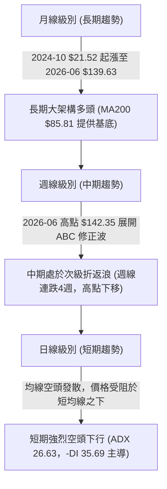

### 📈 長期趨勢 — 12個月走勢圖（Unicode）

```
INTC 月線走勢圖（過去12個月：2025-11 至 2026-10）
價格軸 ($)
$140 ┤                                 ●(06月高點 $139.63)
$120 ┤                             ●          ●(09月次高 $120.23)
$100 ┤                         ●
$90  ┤                                    ●   ●          ●(10月現價 $86.96)
$50  ┤                 ●   ●
$40  ┤ ●(11月 $40.56)      ●
$35  ┤         ●
     └─┬───┬───┬───┬───┬───┬───┬───┬───┬───┬───┬───
      11  12  01  02  03  04  05  06  07  08  09  10 (月份)
      2025年                  2026年
```

**12個月走勢特徵分析表格**：

| 階段時間 | 起迄月份 | 起迄收盤價 ($) | 區間漲跌幅 | 趨勢性質與市場心理特徵 |
|----------|----------|----------------|------------|------------------------|
| **第一階段：底部盤整** | 2025-11 → 2025-12 | 40.56 → 36.90 | -9.02% | 低位籌碼沉澱，市場悲觀情緒逐步收斂 |
| **第二階段：蓄勢突破** | 2025-12 → 2026-03 | 36.90 → 44.13 | +19.59% | 股價橫盤蓄勢，均線逐步向上聚攏扭轉 |
| **第三階段：主升暴漲** | 2026-03 → 2026-06 | 44.13 → 139.63 | +216.41% | 史詩級軋空暴升，創下 52 週高點 $142.35 |
| **第四階段：高位劇震** | 2026-06 → 2026-08 | 139.63 → 89.51 | -35.89% | 獲利盤大舉出逃，迅速回踩 $90 整數關口 |
| **第五階段：次頂反彈** | 2026-08 → 2026-09 | 89.51 → 120.23 | +34.32% | 籌碼二次逃命波，構築雙頂/右肩形態 |
| **第六階段：破位下瀉** | 2026-09 → 2026-10 | 120.23 → 86.96 | -27.67% | 空方趨勢確立，直接考驗年線支撐 $85.81 |

### 📊 中期趨勢（週線分析）

```
INTC 中期週線壓力與支撐結構示意圖
價格軸 ($)
$130 ┤                ▲ 09/25 週高點 $127.44 (反彈阻力極限)
$120 ┤           ▲ 10/02 週高點 $126.00
$110 ┤      ▲ 10/09 週高點 $118.20
$100 ┤ -------------------------------------------- MA50 ($102.11) / 斐波 38.2% ($100.54)
$90  ┤ ──現價 $86.96 ── 斐波 50.0% ($87.62)
$85  ┤ ============================================ S1 ($85.14) / MA200 ($85.81) / 10/22日低 $84.65
$80  ┤ -------------------------------------------- 布林下軌 ($80.15) / S2 ($81.79)
```

從近 8 根週 K 線可觀察到，自 2026-09-25 創下波段收盤高點 $123.00 後，週 K 線已連續 4 週收黑（$119.33 → $104.70 → $89.85 → $86.96），週線 RSI 從高檔 66.9 崩跌至 32.8，MACD 柱狀圖亦由正翻負並加速發散（最新週線為 -2.561）。週線呈現標準的「高點下移、低點破底」中級修正格局。

### ⚡ 趨勢強度評估（ADX 解讀）

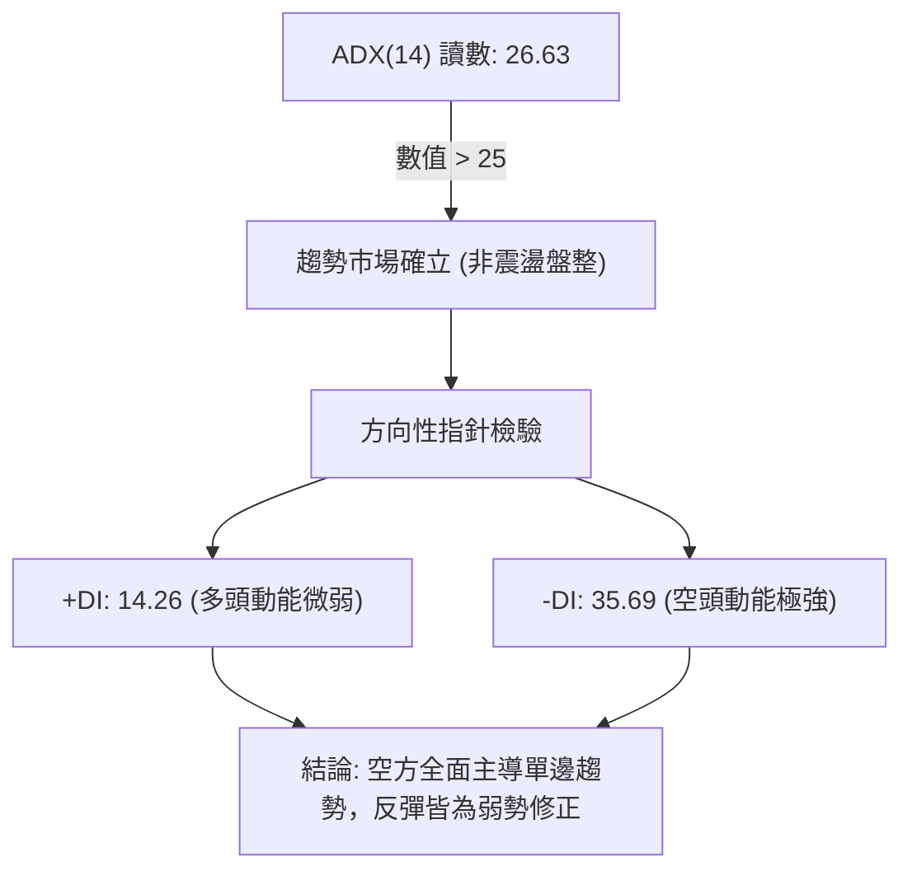

**ADX 趨勢強度對照表**：

| 指標名稱 | 當前數值 | 參考閾值 | 趨勢判定 | 具體技術含義 |
|----------|----------|----------|----------|--------------|
| **ADX (14)** | 26.63 | > 25.0 | 🟢 強趨勢 | 市場脫離無方向盤整，目前正運行於強勁的單邊趨勢軌道中 |
| **+DI (14)** | 14.26 | 基準對比 | 🔴 弱勢 | 買方動能極為低迷，無法發動實質的多頭進攻 |
| **-DI (14)** | 35.69 | 基準對比 | 🔴 強勢 | 空方拋壓占據絕對支配地位，空方勢能為多方的 2.5 倍 |
| **Directional Diff** | -21.43 | 0 軸臨界 | 🔴 極度空頭 | 淨方向差距極大，確認價格處於主跌浪或加速下行波段 |

---

## 3. 圖表形態分析

### 🔍 形態識別系統

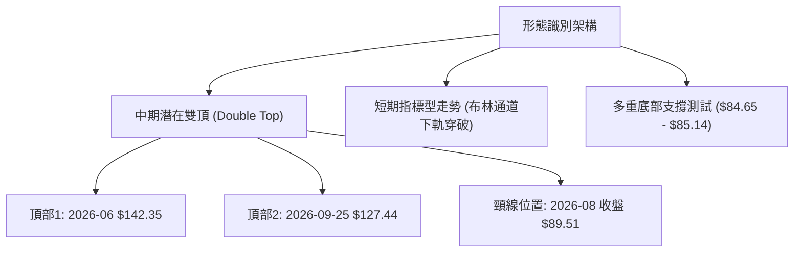

**形態信心度與目標價評估表**：

| 形態類別 | 信心度 | 判斷依據（引用數據） | 完成度 | 目標價（附精確計算式） |
|----------|--------|----------------------|--------|------------------------|
| **中期雙頂 (M頭)** | 75% | 頂1為 52W 高點 $142.35，頂2為 2026-09-25 週高點 $127.44；跌破 2026-08 收盤頸線 $89.51 | 85% | 頸線 $89.51 − (頂2 $127.44 − 頸線 $89.51) = **$51.58**（中長期推算目標，介於斐波 78.6% $56.31 與 S3 $42.58 之間） |
| **短期雙底回踩** | 45% | 近日測試 10/22 低點 $84.65 與 10/23 低點 $84.74，貼近支撐位 S1 $85.14 | 30% | *訊號不足，僅做指標型解讀*（信心度低於 50%，未獲成交量放大確認） |
| **布林下軌超賣反彈** | 80% | 日線收盤 $86.96，布林 %B = 0.14，極度逼近下軌 $80.15 且 Stoch 進入 <10 | 90% | 由超賣回抽布林中軌（MA20），計算式：目標 = MA20 數值 = **$104.09** |

### 🕯️ 重要K線形態分析

嚴格依據近 10 根日 K 線與近 8 根週 K 線之開高低收進行精確解讀：

| 日期（日K/週K） | 開 | 高 | 低 | 收 | K線形態 | 解讀 | 訊號 |
|------------------|----|----|----|----|---------|------|------|
| **2026-10-15 (日)** | 93.61 | 96.87 | 90.02 | 95.37 | 帶長下影之中黑實體 | 帶量 (147.16M) 急挫後反彈，空方力量初步宣洩 | 🟡 |
| **2026-10-16 (日)** | 93.48 | 94.22 | 89.19 | 89.85 | 長陰下挫 | 開平走低並收於最低點附近，破壞前日止跌企圖 | 🔴 |
| **2026-10-21 (日)** | 93.43 | 94.39 | 90.75 | 92.96 | 弱勢小陽線 | 縮量 (75.57M) 反彈受制於 10/19 高點 $95.39 | 🟡 |
| **2026-10-22 (日)** | 87.92 | 89.19 | 84.65 | 85.49 | 跳空長陰爆量破位 | 放量 (134.13M) 跳空下殺創波段新低 $84.65，恐慌拋盤湧現 | 🔴 |
| **2026-10-23 (日)** | 85.92 | 87.87 | 84.74 | 86.96 | 帶下影縮量紅K (孕線) | 守住前日低點 $84.65 未破，量縮 (71.81M) 企穩，短線具備止跌雛形 | 🟢 |
| **2026-10-09 (週)** | 115.34 | 118.20 | 104.00 | 104.70 | 大陰線破線 | 週線失守 MA20/MA50，確立中期下行反轉結構 | 🔴 |
| **2026-10-16 (週)** | 102.52 | 103.19 | 89.19 | 89.85 | 連續週長陰線 | 週線放量跌破 $90 整數防線，下行動能強烈發散 | 🔴 |
| **2026-10-23 (週)** | 94.53 | 95.39 | 84.65 | 86.96 | 低位十字錘頭星假陽線 | 測試長期 MA200 ($85.81) 與 S1 ($85.14)，留下 $84.65 長下影線 | 🟡 |

### 📉 ASCII 走勢形態示意圖

```
INTC 近期日K線形態走向（2026-10-12 至 2026-10-23）
價格軸 ($)
$104 ┤   ┌┐
$102 ┤ ┌─┴┤ ┌┐
$100 ┤ │  │ ││
$98  ┤ └┬─┘ ││
$96  ┤      ││  ┌┐
$94  ┤      └┴──┼┼──┬┐       ┌┐
$92  ┤          ││  ││  ┌┐   ││
$90  ┤          └┴──┼┼──┼┼───┼┼──────┐
$88  ┤              ││  ││   ││  ┌┐  ││
$86  ┤              └┘  └┘   ││  ││  ││ ◄ 10/23收 $86.96
$84  ┤                       └┴──┴┴──┴┴─ 最低 $84.65 (雙底支撐帶)
     └─┬─────┬─────┬─────┬─────┬─────┬─────┬─────┬─────┬─────┬─────
      10/12 10/13 10/14 10/15 10/16 10/19 10/20 10/21 10/22 10/23
```

### 🎯 形態目標價計算

根據日線雙重測試低點（10/22 低點 $84.65 與 10/23 低點 $84.74）所構建的微型潛在雙底架構推算：
- **形態底部基點**：$84.65（取兩日最低點）
- **短期反彈阻力頸線**：10/21 反彈高點 $94.39
- **形態垂直高度**：頸線高點 $94.39 − 形態低點 $84.65 = **$9.74**
- **突破目標價推算**：
  - 頸線 $94.39 + 形態高度 $9.74 = **$104.13**（該計算數值高度精準收斂於日線 MA20 數值 **$104.09** 及 MA50 數值 **$102.11** 區間）。

---

## 4. 支撐與阻力

### 🗺️ 關鍵價位分布圖（Unicode）

```
INTC 價位結構分布圖
══════════════════════════════════════════════════════════════════════
$132.75 ║████████████████████████████████████████║ 強阻力 R3 (年內次高平台)
$127.04 ║██████████████████████████████          ║ 阻力 R2 (09/25波段高點聚類)
$116.52 ║▓▓▓▓▓▓▓▓▓▓▓▓▓▓▓▓▓▓▓▓                    ║ 斐波那契 23.6% 回調位
$107.13 ║████████████████████████████████████    ║ 關鍵阻力 R1 (波段反彈防線)
$104.09 ║----------------------------------------║ 動態阻力 MA20 / BB中軌
$100.54 ║▓▓▓▓▓▓▓▓▓▓▓▓▓▓▓▓▓▓▓▓▓▓▓▓                ║ 斐波那契 38.2% 回調位
$87.62  ║▓▓▓▓▓▓▓▓▓▓▓▓▓▓▓▓▓▓▓▓▓▓▓▓▓▓▓▓▓▓          ║ 斐波那契 50.0% 回調位
$86.96  ╠════════════════════════════════════════╣ ◄ 當前收盤價 ($86.96)
$85.81  ║----------------------------------------║ 長期生命線 MA200
$85.14  ║▓▓▓▓▓▓▓▓▓▓▓▓▓▓▓▓▓▓▓▓▓▓▓▓▓▓▓▓▓▓▓▓        ║ 近期核心支撐 S1
$81.79  ║████████████████████████████████████████║ 強支撐 S2 (波段前低聚類)
$80.15  ║----------------------------------------║ 布林通道下軌
$74.70  ║▓▓▓▓▓▓▓▓▓▓▓▓▓▓▓▓▓▓▓▓▓▓▓▓▓▓▓▓▓▓▓▓▓▓▓▓    ║ 斐波那契 61.8% 黃金分割位
$42.58  ║████████████████████████████████████████║ 終極深層支撐 S3
══════════════════════════════════════════════════════════════════════
```

### 🚧 阻力位分析表

依據數據庫中由 OHLCV 精確計算之波段高點聚類結果：

| 阻力級別 | 價位 ($) | 距現價幅度 | 形成原因與技術共振 | 突破難度 | 重要性 |
|----------|----------|------------|--------------------|----------|--------|
| **R1** | **$107.13** | +23.19% | 2026年10月初破位前之成交密集平台，與 MA120 ($107.59) 形成技術共振 | 🔴 極高 | ★★★★★ |
| **R2** | **$127.04** | +46.09% | 2026-09-25 週高點 $127.44 與雙頂形態右肩聚類區間 | 🔴 極高 | ★★★★☆ |
| **R3** | **$132.75** | +52.66% | 2026年6月歷史天價回落時之籌碼堆積天花板 | 🔴 極高 | ★★★☆☆ |

### 🛡️ 支撐位分析表

依據數據庫中由 OHLCV 精確計算之波段低點聚類結果：

| 支撐級別 | 價位 ($) | 距現價幅度 | 形成原因與技術共振 | 守住機率 | 重要性 |
|----------|----------|------------|--------------------|----------|--------|
| **S1** | **$85.14** | -2.09% | 近期波段回撤低點聚類，共振年線 MA200 ($85.81) 及 10/22 低點 $84.65 | 🟡 55% | ★★★★★ |
| **S2** | **$81.79** | -5.95% | 近一年密集整理低點聚類，下方緊鄰布林下軌 $80.15 防線 | 🟢 70% | ★★★★☆ |
| **S3** | **$42.58** | -51.03% | 2026年3月主升浪起漲前的箱體頂部，長週期結構性終極防線 | 🟢 95% | ★★★☆☆ |

### 📐 斐波那契回調位分析

依據 52 週絕對交易區間（最低點 $32.89 → 最高點 $142.35，波幅 $109.46）計算之精確斐波那契回調結構：

| 斐波那契比例 | 價位 ($) | 距現價幅度 | 技術意義解讀與當前互動狀態 |
|--------------|----------|------------|----------------------------|
| **0.0%** (52W High) | $142.35 | +63.69% | 年內絕對頂部，歷史獲利盤全面出逃點 |
| **23.6%** | $116.52 | +34.00% | 弱次回調位，已被空頭強勢擊穿轉化為中長期阻力 |
| **38.2%** | $100.54 | +15.62% | 強勢回調防線，共振 MA50 ($102.11) 與百元心理整數關口 |
| **50.0%** (中軸) | **$87.62** | +0.76% | **多空分水嶺**：現價 $86.96 正在此關鍵回調位下方緊貼震盪 |
| **61.8%** (黃金分割) | **$74.70** | -14.10% | 主升浪之黃金分割生命線，若破位則整輪大多頭行情結束 |
| **78.6%** | $56.31 | -35.25% | 深度崩塌回調位，多頭防禦極限 |
| **100.0%** (52W Low) | $32.89 | -62.18% | 循環牛市起點，歷史絕對底部 |

**現價落點解讀**：
當前收盤價 **$86.96** 正好處於 **50.0% ($87.62)** 與 **61.8% ($74.70)** 兩大核心回調位之間，且與 50.0% 關鍵位僅差 $0.66 (-0.76%)。此處同時疊加長期均線 MA200 ($85.81) 與聚類支撐 S1 ($85.14)，構成了多時框共振的「強支撐矩陣帶」（$85.14 - $87.62）。若多頭能在此止跌收復 $87.62，則中期多頭架構未遭毀滅；反之若有效跌破 S1，價格勢必向 S2 ($81.79) 乃至 61.8% 黃金回調位 $74.70 滑落。

---

## 5. 技術指標深度解讀

### 🎛️ 指標訊號總覽

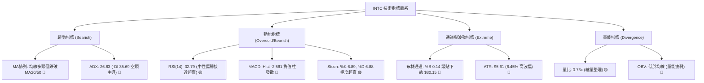

### 📈 移動平均線排列分析

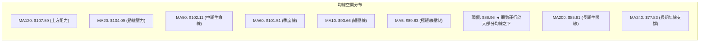

**均線狀態深度評估表**：

| 均線名稱 | 數值 ($) | 乖離率 (%) | 運行趨勢 | 多空意涵解讀 |
|----------|----------|------------|----------|--------------|
| **MA5** | $89.83 | -3.19% | 陡峭向下 ▁▁ | 股價受制於 5 日線壓制，超短期空頭動能尚未緩解 |
| **MA10** | $93.66 | -7.16% | 快速下行 ▁▁ | 下壓斜率陡峭，為反彈的第一道強動態阻力關卡 |
| **MA20** | $104.09 | -16.45% | 高位拐頭向下 ▆▅ | 負乖離率達 -16.45%，呈現嚴重短線超賣拉扯現象 |
| **MA50** | $102.11 | -14.84% | 走平轉跌 ▃▃ | 中期多空生命線宣告失守，轉化為中期沉重套牢反壓 |
| **MA200** | $85.81 | +1.34% | 穩定向上 ▇██ | 價格目前僅高於年線 1.34%，此處為長期牛熊定奪之關鍵支撐 |
| **MA240** | $77.83 | +11.74% | 持續走多 ███ | 超長週期均線維持向上，確認過去兩年大底部未被破壞 |

### 📉 RSI(14) 分析

- **RSI(14) 數值展示**：
  ```
  RSI(14) = 32.79   [ 弱勢區間 / 臨近超賣 ]
  0 ══════════ 30 ══════════════ 50 ══════════════ 70 ══════════ 100
  [██████████████░░░░░░░░░░░░░░░░░░░░░░░░░░░░░░░░░] 32.79%
  ```
- **區間評估**：RSI 讀數為 32.79，處於 30–70 之中性偏弱下沿。雖然尚未完全跌破 30 進入經典超賣區，但日線 Stoch 已跌至 6.89/6.88 的絕對超賣區，顯示空頭下殺動能已近尾聲，短線下行空間受限。
- **背離判斷**：
  - **結論**：依近 20 根 K 棒首尾之價格與 RSI 方向比對，**無明顯背離現象**。價格自高位跌落，RSI 亦同步由 60 以上下墜至 32.79，量價與指標維持同向順勢下行，說明此波下跌為實質性拋盤主導，而非虛跌或背離洗盤。

### 📊 MACD(12/26/9) 訊號解讀

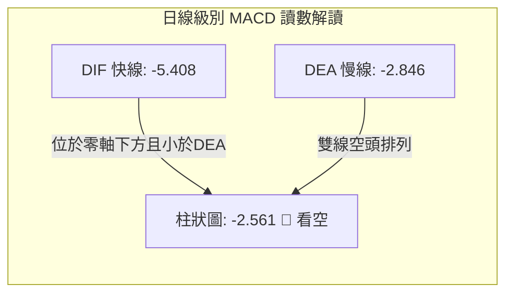

- **MACD 詳細數值解讀**：
  - DIF 快線 (-5.408) 位於零軸下方，且持續低於 DEA 慢線 (-2.846)。
  - MACD 柱狀圖為 -2.561，負值柱狀呈現空方擴散擴展。在零軸下方的死叉通常代表主跌浪或極弱勢整理，表明空方控盤動能依然強烈，目前尚未觀察到柱狀體收斂或紅柱翻揚的右側拐點訊號。

### 📦 布林通道分析

```
布林通道結構示意圖 (帶寬: $80.15 - $128.03)
價格軸 ($)
$128.03 ┼──────────────────────────────── 上軌 (UB)
$120.00 ┤
$110.00 ┤
$104.09 ┼┄┄┄┄┄┄┄┄┄┄┄┄┄┄┄┄┄┄┄┄┄┄┄┄┄┄┄┄┄ 中軌 (MA20)
$95.00  ┤
$86.96  ●════════════════════════════════ 現價 ($86.96, %B = 0.14)
$80.15  ┼──────────────────────────────── 下軌 (LB)
```

- **布林通道參數與現狀**：
  - 上軌：**$128.03** ｜ 中軌 (MA20)：**$104.09** ｜ 下軌：**$80.15**
  - **%B 指標**：**0.14**（接近 0.0，代表股價高度緊貼下軌運行）
  - **通道開口狀態**：由於近期連續急跌，布林通道帶寬顯著擴張，%B 跌至 0.14。當 %B < 0.15 時，股價通常處於通道下軌的「過度延伸」（Overextended）狀態，隨時存在技術性均值回歸（回抽中軌 $104.09）之物理修復需求。

### 💹 成交量分析（量價配合度）

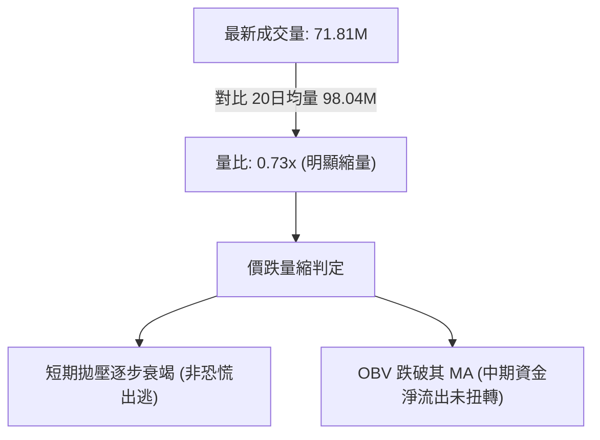

- **量價配合度解析**：
  - 2026-10-23 收盤價 $86.96，成交量僅 71,813,700 股，顯著低於 20 日均量 (98.04M) 及 50 日均量 (100.47M)，量比縮減至 **0.73x**。
  - 對比 2026-10-22 的放量下殺（134.13M 股、低點 $84.65），10-23 在低位出現了顯著的「縮量止跌」現象，顯示在 $85.00 關卡附近主動性空頭賣壓開始收斂。
  - **OBV (能量潮)**：系統顯示「OBV < MA → 量能疲弱」，在中期維度上資金依然呈現淨流出格局，確認目前的反彈僅屬於縮量超跌修復，並非增量主力進場發動的趨勢反轉。

---

## 6. 動能與波動率

### ⚡ 動能評估四象限

| 象限區間 | 動能特徵 | 波動率特徵 | 當前狀態判定 | 交易決策與風險評估 |
|----------|----------|------------|--------------|--------------------|
| **Q1 (最佳擴展)** | 強多頭動能 | 低波動率 | — | 主升浪初期，最優突破進場點 |
| **Q2 (盤整蓄勢)** | 弱動能 (中性) | 低波動率 | — | 沉澱期，適合觀望或區間網格操作 |
| **Q3 (極限搏殺)** | 強多頭動能 | 高波動率 | — | 狂熱主升浪，具備高風險高收益特徵 |
| **Q4 (主跌宣洩)** | **強空頭動能 (負向強)** | **高波動率 (ATR 6.45%)** | **✓ 當前 INTC 歸屬此象限** | **避免盲目重倉抄底，短線以超跌反彈快進快出為主** |

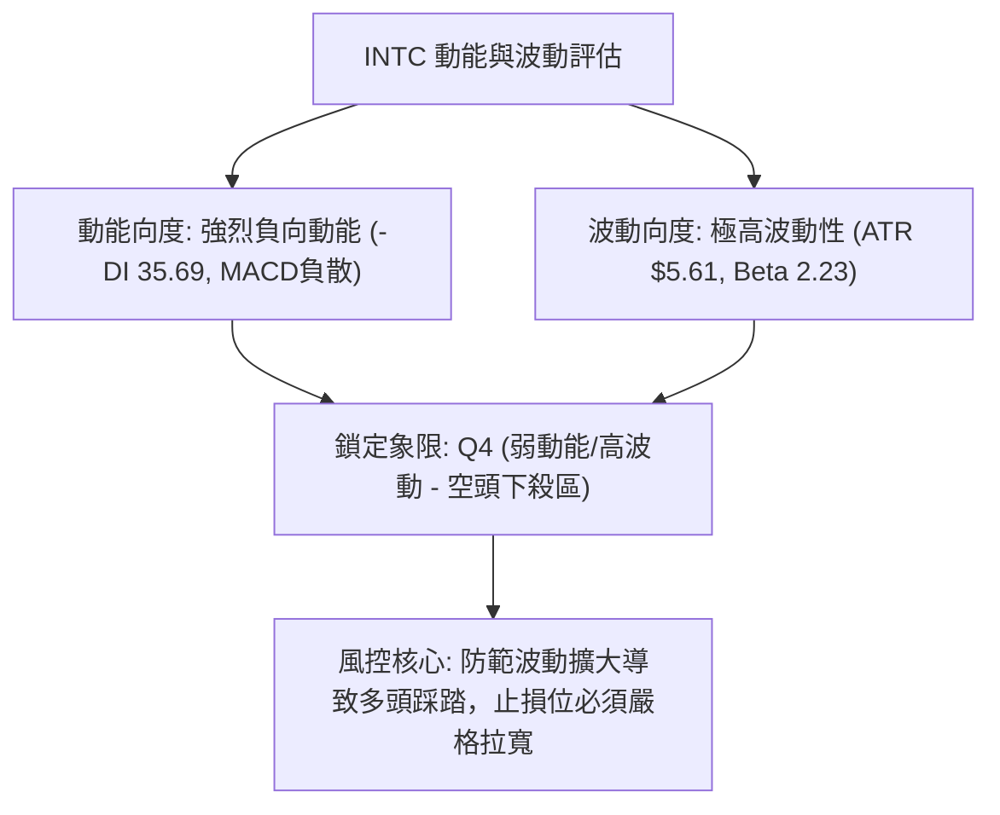

### 📊 ATR 波動率分析

- **ATR (14, Wilder)**：**$5.61**
- **波動率佔比**：佔當前股價 $86.96 的 **6.45%**（每日平均常態震盪區間達 $5.61，屬於半導體板塊中極高波動標的）。
- **止損距離建議**：
  - 基於短線波動防護，建議正常止損空間應設定在 **1.0 至 1.5 倍 ATR** 之間。
  - **1.0 倍 ATR 防護距離**：$5.61。
  - **1.5 倍 ATR 防護距離**：$8.42。
  - 若在當前價位（$86.96）附近做多，為避免被日線常態雜訊掃出場，嚴格的技術止損必須放置於關鍵低點 $84.65 與支撐 S1 $85.14 之下，或依據策略風控設定止損（詳見第 8 章）。

### 📐 Beta 與市場相關性

- **Beta 係數**：**2.23**
- **市場敏感度評估**：
  - INTC 的 Beta 數值高達 2.23，代表其波動敏感度為標普 500 指數的 2.23 倍。若大盤指數波動 1%，INTC 平均將產生 2.23% 的同向巨幅波動。
  - 在大盤整體承壓或科技板塊財報季來臨之際（如市場焦點之 10月29日財報），高 Beta 特性會迅速放大下行尾部風險，因此在持倉管理上必須嚴格控制槓桿與部位成數。

---

## 7. 多時框架總結

### 📋 時框架評分表

| 時框架 | 趨勢方向 | 動能狀態 | 均線排列 | 圖表形態 | 綜合評分 | 操作與策略建議 |
|--------|----------|----------|----------|----------|----------|----------------|
| **月線 (長期)** | 🟢 偏多 | 🟡 減弱 | 🟢 多頭 (MA200向上) | 自天價 $142.35 展開健康次級修正 | **65/100** | 長線多頭未死，逢低關注年線防禦 |
| **週線 (中期)** | 🔴 偏空 | 🔴 轉弱 (MACD負) | 🔴 跌破MA20/50 | 雙頂破頸線格局，連4週大陰下行 | **35/100** | 逢反彈減碼，暫不宜盲目重倉長多 |
| **日線 (短期)** | 🔴 空頭 | 🟢 超賣 (Stoch<10) | 🔴 空頭發散壓制 | 貼布林下軌震盪，微型雙底打底中 | **35/100** | 超跌反彈機會，僅適合短線快進快出 |

### 🔲 綜合訊號矩陣

```
時框架訊號矩陣評估：
長線維度 (月線)  [▓▓▓▓▓▓▓▓▓▓▓▓█░░░░░░░]  65%  🟢 長期基底 (MA200 $85.81 尚存)
中線維度 (週線)  [▓▓▓▓▓▓█░░░░░░░░░░░░░]  35%  🔴 中期回撤 (連四陰，空方主導)
短線維度 (日線)  [▓▓▓▓▓▓█░░░░░░░░░░░░░]  35%  🔴 短期承壓 (均線空頭排列，指標超賣)
──────────────────────────────────────────────────────────────────
一致性判定：長多與中短空發生結構性衝突，處於長期多頭架構下的「中級深幅修正波」。
```

### ⚖️ 多時框收斂結論

- **收斂規則執行**：
  1. **行情性質判定**：當前日線 ADX(14) 讀數為 **26.63 > 25**，且 -DI (35.69) 遠大於 +DI (14.26)，因此系統嚴格判定當前屬於 **「趨勢行情（空頭強趨勢）」**，而非盤整行情。
  2. **多時框優先級權衡**：在 ADX > 25 的趨勢行情下，交易邏輯應以中長期均線（週線 MA50 $102.11 與 MA200 $85.81）及主導趨勢方向為最高依歸。雖然日線 Stoch (%K 6.89) 與布林通道 (%B 0.14) 呈現嚴重超賣，但週線連續 4 週大陰線摜破中期支撐，表明空頭趨勢力量依然佔據統治地位。
  3. **收斂方向唯一性定調**：**【偏空主導，順勢做空為主要策略，超跌反彈僅供輔助】**。第 1 章技術評分卡算術平均為 **38/100 (≤ 40)**，依策略路由規則，第 8 章之核心策略**全面主推「逢高做空／破位順勢做空」**，任何多頭操作僅列為超跌反彈交易與風控防範考量。

---

## 8. 交易策略建議

### 🗺️ 策略決策流程圖

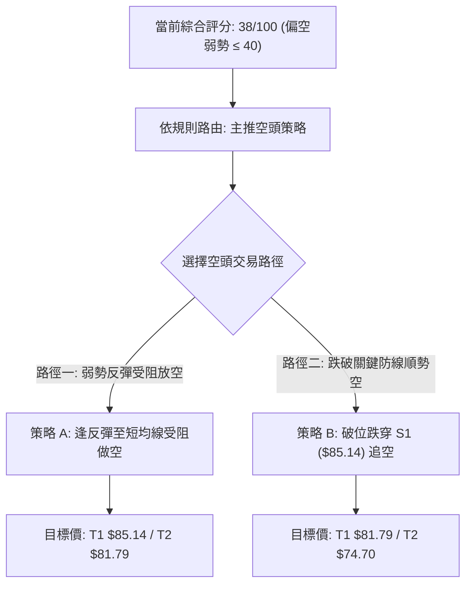

### 🧭 策略路由（依評分卡分流，不得兩頭下注）

> **當前主策略方向 = 【偏空主推策略（依評分卡綜合評分 38/100 ≤ 40 定調）】**

### 🎯 價格情境階梯（Price Scenarios）

價位嚴格引用第 4 章「關鍵價位與支撐阻力」之精確數值：

| 觸發條件 | 下一目標 | 後續延伸 | 情境含義與技術解讀 |
|----------|----------|----------|--------------------|
| **向上突破 R1 $107.13** | **R2 $127.04** | **R3 $132.75** | 中期空頭架構徹底扭轉，多頭重啟主升浪挑戰年內高點 |
| **向上反彈測試 MA10 $93.66** | **MA20 $104.09** | **R1 $107.13** | 日線極度超賣引發之正常均值回歸修復，遇阻仍是空點 |
| **現價 $86.96 震盪整理** | **S1 $85.14** | **斐波50% $87.62** | 多空於年線 MA200 ($85.81) 展開存亡保衛戰，等待財報催化 |
| **向下有效跌破 S1 $85.14** | **S2 $81.79** | **斐波61.8% $74.70** | 年線宣告失守，多頭全面潰敗，中期修正向深水區擴展 |
| **向下摜破 S2 $81.79** | **斐波61.8% $74.70** | **S3 $42.58** | 跌破布林下軌保護，引發長期多殺多恐慌性踩踏 |

### 📊 情境機率分佈

| 交易情境 | 發生機率 | 主要技術與量能依據 |
|----------|----------|--------------------|
| **情境一：受阻回落 / 跌破支撐下行** | **55%** | ADX(14)=26.63 強趨勢確立，-DI(35.69) 空方主導；MACD 柱狀 (-2.561) 負散；OBV 疲軟量能不足 |
| **情境二：區間窄幅震盪 (基底整固)** | **30%** | 日線 Stoch 極度超賣 (%K 6.89)；布林下軌 $80.15 支撐；年線 MA200 $85.81 與 S1 $85.14 具備買盤托底 |
| **情境三：展開強勁 V 型大反轉** | **15%** | 均線系統全面呈空頭排列壓制 (MA5/10/20/50 全線下壓)，無實質成交量配合，大反轉機率極低 |

### 🔴 主推空頭策略詳情

> **風險報酬比公式**：做空時風險報酬比 = (進場價 − 目標價 T1) ÷ (止損價 − 進場價)。以精確進場價格計算，寫出的比值嚴格能由同一欄數值算回。

| 策略要素 | 策略 A（反彈受阻高空） | 策略 B（跌破 S1 順勢追空） |
|----------|------------------------|----------------------------|
| **交易邏輯** | 順應日線空頭趨勢，趁短線超賣反抽至壓力位遇阻進場 | 跌破年線與關鍵波段低點聚類，追擊主跌浪延伸 |
| **進場條件** | 股價反彈至 MA10 ($93.66) 附近出現上影線滯漲訊號 | 日線收盤價跌破 S1 ($85.14)，或盤中摜穿 $85.00 |
| **進場價格** | **$93.66**（精確取 MA10 阻力數值） | **$85.00**（跌破 S1 $85.14 後之關鍵整數觸發點） |
| **目標價 T1** | **$85.14**（關鍵支撐位 S1） | **$81.79**（強支撐位 S2 / 逼近布林下軌） |
| **目標價 T2** | **$81.79**（強支撐位 S2） | **$74.70**（斐波那契 61.8% 黃金分割回調位） |
| **止損價格** | **$97.67**（取 10/14 日 K 線最低點阻力） | **$86.96**（以當前收盤價作為假突破之嚴格止損） |
| **風險報酬比** | **1 : 2.12**（以 T1 計）<br>*(93.66−85.14)/(97.67−93.66) = 8.52/4.01 = 2.124*<br>*(以 T2 計為 1 : 2.96)* | **1 : 1.64**（以 T1 計）<br>*(85.00−81.79)/(86.96−85.00) = 3.21/1.96 = 1.637*<br>*(以 T2 計為 1 : 5.25)* |
| **成功機率** | **65%** | **55%** |
| **建議倉位** | **15%**（控制在總部位 15% 以內） | **10%**（動量突破追空，宜輕倉操作） |

### 🟢 反向風險觸發點（多頭反轉對沖提示）

若出現以下技術訊號，將宣告主推之空頭策略失效，交易員應即刻平倉空頭並考慮轉向：
1. **價格強勢站穩 MA20 ($104.09)**：若日線放量收復 MA20 及斐波 38.2% ($100.54)，代表中級下修宣告結束。
2. **突破 R1 關鍵阻力 ($107.13)**：若突破 R1，雙頂形態失敗，多頭趨勢反轉成形。
3. **MACD 出現零軸下底背離金叉**：若 DIF 快線向上穿越 DEA 慢線，且伴隨量比 > 1.5x 爆量，應停止做空。

### ⭐ 整體訊號強度評星

```
做多訊號強度：★★☆☆☆  (2/5星 - 僅存超賣指標鈍化與年線基底)
做空訊號強度：★★★★☆  (4/5星 - 均線空頭排列，趨勢強度ADX主導)
整體可信度：  ★★★☆☆  (3/5星 - 財報公佈在即，須防範高波動裂口風險)
```

---

## 9. 風險提示與監控

### ✅ 關鍵監控指標 Checklist

```
╔══════════════════════════════════════════════════════════════════╗
║                   交易監控指標 CHECKLIST                         ║
╠══════════════════════════════════════════════════════════════════╣
║ [ ] 支撐防守測試：收盤價是否連續 2 日跌破 S1 ($85.14) 與年線   ║
║ [ ] 動態阻力突破：反彈能否有效收復 MA10 ($93.66) 與 MA20      ║
║ [ ] 趨勢指標異動：ADX(14) 是否持續維持在 25 以上，-DI 是否收斂  ║
║ [ ] 波動異常預警：單日波幅是否超過 1.5 倍 ATR ($8.42)           ║
║ [ ] 動能超賣修復：Stoch %K 是否自 <10 區域形成黃金交叉上穿 %D  ║
║ [ ] 重大事件節點：緊密鎖定 2026-10-29 盤後 Intel 財報發布        ║
╚══════════════════════════════════════════════════════════════════╝
```

### ⚠️ 風險場景分析

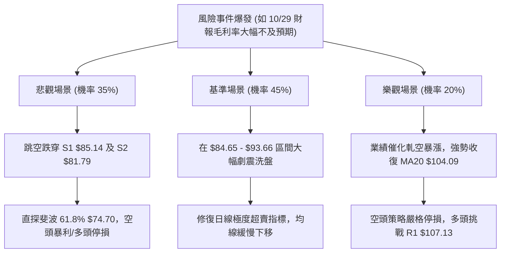

### 🛡️ 風險管理重要提醒

1. **事件型裂口風險（Event-Driven Gap Risk）**：
   - 根據最新資訊，Intel 關鍵財報與利潤率測試即將於 **10月29日** 揭曉。在財報發布前後，隱含波動率將大幅飆升，極易出現高達 10%–15% 的跳空缺口，這可能直接導致任何技術止損指令以滑價執行。建議在財報公布前夕，應將整體部位壓縮至正常水位之 30% 以下，或藉由期權進行下行保護。
2. **高 Beta 波動懲罰**：
   - INTC 當前 Beta 高達 **2.23**，ATR 佔比達 **6.45%**。在持倉資金管理上，單筆交易的最大容許虧損金額嚴格不得超過總資產淨值的 **1.5%**。
3. **左側交易禁忌**：
   - 儘管 Stoch (%K 6.89) 處於個位數極端超賣，但在 ADX > 25 的強空頭趨勢下，指標超賣往往以「鈍化再鈍化」的方式向下破位，切忌在未見到明確的「右側雙底成形且放量收復短期均線」前盲目重倉抄底。

---

## 📋 報告總結

```
╔══════════════════════════════════════════════════════════════════╗
║                    INTC 技術分析報告總結                         ║
╠══════════════════════════════════════════════════════════════════╣
║ 報告日期：2026-10-26                                             ║
║ 當前價格：$86.96                                                 ║
║ 綜合評分：38/100 (算術平均值)                                    ║
║ 分析評級：🔴 偏空弱勢 (強空頭趨勢下之超賣整理)                   ║
╠══════════════════════════════════════════════════════════════════╣
║ 關鍵結論：                                                       ║
║ ├─ 長期趨勢：🟢 偏多但面臨考驗，股價緊貼年線 MA200 ($85.81) 運行 ║
║ ├─ 中期趨勢：🔴 空頭主導，週線連續 4 週大陰線回撤，雙頂結構確立  ║
║ ├─ 短期趨勢：🔴 弱勢承壓，均線空頭排列，但日線動能指標嚴重超賣   ║
║ ├─ 關鍵支撐：S1: $85.14 ｜ S2: $81.79 ｜ 斐波61.8%: $74.70       ║
║ ├─ 關鍵阻力：MA10: $93.66 ｜ MA20: $104.09 ｜ R1: $107.13        ║
║ └─ 分析師目標：共識買入評級，平均目標價 $117.14 (區間 $80-$200)   ║
╠══════════════════════════════════════════════════════════════════╣
║ 最優策略組合：                                                   ║
║ 1. 🥇 最佳機會：策略 A (逢反彈至 MA10 $93.66 受阻做空，R/R 2.12) ║
║ 2. 🥈 次選機會：策略 B (有效跌破 S1 $85.14 順勢追空，R/R 1.64)   ║
║ 3. 🥉 保守選擇：空手觀望，靜待 10月29日 財報公布後多空定奪再進場 ║
╚══════════════════════════════════════════════════════════════════╝
```

---

> ⚠️ **免責聲明**：本報告為 AI 自動生成之技術分析，所有數據及估算均基於提供的歷史價格資訊。本報告**僅供研究與學術參考**，**不構成任何投資建議**。投資有風險，入市需謹慎。

---

*報告生成時間：2026-10-26 ｜ 數據來源：Yahoo Finance ｜ 分析框架：多時框技術分析*