# INTC 技術分析報告

> **報告日期**：2026-10-27 ｜ **語言**：繁體中文 ｜ **數據來源**：Yahoo Finance ｜ **當前價格**：$90.47 USD

---

## 目錄

| 章節 | 內容 |
|------|------|
| [1. 技術面概覽](#1-技術面概覽) | 訊號儀表板、核心指標、評分卡 |
| [2. 趨勢分析](#2-趨勢分析) | 多時框趨勢、長中短期走勢 |
| [3. 圖表形態分析](#3-圖表形態分析) | 形態識別、K線組合、目標價 |
| [4. 支撐與阻力](#4-支撐與阻力) | 關鍵價位、斐波那契回調 |
| [5. 技術指標深度解讀](#5-技術指標深度解讀) | MA/RSI/MACD/布林/成交量 |
| [6. 動能與波動率](#6-動能與波動率) | 動能評估、ATR、Beta |
| [7. 多時框架總結](#7-多時框架總結) | 時框架評分矩陣 |
| [8. 交易策略建議](#8-交易策略建議) | 多空策略、風險報酬比 |
| [9. 風險提示與監控](#9-風險提示與監控) | 監控指標、風險場景 |

---

## 1. 技術面概覽

### 🎯 技術訊號儀表板

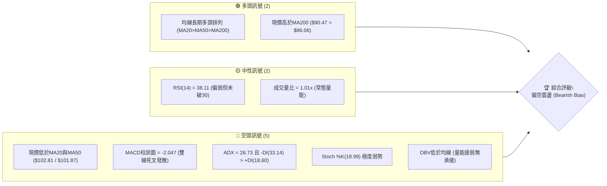

### 📊 核心指標速覽表

| 指標類別 | 指標名稱 | 當前數值 | 訊號 | 解讀 |
|:---|:---|:---|:---:|:---|
| **價格** | 當前價格 | $90.47 | 🔴 | 跌破短期所有均線，回測長期支撐區間 |
| **均線** | MA20 | $102.81 | 🔴 | 價格在MA20下方 -12.00%，短期下行趨勢顯著 |
| **均線** | MA50 | $101.87 | 🔴 | 價格在MA50下方 -11.19%，中期承壓 |
| **均線** | MA200 | $86.06 | 🟢 | 價格在MA200上方 +5.12%，長期牛熊分界線仍有保護 |
| **動能** | RSI(14) | 38.11 | 🟡 | 位於弱勢中性區間（30–40），尚未進入極端超賣 |
| **動能** | MACD(12,26,9) | -5.405 / -3.358 | 🔴 | 柱狀圖 -2.047，死叉擴大中，空方動能充沛 |
| **波動** | ATR(14) | $5.61 (6.21%) | 🔴 | 每日波動高達 6.21%，短線操作滑價與回撤風險高 |

### 🏆 技術評分卡

```
技術評分卡 — INTC (2026-10-27)
════════════════════════════════════════════════════
趨勢強度      ████████░░░░░░░░░░░░  40/100  🔴 空方強趨勢主導
動能指標      ██████░░░░░░░░░░░░░░  30/100  🔴 MACD與Stoch持續弱勢
支撐穩定度    ████████████░░░░░░░░  60/100  🟡 臨近S1/S2與MA200匯聚區
成交量配合    ████████░░░░░░░░░░░░  40/100  🔴 OBV<MA量能潰散，缺乏主力承接
形態完整度    ████████░░░░░░░░░░░░  40/100  🔴 頭部下破後進入弱勢尋底
均線排列      ████████████░░░░░░░░  60/100  🟡 長期多頭框架仍存(MA20>50>200)但短期遭跌破
════════════════════════════════════════════════════
綜合評分      █████████░░░░░░░░░░░  45/100  中性偏空（區間破位，探底考驗）
════════════════════════════════════════════════════
計算驗證：(40 + 30 + 60 + 40 + 40 + 60) ÷ 6 = 270 ÷ 6 = 45/100
```

---

## 2. 趨勢分析

### 🌐 多時框趨勢分析

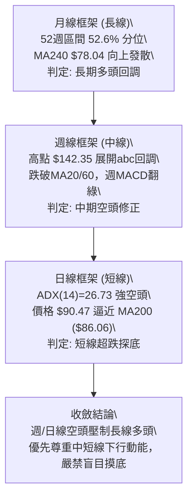

### 📈 長期趨勢 — 12個月走勢圖（Unicode）

```
INTC 月線走勢圖（過去12個月：2025-11 至 2026-10）
價格軸 ($)
$140 ┤                                     ● (2026-06: 139.63 / 52W High $142.35)
$130 ┤                                    ╱ ╲
$120 ┤                                   ╱   ╲            ● (2026-09: 120.23)
$110 ┤                             ●    ╱     ╲          ╱ ╲
$100 ┤                            ╱ ╲  ╱       ╲        ╱   ╲
 $90 ┤                      ●    ╱   ╲╱         ●──────●─────● ← 現價 $90.47
 $80 ┤                     ╱    ╱              (07:90.20)(08:89.51)(10:90.47)
 $70 ┤                    ╱    ╱
 $60 ┤                   ╱    ╱
 $50 ┤                  ╱    ╱
 $40 ┤ ●──────●        ●    ╱
 $30 ┤         ╲      ╱    ╱
     └─┬──────┬──────┬──────┬──────┬──────┬──────┬──────┬──────┬──────┬──────┬──────┬─
     11/25  12/25  01/26  02/26  03/26  04/26  05/26  06/26  07/26  08/26  09/26  10/26
```

#### 走勢特徵分析表格

| 階段區間 | 起止價格 | 漲跌幅 | 形態特徵與動能演變 |
|:---|:---:|:---:|:---|
| **築底啟動期**<br>(2025-11 ~ 2026-03) | $40.56 → $44.13 | +8.80% | 於 $36.90 ~ $46.47 構築底部平台，成交量溫和沉澱 |
| **主升浪噴發期**<br>(2026-04 ~ 2026-06) | $94.48 → $139.63 | +47.79% | 爆發性單邊行情，創下 52 週歷史高點 $142.35 |
| **首輪暴跌與震盪**<br>(2026-07 ~ 2026-08) | $90.20 → $89.51 | -0.77% | 自高點無量閃崩至 $90 水平，構築雙重回撤低點 |
| **次高點誘多反彈**<br>(2026-09) | $89.51 → $120.23 | +34.32% | 快速回抽至 $120.23，受制於 R2 阻力帶，量能未能創新高 |
| **次輪殺跌探底**<br>(2026-10 即時) | $120.23 → $90.47 | -24.75% | 週線連續破位，日線回落至前期 7-8 月支撐平台，考驗牛熊線 |

### 📊 中期趨勢（週線分析）

```
INTC 週線關鍵結構與近期壓力支撐架構
──────────────────────────────────────────────────────────────────
 $142.35  ════════════════════════════════════════  52週歷史高點 (波段頂部)
          │
 $127.04  ────────────────────────────────────────  週線頭部頸線 / R2 阻力位
          │      [2026-09 反彈高點 $127.44]
 $107.13  ────────────────────────────────────────  R1 關鍵阻力 / MA20-MA50密集區
          │      [下行破位點]
  $90.47  ········································  ◄ 當前收盤價 ($90.47)
          │
  $89.59  ────────────────────────────────────────  S1 頸線支撐位 (近3週低點群)
  $86.06  ────────────────────────────────────────  日線 MA200 牛熊分水嶺
  $85.14  ════════════════════════════════════════  S2 核心支撐位 (10/22最低點 $84.65)
  $81.79  ────────────────────────────────────────  S3 極限支撐位 (波段下軌延伸)
──────────────────────────────────────────────────────────────────
```

### ⚡ 趨勢強度評估（ADX 解讀）

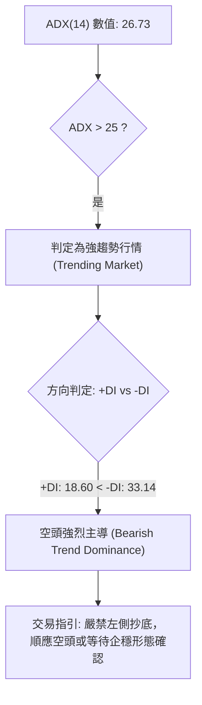

#### ADX 強度對照與解讀

| 指標變數 | 當前讀數 | 門檻區間 | 技術含義 |
|:---|:---:|:---:|:---|
| **ADX(14)** | 26.73 | > 25.00 | 確認目前處於趨勢行情而非無方向橫盤，波動具有方向慣性 |
| **+DI (14)** | 18.60 | 弱勢區間 (<20) | 多方動能極度渙散，買盤不具備發動攻擊的能力 |
| **-DI (14)** | 33.14 | 強勢區間 (>30) | 空方佔據絕對壓倒性優勢，下行賣壓持續釋放 |
| **趨勢綜合** | 🔴 空方趨勢 | 強趨勢下行 | 依規則 14，系統處於「趨勢行情」，以週線/MA50/MA200方向為主導 |

---

## 3. 圖表形態分析

### 🔍 形態識別系統

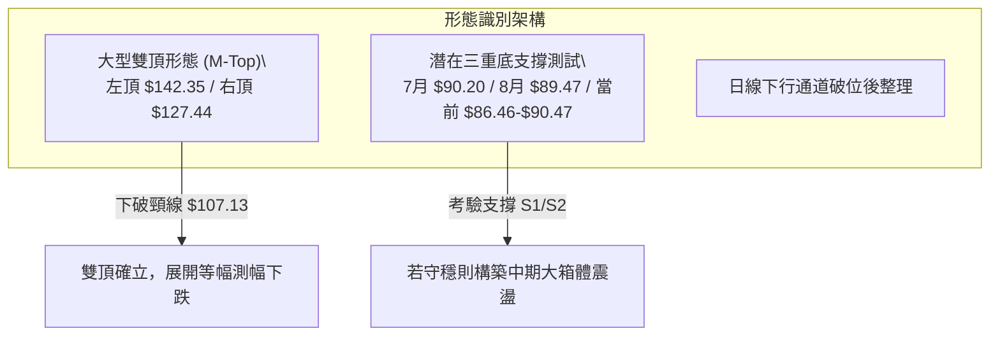

#### 形態信心度與目標價計算（依規則 15）

| 形態名稱 | 信心度 | 判斷依據（引用數據） | 完成度 | 目標價（附精確計算式） |
|:---|:---:|:---|:---:|:---|
| **中級雙頂 (Double Top)** | **75%** | 左頂 2026-06 高點 $142.35，右頂 2026-09-25 高點 $127.44，跌破中期頸線位 R1 ($107.13) | 85% | 頸線 $107.13 − (形態次高 $127.44 − 頸線 $107.13) = $107.13 − $20.31 = **$86.82** (接近MA200與S2) |
| **大箱體底邊支撐測試** | **55%** | 2026-07 收盤 $90.20、2026-08 收盤 $89.51 與目前 2026-10 收盤 $90.47 重疊於 S1 ($89.59) 附近 | 50% | 區間底 $89.59 + (區間頂 R1 $107.13 − $89.59) = $89.59 + $17.54 = **$107.13** (反彈目標) |
| **短期頭肩頂** | <40% | 數據中左肩與右肩結構不對稱，成交量無典型縮放 | 0% | 訊號不足，僅做指標型解讀，不預設形態目標價 |

### 🕯️ 重要K線形態分析（嚴格依據近10根日K與近8根週K）

| 日期（週期） | 開盤價 | 最高價 | 最低價 | 收盤價 | K線形態名稱 | 形態特徵與技術解讀 | 訊號 |
|:---|:---:|:---:|:---:|:---:|:---|:---|:---:|
| **2026-10-15 (日K)** | 93.61 | 96.87 | 90.02 | 95.37 | 長下影中陽線 | 下探 90 整數關卡獲買盤承接，但成交量 1.47 億股帶有恐慌盤 | 🟡 |
| **2026-10-16 (日K)** | 93.48 | 94.22 | 89.19 | 89.85 | 實體下破陰線 | 跳空開低，實體跌破 $90.00，破位確立，延續空方走勢 | 🔴 |
| **2026-10-22 (日K)** | 87.92 | 89.19 | 84.65 | 85.49 | 大陰線（放量下殺）| 放量 1.34 億股摜破 S2 ($85.14)，創波段新低 $84.65，恐慌拋補 | 🔴 |
| **2026-10-23 (日K)** | 85.92 | 87.87 | 84.74 | 86.96 | 探底小陽線 | 未破前日低點 $84.65，成交量萎縮至 7,209 萬股，下行賣壓動能減退 | 🟡 |
| **2026-10-26 (日K)** | 87.94 | 92.09 | 86.46 | 90.47 | 低開高走中陽線 | 吞噬前一日實體，最高觸及 $92.09，成功收復 S1 ($89.59)，多頭反撲 | 🟢 |
| **2026-10-16 (週K)** | 102.52 | 103.19 | 89.19 | 89.85 | 斷頭穿頭大陰棒 | 週跌幅逾 14%，單週跌破百元大關與多道均線，形成絕對下壓形態 | 🔴 |
| **2026-10-23 (週K)** | 94.53 | 95.39 | 84.65 | 86.96 | 長下影十字錘頭 | 最低下探 $84.65 後收盤拉回 $86.96，帶有強烈下影線防禦意圖 | 🟡 |

### 📉 ASCII 走勢形態示意圖

```
雙頂結構與近期下破支撐示意圖
─────────────────────────────────────────────────────────────────
               頂1: $142.35
                 ▲
                ╱ ╲                  頂2: $127.44
               ╱   ╲                   ▲
              ╱     ╲                 ╱ ╲
             ╱       ╲               ╱   ╲
            ╱         ╲             ╱     ╲
───────────╱───────────▼───────────╱───────▼────────────────────
頸線位 R1: $107.13     反彈谷底           跌破頸線點 (10/09)
                       $89.47              ╲
                                            ╲   日線反抽阻力 MA10 $92.58
                                             ╲    ┌──► 現價 $90.47
──────────────────────────────────────────────▼──┴──────────────
支撐位 S1: $89.59  -------------------------- 10/26 收復
支撐位 S2: $85.14  -------------------------- 10/22 低點 $84.65 (極限防守)
─────────────────────────────────────────────────────────────────
```

### 🎯 形態目標價計算

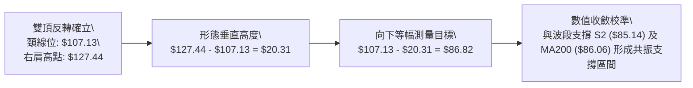

---

## 4. 支撐與阻力

### 🗺️ 關鍵價位分布圖（Unicode）

```
INTC 價位結構分布圖（嚴格依據 OHLCV 計算聚類點位）
═════════════════════════════════════════════════════════════════
 $142.35 ║████████████████████████████████║ 52W 最高點 / 斐波 0.0%
 $132.75 ║████████████████████████        ║ 強阻力 R3 (+46.73%)
 $127.04 ║████████████████████████████    ║ 阻力 R2 (+40.42%) / 右頂頸線
 $116.52 ║████████████████                ║ 斐波那契 23.6% 回調位
 $107.13 ║████████████████████████████████║ 關鍵阻力 R1 (+18.41%) / MA120
 $100.54 ║████████████████████            ║ 斐波那契 38.2% 回調位 / 百元心理關卡
  $90.47 ╠════════════════════════════════╣ ◄ 當前收盤價 ($90.47)
  $89.59 ║▓▓▓▓▓▓▓▓▓▓▓▓▓▓▓▓▓▓▓▓▓▓▓▓        ║ 近期支撐 S1 (-0.97%)
  $87.62 ║▓▓▓▓▓▓▓▓▓▓▓▓▓▓▓▓                ║ 斐波那契 50.0% 多空分水嶺
  $86.06 ║████████████████████████        ║ 技術指標 MA200 (牛熊分界線)
  $85.14 ║████████████████████████████████║ 強支撐 S2 (-5.89%) / 前低 $84.65
  $81.79 ║████████████████                ║ 極限支撐 S3 (-9.59%)
  $74.70 ║████████████████████            ║ 斐波那契 61.8% 黃金分割位
═════════════════════════════════════════════════════════════════
```

### 🚧 阻力位分析表

| 阻力級別 | 價位 | 形成原因 | 突破難度 | 重要性 |
|:---|:---:|:---|:---:|:---|
| **第一阻力 (R1)** | **$107.13** | 近一年波段高點聚類、MA120 ($107.44) 匯聚、前期大箱體頸線下破點 | 極高 | ★★★★★<br>多頭反轉的生命線，站穩方能扭轉頹勢 |
| **第二阻力 (R2)** | **$127.04** | 2026-09-25 週K高點聚類 ($127.44)、布林通道上軌 ($126.80) | 極高 | ★★★★☆<br>中期波段頂部，空頭重兵防守區 |
| **第三阻力 (R3)** | **$132.75** | 2026-06 波段回落前次高點聚類、歷史套牢盤密集套牢區 | 極限 | ★★★☆☆<br>長期牛市延續目標位 |

### 🛡️ 支撐位分析表

| 支撐級別 | 價位 | 形成原因 | 守住機率 | 重要性 |
|:---|:---:|:---|:---:|:---|
| **第一支撐 (S1)** | **$89.59** | 近一年波段低點聚類、2026-07/08 月線收盤聚類 ($90.20/$89.51) | 60% | ★★★☆☆<br>短線防線，10/26 收盤已勉強收復 |
| **第二支撐 (S2)** | **$85.14** | 近一年波段低點聚類、10/22 最低點 $84.65 緩衝區、斐波 50% ($87.62) 延伸防禦 | 75% | ★★★★★<br>核心生命線，跌破將引發大規模停損賣壓 |
| **第三支撐 (S3)** | **$81.79** | 近一年波段極端低點聚類、逼近布林通道下軌 ($78.82) | 85% | ★★★★☆<br>空頭力竭買盤區，強烈超賣價值支撐 |

### 📐 斐波那契回調位分析

依據 52 週完整波動區間（低點 $32.89 → 高點 $142.35，波幅 $109.46）嚴格計算：

| 回調比例 | 斐波那契價位 | 當前價位相對位置與意義解讀 |
|:---:|:---:|:---|
| **0.0%** | **$142.35** | 52 週最高點，波段絕對頂部 |
| **23.6%** | **$116.52** | 中期回調第一關卡，已於 10 月初失守，轉化為強壓力 |
| **38.2%** | **$100.54** | 強勢回調防線與心理百元關卡重疊，失守後確認進入深度回檔 |
| **50.0%** | **$87.62** | **多空中級平衡分水嶺**。當前價格 $90.47 處於 38.2% ($100.54) 與 50.0% ($87.62) 之間。<br>目前價格正於 50.0% 回調位上方進行防禦性震盪，此處為牛市回檔的最關鍵臨界線。 |
| **61.8%** | **$74.70** | 黃金分割強支撐位，接近 MA240 ($78.04)，若 50% 失守將直測此區 |
| **78.6%** | **$56.31** | 深度回調極限，牛市架構破壞點 |
| **100.0%** | **$32.89** | 52 週最低點，本輪行情歷史起點 |

---

## 5. 技術指標深度解讀

### 🎛️ 指標訊號總覽

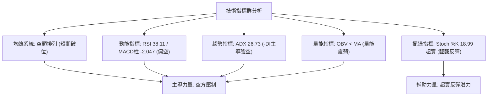

### 📈 移動平均線排列分析

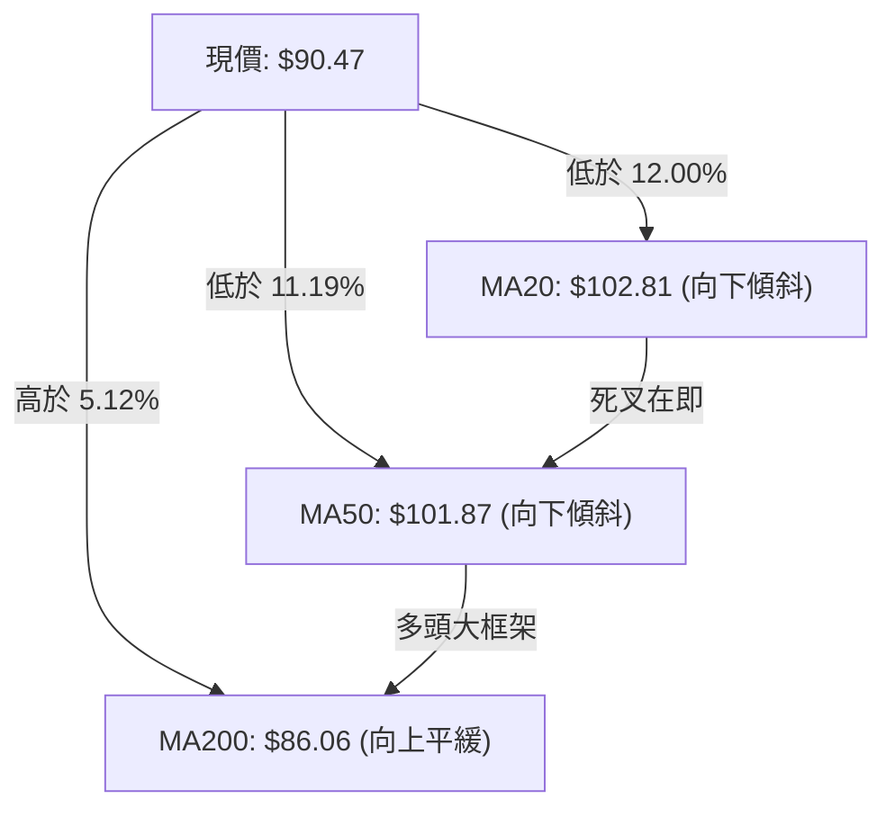

#### 均線數據深度對照

| 均線名稱 | 價位 | 距離現價幅度 | 形態走勢方向 | 技術狀態與涵義 |
|:---|:---:|:---:|:---:|:---|
| **MA 5** | $89.51 | +1.07% | ▲ 微幅翻揚 | 現價重新站上5日線，短線連續兩日反彈，初步止血 |
| **MA 10** | $92.58 | -2.28% | ▼ 急劇下墜 | 短線第一道動態阻力，壓制反彈空間 |
| **MA 20** | $102.81 | -12.00% | ▼ 下行發散 | 20日布林中軌，短中期多空分界線，阻力沉重 |
| **MA 50** | $101.87 | -11.19% | ▼ 下行走平 | 中期生命線，MA20與MA50面臨高位死叉威脅 |
| **MA 60** | $101.52 | -10.88% | ▼ 震盪下行 | 季線阻力群形成三重頭頂蓋 |
| **MA 120** | $107.44 | -15.80% | ▼ 下行拐頭 | 與 R1 ($107.13) 重合，構成中長期強壓 |
| **MA 200** | $86.06 | +5.12% | ▲ 持續上行 | **牛熊分界線**，歷史長線支撐，目前多頭最後堡壘 |
| **MA 240** | $78.04 | +15.92% | ▲ 穩定爬升 | 遠期年線支撐，與布林下軌 ($78.82) 形成共振底 |

### 📉 RSI(14) 分析

- **當前讀數**：38.11（Wilder 算法）
- **強度進度條**：`███████░░░░░░░░░░░░░` 38.11% （處於弱勢空方主導區間 30–50）
- **超買超賣狀態**：
  - 未達到 <30 的絕對超賣閾值，顯示空頭拋壓雖強但未引發徹底的恐慌性無差別拋售。
  - 與 2026-10-16 週線收盤時 RSI(14)=31.4 相比，日線動能微幅修復，屬於下跌趨勢中的中繼整理。
- **背離判斷**：
  - **日線背離**：無明顯背離。20根K棒首尾（10/13收盤 $102.81至10/26收盤 $90.47）價格下行，RSI同步走低，空方動能一致。
  - **週線背離**：無底背離跡象，MACD柱與RSI在9月至10月間同步由正轉負，量價走勢吻合。

### 📊 MACD(12,26,9) 訊號解讀


- **快慢線位置**：DIF (-5.405) 與 Signal (-3.358) 均深處零軸下方，屬於典型空頭市場特徵。
- **柱狀圖動態**：當前 Hist 為 -2.047，較前幾日的極端負值略有收斂（日K圖顯示10/22至10/26有企穩微彈），但尚未見到零軸下方的黃金交叉訊號。空頭防守反擊仍有隨時被空方回壓的風險。

### 📦 布林通道分析 (Bollinger Bands, 20, 2)

```
布林通道結構示意圖 (現價 $90.47, %B = 0.24)
────────────────────────────────────────────────────────────────
上軌  $126.80  ──────────────────────────────────────────── (R2 阻力區)
               │
中軌  $102.81  -------------------------------------------- (MA20 阻力位)
               │
現價   $90.47  ···············▲···························· (%B = 0.24)
               │              │
下軌   $78.82  ═══════════════╧════════════════════════════ (極限超賣支撐)
────────────────────────────────────────────────────────────────
通道帶寬 (Bandwidth) = ($126.80 − $78.82) ÷ $102.81 = 46.67% (極度張開，波動放大)
```

- **通道形態解讀**：布林帶寬高達 46.67%，呈現下軌向下發散、中軌急傾斜向下的「開口向下」擴張態勢，屬於強烈空頭單邊波段特徵。
- **%B 指標**：0.24。價格處於中軌與下軌之間的下半區，且臨近下軌。雖然未跌破 0.00 極端超賣區，但 %B < 0.30 顯示價格嚴重偏離均值，隨時存在向中軌 $102.81 均值回歸的技術性反抽需求。

### 💹 成交量分析（量價配合度）

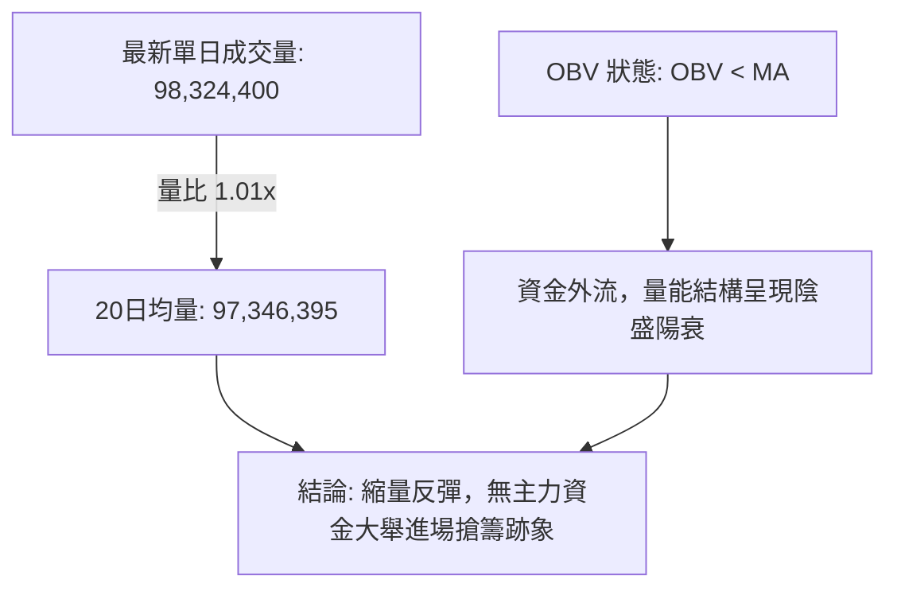

- **量比與均量對比**：最新量 98.32M 與 20日均量 97.35M 基本持平（量比 1.01），但顯著低於 10/15 殺跌時的 147.16M 及 10/22 的 134.13M。這說明近兩日從 $84.65 回升至 $90.47 的反彈是「空頭獲利回補」所驅動，而非「主動性增量多頭資金」推升。
- **OBV 趨勢評估**：數據明確標示「OBV < MA → 量能疲弱」。OBV 處於均線下方持續下行，量能並未確認當前價格的反彈，存在量價背離隱憂，反彈高度受限。

---

## 6. 動能與波動率

### ⚡ 動能評估四象限

| 象限標籤 | 動能狀態 | 波動率狀態 | INTC 當前坐標判定 | 策略指導涵義 |
|:---:|:---:|:---:|:---:|:---|
| **第一象限 (Q1)** | 強動能 (多方) | 低波動 | — | 最佳波段順勢作多環境 |
| **第二象限 (Q2)** | 弱動能 (中性) | 低波動 | — | 窄幅盤整，等待方向選擇 |
| **第三象限 (Q3)** | 強動能 (單邊) | 高波動 | — | 趨勢突破，激進追隨主趨勢 |
| **第四象限 (Q4)** | **弱多強空動能** | **高波動** | **✓ INTC 當前位置**<br>(ADX 26.73, ATR 6.21%) | **下行高風險區：做多勝率極低，操作宜嚴控倉位與止損** |

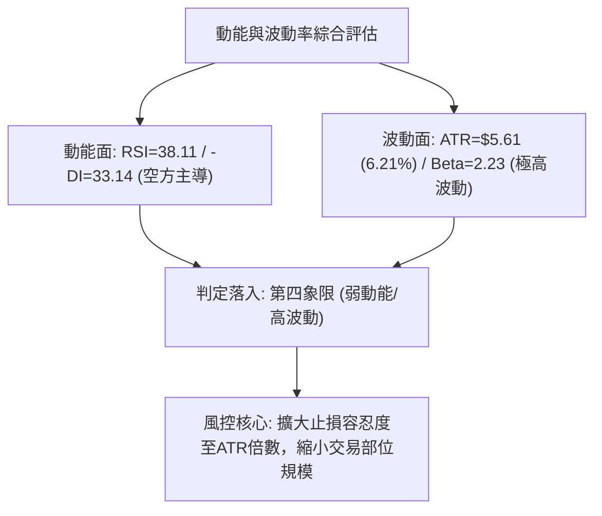

### 📊 ATR 波動率分析

- **ATR(14) 數值**：**$5.61**（佔現價百分比：**6.21%**，Wilder 平滑）
- **波動率特性解讀**：
  - INTC 單日預期震盪空間達到 $5.61，意味著日內波動極容易觸發常規的百分比停損（如 2%~3%）。
  - 當前波動率處於高位，反彈過程中日K線影線普遍較長（例如 10/26 日高低差達 $5.63），極度考驗進場點位精確度。
- **止損與部位管理建議**：
  - 建議最短技術止損間距設為 **1.0 × ATR ($5.61)**，穩健波段止損應設為 **1.5 × ATR ($8.42)**。
  - 在此等高 ATR 環境下，單筆交易名義本金應縮減至常規持倉的 50% 以下，以避免單日內因波動侵蝕總資金回撤上限。

### 📐 Beta 與市場相關性

- **Beta 係數**：**2.23**
- **市場敏感度分析**：
  - Beta 高達 2.23，說明 INTC 屬於超高彈性半導體科技權值股。當標普 500 或費城半導體指數波動 1% 時，理論上 INTC 將產生 2.23% 的同向放大波動。
  - 當前整體半導體產業受到總體經濟與大盤壓制時，INTC 呈現出高係數的下行 Beta 風險；但一旦市場情緒逆轉，其反彈爆發力亦將顯著超越大盤。

---

## 7. 多時框架總結

### 📋 時框架評分表

| 時框架 | 趨勢方向 | 動能狀態 | 均線排列狀況 | 圖表形態特徵 | 綜合評分 | 操作建議方向 |
|:---|:---:|:---:|:---:|:---|:---:|:---|
| **長線 (月線)** | 🟢 偏多 | 🟡 中性回調 | MA240向上發散，處52W中部 | 52週區間50%強支撐考驗 | **60/100** | 長期投資者逢低觀察MA200表現 |
| **中線 (週線)** | 🔴 偏空 | 🔴 強烈空頭 | 跌破MA20/50，向MA200靠攏 | 週線中級雙頂確立破位 | **35/100** | 逢反彈減碼，嚴禁中期波段加倉 |
| **短線 (日線)** | 🔴 偏空 | 🟡 超賣反抽 | 均線空頭排列，收復MA5 | 考驗前低 S1/S2，日陽線止跌 | **40/100** | 超跌反彈交易，嚴格以S2為防守 |

### 🔲 綜合訊號矩陣

```
時框與維度訊號一致性評估矩陣
════════════════════════════════════════════════════════════════
維度 / 時框         日線 (短期)        週線 (中期)        月線 (長期)
────────────────────────────────────────────────────────────────
趨勢方向            🔴 看空 (破位)     🔴 看空 (死叉)     🟢 看多 (支撐)
均線系統            🔴 空頭壓制        🔴 均線反壓        🟢 均線多頭
動能指標            🟡 嘗試修復        🔴 動能發散        🟡 高位回落
量能配合            🔴 OBV疲弱         🔴 週量萎縮        🟢 年增充沛
波動環境            🔴 ATR擴大         🔴 下行波段        🟡 常態擴張
────────────────────────────────────────────────────────────────
一致性判定: 短中期訊號高度偏空共振，長期牛市架構受到中期殺跌嚴重威脅
════════════════════════════════════════════════════════════════
```

### ⚖️ 多時框收斂結論（嚴格遵守規則 14 優先級）

1. **行情模式判斷**：
   - 當前 **ADX(14) = 26.73 > 25**，依規定判定為**「趨勢行情（Trending Market）」**。
   - 趨勢方向判定：-DI (33.14) 遠大於 +DI (18.60)，確立當前主導趨勢為**「中短期下行強趨勢」**。

2. **時框優先級權重收斂**：
   - 依「規則 14」，在強趨勢行情下，以中長期（週線/MA50、MA200）方向為主導，日線僅用於尋找精確進出場時機，日線之超賣或微幅反彈不得凌駕於週線空頭趨勢之上。
   - 週線雙頂跌破頸線 $107.13，MACD 柱持續為負 (-2.047)，日線價格 ($90.47) 受到上方向下俯衝的 MA10 ($92.58)、MA20 ($102.81) 重重壓制。

3. **唯一收斂方向結論**：
   - **偏空防禦（Bearish Bias / Defensive）**。
   - 儘管當前股價觸及 S1 ($89.59) 且逼近 MA200 ($86.06) 產生短線超跌反抽，但在未有效帶量突破 R1 ($107.13) 及站穩 MA50 之前，整體架構均屬於空頭回調與探底行情。任何操作必須以風控防守為首要前提。

---

## 8. 交易策略建議

### 🗺️ 策略決策流程圖

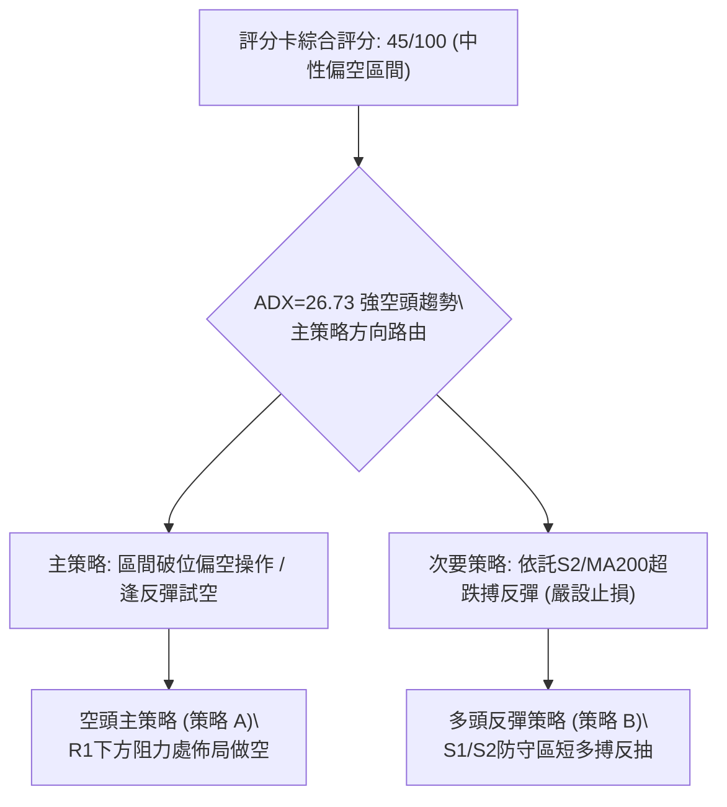

### 🧭 策略路由（依規則 18 評分卡分流）

- **當前技術評分卡綜合評分**：**45/100**
- **當前主策略方向**：**區間防禦偏空（依評分 45/100，40–60 區間操作但受 ADX 趨勢壓制，主推偏空反彈做空與底線防守策略）**。

---

### 🎯 價格情境階梯（Price Scenarios，嚴格引用第 4 章實際價位）

| 觸發條件 | 下一目標價位 | 後續延伸價位 | 情境技術含義與市場意涵 |
|:---|:---:|:---:|:---|
| **向上突破 R1 ($107.13)** | R2 ($127.04) | R3 ($132.75) | 中期空頭警報解除，週線雙頂失敗，重啟長線多頭主升浪 |
| **站穩現價區間 ($90.47)** | MA10 ($92.58) | 斐波 38.2% ($100.54) | 於 S1 與 MA200 之間構築短期震盪平台，以時間換取空間消化賣壓 |
| **向下跌破 S1 ($89.59)** | S2 ($85.14) | S3 ($81.79) | 短線止跌宣告失敗，下探考驗牛熊分水嶺 MA200 ($86.06) 與前期低點 |
| **實體跌破 S2 ($85.14)** | S3 ($81.79) | 斐波 61.8% ($74.70) | 形態破位，牛市徹底告終，引發多殺多恐慌拋售行情 |

### 📊 情境機率分佈

| 情境編號 | 情境路徑描述 | 預估機率 | 主要技術與量化依據 |
|:---:|:---|:---:|:---|
| **情境 1** | **向下再探底或破位下行** | **45%** | ADX=26.73 (-DI=33.14) 強趨勢空頭主導；MACD柱仍為負 (-2.047)；OBV低於均線顯示無機構資金承接 |
| **情境 2** | **弱勢區間震盪築底** | **35%** | 臨近波段低點聚類 S1 ($89.59)、斐波 50% ($87.62) 及 MA200 ($86.06) 重疊支撐帶；Stoch進入超賣區 |
| **情境 3** | **強勢反轉直接上攻** | **20%** | 上方遭遇向下俯衝之 MA10/20/50 三重均線密集反壓；成交量未見倍數放大，缺乏反轉量能動能 |

---

### 🟢 主策略詳情（嚴格遵守規則 5、13、17 計算風險報酬比）

本報告根據 45/100 評分與強趨勢環境，提供兩套策略：**策略 A 為順應中期趨勢之「反彈阻力做空策略（主推）」**；**策略 B 為順應短期超跌之「右側短線反彈策略（次選）」**。

| 策略要素 | 策略 A：順勢逢高做空（主推策略） | 策略 B：依託強支撐搏反彈（次選策略） |
|:---|:---|:---|
| **交易方向** | 🔴 做空 (Short) | 🟢 做多 (Long) |
| **進場條件** | 價格反抽遭遇 R1 下方之斐波 38.2% 阻力出現滯漲日K線 | 價格回測 S1 守穩，日K收於 $89.59 之上確認止跌 |
| **進場價格** | **$100.54** (斐波 38.2% 回調位) | **$90.47** (當前確認收盤價) |
| **目標價 T1** | **$89.59** (支撐位 S1) | **$100.54** (斐波 38.2% 阻力位) |
| **目標價 T2** | **$85.14** (強支撐 S2 / 前低區) | **$107.13** (阻力位 R1 / 頸線) |
| **止損價格** | **$107.13** (阻力位 R1 實體突破) | **$85.14** (強支撐 S2 跌破止損) |
| **風險報酬比** | **1 : 1.66（以 T1 計）**<br>計算式：($100.54 − $89.59) ÷ ($107.13 − $100.54)<br>= $10.95 ÷ $6.59 = **1.66**<br>*(以 T2 計為 1 : 2.34)* | **1 : 1.89（以 T1 計）**<br>計算式：($100.54 − $90.47) ÷ ($90.47 − $85.14)<br>= $10.07 ÷ $5.33 = **1.89**<br>*(以 T2 計為 1 : 3.13)* |
| **成功機率** | **65%** | **45%** |
| **建議倉位** | **15% - 20%** | **5% - 10%** (嚴格輕倉) |

---

### 🔴 反向風險觸發點（對沖提示）

若已建立策略 A 空頭部位或持幣觀望者，當出現以下條件時，宣告空頭架構遭破壞，必須無條件止損或反向對沖：
1. **價位關鍵破位**：日線實體陽線收盤**強勢站上 R1 ($107.13)**，且收盤價連續兩日位於其上方。
2. **動能結構逆轉**：日線 MACD 柱狀圖由負轉正向上穿越零軸，且 **+DI 向上金叉 -DI**（+DI > 25，-DI < 20）。
3. **量能突變**：單日成交量突破 1.5 億股（超越 10/15 的 1.47 億放量），並伴隨突破缺口。

### ⭐ 整體訊號強度評星

```
做多訊號強度：★★☆☆☆  (2/5星 — 僅屬超跌反彈性質，缺乏趨勢保護)
做空訊號強度：★★★★☆  (4/5星 — 順應週線雙頂破位與ADX強空頭趨勢)
整體可信度：  ★★★★☆  (4/5星 — 價位聚類與斐波那契回調吻合度極高)
```

---

## 9. 風險提示與監控

### ✅ 關鍵監控指標 Checklist

```
╔══════════════════════════════════════════════════════════════════╗
║              INTC 每日交易關鍵監控清單 (Checklist)               ║
╠══════════════════════════════════════════════════════════════════╣
║ [ ] 價格防線監控：現價 $90.47 是否失守 S1 ($89.59)                ║
║ [ ] 生命線警戒：是否下破 MA200 ($86.06) 與 S2 ($85.14)           ║
║ [ ] 阻力反彈確認：反彈是否於 MA10 ($92.58) 或 $100.54 受阻滯漲  ║
║ [ ] 趨勢動能指標：ADX(14) 是否持續維持於 25 以上且 -DI 居高不下  ║
║ [ ] 振盪超賣監控：Stoch %K 是否自超賣區向上金叉 %D 形成有效反彈  ║
║ [ ] 異常放量警報：單日成交量是否異常超越 120,000,000 股           ║
║ [ ] 波動幅度警報：單日震盪幅度是否超越 ATR ($5.61) 觸發止損     ║
╚══════════════════════════════════════════════════════════════════╝
```

### ⚠️ 風險場景分析

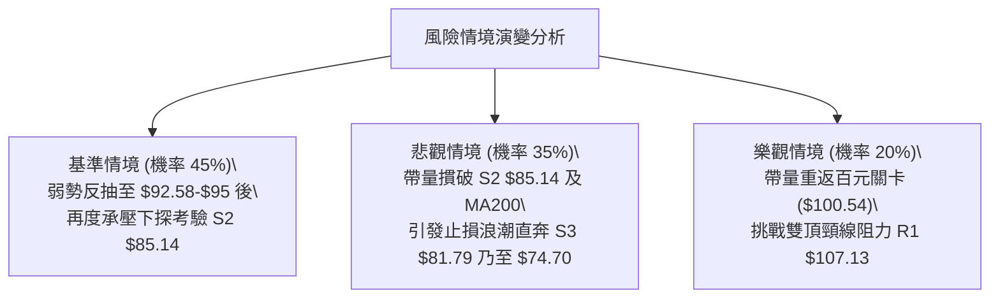

### 🛡️ 風險管理重要提醒

1. **高 ATR 波動下的止損紀律**：
   - 當前 ATR 高達 $5.61 (6.21%)，任何低於 $5.00 的緊密止損極易被市場雜訊打出場。切勿使用固定金額或過窄比例設定止損，必須依託技術價位（如 S2 $85.14 或 R1 $107.13）作為客觀邊界。
2. **Beta 放大效應對沖**：
   - INTC Beta 為 2.23，對納斯達克指數與半導體 ETF (SOXX) 的波動極為敏感。若持有多頭部位，建議配置相應比例的半導體指數反向 ETF 或認沽期權進行系統性風險對沖。
3. **嚴格控制總部位風險**：
   - 在技術評分處於 45 分的弱勢環境中，單筆交易的最大資金虧損應嚴格限制在投資組合總資產的 1.0% 以內。依據凱利公式與波動率模型，當前進場部位上限不宜超過總資金的 15%。

---

## 📋 報告總結

```
INTC 技術分析報告總結
════════════════════════════════════════════════════════
報告日期：2026-10-27
當前價格：$90.47 USD
分析評級：⚖️ 偏空震盪 / 逢高做空 (Bearish Bias)

關鍵結論：
├─ 長期趨勢：🟢 偏多（MA240向上，股價處於52W區間52.6%）
├─ 中期趨勢：🔴 偏空（週線雙頂下破頸線，ADX=26.73空頭主導）
├─ 短期趨勢：🔴 偏空（跌破MA20/50，但S1處出現超跌反彈跡象）
├─ 關鍵支撐：S1 $89.59 ｜ S2 $85.14 ｜ S3 $81.79
├─ 關鍵阻力：R1 $107.13 ｜ R2 $127.04 ｜ R3 $132.75
└─ 分析師目標：均價 $117.71 (區間 $80.00 - $200.00)

最優策略組合：
1. 🥇 最佳機會：策略 A — 逢反彈至斐波38.2% ($100.54) 佈局做空，目標 S1 ($89.59) / S2 ($85.14)，風報比 1:1.66
2. 🥈 次選機會：策略 B — 依託現價 $90.47 / S1 ($89.59) 搏短線超跌反抽，嚴設止損於 S2 ($85.14)，目標 $100.54，風報比 1:1.89
3. 🥉 保守選擇：完全空倉觀望，耐心等待價格下探測試 MA200 ($86.06) 與 S2 ($85.14) 出現明確雙底結構再行決策
════════════════════════════════════════════════════════
```

---

> ⚠️ **免責聲明**：本報告為 AI 自動生成之技術分析，所有數據及估算均基於提供的歷史價格資訊。本報告**僅供研究與學術參考**，**不構成任何投資建議**。投資有風險，入市需謹慎。

---

*報告生成時間：2026-10-27 ｜ 數據來源：Yahoo Finance ｜ 分析框架：多時框技術分析*