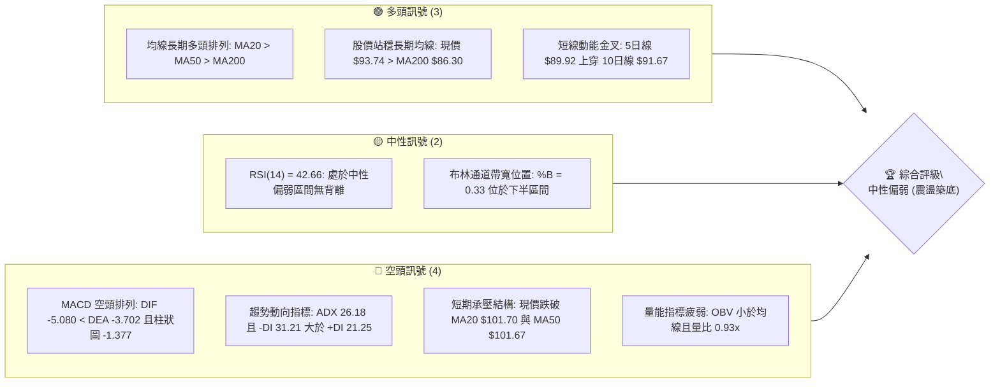
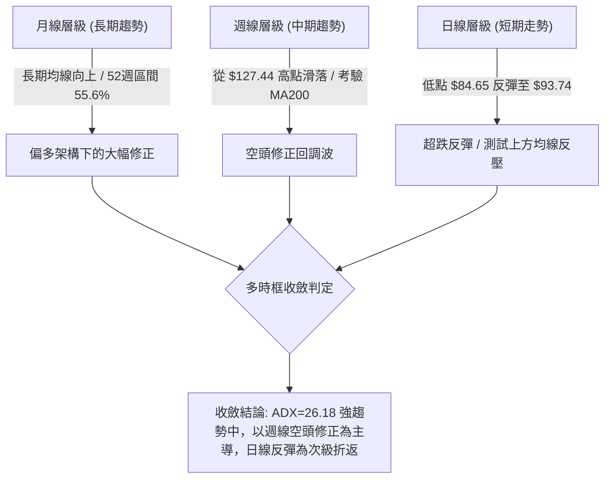
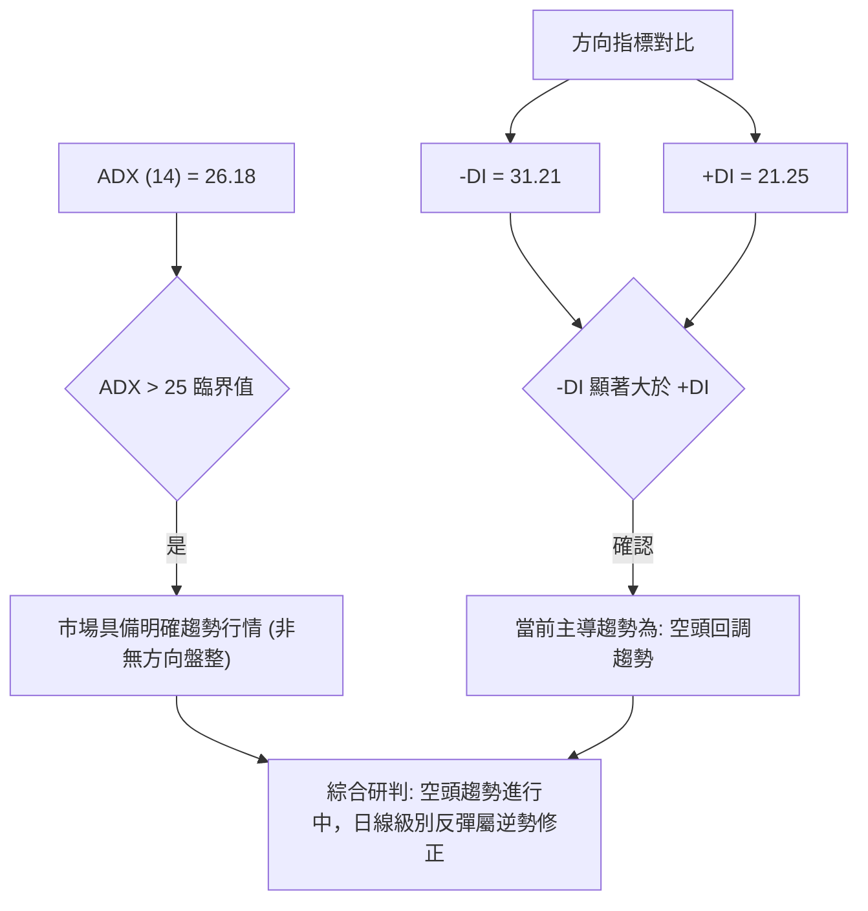
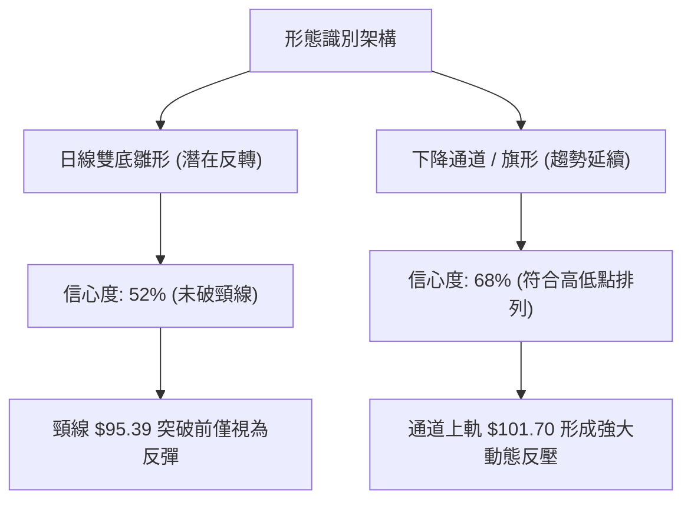
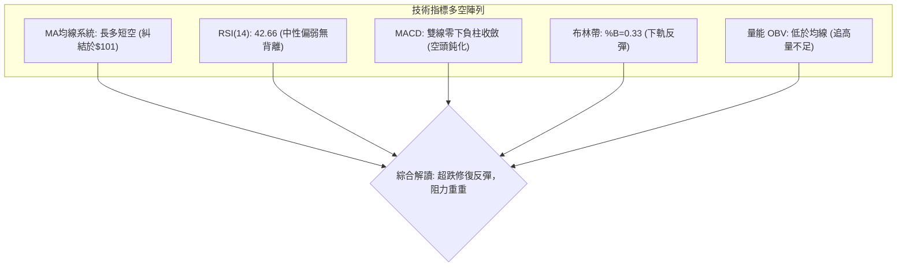
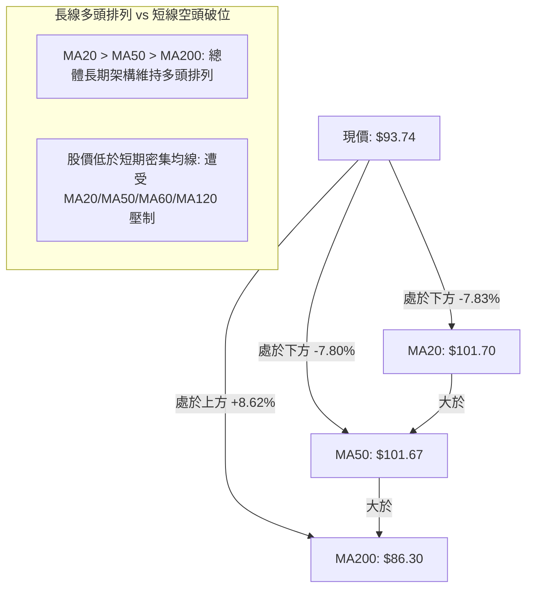
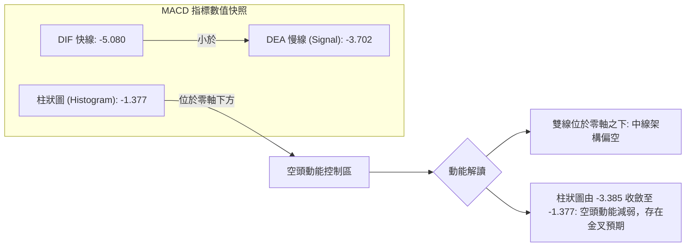
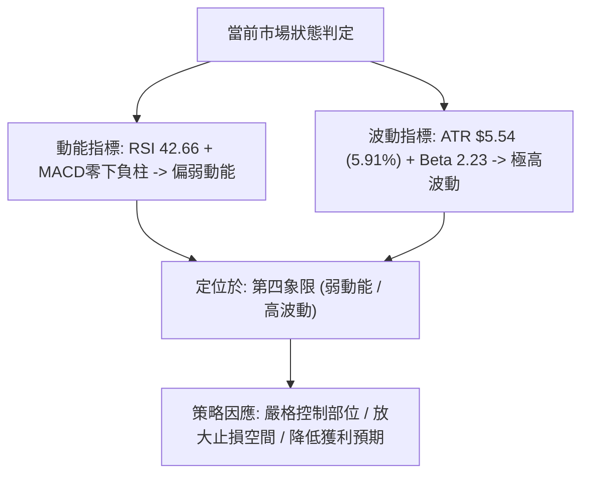
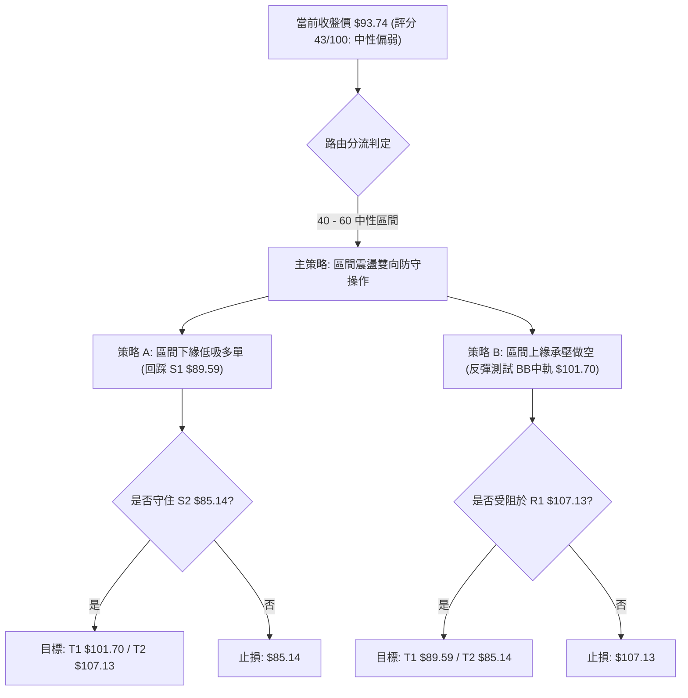
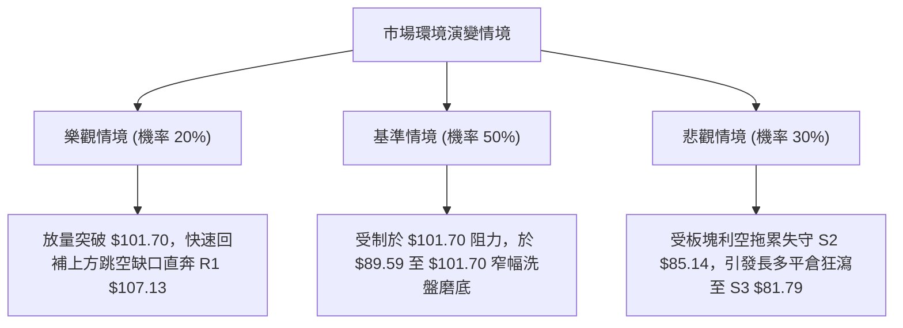

# INTC 技術分析報告

> **報告日期**：2026-10-28 ｜ **語言**：繁體中文 ｜ **數據來源**：Yahoo Finance ｜ **當前價格**：$93.74

---

## 目錄

| 章節 | 內容 |
|------|------|
| [1. 技術面概覽](#1-技術面概覽) | 訊號儀表板、核心指標、評分卡 |
| [2. 趨勢分析](#2-趨勢分析) | 多時框趨勢、長中短期走勢 |
| [3. 圖表形態分析](#3-圖表形態分析) | 形態識別、K線組合、目標價 |
| [4. 支撐與阻力](#4-支撐與阻力) | 關鍵價位、斐波那契回調 |
| [5. 技術指標深度解讀](#5-技術指標深度解讀) | MA/RSI/MACD/布林/成交量 |
| [6. 動能與波動率](#6-動能與波動率) | 動能評估、ATR、Beta |
| [7. 多時框架總結](#7-多時框架總結) | 時框架評分矩陣 |
| [8. 交易策略建議](#8-交易策略建議) | 多空策略、風險報酬比 |
| [9. 風險提示與監控](#9-風險提示與監控) | 監控指標、風險場景 |

---

## 1. 技術面概覽

### 🎯 技術訊號儀表板



### 📊 核心指標速覽表

| 指標類別 | 指標名稱 | 當前數值 | 訊號 | 解讀 |
|----------|----------|----------|------|------|
| **價格** | 當前收盤價 | $93.74 | 🟡 | 位於52週區間 55.6% 位置，處於中期大幅回檔後的低檔反彈期 |
| **均線** | MA20 | $101.70 | 🔴 | 價格在均線下方 -7.83%，短線反彈面臨第一道重要動態反壓 |
| **均線** | MA50 | $101.67 | 🔴 | 價格在均線下方 -7.80%，與 MA20 形成密集雙重阻力帶 |
| **均線** | MA200 | $86.30 | 🟢 | 價格在長期均線上方 +8.62%，牛熊分界線提供實質多頭防守 |
| **動能** | RSI(14) | 42.66 | 🟡 | 位於 30-70 中性區域偏弱，未進入超賣區，近20根K棒無背離 |
| **動能** | MACD(12,26,9) | -5.080 | 🔴 | 雙線位於零軸下方，柱狀圖 -1.377，空頭動能主導但負值開始收斂 |
| **波動** | ATR(14) | $5.54 | 🔴 | 佔股價 5.91%，波動率顯著偏高，日內洗盤劇烈，風控需放大緩衝 |
| **趨勢** | ADX(14) | 26.18 | 🔴 | ADX > 25 確認為趨勢行情，-DI (31.21) 主導空方修正波段 |
| **通道** | 布林帶 %B | 0.33 | 🟡 | 位於中軌（$101.70）與下軌（$78.22）之間，呈現弱勢震盪 |
| **量能** | 20日成交量比 | 0.93x | 🔴 | 最新量 90,131,300 低於20日均量 97,436,725，OBV < MA 量能不足 |

### 🏆 技術評分卡

```
╔══════════════════════════════════════════════════════════════╗
║                 技術評分卡 — INTC (2026-10-28)               ║
╠══════════════════════════════════════════════════════════════╣
║ 趨勢強度      ████████░░░░░░░░░░░░  42/100  🟡 中性偏弱      ║
║ 動能指標      ███████░░░░░░░░░░░░░  35/100  🔴 空頭壓制      ║
║ 支撐穩定度    ███████████░░░░░░░░░  56/100  🟡 考驗支撐      ║
║ 成交量配合    ███████░░░░░░░░░░░░░  34/100  🔴 量能萎縮      ║
║ 形態完整度    █████████░░░░░░░░░░░  44/100  🟡 築底雛形      ║
║ 均線排列      █████████░░░░░░░░░░░  47/100  🟡 長多短空      ║
╠══════════════════════════════════════════════════════════════╣
║ 綜合評分      █████████░░░░░░░░░░░  43/100  中性偏弱觀望     ║
╚══════════════════════════════════════════════════════════════╝
```
*註：綜合評分 = (42 + 35 + 56 + 34 + 44 + 47) ÷ 6 = 43.0，四捨五入為 43/100（依規則 18）。*

---

## 2. 趨勢分析

### 🌐 多時框趨勢分析



### 📈 長期趨勢 — 12個月走勢圖（Unicode）

```
INTC 月線走勢圖（2025-11 至 2026-10）
價格軸 ($)
$140 ┤                               ● $139.63 (2026-06 峰值)
$130 ┤                              ╱ ╲
$120 ┤                             ╱   ╲      ● $120.23 (2026-09 次高)
$110 ┤                   ● $114.68╱     ╲    ╱ ╲
$100 ┤                  ╱                ╲  ╱   ╲
$90  ┤        ● $94.48 ╱                  ●────● $93.74 (現價 2026-10)
$80  ┤       ╱                             $89.51 (2026-08 低點)
$50  ┤   ●──● $46.47 - $44.13
$40  ┤●──┘ $40.56 (2025-11 起漲基底)
$30  ┤
     └────────────────────────────────────────────────────────
       11  12  01  02  03  04  05  06  07  08  09  10 (月份)
       2025                  2026
```

#### 走勢特徵分析表格

| 階段區間 | 起止價格 ($) | 區間漲跌幅 | 主要形態與驅動特徵 |
|----------|--------------|------------|--------------------|
| **第一階段：底部盤整** (2025-11 ~ 2026-03) | $40.56 → $44.13 | +8.80% | 於 $40-$46 區間窄幅橫盤築底，量能沉澱 |
| **第二階段：主升浪爆發** (2026-03 ~ 2026-06) | $44.13 → $139.63 | +216.41% | 突破暴量單邊上漲，月K連續收出大陽線，創波段峰值 |
| **第三階段：初次深幅拉回** (2026-06 ~ 2026-08) | $139.63 → $89.51 | -35.89% | 高檔獲利回吐，兩個月內急跌抹去大量漲幅，於 $89.51 止跌 |
| **第四階段：次級反彈波** (2026-08 ~ 2026-09) | $89.51 → $120.23 | +34.32% | 月線級別死貓反彈，受制於前高壓力帶回落 |
| **第五階段：二次探底震盪** (2026-09 ~ 2026-10) | $120.23 → $93.74 | -22.03% | 再次下探測試年線支撐，當前於 $93.74 試圖止血 |

### 📊 中期趨勢（週線分析）

```
週線級別價格架構示意圖：
  $127.44 峰值 (2026-09-25)
     ╲
      ╲   $119.33 (2026-10-02)
       ╲     ╲
        ╲     ╲   $104.70 (2026-10-09)
         ╲     ╲     ╲
          ╲     ╲     ╲   [動態阻力帶: MA20 $101.70 / R1 $107.13]
           ╲     ╲     ╲     ▲
            ╲     ╲     ╲   ╱ 反彈測試
             ╲     ╲     ●─┘ $93.74 (當前收盤)
              ╲     ╲   ╱ 
               ╲     ●─┘ $86.96 (2026-10-23 週收盤)
                ● $84.65 (2026-10-22 週低點 / 接近 S2 $85.14 與 MA200 $86.30)
```

週線指標顯示，自 2026-09-25 高點 $127.44 以來，INTC 出現連續五週陰線回檔，最低下探至 2026-10-22 的 $84.65。週成交量在下跌過程中逐步由 6.02億股縮減至 4.67億股，顯示賣壓在接近 MA200（$86.30）時出現耗竭跡象。

### ⚡ 趨勢強度評估（ADX 解讀）



#### ADX 趨勢強度對照

| 指標變數 | 當前讀數 | 門檻區間 | 技術含義解讀 |
|----------|----------|----------|--------------|
| **ADX 趨勢強度** | 26.18 | > 25.0 (強趨勢) | 脫離無方向盤整，市場存在主導波段趨勢 |
| **正向動向 (+DI)** | 21.25 | < 25.0 (弱勢) | 多頭攻擊動能不足，買盤僅具被動防守特徵 |
| **負向動向 (-DI)** | 31.21 | > 30.0 (強勢) | 空頭賣壓仍處於支配地位，空方控盤 |
| **趨勢架構定性** | 空頭波段 | -DI > +DI 且 ADX 升 | 當前處於中短期下跌通道內的技術性抵抗 |

---

## 3. 圖表形態分析

### 🔍 形態識別系統



#### 形態識別信心度與目標價表

| 形態類別 | 信心度 | 判斷依據（嚴格引用數據） | 完成度 | 目標價（精確計算式） |
|----------|--------|--------------------------|--------|----------------------|
| **微型雙底 (Double Bottom)** | 52% | 2026-10-22 低點 $84.65 與 2026-10-23 低點 $84.74 形成雙針探底，且守住 S2 $85.14 | 60% | 頸線取 2026-10-19 高點 $95.39。<br>形態高度 = $95.39 − $84.65 = $10.74。<br>理論目標價 = $95.39 + $10.74 = **$106.13**（接近阻力 R1 $107.13） |
| **下降通道 (Descending Channel)** | 68% | 連續波段高點由 $127.44 → $118.20 → $95.39 降低；波段低點由 $113.97 → $104.00 → $84.65 降低 | 85% | 通道破位延伸測幅：若跌破通道下軌支撐 S1 $89.59，等長跌幅目標為：<br>前低 $84.65 − ($95.39 − $89.59) = **$78.85**（接近布林下軌 $78.22 與 61.8% 斐波那契 $74.70） |

### 🕯️ 重要 K 線形態分析

本分析嚴格依據提供的「近10根日K」與「近8根週K」之開高低收精確數據進行解讀（依規則 19）：

#### 近10根日K線形態分析

| 日期 (日K) | 開盤價 ($) | 最高價 ($) | 最低價 ($) | 收盤價 ($) | K線形態名稱 | 技術解讀 | 訊號 |
|------------|------------|------------|------------|------------|-------------|----------|------|
| 2026-10-14 | 99.54 | 101.34 | 97.67 | 98.12 | 中陰線 | 盤中上衝突破 $100 整數關卡受阻，實體收於低位，空頭承壓 | 🔴 |
| 2026-10-15 | 93.61 | 96.87 | 90.02 | 95.37 | 跳空長下影陽線 | 跳空低開後暴量下探 $90.02，逢低買盤進場拉回，釋放超跌信號 | 🟡 |
| 2026-10-16 | 93.48 | 94.22 | 89.19 | 89.85 | 實體中陰線 | 下影線未獲支撐確認，實體下破 $90.00，空頭重奪控盤權 | 🔴 |
| 2026-10-19 | 94.53 | 95.39 | 91.88 | 92.03 | 上影小陰線 | 高開低走，反彈受阻於 $95.39 形成短期微型頸線高點 | 🔴 |
| 2026-10-20 | 90.73 | 93.73 | 88.77 | 91.69 | 下影小陽十字星 | 盤中跌破前低 $89.19 至 $88.77 後拉起，空頭動能放緩，多空拉鋸 | 🟡 |
| 2026-10-21 | 93.43 | 94.39 | 90.75 | 92.96 | 窄幅震盪小陰星 | 量能萎縮至 75.5M，高低點收斂，市場進入方向選擇等待期 | 🟡 |
| 2026-10-22 | 87.92 | 89.19 | 84.65 | 85.49 | 長實體暴跌大陰線 | 恐慌盤湧出下殺至波段低點 $84.65，考驗 MA200，形成空頭力竭柱 | 🔴 |
| 2026-10-23 | 85.92 | 87.87 | 84.74 | 86.96 | 探底錘頭小陽線 | 最低 $84.74 未破前日低點，收盤高於開盤，確認 $84.65-$84.74 支撐 | 🟢 |
| 2026-10-26 | 87.94 | 92.09 | 86.46 | 90.47 | 反彈長陽實體線 | 開盤後穩步推升，實體吞噬前日陰線實體，構成短期多頭反撲結構 | 🟢 |
| 2026-10-27 | 92.47 | 94.98 | 91.86 | 93.74 | 延續攀升中陽線 | 盤中高見 $94.98 直逼頸線 $95.39，收盤 $93.74 站上 10日線 $91.67 | 🟢 |

#### 近8根週K線形態分析

| 週末交易日 | 開盤價 ($) | 最高價 ($) | 最低價 ($) | 收盤價 ($) | K線形態名稱 | 技術解讀 | 訊號 |
|------------|------------|------------|------------|------------|-------------|----------|------|
| 2026-09-11 | 100.80 | 106.69 | 99.34 | 102.94 | 突破小陽線 | 站上百元大關，多頭趨勢延伸 | 🟢 |
| 2026-09-18 | 95.82 | 111.37 | 94.52 | 108.60 | 長陽推進線 | 盤中震盪擴大，成交量放大至 6.26億股，買盤強勁 | 🟢 |
| 2026-09-25 | 116.53 | 127.44 | 114.93 | 123.00 | 高位放量長上影陽線 | 觸及波段高點 $127.44，上影線顯示百元以上拋壓顯著 | 🟡 |
| 2026-10-02 | 120.68 | 126.00 | 113.97 | 119.33 | 烏雲蓋頂前兆陰線 | 高檔無法再創新高，收盤失守 $120，反轉訊號浮現 | 🔴 |
| 2026-10-09 | 115.34 | 118.20 | 104.00 | 104.70 | 大陰實體斷頭鍘 | 跌破前低 $113.97，下探至 $104.00，空頭實質破位 | 🔴 |
| 2026-10-16 | 102.52 | 103.19 | 89.19 | 89.85 | 恐慌加速長陰線 | 跌穿百元支撐，單週跌逾 14 美元，空頭動能極致釋放 | 🔴 |
| 2026-10-23 | 94.53 | 95.39 | 84.65 | 86.96 | 長下影打樁線 | 最低下探至 $84.65，考驗 S2 $85.14 與 MA200，週線獲得初步承接 | 🟡 |
| 2026-10-27 | 87.94 | 94.98 | 86.46 | 93.74 | 週初反彈陽線 | 脫離底部區間向上反抽，收復部分失地 | 🟢 |

### 📉 ASCII 走勢形態示意圖

```
INTC 近期日K微型雙底架構示意圖：

  $101.70 ═════════════════════════════════════════ [MA20 / BB中軌 強阻力]
                                                ▲
  $95.39  ───● (10-19 高點) ───────────────────┼── [雙底頸線]
             │ ╲                               │
  $93.74  ───┼──╲──────────────────────────────● (10-27 現價)
             │   ╲             ● (10-26)      ╱
  $90.47  ───┼────╲───────────╱──────────────┘
             │     ● (10-20) ╱
             │      ╲       ╱
  $84.65  ───● (10-22) ╲   ╱
             [底 1]      ● (10-23: $84.74)
                         [底 2]
  ═════════════════════════════════════════════════
  形態測幅高度 H = $95.39 - $84.65 = $10.74
  理論突破目標價 = $95.39 + $10.74 = $106.13
```

---

## 4. 支撐與阻力

### 🗺️ 關鍵價位分布圖（Unicode）

```
╔══════════════════════════════════════════════════════════════╗
║               INTC 關鍵價位結構分布圖 (OHLCV 計算)           ║
╠══════════════════════════════════════════════════════════════╣
║ $132.75 ║████████████████████████║ 極強阻力 R3 (+41.62%)     ║
║ $127.04 ║████████████████████    ║ 波段阻力 R2 (+35.52%)     ║
║ $116.52 ║▒▒▒▒▒▒▒▒▒▒▒▒▒▒▒▒▒▒▒▒    ║ 斐波那契 23.6% 回調位     ║
║ $107.13 ║████████████████████████║ 核心阻力 R1 (+14.28%)     ║
║ $101.70 ║════════════════════════║ MA20 / BB中軌 動態反壓    ║
║ $100.54 ║▒▒▒▒▒▒▒▒▒▒▒▒▒▒▒▒▒▒▒▒    ║ 斐波那契 38.2% 回調位     ║
╠═════════╬════════════════════════╬═══════════════════════════╣
║  $93.74 ╠►►►►►►►►►►►►►►►►►►►►►►►►╣ ◄ 現價 (收盤價)           ║
╠═════════╬════════════════════════╬═══════════════════════════╣
║  $89.59 ║▓▓▓▓▓▓▓▓▓▓▓▓▓▓▓▓        ║ 近期支撐 S1 (-4.43%)      ║
║  $87.62 ║▒▒▒▒▒▒▒▒▒▒▒▒▒▒▒▒▒▒▒▒    ║ 斐波那契 50.0% 回調位     ║
║  $86.30 ║════════════════════════║ MA200 牛熊分界線 (-7.94%) ║
║  $85.14 ║████████████████████████║ 核心強支撐 S2 (-9.17%)    ║
║  $81.79 ║████████████████████████║ 深層防守支撐 S3 (-12.75%) ║
║  $78.22 ║------------------------║ 布林通道下軌 (-16.56%)    ║
║  $74.70 ║▒▒▒▒▒▒▒▒▒▒▒▒▒▒▒▒▒▒▒▒    ║ 斐波那契 61.8% 黃金分割位 ║
╚══════════════════════════════════════════════════════════════╝
```

### 🚧 阻力位分析表

本表數據嚴格引用自數據封包「阻力位 (Resistance) — 近一年波段高點聚類」（依規則 13）：

| 阻力級別 | 價格 ($) | 距現價幅 | 形成原因與技術聚集 | 突破難度 | 重要性權重 |
|----------|----------|----------|--------------------|----------|------------|
| **R1** | $107.13 | +14.28% | 近一年密集交易密集區與波段反彈高點聚類；接近 MA120 ($107.28) 及雙底形態測幅目標 ($106.13) | 🟡 中等偏高 | ★★★★☆ |
| **R2** | $127.04 | +35.52% | 2026年9月歷史次高點聚類（2026-09-25 週高點 $127.44），強大套牢賣壓籌碼密集帶 | 🔴 極高 | ★★★★★ |
| **R3** | $132.75 | +41.62% | 接近 2026-06 歷史高點 $139.63 下方的最後出貨平台密集區，多頭中期極限目標 | 🔴 極高 | ★★★☆☆ |

### 🛡️ 支撐位分析表

本表數據嚴格引用自數據封包「支撐位 (Support) — 近一年波段低點聚類」（依規則 13）：

| 支撐級別 | 價格 ($) | 距現價幅 | 形成原因與技術聚集 | 守住機率 | 重要性權重 |
|----------|----------|----------|--------------------|----------|------------|
| **S1** | $89.59 | -4.43% | 2026-07/08 月線回調低點聚類（$89.51）；日線 2026-10-16 收盤價 $89.85 附近買盤回防點 | 🟡 60% | ★★★★☆ |
| **S2** | $85.14 | -9.17% | 2026-10-22 波段最低點 $84.65 與 MA200 ($86.30) 構築的共振防守帶，多頭防線核心樞紐 | 🟢 75% | ★★★★★ |
| **S3** | $81.79 | -12.75% | 跌破年線後的最後波段聚類支撐，接近布林下軌（$78.22）與 MA240 ($78.28) 之上方防線 | 🟢 85% | ★★★☆☆ |

### 📐 斐波那契回調位分析

依據 52 週波動區間（低點 $32.89 → 高點 $142.35），各回調位嚴格引用系統計算值：

| 斐波那契比例 | 價位 ($) | 當前相對位置 | 技術意義解讀 |
|--------------|----------|--------------|--------------|
| **0.0% (52W High)** | $142.35 | +51.86% | 52週最高點，長期上行極限目標 |
| **23.6%** | $116.52 | +24.30% | 強勢回檔位，跌破後確認波段轉入深幅修正 |
| **38.2%** | $100.54 | +7.25% | 弱勢修正極限，當前與 MA20 ($101.70) 重合，構成上方極強反壓區 |
| **50.0% (中位分水嶺)**| $87.62 | -6.53% | **當前價格 $93.74 落於 50.0% ($87.62) 與 38.2% ($100.54) 之間**。此前於 2026-10-22 下探至 $84.65 後迅速重返 50% 水平之上，確認中長期多頭主升浪半數漲幅未被完全吞噬 |
| **61.8% (黃金分割)** | $74.70 | -20.31% | 長期多頭生死線，若失守宣告長期多頭行情終結 |
| **78.6%** | $56.31 | -39.93% | 深度回吐位，逼近起漲平台 |
| **100.0% (52W Low)**| $32.89 | -64.91% | 52週最低點，歷史基底 |

---

## 5. 技術指標深度解讀

### 🎛️ 指標訊號總覽



### 📈 移動平均線排列分析



#### 移動平均線數據對照表

| 均線名稱 | 數值 ($) | 偏離現價幅 | 走勢特徵 (近月斜率) | 訊號評估 |
|----------|----------|------------|---------------------|----------|
| **MA5** | $89.92 | +4.24% | 向上翻揚，自底部金叉 MA10 | 🟢 短線反彈持續 |
| **MA10** | $91.67 | +2.26% | 走平向上，提供短線下檔支托 | 🟢 具備短期支撐 |
| **MA20** | $101.70 | -7.83% | 明顯向下彎頭，與 MA50 形成死叉反壓帶 | 🔴 第一反彈重壓 |
| **MA50** | $101.67 | -7.70% | 走平略微向下，與 MA20 形成雙重阻力 | 🔴 中期多空分水嶺 |
| **MA60** | $101.56 | -7.70% | 橫向走平，密集交織於 $101.5-$101.7 | 🔴 密集套牢帶 |
| **MA120**| $107.28 | -12.62% | 走平微彎，精確重合 R1 $107.13 | 🔴 中長線強阻力 |
| **MA200**| $86.30 | +8.62% | 持續向上攀升，牛市生命線未破 | 🟢 核心多頭防線 |
| **MA240**| $78.28 | +19.76% | 強勁向上，奠定中長期估值支撐 | 🟢 深層多頭基石 |

### 📉 RSI(14) 分析

```
RSI(14) 強度儀表板：
當前數值: 42.66
[0] ────────── [30] ───────●─────── [70] ────────── [100]
                  超賣區    42.66 (中性偏弱)   超買區
進度條: ████████░░░░░░░░░░░░  42.66%
```

- **區間評估**：RSI(14) 目前為 42.66，自 2026-10-16 的 31.40 超賣邊界回升，重返 40-50 弱勢反彈區。多頭尚未能將其推上 50 中性平衡點，顯示當前僅為超跌修復，尚未形成攻擊行情。
- **背離判斷**：系統針對近20根K棒首尾之價格與 RSI 進行對比，結論為**無明顯背離**。價格在 10-22 創低點 $84.65，RSI 同步落入 32 附近；隨後價格反彈至 $93.74，RSI 升至 42.66，指標走勢與價格變動完全同步，不存在頂背離或底背離結構。

### 📊 MACD(12/26/9) 訊號解讀



週線層級 MACD 柱狀圖顯示，2026-10-16 綠柱達到極值 -3.385，10-23 收窄至 -2.561，本週更進一步收斂至 -1.377。空頭摜壓力道正以階梯式遞減，若能延續反彈，DIF 有望在零下形成低檔金叉。

### 📦 布林通道分析

```
INTC 布林通道 (20, 2) 結構圖：
  $125.18 ┬────────────────────────────────────────── BB 上軌
          │
  $101.70 ┼────────────────────────────────────────── BB 中軌 (MA20 強反壓)
          │            ▲
  $93.74  ├────────────●───────────────────────────── 現價 (%B = 0.33)
          │           ╱ 反彈路徑
  $78.22  ┴──────────●──────────────────────────────── BB 下軌
                    10-22 低點 $84.65 (未觸及下軌即獲支撐拉起)
```

- **軌道狀態**：通道呈現開口走平後略擴張格局，寬度為 $125.18 − $78.22 = $46.96。
- **相對位置**：%B 讀數為 0.33，位於通道下半部。現價突破 0.30 臨界點脫離超賣邊界，但距中軌（MA20 $101.70）仍有 8.49% 空間。中軌向下傾斜，將在股價反彈至 $101 附近形成極強壓制。

### 💹 成交量分析（量價配合度）

```
量能健康度評估：
最新成交量: 90,131,300 (90.1M)
20日均量:   97,436,725 (97.4M)
量比:       0.93x  (縮量反彈)
進度條:     █████████░░░░░░░░░░░  93.0%

OBV 狀態:   OBV < MA (能量潮低於均線，量能疲弱) 🔴
```

- **量價配合**：在 2026-10-22 恐慌放量（134.1M）砸出低點 $84.65 後，後續三根反彈陽線成交量分別為 72.0M、98.7M、90.1M，呈現「反彈縮量、下跌放量」的背離現象。
- **OBV 解讀**：OBV 持續處於均線下方，反映自 $127.44 高點滑落以來，大資金主力仍以逢高派發、逢低被動承接為主，缺乏機構主動發動突破的主升攻擊量。

---

## 6. 動能與波動率

### ⚡ 動能評估四象限

| 象限分區 | 動能維度 (Momentum) | 波動維度 (Volatility) | 當前標的狀態 | 交易環境與操作定義 |
|----------|---------------------|------------------------|--------------|--------------------|
| **象限 I** | 強動能 (Bullish) | 低波動 (Low Vol) | — | 最佳順勢單邊牛市，適合持股突破 |
| **象限 II**| 弱動能 (Bearish) | 低波動 (Low Vol) | — | 沉悶無序窄幅盤整，觀望等待 |
| **象限 III**| 強動能 (Bullish) | 高波動 (High Vol) | — | 高風險追漲主升浪，波動加劇 |
| **象限 IV**| 弱動能 (Bearish) | 高波動 (High Vol) | **✓ (當前 INTC 落點)** | **高風險深幅震盪折返，極易受假突破欺騙，宜採防守型區間低吸高拋策略** |



### 📊 ATR 波動率分析

- **ATR(14) 絕對數值**：**$5.54**。
- **ATR 波動百分比**：佔當前股價 $93.74 之 **5.91%**（依據 Wilder 計算標準）。
- **日內波動區間參考**：以當前收盤價推算次日理論波動區間為 $88.20 至 $99.28。
- **止損距離建議**：
  - 短線交易（Swing Trading）：建議止損空間至少設定為 1.0 倍 ATR（即 $5.54，約至 S1 $89.59 下方）。
  - 波段交易（Position Trading）：建議止損空間設定為 1.5 倍至 2.0 倍 ATR（即 $8.31 至 $11.08，對應防守價位在 S2 $85.14 與波段前低 $84.65 之下）。

### 📐 Beta 與市場相關性

- **Beta 數值**：**2.23**。
- **相關性解讀**：INTC 之系統性風險敏感度極高，波動率為大盤標普500指數的 2.23 倍。在科技股與費城半導體指數（SOX）出現板塊輪動或市場風險偏好劇變時，該股容易出現雙向極端超動，非系統性回撤風險巨大。

---

## 7. 多時框架總結

### 📋 時框架評分表

| 時框架 | 趨勢方向 | 動能狀態 | 均線排列 | 圖表形態 | 綜合評分 | 建議操作維度 |
|--------|----------|----------|----------|----------|----------|--------------|
| **月線 (長期)** | 🟢 偏多 | 🟡 中性回落 | 🟢 MA200之上 | 突破後深幅拉回測試支撐 | 62/100 | 長期投資者逢低分批佈局 |
| **週線 (中期)** | 🔴 偏空 | 🔴 負柱收斂 | 🟡 均線開口收斂 | 連續5陰下跌後首度出現反彈陽線 | 38/100 | 波段交易者防守觀望，等待結構確立 |
| **日線 (短期)** | 🟡 震盪反彈 | 🟡 脫離超賣 | 🔴 受制短期均線 | 微型雙底測試頸線 $95.39 | 43/100 | 嚴控部位，僅適合區間高拋低吸 |

### 🔲 綜合訊號矩陣

```
時框與指標矩陣比對圖：
                長期 (月線)      中期 (週線)      短期 (日線)
趨勢方向:          🟢 多頭          🔴 修正波        🟡 反彈震盪
均線架構:          🟢 長期向上      🟡 糾結          🔴 短期壓制
動能指標:          🟡 趨緩          🔴 偏弱          🟡 低檔金叉
形態格局:          🟢 支撐未破      🔴 下降通道      🟡 微型築底
時框權重權衡:      30%              40%              30%
綜合收斂共識:      整體處於「大趨勢多頭拉回、中期偏空、短期超跌反彈」的複雜磨底期
```

### ⚖️ 多時框收斂結論

嚴格遵循本報告多時框收斂規則（規則 14）：
1. **行情定性**：當前日線 ADX(14) 讀數為 **26.18 > 25.0**，確認當前屬於**趨勢行情**（非無方向盤整），且由 -DI (31.21) 主導。
2. **時框優先級收斂**：在趨勢行情下，必須以**中長期（週線／MA50、MA200）方向為主導**，日線僅用來尋找進場時機與微觀風控點。
   - 週線自 $127.44 高點滑落以來，正處於標準的 ABC 修正浪。
   - 長期均線系統維持 MA20 ($101.70) > MA50 ($101.67) > MA200 ($86.30) 的多頭排列，且波段低點 $84.65 精確獲得 MA200 與 50% 斐波那契回調位（$87.62）支撐。
3. **唯一方向性結論**：**中性偏弱觀望，主策略定性為「區間震盪防守操作」，等待向上突破頸線確認或反彈遇阻做空**。本結論嚴格收斂第 1 章技術評分卡（43/100）、第 2 章與第 5 章技術訊號，杜絕章節矛盾。

---

## 8. 交易策略建議

### 🗺️ 策略決策流程圖



### 🧭 策略路由（依評分卡分流）

> **當前主策略方向 = 區間震盪防守操作，以關鍵支撐阻力為界，等待突破確認（依評分 43/100）**

因技術評分卡綜合評分為 43/100（落於 40–60 中性區間），市場處於上有均線重壓、下有長期年線支撐的夾心收斂區間。操作上不宜盲目重倉追多或殺跌，應以**布林中軌（$101.70）至關鍵支撐（$89.59 / $85.14）**作為主要交易區間。

### 🎯 價格情境階梯（Price Scenarios）

價位嚴格引用第 4 章由 OHLCV 精確計算之關鍵價位：

| 觸發條件 | 下一目標 | 後續延伸 | 情境技術含義 |
|----------|----------|----------|--------------|
| **強勢突破 R1 ($107.13)** | R2 ($127.04) | R3 ($132.75) | 放量突破下降通道與均線密集反壓，中期空頭修正結束，多頭重啟波段攻勢 |
| **突破 MA20 ($101.70)** | R1 ($107.13) | R2 ($127.04) | 短線雙底形態確立，站上布林中軌，反彈升級為震盪上行行情 |
| **維持現價區間 ($90-$95)** | MA20 ($101.70)| S1 ($89.59) | 於 50% 斐波那契回調位上方蓄勢拉鋸，等待市場催化劑 |
| **跌破 S1 ($89.59)** | S2 ($85.14) | S3 ($81.79) | 短線反彈失敗，空頭二次回踩考驗 MA200 與波段前低 $84.65 |
| **失守 S2 ($85.14)** | S3 ($81.79) | 61.8% ($74.70)| 長期牛熊分界線破位，多頭防線全面潰退，進入深度空頭下跌 |

### 📊 情境機率分佈

| 運行情境 | 發生機率 | 主要技術依據與指標支撐 |
|----------|----------|------------------------|
| **情境一：區間震盪拉鋸** | **50%** | ADX 雖達 26.18 但短期乖離過大；布林帶開口走平；成交量萎縮至 90.1M，缺乏推動破位或突破的單邊動能，股價大概率在 S1 ($89.59) 至 BB中軌 ($101.70) 之間沉澱磨底 |
| **情境二：承壓回落再探底** | **30%** | MACD 雙線深處零下，-DI (31.21) 明顯壓制 +DI (21.25)，上方 MA20/MA50 均線死叉形成重力壓制，若反彈縮量容易再次回探 S1 或 S2 尋求支撐 |
| **情境三：放量反轉向上突破** | **20%** | 日線微型雙底形態已見雛形，若能放量（日均量 > 1.2億股）站穩頸線 $95.39，方有機會向 R1 ($107.13) 發起衝擊 |

### 🟢 主策略詳情

本表交易價位嚴格引用系統計算之 S1/S2/R1/MA20 等真實數據，風險報酬比公式嚴格按照規則 17 計算：

| 策略要素 | 策略 A（區間下緣低吸多單） | 策略 B（區間上緣承壓空單） |
|----------|----------------------------|----------------------------|
| **策略類型** | 支撐位回踩確認做多 | 阻力位受阻確認做空 |
| **進場條件** | 價格回測 S1 止跌收陽，或突破頸線 $95.39 回踩確認 | 價格反彈至 MA20 / BB中軌受阻收長上影線 |
| **進場價格** | **$89.59**（引用 S1 關鍵支撐位） | **$101.70**（引用 MA20 / BB中軌） |
| **目標價 T1** | **$101.70**（引用 MA20 / BB中軌） | **$89.59**（引用 S1 關鍵支撐位） |
| **目標價 T2** | **$107.13**（引用 R1 關鍵阻力位） | **$85.14**（引用 S2 強支撐位） |
| **止損價格** | **$85.14**（引用 S2 強支撐位破位止損） | **$107.13**（引用 R1 關鍵阻力位破位止損） |
| **風險報酬比** | **1 : 2.72（以 T1 計）**<br>*算式：(101.70 − 89.59) ÷ (89.59 − 85.14) = 12.11 ÷ 4.45 = 2.7213*<br>另：**1 : 3.94（以 T2 計）** | **1 : 2.23（以 T1 計）**<br>*算式：(101.70 − 89.59) ÷ (107.13 − 101.70) = 12.11 ÷ 5.43 = 2.2302*<br>另：**1 : 3.05（以 T2 計）** |
| **成功機率** | 52% | 58% |
| **建議倉位** | 10%（試探性防守部位） | 15%（順應中期空頭動能部位） |

### 🔴 反向風險觸發點（對沖提示）

若主策略採取區間操作或逢高沽空，以下觸發條件將推翻偏空思維，必須立即停損或反向對沖：
1. **多頭反轉確認點**：日線連續 2 日實體收盤價站穩 **$101.70**（MA20 / BB中軌）上方，且伴隨單日成交量突破 120,000,000 股。
2. **空頭極限破位點**：若股價無預警跳空跌破 **$85.14**（S2）與波段前低 $84.65，則雙底構築徹底失敗，必須無條件止損多單，防範跌向 $78.22（布林下軌）或 $74.70（61.8% 斐波那契位）。

### ⭐ 整體訊號強度評星

```
做多訊號強度：★★☆☆☆  (2.0/5星 — 僅屬超跌反彈，受制均線大網)
做空訊號強度：★★★☆☆  (3.0/5星 — 中期趨勢偏空，但接近強支撐帶)
整體可信度：  ★★★★☆  (4.0/5星 — 價位聚類明確，高低點結構清晰)
```

---

## 9. 風險提示與監控

### ✅ 關鍵監控指標 Checklist

```
╔══════════════════════════════════════════════════════════════╗
║               INTC 日常交易監控檢驗清單 (Checklist)          ║
╠══════════════════════════════════════════════════════════════╣
║ [ ] 頸線攻防: 日K是否實體突破 $95.39 形成微型雙底形態?       ║
║ [ ] 均線動態: 股價測試 MA20 ($101.70) 時是否出現放量滯漲?    ║
║ [ ] MACD 軌跡: 柱狀圖是否持續收窄至零軸上方形成水下金叉?     ║
║ [ ] 支撐防守: S1 ($89.59) 與 S2 ($85.14) 盤中是否遭遇異常摜壓?║
║ [ ] 量能驗證: 日成交量是否回升至 20日均量 (97.4M) 以上?       ║
║ [ ] 半導體板塊: 費城半導體指數與大盤 Beta 波動聯動風險?      ║
╚══════════════════════════════════════════════════════════════╝
```

### ⚠️ 風險場景分析



### 🛡️ 風險管理重要提醒

1. **高 Beta 波動懲罰**：該股 Beta 高達 **2.23**，且 ATR 達 **$5.54 (5.91%)**。嚴禁使用過高槓桿，單筆交易最大虧損額必須嚴格鎖定在總交易本金的 1.0%–1.5% 以內。
2. **數據真空與財報變數**：基本面數據顯示 TTM 淨利潤為負（淨利率 -19.8%，EPS -$2.12），Trailing P/E 標示為 N/A（數據未提供）。儘管遠期預估 EPS 為 $2.1756，但在估值修復驗證之前，股價完全由市場情緒與技術籌碼驅動，突發消息容易引發跳空缺口。
3. **假突破與牛陷阱（Bull Trap）防範**：由於 MA20（$101.70）、MA50（$101.67）、MA60（$101.56）高度收斂於 $101.5–$101.7 狹窄區間內，當股價初次觸及此區域時，極易出現「假突破隨即暴跌」的走勢。進場追多務必等待日K線收盤確認。

---

## 📋 報告總結

```
╔══════════════════════════════════════════════════════════════╗
║                    INTC 技術分析報告總結                     ║
╠══════════════════════════════════════════════════════════════╣
║ 報告日期：2026-10-28                                         ║
║ 當前價格：$93.74                                             ║
║ 分析評級：⚖️ 中性偏弱觀望 (評分 43/100)                     ║
║                                                              ║
║ 關鍵結論：                                                   ║
║ ├─ 長期趨勢：🟢 偏多架構 (MA20>MA50>MA200，MA200 $86.30 未破)║
║ ├─ 中期趨勢：🔴 空頭修正 (自 $127.44 高點滑落，受制於通道下壓)║
║ ├─ 短期趨勢：🟡 超跌反彈 (低點 $84.65 止血，測試頸線 $95.39) ║
║ ├─ 關鍵支撐：S1: $89.59 ｜ S2: $85.14 ｜ S3: $81.79          ║
║ ├─ 關鍵阻力：R1: $107.13 ｜ R2: $127.04 ｜ R3: $132.75       ║
║ └─ 分析師目標：均價 $117.71 (區間 $80.00 - $200.00，42位評級) ║
║                                                              ║
║ 最優策略組合：                                               ║
║ 1. 🥇 最佳機會：策略 B 區間高拋（反彈至 MA20 $101.70 逢高做空，║
║                 停損設 R1 $107.13，風報比 1 : 2.23）         ║
║ 2. 🥈 次選機會：策略 A 支撐低吸（回踩 S1 $89.59 輕倉試多，   ║
║                 停損設 S2 $85.14，風報比 1 : 2.72）         ║
║ 3. 🥉 保守選擇：空倉觀望，耐心等待價格突破 $101.70 或跌破   ║
║                 $85.14 後，順應新趨勢發動右側追隨交易         ║
╚══════════════════════════════════════════════════════════════╝
```

---

> ⚠️ **免責聲明**：本報告為技術分析研究，所有數據、圖表及量化估算均嚴格基於所提供的歷史價格與指標資訊。本報告**僅供研究與學術參考**，**不構成任何要約、招攬或投資建議**。金融市場瞬息萬變，投資有風險，交易決策應獨立審慎，入市需自行承擔盈虧風險。

---

*報告生成時間：2026-10-28 ｜ 數據來源：Yahoo Finance ｜ 分析框架：多時框技術分析體系*