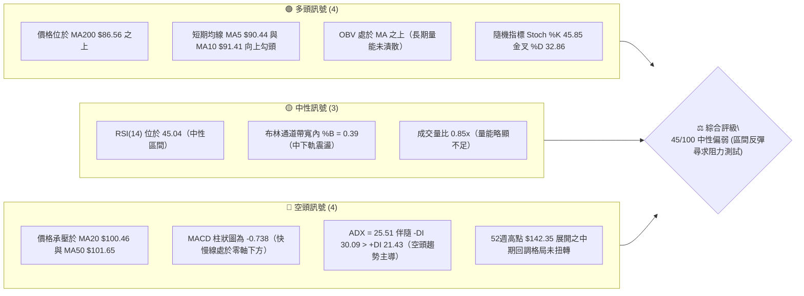
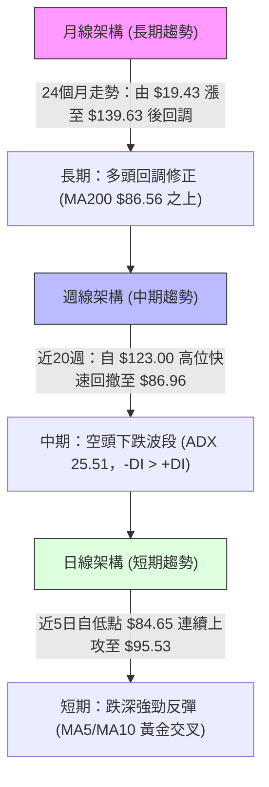
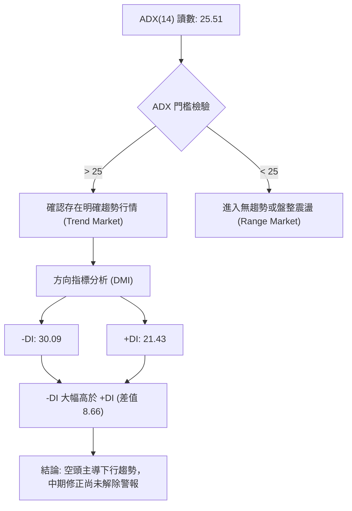
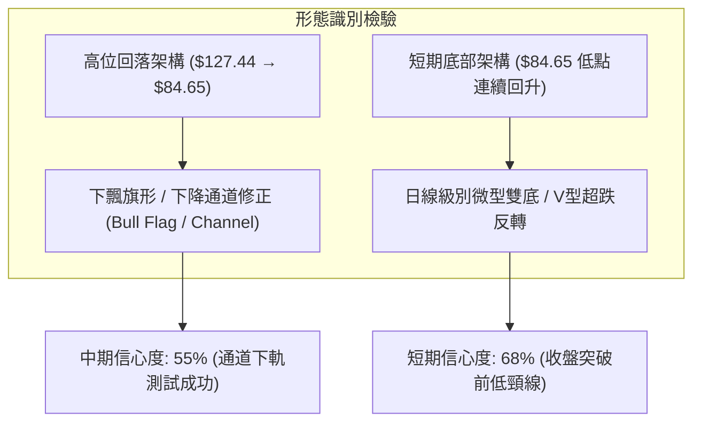
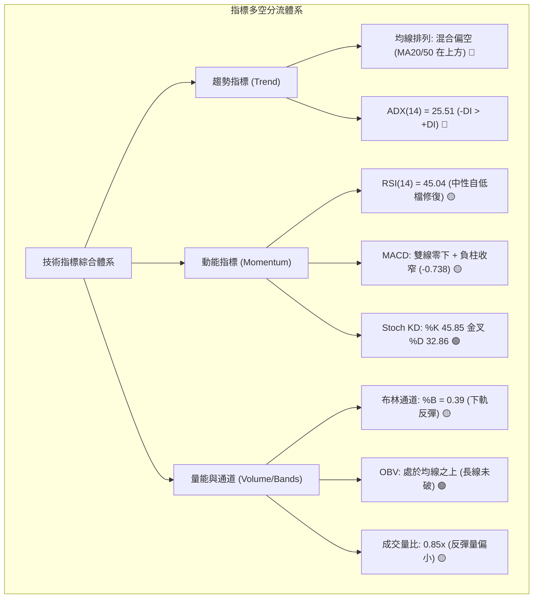
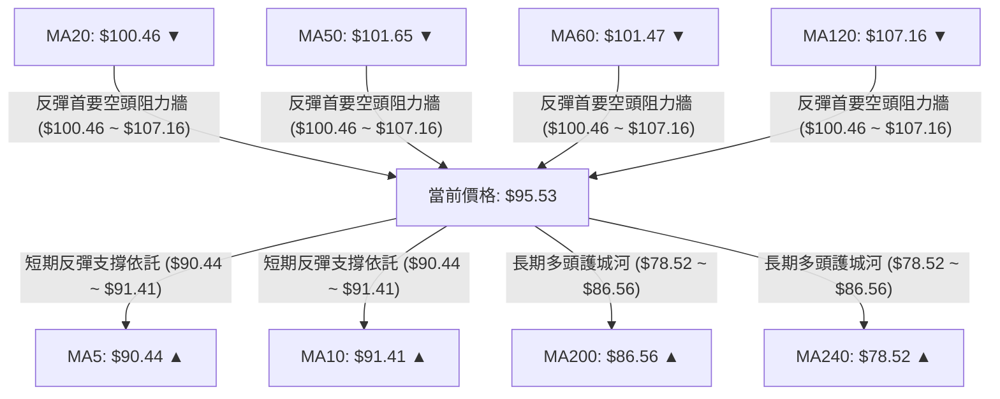
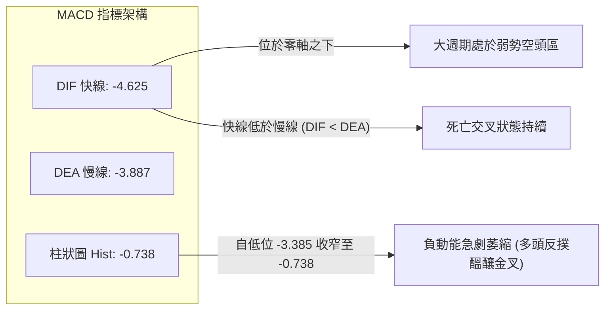
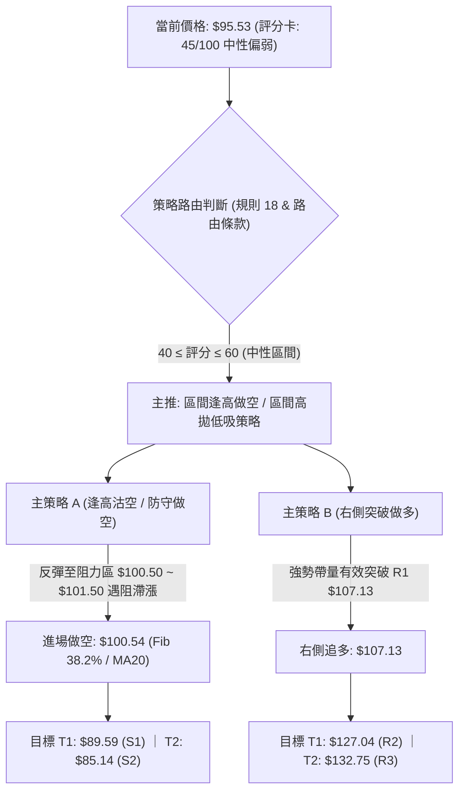
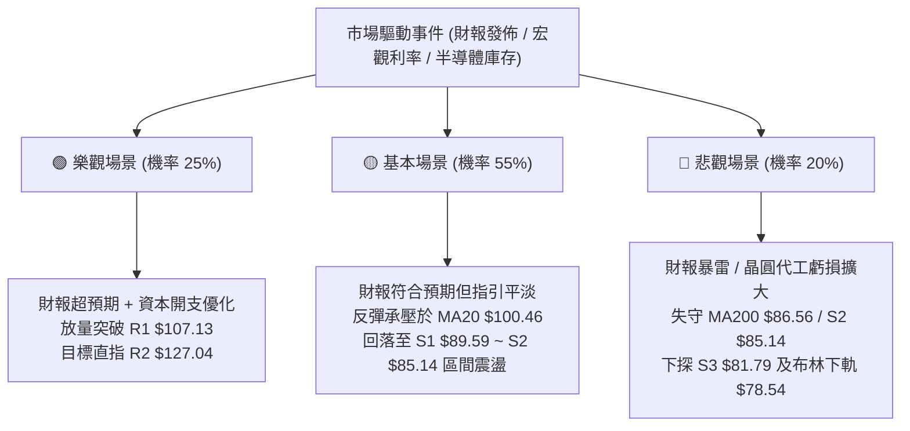

# INTC 技術分析報告

> **報告日期**：2026-10-29 ｜ **語言**：繁體中文 ｜ **數據來源**：Yahoo Finance ｜ **當前價格**：$95.53

---

## 目錄

| 章節 | 內容 |
|------|------|
| [1. 技術面概覽](#1-技術面概覽) | 訊號儀表板、核心指標、評分卡 |
| [2. 趨勢分析](#2-趨勢分析) | 多時框趨勢、長中短期走勢、ADX 解讀 |
| [3. 圖表形態分析](#3-圖表形態分析) | 形態識別、K線組合、目標價計算 |
| [4. 支撐與阻力](#4-支撐與阻力) | 關鍵價位、斐波那契回調結構 |
| [5. 技術指標深度解讀](#5-技術指標深度解讀) | MA/RSI/MACD/布林/成交量 |
| [6. 動能與波動率](#6-動能與波動率) | 動能評估、ATR、Beta 與市場相關性 |
| [7. 多時框架總結](#7-多時框架總結) | 時框架評分矩陣與多時框收斂 |
| [8. 交易策略建議](#8-交易策略建議) | 策略路由、主策略、情境階梯與風報比 |
| [9. 風險提示與監控](#9-風險提示與監控) | 監控指標、風險情境與風控原則 |

---

## 1. 技術面概覽

### 🎯 技術訊號儀表板



### 📊 核心指標速覽表

| 指標類別 | 指標名稱 | 當前數值 | 訊號 | 解讀 |
|:---|:---|:---|:---:|:---|
| **價格** | 當前收盤價 | $95.53 | 🟡 | 位於52週區間57.2%分位，處於短線反彈與中期承壓交界處 |
| **均線** | MA20 | $100.46 | 🔴 | 價格在MA20下方（相距 -4.91%），短中期動能向下傾斜 |
| **均線** | MA50 | $101.65 | 🔴 | 價格在MA50下方（相距 -6.02%），中期生命線失守構成反彈首要屏障 |
| **均線** | MA200 | $86.56 | 🟢 | 價格在MA200上方（相距 +10.36%），長期牛熊分界線維持多頭支撐 |
| **動能** | RSI(14) | 45.04 | 🟡 | 脫離超賣區（前週低點31.4），目前於中性水平回升，未見超買 |
| **動能** | MACD (12,26,9) | -4.625 / -3.887 | 🔴 | 雙線位於零軸下方，柱狀圖 -0.738，空頭主導但負動能正在衰退 |
| **動能** | KD (14,3,3) | %K 45.85 / %D 32.86 | 🟢 | 低檔黃金交叉向上發散，短線反彈動能持續中 |
| **趨勢** | ADX / DMI | ADX: 25.51 (-DI: 30.09) | 🔴 | ADX > 25 確認趨勢行情成立，-DI 佔優表明下行趨勢為主導級別 |
| **波動** | ATR(14) | $5.33 (5.58%) | 🟡 | 每日平均震幅約 5.58%，隱含波動度高，適合波段區間操作 |
| **通道** | 布林帶 (%B) | %B: 0.39 (帶寬 $78.54 - $122.39) | 🟡 | 價格自下軌反彈至中軌下方，通道維持擴張狀態 |
| **量能** | 當日量 / 20日均量 | 81.86M / 96.80M (0.85x) | 🟡 | 反彈過程成交量稍低於均量，呈現縮量反彈特徵 |

### 🏆 技術評分卡

```
╔══════════════════════════════════════════════════════════════════╗
║                   技術評分卡 — INTC (2026-10-29)                 ║
╠══════════════════════════════════════════════════════════════════╣
║ 趨勢強度 (ADX/DMI)    ███████░░░░░░░░░░░░░  35/100  🔴 空頭主導  ║
║ 動能指標 (RSI/MACD/KD)████████░░░░░░░░░░░░  42/100  🟡 中性修復  ║
║ 支撐穩定度 (S1/S2/Fib)████████████░░░░░░░░  58/100  🟡 關鍵支撐  ║
║ 成交量配合 (OBV/均量)  ██████████░░░░░░░░░░  50/100  🟡 中性格局  ║
║ 形態完整度 (日K/週K)  █████████░░░░░░░░░░░  45/100  🟡 短底構築  ║
║ 均線排列 (MA體系)     ████████░░░░░░░░░░░░  40/100  🔴 均線反壓  ║
╠══════════════════════════════════════════════════════════════════╣
║ 綜合評分 (六項算術平均)█████████░░░░░░░░░░░  45/100  ⚖️ 中性偏弱  ║
╚══════════════════════════════════════════════════════════════════╝
```
*註：綜合評分 = (35 + 42 + 58 + 50 + 45 + 40) ÷ 6 = 270 ÷ 6 = 45/100（依規則 18 嚴格執行算術平均）。*

---

## 2. 趨勢分析

### 🌐 多時框趨勢分析



### 📈 長期趨勢 — 12個月走勢圖（Unicode）

以下為 INTC 自 2025 年 11 月至 2026 年 10 月之月線收盤走勢：

```
INTC 月線收盤走勢圖（過去12個月：2025-11 至 2026-10）
價格軸 ($)
$140 ┤                                 ● 6月 (139.63)
$130 ┤                                ╱ ╲
$120 ┤                               ╱   ╲           ● 9月 (120.23)
$110 ┤                         ● 5月(114.68)╲        ╱ ╲
$100 ┤                   ● 4月(94.48)        ╲      ╱   ╲
$90  ┤                                        ● 7月   ● 8月  ● 10月 ($95.53 現價)
$80  ┤                                       (90.20) (89.51)
$70  ┤
$60  ┤
$50  ┤             ● 1月(46.47)
$40  ┤ ● 11月(40.56)   ● 2月(45.61)  ● 3月(44.13)
$30  ┤    ● 12月(36.90)
     └─────────────────────────────────────────────────────────────
       11M   12M   01M   02M   03M   04M   05M   06M   07M   08M   09M   10M
```

#### 長期走勢特徵分析表格

| 階段區間 | 時間跨度 | 起訖收盤價 | 區間漲跌幅 | 走勢特徵與量能意涵 |
|:---|:---:|:---:|:---:|:---|
| **第一階段：底部築底盤整** | 2025-11 ~ 2026-03 | $40.56 → $44.13 | +8.80% | 股價於 $36.90 ~ $46.47 區間橫向震盪，成交量維持常態，主力籌碼吸籌。 |
| **第二階段：主升浪爆發** | 2026-03 ~ 2026-06 | $44.13 → $139.63 | +216.41% | 連續大陽線突破，月線呈現拋物線式上升，創下52週高點 $142.35，動能極度亢奮。 |
| **第三階段：見頂急跌修正** | 2026-06 ~ 2026-08 | $139.63 → $89.51 | -35.89% | 高檔獲利盤湧出，連續兩個月大幅回撤，回踩長期均線與斐波那契 50% 水平。 |
| **第四階段：次高反彈與二次探底** | 2026-08 ~ 2026-10 | $89.51 → $95.53 | +6.73% | 9月反彈至 $120.23 遇阻回落，10月下探 $84.65 後收盤拉回 $95.53，構築寬幅震盪。 |

### 📊 中期趨勢（週線分析）

中期走勢圖展示近期 8 週自高位回調至低位反彈的技術格局：

```
週線級別價格壓力與支撐示意圖
價格 ($)
$130 ┤     ▲ 09/25 高點 $127.44 (次高點)
$120 ┤    ╱ ╲
$110 ┤   ╱   ╲                               ═══ 強阻力 R1: $107.13
$100 ┤  ╱     ╲          ▲ 10/28 收盤 $95.53 ─── MA50: $101.65 / MA20: $100.46
$90  ┤ ╱       ╲        ╱                     ═══ 近期支撐 S1: $89.59
$80  ┤           ▼ 10/23 低點 $84.65           ═══ 強支撐 S2: $85.14 / MA200: $86.56
     └────────────────────────────────────────
       09/11  09/18  09/25  10/02  10/09  10/16  10/23  10/28 (週末交易日)
```

週線指標分析：
- **均線結構**：MA20（$100.46）與 MA50（$101.65）形成上方密集阻力帶，壓制價格反彈空間；但下方 MA200（$86.56）提供實質性支撐。
- **動能演變**：週線 MACD 柱狀圖自 2026-10-16 的 -3.385 收窄至 2026-10-28 的 -0.738，空頭動能呈現顯著鈍化跡象。
- **週成交量**：本週（截至 10/28）成交量 271.13M，呈現縮量回升格局，顯示追高意願有限，仍屬於修正波段中的技術性抽頭。

### ⚡ 趨勢強度評估（ADX 解讀）



#### ADX 趨勢強度指標對照解讀表

| 指標變數 | 當前讀數 | 門檻區間 | 技術解讀 |
|:---|:---:|:---:|:---|
| **ADX (14)** | **25.51** | > 25.00 | **趨勢行情確立**。ADX 突破 25 臨界線，顯示自 $127.44 高點以來的下行波動並非無序震盪，而是具備技術動能的單邊波段。 |
| **+DI (14)** | **21.43** | < 25.00 | **多方動能弱勢**。代表短線多頭力量雖自低檔回升，但尚未跨越強勢進攻基準線。 |
| **-DI (14)** | **30.09** | > 30.00 | **空方佔據主動**。空頭力量處於主導地位，逢高調節賣壓依然存在。 |
| **趨勢定性** | **空頭趨勢中之超跌反彈** | 規則 14 收斂 | 因 ADX > 25，根據多時框收斂規則，本報告以中長期週線向下修正格局為主導，日線反彈僅視為尋找防守點或逢高佈局的時機。 |

---

## 3. 圖表形態分析

### 🔍 形態識別系統



#### 圖表形態信心度評估表（依規則 15）

| 形態名稱 | 時框級別 | 信心度 | 判斷依據（引用數據） | 完成度 | 目標價（附計算式，依規則 13） |
|:---|:---:|:---:|:---|:---:|:---|
| **微型短底 (V型/雙底雛形)** | 日線 | **68%** | 10/22 低點 $84.65 與 10/23 低點 $84.74 形成雙腳不破，隨後連拉3根陽線突破 10/16 頸線收盤 $89.85。 | 75% | 頸線收盤 $89.85 + 形態高度 ($89.85 - $84.65 = $5.20) = **$95.05**（已達成，現價 $95.53）。下一推算阻力為 R1 **$107.13**。 |
| **下飄下降通道 (中期回調)** | 週線 | **55%** | 自 09/25 高點 $127.44 下跌至 10/23 低點 $84.65，高低點階梯下移，目前處於通道下軌向中軌反彈階段。 | 60% | 若有效突破通道上軌（約 MA20 $100.46），波段反彈目標為波段高點阻力 R1 **$107.13**；若遇阻則回撤支撐 S1 **$89.59**。 |
| **大型頭肩頂 / 雙頂** | 週線 | **35%** | 數據中 6月高點 $139.63 與 9月次高點 $120.23 形態不對稱，頸線支撐未完全跌破（S2 $85.14 未收破）。 | 30% | **訊號不足，僅做指標型解讀**（信心度 < 50%，不強行繪製）。 |

### 🕯️ 重要K線形態分析

依規則 19，嚴格採用數據中「近10根日K」與「近8根週K」之開高低收數據進行客觀解讀：

#### 近10根日K形態精確分析

| 日期 | 開盤價 | 最高價 | 最低價 | 收盤價 | 成交量 | K線形態 | 技術解讀 | 訊號 |
|:---:|:---:|:---:|:---:|:---:|:---:|:---|:---|:---:|
| 10-15 | $93.61 | $96.87 | $90.02 | $95.37 | 147.16M | 震盪紡錘線 | 長下影線測試 S1 附近買盤，成交量顯著放大。 | 🟡 |
| 10-16 | $93.48 | $94.22 | $89.19 | $89.85 | 123.00M | 中黑實體K | 跌破 $90.00 整數關卡，賣壓沉重，確立短線下行。 | 🔴 |
| 10-19 | $94.53 | $95.39 | $91.88 | $92.03 | 101.61M | 衝高回落黑K | 跳空高開後無力維持，收在低位，上方賣壓顯著。 | 🔴 |
| 10-20 | $90.73 | $93.73 | $88.77 | $91.69 | 84.06M | 低檔十字星 | 實體極小，多空拉鋸，成交量萎縮，空方動能減弱。 | 🟡 |
| 10-21 | $93.43 | $94.39 | $90.75 | $92.96 | 75.57M | 弱勢小紅K | 窄幅整理，量能持續遞減，市場觀望情緒濃厚。 | 🟡 |
| 10-22 | $87.92 | $89.19 | $84.65 | $85.49 | 134.13M | 破位長黑K | 帶量向下摜壓，下探波段最低點 $84.65，恐慌盤湧出。 | 🔴 |
| 10-23 | $85.92 | $87.87 | $84.74 | $86.96 | 72.09M | 低檔下影紅K | 二次測試 $84.74 未破前低，量縮收紅，打出雙底雛形。 | 🟢 |
| 10-26 | $87.94 | $92.09 | $86.46 | $90.47 | 98.74M | 陽包陰吞噬線 | 實體完全包覆前日波動，帶量突破 $90.00，啟動反彈。 | 🟢 |
| 10-27 | $92.47 | $94.98 | $91.86 | $93.74 | 90.52M | 連續光腳大陽 | 低點持續抬高，多頭買盤積極推進，直逼短期均線。 | 🟢 |
| 10-28 | $95.09 | $95.68 | $93.00 | $95.53 | 81.86M | 溫和小陽線 | 創反彈新高，收在最高點附近，短線多頭掌控節奏。 | 🟢 |

#### 近8根週K形態精確分析

| 日期 | 開盤價 | 最高價 | 最低價 | 收盤價 | 成交量 | 週K線形態 | 技術解讀 | 訊號 |
|:---:|:---:|:---:|:---:|:---:|:---:|:---|:---|:---:|
| 09-11 | $100.80 | $106.69 | $99.34 | $102.94 | 421.04M | 突破實體陽K | 站上 $100 關卡，多頭排列形成。 | 🟢 |
| 09-18 | $95.82 | $111.37 | $94.52 | $108.60 | 626.11M | 放量進攻陽K | 創近月波段新高，週量放大至 626M，趨勢向上。 | 🟢 |
| 09-25 | $116.53 | $127.44 | $114.93 | $123.00 | 602.66M | 衝高上影陽K | 觸碰波段高點 $127.44 後承壓，主力高檔換手。 | 🟡 |
| 10-02 | $120.68 | $126.00 | $113.97 | $119.33 | 495.06M | 高位烏雲罩頂 | 未能創新高，收盤跌破開盤價，形成短期頭部。 | 🔴 |
| 10-09 | $115.34 | $118.20 | $104.00 | $104.70 | 461.35M | 單邊中長陰K | 連續跳水跌破 MA20，空頭反撲猛烈。 | 🔴 |
| 10-16 | $102.52 | $103.19 | $89.19 | $89.85 | 537.18M | 破位帶量黑K | 跌破 $90.00，週收盤最低，空頭完全主導。 | 🔴 |
| 10-23 | $94.53 | $95.39 | $84.65 | $86.96 | 467.46M | 低檔長下影錘頭 | 測試低點 $84.65 後獲支撐拉起，顯現止跌訊號。 | 🟡 |
| 10-28 | $87.94 | $95.68 | $86.46 | $95.53 | 271.13M | 縮量反彈陽K | 截至週三收復失土，形成陽線反包，企圖回測中軌。 | 🟢 |

### 📉 ASCII 走勢形態示意圖

```
INTC 近10日 K 線底部反轉形態與壓力位置圖 ($)
$102.00 ┤                                                    [MA50: $101.65]
$100.00 ┤                                                    [MA20: $100.46 / Fib 38.2%: $100.54]
$98.00  ┤
$96.00  ┤                                              ┌──┐
$94.00  ┤       ┌──┐                                   │  │  ▲ 10/28 收盤 $95.53
$92.00  ┤       │  │             ┌──┐           ┌──┐   │  │
$90.00  ┤ ┌──┐  │  │  ┌──┐       │  │    ┌──┐   │  │   │  │  ═══ 突破短底頸線 ($89.85)
$88.00  ┤ │  │  │  │  │  │       └──┘    │  │   │  │   └──┘
$86.00  ┤ └──┘  └──┘  └──┘  ┌──┐         │  │   └──┘
$84.00  ┤                   └──┘  ┴──┴   └──┘
        └─────────────────────────────────────────────────────
          10-15 10-16 10-19 10-20 10-21 10-22 10-23 10-26 10-27 10-28 (日K)
                                 雙底低點 ($84.65 / $84.74)
```

### 🎯 形態目標價計算

1. **短底形態推算目標**：
   - 形態底部：$84.65（10/22 低點）
   - 形態頸線：$89.85（10/16 收盤價與破位點）
   - 形態垂直高度：$89.85 - $84.65 = $5.20
   - **滿足目標價 1** = 頸線 $89.85 + 形態高度 $5.20 = **$95.05**（當前價格 $95.53 已完全達成此目標）。
   - **延伸測幅目標 2** = 依據波段阻力 R1（由近一年波段高點聚類計算，見規則 13） = **$107.13**。

---

## 4. 支撐與阻力

### 🗺️ 關鍵價位分布圖（Unicode）

```
INTC 價位結構分布圖（OHLCV 精確計算）
══════════════════════════════════════════════════════════════════
$132.75 ║████████████████████████████████║ 強阻力 R3 (+38.96%)
$127.04 ║████████████████████████        ║ 阻力 R2 (+32.98%)
$116.52 ║▓▓▓▓▓▓▓▓▓▓▓▓▓▓▓▓▓▓▓▓            ║ 斐波那契 23.6% 回調位
$107.13 ║████████████████████████████████║ 關鍵阻力 R1 (+12.14%) / MA120 ($107.16)
$100.54 ║▓▓▓▓▓▓▓▓▓▓▓▓▓▓▓▓                ║ 斐波那契 38.2% 回調位 / MA20 ($100.46)
$95.53  ╠════════════════════════════════╣ ◄ 當前收盤價 ($95.53)
$89.59  ║▓▓▓▓▓▓▓▓▓▓▓▓▓▓▓▓▓▓              ║ 近期支撐 S1 (-6.22%)
$87.62  ║▓▓▓▓▓▓▓▓▓▓▓▓▓▓▓▓▓▓▓▓            ║ 斐波那契 50.0% 回調位
$86.56  ║████████████████████████        ║ 長期均線 MA200 支撐帶
$85.14  ║████████████████████████████████║ 強支撐 S2 (-10.88%)
$81.79  ║████████████████████            ║ 強支撐 S3 (-14.38%)
$74.70  ║▓▓▓▓▓▓▓▓▓▓▓▓▓▓                  ║ 斐波那契 61.8% 黃金分割強防守
══════════════════════════════════════════════════════════════════
```

### 🚧 阻力位分析表

所有價位均嚴格引用 OHLCV 計算之聚類數值（規則 13）：

| 阻力級別 | 價位 | 距現價幅 | 形成原因與籌碼解讀 | 突破難度 | 重要性 |
|:---:|:---:|:---:|:---|:---:|:---:|
| **R1** | **$107.13** | +12.14% | **近一年波段高點聚類區**。重合半年均線 MA120 ($107.16)，且緊鄰 10月上旬下跌中繼跳空缺口下沿，套牢籌碼密集。 | 🔴 高 | ★★★★★ |
| **R2** | **$127.04** | +32.98% | **次級波段頂部聚類**。2026年9月反彈頂點 ($127.44) 所在區域，週線級別雙頭頸線壓制位。 | 🔴 極高 | ★★★★☆ |
| **R3** | **$132.75** | +38.96% | **歷史高位籌碼密集成交區**。直逼52週歷史高點 $142.35 前的最後一道強大解套賣壓牆。 | 🔴 極難 | ★★★☆☆ |

### 🛡️ 支撐位分析表

所有價位均嚴格引用 OHLCV 計算之聚類數值（規則 13）：

| 支撐級別 | 價位 | 距現價幅 | 形成原因與籌碼解讀 | 守住機率 | 重要性 |
|:---:|:---:|:---:|:---|:---:|:---:|
| **S1** | **$89.59** | -6.22% | **近一年波段低點聚類區**。為 10/16 破位低點及 10/26 啟動長陽突破之關鍵轉換水平（Support-Resistance Flip）。 | 75% | ★★★★☆ |
| **S2** | **$85.14** | -10.88% | **近一年核心強支撐聚類**。重合 10/22 低點 $84.65 與長期 MA200 ($86.56)，並緊鄰斐波那契 50.0% ($87.62)。 | 85% | ★★★★★ |
| **S3** | **$81.79** | -14.38% | **極端行情防守底線**。布林通道下軌 ($78.54) 至波段密集低點防禦帶，若跌破代表長期牛市邏輯被破壞。 | 95% | ★★★☆☆ |

### 📐 斐波那契回調位分析

依據 52 週波動極限值（低點 $32.89 → 高點 $142.35，波段總垂直落差 $109.46）嚴格計算：

| 斐波那契比例 | 精確價位 | 相對現價位置 | 技術意義解讀 |
|:---:|:---:|:---:|:---|
| **0.0% (52W High)** | **$142.35** | 上方 +49.01% | 2026年6月歷史最高峰，長期多頭終極阻力。 |
| **23.6%** | **$116.52** | 上方 +21.97% | 中期回調第一道防守轉阻力位，9月下旬曾於此獲支撐反彈。 |
| **38.2%** | **$100.54** | 上方 +5.24% | **核心分水嶺**。極度重合 MA20 ($100.46) 與心理整數關卡 $100.00，為反彈多頭最關鍵考驗。 |
| **50.0%** | **$87.62** | 下方 -8.28% | **多空均衡中軸**。10月下旬股價最低打至 $84.65 後迅速拉回此位之上，確認 50% 回調具備強力多頭買盤防守。 |
| **61.8% (黃金分割)** | **$74.70** | 下方 -21.80% | 牛市深度回撤極限位，重合 MA240 ($78.52)，長期多頭底線。 |
| **78.6%** | **$56.31** | 下方 -41.06% | 深度破位區間（數據中未觸及）。 |
| **100.0% (52W Low)** | **$32.89** | 下方 -65.57% | 52週歷史底部。 |

> **回調位結構判斷**：
> 當前價格 **$95.53** 正好處於 **斐波那契 50.0% ($87.62)** 與 **38.2% ($100.54)** 之間。這表明自高點 $142.35 的深幅回撤在打至中軸 50% 處獲得強勁支撐，目前多頭正發起向 38.2%（$100.54）與 MA20（$100.46）的「回抽確認波段」。

---

## 5. 技術指標深度解讀

### 🎛️ 指標訊號總覽



### 📈 移動平均線排列分析



#### 均線體系精確數據解析

| 均線名稱 | 當前數值 | 距現價差距 | 排列方向 | 趨勢解讀與技術意涵 |
|:---|:---:|:---:|:---:|:---|
| **MA5** | $90.44 | +5.63% | ▲ 向上勾頭 | 短線進攻線。5日內自低檔急拉，為短線持股提供動態移動保護。 |
| **MA10** | $91.41 | +4.51% | ▲ 向上勾頭 | 短線操盤線。MA5 正式金叉 MA10，確認短線超跌反彈波段確立。 |
| **MA20** | $100.46 | -4.91% | ▼ 向下傾斜 | 月線生命線。目前向下傾斜，構成上方首道實質壓力，重合 Fib 38.2% ($100.54)。 |
| **MA50** | $101.65 | -5.86% | ▼ 向下傾斜 | 季線中線分水嶺。與 MA20 形成高檔死叉後的空頭壓制帶。 |
| **MA60** | $101.47 | -5.86% | ▼ 向下傾斜 | 密集阻力區，與 MA50 形成雙重共振。 |
| **MA120** | $107.16 | -10.86% | ▼ 向下傾斜 | 半年線阻力帶，精確重合阻力位 R1 ($107.13)。 |
| **MA200** | $86.56 | +10.36% | ▲ 持續向上 | 牛熊分界線。長週期均線仍維持堅定上升斜率，印證長期多頭大格局並未瓦解。 |
| **MA240** | $78.52 | +21.67% | ▲ 持續向上 | 年線基石。與布林通道下軌 ($78.54) 形成底層最強防護網。 |

### 📉 RSI(14) 分析

#### RSI 數值進度條
```
RSI(14) 讀數: 45.04
0 ──────── 超賣(30) ────────── 中軸(50) ──────── 超買(70) ──────── 100
[░░░░░░░░░░████████████████░░░░░░░░░░░░░░░░░░░░░░░░░░░░░░░░░░░] 45.04%
```

- **超買超賣狀態評估**：RSI(14) 數值為 **45.04**（Wilder計算），處於 30 至 70 之中性偏弱區間。股價在 10/16 跌至波段低檔時，週線 RSI 曾下探至 31.4（極度逼近 30 超賣臨界點），隨後展開修復反彈，目前動能回升至 45 水平，尚未觸及 50 多空分水嶺，更遠未達 70 超買區。
- **背離分析**：依據近 20 根 K 棒數據檢驗，價格自 10/15 的高點回調至 10/22 低點 $84.65，RSI 自 40 附近下探至約 31-32 後同步回升；價格由 $84.65 反彈至 $95.53，RSI 由 32 向上修復至 45.04，走勢與價格維持同步。結論：**當前無頂背離亦無底背離**，動能如實反映價格之超跌修復。

### 📊 MACD(12,26,9) 訊號解讀



- **MACD 詳細解讀**：
  - 快線（DIF）= **-4.625**，慢線（Signal/DEA）= **-3.887**，柱狀圖（Histogram）= **-0.738**。
  - 由於快慢線均處於零軸之下，反映中期波段仍處於空頭回調格局。
  - 然而，觀察週線級別柱狀圖變化：自 10/16 的 **-3.385** 收窄至 10/23 的 **-2.561**，進一步急劇收窄至當前 10/28 的 **-0.738**。這表明空方打壓動能已顯著竭盡，多方動能正快速反撲，若日線級別柱狀圖翻紅上穿零軸，將觸發 MACD 零下黃金交叉，迎來更強勁之波段反彈。

### 📦 布林通道分析

```
INTC 日線布林通道 (Bollinger Bands, 20, 2) 結構示意圖
價格 ($)
$125 ┤                                               ═══ 上軌: $122.39
$120 ┤
$115 ┤
$110 ┤
$105 ┤
$100 ┤────────────────────────────────────────────── ─── 中軌 (MA20): $100.46
$95  ┤                                  ● 現價: $95.53 (%B = 0.39)
$90  ┤
$85  ┤
$80  ┤                                               ═══ 下軌: $78.54
     └───────────────────────────────────────────────
```

- **通道帶寬與形態特徵**：
  - 上軌：**$122.39** ｜ 中軌（MA20）：**$100.46** ｜ 下軌：**$78.54** ｜ 帶寬點數：$43.85。
  - 通道指標 %B = **0.39**（計算公式：`(%B = ($95.53 - $78.54) / ($122.39 - $78.54) = $16.99 / $43.85 = 0.387`，約 0.39）。
  - **位置意涵**：%B 自日前接近下軌的低位（約 0.15）向上回升至 0.39，顯示價格脫離極度超賣狀態，正在向中軌（$100.46）運行。通道目前呈現輕微收口後的中期擴張態勢，中軌 $100.46 將成為布林通道框架內最重要的短線動能測試位。

### 💹 成交量分析（量價配合度）

- **量比與均量關係**：最新成交量為 **81,862,000** 股，相較於 20 日均量 **96,803,565** 股，量比為 **0.85x**；相較於 50 日均量 **99,781,942** 股，量能明顯偏低。
- **量價背離檢驗**：
  - 10/26 以 98.74M 帶量上攻（陽吞噬）；但 10/27 與 10/28 價格持續攀升至 $95.53，成交量卻遞減至 90.52M 及 81.86M。
  - 這構成了短線上的**「量價輕度頂背離（量縮價漲）」**特徵，反映市場主力在此價位以推升控盤為主，場外追高買盤相對謹慎，預示著在接近上方阻力帶（MA20 $100.46 / Fib 38.2% $100.54）時，若無新增增量資金介入，反彈動能可能衰竭。
- **OBV（能量潮）趨勢**：
  - 當前數據顯示：`OBV > MA`。
  - 這意味著自 2026 年初以來的長週期主力資金並未隨本次深度回調而全面撤離，中長期資金結構仍保持多頭底蘊，目前的調整屬於大週期上漲後的獲利回吐與浮額清洗。

---

## 6. 動能與波動率

### ⚡ 動能評估四象限

```
動能與波動率四象限矩陣
       高波動 (ATR > 5%)
           │
   Q3: 高風險/高收益     │   Q4: 震盪弱動能 (當前位置: INTC)
   (強動能 + 高波動)     │   (弱動能 + 高波動)
                         │   ★ INTC: ATR 5.58% ｜ ADX 空頭主導
  ───────────────────────┼──────────────────────────────
   Q1: 最佳多頭爆發      │   Q2: 沉悶盤整觀望
   (強動能 + 低波動)     │   (弱動能 + 低波動)
           │
       低波動 (ATR < 3%)
       強動能 ───────────┴─────────── 弱動能 (ADX -DI佔優)
```

| 象限標籤 | 動能狀態 | 波動狀態 | 代表特徵 | INTC 當前符合度 | 操作指引 |
|:---:|:---:|:---:|:---|:---:|:---|
| **Q1** | 強多頭 | 低波動 | 穩步盤堅主升浪 | 否 | 積極做多並持股加碼 |
| **Q2** | 弱動能 | 低波動 | 窄幅無趣盤整 | 否 | 觀望或網格交易 |
| **Q3** | 強多頭 | 高波動 | 暴衝突破主升浪 | 否 | 嚴格移動停利追多 |
| **Q4** | **弱動能/空頭** | **高波動** | **寬幅震盪/超跌修復 (ATR 5.58%, ADX 25.51)** | **✓ 完全吻合** | **嚴禁追高，僅適合逢低吸納或反彈逢高減碼之區間操作** |

### 📊 ATR 波動率分析

- **ATR(14) 數值解讀**：ATR(14) 數值為 **$5.33**，佔現價百分比高達 **5.58%**（Wilder 計算）。這表明 INTC 目前處於高度活躍的寬幅波動環境中，每日平均波動區間超過 $5 美元。
- **動態止損距離設定建議**：
  - **保守型（長線投資者）**：設定 `2.0 × ATR` = `$10.66` 的緩衝空間，可有效避免在盤中劇烈洗盤時被震盪出場。
  - **進取型（波段交易者）**：設定 `1.0 ~ 1.5 × ATR` = `$5.33 ~ $8.00` 的止損距離。以當前進場點考量，止損位宜設在波段低點下方的關鍵支撐位 S1（$89.59，距現價 $5.94，約 1.11 × ATR）或 S2（$85.14，距現價 $10.39，約 1.95 × ATR）。

### 📐 Beta 與市場相關性

- **Beta 係數**：INTC 的 Beta 值高達 **2.23**。
- **市場特徵與風險意涵**：
  - Beta = 2.23 意味著該股具備極高的高彈性特性，其價格波動幅度為大盤（S&P 500）的 **2.23 倍**。
  - 當半導體板塊或宏觀市場情緒轉暖時，INTC 的反彈爆發力極強（如近 4 日自 $84.65 大幅拉升至 $95.53，累計反彈超過 12.8%）；
  - 反之，在市場承壓（如最新新聞提示 Alphabet 財報不佳拖累美股期貨走低、亞洲半導體股回調）時，該股容易承受放大倍數的拋售壓力。交易者必須將高 Beta 帶來的槓桿效應納入倉位控管考量。

---

## 7. 多時框架總結

### 📋 時框架評分表

| 時框架 | 趨勢方向 | 動能指標 | 均線排列 | 形態結構 | 綜合評分 | 建議操作維度 |
|:---:|:---:|:---:|:---:|:---:|:---:|:---|
| **長期 (月線)** | 🟢 多頭回調 | 🟡 中性減速 | 🟢 多頭防禦 (MA200之上) | 寬幅大震盪 | **65/100** | 長線多頭持股底倉防守，S2/Fib 50% 不破不離場 |
| **中期 (週線)** | 🔴 下行修正 | 🔴 空方主導 | 🔴 均線死叉反壓 (MA20/50) | 下飄通道整理 | **38/100** | 逢反彈減碼或於通道上軌建立避險空單 |
| **短期 (日線)** | 🟢 超跌反彈 | 🟢 短線金叉 | 🟡 均線反壓即將來臨 | V型短底完成 | **52/100** | 嚴格按技術位做快進快出之短線波段操作 |

### 🔲 綜合訊號矩陣

```
時框架訊號矩陣衝突與協調檢驗
┌───────────┬───────────────┬───────────────┬───────────────┐
│ 分析維度  │ 長期 (Monthly)│ 中期 (Weekly) │ 短期 (Daily)  │
├───────────┼───────────────┼───────────────┼───────────────┤
│ 主控均線  │ MA200/240 ▲  │ MA20/MA50 ▼   │ MA5/MA10 ▲    │
│ 趨勢方向  │ 宏觀偏多      │ 波段空頭      │ 短線多頭反彈  │
│ 動能狀況  │ 獲利了結減速  │ MACD 柱負值   │ KD 金叉 / RSI 向上│
│ 量能支持  │ OBV 長線支撐  │ 週量遞減      │ 量比 0.85x 縮量│
│ 結論定位  │ 大週期牛市休整│ 中週期下行通道│ 超跌反彈遇阻期│
└───────────┴───────────────┴───────────────┴───────────────┘
```

### ⚖️ 多時框收斂結論（依規則 14 嚴格執行）

> **多時框收斂判定**：
> 1. **行情屬性判定**：當前 ADX(14) 讀數為 **25.51**（> 25.00），明確觸發**「趨勢行情」**規則。
> 2. **優先級取捨**：依規則 14 之嚴格要求——「**趨勢行情（ADX>25）：以中長期（週線/MA50、MA200）方向為主，日線只用來尋找進場時機**」。
> 3. **訊號衝突解決**：目前日線級別雖然連續拉出 3 根陽線形成強勁超跌反彈，但中期週線級別之均線系統（MA20 $100.46、MA50 $101.65）向下壓制，且 -DI (30.09) 明確壓制 +DI (21.43)。日線的短期反彈屬於**中期下行趨勢中的「次級逆勢修正波」**。
> 4. **唯一方向性結論**：**中性偏弱，主導方向為「反彈遇阻後的震盪回踩或區間操作」**。投資人絕不可因日線連陽而盲目追高，日線的反彈恰恰提供了檢視上方阻力位（Fib 38.2% $100.54 / R1 $107.13）拋壓的窗口。

---

## 8. 交易策略建議

### 🗺️ 策略決策流程圖



### 🧭 策略路由（依規則 18 綜合評分 45/100 分流）

> **當前主策略方向 = 中性區間操作，主推【反彈遇阻做空／波段減碼】策略（依評分卡 45/100 判定）**
> 
> **理由依據**：
> 綜合評分為 45/100，落於 40–60 之「中性震盪偏弱」區間。同時 ADX = 25.51 (>25) 且 -DI > +DI，確認中期空頭占優。因此，當前策略絕非在 $95.53 追高做多，而是以**等待反彈測試 MA20 ($100.46) 及 Fib 38.2% ($100.54) 阻力不破時建立空頭/對沖部位**為核心主策略（策略 A）；輔以突破 R1 關鍵阻力後的**右側順勢追多策略**（策略 B）。

### 🎯 價格情境階梯（Price Scenarios）

價位嚴格引用第 4 章及數據包中之 OHLCV 聚類計算數值（規則 13）：

| 階梯觸發條件 | 下一目標價 | 後續延伸目標 | 情境技術含義與市場行為 |
|:---|:---:|:---:|:---|
| **向上突破 R1 $107.13** | **R2 $127.04** | **R3 $132.75** | **強勢反轉情境**：收復半年線 MA120，回補缺口，中期下行趨勢徹底終結，重啟大牛市步伐。 |
| **測試 Fib 38.2% $100.54 遇阻** | **S1 $89.59** | **S2 $85.14** | **中性震盪情境（基準）**：受制於 MA20/MA50 均線反壓，反彈動能衰竭，展開二次探底以夯實支撐。 |
| **向下跌破 S1 $89.59** | **S2 $85.14** | **S3 $81.79** | **空頭擴散情境**：短底失敗，直奔 MA200 ($86.56) 與斐波那契 50% ($87.62)，考驗長期牛熊分界線。 |

### 📊 情境機率分佈

| 情境劃分 | 預估機率 | 主要技術與量能依據（嚴格引用指標狀態） |
|:---|:---:|:---|
| **情境一：受制均線反壓，區間震盪二次探底** | **55%** | ① ADX = 25.51 伴隨 -DI (30.09) > +DI (21.43)，中期空頭主導；② MA20 ($100.46) 與 MA50 ($101.65) 雙重死叉壓頂；③ 連續反彈成交量萎縮（量比僅 0.85x），量價頂背離。 |
| **情境二：強勢帶量向上突破 R1** | **25%** | ① 週線 MACD 負柱狀圖自 -3.385 急劇收窄至 -0.738，多頭動能修復強烈；② KD 低檔黃金交叉發散；③ 長期 OBV 依然高於均線，主力長線底倉未動。 |
| **情境三：直接崩跌摜破 S2/S3** | **20%** | ① 外部財報負面連鎖反應（Alphabet/Samsung 財報失利衝擊半導體板塊）；② INTC 自身 Beta 高達 2.23，若大盤重挫將引發系統性去槓桿拋壓。 |

### 🟢 主策略詳情（方向：中性偏空 / 阻力位反手策略）

所有價位均嚴格引用數據包中的數值；風險報酬比嚴格依據規則 17 定義公式計算：
`風險報酬比 = (進場價 − 目標價 T1) ÷ (止損價 − 進場價)`（做空方向，結果為正數）：

| 策略要素 | 策略 A：阻力區逢高沽空 (主策略) | 策略 B：突破關鍵阻力右側追多 (次選策略) |
|:---|:---|:---|
| **策略類型** | 順中期空頭趨勢、逆短期反彈（逢高佈空） | 順長期大趨勢、右側確認反轉（追隨突破） |
| **進場條件** | 價格反彈至 Fib 38.2% / MA20 阻力位出現滯漲長上影K棒 | 日K線收盤價帶量（量比 > 1.5x）實體站上 R1 |
| **進場價格** | **$100.54**（Fib 38.2% 回調位） | **$107.13**（突破 R1 阻力位確認） |
| **目標價 T1** | **$89.59**（支撐位 S1） | **$127.04**（阻力位 R2） |
| **目標價 T2** | **$85.14**（支撐位 S2 / 50% 回調帶） | **$132.75**（阻力位 R3） |
| **止損價格** | **$104.70**（10/09 週K破位收盤價） | **$100.46**（MA20 / 布林通道中軌） |
| **風險報酬比** | **1 : 2.63（以 T1 計）**<br>*(計算式: ($100.54 - $89.59) ÷ ($104.70 - $100.54) = $10.95 ÷ $4.16 = 2.632)*<br>*(以 T2 計為 1 : 3.70)* | **1 : 2.99（以 T1 計）**<br>*(計算式: ($127.04 - $107.13) ÷ ($107.13 - $100.46) = $19.91 ÷ $6.67 = 2.985)*<br>*(以 T2 計為 1 : 3.84)* |
| **成功機率** | **55%** | **45%** |
| **建議倉位** | **15% ~ 20%** 總投資資本 | **10% ~ 15%** 總投資資本 |

### 🔴 反向風險觸發點（對沖提示）

- **做空策略之風險推翻點**：若日K線以跳空或放量大陽線實體站穩 **$101.65**（MA50 季線）且成交量突破 1.2 億股，宣告「空頭結構失敗」，空單必須無條件止損離場，不可硬抗。
- **做多策略之風險推翻點**：若價格再度跌破 **$89.59**（S1），表明短底反彈徹底夭折，多頭部位必須嚴格止損，防範股價進一步滑落至 **$85.14**（S2）甚至崩跌至 **$81.79**（S3）。

### ⭐ 整體訊號強度評星

```
做多訊號強度：★★☆☆☆  (2/5星 — 短線反彈動能存在，但面臨中期強均線壓制)
做空訊號強度：★★★☆☆  (3/5星 — ADX 趨勢確立，反彈提供極佳之空頭盈虧比)
整體可信度：  ★★★★☆  (4/5星 — 多時框價位與斐波那契點位高度重合共振)
```

---

## 9. 風險提示與監控

### ✅ 關鍵監控指標 Checklist

```
╔══════════════════════════════════════════════════════════════════╗
║                   INTC 核心風險監控清單 (Checklist)              ║
╠══════════════════════════════════════════════════════════════════╣
║ [ ] 監控項 1：MA20 ($100.46) 與 Fib 38.2% ($100.54) 之攻防表現   ║
║ [ ] 監控項 2：成交量是否放大至 1 億股以上（量價背離是否解除）    ║
║ [ ] 監控項 3：MACD 柱狀圖是否翻紅站上 0 軸（空頭動能是否完全逆轉）║
║ [ ] 監控項 4：支撐位 S1 ($89.59) 是否失守（短底有效性檢驗）      ║
║ [ ] 監控項 5：明日即將公佈之 Q3 財報數據與資本支出 Guidance       ║
║ [ ] 監控項 6：大盤半導體板塊情緒（受 Alphabet/Samsung 財報牽動）  ║
╚══════════════════════════════════════════════════════════════════╝
```

### ⚠️ 風險場景分析



### 🛡️ 風險管理重要提醒

1. **財報前夕極端波動風險（Earnings Event Risk）**：
   - 最新新聞明確標註：「*Intel (INTC) reports earnings tomorrow: what to expect*」。財報公佈通常伴隨隔夜巨大跳空缺口。
   - 鑑於 INTC 之 **Beta 值高達 2.23** 且歷史波動率極大（ATR = $5.33，5.58%），若持倉過夜，任何技術支撐位可能因財報利空而被瞬間穿透。**強烈建議非長線投資者在財報前夕將總倉位降至 10% 以下，或利用期權進行完全對沖**。
2. **槓桿與倉位管理守則**：
   - 單筆交易最大虧損額不得超過總投資組合淨值的 **1.5%**。
   - 以策略 A（止損空間 $4.16）為例，若總資金為 $100,000 美元，單次最大容忍風險為 $1,500 美元，則最大建立股數不應超過 `1500 ÷ 4.16 ≈ 360 股`（合約市值約 $36,200 美元，即約 36% 槓桿倉位；保守投資者應進一步縮減至 150-200 股）。
3. **嚴禁逆勢攤平**：
   - 若股價不幸跌破 S2（$85.14），代表 MA200 實質失守，長期多頭技術架構被破壞，切忌盲目「越跌越買」，必須無條件執行停損紀律。

---

## 📋 報告總結

```
╔══════════════════════════════════════════════════════════════════╗
║                     INTC 技術分析報告總結                        ║
╠══════════════════════════════════════════════════════════════════╣
║ 報告日期：2026-10-29                                             ║
║ 當前價格：$95.53                                                 ║
║ 分析評級：⚖️ 45/100 中性偏弱 (反彈遇阻二次探底格局)              ║
╠══════════════════════════════════════════════════════════════════╣
║ 關鍵結論：                                                       ║
║ ├─ 長期趨勢：🟢 宏觀偏多 (股價維持於 MA200 $86.56 及年線之上)    ║
║ ├─ 中期趨勢：🔴 空頭主導 (ADX 25.51，-DI > +DI，下行通道運行中)  ║
║ ├─ 短期趨勢：🟢 超跌反彈 (日K連陽打出 $84.65 雙底，突破頸線)      ║
║ ├─ 關鍵支撐：S1: $89.59 ｜ S2: $85.14 ｜ Fib 50%: $87.62         ║
║ ├─ 關鍵阻力：MA20: $100.46 ｜ Fib 38.2%: $100.54 ｜ R1: $107.13   ║
║ └─ 分析師目標：共識均價 $117.71 (區間 $80.00 ~ $200.00)          ║
╠══════════════════════════════════════════════════════════════════╣
║ 最優策略組合：                                                   ║
║ 1. 🥇 最佳機會 (策略 A)：等待反彈至 $100.54 逢高沽空，目標 $89.59║
║    (風報比 1 : 2.63，順應中期 ADX 趨勢與均線阻力)                ║
║ 2. 🥈 次選機會 (策略 B)：右側放量突破 R1 $107.13 追多，目標 $127 ║
║    (風報比 1 : 2.99，確認大級別反轉成立後再順勢進場)             ║
║ 3. 🥉 保守選擇：維持 10% 底倉觀望，靜待明日盤後 Q3 財報塵埃落定 ║
║    並於 S2 ($85.14) 附近出現明確底背離時再行低吸                 ║
╚══════════════════════════════════════════════════════════════════╝
```

---

> ⚠️ **免責聲明**：本報告為技術分析研究，所有數據、圖表及估算均嚴格基於所提供之歷史價格與成交量資訊。本報告**僅供研究與學術參考**，**不構成任何要約、招攬或投資建議**。金融市場具有高度風險，證券價格可升亦可跌，投資人入市前應獨立評估風險並自負盈虧。

---

*報告生成時間：2026-10-29 ｜ 數據來源：Yahoo Finance ｜ 分析框架：資深多時框技術分析體系*