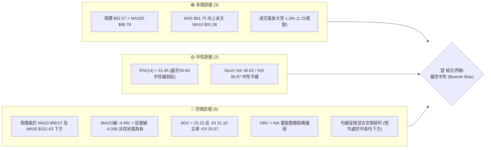
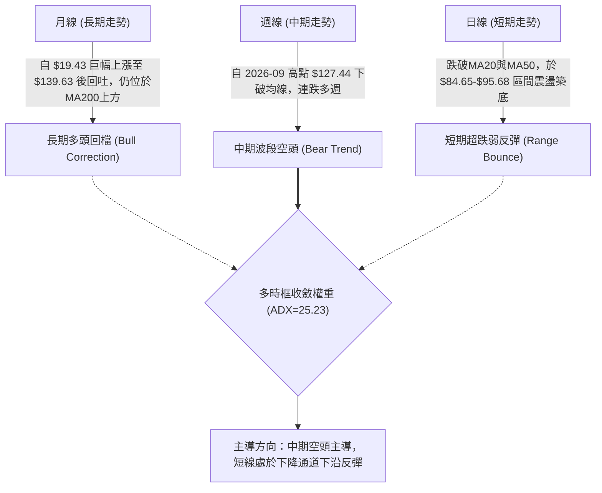
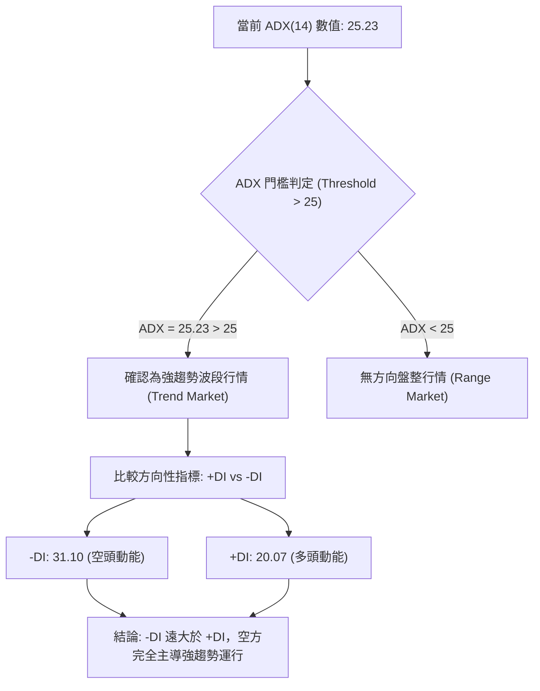
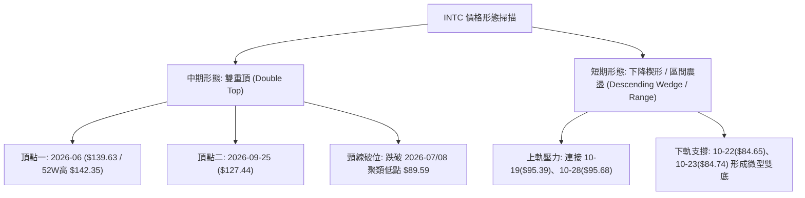
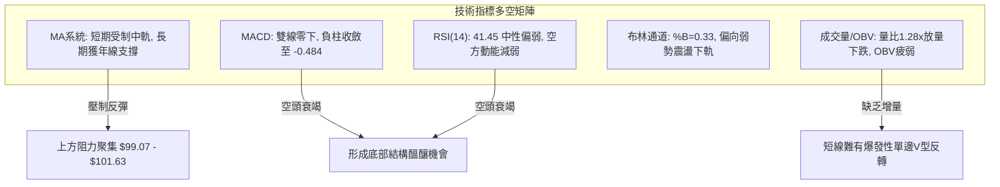
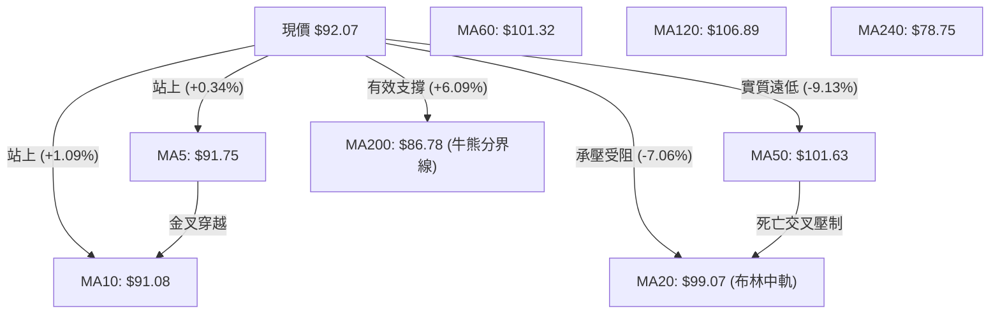
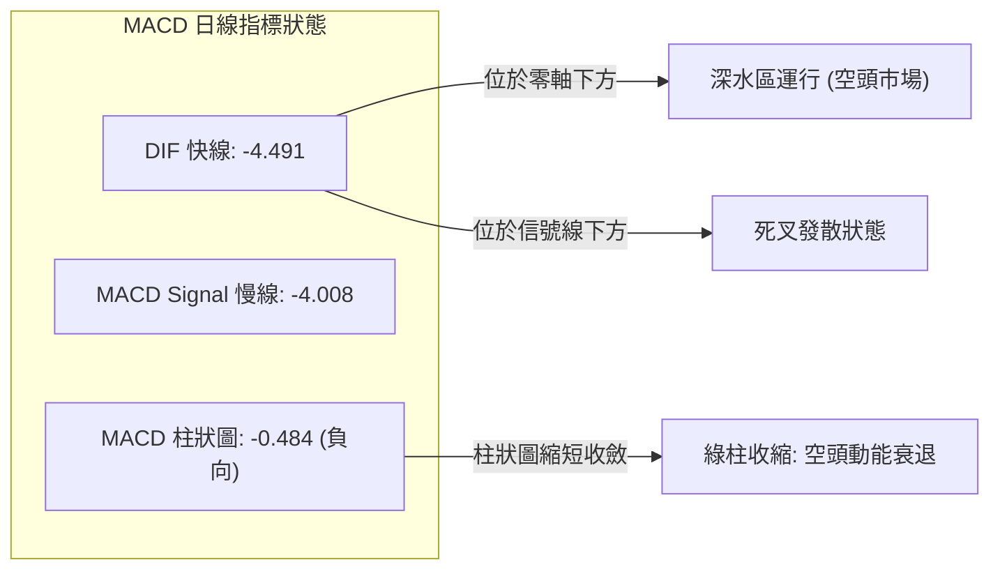
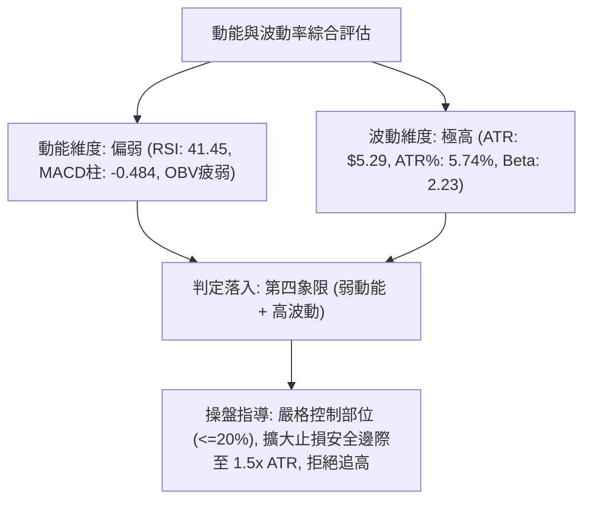
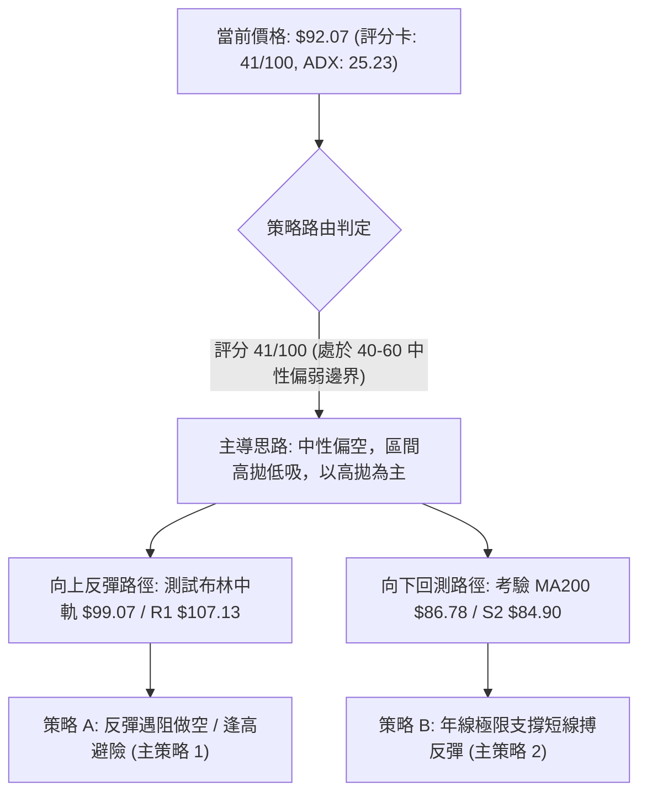
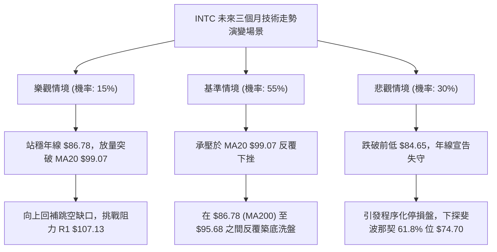

# INTC 技術分析報告

> **報告日期**：2026-10-30 ｜ **語言**：繁體中文 ｜ **數據來源**：Yahoo Finance ｜ **當前價格**：$92.07

---

## 目錄

| 章節 | 內容 |
|------|------|
| [1. 技術面概覽](#1-技術面概覽) | 訊號儀表板、核心指標、評分卡 |
| [2. 趨勢分析](#2-趨勢分析) | 多時框趨勢、長中短期走勢 |
| [3. 圖表形態分析](#3-圖表形態分析) | 形態識別、K線組合、目標價 |
| [4. 支撐與阻力](#4-支撐與阻力) | 關鍵價位、斐波那契回調 |
| [5. 技術指標深度解讀](#5-技術指標深度解讀) | MA/RSI/MACD/布林/成交量 |
| [6. 動能與波動率](#6-動能與波動率) | 動能評估、ATR、Beta |
| [7. 多時框架總結](#7-多時框架總結) | 時框架評分矩陣 |
| [8. 交易策略建議](#8-交易策略建議) | 多空策略、風險報酬比 |
| [9. 風險提示與監控](#9-風險提示與監控) | 監控指標、風險場景 |

---

## 1. 技術面概覽

### 🎯 技術訊號儀表板



### 📊 核心指標速覽表

| 指標類別 | 指標名稱 | 當前數值 | 訊號 | 解讀 |
|----------|----------|----------|------|------|
| **價格** | 當前收盤價 | $92.07 | 🟡 | 位於52W區間54.1%，處於近期回檔低檔整固區 |
| **均線** | MA20 | $99.07 | 🔴 | 現價低於MA20達-7.06%，短期承壓於下行通道 |
| **均線** | MA50 | $101.63 | 🔴 | 現價低於MA50，中期下降趨勢尚未扭轉 |
| **均線** | MA200 | $86.78 | 🟢 | 現價高於MA200達+6.09%，長期年線支撐仍具保護性 |
| **動能** | RSI(14) | 41.45 | 🟡 | 位於40–50中性偏弱區，無超買超賣，下行動能減速 |
| **動能** | MACD (12,26,9) | -4.491 / -4.008 (柱 -0.484) | 🔴 | 零軸下死叉發散，空方控制盤面，但負柱狀圖收斂 |
| **趨勢** | ADX(14) / ±DI | ADX: 25.23 (-DI: 31.10 / +DI: 20.07) | 🔴 | ADX>25確立強空頭波段趨勢行情，空方強勢主導 |
| **通道** | 布林通道 %B | 0.33 (帶寬 $78.90–$119.24) | 🟡 | 位於中軌下方、下軌上方，偏向弱勢震盪區間 |
| **量能** | 20日量比 / OBV | 量比 1.28x / OBV < MA | 🔴 | 今日放量下挫收跌，OBV低於均線顯示主力資金流出 |
| **波動** | ATR(14) | $5.29 (5.74% of price) | 🔴 | 波動率極高，單日平均震幅達5.29美元，風控要求高 |

### 🏆 技術評分卡

```
技術評分卡 — INTC (2026-10-30)
════════════════════════════════════════════════════
趨勢強度      ████████░░░░░░░░░░░░  40/100  🔴 空頭趨勢主導 (ADX 25.23, -DI佔優)
動能指標      ███████░░░░░░░░░░░░░  35/100  🔴 MACD負值發散，RSI偏弱41.45
支撐穩定度    ████████████░░░░░░░░  60/100  🟢 MA200($86.78)及S1($89.59)展現韌性
成交量配合    ████████░░░░░░░░░░░░  40/100  🔴 放量收陰，OBV疲弱未見大資金抄底
形態完整度    ████████░░░░░░░░░░░░  40/100  🔴 自$123以上回落形成雙重頂結構
均線排列      ██████░░░░░░░░░░░░░░  30/100  🔴 MA20/MA50/MA60均線呈空頭發散壓制
════════════════════════════════════════════════════
綜合評分      ████████░░░░░░░░░░░░  41/100  中性偏空（等待築底確認，規則 18）
════════════════════════════════════════════════════
```

*計算依據：(40 + 35 + 60 + 40 + 40 + 30) ÷ 6 = 40.83，四捨五入至整數為 41/100。*

---

## 2. 趨勢分析

### 🌐 多時框趨勢分析



### 📈 長期趨勢 — 12個月走勢圖（Unicode）

```
INTC 月線走勢圖（2025-11 至 2026-10）
價格軸 ($)
$140 ┤                               ● $139.63 (2026-06 峰值)
$120 ┤                                     ● $120.23 (2026-09)
$100 ┤                         ● $114.68   
$90  ┤                   ● $94.48    ● $90.20   ● $89.51   ● $92.07 (現價)
$45  ┤             ● $46.47   ● $45.61   ● $44.13
$40  ┤ ● $40.56    
$35  ┤       ● $36.90
     └────────────────────────────────────────────────────────────
        11    12    01    02    03    04    05    06    07    08    09    10  (月份)
```

**走勢特徵分析表格**：

| 階段區間 | 起止月份 | 價格變動 | 漲跌幅 | 核心技術特徵 |
|----------|----------|----------|--------|--------------|
| **第1階段：底部蓄勢** | 2025-11 → 2026-03 | $40.56 → $44.13 | +8.80% | 橫盤窄幅震盪，籌碼在 $40–$46 密集換手完成洗盤 |
| **第2階段：爆發主升** | 2026-03 → 2026-06 | $44.13 → $139.63 | +216.40% | 垂直飆升，量能急劇放大，突破所有歷史中長期阻力 |
| **第3階段：極限回撤** | 2026-06 → 2026-07 | $139.63 → $90.20 | -35.40% | 獲利了結高潮，出現單月近50美元的毀滅性殺跌 |
| **第4階段：次頂反撲** | 2026-08 → 2026-09 | $89.51 → $120.23 | +34.32% | 跌破百元後的技術性反撲，形成中期頭部次高點 |
| **第5階段：二次下探** | 2026-09 → 2026-10 | $120.23 → $92.07 | -23.42% | 財報利空疊加科技股拋售，跳空大跌考驗年線支撐 |

### 📊 中期趨勢（週線分析）

從週K線收盤走勢觀察，自2026-09-25當週收在 $123.00 之後，近5週連續拉出黑K棒，連續下破週線各短均線：
- **高點下移**：$127.44 (09-25) → $126.00 (10-02) → $118.20 (10-09) → $103.19 (10-16) → $95.39 (10-23)
- **低點下探**：從 $114.93 連續跌至 $84.65，跌破了斐波那契50.0%回調位 $87.62，隨後在年線上方止跌。
- **週MACD柱狀圖**：由正值 +2.925 (09-25) 迅速翻負至 -3.385 (10-16)，雖然近兩週負柱收斂至 -0.484，但中期下行波段趨勢極為明確。

```
週線級別阻力與支撐示意圖：
[阻力] R2: $127.04 ══════════════════════════ (雙重頂右肩峰值)
         ▲
         │ (中期回撤通道)
         ▼
[阻力] R1: $107.13 ────────────────────────── (頸線位 / 前波密集成交區)
         ▲
[現價] $92.07  ◄─── 位於 MA200($86.78) 與 頸線($107.13) 之間
         ▼
[支撐] S1: $89.59  -------------------------- (近一年波段低點聚類)
         ▼
[支撐] S2: $84.90  ══════════════════════════ (本輪回撤極限低點 $84.65 聚類)
```

### ⚡ 趨勢強度評估（ADX 解讀）



**ADX 趨勢強度指標對照解讀表**：

| 指標名稱 | 實際數據 | 標準區間 | 趨勢特徵解讀 | 操作指導含義 |
|----------|----------|----------|--------------|--------------|
| **ADX(14)** | **25.23** | > 25 為強趨勢 | 跨越25臨界點，宣告市場脫離無序震盪，轉入單邊下行趨勢 | 順應中短期趨勢操作，逢高做空勝率高於逆勢抄底 |
| **+DI(14)** | **20.07** | 0 – 100 | 多頭進攻能量萎縮，買盤多為被動防守與空頭回補 | 不宜盲目預測底部，多單缺乏持續性攻擊火力 |
| **-DI(14)** | **31.10** | 0 – 100 | 空方壓制力量強勁，賣壓持續主導日線與週線節奏 | 逢反彈遭遇阻力位（如MA20、R1）易引發新一輪拋盤 |
| **DI差值** | **-11.03** | 負值擴大 | 空多能量差擴大至11點以上，空頭處於絕對進攻態勢 | 嚴格執行多時框收斂規則，以中期向下防守為主 |

---

## 3. 圖表形態分析

### 🔍 形態識別系統



**形態識別與信心度評估表（依規則 15）**：

| 形態名稱 | 信心度 | 判斷依據（引用數據） | 完成度 | 目標價（附嚴格計算式） |
|----------|--------|----------------------|--------|------------------------|
| **中期雙重頂 (Double Top)** | **75%** | 左頂 2026-06 收盤 $139.63 (52W高點 $142.35)；右頂 2026-09 週K高點 $127.44；跌破中樞頸線 R1 $107.13 | 85% | 由形態高度推算：頸線 R1 $107.13 − (形態高點聚類 R2 $127.04 − 頸線 R1 $107.13) = $107.13 − $19.91 = **$87.22**（極度接近斐波那契50%位 $87.62 與 MA200 $86.78） |
| **短期微型雙底 (Mini Double Bottom)** | **60%** | 日K線兩次下探：10-22低點 $84.65 與 10-23低點 $84.74（支撐位 S2 聚類 $84.90 附近獲得確認）；頸線為 10-28 高點 $95.68 | 65% | 由形態高度推算：頸線高點 $95.68 + (頸線 $95.68 − 底部 $84.65) = $95.68 + $11.03 = **$106.71**（極度接近關鍵阻力位 R1 $107.13） |
| **複合頭肩底** | **30%** | 數據不足以確認左肩結構，僅有自低檔 $32.89 漲起之單邊走勢 | 0% | *訊號不足，僅做指標型解讀，不預設目標價* |

### 🕯️ 重要K線形態分析

嚴格依據提供的「近10根日K」與「近8根週K」實際開高低收數據進行客觀解讀：

| 日期（日K/週K） | 開 | 高 | 低 | 收 | K線形態名稱 | 技術解讀 | 訊號 |
|------------------|----|----|----|----|-------------|----------|------|
| **日K 10-21** | 93.43 | 94.39 | 90.75 | 92.96 | 紡錘十字陰線 | 實體極小，高低點收縮，反映市場在93美元處多空陷入膠著觀望 | 🟡 |
| **日K 10-22** | 87.92 | 89.19 | 84.65 | 85.49 | 大跳空長黑K | 財報利空重挫，成交量爆量至1.34億股，直接摜破所有短均，確立空方潰堤 | 🔴 |
| **日K 10-23** | 85.92 | 87.87 | 84.74 | 86.96 | 探底小紅K (錘頭雛形) | 盤中再次考驗84.74未創新低，下影線長1.18美元，收盤收復開盤價，賣壓竭盡 | 🟢 |
| **日K 10-26** | 87.94 | 92.09 | 86.46 | 90.47 | 反彈長陽K | 開低走高長紅棒，實體達2.53美元，完全包覆前一日K棒實體，形成多頭吞噬反撲 | 🟢 |
| **日K 10-27** | 92.47 | 94.98 | 91.86 | 93.74 | 續漲陽線 | 連續第二日收高，回補10-21下跳缺口的一部分，成交量維持9052萬股健康水準 | 🟢 |
| **日K 10-28** | 95.09 | 95.68 | 93.00 | 95.53 | 上影小陽線 | 盤中衝擊95.68遇阻回落，留下0.15美元上影線，量能縮至8259萬股，顯露高檔買力不濟 | 🟡 |
| **日K 10-29** | 92.97 | 93.50 | 90.84 | 92.07 | 破位中長黑K | 跳空低開低走，收在當日相對低點92.07，爆量1.25億股，短線反彈戛然而止 | 🔴 |
| **週K 10-16** | 102.52 | 103.19 | 89.19 | 89.85 | 週線巨量光腳長陰 | 單週狂跌14.85美元(-14.18%)，直接擊穿百元整數大關，放量5.37億股，極度弱勢 | 🔴 |
| **週K 10-23** | 94.53 | 95.39 | 84.65 | 86.96 | 帶長下影下探陰K | 探出本輪低點84.65後回升，下影線長2.31美元，顯示年線 $86.78 附近有機構買盤托底 | 🟡 |
| **週K 10-29** | 87.94 | 95.68 | 86.46 | 92.07 | 週線震盪紡錘陽K | 開87.94收92.07(+5.88%)，振幅達10.5%，週量收縮至3.97億股，顯示低檔震盪整固 | 🟡 |

### 📉 ASCII 走勢形態示意圖

```
INTC 近期日K線形態走向圖（2026-10-16 至 10-29）
價格軸 ($)
$96 ┤                                              ▲ (10-28 高點 $95.68)
$95 ┤                             ┌─┐            ┌─┐
$94 ┤      ┌─┐      ┌─┐           │ │     ┌─┐    │ │
$93 ┤      │ │      │ │           │ │     │ │    │ │     ┌─┐ (10-29 開 $92.97)
$92 ┤      │ │      │ │ ┌─┐       │ │     │ │    │ │     │ │
$91 ┤      │ │ ┌─┐  │ │ │ │       │ │     │ │    │ │     │ │
$90 ┤      │ │ │ │  │ │ │ │       └─┘     │ │    └─┘     └─┘ (10-29 收 $92.07)
$89 ┤ ┌─┐  └─┘ └─┘  └─┘ └─┘              └─┘
$88 ┤ │ │
$87 ┤ │ │                                 ▲ (10-26 長紅陽吞噬)
$86 ┤ │ │                   ┌─┐
$85 ┤ └─┘            ┌─┐    │ │
$84 ┤                │ │    └─┘ ◄─── (10-22 / 10-23 築底低點 $84.65 / $84.74)
    └────────────────────────────────────────────────────────────
       10-16 10-19 10-20 10-21 10-22 10-23 10-26 10-27 10-28 10-29
```

### 🎯 形態目標價計算

1. **中期雙重頂目標（下行測幅）**：
   - **峰值聚類**：取2026-09反彈峰值 R2 = **$127.04**
   - **頸線水平**：取波段高點密集成交回撤頸線 R1 = **$107.13**
   - **垂直高度**：$127.04 − $107.13 = **$19.91**
   - **下行滿足點**：$107.13 − $19.91 = **$87.22**
   - **驗證**：10月22日–23日股價下探至 $84.65，已充分宣洩該形態的量度跌幅，並在斐波那契50%位（$87.62）及年線（MA200 $86.78）附近獲得技術性買盤支撐。

2. **短期區間反彈目標（上行測幅）**：
   - **箱體底邊**：以10-22低點 $84.65 為基準
   - **箱體頂邊（頸線）**：以10-28反彈高點 $95.68 為基準
   - **反彈高度**：$95.68 − $84.65 = **$11.03**
   - **向上突破滿足點**：若日K有效收復 $95.68，測算上行目標為 $95.68 + $11.03 = **$106.71**，高度共振關鍵阻力位 R1（**$107.13**）。

---

## 4. 支撐與阻力

### 🗺️ 關鍵價位分布圖（Unicode）

```
INTC 價位結構分布圖
═══════════════════════════════════════════════════════════════════
$142.35 ║██████████████████████████████║ 52週歷史高點 (52W High)
$132.75 ║████████████████████████      ║ 強阻力 R3 (+44.18%)
$127.04 ║████████████████████          ║ 重大阻力 R2 (+37.98%)
$116.52 ║▓▓▓▓▓▓▓▓▓▓▓▓▓▓▓▓▓▓            ║ 斐波那契 23.6% 回調位
$107.13 ║██████████████████████████████║ 關鍵阻力 R1 (+16.36%) / 頸線
$100.54 ║▓▓▓▓▓▓▓▓▓▓▓▓▓▓▓▓▓▓▓▓▓▓        ║ 斐波那契 38.2% 回調位 / 百元關卡
────────╫──────────────────────────────╫───────────────────────────
$ 92.07 ╠══════════════════════════════╣ ◄── 當前收盤價 (現價)
────────╫──────────────────────────────╫───────────────────────────
$ 89.59 ║▓▓▓▓▓▓▓▓▓▓▓▓▓▓▓▓▓▓▓▓          ║ 近期支撐 S1 (-2.69%)
$ 87.62 ║░░░░░░░░░░░░░░░░░░░░░░        ║ 斐波那契 50.0% 回調位 (多空分水嶺)
$ 86.78 ║▓▓▓▓▓▓▓▓▓▓▓▓▓▓▓▓▓▓▓▓▓▓▓▓▓▓    ║ 200日均線 (MA200 長期生命線)
$ 84.90 ║██████████████████████████████║ 強支撐 S2 (-7.79%) / 前低 $84.65
$ 81.79 ║████████████████████          ║ 極限支撐 S3 (-11.17%)
$ 74.70 ║░░░░░░░░░░░░░░░░░░░░░░        ║ 斐波那契 61.8% 黃金回調位
═══════════════════════════════════════════════════════════════════
```

### 🚧 阻力位分析表

*嚴格引用數據中由波段高點聚類計算所得之數值：*

| 阻力級別 | 準確價位 | 距離現價 | 形成原因與籌碼結構 | 突破難度 | 技術重要性 |
|----------|----------|----------|--------------------|----------|------------|
| **阻力 R1** | **$107.13** | +16.36% | 近一年波段高點聚類、下跳缺口頂部與前波破位頸線，累積數億股套牢籌碼 | 🔴 極高 | ★★★★★ (多空轉換關鍵防線) |
| **阻力 R2** | **$127.04** | +37.98% | 2026年9月反彈頂部（週K高點 $127.44）聚集處，雙重頂右肩峰值 | 🔴 極高 | ★★★★☆ (中期反轉極限) |
| **阻力 R3** | **$132.75** | +44.18% | 2026年6月高位震盪密集區，歷史波段高點聚類，逼近52週歷史峰值 | 🔴 險峻 | ★★★☆☆ (歷史強套牢天花板) |

### 🛡️ 支撐位分析表

*嚴格引用數據中由波段低點聚類計算所得之數值：*

| 支撐級別 | 準確價位 | 距離現價 | 形成原因與籌碼結構 | 守住機率 | 技術重要性 |
|----------|----------|----------|--------------------|----------|------------|
| **支撐 S1** | **$89.59** | -2.69% | 近一年波段低點聚類，2026年7月/8月震盪築底低點（$90.20/$89.51），現為第一道屏障 | 🟡 65% | ★★★☆☆ (短線多空緩衝帶) |
| **支撐 S2** | **$84.90** | -7.79% | 2026-10-22 及 10-23 連續兩日下探極限點（$84.65/$84.74）聚類，亦為下半年最低點 | 🟢 80% | ★★★★★ (中期多頭最後堡壘) |
| **支撐 S3** | **$81.79** | -11.17% | 歷史波段低點聚類，緊鄰布林帶下軌（$78.90）與240日均線（$78.75），最後避險閥 | 🟢 90% | ★★★★☆ (崩盤防守底線) |

### 📐 斐波那契回調位分析

*以 52 週極值區間 $32.89 → $142.35 計算（高度差 $109.46）：*

| 斐波那契回調比例 | 精確價位 | 技術含義與當前位置關聯 |
|------------------|----------|------------------------|
| **0.0% (52W High)** | **$142.35** | 2026年度歷史天花板，本輪狂飆牛市終點 |
| **23.6%** | **$116.52** | 第一回檔支撐位，已被下破並轉化為長期深層阻力 |
| **38.2%** | **$100.54** | 重要心理整數關卡（$100.00），與當前MA50（$101.63）高度重合 |
| **50.0%** | **$87.62** | **多空生死分水嶺**：現價 $92.07 位於 38.2% 與 50.0% 之間！ |
| **61.8%** | **$74.70** | 黃金分割防守位，若跌破50%回調位將直接尋求此位置支撐 |
| **78.6%** | **$56.31** | 深度回撤區，牛市起漲前震盪平台 |
| **100.0% (52W Low)**| **$32.89** | 2025年度底部極限低點 |

**技術深度解讀**：
當前收盤價 **$92.07** 處於 **38.2% 回調位 ($100.54)** 與 **50.0% 回調位 ($87.62)** 的關鍵夾層中。回顧歷史走勢，INTC 自 $142.35 的暴跌在跌至 50% 回調位 $87.62 時（10-22 跌至 $84.65 後迅速拉回），技術買盤迅速進場護盤，使其週K線收盤（$92.07）始終守在 50% 回調位之上。只要股價維持在 $87.62 之上，本輪回撤即可定性為「牛市正常健康回檔」；一旦實體週K跌破 $87.62，則宣告中期結構徹底轉熊，將開啟向 61.8%（$74.70）靠攏的深跌空間。

---

## 5. 技術指標深度解讀

### 🎛️ 指標訊號總覽



### 📈 移動平均線排列分析



**均線結構數據解讀**：
1. **短期超跌修復**：MA5 ($91.75) 於近日上穿 MA10 ($91.08)，且現價 $92.07 站穩於 MA5 及 MA10 之上，呈現超跌之後的極短線止跌契機。
2. **中期空頭反壓**：MA20 ($99.07) 與 MA50 ($101.63) 呈現強烈下行發散，MA60 ($101.32) 與 MA120 ($106.89) 在上方形成密集的空頭阻力牆。價格與 MA20 的乖離率達 -7.06%，顯示反彈的第一個天花板在 $99.07 附近。
3. **長期均線護城河**：200日均線 MA200 目前位於 **$86.78**，且保持上行斜率（年線乖離率 +6.09%），240日均線在 **$78.75**（+16.91%）。當前均線系統屬於典型的「短中期均線空頭排列，但長期均線維持多頭」的**混合排列（Mixed Alignment）**。

### 📉 RSI(14) 分析

- **當前 RSI(14) 數值**：**41.45**（Wilder 計算法）
- **RSI 強度進度條**：
  `弱勢區 0% ░░░░░░░░░░████████████░░░░░░░░░░░░░░░░ 41.45% 強勢區 100%`
- **超買超賣評估**：既未進入超賣區（<30），亦未進入超買區（>70），處於 40–50 區間的**中性偏弱震盪帶**。
- **背離判斷**：
  - **日線背離判定**：檢視近20根K棒首尾價格與 RSI 方向，數據明確指出「**無明顯背離**」。股價由10月高檔回落至 $84.65，RSI 同步自高檔跌落至 30 附近，並隨價格小幅回升至 41.45，指標走勢與價格步伐一致，未形成典型日線底背離。
  - **週線動能收斂**：在週線級別上，10-16 當週收盤 $89.85 時 RSI 為 31.4，10-23 當週價格創更低點 $86.96（盤中低點 $84.65）時，週 RSI 卻小幅抬升至 32.8，隨後 10-29 週收盤 $92.07 時 RSI 回升至 41.5。此微幅擡升顯示**空方拋售動能在週線層面出現動能衰竭**跡象。

### 📊 MACD(12/26/9) 訊號解讀



**MACD 詳細解讀**：
- **絕對數值**：MACD 線（-4.491）低於信號線（-4.008），柱狀圖為 **-0.484**。
- **所處位置**：雙線深陷零軸下方深水區，確認中線為空方掌控的大格局。
- **微觀轉變**：負柱狀圖（-0.484）較先前週線級別的極限負值（-3.385）大幅收斂，且日線綠柱未進一步拉長，說明空頭集中砸盤的高峰期已過，指標正在構築潛在的零下金叉結構，但金叉未正式成型前不可預先盲目作多。

### 📦 布林通道分析

```
INTC 布林通道（20日，2倍標準差）結構圖
═══════════════════════════════════════════════════════════════════
$119.24 ────────────────────────────────────────── 布林上軌 (Upper Band)
          ▲
          │ 寬度 = $40.34 (寬幅通道，強烈震盪)
          ▼
$ 99.07 ────────────────────────────────────────── 布林中軌 (MA20 / 基準線)
          ▲
  $92.07  ╠═══════════════════════════════════════ 當前價格 (%B = 0.33)
          ▼
$ 78.90 ────────────────────────────────────────── 布林下軌 (Lower Band)
═══════════════════════════════════════════════════════════════════
```

**布林通道特徵解析**：
- **帶寬計算**：上軌 $119.24 − 下軌 $78.90 = **$40.34**（帶寬比達 40.7%），顯示近期個股經歷了極端劇烈的單邊殺跌，使通道極度張開。
- **%B 指標位置**：當前 **%B = 0.33**（公式：(92.07 − 78.90) ÷ 40.34 = 0.326），處於下軌與中軌之間的下半區，偏向弱勢運行區間。
- **通道策略意義**：未跌破下軌 $78.90，且自下軌附近逐步回抽，說明股價正在由極度弱勢向中軌 $99.07 進行均值回歸（Mean Reversion），中軌 $99.07 將構成反彈的強大阻力。

### 💹 成交量分析（量價配合度）

1. **量能指標數值**：
   - 最新單日成交量：**125,467,300 股**（1.254億股）
   - 20日移動平均量：**97,935,460 股**
   - **量比 (Volume Ratio)**：**1.28x**（放量28%）
   - 50日移動平均量：**100,100,524 股**
2. **量價關係解讀**：
   - 10月29日單日收盤 $92.07（跌幅較前日顯著），成交量放大至 1.25 億股，量比達 1.28x，呈現典型的「**放量下跌**」不良形態，反映在 $93–$95 反彈阻力區間遭遇了沉重的解套盤與空頭拋壓。
   - 觀察近10日成交量分佈，10月22日大跌時爆出 1.34 億股巨量，而隨後反彈（10-26 至 10-28）成交量卻分別為 9874萬、9052萬及 8259萬股，呈現典型的「**上漲縮量，下跌放量**」的空頭量價背離特徵。
3. **OBV (能量潮) 趨勢**：
   - 數據明確顯示：「**OBV < MA → 量能疲弱**」。
   - OBV 跌破其均線並持續於低檔徘徊，說明機構資金在當前價位並無顯著的主動性吸籌建倉跡象，量能結構不支持無量大漲。

---

## 6. 動能與波動率

### ⚡ 動能評估四象限

| 象限標籤 | 動能狀態 (Momentum) | 波動率狀態 (Volatility) | INTC 當前所屬象限 | 戰略特徵與操盤應對 |
|----------|---------------------|-------------------------|-------------------|--------------------|
| **Q1** | 強 (High) | 低 (Low) | ❌ | 穩定單邊牛市，持股續抱的最佳區間 |
| **Q2** | 弱 (Low) | 低 (Low) | ❌ | 盤整無序築底，適合低吸高拋網格操作 |
| **Q3** | 強 (High) | 高 (High) | ❌ | 瘋狂主升或恐慌踩踏，單邊趨勢劇烈博弈 |
| **Q4** | **弱 (Low)** | **高 (High)** | **✓ (當前所屬)** | **高波動空頭回檔期，風險極高，嚴禁重倉抄底** |



### 📊 ATR 波動率分析

- **ATR(14) 數值**：**$5.29**（Wilder 計算法）
- **ATR 佔比 (ATR % of Price)**：**5.74%**
  - 進度條：`波動率水平: ████████████████░░░░ 5.74% (極高波動門檻)`
- **止損距離建議**：
  - 一般股票 ATR 佔比通常在 2%–3.5%，INTC 高達 5.74%，意味著日內正常波動即可達 5 美元以上。
  - **保守止損距離（波段）**：2.0 × ATR = **$10.58**
  - **一般止損距離（短線）**：1.0 × ATR = **$5.29**
  - **緊密止損距離（日內）**：0.75 × ATR = **$3.97**
  - **應用結論**：若在當前 $92.07 附近進行短線建倉，止損點不可設得過窄（如1–2美元以內），極易被常態雜訊洗出場，技術止損位必須依託結構支撐 S1（$89.59）或年線下方。

### 📐 Beta 與市場相關性

- **Beta 數值**：**2.23**
  - 屬於**超高系統性風險股票**（High Beta Asset）。
  - 當標普500指數（S&P 500）波動 1.0% 時，INTC 理論上將同向放大波動 2.23%。
- **市場環境交互分析**：
  - 結合即時新聞面：「AI 巨頭支出擔憂引發股市重挫、亞股走低、晶片大廠預警艱困一年」，在科技股整體大盤面臨流動性收縮時，高 Beta 值的 INTC 承受了成倍的拋售壓力。
  - 在大盤未止跌前，INTC 難以獨善其身，反彈容易因市場情緒波折而中途夭折。

---

## 7. 多時框架總結

### 📋 時框架評分表

| 時框架 | 趨勢方向 | 動能狀態 | 均線排列 | 圖表形態 | 綜合評分 | 建議處置 |
|--------|----------|----------|----------|----------|----------|----------|
| **長期 (月線)** | 🟢 多頭回檔 | 🟡 中性降溫 | 🟢 MA200/MA240 向上發散 | 自高點回撤至50%回調位整固 | **65/100** | 逢極限支撐分批佈局 |
| **中期 (週線)** | 🔴 明確空頭 | 🔴 空方主導 | 🔴 週短均呈空頭排列 | 雙重頂破位，考驗年線支撐 | **35/100** | 反彈減碼，順勢偏空防守 |
| **短期 (日線)** | 🟡 區間震盪 | 🟡 超跌修復 | 🔴 承壓於MA20及MA50之下 | 10-22跳空破位後低檔箱體盤整 | **40/100** | 短線區間操作，嚴控停損 |

### 🔲 綜合訊號矩陣

| 維度分析 | 短期 (日線級別) | 中期 (週線級別) | 長期 (月線級別) | 訊號一致性評估 |
|----------|-----------------|-----------------|-----------------|----------------|
| **趨勢方向** | 橫盤區間 ($84.65–$95.68) | 下行趨勢 ($127.44 → $84.65)| 宏觀牛市回撤 ($19.43 → $139.63) | 矛盾：長多、中空、短震盪 |
| **動能狀態** | MACD負柱收斂，RSI=41.45 | MACD負柱擴大後微縮，RSI=41.5 | 獲利回吐，處於過熱後退潮期 | 一致：中短期均處於空方動能減弱期 |
| **支撐阻力** | 阻力 $95.68 / 支撐 $84.65 | 阻力 R1 $107.13 / 支撐 S2 $84.90 | 阻力 $142.35 / 支撐 50%位 $87.62 | 高度共振：$84.65–$87.62 為全週期共同支撐 |
| **量能特徵** | 反彈量縮，回落放量 (量比1.28x) | 週量維持3.9億至5.3億高檔換手 | 巨量天頂後縮量回調 | 偏空：未見大機構底部爆量吸籌 |

### ⚖️ 多時框收斂結論

**嚴格遵循規則 14 之多時框收斂法規**：
1. **行情性質判定**：當前 ADX(14) 數值為 **25.23**，大於 25 的趨勢行情臨界點；且 -DI (31.10) 顯著高於 +DI (20.07)，確認當前市場處於**強烈的空頭趨勢行情**，而非無方向的盤整市。
2. **優先級收斂依據**：在強趨勢行情中，必須以**中長期方向（週線級別空頭、MA20與MA50之向下發散反壓）為主導方向**，日線級別的反彈只能作為尋找反彈阻力點或短線波段離場的時機，不可將日線的低檔小陽線視為反轉信號。
3. **唯一方向性結論**：**中性偏空（Bearish Bias）**。中期空頭佔據絕對優勢，短期走勢受制於布林中軌（$99.07）與阻力位 R1（$107.13），下方則依賴年線（MA200 $86.78）與支撐位 S2（$84.90）苦撐，主策略必須維持防禦性與反彈減碼思路。

---

## 8. 交易策略建議

### 🗺️ 策略決策流程圖



### 🧭 策略路由（依評分卡分流，不得兩頭下注）

> **當前主策略方向 = 中性偏空防守型區間交易（依評分 41/100）**
> 
> *依規則說明：綜合評分 41/100 處於 40–60 之中性區間下沿，且 ADX>25 顯示中期空頭強勁。整體策略禁止盲目長線做多，操作以「**逢反彈關鍵阻力做空（策略 A）**」為主軸，輔以「**依託年線超跌極限支撐短線搶反彈（策略 B）**」，兩者皆嚴格鎖定於預設之支撐阻力結構內。*

### 🎯 價格情境階梯（Price Scenarios）

*所有價位嚴格引用第 4 章「關鍵價位」與技術指標快照之精確數值：*

| 觸發條件 | 下一目標 | 後續延伸目標 | 情境技術含義 |
|----------|----------|--------------|--------------|
| **向上突破 R1 $107.13** | R2 **$127.04** | R3 **$132.75** | 中期空頭形態被破壞，多頭強勢反轉，填補跳空缺口 |
| **反彈受阻於 MA20 $99.07** | S1 **$89.59** | S2 **$84.90** | 均線反壓有效，確立弱勢反彈結束，重回下行軌道 |
| **跌破 S1 $89.59** | 50%位 **$87.62** / MA200 **$86.78** | S2 **$84.90** | 短線反彈宣告失敗，尋求長期生命線年線支撐 |
| **跌破 S2 $84.90** | S3 **$81.79** | 61.8%位 **$74.70** | 年線失守，雙重頂下行量度空間打開，進入恐慌破位行情 |

### 📊 情境機率分佈

| 預測情境 | 發生機率 | 主要技術與量化依據 |
|----------|----------|--------------------|
| **弱勢反彈後再次探底** | **55%** | ADX=25.23且-DI=31.10強勢主導；10-29放量下跌（量比1.28x）；OBV<MA量能潰散；MA20/50均線死叉下壓 |
| **在 $84.90–$99.07 區間箱體震盪** | **35%** | 斐波那契50%位（$87.62）與MA200（$86.78）形成強托底；MACD負柱收斂至-0.484，空頭殺跌動能暫歇 |
| **直接突破 R1 $107.13 強勢反轉** | **10%** | 上方套牢盤極為沉重，市場受制於半導體週期利空與高 Beta 系統性風險，缺乏增量資金配合 |

### 🟢 主策略詳情（方向依上方路由）

*嚴格遵守規則 17 之風險報酬比計算定義：*
*做多 RR = (T1 − 進場) ÷ (進場 − 止損)*
*做空 RR = (進場 − T1) ÷ (止損 − 進場)*

| 策略要素 | 策略 A（逢高沽空 / 順應中期趨勢） | 策略 B（年線低吸 / 超跌防守反彈） |
|----------|-----------------------------------|-----------------------------------|
| **交易方向** | 做空 (Short / 逢高避險) | 做多 (Long / 逆勢短線反彈) |
| **進場條件** | 股價弱勢反彈至 MA20 與布林中軌遇阻收黑K | 股價回踩 MA200 與支撐 S2 區間企穩收十字星 |
| **進場價格** | **$99.07** (精確取 MA20 / 布林中軌價位) | **$86.78** (精確取 MA200 年線價位) |
| **目標價 T1** | **$89.59** (支撐位 S1) | **$95.68** (前波反彈高點 / 日K壓力) |
| **目標價 T2** | **$84.90** (支撐位 S2) | **$99.07** (布林中軌 / MA20) |
| **止損價格** | **$101.63** (MA50 阻力位上方) | **$84.65** (10-22 極限低點下方) |
| **風險報酬比** | **1 : 3.70（以 T1 計）**<br>*(99.07−89.59)÷(101.63−99.07) = 9.48÷2.56 = 3.70*<br>*(以 T2 計為 1 : 5.54)* | **1 : 4.18（以 T1 計）**<br>*(95.68−86.78)÷(86.78−84.65) = 8.90÷2.13 = 4.18*<br>*(以 T2 計為 1 : 5.77)* |
| **成功機率** | **65%** (順應日線/週線空頭趨勢) | **45%** (左側博弈年線支撐) |
| **建議倉位** | **15% - 20%** (標準防禦倉位) | **5% - 10%** (輕倉試探，嚴格止損) |

### 🔴 反向風險觸發點（對沖提示）

- **做空策略 A 之風險反轉點**：若日K線以高於 1.2 億股的放量實體陽線收盤站上 **$101.63**（MA50），且 MACD 在零軸下完成強勢金叉，則證明中期空頭趨勢遭破壞，必須無條件平倉所有空單對沖部位。
- **做多策略 B 之風險反轉點**：若股價無量跌破 **$84.65**（本輪回撤最低收盤防線）或實體週K線跌破年線 **$86.78**，表示斐波那契 50% 支撐正式潰敗，多單必須立刻止損出局，嚴防向 61.8% 位 $74.70 墜落。

### ⭐ 整體訊號強度評星

```
做多訊號強度：★★☆☆☆  (2/5星 — 短期超跌反彈，但受制於沉重上方均線)
做空訊號強度：★★★★☆  (4/5星 — 中期雙頂疊加ADX強空頭趨勢，順勢勝率高)
整體可信度：  ★★★★☆  (4/5星 — 多時框價位與均線體系呈現高精度收斂)
```

---

## 9. 風險提示與監控

### ✅ 關鍵監控指標 Checklist

```
╔══════════════════════════════════════════════════════════════════╗
║              INTC 每日盤後關鍵技術指標監控清單                  ║
╠══════════════════════════════════════════════════════════════════╣
║ [ ] 1. 收盤價是否跌破支撐位 S1 ($89.59) 或年線 MA200 ($86.78)    ║
║ [ ] 2. 每日成交量是否異常放大至 1.5 億股以上 (警惕恐慌性拋盤)     ║
║ [ ] 3. ADX(14) 是否持續維持於 25.00 之上且 -DI 向上走擴          ║
║ [ ] 4. 日線 MACD 柱狀圖是否由負 (-0.484) 轉正 (潛在金叉買訊)      ║
║ [ ] 5. RSI(14) 是否跌破 30.00 進入深度超賣極限區                 ║
║ [ ] 6. 股價向上挑戰 MA20 ($99.07) 時之量能表現 (是否量價背離)    ║
║ [ ] 7. 布林帶寬是否持續縮口收斂 (醞釀新一輪方向性突破)           ║
╚══════════════════════════════════════════════════════════════════╝
```

### ⚠️ 風險場景分析



### 🛡️ 風險管理重要提醒

1. **極端波動率防禦（High ATR / High Beta）**：
   - 當前 ATR 高達 **$5.29**（佔股價 5.74%），Beta 為 **2.23**。在如此高震幅的環境下，日內正常波動即可能觸發常規止損。**單一交易帳戶對 INTC 的持倉暴險切勿超過總資金的 15%**，避免單一標的之極端黑天鵝事件重創投資組合淨值。
2. **財報與基本面預警共振**：
   - 新聞面顯示公司「警告未來面臨艱困一年（warns of tough year ahead）」，且分析師評級近期出現 Rosenblatt 下調至「賣出」、Wedbush 下調至「中性」。技術面上形成的跳空暴跌缺口具有強烈的「基本面驅動實質性破位」特徵，切勿單憑「價格便宜」進行盲目左側重倉攤平。
3. **動態追蹤止損機制**：
   - 若採用策略 B 於 $86.78 附近進場博取反彈，當股價上漲達到 1.0 × ATR（即達到 $92.07 現價水平）時，應立即將止損價上移至損益兩平點（$86.78），無條件鎖定本金安全，杜絕獲利單演變為大幅虧損單。

---

## 📋 報告總結

```
INTC 技術分析報告總結
════════════════════════════════════════════════════════
報告日期：2026-10-30
當前價格：$92.07 USD
分析評級：⚖️ 偏空中性 (Bearish Bias / 綜合評分: 41/100)

關鍵結論：
├─ 長期趨勢：🟢 宏觀牛市健康回檔 (現價仍高於 MA200 $86.78 達 +6.09%)
├─ 中期趨勢：🔴 週線級別雙頂破位 (ADX=25.23, -DI=31.10 強空頭主導)
├─ 短期趨勢：🟡 跌破百元後低檔弱勢震盪 (受制於 MA20 $99.07 反壓)
├─ 關鍵支撐：S1: $89.59 ｜ 年線: $86.78 ｜ 強支撐 S2: $84.90
├─ 關鍵阻力：布林中軌: $99.07 ｜ MA50: $101.63 ｜ 阻力 R1: $107.13
└─ 分析師目標：共識均價 $117.71 (機構低標: $80.00 / 高標: $200.00)

最優策略組合：
1. 🥇 最佳機會 (策略 A - 逢高沽空)：
   等待股價弱勢反彈至 MA20 ($99.07) 遇阻進場做空，
   目標價 T1: $89.59，止損價: $101.63，風險報酬比 1 : 3.70。
2. 🥈 次選機會 (策略 B - 年線低吸)：
   若價格回踩 MA200 ($86.78) 企穩，輕倉博弈超跌反彈，
   目標價 T1: $95.68，止損價: $84.65，風險報酬比 1 : 4.18。
3. 🥉 保守選擇：
   完全空倉觀望，耐心等待日線 MACD 零下金叉成型，
   或等待股價有效放量突破 R1 ($107.13) 後再順勢進場。
════════════════════════════════════════════════════════
```

---

> ⚠️ **免責聲明**：本報告為 AI 自動生成之技術分析，所有數據及估算均基於提供的歷史價格資訊。本報告**僅供研究與學術參考**，**不構成任何投資建議**。投資有風險，入市需謹慎。

---

*報告生成時間：2026-10-30 ｜ 數據來源：Yahoo Finance ｜ 分析框架：多時框技術分析*