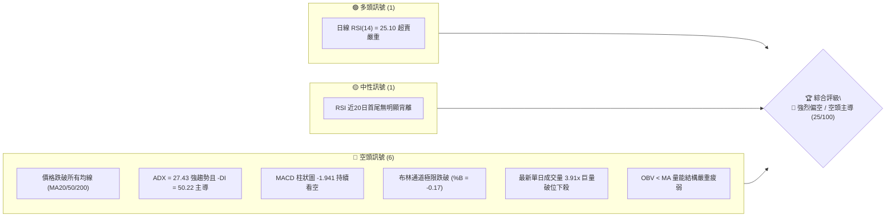
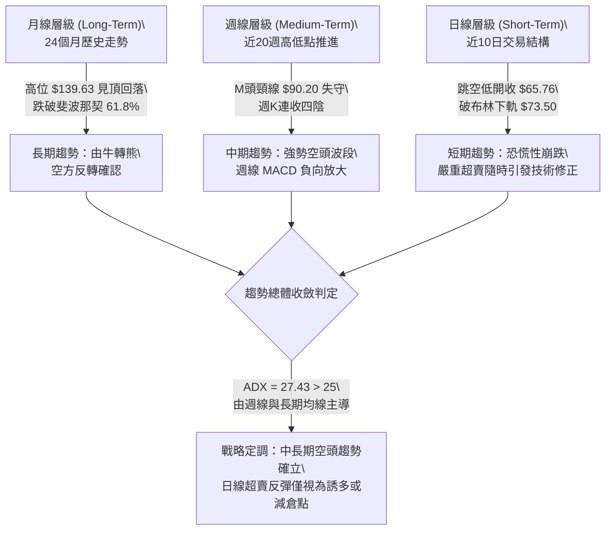
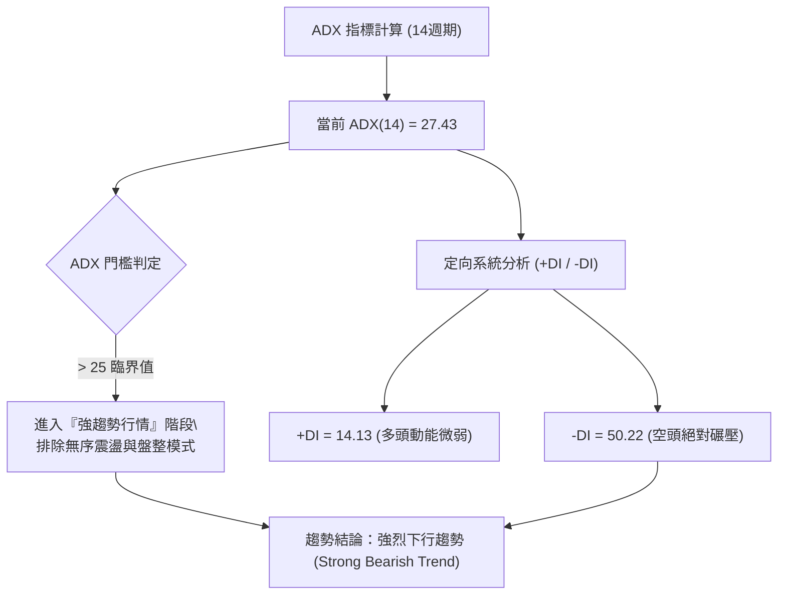
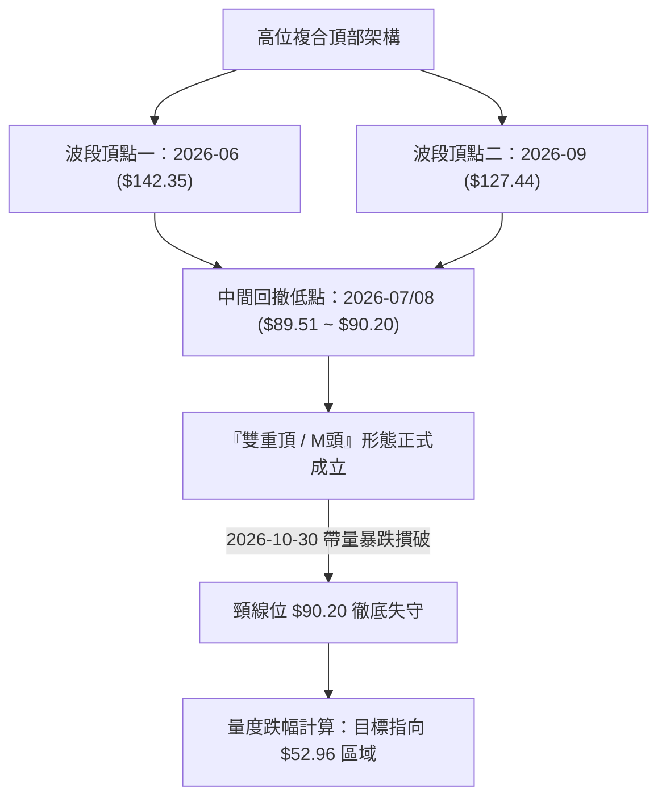
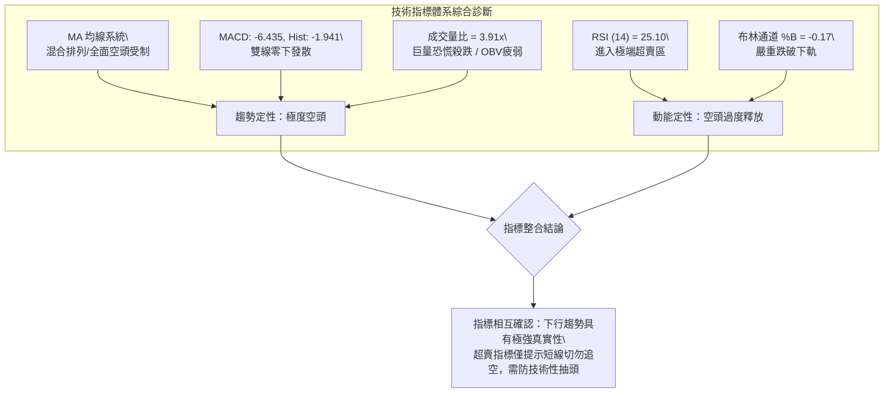
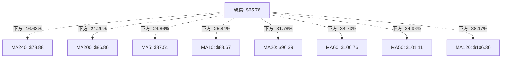
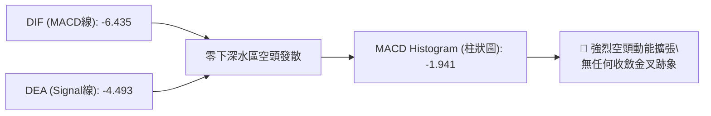
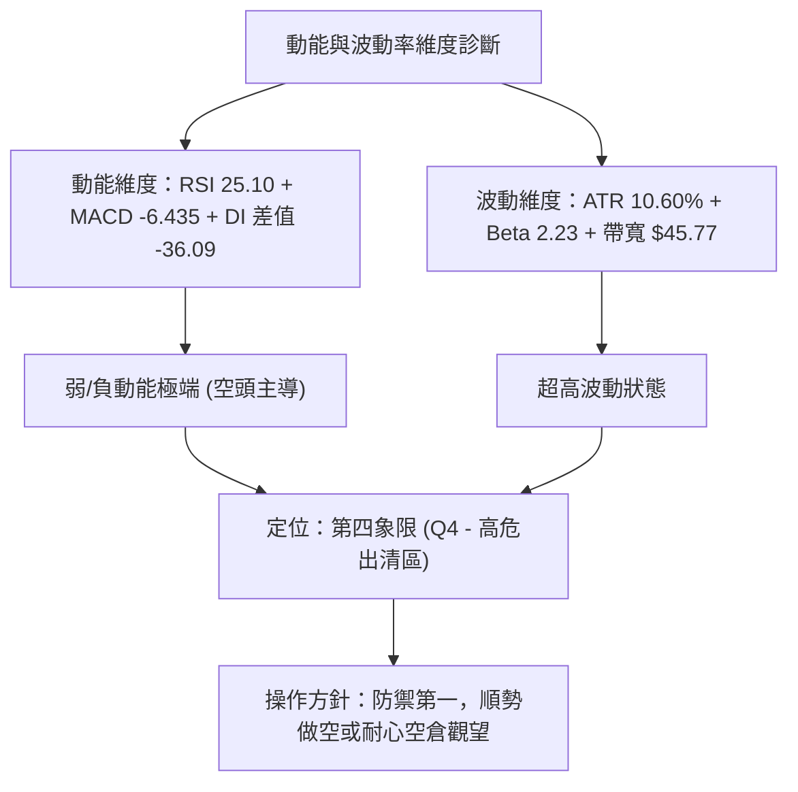
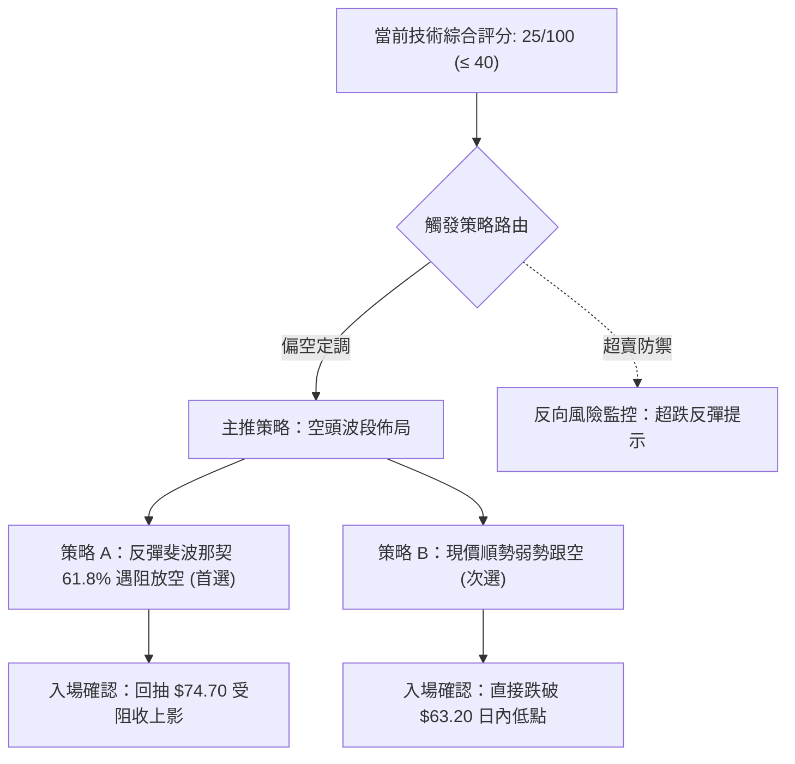
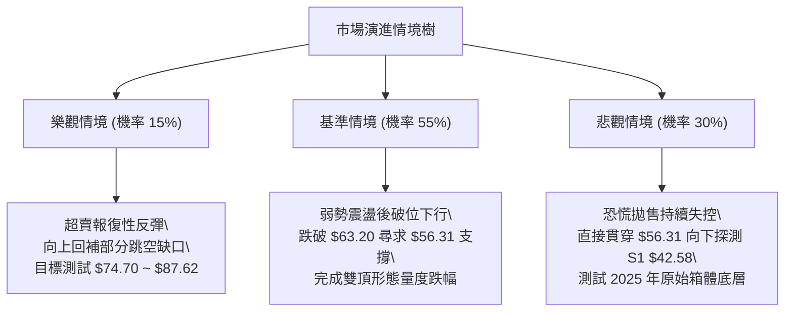

# INTC 技術分析報告

> **報告日期**：2026-10-31 ｜ **語言**：繁體中文 ｜ **數據來源**：Yahoo Finance ｜ **當前價格**：$65.76

---

## 目錄

| 章節 | 內容 |
|------|------|
| [1. 技術面概覽](#1-技術面概覽) | 訊號儀表板、核心指標、評分卡 |
| [2. 趨勢分析](#2-趨勢分析) | 多時框趨勢、長中短期走勢、ADX解讀 |
| [3. 圖表形態分析](#3-圖表形態分析) | 雙頂破位形態、近10日/8週K線組合、目標價測算 |
| [4. 支撐與阻力](#4-支撐與阻力) | 關鍵價位結構、斐波那契回調位深析 |
| [5. 技術指標深度解讀](#5-技術指標深度解讀) | 均線系統、RSI、MACD、布林通道與成交量量價關係 |
| [6. 動能與波動率](#6-動能與波動率) | 動能四象限、ATR波幅、Beta市場敏感度 |
| [7. 多時框架總結](#7-多時框架總結) | 時框架矩陣評分、多時框收斂邏輯 |
| [8. 交易策略建議](#8-交易策略建議) | 策略路由分流、價格情境階梯、主空頭策略與風控 |
| [9. 風險提示與監控](#9-風險提示與監控) | 關鍵指標檢核表、情境預案與倉位管理守則 |

---

## 1. 技術面概覽

### 🎯 技術訊號儀表板



### 📊 核心指標速覽表

| 指標類別 | 指標名稱 | 當前數值 | 訊號 | 解讀 |
|:---|:---|:---|:---:|:---|
| **價格** | 當前收盤價 | $65.76 | 🔴 | 位於52週區間 30.0% 分位，單日跳空重挫 -28.58% |
| **均線** | 短期 MA20 | $96.39 | 🔴 | 價格遠在均線下方 -31.78%，短期下行斜率極陡 |
| **均線** | 中期 MA50 | $101.11 | 🔴 | 價格遠在均線下方 -34.96%，中期趨勢徹底破位 |
| **均線** | 長期 MA200 | $86.86 | 🔴 | 價格跌穿長期牛熊分界線 -24.29%，長期多頭趨勢瓦解 |
| **動能** | RSI(14) | 25.10 | 🟢 | 進入極度超賣區（<30），技術性短線存在超跌反彈動能 |
| **動能** | MACD (12/26/9) | -6.435 / -4.493 | 🔴 | DIF 位於信號線下方且雙雙落入負值深水區，Histogram 為 -1.941 |
| **趨勢** | ADX(14) / -DI | 27.43 / 50.22 | 🔴 | ADX > 25 確立強趨勢行情，-DI 高達 50.22 顯示空頭處於極致壓制狀態 |
| **通道** | 布林通道 %B | -0.17 | 🔴 | 現價 $65.76 遠低於布林下軌 $73.50，呈現異常擴軌下墜 |
| **量能** | 20日成交量比 | 3.91x | 🔴 | 爆出 4.54 億股恐慌拋盤，OBV 疲軟，機構出貨跡象明顯 |
| **波動** | ATR(14) | $6.97 | 🔴 | 佔股價 10.60%，市場處於極端高波動、風險釋放階段 |

### 🏆 技術評分卡

```
技術評分卡 — INTC (2026-10-31)
════════════════════════════════════════════════════
趨勢強度      ████░░░░░░░░░░░░░░░░  20/100  🔴 極弱（空頭絕對主導）
動能指標      █████░░░░░░░░░░░░░░░  25/100  🔴 偏弱（雖超賣但負動能加速）
支撐穩定度    ███████░░░░░░░░░░░░░  35/100  🔴 脆弱（關鍵結構位悉數失守）
成交量配合    ██████░░░░░░░░░░░░░░  30/100  🔴 劣質（巨量長陰確認空頭放量）
形態完整度    █████░░░░░░░░░░░░░░░  25/100  🔴 惡劣（大型雙頂頸線確認跌破）
均線排列      ███░░░░░░░░░░░░░░░░░  15/100  🔴 極空（全面倒戈混合空頭排列）
════════════════════════════════════════════════════
綜合評分      █████░░░░░░░░░░░░░░░  25/100  🔴 強烈偏空（賣出 / 逢高做空）
════════════════════════════════════════════════════
計算說明：綜合評分 = (20 + 25 + 35 + 30 + 25 + 15) ÷ 6 = 25.0（四捨五入至整數 25/100）
```

---

## 2. 趨勢分析

### 🌐 多時框趨勢分析



### 📈 長期趨勢 — 12個月走勢圖（Unicode）

以下為 INTC 過去 12 個月（2025-11 至 2026-10）月線收盤走勢與關鍵轉折點標注：

```
INTC 月線走勢圖（過去12個月收盤價變動）
價格軸 ($)
$140 ┤                                  ● $139.63 (2026-06 週期高點)
$130 ┤                                 / \
$120 ┤                                /   \      ● $120.23 (2026-09 次高點)
$110 ┤                         ● $114.68    \    / \
$100 ┤                        /              \  /   \
$90  ┤                       /                ●──────● $90.20 / $89.51 (頸線平台)
$80  ┤                      /                         \
$70  ┤                     /                           \
$60  ┤                    /                             ● $65.76 (當前收盤)
$50  ┤          ● $46.47 /
$40  ┤●───●────/  (2026-01)
$30  ┤$40.56 $36.90
     └────────────────────────────────────────────────────────────
       11   12   01   02   03   04   05   06   07   08   09   10  (月份)
      2025 2025 2026 2026 2026 2026 2026 2026 2026 2026 2026 2026
```

#### 走勢特徵分析表格

| 階段 | 時間跨度 | 起止價格 | 漲跌幅 | 走勢特徵與技術意義 |
|:---|:---|:---|:---:|:---|
| **底層蓄勢期** | 2025-11 ~ 2026-03 | $40.56 → $44.13 | +8.80% | 股價於 $40.00~$46.00 平台窄幅震盪，籌碼進行充分沉澱。 |
| **主升浪突破** | 2026-04 ~ 2026-06 | $94.48 → $139.63 | +47.79% | 月線級別連續拉升，創下 52 週新高 $142.35，動能極度亢奮。 |
| **高位派發期** | 2026-07 ~ 2026-08 | $90.20 → $89.51 | -0.76% | 自高位巨幅拉回近 35%，於 $90.00 整數關口附近構築短期支撐頸線。 |
| **次頂誘多期** | 2026-09 | $89.51 → $120.23 | +34.32% | 出現二次衝頂行情，但未能越過前期高點，形成經典的週期雙頂左側。 |
| **雪崩破位期** | 2026-10 | $120.23 → $65.76 | -45.31% | 單月重挫逾 45%，直接擊穿 $90.00 頸線支撐及 MA200，走勢全面轉空。 |

### 📊 中期趨勢（週線分析）

中期走勢近 8 週呈現清晰的「頂部確立後破位加速」結構。9 月底於 $127.44 高位滯漲後，週線出現斷崖式下跌，近 4 週收盤價分別為 $104.70、$89.85、$86.96 以及最新一週的 $65.76。

```
近期週線壓力與支撐示意圖
══════════════════════════════════════════════════════════════
[強阻力區]  $123.00 ~ $127.44 (9月雙頂頂部區域，沉澱天量套牢籌碼)
     │
[波段阻力]  $104.70 ~ $107.13 (前波反彈高點聚類 R1 與 MA60/120 壓制)
     │
[頸線阻力]  $89.50 ~ $90.20 (7-8月低點頸線位，破位後轉為強大反壓)
     │
[當前價格]  $65.76 ◄─── 空頭重度壓制中，遠離均線簇
     │
[動態下限]  $56.31 (52週區間 78.6% 斐波那契深層回調支撐)
     │
[歷史支撐]  $42.58 (近一年波段低點聚類 S1)
══════════════════════════════════════════════════════════════
```

### ⚡ 趨勢強度評估（ADX 解讀）



#### ADX 趨勢強度對照解讀

| 指標名稱 | 當前數值 | 參考區間 | 趨勢狀態解讀 |
|:---|:---:|:---:|:---|
| **ADX (14)** | **27.43** | > 25.0 | **確認為強趨勢行情**。擺脫了 8-9 月份的震盪格局，空頭趨勢動能正處於爆發擴張期。 |
| **+DI (14)** | **14.13** | < 20.0 | 多頭進攻意願極度低迷，買盤缺乏持續推升能力。 |
| **-DI (14)** | **50.22** | > 40.0 | 空頭主導力量進入極端主導區，顯示市場目前處於恐慌性拋售與單向宣洩階段。 |
| **趨勢綜合** | **空頭強趨勢** | 絕對偏空 | **嚴禁任何主觀摸底逆勢做多行為**；所有反彈皆應視為空頭趨勢中的修正浪。 |

---

## 3. 圖表形態分析

### 🔍 形態識別系統



#### 圖表形態信心度評估表（依規則 15）

| 形態名稱 | 信心度 | 判斷依據（引用數據） | 完成度 | 目標價（附計算式） |
|:---|:---:|:---|:---:|:---|
| **雙重頂 (M-Top)** | **85%** | ① 左頂最高 $142.35，右頂 $127.44（均未突破前期平台）；② 頸線位於 2026-07 與 2026-08 月線收盤低點聚類 $90.20；③ 2026-10-30 日K收盤 $65.76，跳空跌破頸線逾 27%。 | 100% (已確認破位) | **$52.96**<br>計算式：頸線 $90.20 − (右頂高點 $127.44 − 頸線 $90.20) = $90.20 − $37.24 = **$52.96** |
| **跳空向下突破缺口** | **90%** | 2026-10-29 最低價 $90.84，次日 2026-10-30 開盤價 $68.36，產生高達 $22.48 的巨型下跳缺口，且伴隨 4.54 億股天量。 | 100% | 指標型破位形態，缺口下沿 $90.84 轉化為極強理論阻力區。 |
| **頭肩底 / 雙底** | **0%** | 數據中未偵測到任何底部結構，所有均線呈發散崩落狀。 | 0% | 訊號不足，僅做指標型解讀，不可臆測底部。 |

### 🕯️ 重要 K 線形態分析

根據提供的「近10根日K」與「近8根週K」實際開高低收數據進行嚴格解讀：

#### 近 10 根日 K 線形態解讀

| 日期 | 開盤價 | 最高價 | 最低價 | 收盤價 | K線形態名稱 | 技術解讀 | 訊號 |
|:---|:---:|:---:|:---:|:---:|:---|:---|:---:|
| **2026-10-19** | $94.53 | $95.39 | $91.88 | $92.03 | 中陰線 | 開高走低，受制於 $95.50 阻力，空頭開始施壓。 | 🔴 |
| **2026-10-20** | $90.73 | $93.73 | $88.77 | $91.69 | 下影小陽線 | 盤中下探 $88.77 後獲得弱支撐，多頭嘗試護盤。 | 🟡 |
| **2026-10-21** | $93.43 | $94.39 | $90.75 | $92.96 | 震盪小陽線 | 縮量整理，反彈無力越過 MA20 均線壓力。 | 🟡 |
| **2026-10-22** | $87.92 | $89.19 | $84.65 | $85.49 | 跳空長陰線 | 放量 1.34 億股向下摜壓，跌破 $86.00 局部支撐。 | 🔴 |
| **2026-10-23** | $85.92 | $87.87 | $84.74 | $86.96 | 低開陽十字星 | 縮量至 7,209 萬股，空方暫緩，多空於 $86.00 陷入僵持。 | 🟡 |
| **2026-10-26** | $87.94 | $92.09 | $86.46 | $90.47 | 反彈中陽線 | 向上回補部分跌幅，測試 $92.00 阻力位。 | 🟢 |
| **2026-10-27** | $92.47 | $94.98 | $91.86 | $93.74 | 延續小陽線 | 連續回抽，但在 $95.00 關卡前量能無法放大。 | 🟡 |
| **2026-10-28** | $95.09 | $95.68 | $93.00 | $95.53 | 上影小陽線 | 觸及波段高點 $95.68，逼近 MA20 ($96.39) 遇阻回落。 | 🟡 |
| **2026-10-29** | $92.97 | $93.50 | $90.84 | $92.07 | 陰包陽轉折陰線 | 量能增至 1.34 億股，回跌失守 $93.00，反彈宣告終結。 | 🔴 |
| **2026-10-30** | $68.36 | $68.77 | $63.20 | $65.76 | **極端跳空斷崖長陰** | **跳空暴跌 26.31 美元，4.54 億股恐慌崩盤，收於最低點附近。** | 🔴 |

#### 近 8 根週 K 線形態解讀

| 週末日期 | 開盤價 | 最高價 | 最低價 | 收盤價 | 週K形態名稱 | 技術解讀 | 訊號 |
|:---|:---:|:---:|:---:|:---:|:---|:---|:---:|
| **2026-09-11** | $100.80 | $106.69 | $99.34 | $102.94 | 溫和放量陽線 | 突破百元關口，推動週線 MACD 柱翻正。 | 🟢 |
| **2026-09-18** | $95.82 | $111.37 | $94.52 | $108.60 | 長陽推進線 | 週成交 6.26 億股，強勢上攻確立。 | 🟢 |
| **2026-09-25** | $116.53 | $127.44 | $114.93 | $123.00 | 高位放量長陽 | 觸及次頂 $127.44，週成交 6.02 億股，多頭動能見頂。 | 🟡 |
| **2026-10-02** | $120.68 | $126.00 | $113.97 | $119.33 | 高位滯漲陰線 | 衝高未破新高，週線 MACD 柱急縮至 +0.435，頂背離隱現。 | 🔴 |
| **2026-10-09** | $115.34 | $118.20 | $104.00 | $104.70 | 吞噬中陰線 | 實體跌破上週低點，確立雙頂右肩確立下行。 | 🔴 |
| **2026-10-16** | $102.52 | $103.19 | $89.19 | $89.85 | 破位大陰線 | 擊穿百元大關，直逼頸線 $90.00，量能放大。 | 🔴 |
| **2026-10-23** | $94.53 | $95.39 | $84.65 | $86.96 | 弱勢整理陰線 | 頸線位弱勢盤整，反彈無法收復 $90.00。 | 🔴 |
| **2026-10-30** | $87.94 | $95.68 | $63.20 | $65.76 | **天量毀滅級巨陰** | **單週成交 8.60 億股，週跌幅逾 24%，創年內最大跌幅。** | 🔴 |

### 📉 ASCII 走勢形態示意圖

```
INTC 雙重頂破位結構示意圖
價格
$142.35 ┼─────────● 左頂 (2026-06)
$130.00 ┤          \
$127.44 ┤           \                     ● 右頂 (2026-09)
$120.00 ┤            \                   / \
$110.00 ┤             \                 /   \
$100.00 ┤              \               /     \
 $90.20 ┼────────────────●─────────────●───────\───── 頸線水平位 (失守)
        │            (2026-07)       (2026-08)  \
 $80.00 ┤                                        \
 $70.00 ┤                                         \   ▼ 帶量下跳缺口
 $65.76 ┼──────────────────────────────────────────●─── 當前現價 ($65.76)
        │                                           \
 $52.96 ┼ - - - - - - - - - - - - - - - - - - - - -  ◎ M頭量度跌幅目標位
```

### 🎯 形態目標價計算

1. **雙重頂形態測算**：
   - 形態頸線價格：取 2026-07/08 兩次回撤低點聚類 **$90.20**。
   - 形態右頂高度：2026-09-25 當週最高點 **$127.44**。
   - 形態高度：$127.44 − $90.20 = **$37.24**。
   - 破位量度下行目標價 = 頸線 $90.20 − 形態高度 $37.24 = **$52.96**。
   - 該測算目標價與 52 週斐波那契 78.6% 回調位 **$56.31** 形成極強的共振引力區間。

---

## 4. 支撐與阻力

### 🗺️ 關鍵價位分布圖（Unicode）

```
INTC 價位結構分布圖
═══════════════════════════════════════════════════
$132.75 ║████████████████████████║ 強阻力 R3（歷史高位拋壓區）
$127.04 ║████████████████████    ║ 阻力 R2（次頂密集成交區）
$107.13 ║████████████████████████║ 關鍵阻力 R1（反彈第一強壓 / 密集高點）
$100.54 ║▓▓▓▓▓▓▓▓▓▓▓▓▓▓▓▓        ║ 斐波那契 38.2% 回調位
$87.62  ║▓▓▓▓▓▓▓▓▓▓▓▓▓▓▓▓        ║ 斐波那契 50.0% 中樞平衡位 / MA200 ($86.86)
$74.70  ║▓▓▓▓▓▓▓▓▓▓▓▓▓▓▓▓        ║ 斐波那契 61.8% 黃金分割位 / 布林下軌 ($73.50)
$65.76  ╠════════════════════════╣ ◄ 當前收盤價 ($65.76)
$56.31  ║▓▓▓▓▓▓▓▓▓▓▓▓▓▓▓▓        ║ 斐波那契 78.6% 深層支撐位
$42.58  ║▓▓▓▓▓▓▓▓▓▓▓▓▓▓▓▓        ║ 近期支撐 S1（近一年波段低點聚類）
$41.64  ║████████████████        ║ 支撐 S2（密集籌碼防線）
$40.63  ║████████████████████████║ 強支撐 S3（2025年歷史底部平台）
$32.89  ║████████████████████████║ 極限支撐 52W Low (100.0% 回調位)
═══════════════════════════════════════════════════
```

### 🚧 阻力位分析表

所有價位均嚴格引用自數據「關鍵價位」區塊波段高點聚類數值：

| 阻力級別 | 價位 | 距現價幅動 | 形成原因與籌碼分佈 | 突破難度 | 重要性 |
|:---|:---:|:---:|:---|:---:|:---:|
| **R1** | **$107.13** | +62.91% | 近一年波段高點聚類；與 10 月初下跌起點重疊，聚集巨額解套盤。 | 極高 | ★★★★★ |
| **R2** | **$127.04** | +93.19% | 2026-09 次頂波段高點聚類；此處為機構大規模減倉出貨樞紐。 | 極難 | ★★★★☆ |
| **R3** | **$132.75** | +101.87% | 逼近 52 週高點 $142.35 之歷史波段密集高點；技術面上的絕對天花板。 | 難如登天 | ★★★☆☆ |

### 🛡️ 支撐位分析表

所有價位均嚴格引用自數據「關鍵價位」區塊波段低點聚類數值：

| 支撐級別 | 價位 | 距現價幅動 | 形成原因與籌碼分佈 | 守住機率 | 重要性 |
|:---|:---:|:---:|:---|:---:|:---:|
| **S1** | **$42.58** | -35.25% | 近一年波段低點聚類；2025 年底長達數月的築底箱體頂部防線。 | 60% | ★★★★★ |
| **S2** | **$41.64** | -36.68% | 2025-11 月線收盤聚類低點，多頭最後的密集成交護城河。 | 50% | ★★★★☆ |
| **S3** | **$40.63** | -38.21% | 2025 年多個波段底部的強支撐下沿，一旦擊破將直面 52W 低點 $32.89。 | 40% | ★★★★★ |

### 📐 斐波那契回調位分析

依據 52 週極端區間（低點 $32.89 → 高點 $142.35，波幅 $109.46）計算之黃金分割水平：

| 回調比例 | 關鍵價位 | 與當前價格 ($65.76) 相對關係與技術意義 |
|:---|:---:|:---|
| **0.0% (52W High)** | **$142.35** | 週期天花板，多頭主升浪終結點。 |
| **23.6%** | **$116.52** | 9月震盪箱體中軸，失守後多頭攻勢徹底瓦解。 |
| **38.2%** | **$100.54** | 百元整數大關，前期多空分水嶺，現轉化為強大反壓區。 |
| **50.0%** | **$87.62** | **多空牛熊中樞**。與長期 MA200 ($86.86) 重合，被一根長陰直接打穿。 |
| **61.8%** | **$74.70** | **黃金分割關鍵位**。上週五跳空跌破，現轉化為短線反彈的第一道強阻力壁壘。 |
| **當前價格區間** | **$65.76** | **現價正處於 61.8% ($74.70) 與 78.6% ($56.31) 之間的真空下跌帶。** |
| **78.6%** | **$56.31** | **深度回調支撐位**。技術性超跌下探的第一潛在支撐目標，與形態測算 $52.96 鄰近。 |
| **100.0% (52W Low)**| **$32.89** | 週期起漲原點，極端悲觀情境下的終極底線。 |

---

## 5. 技術指標深度解讀

### 🎛️ 指標訊號總覽



### 📈 移動平均線排列分析



#### 均線系統數據詳解

| 均線名稱 | 當前價格 | 與現價乖離率 | 排列方向與運行特徵 | 訊號評估 |
|:---|:---:|:---:|:---|:---:|
| **MA5** | $87.51 | -24.86% | 垂直陡峭向下扣落，短期下行加速度極快。 | 🔴 |
| **MA10** | $88.67 | -25.84% | 加速下彎，形成超短期反壓第一道防線。 | 🔴 |
| **MA20** | $96.39 | -31.78% | 月線趨勢由走平轉為銳角下行，空頭生命線確立。 | 🔴 |
| **MA50** | $101.11 | -34.96% | 跌穿百元大關，中線波段籌碼已全部轉為套牢盤。 | 🔴 |
| **MA60** | $100.76 | -34.73% | 季線轉為下傾，中期多頭結構完全被摧毀。 | 🔴 |
| **MA120** | $106.36 | -38.17% | 半年線位於高位鈍化，未來將構成中長期重壓。 | 🔴 |
| **MA200** | $86.86 | -24.29% | **年線失守**。牛熊分界線被跳空擊穿，確認長期趨勢逆轉。 | 🔴 |
| **MA240** | $78.88 | -16.63% | 長期基線失守，整體呈現混亂偏空的崩潰型排列。 | 🔴 |

### 📉 RSI(14) 分析

- **當前 RSI(14) 數值**：**25.10**
- **強度進度條**：`█████░░░░░░░░░░░░░░░ 25.10%` 🟢 超賣 (<30)
- **超買超賣區間判斷**：RSI 跌至 25.10，數值創下近 24 個月以來的極值，處於深度的超賣狀態。這表明市場拋盤處於短期情緒宣洩的尾聲，技術上有反彈修復嚴重負乖離的要求。
- **背離分析判斷**：
  - 檢視數據：「近20根K棒首尾的價格與RSI方向，顯示**無明顯背離**」。
  - 價格創下波段新低，RSI 指標同步探底，指標方向與價格運動完全同向。這意味著**目前並未出現底背離結構**，純粹是價格斷崖造成的數值鈍化超賣，不能單憑超賣盲目斷定底部已現。

### 📊 MACD (12/26/9) 訊號解讀



- **DIF 線**：-6.435，快速跌破零軸並向下拉開距離。
- **Signal 線**：-4.493，跟隨向下發散。
- **柱狀圖 (Histogram)**：-1.941，綠柱持續延伸，表明空頭動能仍處於主動釋放過程中，下行慣性依然巨大。

### 📦 布林通道分析

```
布林通道結構示意圖 (週期 20, 2 標準差)
══════════════════════════════════════════════════════════
$119.27 ┬──────────────────────────────────────── 上軌 (Upper)
        │
$96.39  ┼──────────────────────────────────────── 中軌 (MA20)
        │
$73.50  ┴──────────────────────────────────────── 下軌 (Lower)
          \
           \
$65.76      ● 現價 ($65.76) ◄── 位於下軌下方 (BB %B = -0.17)
══════════════════════════════════════════════════════════
```

- **軌道邊界**：上軌 $119.27 ｜ 中軌 $96.39 ｜ 下軌 $73.50 ｜ 帶寬 $45.77。
- **%B 指標**：**-0.17**。正常波動區間為 0 至 1，負值表明價格已經突破下軌外側，呈現極端的「開口向下奔走」形態。在強趨勢中，沿下軌外側下行是主跌浪的典型標誌。

### 💹 成交量分析（量價配合度）

1. **爆量殺跌特徵**：最新交易日成交量達到 **454,221,300 股**，相較於 20 日均量 116,311,520 股，**量比高達 3.91 倍**；週成交量更高達 8.60 億股。
2. **量價關係解讀**：股價暴跌 -28.58% 的同時放巨量，表明市場並非無量空跌，而是遭遇了機構資金的大規模清倉甩賣（Panic Selling），籌碼結構遭到毀滅性破壞。
3. **OBV 趨勢驗證**：數據明確提示「OBV < MA → 量能疲弱」。能量潮指標跌破均線，確認資金淨流出趨勢，量能完全確認了價格破位的有效性，量價呈現極差的「放量下挫」空頭格局。

---

## 6. 動能與波動率

### ⚡ 動能評估四象限

| 象限標籤 | 動能狀態 | 波動率狀態 | 當前位置 | 交易環境定性與行動方針 |
|:---:|:---:|:---:|:---:|:---|
| **第一象限 (Q1)** | 強動能 (多頭) | 低波動 | — | 穩定牛市，波段持股最佳環境。 |
| **第二象限 (Q2)** | 弱動能 (中性) | 低波動 | — | 窄幅盤整，觀望等待方向突破。 |
| **第三象限 (Q3)** | 強動能 (多頭) | 高波動 | — | 瘋狂主升浪，需動態緊盯止盈。 |
| **第四象限 (Q4)** | **弱動能 (極空)** | **極高波動** | **✓ (INTC 當前)** | **風險釋放期。流動性衝擊與恐慌拋售並存，下行風險極高，嚴禁盲目抄底。** |



### 📊 ATR 波動率分析

- **當前 ATR(14)**：**$6.97**（採 Wilder 平滑算法）。
- **ATR 佔價格比率**：$6.97 ÷ $65.76 = **10.60%**。
- **波動率含義**：單日預期正常波動區間接近 7 美元，波幅比率高達 10.60%，處於歷史極值水平。這意味著普通窄幅止損（如 1~2 美元）會極易被日常噪聲掃出場。
- **止損距離建議**：
  - 趨勢型空頭交易止損應設定在 **1.0 ~ 1.5 倍 ATR**（約 $7.00 ~ $10.50 緩衝空間）。
  - 超跌反彈型短線多頭交易，止損距離不得小於 **1.0 倍 ATR**，且必須嚴格控制總倉位。

### 📐 Beta 與市場相關性

- **Beta 數值**：**2.23**。
- **市場敏感度解讀**：INTC 的系統性風險敏感度極高，其波動幅度為大盤（標普500）的 2.23 倍。在科技板塊遭遇拋售的宏觀背景下，高 Beta 特性導致其跌幅被急劇放大。當前市場風險偏好驟降，高 Beta 股票首當其衝承受估值與籌碼的雙重擠壓。

---

## 7. 多時框架總結

### 📋 時框架評分表

| 時框架 | 趨勢方向 | 動能狀態 | 均線排列 | 關鍵形態 | 綜合評分 | 建議方針 |
|:---|:---:|:---:|:---:|:---|:---:|:---|
| **長期 (月線)** | 🔴 由牛轉熊 | 🔴 柱狀下行 | 🔴 跌破 MA200 | $139.63 雙頂壓制 | 20/100 | 長線資金離場觀望 |
| **中期 (週線)** | 🔴 強勢空頭 | 🔴 MACD 發散 | 🔴 全面空頭發散 | M頭破位，頸線失守 | 25/100 | 反彈逢高建立空單 |
| **短期 (日線)** | 🔴 斷崖崩跌 | 🟢 極度超賣 | 🔴 負乖離擴至極限 | 帶量缺口暴跌 | 30/100 | 禁止追空，防超跌抽頭 |

### 🔲 綜合訊號矩陣

```
時框一致性矩陣檢驗
┌──────────────┬──────────────┬──────────────┬──────────────┐
│  分析維度    │  日線 (短期) │  週線 (中期) │  月線 (長期) │
├──────────────┼──────────────┼──────────────┼──────────────┤
│ 趨勢方向     │  🔴 空頭主導 │  🔴 空頭主導 │  🔴 轉向空頭 │
│ 均線系統     │  🔴 垂直崩塌 │  🔴 死叉發散 │  🔴 跌破年線 │
│ 動能指標     │  🟢 超賣鈍化 │  🔴 動能加速 │  🔴 高位死叉 │
│ 量價結構     │  🔴 恐慌放量 │  🔴 天量破位 │  🔴 巨陰派發 │
├──────────────┼──────────────┼──────────────┼──────────────┤
│ 矩陣結論     │ 短期存在嚴重負乖離反抽，但中長期趨勢完全倒向空方。 │
└──────────────┴──────────────┴──────────────┴──────────────┘
```

### ⚖️ 多時框收斂結論

依據多時框收斂規則（嚴格要求 14）：
1. **行情模式判斷**：當前 ADX(14) 數值為 **27.43**（明確大於 25 臨界值），技術結構處於標準的**強趨勢行情**，而非無方向的盤整震盪。
2. **時框優先級收斂**：在趨勢行情下，必須以**中長期方向（週線、MA50、MA200）為主導**。目前週線大陰連跌、MA200 牛熊線失守、M 頭破位，中長期方向毫無疑問為**絕對空頭**。
3. **衝突化解與唯一結論**：日線 RSI(14) = 25.10 的超賣信號，僅代表短期下跌速率過快，易引發超跌技術性抽頭，絕不可視為趨勢反轉。日線層級僅能用於「尋找逢高放空的次優進場點」或「超短線極低倉位的對沖博弈」。
4. **唯一戰略方向**：**全面偏空（Bearish Bias）**，戰術核心為「逢反彈阻力位建立空頭部位」。

---

## 8. 交易策略建議

### 🗺️ 策略決策流程圖



### 🧭 策略路由

> **當前主策略方向 = 空頭主導 / 逢高做空（依評分 25/100，嚴格執行規則 18）**

綜合評分僅為 25/100（≤ 40 區間），技術面處於重度破位狀態。本報告主推**空頭策略**；多頭方向僅列為反轉風險觸發點與對沖參考，嚴禁主觀重倉逆勢摸底。

### 🎯 價格情境階梯（Price Scenarios）

以當前價格 **$65.76** 為基準，所有價位嚴格引用第 4 章關鍵價位區塊之真實數據：

| 觸發條件 | 下一目標 | 後續延伸 | 情境含義與技術演變 |
|:---|:---:|:---:|:---|
| **強勢反彈突破 R1 $107.13** | R2 $127.04 | R3 $132.75 | 極端小概率事件；需基本面巨大利多驅動方能扭轉均線死叉。 |
| **弱勢抽頭測試 Fib 61.8% $74.70** | MA200 $87.62 | Fib 38.2% $100.54 | 典型的超賣技術性修復，觸及即為中線最佳空點。 |
| **維持現價 $65.76 附近震盪** | Fib 61.8% $74.70 | Fib 78.6% $56.31 | 恐慌情緒暫時消化，下軌外側橫盤，蓄勢醞釀下一波下殺。 |
| **向下擊穿 Fib 78.6% $56.31** | S1 $42.58 | S2 $41.64 | 宣告中期量度跌幅全面展開，股價將考驗 2025 年箱體底層。 |
| **跌破 S1 $42.58** | S2 $41.64 | S3 $40.63 | 歷史籌碼徹底鬆動，股價將下探 52W Low $32.89。 |

### 📊 情境機率分佈

| 預期情境 | 機率 | 主要技術依據 |
|:---|:---:|:---|
| **回落 / 順勢再探底** | **60%** | ADX = 27.43 強趨勢確立，-DI = 50.22 壓制，天量破位長陰（4.54億股），OBV 疲軟無資金承接。 |
| **超跌技術性反彈** | **30%** | RSI(14) = 25.10 極度超賣，布林通道 %B = -0.17 嚴重脫軌，ATR 達 10.60% 存在均值回歸修復需求。 |
| **窄幅區間橫盤震盪** | **10%** | 換手率極高，多空分歧巨大，單日近 30% 跌幅後往往難以立即維持窄幅橫盤。 |

### 🟢 主策略詳情（方向依上方路由：空頭主推）

以下策略的進場、止損、目標價均嚴格基於第 4 章中確認的斐波那契回調位及歷史支撐位，風險報酬比按規則 17 精確計算：

| 策略要素 | 策略 A（反彈遇阻做空 — 穩健型） | 策略 B（順勢破位跟空 — 激進型） |
|:---|:---|:---|
| **交易邏輯** | 借助 RSI 超賣反抽，於黃金分割阻力位沽空 | 認定空頭強趨勢（ADX>25），直接順勢進場 |
| **進場條件** | 股價反彈觸及斐波那契 61.8% 遇阻並見日K滯漲 | 股價跌破 10-30 最低價 $63.20 或直接現價建倉 |
| **進場價格** | **$74.70** (斐波那契 61.8% 回調位) | **$65.76** (當前最新收盤價) |
| **目標價 T1** | **$56.31** (斐波那契 78.6% 回調位) | **$56.31** (斐波那契 78.6% 回調位) |
| **目標價 T2** | **$42.58** (近一年波段支撐位 S1) | **$42.58** (近一年波段支撐位 S1) |
| **止損價格** | **$87.62** (斐波那契 50.0% / MA200 阻力防守) | **$74.70** (斐波那契 61.8% 反壓防守位) |
| **風險報酬比** | **1 : 1.42（以 T1 計）**<br>計算式：$(74.70 − 56.31) ÷ (87.62 − 74.70) = 18.39 ÷ 12.92 = 1.42$<br>*另註：以 T2 計為 1 : 2.49* | **1 : 1.06（以 T1 計）**<br>計算式：$(65.76 − 56.31) ÷ (74.70 − 65.76) = 9.45 ÷ 8.94 = 1.06$<br>*另註：以 T2 計為 1 : 2.59* |
| **成功機率** | **65%** | **55%** |
| **建議倉位** | **總資金之 10% ~ 15%** | **總資金之 5% ~ 8%** |

### 🔴 反向風險觸發點（對沖與風控提示）

若市場出現以下極端反轉信號，將直接推翻當前空頭主邏輯，空單必須立即無條件止損離場：
1. **價位突破**：日線收盤價強勢站上 **$87.62**（斐波那契 50.0% 兼 MA200 牛熊分界線），宣告暴跌為假破位。
2. **動能修復**：日線 RSI(14) 快速突破 50 中軸，且 MACD 柱狀圖在零軸下方實現底背離金叉翻正。
3. **量能異動**：出現連續三日成交量萎縮至 5,000 萬股以內並伴隨長下影探底回升，呈現拋壓耗竭形態。

### ⭐ 整體訊號強度評星

```
做多訊號強度：★☆☆☆☆  (1/5星 — 僅存純技術性超賣指標支撐)
做空訊號強度：★★★★☆  (4/5星 — 形態、均線、趨勢、量能四重確認)
整體可信度：  ★★★★☆  (4/5星 — ADX強趨勢確認，指標指引高度一致)
```

---

## 9. 風險提示與監控

### ✅ 關鍵監控指標 Checklist

```
╔══════════════════════════════════════════════════════════════╗
║              INTC 交易關鍵動態監控檢核清單 (Checklist)        ║
╠══════════════════════════════════════════════════════════════╣
║ [ ] 1. 斐波那契 61.8% ($74.70) 能否構成有效反彈壓制？        ║
║ [ ] 2. 恐慌拋盤後單日成交量是否回落至 1.16 億股均量附近？    ║
║ [ ] 3. RSI(14) 是否在 20~25 區間形成二次探底不破（底背離）？ ║
║ [ ] 4. 下方關鍵支撐 $56.31 (Fib 78.6%) 觸及時的買盤承接力道？ ║
║ [ ] 5. 布林通道下軌 ($73.50) 是否開始出現收口跡象？          ║
║ [ ] 6. 費城半導體指數 (SOX) 整體 Beta 系統性風險擴散程度？   ║
╚══════════════════════════════════════════════════════════════╝
```

### ⚠️ 風險場景分析



### 🛡️ 風險管理重要提醒

1. **波動率極端放大下的倉位管控**：
   - 當前 ATR 高達 **$6.97（10.60%）**，單日振幅可能輕易達到正常時期的兩倍以上。
   - 單筆交易的最大本金曝險（Risk at Cost）嚴格限制在總賬戶資產的 **1.0% 以內**。
   - 計算公式：`持股股數 = (總資本 × 1%) ÷ (進場價 − 止損價)`。在止損距離拉大時，必須主動縮小交易股數。
2. **禁止任何主觀「摸底抄底」心理**：
   - 「跌了 45% 不代表不能再跌 45%」。在 ADX > 25 且 -DI > 50 的極端空頭趨勢中，超賣狀態往往會以指標「鈍化再鈍化」的方式延續。
   - 企圖在沒有底部形態確認前接「下墜的飛刀」，是造成賬戶永久性資本損失的最主要原因。
3. **缺口理論防守原則**：
   - 2026-10-30 的下跳缺口下沿為 **$90.84**。只要該缺口未被完全封閉，所有的中長期反彈均視為空頭抵抗，切勿輕信市場反轉言論。

---

## 📋 報告總結

```
INTC 技術分析報告總結
════════════════════════════════════════════════════════
報告日期：2026-10-31
當前價格：$65.76
分析評級：🔴 強烈偏空 / 空頭主導 (綜合評分: 25/100)

關鍵結論：
├─ 長期趨勢：🔴 跌破年線 MA200 ($86.86)，牛熊轉換確立
├─ 中期趨勢：🔴 雙重頂 ($142.35 / $127.44) 頸線破位
├─ 短期趨勢：🟢 極度超賣 (RSI 25.10 / %B -0.17)，隨時有反抽
├─ 關鍵支撐：$56.31 (Fib 78.6%) ｜ $42.58 (波段低點 S1)
├─ 關鍵阻力：$74.70 (Fib 61.8%) ｜ $87.62 (Fib 50% / MA200)
└─ 分析師目標：均價 $107.21 (落後指標) ｜ 最低標 $70.00

最優策略組合：
1. 🥇 最佳機會：策略 A (反彈至 Fib 61.8% $74.70 逢高做空，風報比 1:1.42)
2. 🥈 次選機會：策略 B (現價 $65.76 破位順勢小倉位追空，風報比 1:1.06)
3. 🥉 保守選擇：完全空倉觀望，等待股價觸及 $56.31 且日線築底後再做評估
════════════════════════════════════════════════════════
```

---

> ⚠️ **免責聲明**：本報告為依據量化技術指標與圖表形態所生成之客觀技術分析，所有數據及估算均嚴格基於所提供的歷史價格與成交量資訊。本報告**僅供研究與學術參考**，**不構成任何買賣要約或投資建議**。市場有風險，交易需嚴格執行風險管理與止損紀律。

---

*報告生成時間：2026-10-31 ｜ 數據來源：Yahoo Finance ｜ 分析框架：多時框技術分析體系*