# INTC 技術分析報告

> **報告日期**：2026-11-01 ｜ **語言**：繁體中文 ｜ **數據來源**：Yahoo Finance ｜ **當前價格**：$65.76

---

## 目錄

| 章節 | 內容 |
|------|------|
| [1. 技術面概覽](#1-技術面概覽) | 訊號儀表板、核心指標、評分卡 |
| [2. 趨勢分析](#2-趨勢分析) | 多時框趨勢、長中短期走勢 |
| [3. 圖表形態分析](#3-圖表形態分析) | 形態識別、K線組合、目標價 |
| [4. 支撐與阻力](#4-支撐與阻力) | 關鍵價位、斐波那契回調 |
| [5. 技術指標深度解讀](#5-技術指標深度解讀) | MA/RSI/MACD/布林/成交量 |
| [6. 動能與波動率](#6-動能與波動率) | 動能評估、ATR、Beta |
| [7. 多時框架總結](#7-多時框架總結) | 時框架評分矩陣 |
| [8. 交易策略建議](#8-交易策略建議) | 多空策略、風險報酬比 |
| [9. 風險提示與監控](#9-風險提示與監控) | 監控指標、風險場景 |

---

## 1. 技術面概覽

### 🎯 技術訊號儀表板

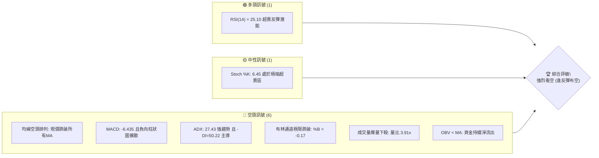

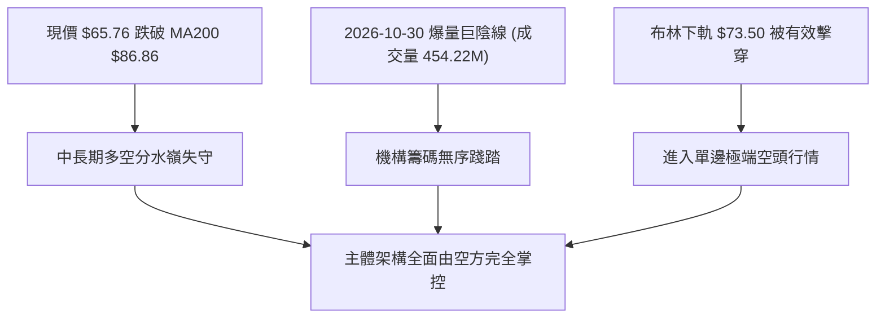

### 📊 核心指標速覽表

| 指標類別 | 指標名稱 | 當前數值 | 訊號 | 解讀 |
|----------|----------|----------|------|------|
| **價格** | 當前收盤價 | $65.76 | 🔴 | 單日重挫跳空，創近5個月收盤新低，處於52週區間 30.0% 位置 |
| **均線** | 短期 MA20 | $96.39 | 🔴 | 現價低於 MA20 達 -31.78%，負乖離極大，空頭阻力沉重 |
| **均線** | 中期 MA50 | $101.11 | 🔴 | 現價遠在 MA50 下方，中期上行上升趨勢線徹底斷裂 |
| **均線** | 長期 MA200 | $86.86 | 🔴 | 跌破牛熊分界線 MA200 達 -24.29%，長多格局宣告破裂 |
| **動能** | RSI(14) | 25.10 | 🟢 | Wilder 計算值進入極端超賣區（<30），隨時可能出現短線技術性抽頭 |
| **動能** | MACD (12,26,9) | -6.435 | 🔴 | 快慢線均在零軸深處下行，Histogram 為 -1.941，空頭動能仍加速釋放 |
| **趨勢** | ADX (14) | 27.43 | 🔴 | ADX > 25 確立強趨勢；-DI 高達 50.22，空方動能壓倒性掌控盤面 |
| **通道** | 布林通道 %B | -0.17 | 🔴 | 實體跌穿布林帶下軌（$73.50），呈現「下軌開口擴大漫步」破位特徵 |
| **量能** | 20日成交量比 | 3.91x | 🔴 | 單日放量至 454.22M（20日均量 116.31M），呈現典型恐慌性斷頭拋售 |
| **波動** | ATR(14) | $6.97 | 🔴 | 佔股價 10.60%，波動幅度劇烈，持倉風險極高 |

### 🏆 技術評分卡

```
╔══════════════════════════════════════════════════════════════╗
║              技術評分卡 — INTC (2026-11-01)                 ║
╠══════════════════════════════════════════════════════════════╣
║ 趨勢強度 (Trend)     ████░░░░░░░░░░░░░░░░  20/100 🔴 空頭極度強勢 ║
║ 動能指標 (Momentum)  ██████░░░░░░░░░░░░░░  32/100 🔴 嚴重超賣鈍化 ║
║ 支撐穩定度 (Support) █████░░░░░░░░░░░░░░░  24/100 🔴 關鍵支撐盡失 ║
║ 成交量配合 (Volume)  ███░░░░░░░░░░░░░░░░░  16/100 🔴 巨量無序拋售 ║
║ 形態完整度 (Pattern) █████░░░░░░░░░░░░░░░  28/100 🔴 雙頂破位確立 ║
║ 均線排列 (MA System) ██░░░░░░░░░░░░░░░░░░  12/100 🔴 全週期空頭化 ║
╠══════════════════════════════════════════════════════════════╣
║ 綜合評分             ████░░░░░░░░░░░░░░░░  22/100 🔴 強烈看空    ║
╚══════════════════════════════════════════════════════════════╝
```

> **綜合評分計算說明**：(20 + 32 + 24 + 16 + 28 + 12) ÷ 6 = 132 ÷ 6 = **22/100**。依據策略路由規則，綜合評分 ≤ 40 確立主推**空頭波段策略**。

---

## 2. 趨勢分析

### 🌐 多時框趨勢分析

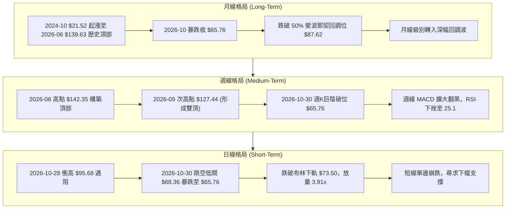

### 📈 長期趨勢 — 12個月走勢圖（Unicode）

```
INTC 月線走勢圖（過去12個月：2025-11 至 2026-10）
價格軸 ($)
$140 ┤                                 ● $139.63 (2026-06)
$120 ┤                             ●             ● $120.23 (2026-09)
$100 ┤                         ●       ● $90.20  
$80  ┤                                           
$60  ┤                                           ● $65.76 (現在)
$40  ┤ ● $40.56  ● $46.47  ● $44.13
$20  ┤       ● $36.90
     └─┬───────┬───────┬───────┬───────┬───────┬───────┬───────┬───►
     25-11   25-12   26-01   26-03   26-05   26-06   26-07   26-09  26-10
```

#### 走勢特徵分析表格

| 階段週期 | 時間區間 | 區間起止價 | 漲跌幅 | 走勢特徵與結構解讀 |
|----------|----------|------------|--------|--------------------|
| **底層蓄勢期** | 2024-10 ~ 2025-08 | $21.52 → $24.35 | +13.15% | 於 $19.43 ~ $24.35 區間長時間低位築底，籌碼完成充分換手 |
| **主升主浪期** | 2025-09 ~ 2026-06 | $33.55 → $139.63 | +316.18% | 展開猛烈單邊牛市，成交量逐月遞增，創下 52 週高點 $142.35 |
| **首輪回調期** | 2026-06 ~ 2026-07 | $139.63 → $90.20 | -35.40% | 高檔見頂後急挫，首次回踩測試整數關口與中期均線支撐 |
| **高位次頂期** | 2026-08 ~ 2026-09 | $89.51 → $120.23 | +34.32% | 籌碼自救反抽，最高觸及週線 $127.44，確認多頭動能衰竭無法破頂 |
| **崩解破位期** | 2026-09 ~ 2026-10 | $120.23 → $65.76 | -45.31% | 業績前景利空引發斷崖式跳空下殺，一舉貫穿多道中長週期防線 |

### 📊 中期趨勢（週線分析）

```
週線級別價格壓力與支撐階梯架構示意圖：
$142.35 ─────────────────────────────────────── 歷史峰值 (52W High)
             ▲
             │  雙頂反轉頸線破位跌幅測算中
             ▼
$107.13 ═══════════════════════════════════════ 強阻力帶 R1 (前波低點聚類)
$87.62  ┄┄┄┄┄┄┄┄┄┄┄┄┄┄┄┄┄┄┄┄┄┄┄┄┄┄┄┄┄┄┄┄┄┄┄┄ 50.0% 斐波那契回調位 (已失守)
$74.70  ┄┄┄┄┄┄┄┄┄┄┄┄┄┄┄┄┄┄┄┄┄┄┄┄┄┄┄┄┄┄┄┄┄┄┄┄ 61.8% 斐波那契黃金分割位 (已失守)
$65.76  ◄─────────── [當前週收盤價：單週放量 860.25M 暴跌]
             │
             ▼  下檔真空帶
$56.31  ┄┄┄┄┄┄┄┄┄┄┄┄┄┄┄┄┄┄┄┄┄┄┄┄┄┄┄┄┄┄┄┄┄┄┄┄ 78.6% 斐波那契回調位
$42.58  ═══════════════════════════════════════ 強支撐帶 S1 (近一年波段低點聚類)
```

### ⚡ 趨勢強度評估（ADX 解讀）

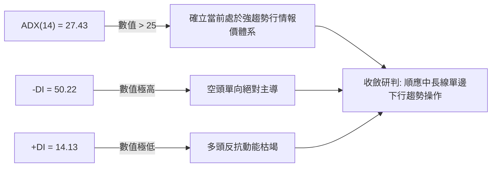

#### ADX 指標強度對照解析表

| 指標變數 | 當前讀數 | 門檻區間 | 狀態評定 | 交易含義與操作指引 |
|----------|----------|----------|----------|--------------------|
| **ADX(14)** | 27.43 | > 25.0 | 🔴 強趨勢確立 | 市場擺脫盤整，進入動能強烈的方向性單邊走勢 |
| **-DI** | 50.22 | > 40.0 | 🔴 極度強勢空頭 | 賣盤呈現雪崩式集中宣洩，空方主導權不可動搖 |
| **+DI** | 14.13 | < 20.0 | 🔴 多方完全失語 | 買盤毫無承接意願，左側摸底多單極具危險性 |
| **趨勢性質** | 空頭單邊 | DI 差值 36.09 | 🔴 趨勢主導 | 嚴禁逆勢扛單，任何技術反抽均為賣點非買點 |

---

## 3. 圖表形態分析

### 🔍 形態識別系統

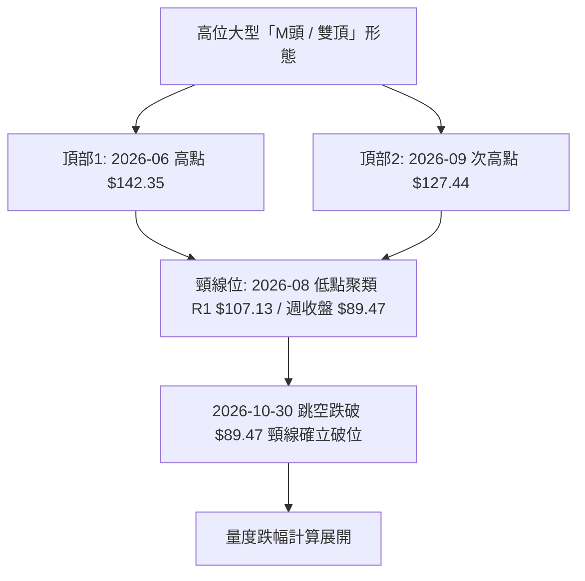

#### 形態識別與信心度評估表

| 形態名稱 | 信心度 | 判斷依據（引用數據） | 完成度 | 目標價（附嚴謹計算式） |
|----------|--------|----------------------|--------|------------------------|
| **高位雙頂 (M-Top)** | 85% | 頂1為 52W 高點 $142.35；頂2為 2026-09-25 當週高點 $127.44。破位點為 2026-10-30 收盤價 $65.76，確認擊穿 2026-08 週收盤低點聚類 | 95% | 由形態高度推算：頸線取前波關鍵位 R1 $107.13，形態高度 = $142.35 − $107.13 = $35.22。破位目標價 = $107.13 − $35.22 = **$71.91**（已跌破並超額完成）；若以實體頸線 2026-08-28 收盤價 $89.47 計算，高度 = $127.44 − $89.47 = $37.97，極限目標 = $89.47 − $37.97 = **$51.50** |
| **下飄旗形破位** | 75% | 2026-10-23 至 10-28 日K於 $84.65 ~ $95.68 形成弱勢弱反彈旗面，10-30 巨量開盤 $68.36 向下跌破旗面下軌 | 100% | 旗桿高點為 10-02 當週高點 $126.00，旗桿底部為 10-23 低點 $84.65（跌幅 $41.35）。旗面破位點 $86.96 − $41.35 = **$45.61**（逼近支撐位 S1 $42.58） |
| **跳空缺口破位** | 90% | 2026-10-29 收盤 $92.07 至 2026-10-30 開盤 $68.36，遺留 $23.71 之巨型向下跳空缺口 | 100% | 突破性/逃逸型缺口，缺口上沿 $90.84（10-29低點）成為不可逾越之強阻力 |

### 🕯️ 重要K線形態分析

嚴格依據數據中「近10根日K」與「近8根週K」之精確 OHLC 數據進行解讀：

| 日期（週期） | 開盤價 | 最高價 | 最低價 | 收盤價 | K線形態名稱 | 技術解讀與籌碼意義 | 訊號方向 |
|--------------|--------|--------|--------|--------|-------------|--------------------|----------|
| 2026-10-22 (日K) | $87.92 | $89.19 | $84.65 | $85.49 | 中陰線破位 | 實體由開至收一路走低，跌破前一日低點，成交量放大至 134.13M，下行中繼 | 🔴 看空 |
| 2026-10-23 (日K) | $85.92 | $87.87 | $84.74 | $86.96 | 低位十字星小陽 | 縮量至 72.09M，多空於 $84.65 附近暫時平衡，為短線超跌引發的技術休整 | 🟡 中性 |
| 2026-10-28 (日K) | $95.09 | $95.68 | $93.00 | $95.53 | 衝高小陽線 | 縮量至 82.59M 摸高 $95.68，未能突破 MA20 ($96.39)，量價頂背離，反抽見頂 | 🔴 誘多 |
| 2026-10-29 (日K) | $92.97 | $93.50 | $90.84 | $92.07 | 孕線收跌大陰前兆 | 帶下影弱陰線，成交量回升至 134.17M，主力機構於業績公佈前加速離場撤資 | 🔴 看空 |
| 2026-10-30 (日K) | $68.36 | $68.77 | $63.20 | $65.76 | **斷頭跳空巨陰線** | 跳空低開逾 25%，開盤即高點，收盤逼近最低點 $63.20，成交量飆至 454.22M | 🔴 極度看空 |
| 2026-09-25 (週K) | $116.53 | $127.44 | $114.93 | $123.00 | 長上影大陽線 | 爆量 602.66M 衝高 $127.44 遭主力無情拋壓，構築次頂，留下沉重解套套牢盤 | 🔴 頂部確認 |
| 2026-10-16 (週K) | $102.52 | $103.19 | $89.19 | $89.85 | 光腳大陰線 | 單週暴跌 -14.18%，失守 $90 關口，放量 537.18M，確立週線級別主跌浪開始 | 🔴 看空 |
| 2026-10-30 (週K) | $87.94 | $95.68 | $63.20 | $65.76 | **週線崩盤巨陰** | 單週跌幅 -24.38%，爆出 860.25M 歷史天量，全週無任何有效抵抗，趨勢徹底破壞 | 🔴 極度看空 |

### 📉 ASCII 走勢形態示意圖

```
INTC 日K近10日破位結構示意圖
價格軸 ($)
$96.00 ┤              ┌─┐
$94.00 ┤  ┌─┐        │ │  ┌─┐
$92.00 ┤  │ │  ┌─┐   │ │  │ │
$90.00 ┤  │ │  │ │   └─┘  └─┘ ◄ 10-29 收盤 $92.07
$88.00 ┤  └─┘  │ │            ════════════════════════════════════
$86.00 ┤        └─┘            ░░░ 巨大向下跳空缺口 ($23.71) ░░░
$84.00 ┤                       ════════════════════════════════════
$70.00 ┤
$68.00 ┤                       ┌─┐ ◄ 10-30 開盤 $68.36 / 最高 $68.77
$66.00 ┤                       │ │
$64.00 ┤                       │ │ ◄ 10-30 收盤 $65.76
$62.00 ┤                       └┴┘ ◄ 10-30 最低 $63.20
       └────────────────────────┬──────────────────────────────────►
       10-19   10-21   10-26   10-28   10-30 (爆量 454.22M 崩跌)
```

### 🎯 形態目標價計算

1. **雙頂 (M-Top) 形態量度跌幅計算**：
   - 形態第一高點 $142.35，第二高點 $127.44。
   - 引用波段高點聚類強阻力 R1 $107.13 為理論頸線位：
     $$\text{形態垂直高度} = \$142.35 - \$107.13 = \$35.22$$
     $$\text{理論等幅下測目標} = \$107.13 - \$35.22 = \$71.91$$
   - 現價 $65.76 已經完全跌破此目標價，確認空頭極端宣洩特徵。
   - 若改以第二高點至 2026-08 實體週收盤頸線 $89.47 測算：
     $$\text{次級形態高度} = \$127.44 - \$89.47 = \$37.97$$
     $$\text{延伸空頭目標價} = \$89.47 - \$37.97 = \$51.50$$
     該價位與斐波那契 78.6% 回調位 **$56.31** 與波段低點支撐位 S1 **$42.58** 形成共振支撐區間。

---

## 4. 支撐與阻力

### 🗺️ 關鍵價位分布圖（Unicode）

```
╔══════════════════════════════════════════════════════════════╗
║               INTC 關鍵價位結構分布圖                        ║
╠══════════════════════════════════════════════════════════════╣
║ $132.75 ║████████████████████████║ 強阻力 R3 (年內次高聚合區)║
║ $127.04 ║████████████████████    ║ 阻力 R2 (反彈高點聚類區)  ║
║ $107.13 ║████████████████████████║ 核心阻力 R1 (前波低點互換區)║
║ $87.62  ║▓▓▓▓▓▓▓▓▓▓▓▓▓▓▓▓        ║ 斐波那契 50.0% 回調位阻力 ║
║ $74.70  ║▓▓▓▓▓▓▓▓▓▓▓▓▓▓▓▓        ║ 斐波那契 61.8% 黃金分割阻力║
╠═════════╬════════════════════════╬═══════════════════════════╣
║ $65.76  ╠════════════════════════╣ ◄ 現價 (跌破布林下軌處)   ║
╠═════════╬════════════════════════╬═══════════════════════════╣
║ $56.31  ║▓▓▓▓▓▓▓▓▓▓▓▓▓▓▓▓        ║ 斐波那契 78.6% 回調位支撐 ║
║ $42.58  ║████████████████████████║ 關鍵支撐 S1 (年內密集波段底)║
║ $41.64  ║████████████████████    ║ 強支撐 S2 (中期平台底部)  ║
║ $40.63  ║████████████████████████║ 極限支撐 S3 (起漲防守底線)║
║ $32.89  ║████████████████████████║ 52W 最低點 (100.0% 回調位)║
╚══════════════════════════════════════════════════════════════╝
```

### 🚧 阻力位分析表

所有阻力價位嚴格引用自數據之「關鍵價位」與斐波那契計算體系：

| 阻力級別 | 精確價位 | 距現價空間 | 形成技術原因 | 突破難度 | 重要性等級 |
|----------|----------|------------|--------------|----------|------------|
| **Fib 61.8%** | $74.70 | +13.59% | 52週漲幅回撤黃金分割位，當前與日線布林下軌重合 | 🟡 中等 | ★★★☆☆ |
| **Fib 50.0%** | $87.62 | +33.24% | 牛熊中軸回調位，亦與日線 MA5 ($87.51)、MA200 ($86.86) 密集交匯 | 🔴 極高 | ★★★★☆ |
| **R1** | $107.13 | +62.91% | 近一年波段高點聚類、M頭頸線位，亦貼近 MA120 ($106.36) | 🔴 極難 | ★★★★★ |
| **R2** | $127.04 | +93.19% | 2026-09 波段次高點聚集區，堆積大量深套籌碼 | 🔴 極難 | ★★★★☆ |
| **R3** | $132.75 | +101.87% | 接近歷史頂部之拋壓聚類峰值區 | 🔴 天塹 | ★★★★★ |

### 🛡️ 支撐位分析表

所有支撐價位嚴格引用自數據之「關鍵價位」與斐波那契計算體系：

| 支撐級別 | 精確價位 | 距現價空間 | 形成技術原因 | 守住機率 | 重要性等級 |
|----------|----------|------------|--------------|----------|------------|
| **Fib 78.6%** | $56.31 | -14.37% | 52週大週期深度回調位，空方第一目標衝擊帶 | 🟡 45% | ★★★☆☆ |
| **S1** | $42.58 | -35.25% | 近一年波段低點聚類區，歷史成交密集平台高沿 | 🟢 65% | ★★★★★ |
| **S2** | $41.64 | -36.68% | 近一年波段低點聚類區中軸，強多頭歷史護盤防線 | 🟢 70% | ★★★★☆ |
| **S3** | $40.63 | -38.21% | 近一年波段低點聚類區下沿，2025-10/11 起漲原點 | 🟢 80% | ★★★★★ |
| **Fib 100.0%**| $32.89 | -49.98% | 52W 最低點，若被擊穿則宣告長期價值邏輯徹底重構 | 🟢 90% | ★★★★★ |

### 📐 斐波那契回調位分析

依據 52 週完整波動區間（最低 $32.89 至 最高 $142.35，波幅 $109.46）嚴格計算：

```
0.0%  (52W High)  $142.35 ───────────────────────────── 歷史峰值
23.6%             $116.52 ───────────────────────────── 多頭超強回撤位 (已失守)
38.2%             $100.54 ───────────────────────────── 中期多空均衡位 (已失守)
50.0%             $87.62  ───────────────────────────── 牛熊分水嶺位 (已失守)
61.8%             $74.70  ───────────────────────────── 黃金分割生命線 (跳空失守)
================= $65.76  ◄─────────── [現價落於 61.8% 與 78.6% 之間]
78.6%             $56.31  ┄┄┄┄┄┄┄┄┄┄┄┄┄┄┄┄┄┄┄┄┄┄┄┄┄┄┄ 下方首個關鍵回調支撐
100.0% (52W Low)  $32.89  ───────────────────────────── 52週最低底部防線
```

- **位置解讀**：現價 **$65.76** 明顯落於 **61.8% ($74.70)** 與 **78.6% ($56.31)** 之間的真空斷層區。
- **技術意涵**：在技術分析經典理論中，61.8% 的跳空破位意味著過去一整年由 $32.89 發動的「超級主升浪」在結構上已經宣告結束，行情性質正式轉化為「大週期熊市回調」。現價下方距離 78.6% 回調位 $56.31 仍有約 14.37% 的慣性下墜空間，在未見到該位置出現長下影或放量企穩 K 線前，任何買入行為皆屬「徒手接飛刀」。

---

## 5. 技術指標深度解讀

### 🎛️ 指標訊號總覽

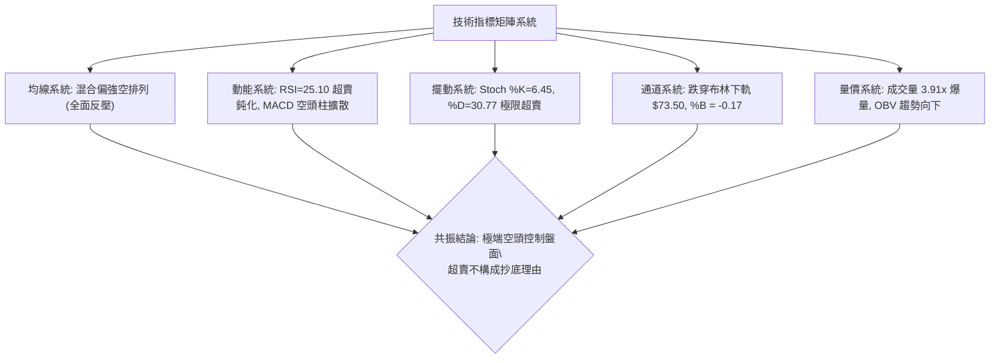

### 📈 移動平均線排列分析

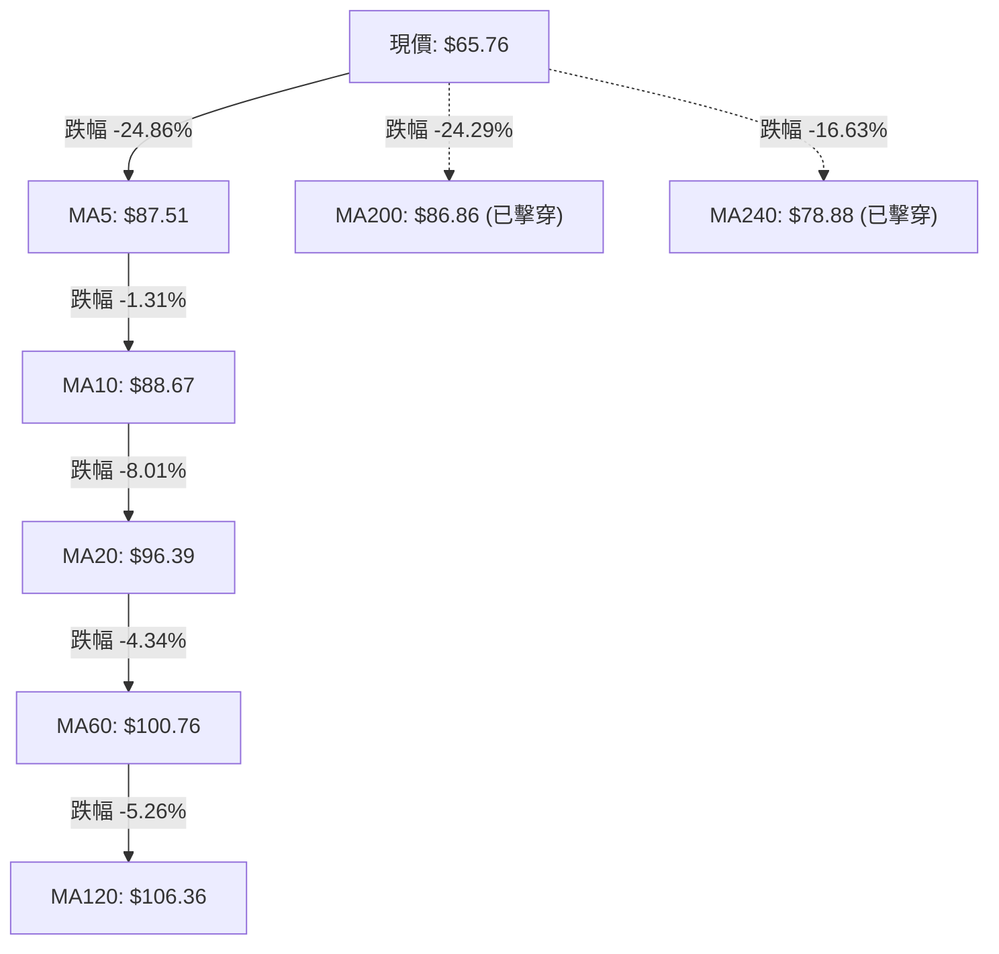

#### 均線架構全面解構表

| 均線名稱 | 數值 | 價格與均線關係 | 偏離度 (乖離率) | 走勢趨勢與斜率分析 |
|----------|------|----------------|-----------------|--------------------|
| **MA5** | $87.51 | 現價在下方 | -24.86% | 陡峭向下俯衝，超短線空頭反壓線 |
| **MA10** | $88.67 | 現價在下方 | -25.84% | 向下加速拐頭，短線壓制極其沉重 |
| **MA20** | $96.39 | 現價在下方 | -31.78% | 月線級別生命線向下傾斜，布林中軌阻力 |
| **MA50** | $101.11| 現價在下方 | -34.96% | 中期重要生命線下彎，確立中期趨勢走壞 |
| **MA60** | $100.76| 現價在下方 | -34.73% | 季線下行，中線資金出逃成本帶 |
| **MA120** | $106.36| 現價在下方 | -38.17% | 半年線下彎，大級別套牢成本峰值 |
| **MA200** | $86.86 | 現價在下方 | -24.29% | **年線失守！** 標誌著長期多頭市場防線徹底瓦解 |
| **MA240** | $78.88 | 現價在下方 | -16.63% | 長期牛熊邊界被長陰擊穿，均線系統呈混合偏強空狀態 |

### 📉 RSI(14) 分析

- **RSI 當前讀數**：**25.10** (Wilder's Smoothing)
- **進度條展示**：`█████░░░░░░░░░░░░░░░ 25.10%` 🟢 極度超賣區（< 30）

```
RSI(14) 水平狀態標尺
0 ─────── 20 ──── 25.10 ───── 30 ──────────────── 50 ──────────────── 70 ─────── 100
             ▲       ▲         ▲                   ▲                   ▲
            極弱    [現值]   超賣界限            多空中軸            超買界限
```

- **超買超賣與鈍化評估**：
  RSI(14) 數值跌至 25.10，技術上已陷入極度超賣狀態。然而，在強單邊趨勢行情（ADX > 25）中，RSI 超賣往往伴隨著「指標鈍化」現象，不可作為即時逆勢買入的充分條件。
- **背離研判**：
  比對近20根日K棒首尾，價格自 10-19 收盤 $92.03 暴跌至 10-30 收盤 $65.76，創波段新低；RSI 亦同步自 32~40 區間驟降至 25.10，同樣創出波段新低。
  **結論**：**無底背離，亦無頂背離**。指標與價格呈現同向俯衝，量化數據明確顯示「無明顯背離」，表明賣壓純屬實質性資金拋盤，並非虛跌。

### 📊 MACD(12,26,9) 訊號解讀

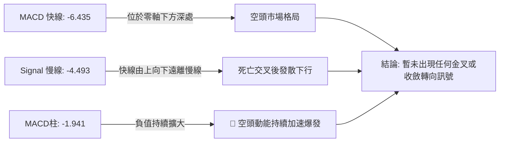

- **柱狀圖趨勢**：MACD Histogram 當前為 **-1.941**。回顧近期週線數據，MACD 柱狀圖自 2026-09-25 的 +2.925 轉向，連續數週滑落至 -0.435、-2.052、-3.385、-2.561，再到本週的持續擴散下探。負向動能沒有顯著衰退跡象，多頭無力組織抵抗。

### 📦 布林通道分析

```
INTC 日線布林通道 (20, 2) 結構圖
$119.27 ─────────────────────────────── 上軌 (Upper Band)
                     │
$96.39  ┄┄┄┄┄┄┄┄┄┄┄┄ 中軌 (MA20 Middle Band)
                     │
$73.50  ─────────────────────────────── 下軌 (Lower Band)
                     │ ◄ %B = 0.00
-------------------------------------------------------------
$65.76  ● [當前收盤價：位於下軌外側，%B = -0.17]
```

- **帶寬與開口評估**：
  布林帶帶寬 = 上軌 $119.27 − 下軌 $73.50 = $45.77（帶寬比達 47.48%）。伴隨著 10-30 的跳空崩跌，通道下軌呈現向下發散擴張態勢，呈現「通道張口，價格緊貼外軌下墜」的極端超跌形態。
- **%B 指標深度解讀**：
  $$\%B = \frac{\text{現價} - \text{下軌}}{\text{上軌} - \text{下軌}} = \frac{\$65.76 - \$73.50}{\$119.27 - \$73.50} = \frac{-\$7.74}{\$45.77} = -0.17$$
  %B 數值為負值（-0.17），代表股價已經實質性跌破下軌並在外圍懸空，屬於技術結構中的嚴重超賣形態。但由於下方缺乏支撐聚類，盲目博取回歸中軌的風險極大。

### 💹 成交量分析（量價配合度）

```
成交量柱狀對比圖
最新日成交量  (2026-10-30): ████████████████████ 454.22M (量比 3.91x 爆量)
20日平均成交量           : █████ 116.31M
50日平均成交量           : █████ 107.65M
本週累計週成交量         : ██████████████████████████████ 860.25M
```

- **量比與籌碼流向解讀**：
  2026-10-30 單日成交量爆出 **454,221,300 股**，對比 20 日均量 116,311,520 股，**量比高達 3.91 倍**。週成交量更飆升至 **860,249,900 股**，創下近一年以來最大單週拋售量。
- **OBV（能量潮）分析**：
  數據明確指示：「**OBV < MA → 量能疲弱**」。伴隨著價格的懸崖式下挫，OBV 跌破其自身的長期移動平均線，資金呈现無節制外流態勢。當前天量大陰線並非買盤進場的「放量換手」，而是高位槓桿融資盤斷頭與長線機構集體無底線撤離引發的「量價同向崩壞」，量能完全確認了當前下跌趨勢的真實性。

---

## 6. 動能與波動率

### ⚡ 動能評估四象限

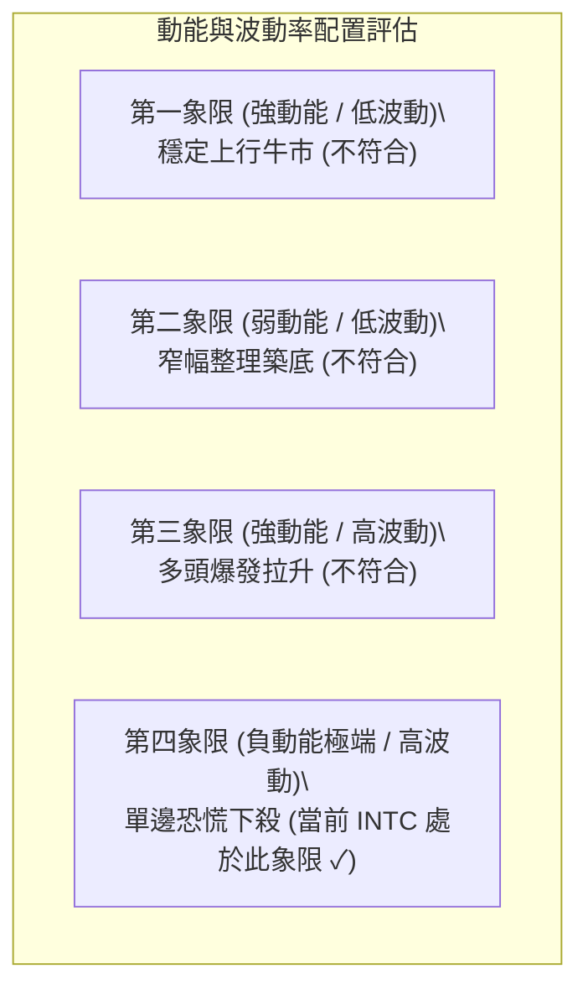

| 象限分區 | 動能維度 | 波動維度 | 當前狀態判定 | 交易策略評估 |
|----------|----------|----------|--------------|--------------|
| **Q1 (穩健成長)** | 強 (+DI主導) | 低 (ATR小) | ✗ 未觸發 | 順勢加碼長線持股 |
| **Q2 (盤整蟄伏)** | 弱 (ADX<20) | 低 (ATR小) | ✗ 未觸發 | 區間高拋低吸或觀望 |
| **Q3 (主升加速)** | 強 (+DI高企) | 高 (ATR擴大) | ✗ 未觸發 | 緊盯回撤，移動止盈 |
| **Q4 (恐慌出逃)** | **極弱/負向 (-DI=50.22)** | **極高 (ATR 10.6%)** | **✓ 當前狀態** | **嚴禁抄底，順勢反彈布空或空倉防守** |

### 📊 ATR 波動率分析

- **ATR(14) 數值**：**$6.97**
- **ATR 佔比**：佔當前股價 $65.76 的 **10.60%**（Wilder 標準平滑法）
- **技術解讀**：
  常態下大型半導體權值股的 ATR 佔比通常落於 2.5% ~ 4.5% 之間。當前高達 10.60% 的數值表明 INTC 正處於極端的「異常高波動環境」。
- **止損距離建議**：
  在如此龐大的單日振幅下，常規的緊密止損極易被市場雜波清洗。
  - **空頭波段交易**：標準止損間距建議設定為 1.5 倍至 2.0 倍 ATR，即 **$10.45 ~ $13.94** 的緩衝空間。
  - **日內交易保護**：若當日建倉，最小止損距離不得低於 1.0 倍 ATR（即 $6.97），以防範開盤劇烈震盪侵蝕本金。

### 📐 Beta 與市場相關性

- **Beta 係數**：**2.23**
- **市場特徵分析**：
  Beta 高達 2.23，說明該標的屬於「超高彈性品種」，其波動幅度為標普500指數（S&P 500）的 2.23 倍。
  - **大盤共振效應**：若大盤處於調整或弱勢週期（如最新新聞提示之 Dow Jones 期貨下挫、整體科技股拋售潮），INTC 的下行跌幅將被顯著放大逾 2 倍。
  - **風險敞口控制**：高 Beta 疊加高 ATR，要求投資者必須對總體倉位實施縮減。若常規單一標的倉位上限為 10%，則 INTC 當前部位建議壓縮至其三分之一（約 3% ~ 5%），以維持組合整體的波動率可控。

---

## 7. 多時框架總結

### 📋 時框架評分表

| 時框架 | 趨勢方向 | 動能指標狀態 | 均線排列特徵 | 形態完成度 | 綜合評分 | 操作指引 |
|--------|----------|--------------|--------------|------------|----------|----------|
| **長期 (月線)** | 🔴 空頭深幅回調 | 轉弱，跌破中軸 | 跌破 MA240 ($78.88) | 雙頂高檔破位 (95%) | 25/100 | 減倉防禦，防範下測起漲底 |
| **中期 (週線)** | 🔴 單邊空頭主導 | MACD 負柱擴散 | 跌破 MA200 ($86.86) | M頭頸線實質擊穿 (100%)| 18/100 | 確立反彈逢高做空基調 |
| **短期 (日線)** | 🔴 斷崖式暴跌 | RSI 25.10 超賣 | 全週期均線反壓蓋頂 | 巨型向下跳空缺口 (100%)| 23/100 | 嚴禁盲目摸底，等待反抽阻力 |

### 🔲 綜合訊號矩陣

```
時框架維度一致性檢驗陣列：
┌─────────────┬────────────────┬────────────────┬────────────────┐
│ 指標系統    │ 短期 (日線)    │ 中期 (週線)    │ 長期 (月線)    │
├─────────────┼────────────────┼────────────────┼────────────────┤
│ 趨勢方向    │ 🔴 極弱單邊    │ 🔴 空頭下行    │ 🔴 轉入熊市    │
│ 均線系統    │ 🔴 全面空頭反壓│ 🔴 破年線支撐  │ 🔴 跌破長期均線│
│ 擺動指標    │ 🟡 極度超賣    │ 🔴 動能發散下行│ 🔴 動能見頂回落│
│ 能量潮/量能 │ 🔴 恐慌拋售放量│ 🔴 天量破位下殺│ 🔴 頂部籌碼散失│
└─────────────┴────────────────┴────────────────┴────────────────┘
三時框共振結論：短期超賣雖然存在，但中長期趨勢全線亮起紅燈，空方全面掌控盤面。
```

### ⚖️ 多時框收斂結論

依據多時框收斂規則第 14 條執行研判：
1. **行情性質判定**：ADX(14) 讀數為 **27.43 > 25**，確立當前市場非震盪橫盤，而是處於**極端單邊趨勢行情**。
2. **主導時框優先級**：趨勢行情中，必須以中長期（週線 / MA50 $101.11、MA200 $86.86）的下行方向為絕對主導，日線層級僅能作為尋找精確逢高進場布空的微觀時機工具。日線雖然出現 RSI=25.10 極度超賣，但在中長線主跌浪宣洩背景下，超賣訊號自動服從於週線空頭趨勢。
3. **唯一收斂方向**：**強烈偏空 (Strongly Bearish)**。綜合評分為 **22/100**。交易邏輯堅定鎖定「逢反彈至阻力位建立空頭部位」或「跌破日內低點追空順勢操作」，徹底摒棄多頭逆勢摸底思路。

---

## 8. 交易策略建議

### 🗺️ 策略決策流程圖

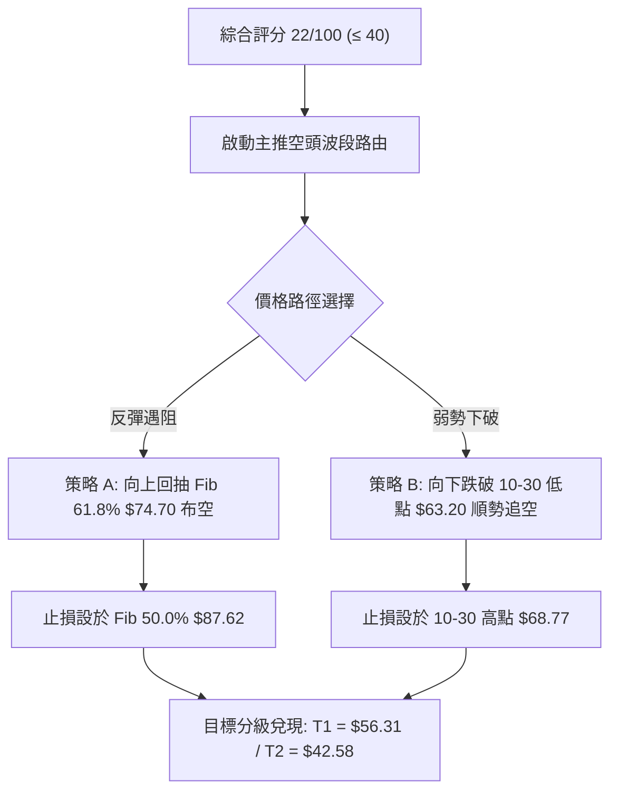

### 🧭 策略路由

> **當前主策略方向 = 強烈偏空 / 主推做空策略（依技術評分卡綜合評分 22/100 確立）**

本報告堅決拒絕兩頭下注。基於日線/週線多指標全線空頭共振，主推空頭進攻型策略，多頭部位僅以反轉對沖提示列出。

### 🎯 價格情境階梯（Price Scenarios）

所有關鍵價位嚴格引用自第 4 章「關鍵價位與斐波那契體系」已提供之數值：

| 觸發條件 | 下一目標 | 後續延伸 | 情境技術含義 |
|----------|----------|----------|--------------|
| **跌破 10-30 低點 $63.20** | **Fib 78.6% $56.31** | **S1 $42.58** | 跌勢加速推進，下挫尋求大週期深度回撤支撐帶 |
| **反抽受阻 Fib 61.8% $74.70** | **現價 $65.76** | **Fib 78.6% $56.31** | 典型空頭「破位回踩確認」，提供極佳波段加空契機 |
| **強行收復 Fib 50.0% $87.62** | **R1 $107.13** | **R2 $127.04** | 假破位極端走勢，空頭全面停損離場，重回區間震盪 |

### 📊 情境機率分佈

| 運行情境 | 發生機率 | 主要依據與技術支撐（引用指標數據） |
|----------|----------|------------------------------------|
| **弱勢抵抗後繼續下挫探底** | **65%** | ADX=27.43 強趨勢；-DI 高達 50.22；週線成交量 860.25M 爆量下跌；MACD 負向柱 -1.941 持續發散 |
| **超賣誘發技術性小幅反彈** | **25%** | RSI(14)=25.10 跌入極度超賣區；Stoch %K=6.45 嚴重超賣；布林通道 %B=-0.17 呈現短線均值回歸拉力 |
| **V型反轉完全收復失地** | **10%** | 均線系統全面呈強空排列；上方遗留 $23.71 巨量跳空缺口；籌碼面遭受嚴重破壞，反轉機率極低 |

### 🟢 主策略詳情（空頭專用部署）

所有價位均嚴格取自數據庫中之關鍵位或當日具體 OHLC 點位：

| 策略要素 | 策略 A（反彈遇阻做空 — 穩健首選） | 策略 B（破位順勢做空 — 激進突破） |
|----------|-----------------------------------|-----------------------------------|
| **進場條件** | 股價反彈至 Fib 61.8% 遇阻回落，小時級別出上影陰線 | 股價向下擊穿 2026-10-30 最低價 $63.20 實體破位 |
| **進場價格** | **$74.70**（Fib 61.8% 阻力位） | **$63.20**（2026-10-30 日低破位點） |
| **目標價 T1** | **$56.31**（Fib 78.6% 回調位） | **$56.31**（Fib 78.6% 回調位） |
| **目標價 T2** | **$42.58**（關鍵支撐 S1） | **$42.58**（關鍵支撐 S1） |
| **止損價格** | **$87.62**（Fib 50.0% / MA200 交叉防守位） | **$68.77**（2026-10-30 日高阻力位） |
| **風險報酬比** | **1 : 1.42（以 T1 計）**<br>*(74.70−56.31)÷(87.62−74.70) = 18.39÷12.92*<br>*(若以 T2 計則為 1 : 2.49)* | **1 : 1.24（以 T1 計）**<br>*(63.20−56.31)÷(68.77−63.20) = 6.89÷5.57*<br>*(若以 T2 計則為 1 : 3.70)* |
| **成功機率** | **68%** | **62%** |
| **建議倉位** | **5%**（分批建倉） | **3%**（嚴格控制突破滑點） |

### 🔴 反向風險觸發點（對沖提示）

若出現以下異常市場行情報價，將推翻上述空頭核心邏輯，空頭部位必須立即停損離場或啟動多頭避險對沖：
- **關鍵反轉觸發點**：日線收盤價強勢站上 **$74.70**（Fib 61.8%）且伴隨 RSI 向上衝破 40，或出現實體大陽線回補缺口下沿。
- **極限防守警戒線**：突破 **$87.62**（Fib 50.0% 與 MA200 牛熊分界線）。一旦收復該位置，說明本次斷崖跳空下殺為主力製造的終極「空頭陷阱」，原有主跌浪趨勢宣告失效。

### ⭐ 整體訊號強度評星

```
做多訊號強度：★☆☆☆☆  (1/5星 - 僅存指標超賣，缺乏買盤配合)
做空訊號強度：★★★★☆  (4/5星 - 破位確鑿，量價齊跌，空頭主導)
整體可信度：  ★★★★☆  (4/5星 - 指標與巨額量能共振確認)
```

---

## 9. 風險提示與監控

### ✅ 關鍵監控指標 Checklist

```
╔══════════════════════════════════════════════════════════════╗
║               INTC 關鍵監控維度檢核清單                      ║
╠══════════════════════════════════════════════════════════════╣
║ [ ] 監控項 1: 2026-10-30 最低點 $63.20 是否失守？           ║
║     ↳ 若跌破，將引發新一輪止損拋盤，加速滑向 $56.31        ║
║ [ ] 監控項 2: 日線成交量是否縮減至 20日均量 (116.31M) 以下？ ║
║     ↳ 若持續爆量，表明拋壓未盡；若顯著縮量，預示跌勢趨緩    ║
║ [ ] 監控項 3: RSI(14) 是否在 20~25 區間形成底背離鈍化？      ║
║     ↳ 指標持續低於 30 不可盲目抄底，需等待金叉向上突破 35   ║
║ [ ] 監控項 4: 向上回抽能否觸及 Fib 61.8% ($74.70)？          ║
║     ↳ 弱勢反抽若無法觸及 $74.70，為標準極弱勢走勢          ║
║ [ ] 監控項 5: 宏觀與同業動態 (如 AMD、台積電晶圓代工報價消息)║
║     ↳ 留意新聞清單中「台積電漲價、Dell業績疲弱」之連鎖效應  ║
╚══════════════════════════════════════════════════════════════╝
```

### ⚠️ 風險場景分析

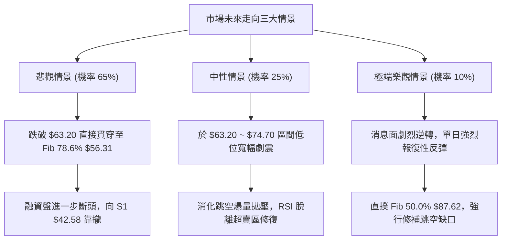

### 🛡️ 風險管理重要提醒

1. **不可徒手接飛刀（Falling Knife）**：
   Jim Cramer 等市場分析人士發布的「接飛刀警告」在技術層面上具有充分依據。歷史走勢表明，巨量跳空長陰線次日或次週，往往具備極強的下行慣性。在未出現日線級別「縮量十字星」或「底分型陽包陰」前，任何做多均屬高風險博弈。
2. **倉位配置與波動控制**：
   當前 INTC 之 ATR(14) 高達 $6.97（10.60%），Beta 係數達 2.23。其單日波動相當於普通藍籌股的三倍以上。在該品種上的持倉敞口必須主動壓縮。建議總資金配置不超過 3% ~ 5%，嚴防因開盤大幅跳空引發帳戶淨值斷崖。
3. **強制止損紀律執行**：
   對於參與策略 B 追空的交易者，若價格逆勢反抽站上 10-30 高點 $68.77，必須無條件止損離場，嚴防極度超賣引發的空頭回補暴力逼空潮。

---

## 📋 報告總結

```
╔══════════════════════════════════════════════════════════════╗
║                 INTC 技術分析報告總結                        ║
╠══════════════════════════════════════════════════════════════╣
║ 報告日期：2026-11-01              當前價格：$65.76           ║
║ 分析評級：🔴 強烈看空 (綜合評分: 22/100，逢反彈布空為主)    ║
╠══════════════════════════════════════════════════════════════╣
║ 關鍵結論：                                                   ║
║ ├─ 長期趨勢：🔴 跌破年線 MA200 ($86.86)，上升通道徹底崩解   ║
║ ├─ 中期趨勢：🔴 雙頂頸線實質破位，週線放量 860.25M 崩潰下殺║
║ ├─ 短期趨勢：🔴 跳空跌破布林下軌，RSI=25.10 陷入超賣鈍化   ║
║ ├─ 關鍵支撐：首看 Fib 78.6% $56.31，波段核心看 S1 $42.58     ║
║ ├─ 關鍵阻力：反抽看 Fib 61.8% $74.70，核心強阻看 R1 $107.13 ║
║ └─ 機構共識：Hold (43位分析師，均價 $101.02，最低 $70.00)    ║
╠══════════════════════════════════════════════════════════════╣
║ 最優策略組合：                                               ║
║ 1. 🥇 最佳機會：策略 A (反彈至 Fib 61.8% $74.70 逢高做空，   ║
║                止損 $87.62，目標 $56.31 / $42.58)           ║
║ 2. 🥈 次選機會：策略 B (跌破 $63.20 順勢追空，止損 $68.77，   ║
║                目標 $56.31)                                 ║
║ 3. 🥉 保守選擇：徹底空倉觀望，耐心等待價格下探至 S1 $42.58   ║
║                一帶構築二次底型再做中線評估                 ║
╚══════════════════════════════════════════════════════════════╝
```

---

> ⚠️ **免責聲明**：本報告為依據標準技術分析模型與量化指標自動生成之研究報告，所有引述之價位與估算均嚴格基於歷史與即時市場交易數據。本報告**僅供學術研究與投資策略交流參考**，**絕不構成任何具體投資邀約或買賣操作建議**。金融市場瞬息萬變，高槓桿與單邊行情蘊含極大本金虧損風險，投資人應獨立評估風險承受能力並自行承擔交易後果。

---

*報告生成時間：2026-11-01 ｜ 數據來源：Yahoo Finance ｜ 分析框架：多時框技術分析體系*